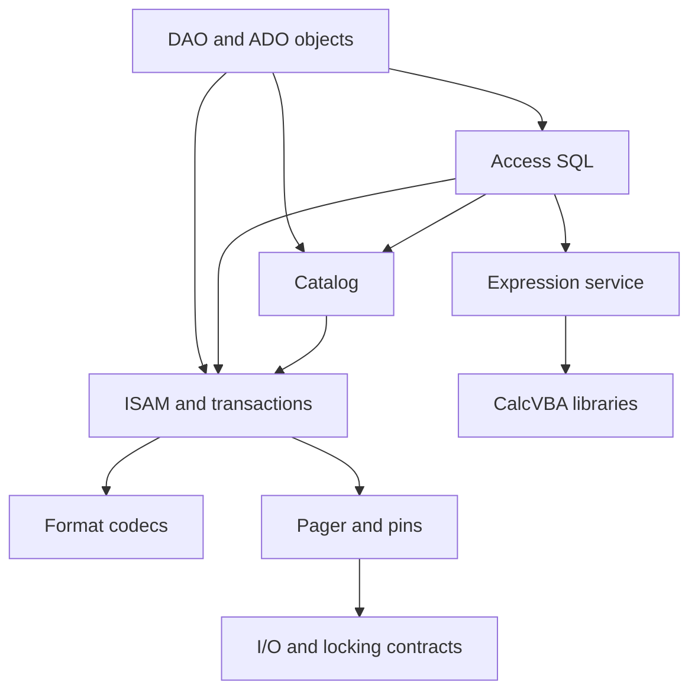

# I-01. Architecture and compatibility boundaries

Revision 1 · Stage 1, response 1 · 2026-11-12

## One engine, explicit boundaries

CalcDb is a set of libraries implementing Jet 4 MDB and ACE ACCDB files, Access SQL, DAO and subsequently ADO. One ISAM layer owns tables, indexes, cursors and mutations. SQL and the object models use that layer; a DAO table recordset never goes through SQL merely to reach a row. One expression service uses CalcVBA's value, conversion and function libraries without requiring its interpreter. These boundaries are **D-ARCH-1, already decided** by the one-pager.[^scope]

The file format, native catalog representation, index-key bytes and observable ACE behavior are compatibility constraints. Cache policy, buffer ownership, lookup structures and query operators are CalcDb choices. A refused in-scope operation remains a compatibility failure; safe refusal during development does not remove it from the scope. Jet 3, server roles and a private SQL dialect are excluded; preserved Access front-end objects remain readable and are never executed.

**Figure F-01 — library dependencies.** Arrows mean “depends on”; shared values, descriptors, typed errors and effect-interface contracts are foundational and omitted from the arrows. This is Mermaid source, not render-verified.

The composition root supplies native or simulated adapters to those contracts. COM adapters expose the object models through real interfaces on every platform. Windows uses system COM services; other platforms use the stand-in defined by CalcVBA. The format, ISAM, catalog, expression and SQL libraries contain no platform I/O: they consume supplied page/value services, compile for wasm32, and never discover a filesystem or scheduler themselves. Catalog bootstrap uses ISAM primitives with explicit descriptors, so ISAM does not depend back on the SQL catalog.

## Calls, resources and validity

A blocking public call borrows an operation context containing effect services, cancellation state and resource budgets. The normal scalar DAO path needs no allocated task or message. Call scope owns scratch buffers and temporary pins; cursor, transaction and connection scopes own retained state. Handles include an owner and generation where storage can be reused. A pointer can remain allocated after its catalog or transaction meaning has expired; memory lifetime and semantic validity are separate checks.

All time, I/O, entropy and scheduling effects cross injected interfaces. Workers, when justified, join the owning call and reproduce its serial result, including row order, Double accumulation, effects and error selection. VBA runs on the caller thread outside internal locks. These are fixed contracts, not a recommendation for a new runtime. The cleared reports contribute reservation, generation and replay mechanisms; their concurrency architectures do not become requirements.[^notes]

The common internal failure carries operation, object, phase and any uncertain persistent effect. DAO/ADO adapters translate it into the evidenced public error and collection state. Resource cleanup must not erase an uncertain write outcome or destroy a COM object still referenced by a client.

## Compatibility baseline and cost discipline

**D-ORACLE-1 is now decided:** the initial Windows oracle is the user-reported ACE **16.0.20527.20016**, read from `ACEDAO.DLL` under `C:\Program Files\Microsoft Office\root\Office16\`. This establishes the selected target, not an execution result. Captures must also identify the actually loaded binaries, x64 process, Access host build, file format, locale, sort descriptor and options. Windows interop is tested separately on installed .NET Framework 4.8-family and .NET 10 LTS; success on one runtime does not establish the other.[^net]

Priority is DAO row loops, then bulk SQL, then browser memory and storage costs. Record per-path allocations, copied/decoded bytes, page traffic, retained bytes, synchronization and COM crossings. Preserve a direct scalar path while allowing batch consumers to share the same storage primitives. Initial process modes are genuine exclusion and many readers with no writer; later read-beside-ACE and shared-writing modes fit the same lock interface. Future encryption, links and providers attach at explicit boundaries rather than introducing a second engine.

Refine the module boundaries only for a demonstrated contract or measured cost conflict; the one-engine requirement remains fixed. Dependency checks, equivalent DAO/SQL storage traces, and a wasm32 core build validate the boundary; they do not establish ACE compatibility. R-ORACLE-1 and R-ACT-1 establish that separately.

[^scope]: Supplied `calcdb-one-pager.md`, Draft 2, principles 1–11; `calcvba-integration-note.md`, “Values and strings,” “COM,” and “Calls and threads.” The user's canonical-VARIANT and 2026-11-12 scope corrections take precedence.
[^notes]: Supplied `asupersync.stage1.part1.md` §§1, 3, 6, 8; part 2 §§2–4; part 4 §§3–4; `frankensqlite.stage1.part3.md` §§8, 10. Concept input only.
[^net]: User-supplied target/build declaration, 2026-11-12. Microsoft, [.NET support policy](https://dotnet.microsoft.com/en-us/platform/support/policy), accessed 2026-11-12, confirms .NET 10's LTS classification; it supplies no observation about the user's installed runtime.
