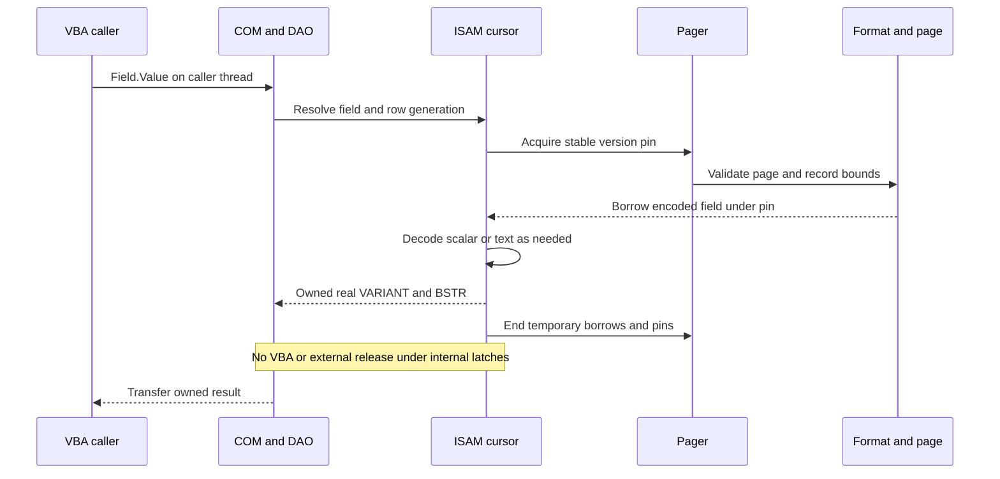

# I-02. Values, strings and ownership

Revision 3 · Part I review and Stage 2, response 1 · 2026-11-13

**Requirement trace:** Primary: RQ-VAL-01, RQ-VAL-03, RQ-TYPE-01. Shared obligations: RQ-SEM-01, RQ-COM-01, RQ-LATE-03, RQ-FMT-03, RQ-VAL-02, RQ-CONC-01, RQ-PORT-03, RQ-PERF-01, RQ-PERF-02. Full requirement text and Part II ownership are in I-16.

## Semantic values and physical encodings

**D-VALUE-1 — Decided representation; provisional package.** The shared semantic value is the platform's real Automation `VARIANT`, with real BSTRs and the common CalcVBA conversion/function implementation. On Windows x64 that VARIANT is **24 bytes**, not 16. The present CalcVBA implementation has its own 16-byte value and converts at the COM boundary; the user reports that CalcVBA is being corrected. CalcDb's design assumes the corrected, exact platform layout. It does not preserve the present compact value as a second semantic representation or add a translation facade around it. Prefer a common foundation package without an interpreter dependency; I-FOUNDATION-1 settles placement and verifies declarations, layout, alignment, tags and calling conventions for every target.[^values]

This section satisfies **RQ-VAL-01** and the representation part of **RQ-TYPE-01** through **K-VALUE**. Target layout and shared semantics are decided; package placement remains provisional. A dependency cycle requires a shared-foundation correction, not duplicated CalcDb coercions.

A physical field view is an encoding reference, not another semantic value system. Its descriptor retains native type, width, precision/scale, flags and collation. Decode into shared values only when an operation needs them. Keep Null, Empty, zero-length text, missing arguments and error values distinct; a row's representation of a database Null does not authorize all those states on disk.

| Native content | Required representation rule |
| --- | --- |
| Yes/No, Byte, Integer, Long and Large Number | Decode native storage according to the field descriptor, then construct the appropriate shared value; no memcpy into a VARIANT. |
| Single, Double, Date, Currency, Decimal | Preserve original storage and exact supported precision; invoke the shared conversion rules only at the requested semantic boundary. |
| Text, Memo, Hyperlink and textual properties | Preserve arbitrary UTF-16 code units, original encoded bytes when untouched, and distinctions between Null and empty text. |
| Binary, OLE, GUID and AutoNumber metadata | Retain native bytes and type/identity semantics; a display string or integer is not their complete representation. |
| Extended date/time | Retain the full native temporal payload/precision; establish shared operations and the DAO/ADO projection through R-FMT-2 and R-DAO-1 before permitting conversion to Date. |
| Complex fields, later | Preserve descriptors, raw payloads and child-storage ownership now; implement their semantic adapters in the later phase. |

Extended date/time remains an initial scalar requirement. If its evidenced operations need more than today's shared types, I-FOUNDATION-1 specifies the necessary shared-library extension; CalcDb must not invent private coercions or silently narrow precision. Complex fields remain later. Unknown representations are preserved, and unsupported operations remain visible failures.

## Four string lifetimes

**D-STRING-1 — Provisional.** Retain encoded row bytes under a page pin, decode fields lazily, and create an owned BSTR when the public contract requires it. Prefer direct final-BSTR construction for one read and bounded scratch for demonstrated reuse; R-STRING-1 confirms or changes that split. Do not convert rows wholesale to UTF-8 or normalize their text. The storage codec handles compressed-Unicode representations; the semantic layer consumes the resulting UTF-16. This implements **RQ-VAL-03**, **K-STRING** and the borrowed-view part of **K-PAGE**.[^physical]

**Figure F-03 — string ownership and lifetime mapping.** The table identifies where a borrow becomes an owned public value.

| Representation | Owner and lifetime | Allocation/copy rule |
| --- | --- | --- |
| Encoded field slice | Cursor's pinned page version and row generation | Borrow after bounds checks; no field allocation. |
| Decoded UTF-16 view | Cursor or operator scratch, with explicit generation | Reuse capacity; invalidate before overwrite or movement. |
| Native index-key bytes | Key buffer or pinned decoded index page | Independent of a BSTR; preserve native key encoding. |
| Public BSTR/SAFEARRAY/VARIANT | Caller or callee as specified by the COM contract | Allocate/copy/transfer through the matching Automation service; release through the same service. |

On Windows the BSTR allocator is OLE Automation; elsewhere it must be CalcVBA's compatible service, which is still to be supplied with the portable COM stand-in. Native text decoding/construction uses explicit lengths, preserving embedded U+0000 rather than scanning for a terminator. General inbound BSTR capture/copy additionally preserves exact byte length, including odd-length binary payloads; II-02 separates that ABI obligation from text coercion. Public strings never alias page frames or reusable decode scratch. Copies of owned Automation values follow their proper deep-copy/reference rules; an object-valued result has the required COM reference. An incoming by-reference value is used only within its documented lifetime. Its pointer must not become retained cursor or plan storage, and an operation's required by-reference writeback must not be replaced by an unrelated value copy.[^values][^automation]

Each cursor carries a row-generation stamp, field offsets and a compact validity bitmap for decoded fields, with checked growth when a schema exceeds inline capacity. Repeated `Fields("x")` lookup may cache the resolved ordinal against the collection/schema generation and applicable comparison context. The cache memoizes ACE's resolution behavior, including ambiguity or duplicate-name behavior established by R-DAO-1; a strict host-language dictionary must not redefine it.

## Allocation and boundary costs

**Figure F-02 — one DAO field call from VBA to native storage.** This is the proposed ownership path, not an observed ACE trace. Mermaid source only; not render-verified. A pin retains bytes; an internal latch protects a short state transition; neither authorizes a foreign writer or extends a public value's borrow.

The public result survives cursor movement and Close. A callback, when an operation requires one, receives stable values after internal latches are released; reentry is followed by generation validation. The figure omits query planning because an ordinary DAO field read reaches the shared cursor directly. **K-COM**, **K-THREAD** and **K-CURSOR** supply the corresponding boundary and continuation rules; II-02 gives the construction algorithms.

For a resident scalar field, the design target after cursor initialization is a checked offset load and construction of a scalar shared value, without heap allocation or an atomic reference-count operation for the field. This is a path hypothesis to measure, not a benchmark claim. `Fields("x").Value` also incurs the object's actual name lookup and COM calls; early-bound and dispatch paths are measured separately, with their observed crossing counts.

For a text value needed once as a BSTR, prefer sizing and decoding directly into the final owned result. Where the same value feeds comparisons, predicates or repeated reads, cursor-local UTF-16 scratch may avoid repeated decoding at the cost of retained capacity and a later BSTR copy. R-STRING-1 compares those paths using short, long, mixed-compression and repeatedly accessed values, recording allocations, decoded units, copied bytes and pinned working set. Choose the cheaper path for the priority DAO loop without changing ownership or returned values; SQL may retain its own bounded batch scratch.

Under **K-ADMISSION**, reserve the output budget before allocating a large value. Charge an allocation once to its owner and separately account for page bytes retained by borrowed slices. A Memo can be consumed in bounded chunks by an interface permitting streaming; a property requiring one BSTR still requires a complete owned result. Never pretend a streaming internal reader removes that obligation.[^memory]

Before calling VBA or another external callback, release internal locks and provide stable owned or immutable arguments. On return, validate generations before continuing a retained cursor operation. R-STRING-1, R-EXPR-1 and R-DAO-1 test values, ownership, error behavior and allocation traces; ABI tests cover both Windows .NET families and the portable stand-in. Passing a scalar round trip alone does not establish BSTR, Decimal, SAFEARRAY or object lifetime correctness.

## Experiment summary

The full card is in [Appendix A-02](A-02-experiments.md); I-15 defines evidence discipline. No target-build observations are claimed.

### R-STRING-1 — DAO value materialization, reuse and ownership

Provisionally use direct owned BSTR construction for a single field read and bounded scratch only where measured reuse pays; reject any candidate with different values, errors or lifetime behavior, then choose by allocations, decode/copy work and retained memory. Dependencies are R-ORACLE-1 capture and I-FOUNDATION-1's minimal ABI/ownership fixture, not a complete DAO or SQL implementation; size **M**, beginning with a resident-row loop and retained BSTRs. The full fixture, captures and outcome branches are in **A-02, R-STRING-1**.

[^values]: Supplied `calcvba-integration-note.md`, “Values and strings,” corrected by the user's Part I review: current CalcVBA value is its own 16-byte form; target shared value is the exact platform VARIANT and BSTR. Microsoft [VARIANT structure](https://learn.microsoft.com/en-us/windows/win32/api/oaidl/ns-oaidl-variant), S-MS-VARIANT, and [x64 ABI conventions](https://learn.microsoft.com/en-us/cpp/build/x64-software-conventions?view=msvc-170), S-MS-X64ABI, accessed 2026-11-13, support the Windows x64 layout derivation in II-02. No target execution is implied.
[^automation]: Microsoft [BSTR](https://learn.microsoft.com/en-us/previous-versions/windows/desktop/automat/bstr), S-MS-BSTR; [SysAllocStringByteLen](https://learn.microsoft.com/en-us/windows/win32/api/oleauto/nf-oleauto-sysallocstringbytelen), S-MS-SYSALLOCSTRINGBYTELEN; [SysStringByteLen](https://learn.microsoft.com/en-us/windows/win32/api/oleauto/nf-oleauto-sysstringbytelen), S-MS-SYSSTRINGBYTELEN; [VariantCopy](https://learn.microsoft.com/en-us/windows/win32/api/oleauto/nf-oleauto-variantcopy), S-MS-VARIANTCOPY; [VariantCopyInd](https://learn.microsoft.com/en-us/windows/win32/api/oleauto/nf-oleauto-variantcopyind), S-MS-VARIANTCOPYIND; [VariantClear](https://learn.microsoft.com/en-us/windows/win32/api/oleauto/nf-oleauto-variantclear), S-MS-VARIANTCLEAR. Documentary ownership contracts, accessed 2026-11-13; exact-material reuse status is recorded in A-01, with no code adopted.
[^physical]: Jackcess, live official [ColumnImpl.java xref](https://jackcess.sourceforge.io/xref/com/healthmarketscience/jackcess/impl/ColumnImpl.html), selected Boolean and text codec passages, accessed 2026-11-12. Reference facts, not target-ACE observations; exact source revision pending. See I-04 for the bounded decoder.
[^memory]: Supplied `asupersync-report.stage1-part2.md` §2 and `asupersync-report.stage1-part4.md` §§4–5; `frankensqlite-report.stage1-part2.md` §§4–7. Reviewed concept input for admission, scratch reuse and ownership costs, not requirements or measured CalcDb performance.
