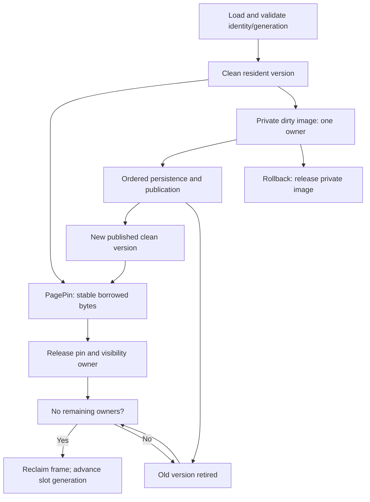

# I-03. VFS, pager and page cache

Revision 7 · Stage 2, response 13 · 2026-11-14

**Requirement trace:** Shared obligations: RQ-PROD-06, RQ-LOCK-01, RQ-LOCK-02, RQ-LATE-01, RQ-STORE-01, RQ-VAL-03, RQ-CONC-01, RQ-CONC-02, RQ-SIM-01, RQ-PORT-01, RQ-PERF-01, RQ-PERF-02, RQ-STORE-04, RQ-STORE-05. Full requirement text and Part II ownership are in I-16.

## Synchronous I/O with explicit outcomes

**D-PAGER-1 — Recommended.** Use a blocking, capability-based VFS and a pager with explicit pins and privately owned dirty frames. A file handle carries verified identity, access mode and capabilities; a path is only an opening instruction. Checked offset arithmetic precedes every request. The interface exposes positioned reads/writes, size/extension/truncation, temporary-file operations, durability requests and a separate locking service. Native, browser and deterministic adapters implement the same outcome contract; unsupported durability or locking capability must not be reported as achieved.

The browser VFS also handles files first requested during a blocking call. Preopened handles cover admitted files; dynamic OpenDatabase/CreateDatabase calls and temporary-file expansion can require asynchronous handle acquisition. The provisional D-WASM-1 adapter uses a dedicated VFS worker that owns those handles and services an engine-worker rendezvous through same-agent-cluster SharedArrayBuffer/Atomics capabilities tested by R-WASM-1. I-14 specifies ownership, timeout and uncertain-completion handling. The engine retains the synchronous contract above.

**K-IO:** every I/O result preserves the backend count separately from proved completed progress and whether further persistent effects are uncertain. A returned short-write count becomes an exact reusable prefix only for a qualified adapter; the browser specification leaves partial-write ordering underspecified, so an unqualified short write retains the entire attempted range as possibly changed and stops.[^browser-progress] A short write followed by an error is not “no change.” The coordinator retains the operation state until it can return a supported outcome; cancellation neither reverses a write nor licenses retrying the entire mutation. Submission order, ordinary completion, a requested flush, flush completion, public acknowledgement and later survival are distinct events. Microsoft documents a specific `dbForceOSFlush` option; actual survival on the selected ACE build remains R-CRASH-1/2 evidence.[^commit]

## Frames, pins and bounded ownership

**K-PAGE:** use contiguous frame storage addressed through a sparse page map, so memory grows with resident pages rather than the highest page number. A pinned frame's backing bytes never move: cache growth adds stable storage, and handles resolve before a borrow begins. A frame identity includes file incarnation, page number and version. A frame handle also has a slot generation; a completion for an old use of a slot cannot publish into its replacement. A `PagePin` retains bytes and the correct visibility version, but does not authorize a write or establish an external file lock. Each private dirty image has one transaction owner.

Resolve a visibility token to a per-page image identity before cache lookup, so unchanged pages remain shared across commits. Before selecting the preservation set or invalidating a native image source, the initial one-writer coordinator claims a logical fresh-view admission hold under the same short synchronization used to select and register views. Existing registered views continue; fresh required-current selections wait or take the selected public continuation. Reserve preservation capacity before freezing sources, then drain active source reads and preserve old images needed by pins, history, rollback owners or pending targets/load tokens, including targets that have not acquired a native read permit. A clean frame is discardable only while a valid reload source remains.

The hold can span I/O; no metadata latch does. Release or convert it only at I-08/II-08's selected logical or failure boundary, which may retain restricted admission after uncertainty. Keep the writer's input ownership before claiming its hold; do not self-wait through fresh-view admission or a destructor callback. Reentrant destruction is deferred to an owner-safe boundary or follows the selected same-attempt continuation, never unconditional reopening. II-03/II-09 give the source, admission and reclamation algorithms. The recommended Windows adapter is buffered positioned I/O with owned event-based overlapped requests beneath the blocking interface.

Choose a simple CLOCK-style replacement policy initially, with sequential-scan admission kept separate from frequently reused pages. Its tuning is provisional under I-15's workload method. Dirty frames and pinned versions are not ordinary eviction candidates. A cursor retains its current page pin across field reads, avoiding a repeated map lookup or latch operation for each resident field. Exclusive mode bypasses shared-path coordination after real exclusion is acquired. Shared mode coalesces concurrent misses, performs I/O outside metadata latches, then validates identity/generation before publication.[^cache]

**Figure F-04 — page ownership, publication and reclamation.** Mermaid source emitted; not render-verified. This is a lifetime diagram, not an assertion that every cursor requires a snapshot.

**K-ADMISSION:** budget cache frames, dirty images, historical versions, long-value scratch and temporary spill separately. Reserve capacity before constructing work. Large transactions may spill private staging/before-images to owned temporary storage; these support live transaction handling. Do not flush an uncommitted database page merely to free memory. The preferred writer stages it until I-08's persistence program permits a write; any earlier spill to the database requires separate ACE evidence. Allocation failure before publication releases reservations; failure after a write preserves progress and uncertainty.

In-process readers retain immutable versions only when their visibility contract requires them. Single-owner reads and writes do not pay mandatory epoch registration or atomic reference counting per scalar access. Transactions identify which version a writer reads and which private frame it modifies; publication and reclamation follow I-08/I-09. Closing an owner settles pins and work without erasing externally referenced COM objects.

## Persistence contract and optional undo

**D-UNDO-1 — Decided. K-CRASH:** after a CalcDb crash, the next ACE, Access or CalcDb opener must find a state no worse than an ACE crash at the corresponding logical point, with the same rules for surviving commits, including `dbForceOSFlush`. ACE-first opening must be safe without running CalcDb first. If ACE leaves a needs-repair state, CalcDb reproduces the evidenced behavior; optional undo adds no stronger baseline guarantee.[^correction]

**D-WRITE-1 — Provisional**, specified in I-08, gives the writer a concrete starting direction: prepare privately; initialize unreachable pages; publish allocation ownership; remove obsolete index references, publish row/LV changes and install new index references; publish catalog changes; free unreachable storage last; then resolve the native logical/flush/acknowledgement transitions. Any native in-progress or needs-repair marker uses only an evidenced field and meaning. II-03 provisionally starts with complete initialized/phase page transfers, while retaining explicit spans so R-FMT-2/R-CRASH-1 can select native granularity; no page transfer is assumed atomic. The pager executes that dependency program, reports effects and retains required images; it does not infer a safe persistence order from buffered write completion. R-FMT-2, R-TXN-1 and R-CRASH-1/2 confirm or change the program.

### Whole-database optional-undo eligibility

The optional undo record is sealed before its covered database writes. It records the database identity/incarnation, operation, rollback eligibility, record integrity, before and intended file lengths, and a manifest partitioning **every database page in the union of the before/intended extents** into covered pages C and uncovered pages U. Headers, allocation/usage maps, indexes and catalog pages are included; no database range is unchecked. U records each page's baseline fingerprint. C retains each complete before-image and the complete intended new image or its fingerprint, with page lengths and explicit ABSENT states for pages created or removed by the operation.

At recovery, acquire exclusion, verify the same file identity and the complete record, then read the entire current database. **Every uncovered page must be unchanged; every covered page must equal either its before-image or its intended new image. Otherwise discard the undo record before making any recovery write.** Compare full bytes where images are retained and recompute the recorded fingerprints from the full read elsewhere. The current file length, page presence and partial final-page length must match a recorded before or intended alternative consistent with those page checks. An unrecorded extent, intermediate length, torn/third page image, identity mismatch or corrupt record rejects the whole operation. A mix of complete before/new pages is permitted; a mixed image within one page is not.

This is the user's selected external-change check. It does not claim that equal bytes prove an absence of past external activity, and it requires no continuous history witness or USN journal. The check may conservatively reject CalcDb's own interrupted intermediate page image if it is neither recorded alternative. The native crash baseline then applies without private recovery.

An otherwise matching sidecar must never undo a commit that the native baseline requires to survive, whether or not the caller received success. Rollback eligibility must therefore be durably disarmed before submission of the first effect that can cross the earliest evidenced commit-survival frontier for that operation and declared fault model; waiting for that effect to complete or for the API to return is too late. Record creation, disarm failure, the native frontier, acknowledgement and interrupted disposal belong to the coordinator's outcome protocol. This must preserve ACE's ordinary and forced-flush survival classes, without silently forcing additional native database durability. If the frontier or sound eligibility/disarming cannot be established with those properties for an operation/backend, leave optional undo disabled there. Absence, rejection or interruption of optional recovery never weakens ACE-first safety; each recovery write cut must independently satisfy the native baseline.

File identity comes from the opened handle and the backend's supported identity contract, with reuse/incarnation limitations recorded. A path or timestamp alone is insufficient; the Windows identity documentation describes filesystem-specific limitations.[^identity] The full-read predicate above is identical to I-08's and replaces the earlier history-witness proposal.

**D-UNDO-2 — Provisional.** Prefer a bounded, immutable private record and one-shot optional restoration: finish the full audit, compile and reserve a qualified native rollback program, then durably disarm before the first recovery database write. Begin with single-file complete-before restoration profiles; native effects that must survive rollback disable that profile. A second crash uses the already required native baseline. A failed seal or retirement can leave a credible Armed record, so its owned retirement obligation must settle before later conflicting work. II-08 supplies the codec, state machine and failure paths; R-CRASH-2 confirms or changes this protocol without changing D-UNDO-1's predicate.

## Evidence and bounded writer development

The initial W-PROBE captures actual ACE I/O independently of a CalcDb writer. It starts with native open/read/lock/fault facilities and attempts complete write-point instrumentation as a separate increment. R-CRASH-1/2 preserve main-file, lock-file and TEMP evidence before independent ACE, Access, Compact & Repair and CalcDb reopening branches. Match logical phase, acknowledged calls and established persistence milestones, not equal write ordinals. Process death, OS/power loss and torn-storage faults remain distinct models.[^traces]

If complete ACE tracing proves impossible, continue the bounded native writer direction in I-08: exhaustive CalcDb persistence-cut simulation plus externally bracketed ACE interruptions and native-state analysis. Qualify only operation/environment cases supported by the resulting evidence, and identify incomplete cases. The missing trace does not halt all writer implementation or authorize an invented recovery format. Pager verification separately checks pin conservation, stale-handle rejection, bounded retention and partial-I/O outcomes.

**Experiment summary.** R-CRASH-1 selects ordering, survival and repair states; R-CRASH-2 selects exhaustion/uncertainty and optional-undo handling, using R-TXN-1 and operation-specific format evidence. Their full cards are in [A-02-experiments.md](A-02-experiments.md); all remain unexecuted against the selected ACE build in this session.

Source identifiers and exact-material/licence records resolve in [A-01-sources.md](A-01-sources.md).

[^commit]: [S-MS-TXN] Microsoft, [Workspace.CommitTrans](https://learn.microsoft.com/en-us/office/client-developer/access/desktop-database-reference/workspace-committrans-method-dao), updated 2022-03-18, read 2026-11-13. Documentation is not an execution capture of ACE 16.0.20527.20016.
[^cache]: [L-FRANK-1], [L-FRANK-2], [L-ASYNC-2], [L-ASYNC-5] Supplied `frankensqlite-report.stage1-part1.md` §§4, 7; `frankensqlite-report.stage1-part2.md` §§4–7; `asupersync-report.stage1-part2.md` §§2–4; `asupersync-report.stage1-part5.md` §7. Cleared concept input, not requirements or transferred performance claims.
[^correction]: User's Stage 0 approval/Q1 and Part I review of 2026-11-13; the review selects the whole-file before/intended-image check and keeps private recovery optional.
[^identity]: [S-MS-FILEID] Microsoft, [BY_HANDLE_FILE_INFORMATION](https://learn.microsoft.com/en-us/windows/win32/api/fileapi/ns-fileapi-by_handle_file_information), updated 2021-04-02, read 2026-11-13.
[^traces]: [L-ASYNC-4], [L-FRANK-3], [S-MS-FILTER] Supplied `asupersync-report.stage1-part4.md` §§7–8 and `frankensqlite-report.stage1-part3.md` §§8, 10; Microsoft, [Registering preoperation and postoperation callback routines](https://learn.microsoft.com/en-us/windows-hardware/drivers/ifs/registering-preoperation-and-postoperation-callback-routines). The API permits instrumentation; its completeness must be demonstrated.

[^browser-progress]: [S-WEB-FS] WHATWG, [File System Standard, sync-handle write](https://fs.spec.whatwg.org/#dom-filesystemsyncaccesshandle-write), live text inspected 2026-11-14: the write algorithm explicitly leaves write order and partial-write results underspecified. [II-14](II-14-platforms.md) supplies the qualified adapter and browser acceptance cases; no browser result is claimed.
