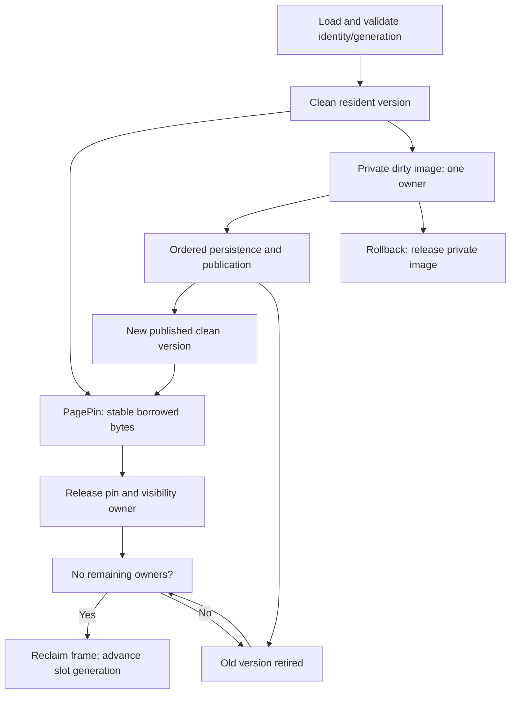

# I-03. VFS, pager and page cache

Book **v1.1** · 2026-11-16 · [Release record](00-book-release.md).

**Requirement trace:** Shared obligations: RQ-PROD-06, RQ-LOCK-01, RQ-LOCK-02, RQ-LATE-01, RQ-STORE-01, RQ-VAL-03, RQ-CONC-01, RQ-CONC-02, RQ-SIM-01, RQ-PORT-01, RQ-PERF-01, RQ-PERF-02, RQ-STORE-04, RQ-STORE-05. Full requirement text and Part II ownership are in I-16.

## Synchronous I/O with explicit outcomes

**D-PAGER-1 — Recommended.** Use a blocking, capability-based VFS and a pager with explicit pins and privately owned dirty frames. A file handle carries verified identity, access mode and capabilities; a path is only an opening instruction. Checked offset arithmetic precedes every request. The interface exposes positioned reads/writes, size/extension/truncation, temporary-file operations, durability requests and a separate locking service. Native, browser and deterministic adapters implement the same outcome contract; unsupported durability or locking capability must not be reported as achieved.

The browser VFS also handles files first requested during a blocking call. Preopened handles cover admitted files; dynamic OpenDatabase/CreateDatabase calls and temporary-file expansion can require asynchronous handle acquisition. The provisional D-WASM-1 adapter uses a dedicated VFS worker that owns those handles and services an engine-worker rendezvous through same-agent-cluster SharedArrayBuffer/Atomics capabilities tested by R-WASM-1. I-14 specifies ownership, timeout and uncertain-completion handling. The engine retains the synchronous contract above. A CreateDatabase request carries a checked creation intent: profile/sort arguments select II-06's synthesized new-image recipe, and II-09 obtains an exclusive creation lease for the actual file. The pager executes the resulting initialized pages and records partial creation or extent effects through the same receipts as other writes. Creating a missing path is not ordinary OpenDatabase with an empty header; public failure and remaining-file behavior are R-CAT-1/CAT-NEW and R-DAO-1 cases.

**K-IO:** every I/O result preserves the backend count separately from proved completed progress and whether further persistent effects are uncertain. A returned short-write count becomes an exact reusable prefix only when the adapter's evidence proves that meaning. R-CRASH-1/CRASH-PARTIAL tests the resulting receipt distinction; R-WASM-1/WASM-PROGRESS decides the browser-specific claim. The browser specification leaves partial-write ordering underspecified, so an unqualified short write retains the entire attempted range as possibly changed and stops.[^browser-progress] A short write followed by an error is not “no change.” The coordinator retains the operation state until it can return a supported outcome; cancellation neither reverses a write nor licenses retrying the entire mutation. Submission order, ordinary completion, a requested flush, flush completion, public acknowledgement and later survival are distinct events. Microsoft documents a specific `dbForceOSFlush` option; actual survival on the selected ACE build remains R-CRASH-1 evidence.[^commit]

A broker's disappearance is not a terminal I/O result. K-BROWSER matches response session/request/handle generations before the pager adopts bytes, and gives an observed session failure priority over Done. The initial browser failure path ends the caller/broker cohort while the host retains unresolved effects; the blocked DAO/ADO call does not return a guessed storage error in the abandoned caller. Returning an error while unresolved work survives is an alternative only with proved owner transfer and revoked file bindings. Neither path publishes an incomplete/stale page, retries a whole mutation or reuses the old mailbox from a timeout alone. II-14 §6–§8 and R-WASM-1/WASM-MAILBOX/WASM-BROKER-LOSS decide this adapter boundary.

## Frames, pins and bounded ownership

**K-PAGE:** use contiguous frame storage addressed through a sparse page map, so memory grows with resident pages rather than the highest page number. A pinned frame's backing bytes never move: cache growth adds stable storage, and handles resolve before a borrow begins. A frame identity includes file incarnation, page number and version. A frame handle also has a slot generation; a completion for an old use of a slot cannot publish into its replacement. A `PagePin` retains bytes and the correct visibility version, but does not authorize a write or establish an external file lock. Each private dirty image has one transaction owner. Several Workspace/Connection lockers may hold private overlays at once. A per-file publication gate coordinates only the attempt that is refreshing the committed base, preserving old sources and publishing; it is not held for the lifetime of a transaction.

Data-page interpretation keeps reader bounds separate from creator policy. A one-byte row locator addresses 256 slots; the reader validates that structural limit, the directory and every requested extent. The inspected writer's limit 255 stays provisional under R-FMT-2/FMT-SLOTS256 and must not reject a bounded slot 255 read (II-03 §3.3).

Resolve a visibility token to a per-page image identity before cache lookup, so unchanged pages remain shared across commits. Before selecting the preservation set or invalidating a native image source, the resolving publication attempt claims a logical fresh-view admission hold under the same short synchronization used to select and register views. Existing registered views continue; fresh required-current selections wait or take the selected public continuation. Reserve preservation capacity before freezing sources, then drain active source reads and preserve old images needed by pins, history, rollback owners or pending targets/load tokens, including targets that have not acquired a native read permit. A clean frame is discardable only while a valid reload source remains.

The hold can span I/O; no metadata latch does. Release or convert it only at I-08/II-08's selected logical or failure boundary, which may retain restricted admission after uncertainty. Keep the writer's input ownership before claiming its hold; do not self-wait through fresh-view admission or a destructor callback. On successful publication, release the fresh-view hold and publication gate before draining deferred interface releases outside latches. Failure keeps the selected restrictions; reentrant cleanup cannot reopen an unsafe source merely to make progress. II-03/II-09 give the source, admission and reclamation algorithms. The recommended Windows adapter is buffered positioned I/O with owned event-based overlapped requests beneath the blocking interface.

Choose a simple CLOCK-style replacement policy initially, with sequential-scan admission kept separate from frequently reused pages. Its tuning is provisional under I-15's workload method. Dirty frames and pinned versions are not ordinary eviction candidates. A cursor retains its current page pin across field reads, avoiding a repeated map lookup or latch operation for each resident field. Only a genuinely single-owner cache path can omit shared metadata synchronization. Concurrent in-process callers or workers retain coordination regardless of external file exclusion: coalesce concurrent misses, perform I/O outside metadata latches, then validate identity/generation before publication.[^cache]

**Figure F-04 — page ownership, publication and reclamation.** This is a lifetime diagram, not an assertion that every cursor requires a snapshot.

**K-ADMISSION:** budget cache frames, dirty images, historical versions, long-value scratch and temporary spill separately. Reserve capacity before constructing work. Large transactions may spill private staging/before-images to owned temporary storage; these support live transaction handling. Do not flush an uncommitted database page merely to free memory. The preferred writer stages it until I-08's persistence program permits a write; any earlier spill to the database requires separate ACE evidence. Allocation failure before publication releases reservations; failure after a write preserves progress and uncertainty.

In-process readers retain immutable versions only when their visibility contract requires them. Single-owner reads and writes do not pay mandatory epoch registration or atomic reference counting per scalar access. Transactions identify each locker, its admitted logical resource claims, its base version and the private frame it modifies. Native page/record conflicts use ACE's finite retry/error policy. Before later publication, reapply accepted deltas to the newly published base without replaying user effects; publication and reclamation follow I-08/I-09. Closing an owner settles pins and work without erasing externally referenced COM objects.

## Persistence contract and recorded undo idea

**D-UNDO-1 — Decided. K-CRASH:** after a CalcDb crash, the next ACE, Access or CalcDb opener must find a state no worse than an ACE crash at the corresponding logical point, with the same rules for surviving commits, including `dbForceOSFlush`. ACE-first opening must be safe without running CalcDb first. If ACE leaves a needs-repair state, CalcDb must reproduce the corresponding behavior. This remains the goal; exact classification and its pass conditions are settled during implementation.[^correction]

**D-WRITE-1 — Provisional**, specified in I-08, starts with **one final image per physical page per publication unit**. Compose the transaction's accepted deltas over the current committed base before sealing those images. Prefer CRASH-ORDER-DATA: initialize new targets, then write final data, final indexes, required catalog pages and final existing maps before native resolution. Compare index-before-data and map-before/map-after alternatives through R-CRASH-1. A final map can combine allocation and release, so these are candidates to test, not claims that every intermediate graph is clean. Repeated-image programs remain a fallback if observations require them. Marking, extent, logical commit, requested flush and acknowledgement remain explicit effects; no spare byte becomes an invented commit or repair marker. The pager executes the chosen program and reports exact progress, without treating completion order as persistence order.

**D-UNDO-2 — Retired.** Optional private undo remains a recorded idea, to reconsider only if real write programs show a useful recovery window. There is no planned sidecar codec, state machine or R-CRASH-2 implementation. Required rollback, spill failure and uncertain-write handling remain ordinary transaction/pager work.

D-UNDO-1's conditional eligibility rule is unchanged if that idea is reconsidered. A record must identify the opened file and cover every page in the union of its before and intended extents, including headers, maps, indexes and catalog pages. At recovery, read the whole database under exclusion: **every uncovered page must be unchanged, and every covered page must equal either its before-image or its intended new image; otherwise discard without applying it.** Full stored bytes, page presence, partial-page lengths and before/intended extent alternatives are checked. A third or torn page image rejects the record. The check does not prove an absence of past activity that left identical bytes. No record may undo a commit that ACE's baseline requires to survive or weaken ACE-first recovery. These constraints do not reinstate the retired mechanism.

File identity comes from the opened handle and its supported identity contract; a path or timestamp alone is insufficient.[^identity] Live rollback uses the owning locker's retained deltas and scope images, preserving other lockers' changes. It does not restore a whole old native page merely because the file is physically exclusive across processes.

## Evidence and bounded writer development

W-PROBE observes ACE independently of a CalcDb writer. The preferred crash investigation records writes, extent changes and flushes with their contents, preserves database/lock-file and relevant TEMP evidence, and reconstructs candidate crash images offline. Export CalcDb cut images and give both engines' candidates to the same independent ACE, Access and Compact & Repair first-openers. Observation/control tooling may include a kernel driver; proprietary decompilation remains prohibited. Process death, OS/power loss and torn-storage faults remain distinct models.[^traces]

Complete classification is ambitious. If complete tracing proves unavailable, continue the stated direction with the available payload traces, reconstructed images, controlled interruptions and explicit coverage limits. What that evidence can establish, and how to treat writes whose classes remain unresolved, is implementation work under PRD-07. Missing traces neither prove parity nor imply a new recovery format. Pager verification separately checks pin conservation, stale-handle rejection, bounded retention, independent local overlays and partial-I/O outcomes.

**Experiment summary.** R-TXN-1/TXN-LOCAL determines local locker conflicts, finite retry/error behavior, visibility and both resolution orders. R-CRASH-1 compares writer-order/timing alternatives and interrupted states through the native openers; ordinary exhaustion and uncertainty stay in R-TXN-1/R-CRASH-1 after R-CRASH-2 retirement. Full cards are in [A-02-experiments.md](A-02-experiments.md). All remain specified, not run.

Source identifiers and exact-material/licence records resolve in [A-01-sources.md](A-01-sources.md).

[^commit]: [S-MS-TXN] Microsoft, [Workspace.CommitTrans](https://learn.microsoft.com/en-us/office/client-developer/access/desktop-database-reference/workspace-committrans-method-dao), updated 2022-03-18, read 2026-11-13. Documentation is not an execution capture of ACE 16.0.20527.20016.
[^cache]: [L-FRANK-1], [L-FRANK-2], [L-ASYNC-2], [L-ASYNC-5] Supplied `frankensqlite-report.stage1-part1.md` §§4, 7; `frankensqlite-report.stage1-part2.md` §§4–7; `asupersync-report.stage1-part2.md` §§2–4; `asupersync-report.stage1-part5.md` §7. Cleared concept input, not requirements or transferred performance claims.
[^correction]: [B-SCOPE-11], [U-PRD-01-09], [U-PRW-01-58] The scope statement retains D-UNDO-1's crash/fingerprint requirements; PRD-07 leaves exact crash classification to implementation and PRD-09 retires planned D-UNDO-2. [Scope and context](00-scope.md), §§S4–S5, states the current scope.
[^identity]: [S-MS-FILEID] Microsoft, [BY_HANDLE_FILE_INFORMATION](https://learn.microsoft.com/en-us/windows/win32/api/fileapi/ns-fileapi-by_handle_file_information), updated 2021-04-02, read 2026-11-13.
[^traces]: [L-ASYNC-4], [L-FRANK-3], [S-MS-FILTER] Supplied `asupersync-report.stage1-part4.md` §§7–8 and `frankensqlite-report.stage1-part3.md` §§8, 10; Microsoft, [Registering preoperation and postoperation callback routines](https://learn.microsoft.com/en-us/windows-hardware/drivers/ifs/registering-preoperation-and-postoperation-callback-routines). The API permits instrumentation; its completeness must be demonstrated.

[^browser-progress]: [S-WEB-FS] WHATWG, [File System Standard, sync-handle write](https://fs.spec.whatwg.org/#dom-filesystemsyncaccesshandle-write), live text inspected 2026-11-14: the write algorithm explicitly leaves write order and partial-write results underspecified. [II-14](II-14-platforms.md) and R-WASM-1/WASM-PROGRESS specify the adapter evidence and browser acceptance cases; no browser result is claimed.
