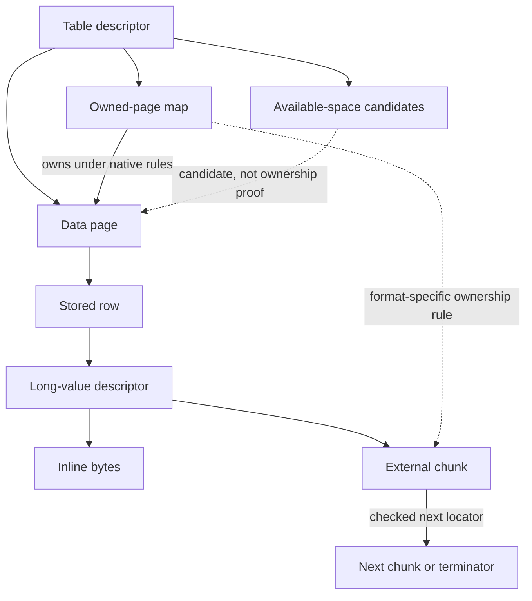

# I-04. Format, rows, long values and allocation

Revision 3 · Part I review · Stage 2, response 1 · 2026-11-13

**Requirement trace:** Primary: RQ-PROD-03, RQ-PROD-04, RQ-PROD-05, RQ-STORE-03, RQ-FMT-01, RQ-FMT-02, RQ-FMT-03. Shared obligations: RQ-LATE-01, RQ-LATE-03, RQ-LATE-04, RQ-OUT-01, RQ-OUT-02, RQ-SRC-01, RQ-ORACLE-02, RQ-STORE-01, RQ-STORE-02, RQ-TYPE-01. Full requirement text and Part II ownership are in I-16.

## One description, independently checked

**D-FMT-1 — Recommended.** The one-description direction is decided; the generation/specialization mechanism is recommended. Maintain one machine-readable format description for each evidenced Jet 4/ACE variant. A rule names its byte order, location, width, conditions, bounds, reference/ownership meaning and evidence source. Generate or specialize reader, writer, validator, inspector and structured fuzz generators from it. Specialization produces direct checked field access; a DAO loop should not interpret a general schema language for every field.

Select an immutable `FormatDescriptor` from verified file-header facts, then pass it explicitly. Keep file-format features, sort descriptors and executable ACE build provenance separate. Jackcess's descriptor defines 4096-byte Jet 4 pages and derives later Access layouts from that family; this supports a common layout framework, not the assumption that all future or unknown variants are understood.[^format] R-FMT-1 confirms the supported signatures, layouts and feature combinations using independently generated Access files. A generated reader, writer and validator can agree on the same wrong description: only independent evidence establishes compatibility.

## Bounded row and text decoding

**Figure F-05a — candidate data-page byte regions.** This is a layout hypothesis for R-FMT-1/2, expressed as bounded intervals rather than guessed numeric offsets. It is an emitted Markdown table, not a render-verified or oracle-confirmed layout.

Let `P` be the selected descriptor's page size; all other symbols below are descriptor fields or values read from checked metadata. The 4096-byte Jet 4 reference observation above does not fix every supported variant. A row below names a candidate region, not its confirmed location relative to every other region.

| Candidate page region | Symbolic byte extent | Interpretation and confirmation needed |
| --- | --- | --- |
| Header | `[0, H)` | Candidate page kind, owner, counts, flags and free-space metadata; field offsets, widths and applicable page types remain to be identified. |
| Slot directory | `[S, S + N × E)` | `N` candidate entries of encoded width `E`; determine offset origin, flags, direction and how deleted/overflow slots are represented. |
| Row or overflow body `i` | `[R_i, R_i + L_i)` | Extent established through the evidenced slot/row rules; test relocation, overlap restrictions and any shared or indirect form before exposing a slice. |
| Remaining intervals | Page bytes outside established regions | May contain reusable space, padding or opaque data; zero bytes and lack of a known reference do not establish free space. |

Every extent must fit within `[0, P)` before use. The hypotheses do not assume that the slot directory grows from a particular end or that free space is one contiguous gap; the boundary fixtures decide those facts.

**Figure F-05b — candidate stored-record regions.** This companion layout hypothesis uses offsets relative to one established record extent `[0, L)`. It names the regions the decoder must locate; the table order does not assert their physical ordering, and the source-only table has not been render-verified.

| Candidate record region | Symbolic byte extent | Interpretation and deciding evidence |
| --- | --- | --- |
| Record header | `[0, h)` | Physical field/count/version information, if present in the selected form; deleted columns and physical versus visible order distinguish meanings. |
| Fixed-width field area | `[f0, f1)` | Type-specific extents from physical column metadata; establish gaps, deleted-column storage and conditional layouts. |
| Variable payload area | `[v0, v1)` or several evidenced spans | Text, binary and in-row descriptors; offsets and lengths must resolve inside the containing record or a checked external reference. |
| Variable-field directory | `[d0, d1)` | Determine entry width, direction, offset base, terminal entry and absent-field representation; do not infer these from current column display order. |
| Null/Boolean metadata | `[b0, b1)` | Per-type bit interpretation and column numbering; Boolean and Null meanings remain distinct. |
| Unclassified bytes or flags | Explicit retained intervals | Preserve until a field rule or reference interpretation is established; do not remove them when re-encoding known values. |

R-FMT-1 identifies the family and structural coordinates; R-FMT-2 confirms each mutation-sensitive interpretation and codec round trip. II-04 will replace these symbols with evidenced descriptors, not promote the hypotheses to facts by repetition.

**Decoder obligations.** The following checks apply after selecting the evidenced physical layout.

| Component | Decoder obligation |
| --- | --- |
| Page header and row-slot directory | Check page kind, directory bounds, slot flags and row extent before exposing a slice. |
| Physical column metadata | Distinguish stored column identifiers/positions from current display order and names. |
| Fixed values | Validate field extent and type-specific encoding; return a bounded physical view. |
| Variable-value directory | Check counts, arithmetic, offsets and overlap rules before indexing or allocating. |
| Null/Boolean metadata | Interpret with the field type; do not apply one generic Null rule to every bit. |
| Overflow/long-value reference | Validate the locator, ownership and traversal budget before following it. |
| Unknown spans | Retain bytes with their containing structure and relocation restrictions. |

The table describes required checks, not new rejection semantics. A malformed-input outcome carries enough detail for the boundary to reproduce the oracle's error; accepting damaged data must never permit an out-of-bounds access.

Jackcess stores Boolean values through its null-mask handling and distinguishes them from ordinary field payload. Its compressed-text reader handles alternating compressed and uncompressed segments.[^column] Accordingly, CalcDb uses a checked state machine for native text, preserving arbitrary UTF-16 units and checking segment boundaries. It neither assumes a whole value has one compression state nor rewrites untouched text into a preferred encoding. Null, empty text, embedded zero units, unpaired surrogates and malformed transitions receive separate corpus cases. Reader acceptance and writer encoding policy are separate evidenced rules.

## Long values and space ownership

Long values use explicit native forms and location references. The inspected reference implementation supports inline, single-external and chained forms; usage maps have inline and reference forms.[^long] CalcDb models those structures directly. A chunk iterator owns its current pin, validates each next locator and cumulative length, and has bounded traversal with cycle detection. Consumers may stream when their contract permits; materialization reserves its complete budget first. Premature chain termination, contradictory lengths and duplicate ownership produce a typed damaged-data result for oracle mapping, never silent truncation adopted from a reference reader.

Separate the database's allocation view, each object's ownership map and its available-space candidates. “Owned” does not mean “has room,” and “has room” does not mean “free.” Allocation reserves candidate pages/slots privately, checks the encoded result's capacity, and updates all required native maps and references in the mutation plan. Usage-map expansion and inline-to-reference transitions are structural operations. R-FMT-2 exercises boundaries, reuse after deletion and long-value growth/shrinkage rather than only small round trips.

**Figure F-06 — row, long-value and allocation relationships.** The graph is the proposed ownership model, not a claim that these labels correspond to specific native fields. R-FMT-2 confirms each reference and ownership edge. Mermaid source only; not render-verified.

The allocator's global free-space view is checked separately before any reservation. A next pointer proves reachability only after bounds and identity checks; it does not alone prove exclusive ownership, and any sharing rule remains explicit.

## Preservation is part of every mutation

**D-OPAQUE-1 — Recommended.** Represent understood fields alongside retained raw spans, opaque objects and reference constraints. Preserve unmodelled properties and front-end payload bytes exactly. Do not reconstruct the database from understood tables alone. Moving an opaque region is permitted only when its reference/ownership rules are established; copying its bytes to a different place is not automatically preservation.

Every row, index or catalog edit builds a `MutationPlan`: expected identities/generations, read dependencies, changed byte ranges, new/free allocations, reference changes, preserved ranges, memory/spill reservations and required persistence steps. Preflight the complete physical mutation before publishing any part. Preparation must not invoke or repeat VBA callbacks speculatively, or change ACE-visible evaluation/error order. On application, validate that its dependencies still match. This uses the reports' preflight and generation concepts without importing whole-file replacement or rename-based publication.[^preflight]

For insertion, choose an owned page with sufficient encoded space or reserve a new page, then plan row/slot, index and map changes together. For a growing update, calculate relocation/overflow effects before overwriting the old row. For deletion, remove required references and account for associated long-value storage according to native ownership rules. Repack only structures whose complete relocation rules are known; preserve protected spans. If a required reference remains unknown, refuse before mutation and record the missing compatibility case.

These plans provide logical mutation preparation under **K-PREFLIGHT**; **K-FORMAT** supplies their checked physical interpretation. The preferred provisional persistent ordering in I-08, D-WRITE-1, governs page publication, map/index/catalog dependencies and any evidenced repair marker; R-CRASH-1/2 confirm or change that ordering. Rollback and implicit-operation boundaries come from the Workspace policy in I-08. No own WAL, replacement database or automatic post-write repair supplies correctness.

Encryption later wraps physical page access through a format-specific codec, with keys owned by the connection and no plaintext persisted accidentally. Complex fields retain descriptors and ownership hooks; unknown chains constrain edits until supported. The future compact-and-repair engine reuses checked traversal and relocation, while ordinary reads never silently repair. Front-end objects remain readable raw content and are never executed.

## Cost and acceptance

For a scan, cost is pages visited plus requested field decoding, rather than allocation per row or per column. A scalar update's logical write set includes its data page, affected indexes, maps and any long-value changes; measure distinct pages, rewritten bytes, repeated writes and flushes separately. Preflight buffers grow with the mutation's touched structures, with bounded spill for large actions; they do not require a full-file image.

R-FMT-1/2 and R-PRESERVE-1 compare ACE-created fixtures, CalcDb mutations, ACE/Access reopen and Compact & Repair outcomes, plus protected-region byte identity. Full-file byte identity is neither expected after a legitimate edit nor used as a substitute for structural and behavioral checks. Exact source-file/resource licensing remains recorded before any future port; the present design reuses no reference code.

## Deciding experiments

The full fixtures, captures, branch choices and effort estimates are in [A-02](A-02-experiments.md); the complete source ledger is in [A-01](A-01-sources.md). No experiment result is claimed here.

**R-FMT-1 (L)** selects file-visible descriptor boundaries from independently created Jet 4/ACE fixtures, starting after R-ORACLE-1. Unexplained signatures or byte ranges remain explicit and block claims of support for affected writes; the [full card](A-02-experiments.md#r-fmt-1--format-families-descriptors-and-minimal-valid-files) defines the discriminating creation and inspection cases.

**R-FMT-2 (L)** establishes complete row, long-value, ownership, allocation and index mutation obligations for each R-FMT-1 descriptor. Its [full card](A-02-experiments.md#r-fmt-2--rows-long-values-allocation-and-native-mutations) separates ordinary mutation evidence from R-CRASH-1/2, with cursor and transaction observations added to the branches that need them.

**R-PRESERVE-1 (M)** permits a mutation only after protected bytes and their identity, references, ownership and reachability survive the independent interoperability checks. It builds on R-FMT-1/2; unknown relocation keeps the affected write refused and counted as missing compatibility, under the [full card](A-02-experiments.md#r-preserve-1--opaque-objects-protected-bytes-and-shared-references).

[^format]: Jackcess, live official [JetFormat.java xref](https://jackcess.sourceforge.io/xref/com/healthmarketscience/jackcess/impl/JetFormat.html), selected descriptor passages, accessed 2026-11-12. Apache-2.0 file header inspected; immutable revision linkage pending. Reference implementation facts, not observed ACE 16 behavior.
[^column]: Jackcess, [ColumnImpl.java xref](https://jackcess.sourceforge.io/xref/com/healthmarketscience/jackcess/impl/ColumnImpl.html), selected Boolean and text passages, same access/version limitation. Apache-2.0 header inspected; no code adaptation.
[^long]: Jackcess, [LongValueColumnImpl.java](https://jackcess.sourceforge.io/xref/com/healthmarketscience/jackcess/impl/LongValueColumnImpl.html) and [UsageMap.java](https://jackcess.sourceforge.io/xref/com/healthmarketscience/jackcess/impl/UsageMap.html), selected structural passages and Apache-2.0 headers inspected, accessed 2026-11-12. Source behavior does not determine CalcDb's damaged-value policy.
[^preflight]: Supplied `asupersync-report.stage1-part2.md` §§2, 4, 8; `asupersync-report.stage1-part4.md` §5; `frankensqlite-report.stage1-part1.md` §7 and `frankensqlite-report.stage1-part2.md` §§4–7. Concept input only; generated-test agreement does not establish ACE semantics.
