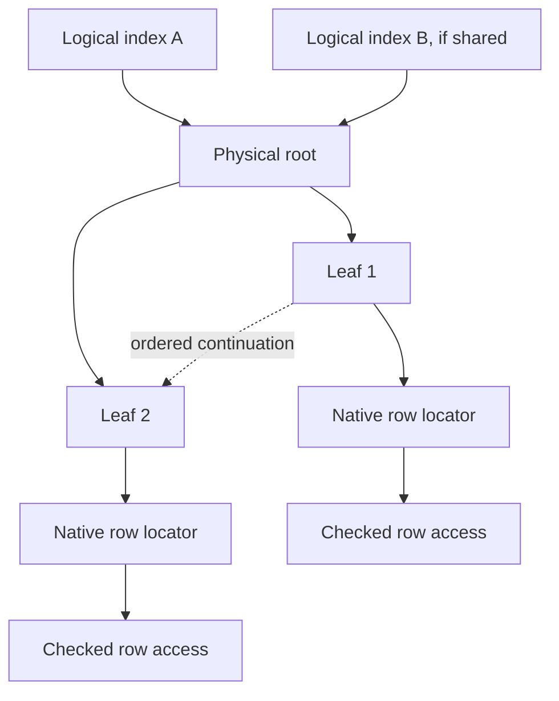

# I-05. Indexes and sort-order keys

Revision 4 · Part I review · Stage 2, response 4 · 2026-11-13

**Requirement trace:** Primary: RQ-SEM-02. Shared obligations: RQ-LATE-04, RQ-FMT-03, RQ-TYPE-01, RQ-ISAM-01, RQ-DAO-02, RQ-PROD-04 and RQ-STORE-04. Full requirement text and Part II ownership are in I-16.

## Three distinct contracts

The catalog distinguishes a logical index's name, fields, flags and constraints from its physical tree. Several logical definitions may refer to one physical structure in the inspected Jackcess model, so ownership is explicit rather than inferred from index count.[^tree] Each cursor receives the physical root, its owner map and a checked descriptor under **K-KEY**. SQL and DAO `Seek` share the tree mechanism; their argument and result policies remain explicit.

**D-SORT-1 — Provisional.** R-SORT-3 settles the encoder choice. Use an evidence-backed table-driven encoder selected by the native sort identifier/version and applicable field flags. Separate semantic comparison, full ordered index entries, and compressed page representation. They share validated rules without being treated as identical byte strings. SQL text comparison is not automatically a comparison of stored entries, which include structural information and tie-breaking locators.

General Legacy and General have distinct implementations/tables in Jackcess; its General implementation also treats surrogate weights explicitly.[^sort] Therefore a generic OS collation function, Unicode normalization or BSTR binary comparison cannot be assumed to construct native keys. Build the descriptor from file metadata and evidenced options. General 97 is a sort descriptor family, not permission to admit excluded Jet 3 files. All required locale-specific orders remain in scope; the pinned reference's three General-family pairs do not define CalcDb's supported inventory. If keys vary by machine locale or build in R-SORT-3, record the difference and revise the explicit compatibility policy; do not add an invisible “oracle build” switch unrelated to the file or chosen product target.

**Figure F-07a — logical definitions, shared physical tree and row locators.** Design topology over source-backed native hypotheses; numeric geometry and high-key/tail details are in II-05. Mermaid source only; not render-verified.

**Figure F-07b — concrete key and page-entry layers.** Numeric reference-backed hypotheses for ascending Long42, not ACE captures; emitted table, not render-verified.[^pin]

| Layer | Concrete construction | Distinction |
| --- | --- | --- |
| One nonnull field key | `7F 80 00 00 2A` | Direction marker plus sign-adjusted big-endian Long. |
| Compound key | Concatenated type-specific field encodings, then the qualified whole-key length rule | Mixed ASC/DESC and Null are per field; long-key shortening may lose information. |
| Full leaf entry | `K` followed by `u24BE page` and `u8 row slot` | Row-root locator breaks physical ties; it is not semantic equality or a DAO bookmark. |
| Full interior entry | Full leaf-style fence followed by `u32BE child` | Inclusive child maximum; child pointer is excluded from comparison. |
| Compressed page stream | First full entry, then later entries with a page-wide prefix omitted | Boundary bitmap marks exclusive stored ends; a reader may need a prefix extending into locator bytes. |

Keep field keys, shortened user keys, full entries and page fragments distinct. Text weight bytes generally cannot recover the original BSTR. A long-key digest cannot by itself prove semantic equality or SQL order. II-05 supplies exact scalar/text examples and a discriminating compound-key collision from the pinned reference; R-SORT-3 decides whether ACE confirms or changes that rule. The writer needs byte-identical native keys while semantic consumers need the qualified comparison and residual policy.

## Navigation and page encoding

Represent an index cursor by its visibility token, root/descriptor generation, traversal stack, current leaf pin and entry position. Lower-bound search descends inclusive child-maximum fences to a leaf, compares user-key bytes then row-root locators, and uses the leaf chain or validated traversal state for continuation. A header tail has no stored fence; without a tail, a probe above all explicit fences uses the last child. Internal compound-prefix bounds are typed states, not string-prefix tests. DAO omitted trailing Seek arguments have separate lowering: Microsoft's method and tutorial conflict on operators/direction, while the method documents Null defaults. Provisionally follow the method reference and settle the precise target behavior through R-CURSOR-1/R-DAO-1.[^seek] Duplicate user keys retain the evidenced locator ordering. A physical locator is an internal storage reference, not a presumed DAO bookmark encoding.

The candidate 4096-byte page has kind 03/04, a 453-byte boundary bitmap at 27 and entry payload at 480, leaving 3616 bytes. Header pointers are little endian; entry row/child trailers are big endian. Byte 8 is a stamp field, not an entry count. The bitmap records cumulative exclusive ends, including boundary 3616 in its final byte. Prefix reconstruction can reach locator bytes, while the pinned fresh writer chooses key-only prefixes; read tolerance and emitter policy are distinct.[^pin] CalcDb therefore reconstructs full entries before semantic checks or mutation. Decode entry boundaries once per pinned page, retaining offsets and bounded reusable scratch. Compare prefix and suffix spans directly where useful; do not allocate one owned string or object per key. Validate prefix lengths, entry bounds, ordering, child/sibling references and page capacity before publishing a decoded view.

For the initial cold descent into height `h`, count up to `h` demanded tree-page reads plus the selected row/long-value reads; continuing a seek/range can visit more leaves, while cache residency reduces physical I/O. A leaf scan amortizes page decoding across its entries. Within a page, binary search uses logarithmic entry comparisons, but inspected bytes depend on common prefixes and key lengths. Measure those bytes and branch behavior rather than reporting only comparison counts. A covering query avoids row fetches only where its required values and semantics are actually recoverable from the index representation.

## Mutation and structural changes

Prepare each index mutation with the row mutation. Derive old/new keys once for affected fields; delete the old entry and insert the new one in the same logical operation. Revalidate uniqueness and transaction dependencies at the required boundary. Unaffected key bytes may remain untouched, but moving a row can still change its indexed locator. Shared physical trees must not receive duplicate updates through multiple logical definitions.

Stage the affected page's complete entries in reusable scratch, compute their encoded occupancy, then encode a replacement. If it does not fit, split by encoded byte occupancy, recompute prefixes and separators, and recursively prepare parent/root changes. **D-INDEX-1 — Provisional.** Retain nonempty underfull pages, unlink empty children and propagate their removal; keep the root page, converting it to an empty leaf when the tree empties. Initially omit eager redistribution, merging and single-child root contraction. This limits changed pages and has a concrete reference basis. R-FMT-2/R-CURSOR-1/R-CRASH-1/2 change it if native validity, public behavior or crash classes require different shapes. Leaf links span the leaf sequence; the inspected interior peer links stay within their parent's children.[^cache] The format fixes valid trees and observable traversal; it need not force CalcDb to copy an unobservable ACE allocation heuristic. R-FMT-2 and R-CURSOR-1 determine which split, reuse and movement choices affect bookmarks, row order or other visible behavior. I-03/I-08 determine allowable persistence cuts. A tail-child maximum can change an ancestor fence while an intermediate parent's bytes remain identical; a larger replacement fence can make even a deletion require a split. Propagate subtree summaries independently of serialized-page changes. A row's overflow-body relocation does not change its index locator when its logical row root stays fixed.

Apply native Null membership and constraints once per applicable physical tree, preserving every logical relationship check and the observed failure order. The persisted unique-entry statistics word is not exact current cardinality; Microsoft also documents stale DistinctCount after deletions/rollback. Qualify its update/refresh rules rather than recounting it during a delete.[^count]

Bulk index construction sorts bounded runs of exact entries, spills through VFS when necessary, and packs leaves/interiors from the ordered stream. It uses the same key encoder, duplicate handling and page codec as incremental writes. It must reproduce ACE's observed duplicate/constraint errors and applicable order; “faster bulk build” does not authorize different semantics.

Unknown key encoding causes a pre-mutation failure until implemented. Writing knowingly unusable keys and relying on Compact & Repair is incompatible with the ordinary-write requirement. Such a refusal remains a failed compatibility case. Later encrypted/complex-field variants extend the descriptor and key rules rather than introducing another index implementation.

## Evidence and reopening conditions

Validate physical keys and public ordering independently: a byte-level match alone does not establish correct Seek/SQL behavior, and matching logical order alone does not establish interoperable mutation. Structural changes also require I-15's ordinary reopen/Compact & Repair checks and I-08's crash-state comparisons.

Retain a simple scalar encoder as the checked implementation path while measuring specializations against complete output bytes. No performance ratio from the cleared notes becomes a target.[^method] Reopen D-SORT-1 if evidence requires a richer descriptor or different encoding mechanism. II-05 records pinned Java and six individually hashed weight/mapping resources. Their exact resource provenance/licence remains separate from the Java headers and project notice; no table or source code has been ported. Reuse requires that exact-material check or independently derived native capture data.

## Deciding experiments

The full fixtures, captures, branch choices and effort estimates are in [A-02](A-02-experiments.md); the complete source ledger is in [A-01](A-01-sources.md). No experiment result is claimed here.

**R-SORT-3 (L)** selects exact descriptor/scalar/text/length rules, including 510-byte collisions, and tests which encoded comparisons support semantic operations. R-FMT-1 starts the work; R-FMT-2 and R-CURSOR-1 extend structural/navigation cases under the [full card](A-02-experiments.md#r-sort-3--native-key-dependence-on-descriptor-locale-and-build).

[^tree]: Jackcess, live official [IndexData.java xref](https://jackcess.sourceforge.io/xref/com/healthmarketscience/jackcess/impl/IndexData.html), selected physical-index/page/entry passages, accessed 2026-11-12. Apache-2.0 file header checked; source revision unpinned; no port. These are reference facts to test against ACE.
[^sort]: Jackcess, [GeneralLegacyIndexCodes.java](https://jackcess.sourceforge.io/xref/com/healthmarketscience/jackcess/impl/GeneralLegacyIndexCodes.html) and [GeneralIndexCodes.java](https://jackcess.sourceforge.io/xref/com/healthmarketscience/jackcess/impl/GeneralIndexCodes.html), selected descriptions/encoding passages and Apache-2.0 headers inspected, accessed 2026-11-12. Those earlier live Java readings did not include the data tables. II-05's later immutable resource inspection is recorded separately and does not retroactively pin the live material or grant resource reuse.
[^method]: Supplied `frankensqlite-report.stage1-part1.md` §§4, 7 and `frankensqlite-report.stage1-part3.md` §§8, 10; `asupersync-report.stage1-part2.md` §§7–8. Concept input for bulk work, exact-path comparison and measurement.

[^pin]: S-JACK-INDEX-PIN; S-JACK-IDXCODES-PIN; S-JACK-FMT — Exact Jackcess commit `be0a2139b087a227d14cafd4ea231306a5a3a862`, inspected2026-11-13, selected geometry/entry/scalar/format passages; individual hashes, extents and header checks in A-01. Numeric examples and native interpretations remain hypotheses under R-FMT-2/R-SORT-3.
[^cache]: S-JACK-IDXCACHE-PIN — Same immutable pin, selected split/root/empty/peer/tail mechanisms. Reference policy distinguished from proposed byte-balanced CalcDb planning and target crash evidence; no code port.
[^seek]: S-MS-DAO-SEEK; S-MS-DAO-SEEK-GUIDE — Microsoft method reference (updated2022-03-21) and table-type Seek tutorial (updated2022-01-22), read2026-11-13. II-05/A-02 retain their documentary conflict and deciding native cases.
[^count]: S-JACK-INDEX-PIN; S-MS-INDEX-DISTINCT — Pinned reference counter paths and Microsoft Index.DistinctCount remarks (updated2021-09-14), read2026-11-13. Neither establishes every native transition.
