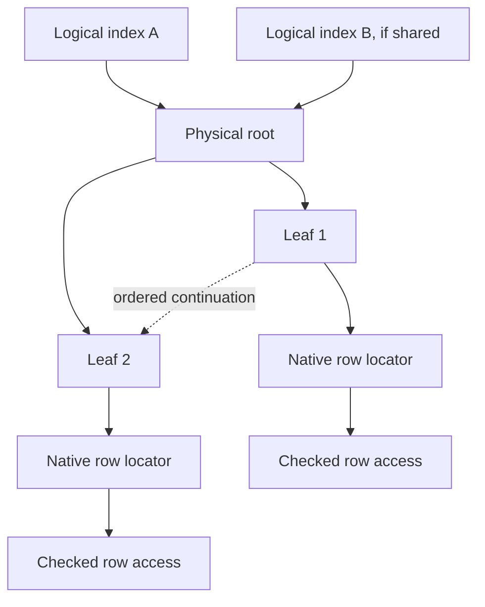

# I-05. Indexes and sort-order keys

Revision 3 · Part I review · Stage 2, response 1 · 2026-11-13

**Requirement trace:** Primary: RQ-SEM-02. Shared obligations: RQ-LATE-04, RQ-FMT-03, RQ-TYPE-01. Full requirement text and Part II ownership are in I-16.

## Three distinct contracts

The catalog distinguishes a logical index's name, fields, flags and constraints from its physical tree. Several logical definitions may refer to one physical structure in the inspected Jackcess model, so ownership is explicit rather than inferred from index count.[^tree] Each cursor receives the physical root and a checked descriptor under **K-KEY**; SQL and DAO `Seek` share the same implementation.

**D-SORT-1 — Provisional.** R-SORT-3 settles the encoder choice. Use an evidence-backed table-driven encoder selected by the native sort identifier/version and applicable field flags. Separate semantic comparison, full ordered index entries, and compressed page representation. They share validated rules without being treated as identical byte strings. SQL text comparison is not automatically a comparison of stored entries, which include structural information and tie-breaking locators.

General Legacy and General have distinct implementations/tables in Jackcess; its General implementation also treats surrogate weights explicitly.[^sort] Therefore a generic OS collation function, Unicode normalization or BSTR binary comparison cannot be assumed to construct native keys. Build the descriptor from file metadata and evidenced options. If keys vary by machine locale or build in R-SORT-3, record the difference and revise the explicit compatibility policy; do not add an invisible “oracle build” switch unrelated to the file or chosen product target.

**Figure F-07a — logical definitions, shared physical tree and row locators.** This is the design topology; fan-out, separator encoding, sibling fields and split policy remain format evidence. Mermaid source only; not render-verified.

**Figure F-07b — composite key and page-entry layers.** This symbolic layout table is a hypothesis under R-SORT-3, not an asserted sequence of native bytes; it is emitted but not render-verified.

| Layer | Symbolic construction | Rule still to establish for each descriptor |
| --- | --- | --- |
| One field key | `K_i = encode(type_i, value_i, flags_i, sort)` | Null markers, descending transforms, text weights and type-specific boundaries. |
| Compound value key | `K = compose(K_1, …, K_n)` | Separators, escaping, prefix-seek bounds and exact byte comparison rules. |
| Complete ordered entry | `E = attach_locator(K, native_locator)` | Locator representation, placement and duplicate tie-breaking rules; no assumption that SQL equality includes it. |
| On-page representation | `C = compress(E, page_context)` | Prefix context, entry boundaries and required reconstruction before comparison; structural bytes can participate. |

Keeping these layers explicit permits one checked key service to serve native navigation and mutations while SQL comparison uses only its applicable semantic rule.

## Navigation and page encoding

Represent an index cursor by its visibility token, root/descriptor generation, traversal stack, current leaf pin and entry position. Lower-bound search descends separators to a leaf, compares complete entries under native rules and uses the leaf chain or validated traversal state for continuation. Compound/prefix seeks construct proper bounds; they are not string-prefix tests. Duplicate user keys retain the evidenced locator ordering. A physical locator is an internal storage reference, not a presumed DAO bookmark encoding.

The inspected page codec uses leaf/interior forms, an entry-boundary bitmap and a common prefix that can extend into row-locator bytes; interior entries include child references.[^tree] CalcDb therefore reconstructs full entries before semantic checks or mutation. Decode entry boundaries once per pinned page, retaining offsets and bounded reusable scratch. Compare prefix and suffix spans directly where useful; do not allocate one owned string or object per key. Validate prefix lengths, entry bounds, ordering, child/sibling references and page capacity before publishing a decoded view.

For the initial cold descent into height `h`, count up to `h` demanded tree-page reads plus the selected row/long-value reads; continuing a seek/range can visit more leaves, while cache residency reduces physical I/O. A leaf scan amortizes page decoding across its entries. Within a page, binary search uses logarithmic entry comparisons, but inspected bytes depend on common prefixes and key lengths. Measure those bytes and branch behavior rather than reporting only comparison counts. A covering query avoids row fetches only where its required values and semantics are actually recoverable from the index representation.

## Mutation and structural changes

Prepare each index mutation with the row mutation. Derive old/new keys once for affected fields; delete the old entry and insert the new one in the same logical operation. Revalidate uniqueness and transaction dependencies at the required boundary. Unaffected key bytes may remain untouched, but moving a row can still change its indexed locator. Shared physical trees must not receive duplicate updates through multiple logical definitions.

Stage the affected page's complete entries in reusable scratch, compute their encoded occupancy, then encode a replacement. If it does not fit, split by encoded byte occupancy, recompute prefixes and separators, and recursively prepare parent/root changes. Deletion may redistribute or merge where the evidenced structural invariants permit. The format fixes valid trees and observable traversal; it need not force CalcDb to copy an unobservable ACE allocation heuristic. R-FMT-2 and R-CURSOR-1 determine which split, reuse and movement choices affect bookmarks, row order or other visible behavior. I-03/I-08 determine allowable persistence cuts.

Bulk index construction sorts bounded runs of exact entries, spills through VFS when necessary, and packs leaves/interiors from the ordered stream. It uses the same key encoder, duplicate handling and page codec as incremental writes. It must reproduce ACE's observed duplicate/constraint errors and applicable order; “faster bulk build” does not authorize different semantics.

Unknown key encoding causes a pre-mutation failure until implemented. Writing knowingly unusable keys and relying on Compact & Repair is incompatible with the ordinary-write requirement. Such a refusal remains a failed compatibility case. Later encrypted/complex-field variants extend the descriptor and key rules rather than introducing another index implementation.

## Evidence and reopening conditions

Validate physical keys and public ordering independently: a byte-level match alone does not establish correct Seek/SQL behavior, and matching logical order alone does not establish interoperable mutation. Structural changes also require I-15's ordinary reopen/Compact & Repair checks and I-08's crash-state comparisons.

Retain a simple scalar encoder as the checked implementation path while measuring specializations against complete output bytes. No performance ratio from the cleared notes becomes a target.[^method] Reopen D-SORT-1 if evidence requires a richer descriptor or different encoding mechanism. Reuse of Jackcess's referenced weight resources requires their own pinned provenance/licence review; inspecting the Java headers did not clear those resources.

## Deciding experiments

The full fixtures, captures, branch choices and effort estimates are in [A-02](A-02-experiments.md); the complete source ledger is in [A-01](A-01-sources.md). No experiment result is claimed here.

**R-SORT-3 (L)** decides whether native descriptors and field flags fully determine key encoding or whether additional evidenced target conditions must be explicit. Start from R-FMT-1; add R-FMT-2 and R-CURSOR-1 evidence for structural mutation and navigation branches, as specified in the [full card](A-02-experiments.md#r-sort-3--native-key-dependence-on-descriptor-locale-and-build).

[^tree]: Jackcess, live official [IndexData.java xref](https://jackcess.sourceforge.io/xref/com/healthmarketscience/jackcess/impl/IndexData.html), selected physical-index/page/entry passages, accessed 2026-11-12. Apache-2.0 file header checked; source revision unpinned; no port. These are reference facts to test against ACE.
[^sort]: Jackcess, [GeneralLegacyIndexCodes.java](https://jackcess.sourceforge.io/xref/com/healthmarketscience/jackcess/impl/GeneralLegacyIndexCodes.html) and [GeneralIndexCodes.java](https://jackcess.sourceforge.io/xref/com/healthmarketscience/jackcess/impl/GeneralIndexCodes.html), selected descriptions/encoding passages and Apache-2.0 headers inspected, accessed 2026-11-12. Referenced data tables were not opened or cleared for reuse.
[^method]: Supplied `frankensqlite-report.stage1-part1.md` §§4, 7 and `frankensqlite-report.stage1-part3.md` §§8, 10; `asupersync-report.stage1-part2.md` §§7–8. Concept input for bulk work, exact-path comparison and measurement.
