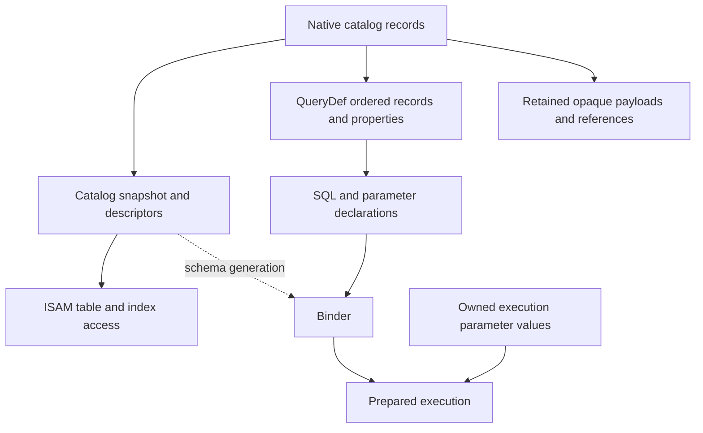

# I-06. Catalog, properties and QueryDefs

Revision 3 · Part I review · Stage 2, response 1 · 2026-11-13

**Requirement trace:** Primary: RQ-SQL-08. Shared obligations: RQ-PROD-05, RQ-SQL-02, RQ-SQL-03, RQ-SQL-06, RQ-DAO-03, RQ-DAO-04, RQ-LATE-02, RQ-LATE-03, RQ-LATE-04, RQ-OUT-01, RQ-STORE-03, RQ-FMT-01, RQ-EXPR-03. Full requirement text and Part II ownership are in I-16.

## Native catalog with immutable working views

**D-CATALOG-1 — Recommended.** Under **K-CATALOG**, bootstrap the native catalog from format-defined roots and checked ISAM primitives. Decode it into an immutable `CatalogSnapshot` plus retained raw records/property blobs. Table descriptors carry stable native identity, physical column numbering, visible order, types, indexes, relationships, defaults/validation metadata and sort information. Names retain their original UTF-16 representation; lookup uses the evidenced comparison and duplicate-name rules. ISAM receives those descriptors rather than calling a SQL binder to discover storage.

The native records remain authoritative. Descriptors are caches with explicit object/schema generations, not another catalog stored beside the Access file. Keep unknown property types, flags, order and opaque payloads attached to their containing records. Collections expose the appropriate metadata through DAO/ADO adapters. Forms, reports, macros and modules remain preserved and readable raw objects; none becomes executable merely because it appears in the catalog.[^scope]

## QueryDefs retain both representations

A saved QueryDef has a preservation representation—native ordered records, identity, flags and properties—and an execution representation—SQL syntax, declared parameters and a bound plan. Jackcess's query-row API exposes attributes, expressions, flags, names, object identity and ordering data; its query API derives SQL from native query records.[^query] This supports keeping both representations. It does not establish the exact target-build serialization.

Changing a saved definition's `.SQL`, parameter declarations or persistent properties invokes a tested translator to native catalog changes. Preserve unrelated records and unknown properties, and reproduce the SQL text/property view ACE exposes, including any evidenced normalization. Merely storing an AST or an SQL string in a private property cannot meet native QueryDef interoperability. Binding execution `Parameter.Value` is separate from that persistence: values are owned separately from declarations and reusable plans, and rebinding must not retain a client's borrowed VARIANT pointer.

Temporary QueryDefs use the same parser, binding and execution services, with object-owned transient definition state. Microsoft's documented distinction is that they are neither saved to disk nor appended to the persistent QueryDefs collection.[^dao] Pass-through and linked-source metadata is preserved now, with execution attached to the later linked-source/provider capability. Unsupported execution remains visible in the compatibility ledger.

**Figure F-08 — native catalog ownership and derived execution state.** Solid arrows describe derivation or retained ownership; the dashed arrow is a generation dependency. The native records remain authoritative. Mermaid source only; not render-verified.

Execution values do not become persistent catalog properties by rebinding. Catalog structure research follows the native-record branches before full SQL execution exists; the binder consumes descriptors and does not bootstrap ISAM.

## DDL, visibility and invalidation

A catalog mutation preflights related table definitions, indexes, relationship records, properties and names together. The Workspace coordinator supplies the implicit/explicit transaction policy. Private catalog views are visible only where the evidenced transaction rules require; publish a new generation at that visibility boundary. Do not assume every DDL statement is rollbackable. R-CAT-1 with R-TXN-1 establishes commit, rollback, nested-operation and failure behavior before that policy is fixed.

Object lifetime and descriptor validity remain separate. Retired snapshots live while readers need them; stale objects cannot silently bind to a newly created object reusing a name or identifier. A generation token includes its owning catalog incarnation, and rollback does not make an old token valid for unrelated state. Refresh behavior and errors of already-held DAO/ADO objects are surface policies to measure.

Prepared plans record dependencies on referenced schema objects, parameter declaration types, SQL options/wildcard mode, collation, function-registry version and relevant sandbox context. A cheap entry check validates the dependencies before execution. Data-only changes do not automatically force full rebinding; statistics and any assumptions based on data have their own invalidation policy. A bounded cache admits prepared entries by measured reuse and retained bytes. Cache misses compile normally and do not change behavior.[^cache]

## Cost and acceptance

Open-time bootstrap reads only the catalog structures required for identification and initial descriptors; load large raw objects lazily. Repeated field/parameter resolution uses a valid descriptor rather than rereading catalog pages. Track bootstrap page reads, retained descriptor/raw bytes, lookup probes and bind/cache costs independently. Any later external-writer mode must add evidenced freshness validation before reusing a catalog view; an in-process generation cannot detect ACE's changes by itself.

Native persistence, typed execution and held-object validity are checked independently. Ordinary output must satisfy I-15's ACE/Access reopen and “Compact & Repair finds nothing to fix” test, together with protected-byte preservation. D-CATALOG-1's serializer and invalidation mechanism remain provisional until the relevant R-CAT-1 branches settle them; the native catalog and single shared engine remain fixed.

## Deciding experiments

The full fixtures, captures, branch choices and effort estimates are in [A-02](A-02-experiments.md); the complete source ledger is in [A-01](A-01-sources.md). No experiment result is claimed here.

**R-CAT-1 (M)** starts native catalog reading and QueryDef-structure research after R-ORACLE-1 and R-FMT-1; it does not wait for complete SQL or a catalog writer. Mutation branches add R-FMT-2, typed execution branches add R-EXPR-1, and transaction branches add R-TXN-1; their outcomes select serialization, preservation and invalidation rules under the [full card](A-02-experiments.md#r-cat-1--native-querydefs-catalog-round-trips-and-invalidation).

[^scope]: Supplied `calcdb-one-pager.md`, scope and principles 3, 4, 9; `CHARTER.md`, catalog and preservation elaborations, subordinate to the one-pager.
[^query]: Jackcess, [QueryImpl API](https://jackcess.sourceforge.io/apidocs/com/healthmarketscience/jackcess/impl/query/QueryImpl.html) and [QueryImpl.Row API](https://jackcess.sourceforge.io/apidocs/com/healthmarketscience/jackcess/impl/query/QueryImpl.Row.html), pages labelled 5.0.4, accessed 2026-11-12. API facts only; no QueryImpl source/header or reuse clearance established.
[^dao]: Microsoft, [QueryDef object (DAO)](https://learn.microsoft.com/en-us/office/client-developer/access/desktop-database-reference/querydef-object-dao), accessed 2026-11-12. Documented lifetime/property behavior requires target-build verification.
[^cache]: Supplied `asupersync-report.stage1-part4.md` §3 and `asupersync-report.stage1-part6.md` §5; `frankensqlite-report.stage1-part1.md` §7. Concepts: generation validity, metadata lookup semantics and stale-schema failure modes; not ACE implementation facts.
