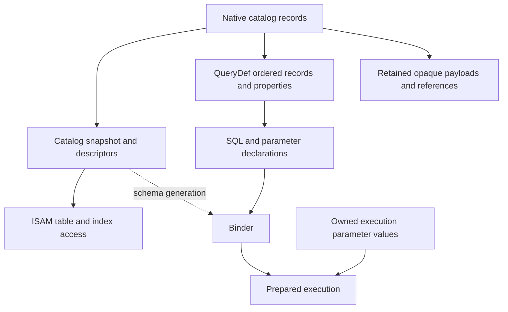

# I-06. Catalog, properties and QueryDefs

Revision 4 · Stage 2, response 5 · 2026-11-13

**Requirement trace:** Primary: RQ-SQL-08. Shared obligations: RQ-PROD-05, RQ-SQL-02, RQ-SQL-03, RQ-SQL-06, RQ-DAO-03, RQ-DAO-04, RQ-LATE-02, RQ-LATE-03, RQ-LATE-04, RQ-OUT-01, RQ-STORE-03, RQ-FMT-01, RQ-EXPR-03. Full requirement text and Part II ownership are in I-16.

## Native catalog with immutable working views

**D-CATALOG-1 — Recommended.** Under **K-CATALOG**, bootstrap the native catalog from format-defined roots and checked ISAM primitives. Decode it into an immutable `CatalogSnapshot` plus retained raw records/property blobs. Table descriptors carry stable native identity, physical column numbering, visible order, types, indexes, relationships, defaults/validation metadata and sort information. Names retain their original UTF-16 representation; lookup uses the evidenced comparison and duplicate-name rules. ISAM receives those descriptors rather than calling a SQL binder to discover storage.

The preferred bootstrap starts at the profile's catalog TableDef locator—page 2 in the inspected Jet 4/ACE reference—and binds `MSysObjects` from its actual physical field definitions. This first decode is property-free, so resolving calculated-column metadata cannot recurse into a catalog that is still being opened. A bounded identity projection precedes qualified indexed lookup. Native object IDs, parent-container IDs, physical page/row locators and in-process object incarnations are distinct types. Preserve ambiguous identities as explicit lookup outcomes; do not silently choose one or infer ACE's eager open error from a structural audit.[^catalog-native]

The native records remain authoritative. Descriptors are caches with explicit object/schema generations, not another catalog stored beside the Access file. Keep unknown property types, flags, order and opaque payloads attached to their containing records. Collections expose the appropriate metadata through DAO/ADO adapters. Forms, reports, macros and modules remain preserved and readable raw objects; none becomes executable merely because it appears in the catalog.[^scope]

The property service retains the entire native `LvProp` representation plus a bounded directory of sections, names and records. Its map key includes kind and name, so same-named column and index maps remain distinct. Prefer an exact no-op, a qualified same-length patch, or the minimum understood reconstruction for a larger edit. Raw flags, repeated dictionaries, duplicate records and tails survive separately from decoded values. An absent outer value and a present empty value retain distinct state. Unknown coupled offsets or references prevent only the unsafe affected transformation, before publication; they do not authorize rebuilding every property map from a convenience dictionary.[^property-native]

Relationships coordinate their catalog identity, ordered field-pair rows and the logical index links in both TableDefs; physical trees can be shared. Table creation also includes evidenced ownership/access-control records. Preserve those native associations, and establish their MDB/ACCDB and caller-specific creation behavior rather than importing the reference writer's permissive fallback. Shared ISAM constraints/cascades consume the resulting descriptors; catalog code does not implement another constraint engine.[^catalog-native]

## QueryDefs retain both representations

A saved QueryDef has a preservation representation—native ordered records, identity, flags and properties—and an execution representation—SQL syntax, declared parameters and a bound plan. Jackcess's query-row API exposes attributes, expressions, flags, names, object identity and ordering data; its query API derives SQL from native query records.[^query] This supports keeping both representations. It does not establish the exact target-build serialization.

The exact inspected source links type-5 `MSysObjects` identities to `MSysQueries.ObjectId` rows and uses separate encodings for object query-kind flags and type-row flags. It retains raw `Order` bytes but consumes encounter order without interpreting them. Prefer that reconstruction only for the native-qualified fixture set; new or edited definitions use an order/row recipe established by native captures. Preserve untouched ordering bytes. Raw expressions, the public `.SQL` string and the parsed semantic form remain separate, because reference reconstruction can normalize text and is not a byte-faithful DAO SQL serializer.[^query-native]

Changing a saved definition's `.SQL`, parameter declarations or persistent properties invokes a tested translator to native catalog changes. Preserve unrelated records and unknown properties, and reproduce the SQL text/property view ACE exposes, including any evidenced normalization. Merely storing an AST or an SQL string in a private property cannot meet native QueryDef interoperability. Binding execution `Parameter.Value` is separate from that persistence: values are owned separately from declarations and reusable plans, and rebinding must not retain a client's borrowed VARIANT pointer.

A QueryDef instance owns reusable parameter values; an active execution or Recordset retains its accepted binding. Microsoft's no-argument versus explicit-QueryDef Requery behavior requires that distinction. A definition edit provisionally creates a fresh declaration incarnation and unassigned cells; R-CAT-1 can select native value survival or handle retargeting through an explicit checked mapping. An old parameter ordinal cannot accidentally bind a different new declaration.[^requery]

Temporary QueryDefs use the same parser, binding and execution services, with object-owned transient definition state. Microsoft's documented distinction is that they are neither saved to disk nor appended to the persistent QueryDefs collection.[^dao] Pass-through and linked-source metadata is preserved now, with execution attached to the later linked-source/provider capability. Unsupported execution remains visible in the compatibility ledger.

**Figure F-08 — native catalog ownership and derived execution state.** Solid arrows describe derivation or retained ownership; the dashed arrow is a generation dependency. The native records remain authoritative. Mermaid source only; not render-verified.

Execution values do not become persistent catalog properties by rebinding. Catalog structure research follows the native-record branches before full SQL execution exists; the binder consumes descriptors and does not bootstrap ISAM.

## DDL, visibility and invalidation

A catalog mutation preflights related table definitions, indexes, relationship records, properties and names together. The Workspace coordinator supplies the implicit/explicit transaction policy. Private catalog views are visible only where the evidenced transaction rules require; publish a new generation at that visibility boundary. Do not assume every DDL statement is rollbackable. R-CAT-1 with R-TXN-1 establishes commit, rollback, nested-operation and failure behavior before that policy is fixed.

Object lifetime and descriptor validity remain separate. Retired snapshots live while readers need them; stale objects cannot silently bind to a newly created object reusing a name or identifier. A generation token includes its owning catalog incarnation, and rollback does not make an old token valid for unrelated state. Refresh behavior and errors of already-held DAO/ADO objects are surface policies to measure.

Public collection membership/ordering has its own state above the catalog, so a refreshed internal descriptor directory does not automatically refresh a held DAO collection or retarget returned child objects. Name resolution records positive hits and relevant earlier-scope misses, including implicit-parameter and shadowing cases. Access Name AutoCorrect is a separately controlled application-side operation; an engine-only rename does not authorize generic text replacement in opaque objects or VBA source.[^refresh][^autocorrect]

Prepared plans record dependencies on referenced schema objects, parameter declaration types, SQL options/wildcard mode, collation, function-registry version and relevant sandbox context. A cheap entry check validates the dependencies before execution. Data-only changes do not automatically force full rebinding; statistics and any assumptions based on data have their own invalidation policy. A bounded cache admits prepared entries by measured reuse and retained bytes. Cache misses compile normally and do not change behavior.[^cache]

The entry certificate belongs to the owner and selected catalog view and includes relevant host/options/sandbox generations; one shared mutable “last checked” field on a cached plan is insufficient. Require the parameter-layout ticket to match before capturing execution values. Schema changes during callbacks follow the qualified retained-view continuation or failure policy without replaying effects. Native page publication, in-process catalog visibility and commit acknowledgement remain separate boundaries under the transaction coordinator; II-06 supplies the concrete row/property/index closure.

## Cost and acceptance

Open-time bootstrap reads only the catalog structures required for identification and initial descriptors; load large raw objects lazily. Repeated field/parameter resolution uses a valid descriptor rather than rereading catalog pages. Track bootstrap page reads, retained descriptor/raw bytes, lookup probes and bind/cache costs independently. Any later external-writer mode must add evidenced freshness validation before reusing a catalog view; an in-process generation cannot detect ACE's changes by itself.

Native persistence, typed execution and held-object validity are checked independently. Ordinary output must satisfy I-15's ACE/Access reopen and “Compact & Repair finds nothing to fix” test, together with protected-byte preservation. D-CATALOG-1's serializer and invalidation mechanism remain provisional until the relevant R-CAT-1 branches settle them; the native catalog and single shared engine remain fixed.

## Deciding experiments

The full fixtures, captures, branch choices and effort estimates are in [A-02](A-02-experiments.md); the complete source ledger is in [A-01](A-01-sources.md). No experiment result is claimed here.

**R-CAT-1 (L)** separates bootstrap, property grammar, query ordering, public lifetimes, DDL/relationships, binding invalidation and crash/reopen branches. R-ORACLE-1/R-FMT-1 start raw capture; only affected branches add format-write/key, expression/SQL, transaction, host or sharing evidence. Outcomes select native recipes and public transitions under the [full card](A-02-experiments.md#r-cat-1--native-querydefs-catalog-round-trips-and-invalidation); basic catalog research and structural writers do not await a complete SQL executor.

[^scope]: Supplied `calcdb-one-pager.md`, scope and principles 3, 4, 9; `CHARTER.md`, catalog and preservation elaborations, subordinate to the one-pager.
[^query]: Jackcess, [QueryImpl API](https://jackcess.sourceforge.io/apidocs/com/healthmarketscience/jackcess/impl/query/QueryImpl.html) and [QueryImpl.Row API](https://jackcess.sourceforge.io/apidocs/com/healthmarketscience/jackcess/impl/query/QueryImpl.Row.html), pages labelled 5.0.4, accessed 2026-11-12. API facts only; no QueryImpl source/header or reuse clearance established.
[^dao]: Microsoft, [QueryDef object (DAO)](https://learn.microsoft.com/en-us/office/client-developer/access/desktop-database-reference/querydef-object-dao), accessed 2026-11-12. Documented lifetime/property behavior requires target-build verification.
[^cache]: Supplied `asupersync-report.stage1-part4.md` §3 and `asupersync-report.stage1-part6.md` §5; `frankensqlite-report.stage1-part1.md` §7. Concepts: generation validity, metadata lookup semantics and stale-schema failure modes; not ACE implementation facts.
[^catalog-native]: [S-JACK-CATDB-PIN] Jackcess [DatabaseImpl.java](https://github.com/jahlborn/jackcess/blob/be0a2139b087a227d14cafd4ea231306a5a3a862/src/main/java/com/healthmarketscience/jackcess/impl/DatabaseImpl.java) and [S-JACK-REL-CREATE-PIN] [RelationshipCreator.java](https://github.com/jahlborn/jackcess/blob/be0a2139b087a227d14cafd4ea231306a5a3a862/src/main/java/com/healthmarketscience/jackcess/impl/RelationshipCreator.java), exact pin and selected extents in A-01. Reference mechanism facts only; native creation/security/order behavior remains experimental.
[^property-native]: [S-JACK-PROPMAPS-PIN] Jackcess [PropertyMaps.java](https://github.com/jahlborn/jackcess/blob/be0a2139b087a227d14cafd4ea231306a5a3a862/src/main/java/com/healthmarketscience/jackcess/impl/PropertyMaps.java) and [S-JACK-PROPMAPIMPL-PIN] [PropertyMapImpl.java](https://github.com/jahlborn/jackcess/blob/be0a2139b087a227d14cafd4ea231306a5a3a862/src/main/java/com/healthmarketscience/jackcess/impl/PropertyMapImpl.java), exact pin/header inspection in A-01; detailed framing and worked bytes in II-06.
[^query-native]: [S-JACK-QUERYIMPL-PIN] Jackcess [QueryImpl.java](https://raw.githubusercontent.com/jahlborn/jackcess/be0a2139b087a227d14cafd4ea231306a5a3a862/src/main/java/com/healthmarketscience/jackcess/impl/query/QueryImpl.java), exact pin; source reconstruction and raw Order retention, not an ACE order-byte specification.
[^requery]: [S-MS-REQUERY] Microsoft [Recordset.Requery method (DAO)](https://learn.microsoft.com/en-us/office/client-developer/access/desktop-database-reference/recordset-requery-method-dao), updated 2022-03-21, revisited 2026-11-13; supplied QueryDef versus original parameters, with exact surface details to capture.
[^refresh]: [S-MS-TABLEDEFS-REFRESH] Microsoft [TableDefs.Refresh method (DAO)](https://learn.microsoft.com/en-us/office/client-developer/access/desktop-database-reference/tabledefs-refresh-method-dao), updated 2021-09-14, read 2026-11-13.
[^autocorrect]: [S-MS-NAME-AUTOCORRECT] Microsoft [Set name AutoCorrect options](https://support.microsoft.com/en-us/access/set-name-autocorrect-options), read 2026-11-13; application-side name-map behavior, not a native map format.
