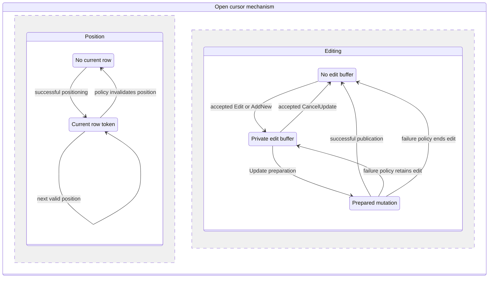

# I-07. ISAM, cursors and constraints

Revision 3 · Part I review · Stage 2, response 1 · 2026-11-13

**Requirement trace:** Primary: RQ-DAO-02, RQ-ISAM-01. Shared obligations: RQ-PROD-02, RQ-SQL-04, RQ-SQL-05, RQ-DAO-01, RQ-DAO-03, RQ-ADO-01, RQ-LATE-02, RQ-LATE-03, RQ-ORACLE-02, RQ-FMT-03, RQ-VAL-03, RQ-CONC-01, RQ-CALL-01, RQ-CALL-04, RQ-PERF-01, RQ-PERF-02. Full requirement text and Part II ownership are in I-16.

## One cursor mechanism, explicit policies

**D-CURSOR-1 — Provisional.** The shared mechanism is recommended; R-CURSOR-1/R-DAO-1 settle visibility and lifecycle policy. Under **K-CURSOR**, a cursor contains a source descriptor, visibility token, position, population state, current page pin, decode scratch and optional edit buffer. Public recordset type selects policy; DAO, SQL and ADO share navigation and mutation primitives without inheriting each other's surface behavior.

| DAO policy | Selected mechanism |
| --- | --- |
| Table | Direct table/index traversal; native indexed bounds serve Seek. |
| Dynaset | Incremental membership/provenance stream with refreshable row access; retain or spill identities where scrolling requires it. |
| Snapshot | Stable result values/membership through retained versions or a bounded result spool, according to observed population timing. |
| Forward-only | Forward result production with bounded lookahead; do not retain arbitrary backward-navigation state. |

These mechanisms implement documented recordset distinctions, not a blanket isolation level. Updateability is derived separately from source provenance, query shape and options. Explicitly requested types must not silently fall back to a cheaper type.[^types]

Position validity, BOF/EOF, NoMatch, population progress and EditMode are separate state. Microsoft documents that failed Seek/Find invalidates the current record while later Move calls leave NoMatch unchanged. RecordCount for non-table cursors can reflect population progress; forcing COUNT(*) or full materialization would change behavior.[^state] R-CURSOR-1 records every property after successful and failed transitions, including empty/singleton results, discovered deletions and Requery.

**Figure F-09 — independent position and edit state.** This is the proposed cursor state model, with public transition and failure policies provisional under R-CURSOR-1/R-TXN-1. Population, open-resource lifetime and shared bookmark-family incarnation remain additional independent state. Mermaid source only; not render-verified.

The two failure edges are alternatives chosen by the evidenced operation/context, not permission to choose an arbitrary outcome. Positioning can invalidate borrowed row views without destroying an owned edit buffer; whether a particular public movement is permitted or posts/abandons that buffer is the adapter policy. A clone receives its own state vector while sharing only the eligible identity/data family.

## Identity, bookmarks and navigation

An internal row token names its file/table incarnation and row identity within a defined visibility lifetime; its current physical locator is resolved separately. It is not a persistent hidden column. Track relocation/reuse through evidenced native references and in-process mappings, and reject stale generations rather than reading a replacement row. The exact survival of public bookmarks through movement, deletion, rollback and Requery is an oracle contract.

A bookmark adapter owns the public value and validates its recordset/result family before resolving it. Documentation permits exchange between clones but not independent recordsets; prose differs about Byte-array versus String storage, so capture the actual VARIANT subtype and shape.[^bookmark] A clone shares eligible identity/data state but owns its position and edit state. Close and Requery also notify transaction/lifecycle policy: clone closure is documented to trigger rollback during a pending transaction, so it cannot be implemented as only a local reference decrement.[^clone]

MoveNext advances within the retained page/index state, invalidates row-local decoded views, and obtains another page only when required. Seek uses I-05 bounds; Find binds its criterion through I-10 and scans or uses a proven equivalent index range. Repeated criteria and field lookups cache against schema/semantic generations. RecordCount and movement expose observed population rather than an invented eager cursor. Prefetch remains optional and cannot move an error or externally visible read effect ahead of the serial contract.

## Editing and constraints

Edit captures original identity/change evidence and a private row buffer; AddNew initializes the required defaults and generated-value state. Unchanged large fields remain bounded references until copying is necessary. Field assignments use shared conversions and retain per-field changed flags. Update invokes one constraint/mutation service, then publishes the observed cursor/LastModified state. CancelUpdate, movement, failed Update and repeated Update follow separate transition rules; failure does not automatically discard the buffer.[^edit]

The shared mutation service owns nullability, Required/AllowZeroLength, defaults, field/table validation, unique indexes, relationships and cascades. Evaluation/check order is explicit because it selects errors and callback effects. AutoNumber reservation and reuse follow evidence even when a failed operation leaves a gap. Cascade traversal retains target identities and a visited/work set, with bounded spill; cycle disposition and failure scope come from R-SQL-2/R-TXN-1. Both DAO edits and action queries use this service.

Prepare physical row/index/map changes only after the appropriate semantic steps. Validate original-row evidence at the policy-selected point for optimistic edits; pessimistic policy obtains its edit ownership earlier. Keep lock timing, conflict detection and statement rollback distinct. `dbSeeChanges` is not assumed to switch all conflict detection on or off. Never retry an uncertain Update by reexecuting callbacks or generating another identity.

## Costs and deciding evidence

The priority loop retains a cursor, page pin and reusable scratch. Resident MoveNext and scalar field reads avoid per-row container allocation. Encode only changed fields where possible, counting any required row reconstruction, page-image copying and index/allocation work separately. Count name lookups, COM crossings, copied row/long-value bytes, decoded fields, page transitions and retained/spilled identities independently.

The contradictory current Delete reference and deletion concept article are recorded documentary conflicts, not grounds to remove Delete support.[^delete] R-DAO-1 completes the member/state inventory; ADO reuses mechanisms with its own policy captures as the shared contracts become available.

## Deciding experiments

The full fixtures, captures, branch choices and effort estimates are in [A-02](A-02-experiments.md); the complete source ledger is in [A-01](A-01-sources.md). No experiment result is claimed here.

**R-CURSOR-1 (L)** starts after R-ORACLE-1 and R-FMT-1 and selects cursor visibility, population, identity, bookmark and lifecycle policies from per-transition observations. Inconclusive timing remains unresolved; the [full card](A-02-experiments.md#r-cursor-1--identity-population-and-cursor-transitions) must settle the relevant policy before accepting stable W-05 cursor behavior.

[^types]: Microsoft, [Recordset object](https://learn.microsoft.com/en-us/office/client-developer/access/desktop-database-reference/recordset-object-dao), DAO reference, accessed 2026-11-12; labelled Access/Office 2013, not observed target-build behavior.
[^state]: Microsoft, [NoMatch](https://learn.microsoft.com/en-us/office/client-developer/access/desktop-database-reference/recordset-nomatch-property-dao) and [RecordCount](https://learn.microsoft.com/en-us/office/client-developer/access/desktop-database-reference/recordset-recordcount-property-dao), accessed 2026-11-12.
[^bookmark]: Microsoft, [Bookmark](https://learn.microsoft.com/en-us/office/client-developer/access/desktop-database-reference/recordset-bookmark-property-dao) and [Mark a position](https://learn.microsoft.com/en-us/office/vba/access/concepts/data-access-objects/mark-a-position-in-a-dao-recordset), accessed 2026-11-12.
[^clone]: Microsoft, [Clone](https://learn.microsoft.com/en-us/office/client-developer/access/desktop-database-reference/recordset-clone-method-dao) and [Requery](https://learn.microsoft.com/en-us/office/client-developer/access/desktop-database-reference/recordset-requery-method-dao), accessed 2026-11-12.
[^edit]: Microsoft, [Edit](https://learn.microsoft.com/en-us/office/client-developer/access/desktop-database-reference/recordset-edit-method-dao), [AddNew](https://learn.microsoft.com/en-us/office/client-developer/access/desktop-database-reference/recordset-addnew-method-dao) and [Update](https://learn.microsoft.com/en-us/office/client-developer/access/desktop-database-reference/recordset-update-method-dao), accessed 2026-11-12. Selected documented mechanisms require context-specific oracle verification.
[^delete]: Microsoft, [Delete reference](https://learn.microsoft.com/en-us/office/client-developer/access/desktop-database-reference/recordset-delete-method-dao) versus [DAO deletion guidance](https://learn.microsoft.com/en-us/office/vba/access/concepts/data-access-objects/delete-a-record-from-a-dao-recordset), accessed 2026-11-12. Neither conflicting sentence is treated as an execution result.
