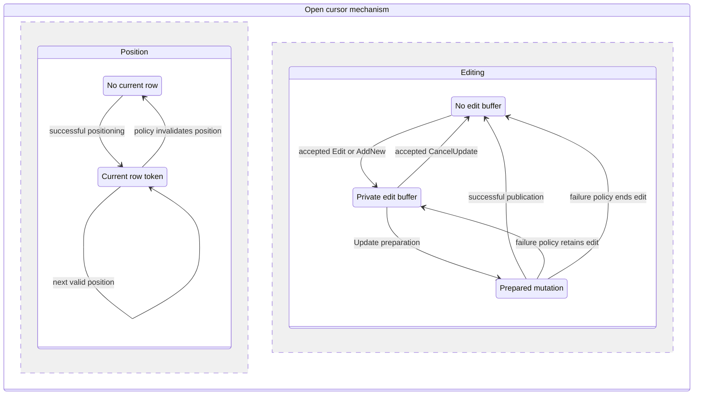

# I-07. ISAM, cursors and constraints

Revision 5 · Part I review · Stage 2, response 6 · 2026-11-13

**Requirement trace:** Primary RQ-DAO-02 and RQ-ISAM-01. Shared obligations: RQ-PROD-02, RQ-SQL-04, RQ-SQL-05, RQ-DAO-01, RQ-DAO-03, RQ-ADO-01, RQ-LATE-02, RQ-LATE-03, RQ-ORACLE-02, RQ-FMT-03, RQ-VAL-03, RQ-CONC-01, RQ-CALL-01, RQ-CALL-03, RQ-CALL-04, RQ-PERF-01 and RQ-PERF-02. Full scope text is in I-16; II-07 supplies the native byte witnesses and algorithms.

## One mechanism with explicit cursor policies

**D-CURSOR-1 — Provisional.** The shared navigation/mutation mechanism is recommended; R-CURSOR-1/R-DAO-1 select observable membership, visibility, failure and lifetime policy. Under K-CURSOR, each cursor owns its position, observation counters, selected access path, pins/scratch, optional edit and LastModified history. A family can share result backing and eligible bookmark identity without sharing current position. DAO, SQL and ADO consume the same physical operations with their own surface policies.

| Policy | Preferred provisional mechanism | Evidence that changes it |
| --- | --- | --- |
| Table | Direct owned-map/root scan or selected native index; rebind by logical root after physical movement. | CUR-POS/ID/SEEK selects order, visibility and continuation after mutation. |
| Dynaset | Incrementally retained result occurrences from an opening membership view, with separately refreshable source values. | CUR-POP changes the membership cutoff/frontier if unread rows or later inserts are admitted differently. |
| Snapshot | Retained source versions with lazy production of stable values; bounded owned value spool when compatible with evaluation timing. | CUR-POP/EXPR selects the actual visibility/evaluation boundary; eager production cannot move effects/errors. |
| Forward-only | Forward producer with current values and bounded lookahead, without a backward identity directory. | CUR-POS/POP selects admitted movement, population and failure state. |
| Dynamic/provider | Explicit capability dispatch; later provider mechanics where the native context supports them. | R-DAO-1/R-LINK-1 captures acceptance/error; no silent conversion to a local dynaset. |

Omitted OpenRecordset arguments use the evidenced source/type defaults. Explicit types, read-only/append-only flags and conflicting options retain their native result/error behavior. Updateability is derived separately from type. The full member inventory includes contexts in which a member is rejected or ignored; it is not reduced to four successful open modes.[^types]

Position validity, DeletedCurrent, BOF/EOF, NoMatch, population and EditMode are independent. Failed Seek/Find can leave NoMatch=True while a later successful Move restores a current row without clearing it. RecordCount can describe partial population or a stale postrollback observation; a property getter must not complete the query to manufacture an exact cardinality. AbsolutePosition and PercentPosition use their qualified policies rather than a universal ordinal formula.[^state]

**Figure F-09 — independent position and edit state.** This is the proposed cursor state model, with public transition and failure policies provisional under R-CURSOR-1/R-TXN-1. Population, open-resource lifetime and shared bookmark-family incarnation remain additional independent state. Mermaid source only; not render-verified.

The failure edges select the captured operation/phase outcome. Releasing a pin does not decide whether an edit survives; ordinary movement's abandonment rule does not establish every failed movement's behavior. GetRows uses one retained occurrence binding for all fields of each returned row, then advances through the same navigation primitive. Its documented deleted-row short return leaves that row current; other failures retain their own disposition.[^getrows]

## Physical identity, search and retained results

A native row token contains file/table/root incarnation and the logical root locator. Its final body can be on another page; the token does not become the body address after growth. Enumerate the ordinary owned-page map, then root slots; the available-space map is not a row directory. Suppress deleted roots and independently encountered overflow bodies, while following a live root through its body under one coherent view. Keep field binding lazy and retain the root identity for index mutation. An old snapshot consults its retained identity/view, not only the current slot registry. Local generations do not establish later external-ACE freshness.

An indexed position owns its full native entry, including the row-root locator. Restoring a particular duplicate seeks that entry, not the first equal user key. After deletion, the old entry may remain an ordering boundary even though its row is unavailable. A reseek already returns a candidate; a second increment would skip it. Own-key changes, splits, relocation and EOF insertion visibility select distinct refresh transitions.

Seek binds typed arguments and the complete actual index descriptor, then lowers qualified comparisons to inclusive/exclusive bounds and any required residual search. Omitted trailing arguments are provisionally the method reference's Null-default inputs, not an internal prefix wildcard. Mixed-direction index-order comparison is a preferred candidate requiring CUR-SEEK; a scan fallback still needs known coercion/comparison semantics. Duplicate choice and long-key collisions remain separate from physical tie order.[^seek]

Find evaluates in result occurrence order through the shared expression service. An index can accelerate it only while preserving membership, selected first/last match, comparisons and effects/errors. Repeated criteria and field names cache against descriptor/context generations. Filter and Sort configure a subsequently created Recordset; a child has its own cursor/family and retains the parent's admitted provenance/backing through an explicit creation recipe, without accidental query or callback replay.[^derived]

Scrollable results retain occurrence identities, source lineage and an ordinal directory, spilling within an owned budget. Snapshots charge retained page/LV versions or actual stored values. Memory pressure cannot force early expression evaluation just to release old pages. The priority resident MoveNext/scalar-read path reuses its cursor, page image and scratch without a per-row dictionary.

## Bookmarks, clones and query provenance

Public bookmarks own their actual Automation value and validate family/incarnation before resolving a row or result occurrence. Capture native VARIANT type, array bounds or BSTR length; do not reuse the four-byte disk locator as a guessed public format. Documentation permits clone interchange but distinguishes independent recordsets and contains Byte-array/String wording differences.[^bookmark]

Copied Byte arrays or BSTRs do not notify the engine when copied or destroyed. Issued-ticket mappings and stale-identity evidence therefore belong to the live family until qualified invalidation/expiry, with budgeted storage; they cannot be reclaimed by presumed public-copy reference counts. Client bytes do not keep a closed database alive. Clone owns position/edit/history, sharing only eligible backing. Requery provisionally gives its caller a new incarnation while clones retain old backing; CUR-LIFE selects any different native sharing rule. LastModified carries its owner and successful-operation receipt, never silently retargeting a new family. Close/Requery reach Workspace policy, including the documented pending-transaction clone-close rollback effect.[^clone]

A query occurrence stores its base row tokens separately from projected values. Multiple join occurrences can reference one parent; multiple aliases can reference one physical field; an outer-join absent side is not a new all-Null row. The binder supplies per-field origins and edit/add/delete target maps. Recordset.Updatable can be true while some Fields.DataUpdatable values are false. Consistent/inconsistent options select an evidenced route, not a bypass of declared integrity. DISTINCTROW retains the required source-row distinction; projected-value deduplication alone cannot implement it.[^updatable]

## Editing, generation and one constraint service

Edit captures original identity/comparison evidence and a private buffer. AddNew records Unset separately from explicit Null, initializes admitted defaults/generated values at their qualified phase and retains the previous position. Unchanged large fields remain retained native references until copying is required. Assignment converts into owned temporary storage, performs assignment-phase checks and installs only the accepted value. Track assigned columns separately from semantic changes. CancelUpdate resolves the pending edit; it is not implemented by calling Workspace.Rollback.[^edit]

Generated values have per-attempt tickets containing the accepted scalar and reservation disposition. Physical reprepare reuses tickets and completed effects. CancelUpdate, failed validation, rollback and reopen select native counter/gap behavior; no MAX(id)+1 allocator or automatic regeneration is allowed. Later calculated-field support occupies a descriptor/dependency slot without becoming a prerequisite for unrelated initial edits; preserve unaffected wrappers/results and expose affected unsupported work.

The shared service owns Required/AllowZeroLength, defaults, field/table validation, unique indexes, relationships and cascades. ValidateOnSet provisionally chooses immediate versus deferred field checks; paired failures select exact precedence, Null acceptance and error phase. Validation is not WHERE predicate acceptance. Bind expression contexts separately and admit functions by those contexts; a default cannot use an otherwise forbidden UDF merely because SQL can call it.

Pessimistic policy acquires edit ownership early; optimistic policy compares originals at the qualified Update point. Prefer whole-row logical evidence provisionally, excluding another row's change on the same page. Page-generation change triggers revalidation, not an automatic conflict verdict. A failed conflict and an explicit second Update have their own continuation; the engine never silently forces overwrite or repeats semantic effects after uncertain persistence.[^edit]

Prepare accepted row/LV changes, distinct physical-tree deltas, maps/counters and relationship work as one native operation or the evidenced sequence of publication units. Cascades retain child identities before moving their lookup keys and process a scheduled logical overlay. Immediate uniqueness remains immediate unless native evidence says otherwise. Repeated paths compose row changes while retaining logical obligations; prefer an identical-image fixed point for idempotent cycles and a qualified failure for conflicting/changing cycles, subject to R-SQL-2/R-TXN-1. Ordered spill bounds the work without inventing a public depth limit. DAO edits and actions share this service; action candidate stabilization is permitted only at its evidenced selection/evaluation boundary.

Delete retains its captured deleted-current continuation rather than automatically moving. The current method reference conflicts with detailed DAO deletion guidance; reproduce the supported target operation and errors. Physical retirement respects root/body/LV ownership and retained views. Transaction/persistent failure scope and ACE-first crash parity remain I-08's rules.[^delete]

## Costs, dependencies and deciding evidence

Count scalar/name/COM crossings, conversions, BSTR/SAFEARRAY allocation, decoded/copied bytes, row/LV/index/map reads, reseeks, identity/spool/history retention, constraint probes and generated tickets without surviving rows. A one-byte assignment can still copy a page image and move an index entry. Logical index aliases share physical work; unchanged keys can avoid deltas only where native count/constraint policy permits. Public ODBC CacheSize/CacheStart/FillCache are provider features, not controls for the native page cache.

W-04 starts table/index reads and identity/state; W-05 adds edits, defaults/validation, generated values and constraints/cascades using native-created fixtures. Query producers/provenance and actions extend those mechanisms under W-06/07. W-08/09 attach DAO/ADO slices as available; ADO has no full-DAO prerequisite. Completed native writes pass T-COMPACT-1 and qualified crash comparisons.

**R-CURSOR-1 (L)** starts public transitions from R-ORACLE-1/native fixtures and adds R-FMT-1 for physical identity. CUR-POS/POP/ID/SEEK/EDIT/PROV/BULK/LIFE select the provisional policies; branch-specific key, expression, write, transaction and provider dependencies are in [A-02](A-02-experiments.md#r-cursor-1--identity-population-and-cursor-transitions).

**R-SQL-2/R-TXN-1** settle action/cascade scheduling, generated-value disposition, conflict continuations and rollback/partial-progress scope. Their full cards remain in A-02; source material and exact-use classification remain in A-01.

[^types]: [S-MS-RST, S-MS-DAO-RST-TYPES, S-MS-DAO-OPEN-RST] Microsoft Recordset/RecordsetTypeEnum/Database.OpenRecordset references; II-07 cites exact URLs and contexts. Documentary contracts, not an ACE execution result.
[^state]: [S-MS-NOMATCH, S-MS-COUNT, S-MS-DAO-BOF, S-MS-DAO-ABS-POS, S-MS-DAO-PCT-POS] Microsoft cursor state/position references, additionally inspected2026-11-13; method conflicts retained in CUR-POS/POP.
[^getrows]: [S-MS-DAO-GETROWS] Microsoft, [Recordset.GetRows](https://learn.microsoft.com/en-us/office/client-developer/access/desktop-database-reference/recordset-getrows-method-dao), remarks inspected2026-11-13.
[^seek]: [S-MS-DAO-SEEK, S-MS-DAO-SEEK-GUIDE] Microsoft Seek reference and table-search tutorial; direction/omission disagreement remains a native probe.
[^derived]: [S-MS-DAO-FILTER, S-MS-DAO-SORT, S-MS-DAO-DERIVED-OPEN] Microsoft Filter/Sort/Recordset.OpenRecordset references, inspected2026-11-13; signatures also follow the actual interface manifest.
[^bookmark]: [S-MS-BOOKMARK, S-MS-MARK] Microsoft Bookmark reference and Mark a position guidance; actual typed return remains CUR-ID.
[^clone]: [S-MS-CLONE, S-MS-REQUERY, S-MS-LASTMODIFIED] Microsoft Clone/Requery/LastModified references; public lifetime and Workspace effects need context-specific capture.
[^updatable]: [S-MS-DAO-UPDATABLE, S-MS-FIELD-DATAUPDATABLE, S-MS-PREDICATES, S-MS-DAO-INCONSISTENT] Microsoft field/recordset updateability, SQL predicates and inconsistent dynaset guidance, inspected2026-11-13.
[^edit]: [S-MS-EDIT, S-MS-ADD, S-MS-UPDATE, S-MS-CANCELUPDATE, S-MS-VALIDATEONSET] Microsoft edit-buffer, conflict and validation references; contradictory/general wording is not promoted into a native observation.
[^delete]: [S-MS-DELETE, S-MS-DELETE-GUIDE] Microsoft Delete reference versus detailed DAO deletion guidance; target Delete remains required.
