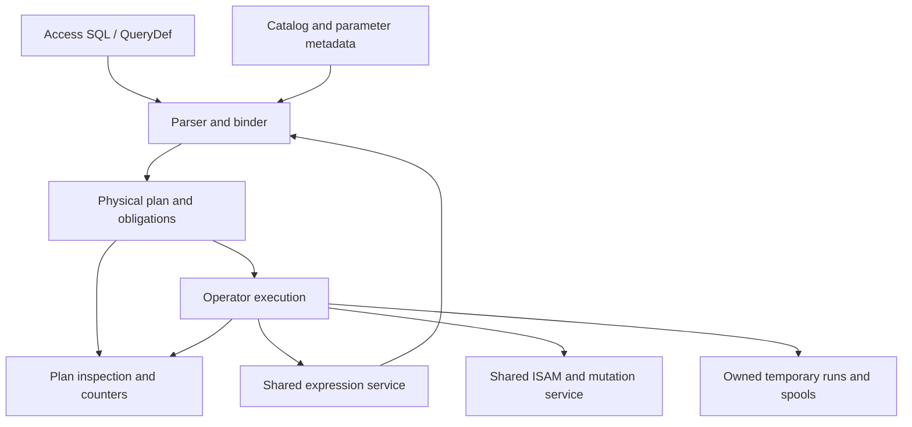
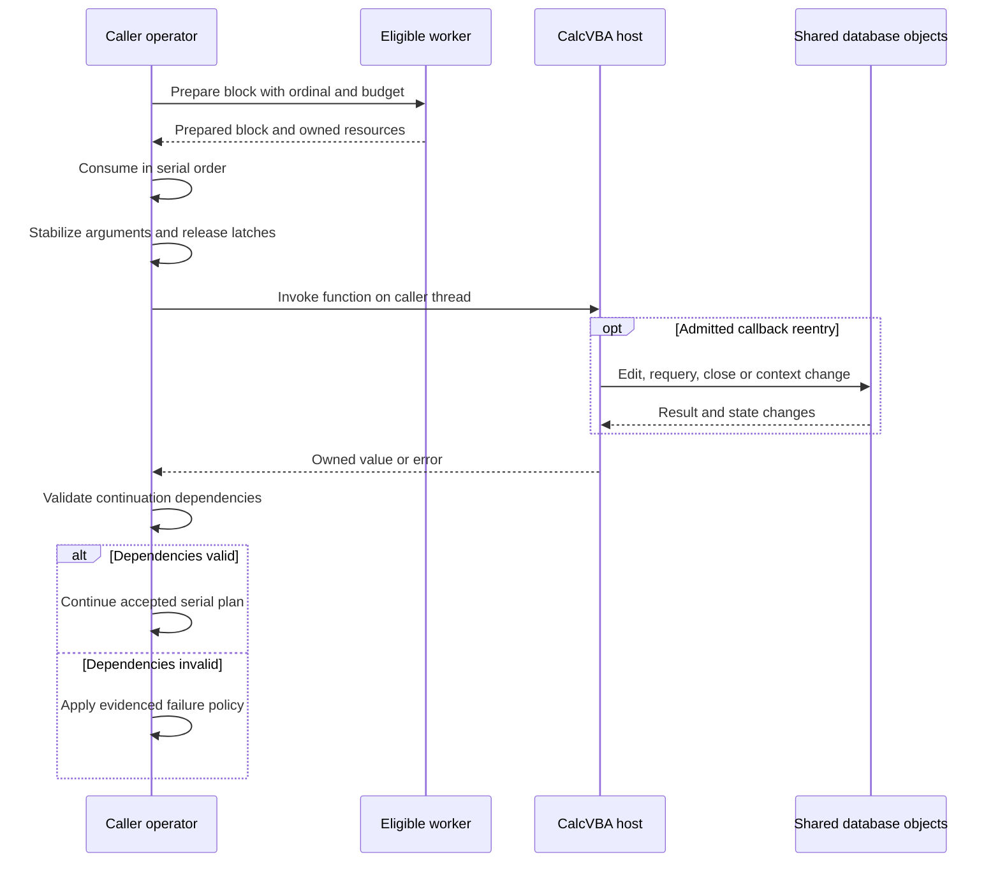

# I-11. Access SQL planning and execution

Revision 3 · Part I review · Stage 2, response 1 · 2026-11-13

**Requirement trace:** Primary: RQ-SQL-01, RQ-SQL-02, RQ-SQL-03, RQ-SQL-04, RQ-SQL-05, RQ-SQL-06, RQ-CALL-02, RQ-PLAN-01. Shared obligations: RQ-SQL-07, RQ-SQL-08, RQ-SEM-01, RQ-SEM-02, RQ-SEM-03, RQ-LATE-02, RQ-LATE-06, RQ-OUT-02, RQ-ORACLE-02, RQ-ISAM-01, RQ-VAL-02, RQ-EXPR-03, RQ-PERF-01, RQ-PERF-02. Full requirement text and Part II ownership are in I-16.

## Bind Access semantics before choosing operators

**D-SQL-1 — Recommended.** Use an Access grammar, typed binding and a small physical-operator engine over the shared ISAM and expression services. Cover SELECT, joins, subqueries, UNION, aggregates, crosstabs, PARAMETERS, actions and DDL; do not translate through another engine's SQL semantics. The binder produces result metadata, parameter declarations, row provenance, updateability, ordering/evaluation obligations and dependency generations.

Bind explicit PARAMETERS before the statement body; keep declarations separate from owned execution values.[^parameters] Unresolved names follow ACE's context-specific inference/error rules rather than always becoming “unknown column.” Resolve catalog and function dependencies through I-06/I-10. Reuse plans only after cheap dependency validation; changed schema, function registry, sandbox or semantic options invalidate the affected bindings.

**Figure F-12 — one bound plan, shared execution services.** Diagnostics describe the physical objects actually executed. Mermaid source only; not render-verified.

Each operator declares schema, value ownership, provenance, order, expression effects, memory budget and cancellation owner. A scalar pull interface serves DAO's incremental population; compatible operators may exchange bounded batches internally. Borrowed row views expire at the declared advancement boundary; retained results own their values or pins. Batch size must not change population, error timing or effects visible at a public call boundary.

## Physical algorithms and their limits

Prefer scans and indexed bounds with residual predicates, streaming filters/projections, and indexed nested-loop joins where the inner key is useful. Bounded block nested loops provide a general fallback. Hash/merge joins and join reordering require proven equivalence for outer-join Nulls, conversions, output order and evaluation effects; they are not unconditional “better” plans. Correlated subqueries retain invocation multiplicity unless safe decorrelation or memoization is established.

Estimate scanned pages, index probes, decoded fields, comparisons, rows retained and spill I/O from catalog information and measured local counters. Begin with a small cost model and deterministic tie rules; statistics caches are disposable. Do not spend more planning work than the short DAO/QueryDef calls justify. Reopen operator choice when representative measurements change these costs.

Sorting creates budgeted runs and merges them. Temporary records preserve types, Nulls, precision, provenance and necessary input ordinals; they are disposable work products. Grouping and DISTINCT use bounded hashing or sorting. Preserve each group's serial contribution order for Double folds and order-sensitive aggregates; spilling must retain that order. Aggregate initialization, step, final type, empty-input and Null rules are SQL-context policies over shared scalar primitives. Partial sums are not interchangeable with a serial fold. UNION ALL and UNION have separate concatenation, duplicate and type-resolution policies.

## Access-specific operators

DISTINCTROW retains the relevant source provenance and full-row comparison inputs; it cannot be implemented as DISTINCT over displayed fields. Microsoft's documented multi-table examples do not settle whether physically distinct, fully equal base rows collapse in every case. Retain identities and values until R-SQL-3 selects the exact rule; single-table and all-table projection cases are included.[^predicates]

TOP preserves the entire cutoff tie group. A bounded heap must therefore retain or spill ties; an internal locator used for stable ordering must not break SQL equality at the cutoff. TOP PERCENT additionally needs an evidenced count/rounding policy. Unordered TOP still has a serial reference behavior for the selected plan; documented freedom of selection does not authorize worker-dependent results.[^predicates]

Crosstabs with an explicit PIVOT IN list can establish fixed headings, including headings without data. Dynamic crosstabs have a separate discovery/metadata phase. Keep typed pivot keys distinct from rendered field names, with oracle-selected heading order, collision handling, Null rules and output types. Use a bounded aggregate/spool when discovery and output cannot safely share one streaming pass; never discover headings by reexecuting effectful expressions. R-SQL-3 fixes when Fields metadata becomes visible, including parameterized and empty results.[^transform]

Both wildcard modes are binding context, not parser-wide replacements. The effective DAO/ADO/database option precedence is tested separately. A LIKE range uses I-05's exact collation/key rules and retains a residual check unless complete equivalence is proved.[^wildcards]

## Actions share the cursor mutation path

**D-ACTION-1 — Provisional.** R-SQL-2 selects the stabilization boundary. Stabilize candidate identity when an update can change its own access path. Prefer an ordered identity spool when ACE's selection/evaluation boundary permits it; otherwise use a relocation-stable traversal whose physical changes cannot revisit or skip candidates. Eagerly collecting every predicate or assignment result is not automatically equivalent: it can move callback effects and errors ahead of mutations. The experiment selects the admissible stabilization point.

Each action uses the I-07 constraint/mutation service and I-08 statement/Workspace policy. Preserve evaluation counts and order, original-value dependencies, generated defaults/identities, cascades, affected counts and failure disposition. Test INSERT SELECT against its own target, key-moving UPDATE, join actions, DELETE, make-table queries and DDL. QueryDefs publish through the native catalog path. SQL has no second constraint implementation or durability protocol. The documented dbFailOnError conflict remains explicit until the full action/failure matrix settles it.[^execute]

## Serial equivalence and inspectable plans

**D-PAR-1 — Decided.** Eligibility and profitable thresholds require evidence. **K-PAR** requires establishing an ACE-compatible serial plan first. Workers may prepare independent blocks only where an ordered consumer can preserve row order, expression evaluation/error order and exact Double results. Preserve ordinals and perform order-sensitive folds serially; do not reassociate floating-point sums. Host VBA calls execute on the caller thread outside internal latches, and their multiplicity cannot change. Fall back to scalar execution when those obligations cannot be met. Worker admission also accounts for thread crossings, copied bytes and memory amplification, particularly on WASM.

**Figure F-13 — ordered worker preparation and caller-thread VBA reentry.** Workers are optional and prepare only eligible independent work; the caller owns observable expression evaluation and continuation. This is the provisional scheduling design selected by R-PAR-1/R-UDF-1, not an observed ACE schedule. Mermaid source only; not render-verified.

The callback cannot be replayed to rebuild stale preparation. A worker failure is published at the corresponding serial consumption point when that ordering is required, and retained worker resources remain bounded until consumed or safely discarded.

**K-PLAN** inspection returns the actual operator graph with stable IDs, access predicates, estimated costs/bounds and optional observed counters. Record why an otherwise plausible rewrite was ineligible. Expose this through diagnostics, without adding a private SQL dialect. SQLite's plan inspection illustrates useful access-path distinctions; its output format and planning semantics are not adopted.[^plans]

Capture the executed plan with every semantic or performance case. Acceptance combines ACE differentials with required seek/scan shapes and bounded-spill invariants; a faster incompatible plan is a failure.

## Deciding experiments

The full fixtures, captures, branch choices and effort estimates are in [A-02](A-02-experiments.md); the complete source ledger is in [A-01](A-01-sources.md). No experiment result is claimed here.

**R-SQL-1 (L)** uses R-EXPR-1 and R-SORT-3 to select admissible binder rules, operators and rewrites before W-06 completion. Exact typed results, errors and effects decide eligibility; actual-plan counters select cost among equivalent alternatives, under the [full card](A-02-experiments.md#r-sql-1--typed-relational-semantics-and-admissible-rewrites).

**R-SQL-2 (L)** decides the action-selection boundary and failure disposition before W-07, using R-TXN-1 and R-FMT-2 plus R-CAT-1 for catalog-changing branches. Its [full card](A-02-experiments.md#r-sql-2--action-stability-and-failure-disposition) selects an ordered identity spool or relocation-stable traversal without speculative or repeated callbacks.

**R-SQL-3 (L)** combines R-CAT-1's structure research, R-SQL-1 and R-CURSOR-1 to decide DISTINCTROW identity, TOP ties, parameter and crosstab metadata rules. SELECT evidence belongs before W-06 completion; saved-catalog write acceptance remains W-07, as separated in the [full card](A-02-experiments.md#r-sql-3--distinctrow-top-parameters-and-crosstab-schema).

**R-PAR-1 (M)** follows the relevant R-SQL-1/2/3 and R-UDF-1 evidence, comparing every candidate worker path with the accepted serial plan and ACE where applicable. A semantic difference rejects the path and a missing measured net gain retains serial execution; the [full card](A-02-experiments.md#r-par-1--serial-equivalence-before-worker-admission) never delays scalar delivery.

[^parameters]: Microsoft, [PARAMETERS declaration](https://learn.microsoft.com/en-us/office/client-developer/access/desktop-database-reference/parameters-declaration-microsoft-access-sql), updated 2022-06-14, accessed 2026-11-12. Documentary baseline, not a target-build execution result.
[^predicates]: Microsoft, [ALL, DISTINCT, DISTINCTROW, TOP](https://learn.microsoft.com/en-us/office/vba/access/concepts/structured-query-language/all-distinct-distinctrow-top-predicates-microsoft-access-sql), updated 2026-04-25, accessed 2026-11-12.
[^transform]: Microsoft, [TRANSFORM](https://learn.microsoft.com/en-us/office/client-developer/access/desktop-database-reference/transform-statement-microsoft-access-sql), updated 2022-06-14, accessed 2026-11-12. Its example places PARAMETERS before TRANSFORM; the prose calling TRANSFORM first is read in that context.
[^wildcards]: Microsoft, [Access wildcard character reference](https://support.microsoft.com/en-us/access/access-wildcard-character-reference), accessed 2026-11-12. Target surface/option precedence remains R-SQL-1 evidence.
[^execute]: Microsoft, [Database.Execute](https://learn.microsoft.com/en-us/office/client-developer/access/desktop-database-reference/database-execute-method-dao) and [QueryDef.Execute](https://learn.microsoft.com/en-us/office/client-developer/access/desktop-database-reference/querydef-execute-method-dao), accessed 2026-11-12; see I-08 for the contradiction and provisional interpretation.
[^plans]: SQLite, [EXPLAIN QUERY PLAN](https://sqlite.org/eqp.html), page dated 2025-05-31, accessed 2026-11-12; plan-inspection concept only. SQLite's [public-domain statement](https://sqlite.org/copyright.html) was checked for this documentation; no source code was reused.
