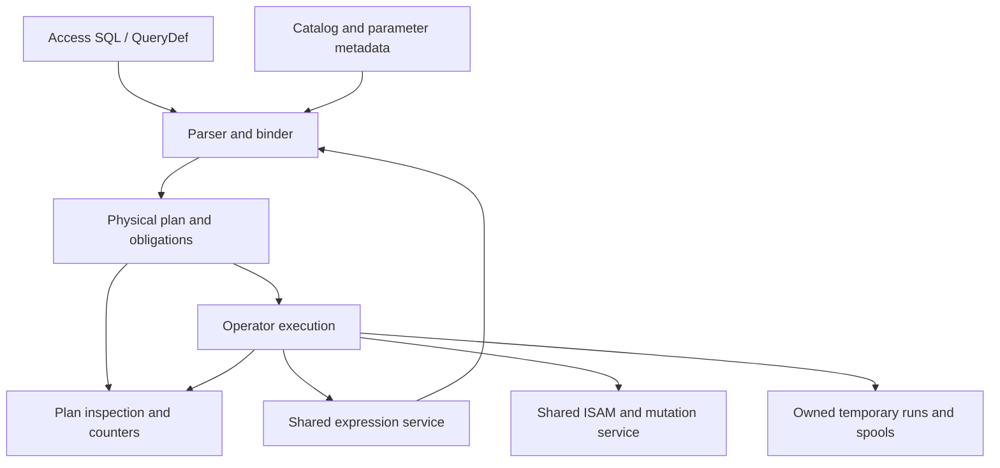
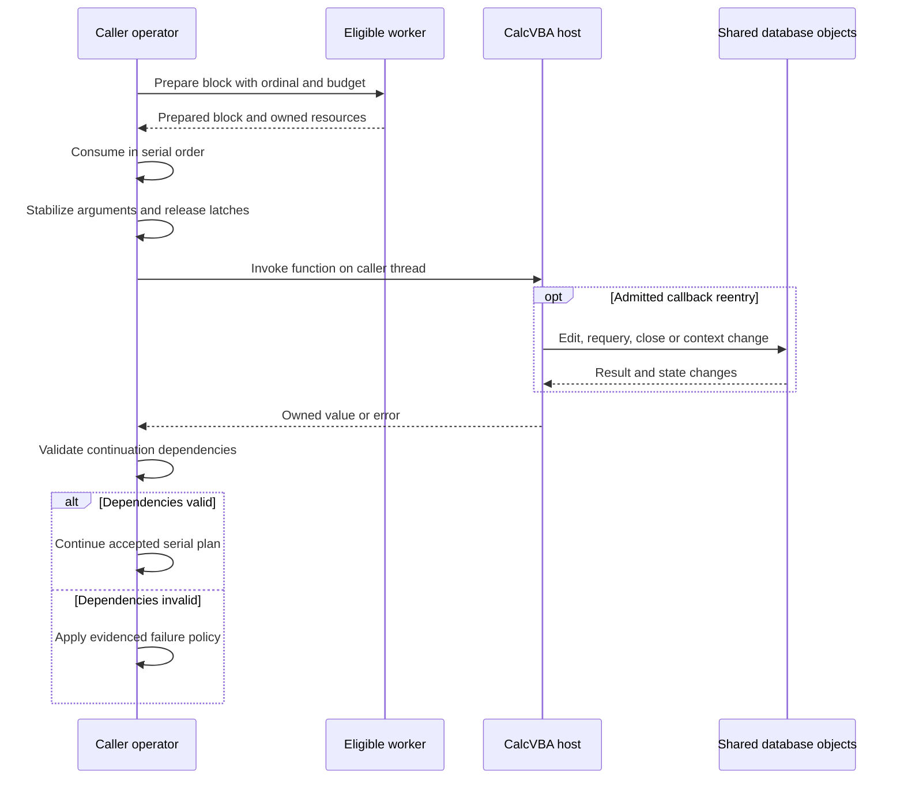

# I-11. Access SQL planning and execution

Revision 4 · Part I reconciliation · Stage 2, response 10 · 2026-11-13

**Requirement trace:** Primary: RQ-SQL-01, RQ-SQL-02, RQ-SQL-03, RQ-SQL-04, RQ-SQL-05, RQ-SQL-06, RQ-CALL-02, RQ-PLAN-01. Shared obligations: RQ-SQL-07, RQ-SQL-08, RQ-SEM-01, RQ-SEM-02, RQ-SEM-03, RQ-LATE-02, RQ-LATE-06, RQ-OUT-02, RQ-ORACLE-02, RQ-ISAM-01, RQ-VAL-02, RQ-EXPR-03, RQ-PERF-01, RQ-PERF-02. Full requirement text and Part II ownership are in I-16.

## Bind Access semantics before choosing operators

**D-SQL-1 — Recommended.** Use an Access grammar, typed binding and a small physical-operator engine over the shared ISAM and expression services. Cover SELECT, joins, subqueries, UNION, aggregates, crosstabs, PARAMETERS, actions and DDL; do not translate through another engine's SQL semantics. The binder produces result metadata, parameter declarations, row provenance, updateability, ordering/evaluation obligations and dependency generations.

Bind explicit PARAMETERS before the statement body; keep declarations separate from owned execution values.[^parameters] Unresolved names follow ACE's context-specific inference/error rules rather than always becoming “unknown column.” Resolve catalog and function dependencies through I-06/I-10. Reuse plans only after cheap dependency validation; changed schema, function registry, sandbox or semantic options invalidate the affected bindings.

II-11 makes the binder concrete: counted source and bounded syntax, distinct source occurrences/aliases, parameter declaration origins, immutable bound metadata and separately owned execution cells. Native external-file `IN` uses the same native database service and explicit file/Workspace context; it is not automatically a linked-provider capability. Query-owner authority and supported security DDL require the actual workgroup/principal context. Approximate product limits and conflicting documentary limits remain probe seeds, with checked internal capacity independent of the eventual native threshold.

**Figure F-12 — one bound plan, shared execution services.** Diagnostics describe the physical objects actually executed. Mermaid source only; not render-verified.

Each operator declares schema, value ownership, provenance, order, expression effects, memory budget and cancellation owner. A scalar pull interface serves DAO's incremental population; compatible operators may exchange bounded batches internally. Borrowed row views expire at the declared advancement boundary; retained results own their values or pins. Batch size must not change population, error timing or effects visible at a public call boundary.

## Physical algorithms and their limits

Prefer scans and indexed bounds with residual predicates, streaming filters/projections, and indexed nested-loop joins where the inner key is useful. A generic nested-loop implementation is the general fallback; bounded block variants must preserve or qualify the selected occurrence schedule. Hash/merge joins and join reordering require proven equivalence for outer-join Nulls, conversions, output order and evaluation effects. Correlated subqueries retain invocation multiplicity unless safe decorrelation or memoization is established. Outer joins record an ON match before applying WHERE, so a matched row whose matches all fail WHERE cannot acquire a spurious Null extension.

Every range needs separate candidate-inclusion and demand/error proofs. Complete-entry bounds use before/after-all-locators sentinels so a duplicate key run is not cut short; compound and descending mappings are descriptor-specific. A residual can reject extra candidates but cannot restore omitted matches or a skipped required error. II-11's constructed page-17/leaf witness has physical root order Id43,42 and decoded index order Id42,43; its overflow body is followed through the root and is never a third logical row. This is byte arithmetic, not a native-engine execution result.

Estimate scanned pages, index probes, decoded fields, comparisons, rows retained and spill I/O from catalog information and measured local counters. Begin with a small cost model and deterministic tie rules; statistics caches are disposable. Do not spend more planning work than the short DAO/QueryDef calls justify. Reopen operator choice when representative measurements change these costs.

Sorting creates budgeted runs and bounded merges. Temporary records encode active payloads, exact BSTR lengths, types, Nulls, precision, provenance and necessary input ordinals; they are disposable work products. Pointers and inactive VARIANT bytes are not serialized semantic values. Interface-valued payloads retain budgeted live owners and cannot become spillable merely by writing a handle. Run publication follows settled complete framing; incomplete writes never become readable intended extents.

Grouping and DISTINCT bind semantic equality independently of physical order and hash routing. Hashing requires equal values to have equal hashes; ordered stores require compatible equality classes. Aggregate spilling initially evicts/reloads exact descriptor state after accepted semantic steps. Preserve the global input/error/effect frontier as well as each group's numeric contribution order: partitioning all input before folding can invoke a later callback before discovering an earlier overflow. Aggregate initialization, step, result type, empty/Null behavior and finalization remain SQL-context policies over shared primitives. Statistical recurrences and the documented VarP/StDevP singleton discrepancy have independent probes. UNION ALL and UNION retain separate arm, type-conversion, duplicate and demand policies; mixed tokens are not collapsed into one global flag.

## Access-specific operators

**Preferred provisional DISTINCTROW rule:** compare the complete logical values of the source families that contribute projected values, retaining physical provenance separately. Microsoft's UniqueRecords wording supports that choice, while equal-value heap rows, aliases and computed projections still need R-SQL-3.[^unique] II-11's six-occurrence fixture distinguishes one projected-value class, two full-row classes and three physical identities. An equality class retains its update provenance or an owned recovery recipe without eagerly discovering future members. The documented single-source/all-sources-projected bypass cases remain explicit.[^predicates]

TOP initially uses full semantic sorting plus a cutoff iterator, or a proved compatible ordered access path. It preserves the entire cutoff tie group; an internal ordinal used for selected tie ordering does not enter cutoff equality. A later heap must retain/spill a potentially input-sized tie set. TOP PERCENT starts with the **provisional** checked ceiling of `N*p/100` from one accepted input execution; R-SQL-3 selects count location, rounding and admission. Unordered TOP still has a serial reference prefix for the selected plan; documented selection freedom does not authorize worker-dependent results.[^predicates]

Crosstabs with an explicit PIVOT IN list can establish fixed headings, including headings without data. Fixed schema readiness/publication is separate from cell population; a metadata request need not exhaust all cells. Dynamic crosstabs require heading discovery before complete schema publication. Keep typed pivot keys, displayed values, rendered names and ordinals distinct, and preserve absent cells separately from seen/all-Null cells. A bounded sparse cell-state store processes one accepted stream without repeating effects; row-summary aggregates have their own states. R-SQL-3 fixes heading order/collisions, missing-cell behavior and when Fields metadata becomes visible.[^transform]

Both wildcard modes are binding context, not parser-wide replacements. The effective DAO/ADO/database option precedence is tested separately. A LIKE range uses I-05's exact collation/key rules and retains a residual check unless complete equivalence is proved.[^wildcards]

## Actions share the cursor mutation path

**D-ACTION-1 — Provisional.** R-SQL-2 selects the stabilization boundary. Prefer an ordered identity spool only at a qualified discovery/evaluation boundary. When effects must remain interleaved, prefer a lazy walk over a protected immutable enumeration cut: preserve relevant old index/map/root images before the action overwrites them, including sources not yet acquired by the cursor. Membership/order protection is separate from the value view used for predicates and assignments. A visited set over a changing live tree is insufficient. Native evidence of required live/new membership would select an explicit mutation-aware enumeration policy instead.

Each action uses the I-07 constraint/mutation service and I-08 statement/Workspace policy. Preserve evaluation counts and order, original-value dependencies, generated defaults/identities, cascades, affected counts and failure disposition. Test INSERT SELECT against its own target, key-moving UPDATE, join actions, DELETE, make-table queries and DDL. QueryDefs publish through the native catalog path. SQL has no second constraint implementation or durability protocol. The documented dbFailOnError conflict remains explicit until the full action/failure matrix settles it.[^execute]

Source occurrences, distinct targets, accepted mutations and exposed affected counts remain separate. Joined-target coalescing has a named phase; the initial candidate is after qualification and before assignment, subject to native evidence. SQL CHECK has its own binding/persistence descriptor because its documented scope can exceed DAO's row-local TableDef.ValidationRule; it still invokes the common mutation/constraint service.[^check] DDL coverage includes tables/indexes/constraints, saved views/procedures, supported workgroup/security statements and password operations under their actual profile/phase. Required native forms cannot disappear because their catalog or security integration is difficult. SELECT INTO owns schema creation and row insertion with separately captured visibility/failure stages.

## Serial equivalence and inspectable plans

**D-PAR-1 — Decided.** Eligibility and profitable thresholds require evidence. **K-PAR** requires establishing an ACE-compatible serial plan first. Workers may prepare independent blocks only where an ordered consumer can preserve row order, expression evaluation/error order and exact Double results. Preserve ordinals and perform order-sensitive folds serially; do not reassociate floating-point sums. Host VBA calls execute on the caller thread outside internal latches, and their multiplicity cannot change. Fall back to scalar execution when those obligations cannot be met. Worker admission also accounts for thread crossings, copied bytes and memory amplification, particularly on WASM.

**Figure F-13 — ordered worker preparation and caller-thread VBA reentry.** Workers are optional and prepare only eligible independent work; the caller owns observable expression evaluation and continuation. This is the provisional scheduling design selected by R-PAR-1/R-UDF-1, not an observed ACE schedule. Mermaid source only; not render-verified.

The callback cannot be replayed to rebuild stale preparation. A worker failure is published at the corresponding serial consumption point when that ordering is required, and retained worker resources remain bounded until consumed or safely discarded.

**K-PLAN** inspection returns the installed operator graph with stable IDs, access predicates, estimated costs/bounds and observed counters. Spill, fallback and permitted physical replacement appear as actual continuation events with their accepted frontier; recomputing an explanation afterward is insufficient. Record why an otherwise plausible rewrite was ineligible. Expose this through diagnostics, without adding a private SQL dialect. SQLite's plan inspection illustrates useful access-path distinctions; its output format and planning semantics are not adopted.[^plans]

Capture the executed plan with every semantic or performance case. Acceptance combines ACE differentials with required seek/scan shapes and bounded-spill invariants; a faster incompatible plan is a failure.

## Deciding experiments

The full fixtures, captures, branch choices and effort estimates are in [A-02](A-02-experiments.md); the complete source ledger is in [A-01](A-01-sources.md). No experiment result is claimed here.

**R-SQL-1 (L)** uses R-EXPR-1 and R-SORT-3 to select admissible binder rules, operators and rewrites before W-06 completion. Exact typed results, errors and effects decide eligibility; actual-plan counters select cost among equivalent alternatives, under the [full card](A-02-experiments.md#r-sql-1--typed-relational-semantics-and-admissible-rewrites).

**R-SQL-2 (L)** decides the action-selection boundary and failure disposition before W-07, using R-TXN-1 and R-FMT-2 plus R-CAT-1 for catalog-changing branches. Its [full card](A-02-experiments.md#r-sql-2--action-stability-and-failure-disposition) selects an admitted spool or protected lazy enumeration, value visibility, coalescing/counts and CHECK/DDL/security recipes.

**R-SQL-3 (L)** combines relevant R-CAT-1 structure research, R-SQL-1 and R-CURSOR-1 to decide DISTINCTROW equivalence/provenance, TOP ties, parameters and independent crosstab schema/population timing. SELECT evidence precedes W-06 completion; saved-catalog writing remains W-07, as separated in the [full card](A-02-experiments.md#r-sql-3--distinctrow-top-parameters-and-crosstab-schema).

**R-PAR-1 (M)** follows the relevant R-SQL-1/2/3 and R-UDF-1 evidence, comparing every candidate worker path with the accepted serial plan and ACE where applicable. A semantic difference rejects the path and a missing measured net gain retains serial execution; the [full card](A-02-experiments.md#r-par-1--serial-equivalence-before-worker-admission) never delays scalar delivery.

[^parameters]: Microsoft, [PARAMETERS declaration](https://learn.microsoft.com/en-us/office/client-developer/access/desktop-database-reference/parameters-declaration-microsoft-access-sql), updated 2022-06-14, accessed 2026-11-12. Documentary baseline, not a target-build execution result.
[^unique]: [S-MS-UNIQUE-RECORDS] Microsoft, [UniqueRecords property](https://learn.microsoft.com/en-us/office/vba/access/concepts/miscellaneous/uniquerecords-property), updated 2026-04-25; definition/remarks inspected 2026-11-13. Supports the full-logical-row starting hypothesis, not a native heap-row or update-mapping result.
[^check]: [S-MS-SQL-MODIFY-DESIGN] Microsoft, [Modify a table's design using Access SQL](https://learn.microsoft.com/en-us/office/vba/access/concepts/structured-query-language/modify-a-table-s-design-using-access-sql), CHECK discussion inspected 2026-11-13; exact source/read extent and limitations in A-01. Required native syntax, context and persistence are R-SQL-2/R-CAT-1 work, separate from DAO validation properties.
[^predicates]: Microsoft, [ALL, DISTINCT, DISTINCTROW, TOP](https://learn.microsoft.com/en-us/office/vba/access/concepts/structured-query-language/all-distinct-distinctrow-top-predicates-microsoft-access-sql), updated 2026-04-25, accessed 2026-11-12.
[^transform]: Microsoft, [TRANSFORM](https://learn.microsoft.com/en-us/office/client-developer/access/desktop-database-reference/transform-statement-microsoft-access-sql), updated 2022-06-14, accessed 2026-11-12. Its example places PARAMETERS before TRANSFORM; the prose calling TRANSFORM first is read in that context.
[^wildcards]: Microsoft, [Access wildcard character reference](https://support.microsoft.com/en-us/access/access-wildcard-character-reference), accessed 2026-11-12. Target surface/option precedence remains R-SQL-1 evidence.
[^execute]: Microsoft, [Database.Execute](https://learn.microsoft.com/en-us/office/client-developer/access/desktop-database-reference/database-execute-method-dao) and [QueryDef.Execute](https://learn.microsoft.com/en-us/office/client-developer/access/desktop-database-reference/querydef-execute-method-dao), accessed 2026-11-12; see I-08 for the contradiction and provisional interpretation.
[^plans]: SQLite, [EXPLAIN QUERY PLAN](https://sqlite.org/eqp.html), page dated 2025-05-31, accessed 2026-11-12; plan-inspection concept only. SQLite's [public-domain statement](https://sqlite.org/copyright.html) was checked for this documentation; no source code was reused.
