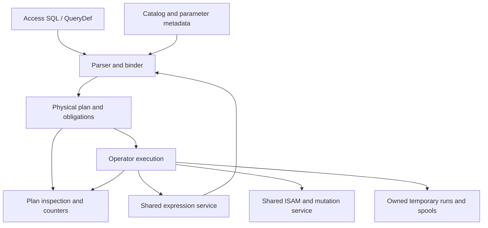

# I-11. Access SQL planning and execution

Revision 2 · Stage 1, response 3 · 2026-11-12

## Bind Access semantics before choosing operators

**D-SQL-1 — recommended.** Use an Access grammar, typed binding and a small physical-operator engine over the shared ISAM and expression services. Cover SELECT, joins, subqueries, UNION, aggregates, crosstabs, PARAMETERS, actions and DDL; do not translate through another engine's SQL semantics. The binder produces result metadata, parameter declarations, row provenance, updateability, ordering/evaluation obligations and dependency generations.

Bind explicit PARAMETERS before the statement body; keep declarations separate from owned execution values.[^parameters] Unresolved names follow ACE's context-specific inference/error rules rather than always becoming “unknown column.” Resolve catalog and function dependencies through I-06/I-10. Reuse plans only after cheap dependency validation; changed schema, function registry, sandbox or semantic options invalidate the affected bindings.

**Figure F-12 — one bound plan, shared execution services.** Diagnostics describe the physical objects actually executed. Mermaid source only; not render-verified.

Each operator declares schema, value ownership, provenance, order, expression effects, memory budget and cancellation owner. A scalar pull interface serves DAO's incremental population; compatible operators may exchange bounded batches internally. Borrowed row views expire at the declared advancement boundary; retained results own their values or pins. Batch size must not change population, error timing or effects visible at a public call boundary.

## Physical algorithms and their limits

Prefer scans and indexed bounds with residual predicates, streaming filters/projections, and indexed nested-loop joins where the inner key is useful. Bounded block nested loops provide a general fallback. Hash/merge joins and join reordering require proven equivalence for outer-join Nulls, conversions, output order and evaluation effects; they are not unconditional “better” plans. Correlated subqueries retain invocation multiplicity unless safe decorrelation or memoization is established.

Estimate scanned pages, index probes, decoded fields, comparisons, rows retained and spill I/O from catalog information and measured local counters. Begin with a small cost model and deterministic tie rules; statistics caches are disposable. Do not spend more planning work than the short DAO/QueryDef calls justify. Reopen operator choice when representative measurements change these costs.

Sorting creates budgeted runs and merges them. Temporary records preserve types, Nulls, precision, provenance and necessary input ordinals; they are disposable work products. Grouping and DISTINCT use bounded hashing or sorting. Preserve each group's serial contribution order for Double folds and order-sensitive aggregates; spilling must retain that order. Aggregate initialization, step, final type, empty-input and Null rules are SQL-context policies over shared scalar primitives. Partial sums are not interchangeable with a serial fold. UNION ALL and UNION have separate concatenation, duplicate and type-resolution policies.

## Access-specific operators

DISTINCTROW retains the relevant source provenance and full-row comparison inputs; it cannot be implemented as DISTINCT over displayed fields. Microsoft's documented multi-table examples do not settle whether physically distinct, fully equal base rows collapse in every case. Retain identities and values until R-SQL-3 selects the exact rule; single-table and all-table projection cases are included.[^predicates]

TOP preserves the entire cutoff tie group. A bounded heap must therefore retain or spill ties; an internal locator used for stable ordering must not break SQL equality at the cutoff. TOP PERCENT additionally needs an evidenced count/rounding policy. Unordered TOP still has a serial reference behavior for the selected plan; documented freedom of selection does not authorize worker-dependent results.[^predicates]

Crosstabs with an explicit PIVOT IN list can establish fixed headings, including headings without data. Dynamic crosstabs have a separate discovery/metadata phase. Keep typed pivot keys distinct from rendered field names, with oracle-selected heading order, collision handling, Null rules and output types. Use a bounded aggregate/spool when discovery and output cannot safely share one streaming pass; never discover headings by reexecuting effectful expressions. R-SQL-3 fixes when Fields metadata becomes visible, including parameterized and empty results.[^transform]

Both wildcard modes are binding context, not parser-wide replacements. The effective DAO/ADO/database option precedence is tested separately. A LIKE range uses I-05's exact collation/key rules and retains a residual check unless complete equivalence is proved.[^wildcards]

## Actions share the cursor mutation path

**D-ACTION-1 — provisional under R-SQL-2.** Stabilize candidate identity when an update can change its own access path. Prefer an ordered identity spool when ACE's selection/evaluation boundary permits it; otherwise use a relocation-stable traversal whose physical changes cannot revisit or skip candidates. Eagerly collecting every predicate or assignment result is not automatically equivalent: it can move callback effects and errors ahead of mutations. The experiment selects the admissible stabilization point.

Each action uses the I-07 constraint/mutation service and I-08 statement/Workspace policy. Preserve evaluation counts and order, original-value dependencies, generated defaults/identities, cascades, affected counts and failure disposition. Test INSERT SELECT against its own target, key-moving UPDATE, join actions, DELETE, make-table queries and DDL. QueryDefs publish through the native catalog path. SQL has no second constraint implementation or durability protocol. The documented dbFailOnError conflict remains explicit until the full action/failure matrix settles it.[^execute]

## Serial equivalence and inspectable plans

**D-PAR-1 — decided constraint; thresholds measured.** Establish an ACE-compatible serial plan first. Workers may prepare independent blocks only where an ordered consumer can preserve row order, expression evaluation/error order and exact Double results. Preserve ordinals and perform order-sensitive folds serially; do not reassociate floating-point sums. Host VBA calls execute on the caller thread outside internal latches, and their multiplicity cannot change. Fall back to scalar execution when those obligations cannot be met. Worker admission also accounts for thread crossings, copied bytes and memory amplification, particularly on WASM.

Inspection returns the actual operator graph with stable IDs, access predicates, estimated costs/bounds and optional observed counters. Record why an otherwise plausible rewrite was ineligible. Expose this through diagnostics, without adding a private SQL dialect. SQLite's plan inspection illustrates useful access-path distinctions; its output format and planning semantics are not adopted.[^plans]

R-SQL-1 compares typed values, Null/error behavior, joins and wildcard contexts; R-SQL-2 compares actions and failure boundaries; R-SQL-3 compares DISTINCTROW, TOP, crosstab metadata and parameters. R-PAR-1 compares exact ordered rows, Double bit patterns, callback traces and first errors against the accepted serial path. Capture the executed plan with every case. Acceptance combines ACE differentials with required seek/scan shapes and bounded-spill invariants; a faster incompatible plan is a failure.

## Detailed experiment cards

All cards in this chapter are planned experiments, with no target-build observations claimed. I-15 defines the shared capture, comparison, ambiguity and cross-build conditions; the conditions below extend that contract. Research prerequisites require the relevant evidence or minimal probe, not completion of a later production subsystem.

### R-SQL-1 — Typed relational semantics and admissible rewrites

**Question / conditions:** which binder/operator contracts preserve Access results and effects? Cross ANSI modes and direct SQL/saved QueryDef/DAO, with ADO as a separately captured surface when available. **Fixture / operations:** controlled joins including outer Null extension, correlated subqueries, UNION variants, group/empty aggregates, mixed type/coercion boundaries, text ranges and LIKE patterns; compare candidate scan and seek shapes against the same semantic input. **Capture / comparison:** exact types, values, multiplicity/order, effects and first error; include the CalcDb executed plan, not a separately reconstructed explanation. Order freedom is classified, while each parallel path still owes its serial reference. **Decides:** equivalence admits a rewrite/access path; changed coercion, effects or errors keep the less transformed plan. Missing coverage produces an explicit unresolved feature entry. **Depends / size:** R-EXPR-1, R-SORT-3; L. Precedes W-06; counters then determine costs among admissible plans.

### R-SQL-2 — Action stability and failure disposition

**Question / conditions:** where may selection be stabilized, and which effects survive failure? Cross action kind, dbFailOnError, dbSeeChanges, explicit/nested transactions and failure class. **Fixture / operations:** indexed key-moving updates in both directions, joined duplicate candidates, self-target INSERT SELECT, DELETE/cascades, make-table/DDL and native QueryDef changes. Place unique/validation/conversion/UDF/lock failures at first, middle and last candidates; storage failures link to R-CRASH-2. **Capture / comparison:** candidate identities/order, assignment/predicate effects, generated values, affected counts, errors, subsequent transaction usability and surviving file/catalog changes. **Decides:** an evidenced selection boundary permits an ordered spool; interleaved effects require relocation-stable traversal without speculative callbacks. Per-option failure results choose statement undo or retained partial progress. Do not generalize the documented lock-failure example to all failures. **Depends / size:** R-TXN-1, R-FMT-2, R-CAT-1; L. Before W-07.

### R-SQL-3 — DISTINCTROW, TOP, parameters and crosstab schema

**Question / conditions:** what identity, tie and metadata rules need dedicated operators? **Fixture / operations:** equal projected values from distinct and fully equal base rows, repeated joins, aliases/outer joins and one/all-table projection; TOP boundary ties, multicolumn/Null ordering, PERCENT and unordered inputs; fixed/dynamic PIVOT headings with absent data, collisions, Null, empty results and repeated parameter values. **Capture / comparison:** multiplicity/order/updateability, typed parameters, field names/order/types and availability after each call, plus expression/effect trace. **Decides:** duplicate outcomes select identity/value keys; tie outcomes select cutoff comparator and count/rounding; metadata timing selects discovery/materialization boundaries without repeating effects. Documentation leaves these detailed cases unconfirmed. **Depends / size:** R-CAT-1 research, R-SQL-1, R-CURSOR-1; L. SELECT/operator evidence precedes completion of W-06; saved-catalog write acceptance remains W-07.

### R-PAR-1 — Serial equivalence before worker admission

**Question / conditions:** which worker paths preserve the accepted serial execution and improve measured cost? Use fixed input/capture IDs, plan/operator IDs, budgets and reproducible scheduler seeds; compare no-worker with each proposed parallel path. **Fixture / operations:** cancellation-sensitive Double sequences, ties, skewed/spilling groups, mixed errors, UDF traces and memory-pressure/close/cancel cases. Use numerical cancellation patterns, not only small positive sums. **Capture / comparison:** exact ordered typed rows, Double bit patterns, effects/first error, resource conservation, page/spill/copy/synchronization counters and timing with A/A noise controls. Both modes are separately checked against ACE where applicable. **Decides:** any semantic difference rejects eligibility; equivalence without a measured net gain keeps serial execution. No profitable threshold is invented. **Depends / size:** R-SQL-1/2/3 and R-UDF-1; M. Optional parallelism cannot delay the scalar path or justify a separate evaluator.

[^parameters]: Microsoft, [PARAMETERS declaration](https://learn.microsoft.com/en-us/office/client-developer/access/desktop-database-reference/parameters-declaration-microsoft-access-sql), updated 2022-06-14, accessed 2026-11-12. Documentary baseline, not a target-build execution result.
[^predicates]: Microsoft, [ALL, DISTINCT, DISTINCTROW, TOP](https://learn.microsoft.com/en-us/office/vba/access/concepts/structured-query-language/all-distinct-distinctrow-top-predicates-microsoft-access-sql), updated 2026-04-25, accessed 2026-11-12.
[^transform]: Microsoft, [TRANSFORM](https://learn.microsoft.com/en-us/office/client-developer/access/desktop-database-reference/transform-statement-microsoft-access-sql), updated 2022-06-14, accessed 2026-11-12. Its example places PARAMETERS before TRANSFORM; the prose calling TRANSFORM first is read in that context.
[^wildcards]: Microsoft, [Access wildcard character reference](https://support.microsoft.com/en-us/access/access-wildcard-character-reference), accessed 2026-11-12. Target surface/option precedence remains R-SQL-1 evidence.
[^execute]: Microsoft, [Database.Execute](https://learn.microsoft.com/en-us/office/client-developer/access/desktop-database-reference/database-execute-method-dao) and [QueryDef.Execute](https://learn.microsoft.com/en-us/office/client-developer/access/desktop-database-reference/querydef-execute-method-dao), accessed 2026-11-12; see I-08 for the contradiction and provisional interpretation.
[^plans]: SQLite, [EXPLAIN QUERY PLAN](https://sqlite.org/eqp.html), page dated 2025-05-31, accessed 2026-11-12; plan-inspection concept only. SQLite's [public-domain statement](https://sqlite.org/copyright.html) was checked for this documentation; no source code was reused.
