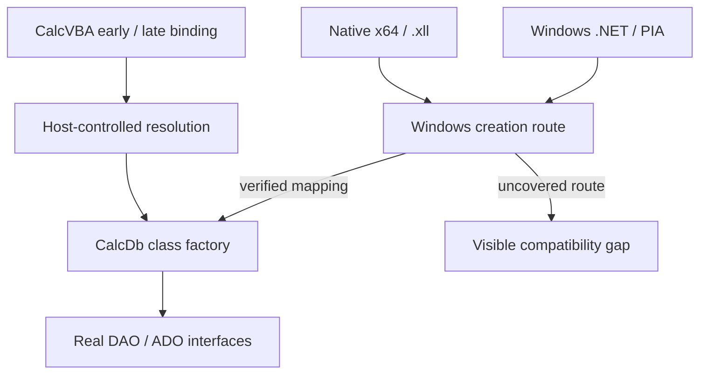

# I-13. COM, activation and DNA Calc integration

Revision 3 · Part I review and Stage 2, response 12 · 2026-11-14

**Requirement trace:** Primary: RQ-PROD-02, RQ-COM-01, RQ-COM-02, RQ-COM-03, RQ-CALL-01, RQ-PORT-02, RQ-PORT-03, RQ-HOST-01. Shared obligations: RQ-PROD-01, RQ-PROD-06, RQ-SEM-03, RQ-ADO-01, RQ-ADO-02, RQ-LATE-05, RQ-VAL-01, RQ-EXPR-01, RQ-EXPR-02, RQ-CALL-03. Full requirement text and Part II ownership are in I-16.

## Separate creation identity from interface compatibility

**D-ACT-1 — Provisional.** Prefer host-managed, scoped registration-free activation, with host-owned factories where demonstrated necessary. CalcDb has its own public CLSIDs and ProgIDs, alongside ACE, and implements the required genuine DAO and ADO interfaces. Compatibility mappings belong to DNA Calc's host integration. They must reach unchanged VBA, native `.xll` and .NET clients without changing those clients' database calls. R-ACT-1 confirms or changes the chosen route; an unsupported required creation route remains an initial-scope compatibility gap. This implements **RQ-PROD-02**, **RQ-COM-01**, **RQ-COM-02** and **K-COM**.

II-13 makes these routes concrete through one captured interface inventory, target declaration profiles, activation bindings and retained host capabilities; its 64 T-INT acceptance families remain planned/unexecuted. Three operations need separate evidence. ProgID resolution selects a class identity. Class activation selects an implementation in a requested execution context. QueryInterface obtains an interface on an existing object. CoCreateInstance receives a CLSID, context and requested IID, then obtains a class factory and creates an instance. Supporting a DAO IID alone cannot redirect creation.[^creation]

A host alias for `DAO.DBEngine.120` affects paths using that resolver. Native code may instead call Windows directly with an embedded CLSID, retain a class factory, or receive an already-created object. PIA construction may use imported coclass metadata. Preserve these distinctions in the activation inventory, including type-library resolution before creation. Obtain actual CLSIDs, IIDs, DISPIDs and versions from permitted public metadata and actual client declarations; infer none from the Office16 directory name. Copy the full type graph through nonregistering LoadTypeLibEx, reconcile inherited/dual views and native slot offsets, and generate typed entries, dispatch recipes and type-information projections from that one inventory. Office binaries are evidence inputs, not assumed redistributable dependencies.

Expose CalcDb's own identities in its deployment metadata and any explicitly selected per-user registration. Within DNA Calc, supply explicit compatibility mappings through the chosen resolver, activation context or host-owned factory. Original creation identities needed by unchanged binaries must be represented as well as string aliases. Outside DNA Calc, redirection of Microsoft identities remains an explicit opt-in, per-user testing arrangement. Host compatibility activation requires no registry changes; no implementation or experiment changes HKLM.

## Windows activation paths

**Figure F-14 — creation routes converge on real interfaces.** Arrows describe the intended routing, not demonstrated coverage. Mermaid source only; not render-verified.

Prefer a native DLL with registration-free activation as the first Windows candidate. Microsoft documents that COM checks the active context for ProgID-to-CLSID and CLSID-to-DLL mappings before registry fallback. This can address both string lookup and hard-coded CLSID creation when the required mappings exist. It does not establish coverage for every loader, cached object or scheduler entry. A retained factory keeps its selection; retained ITypeInfo can perform new class activation and is tested separately.[^contexts]

DNA Calc owns activation-context installation and lifetime around relevant entry paths. ActivateActCtx pushes a thread-associated context; the matching cookie is deactivated on that thread in reverse order. Capture an owned outcome and finish scope/profile cleanup before final COM error/output publication. Windows documents current-context inheritance by CreateThread and propagation on described callback/message routes; COM also propagates the creating context to its selected creation host thread. Pre-existing pools, managed scheduling, nested scopes and cached factories require separate evidence. Manifest class, type-library and threading metadata must describe the actual component.[^scope][^ctxthreads]

A host-owned in-process class factory is the second candidate. REGCLS documents locally satisfied creation through EXE-registered in-process factories. CoRegisterClassObject permits the EXE to publish internal objects for itself and DLLs it uses; the DLL server exports DllGetClassObject. Keep registration/revocation, references and shutdown with the host, rather than treating an arbitrary server DLL as a universal activation override.[^factories] Test precedence and coexistence when ACE is installed, including combined CLSCTX values and retained factories.

Use a lookup-only host resolver for known aliases. CLSIDFromProgID can create an OLE1 identity and registry entry for an absent name; CLSIDFromProgIDEx can trigger policy-enabled installation. Direct unchanged-client missing-name behavior is therefore captured only in a preconfigured disposable environment, never by speculative probing on the user's installation. A missing active mapping can fall back to registered ACE, so selection provenance is part of every route's acceptance.[^progidrules]

The chosen bindings must instantiate CalcDb. Successful data access through accidentally activated ACE is an activation failure, even when results match. Record factory and loaded-module provenance. Likewise, initial ADO creation must yield **CalcDb's ADO object model**; its connection-string handling routes `Microsoft.ACE.OLEDB.12.0` to the shared engine. Microsoft's ADO using a future CalcDb OLE DB provider is a separate later capability.

## Interface, value and lifetime contracts

Maintain one evidenced interface inventory: inheritance, method order, calling convention, parameter direction, optional/default values, IIDs, DISPIDs and ownership. Use it to check native declarations, Windows exposure and the portable implementation. Vtable and dispatch adapters reach the same object-model operations; neither supplies a second DAO implementation.

QueryInterface has a static supported-interface set and a consistent controlling IUnknown identity; success returns a retained reference. Close changes resource state, not object identity or the supported-interface set.[^identity] Keep collection/child identity and post-Close errors consistent with I-12. Class factories, outstanding object references, active calls, metadata descriptors, event delivery and deferred cleanup retain the code/services they need. DllCanUnloadNow returns S_FALSE while referenced obligations remain; the host releases its module owner from outside active calls. Deferred EXCEPINFO callbacks and spreadsheet cleanup functions need explicit code lifetime even when no ordinary database reference remains.[^unload] A collection may release its reference without destroying an object still held by a client. Rust unwinding cannot cross the public ABI; boundary failures follow the error policy, with internal defects retained diagnostically.

IDispatch requires the published member identifiers, method/property invocation flags, named and optional arguments, reversed positional argument layout, LCID behavior and correct EXCEPINFO/argument-error reporting. Type information, default members and enumeration must support the callers that consume them.[^dispatch] Capture HRESULT, DAO/ADO Errors and managed exception projection as distinct outputs. QueryInterface success and one scalar method are insufficient evidence for the entire surface.

**D-VALUE-1 — Decided representation; provisional package.** The shared value is the real platform Automation VARIANT and real BSTR, with common CalcVBA conversions and functions. Windows x64 VARIANT is **24 bytes**. Current CalcVBA instead uses its own 16-byte value and converts at the COM boundary; that implementation is being corrected, and CalcDb assumes the corrected exact layout. There is no compact CalcDb semantic value hidden behind a COM facade. Match allocator/free and deep-copy/reference rules, retain required by-reference writeback, and preserve array shape, Decimal/Currency precision and distinctions among Empty, Null, missing and error values. Public owned values never alias cursor scratch or evictable pages; II-02 specifies **K-VALUE**, **K-STRING** and **K-ADMISSION** in detail.[^integration][^valueabi]

These rules apply equally to callbacks. Under **K-THREAD** and **K-ERROR**, prepare stable arguments, release internal latches and invoke VBA on the caller thread. On return, validate cursor, catalog, transaction, function-registry and retained-plan dependencies before continuation. Reentry may close an object or alter the query's meaning while its memory remains alive. Neither invalidation nor physical preparation failure permits repeating a host effect. Logical database locks retain their independently evidenced ACE lifetime.

## Runtime and platform matrix

Windows COM and native add-ins target **x64 only**. **RQ-COM-03** requires both installed .NET Framework 4.8-family and .NET 10 LTS; **RQ-PORT-02** requires genuine COM interfaces across supported platforms. Keep the following delivery lanes independent; passing one does not establish another.

| Lane | Required caller and boundary evidence |
| --- | --- |
| CalcVBA on Windows | Early-bound type-library/vtable calls and late-bound creation/dispatch through the actual runtime. |
| Native Windows | Existing x64 `.xll` inside DNA Calc, plus focused native probes for direct CLSID, ProgID and factory paths. |
| .NET Framework 4.8 family | Actual installed runtime, unchanged client/PIA metadata, coclass creation, typed calls and late binding. |
| .NET 10 LTS on Windows | Its own host/client/PIA loading, built-in COM interop, creation, dispatch and ownership captures. |
| Native non-Windows and wasm32 | CalcVBA's client using the new portable services; no claim that Microsoft's .NET COM runtime becomes portable. |

The selected ACE oracle is the user-reported ACEDAO.DLL **16.0.20527.20016**. Capture the actually loaded engine, Access host, CLR, client and PIA independently. Microsoft's PIA inventory names `Microsoft.Office.Interop.Access.Dao.dll`; its assembly identity is not inferred from the engine's file version. Imported coclass metadata participates in construction, and RCWs consume identity, type information, errors and enumeration in addition to method signatures.[^managed]

Modern .NET documents built-in COM interop on Windows alongside ComWrappers/source generation. Prefer the existing interop route for unchanged PIA clients; NativeAOT or rewritten wrappers are unnecessary initial prerequisites. Keep actual coclass, embedded-interop identity, imported directions/defaults and assembly binding. Framework registration-free CLR deployment guidance does not establish the corresponding .NET 10 behavior.[^net]

Prefer a native host capable of the installed Framework 4.8-family plus one selected modern runtime, initially .NET 10. Current Excel-DNA documentation supports this coexistence model; actual DNA Calc loading, load order, original runtime configuration and dependency identities remain I-HOST-1 evidence. Preserve add-in settings rather than silently retargeting or changing roll-forward. Framework AppDomains and modern load contexts have distinct loading/unload behavior; retained providers, delegates and event sinks retain their actual runtime owner.[^runtimehost]

Compare the native Automation result and the managed projection separately. A native Currency can arrive as managed Decimal and return as VT_DECIMAL in an ordinary object round trip; raw subtype fidelity cannot be established from managed value equality. Test actual rank/lower-bound array signatures, binder failures before entry, preserved HRESULT versus exception projection and RCW aliases. Host shutdown never force-releases arbitrary shared client RCWs.[^managedprojection]

Separate build-tool failure from runtime failure. ResolveComReference is unsupported in the .NET Core MSBuild used by `dotnet build`; a pinned PIA/pre-generated wrapper reference or the documented Framework-MSBuild tool route avoids confusing that limitation with COM consumption.[^build] Preserve existing client binaries and metadata when testing unchanged operation; rebuilding a representative probe is a separately labelled result.

Windows thread initialization belongs to the actual caller/host owner; balance its successful CoInitializeEx calls without reinitializing a foreign thread or doing COM startup in DllMain.[^threads] Prefer Both class metadata provisionally only with synchronized factories/MTA object state; R-ACT-1 can select class-specific alternatives. Record initiating caller with provenance or Unknown, actual server-entry thread and CalcVBA runtime owner. A synchronous marshaled call can keep its origin blocked while executing elsewhere; VBA callback ownership still needs a qualified route. No automatic agile/free-threaded-marshaler claim or internal-worker callback satisfies that requirement.[^threadmodel]

## Portable COM and the host boundary

The supplied CalcVBA note, tied to commit **8115aa781**, establishes that its COM client is Windows-only today. CalcVBA's portable stand-in is a decided direction and **does not exist yet**. CalcVBA owns its implementation; CalcDb specifies and exercises the following concrete requirements under **RQ-PORT-03** and **K-COM**. The stand-in provides no apartments, cross-thread marshaling or process marshaling. Platform-specific pointer sizes and calling conventions follow a published shared target ABI; Windows x64 remains the exact native Automation ABI, and no unpublished CalcVBA internal ABI is invented here.[^integration]

| Required service | Concrete contract and minimum acceptance evidence |
| --- | --- |
| Identity and real interfaces | Implement `IUnknown` with stable controlling identity, static supported-IID set, correct `QueryInterface`/`AddRef`/`Release`, real target vtables and genuine parameter directions. Hold objects and their vtable module through active calls and surviving references. Verify with the actual CalcVBA client, including retained children after parent Close.[^identity] |
| Class factories and activation | Supply class resolution and `IClassFactory::CreateInstance`/`LockServer` with exact factory/object ownership. A non-null aggregation outer requires an `IID_IUnknown` request; unsupported aggregation returns the specified failure, rather than silently ignoring the outer. Whether a particular DAO/ADO class supports aggregation is inventory/probe evidence, not a generic requirement to accept it. Test own identity, compatibility mapping, unsupported IID, missing class, factory retention and shutdown.[^classfactory] |
| Dispatch and type information | Implement `IDispatch::GetTypeInfoCount`, `GetTypeInfo`, `GetIDsOfNames` and `Invoke`, including member and parameter names, stable DISPIDs, LCID, defaults, named arguments and property flags. Provide the `ITypeInfo`/type-library metadata and descriptor-release methods consumed by CalcVBA's early binding and object inspection, including inheritance, references, enums and coclasses. A names-only dispatch dictionary or blanket zero type-info count is insufficient for the required clients; inventory the actual consumed metadata surface.[^dispatchall][^typeinfo] |
| Errors | Preserve HRESULT and argument-error index separately from `IErrorInfo`, `EXCEPINFO`, VBA Err and DAO/ADO Errors. Supply the required creation/set/get error-info services, support queries, BSTR ownership and per-caller-thread error lifetime; `GetErrorInfo` consumes the current error object. Exercise nested failure, success after failure, missing optional argument and type mismatch. Implement deferred EXCEPINFO fill-in only where the evidenced public contract requires it.[^errors] |
| Collection enumeration | Implement `IEnumVARIANT::Next`, `Skip`, `Reset` and `Clone`, plus the published `_NewEnum` member. Returned elements use real VARIANTs with independent ownership; partial `Next` returns the correct count and `S_FALSE`. Verify empty/end cases, clone position, retained elements, collection mutation and Close behavior against the relevant DAO/ADO inventory.[^enumeration] |
| ADO events and connection points | Implement `IConnectionPointContainer` and `IConnectionPoint`, including find/enumerate, outgoing-IID reporting, container retrieval, `Advise`, `Unadvise` and connection enumeration with their required enumerator interfaces. `Advise` queries the sink's outgoing interface and retains the resulting reference; cookies identify subscriptions. Use the actual ADO event IIDs/signatures, argument directions and DISPIDs from permitted metadata. Test duplicate subscriptions, failed sink QI, self-Unadvise, reentrant Close, surviving subscriptions and explicit cleanup of reference cycles.[^connections] |
| Event delivery and reentry | Deliver supported ADO events and VBA callbacks synchronously on the calling runtime thread, with stable arguments and no engine latch held. Retain each in-flight sink independently of subsequent Unadvise; revalidate state after callbacks and never replay an event to repair an invalid continuation. Event ordering, cancellation/ByRef arguments and visibility come from R-ADO-1/R-UDF-1; introducing the connection-point mechanism does not decide those policies. |
| Allocation and BSTR | Provide the allocator/free pairs required by the actual interfaces, including COM task-memory equivalents where such buffers are returned. BSTR allocation, explicit length, copy and free remain distinct from task-memory allocation. Include `SysAllocStringByteLen`/`SysStringByteLen` semantics: inbound binary BSTRs may have odd byte counts, so capture/copy preserves exact bytes without rounding through character length. Native database text construction preserves arbitrary UTF-16 and embedded nulls; binary-to-text coercion/rejection remains observed policy. Preserve permitted null pointers and allocation failures; a host `wchar_t` or UTF-8 string is not a portable BSTR declaration.[^valueabi][^bytebstr] |
| VARIANT operations | Provide correct initialization, owned copy, indirect copy, clear and typed construction for the published tag set, including Decimal's union overlay. Retain object references correctly; ByRef does not confer referent ownership. Preserve aliases/writeback and evidenced errors. For owned-copy admission use a conservative preflight bound or an explicitly budget-aware foundation operation; an opaque native call cannot enforce incremental allocation limits. Default native copy/cleanup and foreign reference operations to the caller thread, with concurrency/reentry still requiring I-FOUNDATION-1 validation and no mutex held across foreign callbacks. Test deep copy, move, clear failure and partial construction through real clients.[^valueops] |
| SAFEARRAY operations | Provide creation/destruction, copy, bounds/type queries, element get/put and access/unaccess or lock/unlock as consumed by the interfaces. Preserve dimensions, nonzero lower bounds, element stride, nested element ownership and lock state. Do not substitute a host vector descriptor; record/typed-object metadata is required when the supported surface uses it. Run mixed element, nested ownership and locked-array cleanup cases.[^arrays] |

The table is the required service inventory, not a claim that the absent stand-in has these functions. I-FOUNDATION-1 publishes its actual declarations and identifies any extra methods consumed by the runtime. Passing a Rust-only mock server/client pair is useful local evidence but does not demonstrate CalcVBA early binding, enumeration, error consumption or ADO event delivery. Native non-Windows and wasm32 each need actual-runtime client tests.

**D-HOST-1 — Provisional.** Prefer one immutable retained HostBinding and a small versioned capability boundary for activation/type resolution, VFS/configuration, function invocation, effects, diagnostics, runtime/thread ownership, waiting and shutdown. The bootstrap prefix has an explicit size/version/target ABI and uses agreed fixed-width declarations; concrete signatures remain I-HOST-1 work. **RQ-HOST-01** keeps database operations in genuine COM and the shared engine, and **RQ-CALL-01** keeps calls blocking. No unpublished CalcVBA runtime/JIT ABI is assumed.

DllGetClassObject receives class/interface identities, not a host-services or workbook token. Prefer explicit module load/pin, bootstrap outside DllMain, immutable Active process-host binding publication, then exposure of compatibility routes. Narrower document scopes need a demonstrated entry/resolver. Issued factories and objects retain their binding generation. Absent, Stopping or Residual compatibility bindings never silently select standalone mode; CalcDb own-class standalone deployment is an explicit separate choice supporting native-file DAO without VBA.

Attach and detach register their attempt before foreign preparation. Stop future entry/provider permission separately from retained executable lifetime; use existing Close/request owners, avoid ancestor self-waits and keep unresolved calls, interfaces, allocators, metadata and callback code in a residual owner. Finish foreign cleanup before II-12 final publication. The XLL/worksheet representation and cleanup are host responsibilities with allocation rules distinct from Automation. Add a bulk external-data facility only for a demonstrated need, using the same accepted query/transaction/cursor state.

Prefer explicit host callbacks under D-UDF-1; R-UDF-1 determines whether an alternative resolver is necessary. Host-service version mismatch or missing capability produces a named integration failure. Preserved Access modules remain data and are not executed by CalcDb. On portable platforms, co-location with CalcVBA permits direct blocking interface calls; an asynchronous UI boundary does not turn object methods into asynchronous calls.

## Experiment summaries

Full cards are in [Appendix A-02](A-02-experiments.md); all outcomes remain unobserved on the target runtimes.

### R-ACT-1 — unchanged creation and call routes

Prefer scoped native mappings, adding host factories for demonstrated coverage; qualify type-library resolution, retained factory/type-info creation, actual thread propagation and synchronized Both. Native discovery starts from R-ORACLE-1 and existing callers; CalcDb comparisons add minimal W-02/W-08 slices, with separate Framework 4.8-family/.NET 10 and unchanged .xll clients. Size **M** for bounded feasibility; full branches and outcomes are in **A-02, R-ACT-1**.

### I-FOUNDATION-1 — shared declarations and portable services

Publish corrected declarations and the complete consumed portable service inventory; use independent SDK/runtime clients, Decimal/stride and odd-byte BSTR witnesses, array shape/metadata, actual type binding, errors, enumeration and events. Discovery starts from supplied declarations; target execution adds corrected CalcVBA and its stand-in, preserving the earlier scalar/text extension. Size **S** for investigation, implementation separate; full cases are in **A-02, I-FOUNDATION-1**.

### I-HOST-1 — activation, callbacks and shutdown ownership

Prefer explicit bootstrap and retained versioned capabilities; test both runtime families, known/Unknown origin, caller-thread UDF entry, qualified waits and residual teardown including allocator/code owners. Minimal declarations and real host loading precede one reentrant callback; full SQL/DAO is not required. Size **M**; **A-02, I-HOST-1** retains all wait/UDF obligations and decides missing capability, loading or ownership changes.

## Costs and reopening decisions

Run foundation, native activation, PIA and portable-client feasibility early, alongside oracle/storage work. W-08 can have an early host/ABI milestone and later complete DAO integration; W-07 is not a prerequisite for discovering an unusable creation route. Initial/later feature scope remains fixed while implementation order follows actual dependencies.

Measure cold creation separately from warm calls: DLL/context/type-library loading, managed wrapper construction, dispatch lookup, interface queries, reference operations and Automation allocation/copy bytes. Retain the direct vtable scalar path; avoid mandatory host messages or interpreter entry. Cache metadata and dispatch identifiers only with their valid owner/context. Measure shutdown and retained-object costs as well as the row loop.

Reopen D-ACT-1 when a required caller bypasses the chosen scope, activates ACE, or cannot retain its metadata; reopen D-HOST-1 for an unrepresentable capability/lifetime requirement; reopen package placement for a demonstrated dependency cycle. No optimization relaxes public identity, ownership, error, synchronous-call or ACE-equivalent persistence contracts. All target-runtime and ACE experiments described here remain unexecuted in this session.

## Source and reuse notes

Existing activation/runtime references were accessed **2026-11-12**, concrete Automation references **2026-11-13**, and II-13 additions **2026-11-14**. Dates identify displayed document updates, not tested product versions. These are factual references; exact article/example reuse licences and PIA redistribution rights have not been verified. No example code or Office binaries are adopted, and documentation availability alone does not authorize their redistribution.

[^creation]: Microsoft, [CoCreateInstance](https://learn.microsoft.com/en-us/windows/win32/api/combaseapi/nf-combaseapi-cocreateinstance), updated 2021-10-18; Windows native creation API.
[^contexts]: Microsoft, [Creating Registration-Free COM Objects](https://learn.microsoft.com/en-us/windows/win32/sbscs/creating-registration-free-com-objects), updated 2021-01-07; Windows activation mappings and fallback.
[^scope]: Microsoft, [ActivateActCtx](https://learn.microsoft.com/en-us/windows/win32/api/winbase/nf-winbase-activateactctx), updated 2024-02-22; [DeactivateActCtx](https://learn.microsoft.com/en-us/windows/win32/api/winbase/nf-winbase-deactivateactctx), updated 2021-10-13; [Assembly Manifests](https://learn.microsoft.com/en-us/windows/win32/sbscs/assembly-manifests), updated 2023-03-10. Historical examples require target verification.
[^factories]: Microsoft, [REGCLS](https://learn.microsoft.com/en-us/windows/win32/api/combaseapi/ne-combaseapi-regcls), updated 2022-01-31; [CoRegisterClassObject](https://learn.microsoft.com/en-us/windows/win32/api/combaseapi/nf-combaseapi-coregisterclassobject), updated 2021-10-13; host EXE versus server DLL responsibilities.
[^identity]: Microsoft, [IUnknown.QueryInterface](https://learn.microsoft.com/en-us/windows/win32/api/unknwn/nf-unknwn-iunknown-queryinterface(refiid_void)), updated 2022-08-31; native identity/reference requirements.
[^dispatch]: Microsoft, [IDispatch.Invoke](https://learn.microsoft.com/en-us/windows/win32/api/oaidl/nf-oaidl-idispatch-invoke), updated 2021-10-13; Automation calling/error contract.
[^managed]: Microsoft, [Office primary interop assemblies](https://learn.microsoft.com/en-us/visualstudio/vsto/office-primary-interop-assemblies?view=visualstudio), updated 2025-10-30, Office 2010/2013/2016 inventory; [CS1613](https://learn.microsoft.com/en-us/dotnet/csharp/misc/cs1613), updated 2021-09-15, coclass metadata; [Runtime Callable Wrapper](https://learn.microsoft.com/en-us/dotnet/standard/native-interop/runtime-callable-wrapper), updated 2023-04-19, including Framework-specific material. None identifies the user's actual PIA binary.
[^net]: Microsoft, [COM interop in .NET](https://learn.microsoft.com/en-us/dotnet/standard/native-interop/cominterop) and [Registration-free COM interop](https://learn.microsoft.com/en-us/dotnet/framework/interop/registration-free-com-interop), both updated 2026-07-12. The latter expressly limits its deployment guidance to .NET Framework.
[^build]: Microsoft, [Troubleshoot COM references](https://learn.microsoft.com/en-us/visualstudio/msbuild/troubleshoot-com-references?view=visualstudio), updated 2025-11-21; [ResolveComReference](https://learn.microsoft.com/en-us/visualstudio/msbuild/resolvecomreference-task?view=visualstudio), updated 2025-07-28; build-tool behavior is separate from runtime compatibility.
[^threads]: Microsoft, [CoInitializeEx](https://learn.microsoft.com/en-us/windows/win32/api/combaseapi/nf-combaseapi-coinitializeex), updated 2024-11-12; Windows thread/apartment initialization.
[^integration]: Supplied `calcvba-integration-note.md`, 2026-11-12, provenance DnaCalc/CalcVBA commit 8115aa781, “COM,” “Calls and threads” and “Not in this note”; integration facts corrected by the user's Part I review: current private 16-byte value, target exact platform VARIANT and real BSTR; portable stand-in remains absent.

[^valueabi]: Microsoft [VARIANT](https://learn.microsoft.com/en-us/windows/win32/api/oaidl/ns-oaidl-variant), S-MS-VARIANT; [x64 ABI conventions](https://learn.microsoft.com/en-us/cpp/build/x64-software-conventions?view=msvc-170), S-MS-X64ABI; [BSTR](https://learn.microsoft.com/en-us/previous-versions/windows/desktop/automat/bstr), S-MS-BSTR; [SysAllocStringLen](https://learn.microsoft.com/en-us/windows/win32/api/oleauto/nf-oleauto-sysallocstringlen), S-MS-SYSALLOCSTRINGLEN. Layout and allocation facts; II-02 derives the target contract.
[^bytebstr]: Microsoft [SysAllocStringByteLen](https://learn.microsoft.com/en-us/windows/win32/api/oleauto/nf-oleauto-sysallocstringbytelen), S-MS-SYSALLOCSTRINGBYTELEN, and [SysStringByteLen](https://learn.microsoft.com/en-us/windows/win32/api/oleauto/nf-oleauto-sysstringbytelen), S-MS-SYSSTRINGBYTELEN, both updated 2024-02-22 and accessed 2026-11-13. Binary BSTR allocation and exact byte-length preservation.
[^classfactory]: Microsoft [IClassFactory](https://learn.microsoft.com/en-us/windows/win32/api/unknwn/nn-unknwn-iclassfactory), S-MS-ICLASSFACTORY, and [CreateInstance](https://learn.microsoft.com/en-us/windows/win32/api/unknwn/nf-unknwn-iclassfactory-createinstance), S-MS-CLASSCREATE; factory and aggregation conditions.
[^dispatchall]: Microsoft [IDispatch](https://learn.microsoft.com/en-us/windows/win32/api/oaidl/nn-oaidl-idispatch), S-MS-IDISPATCH-INTERFACE, and [GetIDsOfNames](https://learn.microsoft.com/en-us/windows/win32/api/oaidl/nf-oaidl-idispatch-getidsofnames), S-MS-GETIDSOFNAMES; full interface and name/member-ID contract.
[^typeinfo]: Microsoft [ITypeInfo](https://learn.microsoft.com/en-us/windows/win32/api/oaidl/nn-oaidl-itypeinfo), S-MS-ITYPEINFO; metadata query and descriptor-lifetime surface.
[^errors]: Microsoft [IErrorInfo](https://learn.microsoft.com/en-us/windows/win32/api/oaidl/nn-oaidl-ierrorinfo), S-MS-IERRORINFO; [EXCEPINFO](https://learn.microsoft.com/en-us/windows/win32/api/oaidl/ns-oaidl-excepinfo), S-MS-EXCEPINFO; [GetErrorInfo](https://learn.microsoft.com/en-us/windows/win32/api/oleauto/nf-oleauto-geterrorinfo), S-MS-GETERRORINFO. Public error objects and caller-thread consumption.
[^enumeration]: Microsoft [IEnumVARIANT](https://learn.microsoft.com/en-us/windows/win32/api/oaidl/nn-oaidl-ienumvariant), S-MS-IENUMVARIANT, and [Next](https://learn.microsoft.com/en-us/windows/win32/api/oaidl/nf-oaidl-ienumvariant-next), S-MS-ENUMVARIANTNEXT. Only interface/behavior documentation is used; sample implementation is not adopted.
[^connections]: Microsoft [IConnectionPointContainer](https://learn.microsoft.com/en-us/windows/win32/api/ocidl/nn-ocidl-iconnectionpointcontainer), S-MS-CONNECTIONCONTAINER; [IConnectionPoint](https://learn.microsoft.com/en-us/windows/win32/api/ocidl/nn-ocidl-iconnectionpoint), S-MS-CONNECTIONPOINT; [Advise](https://learn.microsoft.com/en-us/windows/win32/api/ocidl/nf-ocidl-iconnectionpoint-advise), S-MS-CONNECTIONADVISE. CalcDb subscription/reentry policy is a proposed design constrained by those interfaces and the target ADO observations.
[^valueops]: Microsoft [VariantCopy](https://learn.microsoft.com/en-us/windows/win32/api/oleauto/nf-oleauto-variantcopy), S-MS-VARIANTCOPY; [VariantCopyInd](https://learn.microsoft.com/en-us/windows/win32/api/oleauto/nf-oleauto-variantcopyind), S-MS-VARIANTCOPYIND; [VariantClear](https://learn.microsoft.com/en-us/windows/win32/api/oleauto/nf-oleauto-variantclear), S-MS-VARIANTCLEAR. The implementation uses the canonical services rather than copying article code.
[^arrays]: Microsoft [SAFEARRAY](https://learn.microsoft.com/en-us/windows/win32/api/oaidl/ns-oaidl-safearray), S-MS-SAFEARRAY; [SafeArrayCopy](https://learn.microsoft.com/en-us/windows/win32/api/oleauto/nf-oleauto-safearraycopy), S-MS-SAFEARRAYCOPY; [SafeArrayAccessData](https://learn.microsoft.com/en-us/windows/win32/api/oleauto/nf-oleauto-safearrayaccessdata), S-MS-SAFEARRAYACCESS. Descriptor, element ownership and balanced access facts; sample code is not adopted.

[^ctxthreads]: [S-MS-ACTCTX-THREADS] Microsoft, [Using threads, asynchronous procedures and window messages](https://learn.microsoft.com/en-us/windows/win32/sbscs/using-threads--asynchronous-procedures--and-window-messages), accessed 2026-11-14; documented context propagation, with actual scheduler routes unexecuted.
[^progidrules]: [S-MS-CLSIDFROMPROGID] Microsoft, [CLSIDFromProgID](https://learn.microsoft.com/en-us/windows/win32/api/combaseapi/nf-combaseapi-clsidfromprogid); [S-MS-CLSIDFROMPROGIDEX] [CLSIDFromProgIDEx](https://learn.microsoft.com/en-us/windows/win32/api/combaseapi/nf-combaseapi-clsidfromprogidex), accessed 2026-11-14; missing-name side effects and policy-sensitive installation.
[^unload]: [S-MS-DLLCANUNLOADNOW] Microsoft, [DllCanUnloadNow](https://learn.microsoft.com/en-us/windows/win32/api/combaseapi/nf-combaseapi-dllcanunloadnow), accessed 2026-11-14. Detailed additional code/service owners are the original II-13 design.
[^runtimehost]: [S-EXCELDNA-RUNTIME] Excel-DNA, [.NET runtime support](https://excel-dna.net/docs/guides-basic/dotnet-runtime-support/); [S-MS-NATIVE-NET-HOST] Microsoft, [Native .NET hosting](https://learn.microsoft.com/en-us/dotnet/core/tutorials/netcore-hosting), accessed 2026-11-14. Evidence supports the provisional runtime arrangement, not an executed DNA Calc host.
[^managedprojection]: [S-MS-OBJECT-MARSHAL] Microsoft, [Default marshalling for objects](https://learn.microsoft.com/en-us/dotnet/standard/native-interop/default-marshalling-for-objects); [S-MS-RELEASECOM10] [ReleaseComObject, .NET 10](https://learn.microsoft.com/en-us/dotnet/api/system.runtime.interopservices.marshal.releasecomobject?view=net-10.0), accessed 2026-11-14; projection and active/shared wrapper lifetime. II-13 retains separate Framework evidence.
[^threadmodel]: [S-MS-COM-THREADING-CHOICE] Microsoft, [Choosing the threading model](https://learn.microsoft.com/en-us/windows/win32/com/choosing-the-threading-model); [S-MS-COM-INPROC-THREADING] [In-process server threading issues](https://learn.microsoft.com/en-us/windows/win32/com/in-process-server-threading-issues), accessed 2026-11-14. Both is an original provisional choice subject to actual caller/callback qualification.
