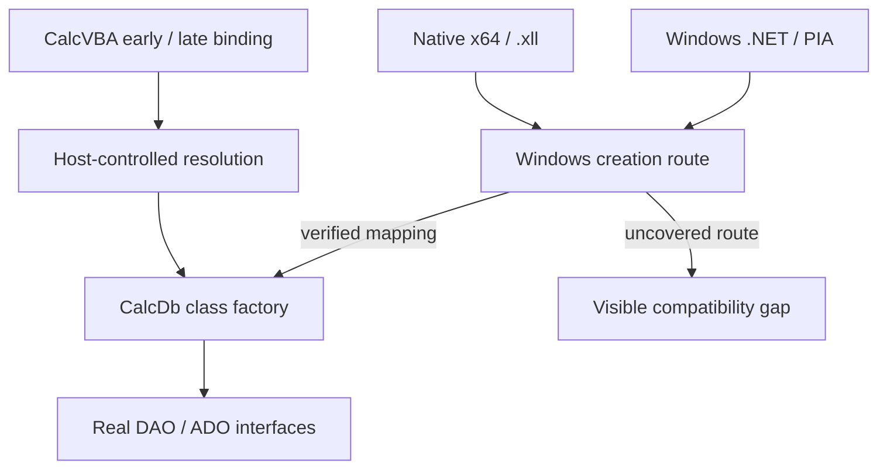

# I-13. COM, activation and DNA Calc integration

Revision 1 · Stage 1, response 3 · 2026-11-12

## Separate creation identity from interface compatibility

**D-ACT-1 — host-managed activation recommended; route coverage remains experimental.** CalcDb has its own public CLSIDs and ProgIDs, alongside ACE. Its objects implement the required genuine DAO interfaces and subsequently ADO interfaces. Compatibility mappings belong to DNA Calc's host integration. They must reach unchanged VBA, native `.xll` and .NET clients without changing those clients' database calls. An unsupported creation route remains an initial-scope compatibility gap.

Three operations need separate evidence. ProgID resolution selects a class identity. Class activation selects an implementation in a requested execution context. QueryInterface obtains an interface on an existing object. CoCreateInstance receives a CLSID, context and requested IID, then obtains a class factory and creates an instance. Supporting a DAO IID alone cannot redirect creation.[^creation]

A host alias for `DAO.DBEngine.120` affects paths using that resolver. Native code may instead call Windows directly with an embedded CLSID, retain a class factory, or receive an already-created object. PIA construction may use imported coclass metadata. Preserve these distinctions in the activation inventory, including type-library resolution before creation. Obtain actual CLSIDs, IIDs, DISPIDs and versions from permitted interface metadata and fixtures; infer none from the Office16 directory name.

Expose CalcDb's own identities in its deployment metadata and any explicitly selected per-user registration. Within DNA Calc, supply explicit compatibility mappings through the chosen resolver, activation context or host-owned factory. Original creation identities needed by unchanged binaries must be represented as well as string aliases. Outside DNA Calc, redirection of Microsoft identities remains an explicit opt-in, per-user testing arrangement. Host compatibility activation requires no registry changes; no implementation or experiment changes HKLM.

## Windows activation paths

**Figure F-14 — creation routes converge on real interfaces.** Arrows describe the intended routing, not demonstrated coverage. Mermaid source only; not render-verified.

Prefer a native DLL with registration-free activation as the first Windows candidate. Microsoft documents that COM checks the active context for ProgID-to-CLSID and CLSID-to-DLL mappings before registry fallback. This can address both string lookup and hard-coded CLSID creation when the required mappings exist. It does not establish coverage for every loader, cached object or client-created thread.[^contexts]

DNA Calc owns activation-context installation and lifetime around the relevant entry paths. ActivateActCtx pushes a thread-associated context; the matching cookie must be deactivated in reverse order. Reentry, callbacks, exceptions, nested contexts and independent threads belong in the probe. COM's documented propagation during creation on a host thread is useful, but does not justify assuming arbitrary host scheduling preserves the intended scope. Manifest class, type-library and threading metadata must describe the actual component.[^scope]

A host-owned in-process class factory is the second candidate. REGCLS documents locally satisfied creation through EXE-registered in-process factories. CoRegisterClassObject permits the EXE to publish internal objects for itself and DLLs it uses; the DLL server exports DllGetClassObject. Keep registration/revocation, references and shutdown with the host, rather than treating an arbitrary server DLL as a universal activation override.[^factories] Test precedence and coexistence when ACE is installed, including combined CLSCTX values and retained factories.

The chosen bindings must instantiate CalcDb. Successful data access through accidentally activated ACE is an activation failure, even when results match. Record factory and loaded-module provenance. Likewise, initial ADO creation must yield **CalcDb's ADO object model**; its connection-string handling routes `Microsoft.ACE.OLEDB.12.0` to the shared engine. Microsoft's ADO using a future CalcDb OLE DB provider is a separate later capability.

## Interface, value and lifetime contracts

Maintain one evidenced interface inventory: inheritance, method order, calling convention, parameter direction, optional/default values, IIDs, DISPIDs and ownership. Use it to check native declarations, Windows exposure and the portable implementation. Vtable and dispatch adapters reach the same object-model operations; neither supplies a second DAO implementation.

QueryInterface has a static supported-interface set and a consistent controlling IUnknown identity; success returns a retained reference. Close changes resource state, not object identity or the supported-interface set.[^identity] Keep collection/child identity and post-Close errors consistent with I-12. Class factories, outstanding object references and calls retain the module containing their vtables. A collection may release its reference without destroying an object still held by a client. Rust unwinding cannot cross the public ABI; boundary failures follow the error policy, with internal defects retained diagnostically.

IDispatch requires the published member identifiers, method/property invocation flags, named and optional arguments, reversed positional argument layout, LCID behavior and correct EXCEPINFO/argument-error reporting. Type information, default members and enumeration must support the callers that consume them.[^dispatch] Capture HRESULT, DAO/ADO Errors and managed exception projection as distinct outputs. QueryInterface success and one scalar method are insufficient evidence for the entire surface.

**D-VALUE-1 remains fixed:** use CalcVBA's shared Automation values, conversions and functions, preferably through the common foundation package proposed in I-02. The canonical VARIANT follows the target ABI; the old numerical shorthand imposes no universal size. Match allocator/free and deep-copy/reference rules. Preserve BSTR lengths, embedded nulls and arbitrary UTF-16; required SAFEARRAY dimensions, bounds and element ownership; Decimal/Currency precision; and distinctions among Empty, Null, missing and error values. Borrowed by-reference storage cannot outlive its call. Public owned values never alias cursor scratch or evictable pages.

These rules apply equally to callbacks. Prepare stable arguments, release internal latches and invoke VBA on the caller thread. On return, validate cursor, catalog, transaction, function-registry and retained-plan dependencies before continuation. Reentry may close an object or alter the query's meaning while its memory remains alive. Neither invalidation nor physical preparation failure permits repeating a host effect.

## Runtime and platform matrix

Windows COM and native add-ins target **x64 only**. Keep the following delivery lanes independent; passing one does not establish another.

| Lane | Required caller and boundary evidence |
| --- | --- |
| CalcVBA on Windows | Early-bound type-library/vtable calls and late-bound creation/dispatch through the actual runtime. |
| Native Windows | Existing x64 `.xll` inside DNA Calc, plus focused native probes for direct CLSID, ProgID and factory paths. |
| .NET Framework 4.8 family | Actual installed runtime, unchanged client/PIA metadata, coclass creation, typed calls and late binding. |
| .NET 10 LTS on Windows | Its own host/client/PIA loading, built-in COM interop, creation, dispatch and ownership captures. |
| Native non-Windows and wasm32 | CalcVBA's client using the new portable services; no claim that Microsoft's .NET COM runtime becomes portable. |

The selected ACE oracle is the user-reported ACEDAO.DLL **16.0.20527.20016**. Capture the actually loaded engine, Access host, CLR, client and PIA independently. Microsoft's PIA inventory names `Microsoft.Office.Interop.Access.Dao.dll`; its assembly identity is not inferred from the engine's file version. Imported coclass metadata participates in construction, and RCWs consume identity, type information, errors and enumeration in addition to method signatures.[^managed]

Modern .NET documents built-in COM interop on Windows alongside ComWrappers/source generation. Use the existing interop route for unchanged PIA clients; requiring rewritten clients would not establish that compatibility. Framework registration-free guidance explicitly applies to Framework, so its CLR deployment details are not evidence for .NET 10.[^net] NativeAOT and alternate wrappers are unnecessary initial prerequisites. Existing Framework add-ins and .NET 10 clients retain their actual runtime requirements; supporting COM does not establish arbitrary cross-runtime binary compatibility or simultaneous CLR hosting.

Separate build-tool failure from runtime failure. ResolveComReference is unsupported in the .NET Core MSBuild used by `dotnet build`; a pinned PIA/pre-generated wrapper reference or the documented Framework-MSBuild tool route avoids confusing that limitation with COM consumption.[^build] Preserve existing client binaries and metadata when testing unchanged operation; rebuilding a representative probe is a separately labelled result.

Windows thread initialization and apartment policy remain native-adapter responsibilities. CoInitializeEx applies to the calling thread, rejects incompatible reinitialization, and must not run from DllMain. STA/MTA call delivery differs.[^threads] Choose supported threading metadata from host requirements and observations; setting Both, Free or agile is not a substitute for meeting the contract. Internal workers never invoke VBA. Moving apartment-bound interfaces requires an explicitly supported Windows mechanism; the portable stand-in supplies no such marshaling service.

## Portable COM and the host boundary

The supplied CalcVBA note, tied to commit **8115aa781**, establishes that its COM client is Windows-only today. CalcVBA's portable stand-in is a decided direction and **does not exist yet**. It must provide activation, allocation, BSTR, VARIANT, SAFEARRAY and other demonstrated minimum services. It provides no apartments or cross-thread/process marshaling. CalcDb specifies and tests its requirements; CalcVBA owns this layer. A parallel CalcDb-only object protocol would violate COM-everywhere scope.[^integration]

**D-HOST-1 — recommend a small versioned host-services boundary.** Establish ownership and capabilities for activation/type resolution, VFS and configuration injection, function resolution/invocation, diagnostics, runtime/thread ownership and shutdown. Keep database operations in the COM object models and shared engine. Add spreadsheet bulk facilities only for an identified need, using the same query/transaction state. No unpublished CalcVBA runtime function, JIT ABI or object layout is assumed.

Prefer explicit host callbacks under D-UDF-1; R-UDF-1 determines whether an alternative resolver is necessary. Host-service version mismatch or missing capability produces a named integration failure. Preserved Access modules remain data and are not executed by CalcDb. On portable platforms, co-location with CalcVBA permits direct blocking interface calls; an asynchronous UI boundary does not turn object methods into asynchronous calls.

## Deciding experiments and integration work

### R-ACT-1 — unchanged creation and call routes

**Question and conditions.** Which host-owned mappings deliver CalcDb to each required caller without changing client code or global registration? Record Windows/x64, actual engine/host/runtime identities, PIA/type-library metadata, activation configuration and apartment state. Use separate environments with ACE present and absent; removing Office from the user's installation is not a fixture procedure.

**Fixture and operations.** Start with a small real COM server and host EXE implementing the evidenced ABI plus bounded identity/value/dispatch operations. Add actual CalcVBA callers, a genuine `.xll` loaded by DNA Calc, DAO-PIA clients in both runtime families and late-bound managed calls. Cross own identities/compatibility mappings; resolver/context/factory approaches; ProgID/CLSID/cached factory creation; first/repeated calls; nested contexts and reentry; independent threads; unsupported IIDs; argument/ownership failures; and teardown with surviving references. Synthetic ABI results remain distinct from database semantics.

**Capture and comparison.** Preserve client binaries, creation inputs, active mapping, requested context/IID, factory reached, loaded implementation, object identity, typed results, HRESULT/exception/error state and reference/module lifetime. Check registry-access evidence for unintended dependencies. Compare the client-visible contract against native reference behavior where applicable, while independently proving CalcDb was instantiated. A missing trace or ambiguous implementation identity is inconclusive; changed builds retain separate outcomes.

**Design consequences.** Accept each route only after creation and ABI/ownership work. Prefer scoped manifests where sufficient; select host factories only for demonstrated coverage. If neither reaches a required route, revisit integration before building a large object model; the requirement stays open. Repeat accepted routes with real cursors, transactions, reentrant callbacks and ADO. **Dependencies/size:** minimal W-02/W-08 feasibility slices and R-ORACLE-1; M for bounded activation work, broader object coverage under R-DAO-1/R-ADO-1. Next action: the native factory/context and two-runtime PIA fixture.

### I-FOUNDATION-1 — shared declarations and portable services

**Question/fixture.** Confirm the existing shared-library dependencies and declarations, select their package home, and identify missing services. Use C++/Rust/managed round trips on Windows and a minimal CalcVBA-client path on native non-Windows/wasm32. Check target size/alignment/offsets, scalar tags, Decimal/Currency, BSTR edge cases, array bounds, by-reference arguments and object-valued cleanup; include allocation failure and nested calls.

**Capture/decision.** Record exact declarations/builds, bytes and semantic values, ownership transfers, allocations and releases. ABI mismatch selects a corrected shared contract; missing precision or services selects a CalcVBA foundation extension. Neither permits private CalcDb coercions. A Rust-only portable object test cannot establish CalcVBA client portability. Incomplete declarations or unavailable target execution remain unresolved. **Dependencies/size:** supplied integration material and a CalcVBA-owned prototype; S for contract investigation, implementation estimated separately. Next action: publish the available declarations and smallest allocation/dispatch round trip.

### I-HOST-1 — activation, callbacks and shutdown ownership

**Question/fixture.** Establish which host component controls add-in loading, runtime initialization, type-library resolution and activation scopes. Prototype capability/version negotiation, effect/configuration injection, one owned-value function call, one public error and reentry that changes or closes the outer object. Include callback exceptions, nested activation scopes, unavailable services and shutdown while factories, objects or calls remain live.

**Capture/decision.** Record caller/execution threads, scope ownership, argument/result lifetime, latch state, callback count, continuation validity and resource release. Select the smallest explicit service contract that preserves the observations. A missing host route extends this integration work; it does not create another database API. R-UDF-1 resolves host/ACE-specific function behavior. Separate conflicting host versions and incomplete traces. **Dependencies/size:** I-FOUNDATION-1 declarations and the host loading prototype; M. Next action: demonstrate creation and one reentrant callback through the actual host, without full SQL or DAO delivery.

## Costs and reopening decisions

Run foundation, native activation, PIA and portable-client feasibility early, alongside oracle/storage work. W-08 can have an early host/ABI milestone and later complete DAO integration; W-07 is not a prerequisite for discovering an unusable creation route. Initial/later feature scope remains fixed while implementation order follows actual dependencies.

Measure cold creation separately from warm calls: DLL/context/type-library loading, managed wrapper construction, dispatch lookup, interface queries, reference operations and Automation allocation/copy bytes. Retain the direct vtable scalar path; avoid mandatory host messages or interpreter entry. Cache metadata and dispatch identifiers only with their valid owner/context. Measure shutdown and retained-object costs as well as the row loop.

Reopen D-ACT-1 when a required caller bypasses the chosen scope, activates ACE, or cannot retain its metadata; reopen D-HOST-1 for an unrepresentable capability/lifetime requirement; reopen package placement for a demonstrated dependency cycle. No optimization relaxes public identity, ownership, error, synchronous-call or ACE-equivalent persistence contracts. All target-runtime and ACE experiments described here remain unexecuted in this session.

## Source and reuse notes

All public sources below were accessed **2026-11-12**. Dates identify displayed document updates, not tested product versions. These are factual references; exact article/example reuse licences and PIA redistribution rights have not been verified. No example code or Office binaries are adopted, and documentation availability alone does not authorize their redistribution.

[^creation]: Microsoft, [CoCreateInstance](https://learn.microsoft.com/en-us/windows/win32/api/combaseapi/nf-combaseapi-cocreateinstance), updated 2021-10-18; Windows native creation API.
[^contexts]: Microsoft, [Creating Registration-Free COM Objects](https://learn.microsoft.com/en-us/windows/win32/sbscs/creating-registration-free-com-objects), updated 2021-01-07; Windows activation mappings and fallback.
[^scope]: Microsoft, [ActivateActCtx](https://learn.microsoft.com/en-us/windows/win32/api/winbase/nf-winbase-activateactctx), updated 2024-02-22; [DeactivateActCtx](https://learn.microsoft.com/en-us/windows/win32/api/winbase/nf-winbase-deactivateactctx), updated 2021-10-13; [Assembly Manifests](https://learn.microsoft.com/en-us/windows/win32/sbscs/assembly-manifests), updated 2023-03-10. Historical examples require target verification.
[^factories]: Microsoft, [REGCLS](https://learn.microsoft.com/en-us/windows/win32/api/combaseapi/ne-combaseapi-regcls), updated 2022-01-31; [CoRegisterClassObject](https://learn.microsoft.com/en-us/windows/win32/api/combaseapi/nf-combaseapi-coregisterclassobject), updated 2021-10-13; host EXE versus server DLL responsibilities.
[^identity]: Microsoft, [IUnknown.QueryInterface](https://learn.microsoft.com/en-us/windows/win32/api/unknwn/nf-unknwn-iunknown-queryinterface(refiid_void)), updated 2022-08-31; native identity/reference requirements.
[^dispatch]: Microsoft, [IDispatch.Invoke](https://learn.microsoft.com/en-us/windows/win32/api/oaidl/nf-oaidl-idispatch-invoke), updated 2021-10-13; Automation calling/error contract.
[^managed]: Microsoft, [Office primary interop assemblies](https://learn.microsoft.com/en-us/visualstudio/vsto/office-primary-interop-assemblies?view=visualstudio), updated 2025-10-30, Office 2010/2013/2016 inventory; [CS1613](https://learn.microsoft.com/en-us/dotnet/csharp/misc/cs1613), updated 2021-09-15, coclass metadata; [Runtime Callable Wrapper](https://learn.microsoft.com/en-us/dotnet/standard/native-interop/runtime-callable-wrapper), updated 2023-04-19, including Framework-specific material. None identifies the user's actual PIA binary.
[^net]: Microsoft, [COM interop in .NET](https://learn.microsoft.com/en-us/dotnet/standard/native-interop/cominterop) and [Registration-free COM interop](https://learn.microsoft.com/en-us/dotnet/framework/interop/registration-free-com-interop), both updated 2026-07-12. The latter expressly limits its deployment guidance to .NET Framework.
[^build]: Microsoft, [Troubleshoot COM references](https://learn.microsoft.com/en-us/visualstudio/msbuild/troubleshoot-com-references?view=visualstudio), updated 2025-11-21; [ResolveComReference](https://learn.microsoft.com/en-us/visualstudio/msbuild/resolvecomreference-task?view=visualstudio), updated 2025-07-28; build-tool behavior is separate from runtime compatibility.
[^threads]: Microsoft, [CoInitializeEx](https://learn.microsoft.com/en-us/windows/win32/api/combaseapi/nf-combaseapi-coinitializeex), updated 2024-11-12; Windows thread/apartment initialization.
[^integration]: Supplied `calcvba-integration-note.md`, 2026-11-12, provenance DnaCalc/CalcVBA commit 8115aa781, “COM,” “Calls and threads” and “Not in this note”; authoritative integration facts, corrected by the user's canonical-VARIANT clarification.
