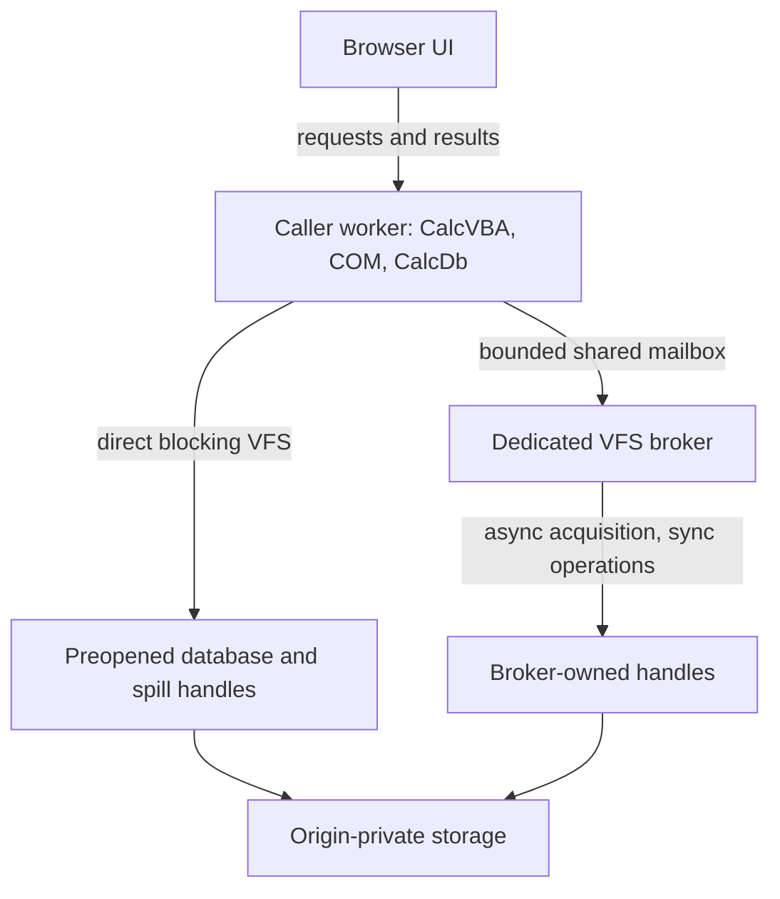

# I-14. WASM and later capabilities

Revision 2 · Part I review · Stage 2, response 1 · 2026-11-13

**Requirement trace:** Primary: RQ-PROD-06, RQ-LATE-01, RQ-LATE-02, RQ-LATE-03, RQ-LATE-04, RQ-LATE-05, RQ-LATE-06. Shared obligations: RQ-PROD-05, RQ-LOCK-03, RQ-LOCK-04, RQ-OUT-01, RQ-PORT-01, RQ-PORT-02, RQ-PORT-03, RQ-PERF-01, RQ-DEV-01. Full requirement text and Part II ownership are in I-16.

## Portability preserves the engine contract

**D-WASM-1 — Provisional.** Retain a blocking engine in a dedicated caller worker and test storage brokerage under R-WASM-1. **K-BROWSER** keeps CalcVBA, CalcDb and CalcVBA's proposed portable COM services together in the caller worker. UI requests may be asynchronous; VBA calls through real DAO/ADO interfaces remain blocking on their caller worker. Activation, reference counting, canonical Automation values and VBA callbacks stay local. This requires the portable CalcVBA work in I-13; it is not an existing integration demonstrated here.

The format, ISAM, catalog, expression and SQL crates perform no platform I/O. Compose the I-03 VFS, durability and lock capabilities at the host boundary. Keep the same persistence coordinator, error outcomes and caller-thread evaluation rules. Neither a browser wrapper nor a missing capability permits a second evaluator, an engine async runtime, cross-worker COM marshaling, or a private authoritative database.

Browser feasibility belongs beside early native storage and portable ABI work. It need not await complete SQL, DAO or ADO. Initial versus later scope remains fixed, but the user's updated instruction makes implementation order dependency driven. Likewise, full shared writing, W-12, is not an automatic prerequisite for every later capability described below.

## Worker storage and dynamic acquisition

The File System Standard exposes synchronous access handles to secure dedicated workers for bucket storage. Acquisition returns a Promise; the resulting handle has synchronous positioned reads/writes, size/truncate, flush and close. Its specified exclusive file-entry lock prevents competing sync handles and writable streams. The handle is neither serializable nor transferable under the inspected IDL and HTML rules.[^fs][^html-data]

Preopen frequently used database handles and bounded spill backing before entering CalcVBA. That permits direct storage calls during execution. However, arbitrary blocking OpenDatabase/CreateDatabase calls can name previously unopened files, and temporary allocation can exhaust the prepared backing. The caller cannot wait for its own event loop to resolve the necessary Promise.

**Provisional solution:** a dedicated host VFS broker owns asynchronously acquired handles and services their subsequent operations. Use a tested shared-memory rendezvous from the blocked caller; transport storage requests, never DAO objects. HTML restricts SharedArrayBuffer passage to the same agent cluster and requires cross-origin isolation. Only shared/dedicated worker agents may use blocking Atomics operations; a SharedWorker is not an interchangeable same-cluster broker.[^html-data][^agents] Test the actual deployment, not just API presence.

**Figure F-15 — local object calls with two storage routes.** Mermaid source only; not render-verified. Each file entry has one owning route at a time.

Start with one outstanding broker request per caller and a fixed shared mailbox separate from the growable WASM heap. Include session/request generations, operation, handle identity, offset, length, owned bytes and terminal progress/error/uncertainty. Publish payload ownership before the atomic request state; publish results before notifying. The caller checks state in a predicate loop, using Atomics.wait's expected-value check to cover completion before suspension.[^atomics] Notification is not the completion record.

The broker must keep its event loop available while asynchronous acquisition resolves; it cannot block that loop awaiting the caller. It never calls VBA. Retain operation ownership and required pins, release internal latches before waiting, and validate continuation dependencies afterward. A timeout or cancellation request cannot release/reuse a buffer still owned by an in-flight write. If an outcome cannot be recovered, preserve uncertainty and quarantine affected state according to I-08. Do not report rollback from a timed-out rendezvous.

Broker-owned handles stay there until close. Direct and broker routes cannot simultaneously acquire the same exclusively locked entry; any ownership change needs a quiescent close/reopen protocol and renewed identity checks. Measure per-call latency, copied bytes and page throughput. Direct preopened handles keep the common path small; batching is allowed only when it preserves required write/flush order and failure observability.

## Storage promises and exact outcomes

Writes may return partial progress or fail with uncertain effects. Flush attempts to transfer cached changes to underlying storage; close does not guarantee that flush. Ordinary writable streams publish on close, typically through temporary replacement, so they are a different persistence mechanism.[^fs] Propagate I-03's exact outcomes. Do not silently substitute replacement streams for the database commit protocol.

An imported desktop file becomes a separate origin-private working copy. Database commit, export completion and export durability need distinct receipts. This path does not establish live sharing of a native file with ACE. Multiple CalcDb connections can share one owner; cross-context reader-only access and exclusion require their own evidence. An exclusive browser handle alone does not implement Jet's lock-file protocol or every required reader mode.

Storage persistence permission protects against certain automatic clearing; quota estimates are not reservations.[^storage] Neither establishes the selected ACE build's commit-survival rules, including dbForceOSFlush, for a browser/OS/device. Preserve requested flush, completed call, public acknowledgement and post-failure bytes separately. Worker/browser termination tests do not establish power-loss behavior. The required ACE-first reopening contract remains unchanged; unsupported browser coverage remains a compatibility failure. Optional private undo follows the same I-03/I-08 recovery check under exclusion: verify file identity, read the complete file, require every uncovered page to match its recorded original fingerprint and every covered page to equal either its before-image or its intended new image, and discard the undo otherwise. Length, page presence and a partial final page follow the recorded before/intended alternatives and explicit ABSENT states in I-03/I-08; an unrecorded extent, intermediate length or third/torn image discards the undo. This is the external-change check; no continuous-history or USN witness is additionally required. It never strengthens the ACE-parity baseline or makes an ACE-first reopen depend on a side file.

For wasm32, the specification ceiling is 65,536 64-KiB pages, or 4 GiB per memory, not an allocation promise. Growth can fail; successful growth can replace/detach the JS-facing buffer.[^wasm] Budget VBA allocations, Automation values, page/history frames, query state, long values, spill and bridge copies together. Check file-offset narrowing independently of pointer width. Reacquire typed-array views after potential growth; logical page pinning does not preserve an old JS view. Avoid full-file residency and lossy JSON value transport.

Worker termination may abort running script and discard queued work.[^workers] A queued cancellation message cannot be relied on during a long blocking call. Test an independently writable atomic cancellation token where available; otherwise report the supported boundary-based behavior. Termination is crash injection, not graceful Close. Lost UI replies also do not authorize action-query replay: the operation may have committed. Correlate requests with settled outcomes without introducing a database WAL or promising exactly-once recovery across browser death.

## Early feasibility decision

**R-WASM-1 (M feasibility)** starts alongside the VFS and portable COM/CalcVBA prototypes, testing blocking object calls, dynamic handle acquisition, bounded resources and honest failure outcomes in the actual target browsers. The [full card](A-02-experiments.md#r-wasm-1--a-concrete-early-feasibility-experiment) selects a proven broker route or an explicitly limited prestaged session; full persistence evidence remains shared with R-CRASH-1/2 and missing required behavior remains unresolved.

## Later mechanisms designed into today's seams

**D-LATER-1 — Recommended.** Reserve explicit storage, catalog, ISAM and surface seams. These capabilities remain later scope. Their implementation depends on the contracts below, while I-16 integrates the overall development order.

Each later-capability experiment follows the common conditions and comparison rules in [A-02](A-02-experiments.md), with independent restored fixtures for mutation branches. The summaries below state the deciding outcome and dependencies; the complete cards retain the fixtures, captures and follow-up choices.

### Encryption

Place a format-selected codec between physical page bytes and logical interpretation. Decode into owned frames; encode into separate output buffers so pinned plaintext remains stable. Intended family coverage remains .mdb RC4 and .accdb AES/CNG; header exceptions, page-number derivation and key changes need per-format evidence. Scope keys/codec contexts to database identity; include their domain in cache ownership. Host credential services own secret lifetime. Give plaintext spill, before-images, diagnostics and temporary copies an explicit protection policy.

Jackcess Encrypt advertises some Access encryption forms through a codec provider; this supports studying that boundary, not assuming complete format coverage.[^encrypt] No source port is cleared here.

**R-ENC-1 (L)** uses native encrypted/plain logical twins and interrupted updates to select variant-specific codecs, credential errors and any changes to header ownership or persistence ordering. It depends on the exclusive writer, format and crash evidence; W-12 is needed only for shared-writing combinations in the [full card](A-02-experiments.md#r-enc-1--encryption).

### Linked tables

Keep native connection/source metadata in the catalog. Resolve it to source capabilities for scan/seek, projection/filter, row identity, mutation, schema refresh, errors and transactions. Microsoft documents TableDef.Connect and separately exposes Database.Transactions; the latter reports whether transactions are supported.[^links] Do not infer atomicity across sources.

Planner pushdown requires equivalent types, Nulls, collation, evaluation/errors and effects. Workspace coordination follows each source's actual transaction limits, without an invented distributed commit. Keep credentials out of cached plans. Browser transports are host capabilities; desktop drivers are not assumed present.

**R-LINK-1 (L)** determines per-source capabilities, pushdown equivalence and mixed-source transaction behavior from the catalog, binder, ISAM/transaction and host-transport contracts. Its [full card](A-02-experiments.md#r-link-1--linked-tables) selects local evaluation when pushdown changes results and never infers cross-source atomicity from individual transaction support.

### Complex fields

Use kind-specific descriptors. Microsoft's Field2 example exposes a multivalued field through a child Recordset2.[^complex] Reuse ISAM/cursor services for child rows while specifying parent identity, lifetime, constraints and transaction participation. Attachments add content/metadata and long-value ownership; calculated fields need the common evaluator and evidenced dependency/storage rules. Do not force all three into one guessed physical representation.

Unknown child structures continue to constrain edits that could orphan or relocate them.

**R-COMPLEX-1 (L)** uses separate multivalue, attachment and calculated-field fixtures to select kind-specific ownership, cursor lifetime and evaluation rules. It depends on row/catalog/long-value, evaluator and object policies; shared-writing behavior is a separate combination in the [full card](A-02-experiments.md#r-complex-1--complex-fields).

### Compact and repair

Own compaction creates a checked native destination through common traversal, allocation, index and catalog codecs. DAO documents a closed, exclusive source and a separate destination, with capacity for both files.[^compact] Keep source ownership and original bytes until validation and explicit publication complete. Unknown references can prohibit relocation even when opaque payloads are copyable. Rebuilding cannot silently discard preserved forms, reports or modules.

Repair is a distinct conservative operation: classify corruption, identify recoverable ownership and report uncertain/lost material. Normal opening never repairs a busy file or treats I/O failure as corruption. Compact & Repair is not presumed byte canonicalization.

**R-REBUILD-1 (L)** distinguishes clean relocation from conservative salvage using independent valid and singly damaged native fixtures. The [full card](A-02-experiments.md#r-rebuild-1--compact-and-repair) depends on the exclusive writer, checked traversal and opaque-reference evidence, with any unproved relocation or lost material explicitly limiting the result.

### OLE DB provider and ODBC driver

Both are later surface adapters over the same engine. OLE DB's source/session objects lead to commands, transactions and rowsets.[^oledb] Implement property negotiation, accessors/bindings, rowset identity, metadata, errors and lifetime with their own contracts; do not forward every call mechanically through DAO. Initial CalcDb ADO and ACE connection-string routing remain independent of this later provider.

**R-OLEDB-1 (L)** uses actual native and both managed-runtime consumer lanes to select property negotiation, bindings, rowset lifetime and errors. The [full card](A-02-experiments.md#r-oledb-1--ole-db-provider) depends on shared query/transaction services and the real external ABI; visibility differences return to the shared service policy.

ODBC needs environment/connection/statement/descriptor state, buffer binding, type conversion, cursor policy, metadata and transaction mapping. Microsoft defines diagnostics per handle, and SQLCancel success can mean only that the request was processed.[^odbc]

**R-ODBC-1 (L)** uses real Driver Manager/client paths to select handle transitions, bindings, per-row outcomes and diagnostic lifetime. It depends on shared query/transaction semantics and target ABI evidence; request/completion cancellation differences remain separate outcomes in the [full card](A-02-experiments.md#r-odbc-1--odbc-driver).

## Source and reuse notes

The complete source ledger is [A-01](A-01-sources.md). Sources accessed **2026-11-12** establish documentary contracts, not observed browser or ACE behavior. No implementation/example code is adopted. WHATWG IPR paragraphs were inspected: File System and Storage documents use CC BY 4.0, with source-incorporated portions under BSD-3-Clause; File System also acknowledges inherited W3C-licensed material. Other exact document/example licences were not separately reviewed. Jackcess Encrypt's project statement is not per-file/dependency reuse clearance.

[^fs]: WHATWG, [File System Standard](https://fs.spec.whatwg.org/), updated 2026-10-19; selected handle, write, flush, close and writable-stream algorithms. [Snapshot d76d3455d5afe2f85754ed24ffdbf99fe30032d4](https://fs.spec.whatwg.org/commit-snapshots/d76d3455d5afe2f85754ed24ffdbf99fe30032d4/) records the material read; the canonical living standard remains normative.
[^html-data]: WHATWG, [Safe passing of structured data](https://html.spec.whatwg.org/multipage/structured-data.html), living standard updated 2026-11-12; interface serialization/transfer and same-agent-cluster/SAB restrictions.
[^agents]: WHATWG, [Agents and agent clusters](https://html.spec.whatwg.org/multipage/webappapis.html#agents-and-agent-clusters), living standard, accessed 2026-11-12; worker blocking permission.
[^atomics]: ECMA, [ECMAScript 2024: DoWait and Atomics.wait](https://tc39.es/ecma262/2024/multipage/structured-data.html#sec-atomics.wait), fixed 2024 edition; shared-buffer, expected-value and suspension rules.
[^storage]: WHATWG, [Storage Standard](https://storage.spec.whatwg.org/), updated 2026-10-19; persistence/quota passages; [snapshot 115691c5158395b89063dee09278703f10494171](https://storage.spec.whatwg.org/commit-snapshots/115691c5158395b89063dee09278703f10494171/).
[^wasm]: WebAssembly, [Core memory-type validation](https://webassembly.github.io/spec/core/valid/types.html#memory-types), WebAssembly 3.0 page, 2026-11-04; wasm32 page/address ceiling (S-WEB-WASM-CORE-MEMORY). W3C, [WebAssembly JavaScript Interface](https://www.w3.org/TR/2026/CRD-wasm-js-api-2-20261106/), Candidate Recommendation Draft, 2026-11-06; memory limits/growth/resource failure. Its W3C permissive document-licence notice was observed; full terms not separately reviewed.
[^workers]: WHATWG, [Web workers](https://html.spec.whatwg.org/multipage/workers.html), living standard updated 2026-11-12; event-loop and termination algorithms.
[^encrypt]: [Jackcess Encrypt homepage](https://jackcessencrypt.sourceforge.io/), live; 5.0.0 announcement dated 2026-09-12, Apache statement from 2.1.0. No immutable source release, per-file headers, NOTICE, resources or dependency licences inspected.
[^links]: Microsoft, [TableDef.Connect](https://learn.microsoft.com/en-us/office/client-developer/access/desktop-database-reference/tabledef-connect-property-dao), updated 2022-03-18; [Database.Transactions](https://learn.microsoft.com/en-us/office/client-developer/access/desktop-database-reference/database-transactions-property-dao), updated 2021-09-14.
[^complex]: Microsoft, [Field2.IsComplex](https://learn.microsoft.com/en-us/office/client-developer/access/desktop-database-reference/field2-iscomplex-property-dao), updated 2021-09-14; example structure inspected, code not reused.
[^compact]: Microsoft, [DBEngine.CompactDatabase](https://learn.microsoft.com/en-us/office/client-developer/access/desktop-database-reference/dbengine-compactdatabase-method-dao), live reference labelled Access 2013/2016; selected target-build behavior remains to test.
[^oledb]: Microsoft, [Data Source and Session Objects (OLE DB)](https://learn.microsoft.com/en-us/previous-versions/windows/desktop/ms714909(v=vs.85)), updated 2016-07-05; historical interface reference.
[^odbc]: Microsoft, [Implementing SQLGetDiagRec and SQLGetDiagField](https://learn.microsoft.com/en-us/sql/odbc/reference/develop-app/implementing-sqlgetdiagrec-and-sqlgetdiagfield?view=sql-server-ver17), updated 2026-05-27; [SQLCancel](https://learn.microsoft.com/en-us/sql/odbc/reference/syntax/sqlcancel-function?view=sql-server-ver17), ODBC API reference, accessed 2026-11-12.
