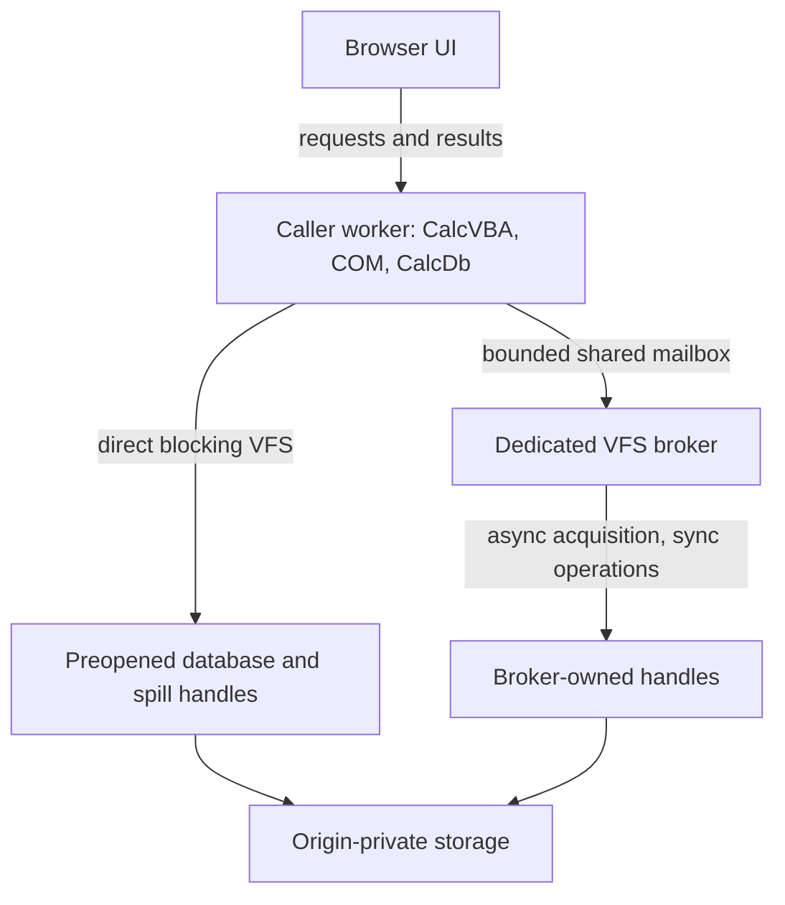

# I-14. WASM and later capabilities

Revision 3 · Part I reconciliation · Stage 2, response 13 · 2026-11-14

**Requirement trace:** Primary: RQ-PROD-06, RQ-LATE-01, RQ-LATE-02, RQ-LATE-03, RQ-LATE-04, RQ-LATE-05, RQ-LATE-06. Shared obligations: RQ-PROD-05, RQ-LOCK-03, RQ-LOCK-04, RQ-OUT-01, RQ-PORT-01, RQ-PORT-02, RQ-PORT-03, RQ-PERF-01, RQ-DEV-01. Full requirement text and Part II ownership are in I-16.

## Portability preserves the engine contract

**D-WASM-1 — Provisional.** Prefer one linked wasm32 program containing the actual CalcVBA runtime, shared Automation foundation and CalcDb in a dedicated caller worker. **K-BROWSER** retains their common memory, call-table and allocator domains; separately compiled instances must explicitly share and qualify those domains. Equal pointer integers or interface IDs are insufficient. UI entry may be asynchronous while genuine DAO/ADO calls remain blocking and local. The real platform VARIANT/BSTR rule is unchanged; wasm32 publishes its actual target ABI rather than copying the Windows x64 calling convention. This is proposed integration, not a demonstrated CalcVBA browser build.[^wasm-domain]

II-14 develops the actual deployment record, 128-byte mailbox, page-transfer receipts, reader alternatives, budget arithmetic and six later mechanisms. Its **64 T-PLAT acceptance families remain planned/unexecuted**. JSPI is an alternative to measure through the complete CalcVBA callback/reentry/Close chain; it is not dismissed as impossible or accepted solely because a suspended export returns a Promise.[^jspi]

The format, ISAM, catalog, expression and SQL crates perform no platform I/O. Compose the I-03 VFS, durability and lock capabilities at the host boundary. Keep the same persistence coordinator, error outcomes and caller-thread evaluation rules. Neither a browser wrapper nor a missing capability permits a second evaluator, an engine async runtime, cross-worker COM marshaling, or a private authoritative database.

Browser feasibility belongs beside early native storage and portable ABI work. It need not await complete SQL, DAO or ADO. Initial versus later scope remains fixed, but the user's updated instruction makes implementation order dependency driven. Likewise, full shared writing, W-12, is not an automatic prerequisite for every later capability described below.

## Worker storage and dynamic acquisition

The File System Standard exposes synchronous access handles to secure dedicated workers for bucket storage. Acquisition returns a Promise; the resulting handle has synchronous positioned reads/writes, size/truncate, flush and close. Its specified exclusive file-entry lock prevents competing sync handles and writable streams. The handle is neither serializable nor transferable under the inspected IDL and HTML rules.[^fs][^html-data]

Preopen frequently used database handles and bounded spill backing before entering CalcVBA. That permits direct storage calls during execution. However, arbitrary blocking OpenDatabase/CreateDatabase calls can name previously unopened files, and temporary allocation can exhaust the prepared backing. The caller cannot wait for its own event loop to resolve the necessary Promise.

**Provisional solution:** a dedicated host VFS broker owns asynchronously acquired handles and services their subsequent operations. Use a tested shared-memory rendezvous from the blocked caller; transport storage requests, never DAO objects. HTML restricts SharedArrayBuffer passage to the same agent cluster and requires cross-origin isolation. Only shared/dedicated worker agents may use blocking Atomics operations; a SharedWorker is not an interchangeable same-cluster broker.[^html-data][^agents] Test the actual deployment, not just API presence.

**Figure F-15 — local object calls with two storage routes.** Mermaid source only; not render-verified. Each file entry has one owning route at a time.

Start with one outstanding broker request per caller and a fixed shared mailbox separate from the growable WASM heap. Include session/request generations, operation, handle identity, offset, length, owned bytes and terminal progress/error/uncertainty. Publish payload ownership before the atomic request state; publish results before notifying. The caller checks state in a predicate loop, using Atomics.wait's expected-value check to cover completion before suspension.[^atomics] Notification is not the completion record.

The broker must keep its event loop available while asynchronous acquisition resolves; it cannot block that loop awaiting the caller. It never calls VBA. Retain operation ownership and required pins, release internal latches before waiting, and validate continuation dependencies afterward. A timeout or cancellation request cannot release/reuse a buffer still owned by an in-flight write. If an outcome cannot be recovered, preserve uncertainty and quarantine affected state according to I-08. Do not report rollback from a timed-out rendezvous.

Broker-owned handles stay there until close. Direct and broker routes cannot simultaneously acquire the same exclusively locked entry; any ownership change needs a quiescent close/reopen protocol and renewed identity checks. Measure per-call latency, copied bytes and page throughput. Direct preopened handles keep the common path small; batching is allowed only when it preserves required write/flush order and failure observability.

## Storage promises and exact outcomes

**K-IO** preserves a returned count separately from a proved contiguous prefix. The File System Standard leaves partial-write ordering/results underspecified; an unqualified short browser write therefore stops normal advancement with the whole attempted range possibly changed. Exact-suffix retry needs stronger adapter evidence. Flush attempts underlying-device transfer; close is not that flush. Writable streams publish through a separate close/replacement mechanism and cannot silently replace the native in-place commit program.[^fs]

An imported desktop file becomes a separate origin-private working copy. Database resolution, export image and export publication have distinct receipts; exports and interruption capture retain exact physical stored bytes, including encoded pages. This does not establish live ACE sharing. Prefer measured native read-only access handles where available; Chrome documents such an extension, but the inspected WHATWG baseline has no mode parameter. The alternative to investigate is a retained File/Blob source under continuous cooperating-host shared Web Lock admission, with every host mutator using exclusive admission. File snapshot state is not a universal MVCC guarantee, and Web Locks does not exclude bypassing code. An exclusive sync handle alone does not satisfy required many-reader coverage.[^readers]

Storage persistence permission protects against certain automatic clearing; quota estimates are not reservations.[^storage] Neither establishes the selected ACE build's commit-survival rules, including dbForceOSFlush, for a browser/OS/device. Preserve requested flush, completed call, public acknowledgement and post-failure bytes separately. Worker/browser termination tests do not establish power-loss behavior. The required ACE-first reopening contract remains unchanged; unsupported browser coverage remains a compatibility failure. Optional private undo follows the same I-03/I-08 recovery check under exclusion: verify file identity, read the complete file, require every uncovered page to match its recorded original fingerprint and every covered page to equal either its before-image or its intended new image, and discard the undo otherwise. Length, page presence and a partial final page follow the recorded before/intended alternatives and explicit ABSENT states in I-03/I-08; an unrecorded extent, intermediate length or third/torn image discards the undo. This is the external-change check; no continuous-history or USN witness is additionally required. It never strengthens the ACE-parity baseline or makes an ACE-first reopen depend on a side file. All fingerprint/image comparisons use physical stored bytes. Prefer optional undo disabled in the initial browser profile until persistent file incarnation, side-file durability, pre-frontier retirement and D-UNDO-2's durable disarm-before-recovery-write can be qualified. A locator comparison alone is not that identity evidence.[^fs]

For wasm32, the specification ceiling is 65,536 64-KiB pages, or 4 GiB per memory, not an allocation promise. Growth can fail; successful growth can replace/detach the JS-facing buffer.[^wasm] Budget VBA allocations, Automation values, page/history frames, query state, long values, spill and bridge copies together. Check file-offset narrowing independently of pointer width. Reacquire typed-array views after potential growth; logical page pinning does not preserve an old JS view. Avoid full-file residency and lossy JSON value transport.

Worker termination may abort running script and discard queued work.[^workers] Keep caller and broker as an owned failure cohort: a stopped worker alone proves neither I/O settlement nor safe payload reuse. Retain unresolved effects and leases; reacquisition gets a new session and audits the file rather than replaying a request. Cancellation uses independently writable control state and preserves the accepted operation. Controlled Close drains owners; termination remains crash injection. A lost UI reply does not authorize action-query replay.

## Early feasibility decision

**R-WASM-1 (M feasibility)** starts with actual portable ABI/runtime and minimal VFS slices, then qualifies direct/broker acquisition, partial effects, failure-cohort lifetime, many-reader profiles and bounded memory. The [full card](A-02-experiments.md#r-wasm-1--a-concrete-early-feasibility-experiment) includes JSPI comparison and separate worker/browser/OS failure evidence; a prestaged-only fallback remains incomplete initial coverage.

## Later mechanisms designed into today's seams

**D-LATER-1 — Recommended.** Reserve explicit storage, catalog, ISAM and surface seams. These capabilities remain later scope. Their implementation depends on the contracts below, while I-16 integrates the overall development order.

Each later-capability experiment follows the common conditions and comparison rules in [A-02](A-02-experiments.md), with independent restored fixtures for mutation branches. The summaries below state the deciding outcome and dependencies; the complete cards retain the fixtures, captures and follow-up choices.

### Encryption

Keep database password metadata, page encoding and provider encryption separate. Select an evidenced native header/provider profile before decoding ordinary pages. Intended .mdb RC4 and .accdb AES/CNG coverage remains; the actual metadata, algorithm and page mapping select each case. Cache plaintext under file/key-epoch ownership and prepare immutable encoded images per native write phase. Full-image preparation supplies no atomic-page persistence guarantee. Physical stored bytes remain the crash/undo comparison domain.

Jet password changes can also re-mask SIDs; a page-zero-only recipe is insufficient. Prefer a separate native destination for explicit whole-file maintenance conversion, while an existing in-place public password member retains its own qualified identity/crash behavior. Protected temporary backing and a bounded memory fallback must be explicit; encrypted database bytes or OPFS alone do not protect plaintext spill.[^encrypt-details]

Jackcess Encrypt's live release documentation now describes 5.0.2; the inspected immutable source is separately pinned at `77a1d54db8fc71606f391d94adacae7e34b108ca` with a `5.0.1-SNAPSHOT` POM. Exact Java headers and the matching licence were checked, without a code port or blanket dependency/resource reuse clearance.[^encrypt]

**R-ENC-1 (L)** separates encrypted reads/writes, password/SID changes, closed-file conversions and compaction encryption, with physical interrupted-state captures. Its [full card](A-02-experiments.md#r-enc-1--encryption) selects native profiles and protected temporary policy from format/exclusive-writer/crash evidence; only shared-writing combinations add W-12.

### Linked tables

Keep native connection/source metadata in the catalog. Resolve it to source capabilities for scan/seek, projection/filter, row identity, mutation, schema refresh, errors and transactions. Microsoft documents TableDef.Connect and separately exposes Database.Transactions; the latter reports whether transactions are supported.[^links] Do not infer atomicity across sources.

Keep LinkDefinition, SourceBinding, SourceSchema, SourceRowToken and accepted source-operation ownership separate. A remote filter must preserve demanded errors/effects as well as candidate rows; typed binding and stable update identity precede pushdown. Relinking retains old owners and publishes native metadata under the selected surface policy. Microsoft documents a Version 2403 RefreshLink index-preservation change, so the actual oracle branch must be captured.[^refresh]

Workspace coordination records source-specific effects and unknown outcomes; support flags do not provide distributed commit. Connection pooling respects the captured Workspace/isolation policy. Browser transport is an explicit host capability, with no assumed desktop driver. Credentials remain host-owned.

**R-LINK-1 (L)** determines per-source capabilities, pushdown equivalence and mixed-source transaction behavior from the catalog, binder, ISAM/transaction and host-transport contracts. Its [full card](A-02-experiments.md#r-link-1--linked-tables) selects local evaluation when pushdown changes results and never infers cross-source atomicity from individual transaction support.

### Complex fields

Use kind-specific descriptors. Microsoft's Field2 example exposes a multivalued field through a child Recordset2.[^complex] Distinguish catalog association, parent-value group key, child identity and physical locator. Reuse common ISAM/LV/index/coordinator services; completed mutations preserve the qualified ownership closure, while interrupted states follow the ACE crash class. Attachments have a native content/compression wrapper inside LV storage, separate from public file bytes. Calculated fields use their resolved result wrapper and the common evaluator at the native-selected update point. Preserve append-only history and unknown child/reference closures; a generic child-table abstraction is insufficient.[^complex-details]

**R-COMPLEX-1 (L)** uses separate multivalue, attachment and calculated-field fixtures to select kind-specific ownership, cursor lifetime and evaluation rules. It depends on row/catalog/long-value, evaluator and object policies; shared-writing behavior is a separate combination in the [full card](A-02-experiments.md#r-complex-1--complex-fields).

### Compact and repair

Own compaction surveys a typed ownership/reference graph, plans relocation, then builds and validates a separate native destination through existing codecs and index construction. DAO documents a closed, exclusive source and a separate destination, with capacity for both files.[^compact] Fixups cover page, row and object identities, not only page numbers. Opaque content requires proved address independence or complete fixed placement; otherwise refuse unsafe relocation. Copying known tables through SQL is not full-database preservation. Source retention, destination validation and namespace publication remain separate owned outcomes.

Repair is a distinct conservative operation: classify corruption, identify recoverable ownership and report uncertain/lost material. Normal opening never repairs a busy file or treats I/O failure as corruption. Compact & Repair is not presumed byte canonicalization.

**R-REBUILD-1 (L)** distinguishes clean relocation from conservative salvage using independent valid and singly damaged native fixtures. The [full card](A-02-experiments.md#r-rebuild-1--compact-and-repair) depends on the exclusive writer, checked traversal and opaque-reference evidence, with any unproved relocation or lost material explicitly limiting the result.

### OLE DB provider and ODBC driver

Both are later surface adapters over the same engine. OLE DB's source/session objects lead to commands, transactions and rowsets.[^oledb] Compile property/accessor plans and retain HROW/stream/error owners through their actual lifetimes. On x64, status is 32-bit while applicable length/offset cells are 64-bit; `CreateAccessor.cbRowSize` is parameter-set stride, not a `GetData` allocation bound. Preserve property, binding, row and extended-error outcomes separately.[^provider-details] Initial CalcDb ADO and ACE connection-string routing remain independent of this later provider.

**R-OLEDB-1 (L)** uses actual native and both managed-runtime consumer lanes to select property negotiation, bindings, rowset lifetime and errors. The [full card](A-02-experiments.md#r-oledb-1--ole-db-provider) depends on shared query/transaction services and the real external ABI; visibility differences return to the shared service policy.

ODBC compiles descriptor/buffer plans while retaining real handle states, diagnostics and accepted execution. Derive x64 SQLLEN indicators, array strides, status arrays and fetched/processed counts from actual declarations. Retain conversion position across SQLGetData pieces and operation ownership through SQLParamData/SQLPutData. Microsoft defines diagnostics per handle and separates cancellation request success from operation settlement; SQLEndTran supplies no implicit two-phase commit across connections.[^odbc][^driver-details]

**R-ODBC-1 (L)** uses real Driver Manager/client paths to select handle transitions, bindings, per-row outcomes and diagnostic lifetime. It depends on shared query/transaction semantics and target ABI evidence; request/completion cancellation differences remain separate outcomes in the [full card](A-02-experiments.md#r-odbc-1--odbc-driver).

## Source and reuse notes

The complete source ledger is [A-01](A-01-sources.md). Sources accessed **2026-11-12 and 2026-11-14** establish documentary and reference-implementation facts, not observed browser or ACE behavior. No implementation/example code is adopted. WHATWG IPR paragraphs were inspected: File System and Storage documents use CC BY 4.0, with source-incorporated portions under BSD-3-Clause; File System also acknowledges inherited W3C-licensed material. Other exact document/example licences were not separately reviewed. II-14 records exact pinned Jackcess/Jackcess Encrypt file-header and licence inspection; dependencies/resources and a full redistribution set remain unreviewed.

[^fs]: WHATWG, [File System Standard](https://fs.spec.whatwg.org/), updated 2026-10-19; selected handle, write, flush, close and writable-stream algorithms. [Snapshot d76d3455d5afe2f85754ed24ffdbf99fe30032d4](https://fs.spec.whatwg.org/commit-snapshots/d76d3455d5afe2f85754ed24ffdbf99fe30032d4/) records the material read; the canonical living standard remains normative.
[^html-data]: WHATWG, [Safe passing of structured data](https://html.spec.whatwg.org/multipage/structured-data.html), living standard updated 2026-11-12; interface serialization/transfer and same-agent-cluster/SAB restrictions.
[^agents]: WHATWG, [Agents and agent clusters](https://html.spec.whatwg.org/multipage/webappapis.html#agents-and-agent-clusters), living standard, accessed 2026-11-12; worker blocking permission.
[^atomics]: ECMA, [ECMAScript 2024: DoWait and Atomics.wait](https://tc39.es/ecma262/2024/multipage/structured-data.html#sec-atomics.wait), fixed 2024 edition; shared-buffer, expected-value and suspension rules.
[^storage]: WHATWG, [Storage Standard](https://storage.spec.whatwg.org/), updated 2026-10-19; persistence/quota passages; [snapshot 115691c5158395b89063dee09278703f10494171](https://storage.spec.whatwg.org/commit-snapshots/115691c5158395b89063dee09278703f10494171/).
[^wasm]: WebAssembly, [Core memory-type validation](https://webassembly.github.io/spec/core/valid/types.html#memory-types), WebAssembly 3.0 page, 2026-11-04; wasm32 page/address ceiling (S-WEB-WASM-CORE-MEMORY). W3C, [WebAssembly JavaScript Interface](https://www.w3.org/TR/2026/CRD-wasm-js-api-2-20261106/), Candidate Recommendation Draft, 2026-11-06; memory limits/growth/resource failure. Its W3C permissive document-licence notice was observed; full terms not separately reviewed.
[^workers]: WHATWG, [Web workers](https://html.spec.whatwg.org/multipage/workers.html), living standard updated 2026-11-12; event-loop and termination algorithms.
[^encrypt]: [S-WEB-JACK-ENCRYPT] [Jackcess Encrypt homepage](https://jackcessencrypt.sourceforge.io/); [S-JACK-ENC-CHANGES] [release notes](https://jackcessencrypt.sourceforge.io/changes-report.html), accessed 2026-11-14, including 5.0.2 (2026-10-06). II-14 and A-01 distinguish the separately pinned 5.0.1-SNAPSHOT source and exact inspected licences; no source port or blanket redistribution clearance.
[^links]: Microsoft, [TableDef.Connect](https://learn.microsoft.com/en-us/office/client-developer/access/desktop-database-reference/tabledef-connect-property-dao), updated 2022-03-18; [Database.Transactions](https://learn.microsoft.com/en-us/office/client-developer/access/desktop-database-reference/database-transactions-property-dao), updated 2021-09-14.
[^complex]: Microsoft, [Field2.IsComplex](https://learn.microsoft.com/en-us/office/client-developer/access/desktop-database-reference/field2-iscomplex-property-dao), updated 2021-09-14; example structure inspected, code not reused.
[^compact]: Microsoft, [DBEngine.CompactDatabase](https://learn.microsoft.com/en-us/office/client-developer/access/desktop-database-reference/dbengine-compactdatabase-method-dao), live reference labelled Access 2013/2016; selected target-build behavior remains to test.
[^oledb]: Microsoft, [Data Source and Session Objects (OLE DB)](https://learn.microsoft.com/en-us/previous-versions/windows/desktop/ms714909(v=vs.85)), updated 2016-07-05; historical interface reference.
[^odbc]: Microsoft, [Implementing SQLGetDiagRec and SQLGetDiagField](https://learn.microsoft.com/en-us/sql/odbc/reference/develop-app/implementing-sqlgetdiagrec-and-sqlgetdiagfield?view=sql-server-ver17), updated 2026-05-27; [SQLCancel](https://learn.microsoft.com/en-us/sql/odbc/reference/syntax/sqlcancel-function?view=sql-server-ver17), ODBC API reference, accessed 2026-11-12.

[^wasm-domain]: [S-WEB-WASM-BASIC-C-ABI], [S-WEB-WASM-DYNAMIC-LINK], [S-WEB-WASM-RUNTIME] WebAssembly primary ABI, dynamic-linking and runtime-instance documents, inspected 2026-11-14; exact URLs/extents in II-14/A-01. Shared-domain design is provisional.
[^jspi]: [S-WEB-JSPI] V8, [Introducing the WebAssembly JavaScript Promise Integration API](https://v8.dev/blog/jspi), inspected 2026-11-14; wrapped exports, suspension/resumption and JavaScript-stack limitations. Actual CalcVBA use remains untested.
[^readers]: [S-WEB-CHROME-ACCESS-MODES], [S-WEB-WEBLOCKS], [S-WEB-FILEAPI] Chrome's documented access modes and W3C Web Locks/File API drafts of 2026-11-12, inspected 2026-11-14; exact capability and lifetime evidence remains R-WASM-1.
[^encrypt-details]: [S-JACK-ENC-PASSWORD], [S-JACK-ENC-OFFICE], [S-JACK-ENC-AGILE] Pinned reference password/SID, header/provider and page-parameter facts in II-14/A-01, not ACE crash behavior.
[^refresh]: [S-MS-TABLEDEF-REFRESHLINK] Microsoft, [TableDef.RefreshLink](https://learn.microsoft.com/en-us/office/client-developer/access/desktop-database-reference/tabledef-refreshlink-method-dao), accessed 2026-11-14; documented Version 2403 behavior, not a capture of the user's engine.
[^complex-details]: Native-reference complex/attachment/history source facts and exact pin/inspection in II-14/A-01; Microsoft's calculated-field restrictions and append-only property facts are cited there. The relocation/update plans are original proposed design.
[^provider-details]: [S-MS-OLEDB-64BIT], [S-MS-OLEDB-CREATEACCESSOR], [S-MS-OLEDB-ERRORINTERFACES] Microsoft primary API references, accessed 2026-11-14; actual consumer layouts and lifetime remain R-OLEDB-1.
[^driver-details]: [S-MS-ODBC-64BIT], [S-MS-ODBC-GETDATA], [S-MS-ODBC-PARAMDATA], [S-MS-ODBC-ENDTRAN] Microsoft primary API references, accessed 2026-11-14; exact client/Driver Manager outcomes remain R-ODBC-1.
