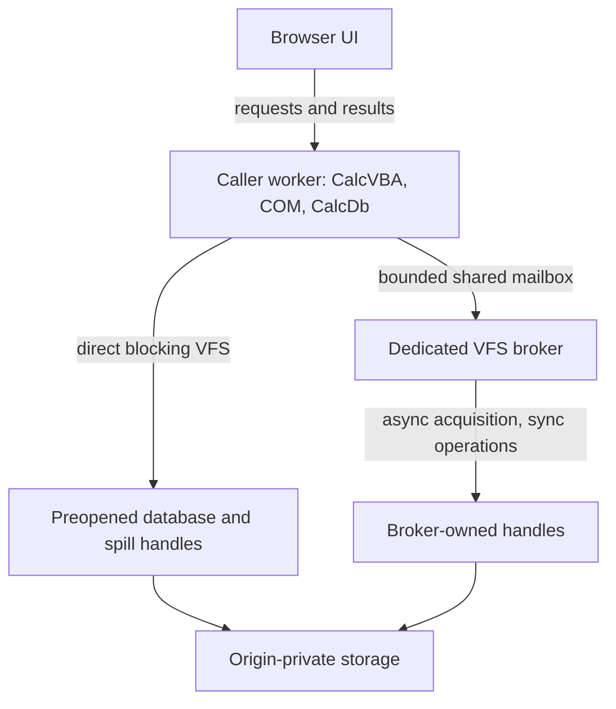

# I-14. WASM and later capabilities

Revision 1 · Stage 1, response 3 · 2026-11-12

## Portability preserves the engine contract

**D-WASM-1 — retain a blocking engine inside a dedicated caller worker; test storage brokerage early.** CalcVBA, CalcDb and CalcVBA's proposed portable COM services live together. UI requests may be asynchronous; VBA calls through real DAO/ADO interfaces remain blocking on their caller worker. Activation, reference counting, canonical Automation values and VBA callbacks stay local. This requires the portable CalcVBA work in I-13; it is not an existing integration demonstrated here.

The format, ISAM, catalog, expression and SQL crates perform no platform I/O. Compose the I-03 VFS, durability and lock capabilities at the host boundary. Keep the same persistence coordinator, error outcomes and caller-thread evaluation rules. Neither a browser wrapper nor a missing capability permits a second evaluator, an engine async runtime, cross-worker COM marshaling, or a private authoritative database.

Browser feasibility belongs beside early native storage and portable ABI work. It need not await complete SQL, DAO or ADO. Initial versus later scope remains fixed, but the user's updated instruction makes implementation order dependency driven. Likewise, full shared writing, W-12, is not an automatic prerequisite for every later capability described below.

## Worker storage and dynamic acquisition

The File System Standard exposes synchronous access handles to secure dedicated workers for bucket storage. Acquisition returns a Promise; the resulting handle has synchronous positioned reads/writes, size/truncate, flush and close. Its specified exclusive file-entry lock prevents competing sync handles and writable streams. The handle is neither serializable nor transferable under the inspected IDL and HTML rules.[^fs][^html-data]

Preopen frequently used database handles and bounded spill backing before entering CalcVBA. That permits direct storage calls during execution. However, arbitrary blocking OpenDatabase/CreateDatabase calls can name previously unopened files, and temporary allocation can exhaust the prepared backing. The caller cannot wait for its own event loop to resolve the necessary Promise.

**Provisional solution:** a dedicated host VFS broker owns asynchronously acquired handles and services their subsequent operations. Use a tested shared-memory rendezvous from the blocked caller; transport storage requests, never DAO objects. HTML restricts SharedArrayBuffer passage to the same agent cluster and requires cross-origin isolation. Only shared/dedicated worker agents may use blocking Atomics operations; a SharedWorker is not an interchangeable same-cluster broker.[^html-data][^agents] Test the actual deployment, not just API presence.

**Figure F-15 — local object calls with two storage routes.** Mermaid source only; not render-verified. Each file entry has one owning route at a time.

Start with one outstanding broker request per caller and a fixed shared mailbox separate from the growable WASM heap. Include session/request generations, operation, handle identity, offset, length, owned bytes and terminal progress/error/uncertainty. Publish payload ownership before the atomic request state; publish results before notifying. The caller checks state in a predicate loop, using Atomics.wait's expected-value check to cover completion before suspension.[^atomics] Notification is not the completion record.

The broker must keep its event loop available while asynchronous acquisition resolves; it cannot block that loop awaiting the caller. It never calls VBA. Retain operation ownership and required pins, release internal latches before waiting, and validate continuation dependencies afterward. A timeout or cancellation request cannot release/reuse a buffer still owned by an in-flight write. If an outcome cannot be recovered, preserve uncertainty and quarantine affected state according to I-08. Do not report rollback from a timed-out rendezvous.

Broker-owned handles stay there until close. Direct and broker routes cannot simultaneously acquire the same exclusively locked entry; any ownership change needs a quiescent close/reopen protocol and renewed identity checks. Measure per-call latency, copied bytes and page throughput. Direct preopened handles keep the common path small; batching is allowed only when it preserves required write/flush order and failure observability.

## Storage promises and exact outcomes

Writes may return partial progress or fail with uncertain effects. Flush attempts to transfer cached changes to underlying storage; close does not guarantee that flush. Ordinary writable streams publish on close, typically through temporary replacement, so they are a different persistence mechanism.[^fs] Propagate I-03's exact outcomes. Do not silently substitute replacement streams for the database commit protocol.

An imported desktop file becomes a separate origin-private working copy. Database commit, export completion and export durability need distinct receipts. This path does not establish live sharing of a native file with ACE. Multiple CalcDb connections can share one owner; cross-context reader-only access and exclusion require their own evidence. An exclusive browser handle alone does not implement Jet's lock-file protocol or every required reader mode.

Storage persistence permission protects against certain automatic clearing; quota estimates are not reservations.[^storage] Neither establishes the selected ACE build's commit-survival rules, including dbForceOSFlush, for a browser/OS/device. Preserve requested flush, completed call, public acknowledgement and post-failure bytes separately. Worker/browser termination tests do not establish power-loss behavior. The required ACE-first reopening contract remains unchanged; unsupported browser coverage remains a compatibility failure. Optional private undo requires I-03's full identity, fingerprint and continuous no-external-change evidence; matching OPFS names or bytes alone is insufficient.

For wasm32, the specification ceiling is 65,536 64-KiB pages, or 4 GiB per memory, not an allocation promise. Growth can fail; successful growth can replace/detach the JS-facing buffer.[^wasm] Budget VBA allocations, Automation values, page/history frames, query state, long values, spill and bridge copies together. Check file-offset narrowing independently of pointer width. Reacquire typed-array views after potential growth; logical page pinning does not preserve an old JS view. Avoid full-file residency and lossy JSON value transport.

Worker termination may abort running script and discard queued work.[^workers] A queued cancellation message cannot be relied on during a long blocking call. Test an independently writable atomic cancellation token where available; otherwise report the supported boundary-based behavior. Termination is crash injection, not graceful Close. Lost UI replies also do not authorize action-query replay: the operation may have committed. Correlate requests with settled outcomes without introducing a database WAL or promising exactly-once recovery across browser death.

## R-WASM-1 — a concrete early feasibility experiment

**Question and conditions.** Can the actual CalcVBA caller use blocking COM and the production VFS contracts with bounded resources, dynamic acquisition and honest failure outcomes? Record browser/version, OS, secure origin, isolation/agent-cluster configuration, storage mode, toolchain/module features and resource budgets. Test intended browser families explicitly; a standard is not an implementation support matrix.

**Fixture.** Begin with the portable allocation/dispatch prototype from I-13 and one small native database copied into browser storage. Add a previously unopened database name, empty creation target, preopened spill backing, small memory/cache budgets and a competing tab/worker. Instrument request publication, acquisition, read/write counts, flush, acknowledgement and ownership release. Add real mutation sequences as the pager/coordinator becomes available.

| Probe | Required evidence and consequence |
| --- | --- |
| Local COM and reentry | Actual CalcVBA activation, IUnknown/IDispatch, BSTR/VARIANT/SAFEARRAY ownership, callback thread and reentrant invalidation. Rust-only calls cannot establish CalcVBA portability. |
| Dynamic acquisition | Open/create from inside a blocking VBA call; force spill exhaustion. Exercise successful acquisition, refusal, pending cancellation and completion before wait. Deadlock or hidden Promise-returning DAO behavior reopens the backend design. |
| Broker ownership | Stop caller and broker independently around publication/completion; delay replies; race cancellation. Capture late writes, retained buffers/handles, generations and unresolved outcomes. Prove no ABA reuse or automatic mutation replay. |
| Storage and exclusion | Short read/write, quota failure, extension/truncation, flush/close/reopen, competing handles, multiple readers, worker death and browser restart. Preserve bytes, lengths, error counts and lock-release observations. |
| Memory and performance | Force growth around bridges; large files under small budgets; long readers, long values and spilling operations. Capture peak memory/copies, latency and scalar throughput; reject unbounded residency. |
| Interrupted persistence | Interrupt each relevant write/flush/acknowledgement point; preserve untouched copies before reopening. Compare independent CalcDb and exported ACE/Access/Compact & Repair branches. Record export's effects separately; use controlled OS/power-loss work for stronger claims. |

**Decision branches.** A demonstrated direct route uses the normal pager. Dynamic acquisition selects the broker only after shared-memory, ownership and failure probes succeed. Without that capability, offer an explicit prestaged session with admitted files/resources and visible limits; it does not complete initial browser scope. Missing durability or required reader semantics remain named failures. Refuse unsupported work before mutation where possible; later uncertainty still follows the coordinator contract.

**Dependencies/size:** VFS and portable COM/CalcVBA prototypes; M for feasibility, with full persistence evidence shared with R-CRASH-1/2. Start immediately alongside those foundations. Record native typed-value/error/file comparisons separately from API conformance. No browser, ACE or power-loss experiment in this chapter has been executed.

## Later mechanisms designed into today's seams

**D-LATER-1 — reserve explicit storage, catalog, ISAM and surface seams.** These capabilities remain later scope. Their implementation depends on the contracts below, while I-16 integrates the overall development order.

The six experiments below use **I-15's common experiment conditions and capture/comparison rules**: verified loaded engine/host/provider/driver identities, caller surface and bitness, locale, sort/options and relevant storage/transaction settings. Restore independent fixture copies for mutation arms; compare typed results, order, metadata, errors, object/transaction state and classified file changes. Incomplete traces, unavailable targets, nondiscriminating fixtures or contradictory evidence leave the affected rule unresolved and trigger a reduced follow-up. Preserve different-build outcomes separately for a declared target decision; neither documentation nor another build supplies a missing observation.

### Encryption

Place a format-selected codec between physical page bytes and logical interpretation. Decode into owned frames; encode into separate output buffers so pinned plaintext remains stable. Intended family coverage remains .mdb RC4 and .accdb AES/CNG; header exceptions, page-number derivation and key changes need per-format evidence. Scope keys/codec contexts to database identity; include their domain in cache ownership. Host credential services own secret lifetime. Give plaintext spill, before-images, diagnostics and temporary copies an explicit protection policy.

Jackcess Encrypt advertises some Access encryption forms through a codec provider; this supports studying that boundary, not assuming complete format coverage.[^encrypt] No source port is cleared here.

**R-ENC-1 — planned; L.** Which native algorithm/header/password variants and update failures must the codec reproduce? Capture native fixtures, wrong-key errors, encrypted/plaintext page relationships, partial writes and interrupted rekeying. Results select transforms and credential/error policy while preserving I-08's crash protocol. Depend on the exclusive writer, format and persistence evidence; W-12 is required for the shared-writing combination only.

Begin with native-created encrypted/plain logical twins containing an indexed text column and a long value spanning pages; vary format/encryption variant, ASCII/non-ASCII test passwords, update location, flush option and interruption point. Separate encryption metadata or randomization from required value and decoded index-key equality, recording repeated native creations so unexplained ciphertext differences cannot justify an arbitrary comparison mask. If encryption changes only the physical representation, retain the page-codec seam; if it changes header ownership or mutation ordering, extend the format descriptor or coordinator before enabling that variant.

### Linked tables

Keep native connection/source metadata in the catalog. Resolve it to source capabilities for scan/seek, projection/filter, row identity, mutation, schema refresh, errors and transactions. Microsoft documents TableDef.Connect and separately exposes Database.Transactions; the latter reports whether transactions are supported.[^links] Do not infer atomicity across sources.

Planner pushdown requires equivalent types, Nulls, collation, evaluation/errors and effects. Workspace coordination follows each source's actual transaction limits, without an invented distributed commit. Keep credentials out of cached plans. Browser transports are host capabilities; desktop drivers are not assumed present.

**R-LINK-1 — planned; L.** Which operations and transaction boundaries does each supported source expose? Capture relinking, unavailable sources, schema changes, partial updates and mixed native/external transactions against ACE. Results select capability, pushdown and error mappings. Depend on catalog, binder, ISAM/transaction and host-transport contracts; shared native writing is a separate combination to verify.

Use DAO/ADO against a local table and a link to a separate two-row table with a key, nullable text and duplicate non-key values; add an independently provisioned fixture for each intended external source family. Vary local versus linked access, shared versus separate connections, transaction nesting, source schema changes and a conflicting edit or disconnect at a named operation. Comparison differences select local expression evaluation instead of that pushdown; transaction differences select the evidenced source capability and Workspace policy, never a claim of cross-source atomicity.

### Complex fields

Use kind-specific descriptors. Microsoft's Field2 example exposes a multivalued field through a child Recordset2.[^complex] Reuse ISAM/cursor services for child rows while specifying parent identity, lifetime, constraints and transaction participation. Attachments add content/metadata and long-value ownership; calculated fields need the common evaluator and evidenced dependency/storage rules. Do not force all three into one guessed physical representation.

Unknown child structures continue to constrain edits that could orphan or relocate them.

**R-COMPLEX-1 — planned; L.** What physical ownership and public behavior belongs to each field kind? Capture parent movement/deletion, child bookmarks, duplicates, attachment replacement, calculated dependencies, cleanup and rollback through DAO/ADO. Results select kind-specific codecs and cursor/update policy. Depend on row/catalog/long-value, evaluator and object-policy contracts; external shared writing adds combination evidence.

Create separate native ACCDB fixtures for each field kind, with one parent, two entries where applicable, a small attachment and a page-spanning attachment; isolate the calculated-field fixture from child-storage assumptions. Vary Null/duplicate inputs, held child/clone references, parent movement/deletion and commit/rollback, comparing public state with before/after ownership chains. Child identity/visibility differences change cursor lifetime and version policy; calculated dependency results determine materialization and invalidation rules in the existing evaluator.

### Compact and repair

Own compaction creates a checked native destination through common traversal, allocation, index and catalog codecs. DAO documents a closed, exclusive source and a separate destination, with capacity for both files.[^compact] Keep source ownership and original bytes until validation and explicit publication complete. Unknown references can prohibit relocation even when opaque payloads are copyable. Rebuilding cannot silently discard preserved forms, reports or modules.

Repair is a distinct conservative operation: classify corruption, identify recoverable ownership and report uncertain/lost material. Normal opening never repairs a busy file or treats I/O failure as corruption. Compact & Repair is not presumed byte canonicalization.

**R-REBUILD-1 — planned; L.** Which content can be relocated or conservatively recovered without inventing structure? Compare damaged chains, lost indexes/catalog links, unknown objects and interrupted rebuild/publication with ACE repair outcomes. Capture retained/lost objects and reopen behavior; results bound relocation and salvage. Depend on the exclusive writer, traversal/codec validation and opaque-reference evidence, not blanket W-12 completion.

Start from a small valid Jet 4/ACCDB fixture with an index, long value, relationship and recorded preserved-object payload; fork one controlled broken reference, allocation inconsistency or index defect per damaged copy. Cross clean compaction versus repair, known versus opaque references, sufficient versus exhausted destination space and interruption at each rebuild/publication phase, keeping the original untouched. An unproved opaque relocation restricts compaction; evidenced recoverable ownership selects a bounded salvage rule, while lost or uncertain content must remain explicit rather than being inferred from a successful repair return.

### OLE DB provider and ODBC driver

Both are later surface adapters over the same engine. OLE DB's source/session objects lead to commands, transactions and rowsets.[^oledb] Implement property negotiation, accessors/bindings, rowset identity, metadata, errors and lifetime with their own contracts; do not forward every call mechanically through DAO. Initial CalcDb ADO and ACE connection-string routing remain independent of this later provider.

**R-OLEDB-1 — planned; L.** Which interfaces, negotiated properties and lifecycle behaviors do required consumers exercise? Record loaded provider identity; capture native consumers and System.Data.OleDb against ACE, including partial binding/fetch/update, transactions, cancellation and surviving rowsets. Results select adapter state and conversion/error policy. Depend on shared query/transaction services and real external ABI tests.

Use a minimal native consumer and the two managed runtime lanes against a two-row table containing Null, text and Currency plus one parameterized command; retain a row handle across transaction and session-close attempts. Vary requested rowset properties, fixed/variable buffer sizes, parameter metadata, cursor/update options and consumer path, capturing negotiated values, status arrays and errors immediately. A property or binding difference changes provider negotiation/conversion state; a visibility or transaction difference reopens the shared service policy instead of adding provider-only storage semantics.

ODBC needs environment/connection/statement/descriptor state, buffer binding, type conversion, cursor policy, metadata and transaction mapping. Microsoft defines diagnostics per handle, and SQLCancel success can mean only that the request was processed.[^odbc]

**R-ODBC-1 — planned; L.** Which negotiated functions and handle transitions must required clients observe? Record loaded driver identity; capture Driver Manager interaction, partial fetch/update, truncation, data-at-execution, transactions, cancellation and SQLSTATE/native-error ordering against that reference. Results select bindings and diagnostic/state transitions. Depend on shared query/transaction semantics and actual target ABI/client tests. Neither provider introduces another evaluator or delays browser feasibility.

Use a small Driver Manager client with a two-row table and parameterized insert/select, scalar and array bindings, and a long value supplied in chunks. Vary declared ODBC version, ANSI/Unicode entry paths, buffer size, cursor/autocommit options, failure position within an array and cancellation before/during completion. Per-row status or diagnostic-lifetime differences change handle/binding state; successful cancel requests followed by successful operations require separate request and completion outcomes, while transaction differences return to the shared coordinator contract.

## Source and reuse notes

Sources accessed **2026-11-12** establish documentary contracts, not observed browser or ACE behavior. No implementation/example code is adopted. WHATWG IPR paragraphs were inspected: File System and Storage documents use CC BY 4.0, with source-incorporated portions under BSD-3-Clause; File System also acknowledges inherited W3C-licensed material. Other exact document/example licences were not separately reviewed. Jackcess Encrypt's project statement is not per-file/dependency reuse clearance.

[^fs]: WHATWG, [File System Standard](https://fs.spec.whatwg.org/), updated 2026-10-19; selected handle, write, flush, close and writable-stream algorithms. [Snapshot d76d3455d5afe2f85754ed24ffdbf99fe30032d4](https://fs.spec.whatwg.org/commit-snapshots/d76d3455d5afe2f85754ed24ffdbf99fe30032d4/) records the material read; the canonical living standard remains normative.
[^html-data]: WHATWG, [Safe passing of structured data](https://html.spec.whatwg.org/multipage/structured-data.html), living standard updated 2026-11-12; interface serialization/transfer and same-agent-cluster/SAB restrictions.
[^agents]: WHATWG, [Agents and agent clusters](https://html.spec.whatwg.org/multipage/webappapis.html#agents-and-agent-clusters), living standard, accessed 2026-11-12; worker blocking permission.
[^atomics]: ECMA, [ECMAScript 2024: DoWait and Atomics.wait](https://tc39.es/ecma262/2024/multipage/structured-data.html#sec-atomics.wait), fixed 2024 edition; shared-buffer, expected-value and suspension rules.
[^storage]: WHATWG, [Storage Standard](https://storage.spec.whatwg.org/), updated 2026-10-19; persistence/quota passages; [snapshot 115691c5158395b89063dee09278703f10494171](https://storage.spec.whatwg.org/commit-snapshots/115691c5158395b89063dee09278703f10494171/).
[^wasm]: W3C, [WebAssembly JavaScript Interface](https://www.w3.org/TR/2026/CRD-wasm-js-api-2-20261106/), Candidate Recommendation Draft, 2026-11-06; memory limits/growth/resource failure. Its W3C permissive document-licence notice was observed; full terms not separately reviewed.
[^workers]: WHATWG, [Web workers](https://html.spec.whatwg.org/multipage/workers.html), living standard updated 2026-11-12; event-loop and termination algorithms.
[^encrypt]: [Jackcess Encrypt homepage](https://jackcessencrypt.sourceforge.io/), live; 5.0.0 announcement dated 2026-09-12, Apache statement from 2.1.0. No immutable source release, per-file headers, NOTICE, resources or dependency licences inspected.
[^links]: Microsoft, [TableDef.Connect](https://learn.microsoft.com/en-us/office/client-developer/access/desktop-database-reference/tabledef-connect-property-dao), updated 2022-03-18; [Database.Transactions](https://learn.microsoft.com/en-us/office/client-developer/access/desktop-database-reference/database-transactions-property-dao), updated 2021-09-14.
[^complex]: Microsoft, [Field2.IsComplex](https://learn.microsoft.com/en-us/office/client-developer/access/desktop-database-reference/field2-iscomplex-property-dao), updated 2021-09-14; example structure inspected, code not reused.
[^compact]: Microsoft, [DBEngine.CompactDatabase](https://learn.microsoft.com/en-us/office/client-developer/access/desktop-database-reference/dbengine-compactdatabase-method-dao), live reference labelled Access 2013/2016; selected target-build behavior remains to test.
[^oledb]: Microsoft, [Data Source and Session Objects (OLE DB)](https://learn.microsoft.com/en-us/previous-versions/windows/desktop/ms714909(v=vs.85)), updated 2016-07-05; historical interface reference.
[^odbc]: Microsoft, [Implementing SQLGetDiagRec and SQLGetDiagField](https://learn.microsoft.com/en-us/sql/odbc/reference/develop-app/implementing-sqlgetdiagrec-and-sqlgetdiagfield?view=sql-server-ver17), updated 2026-05-27; [SQLCancel](https://learn.microsoft.com/en-us/sql/odbc/reference/syntax/sqlcancel-function?view=sql-server-ver17), ODBC API reference, accessed 2026-11-12.
