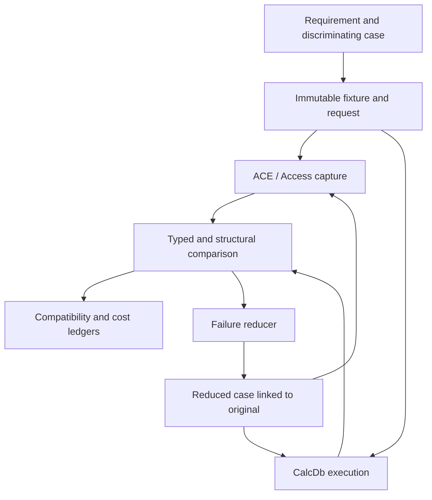

# I-15. Oracle, corpus, tests and performance

Revision 3 · Part I reconciliation · Stage 2, response 14 · 2026-11-14

**Requirement trace:** Primary: RQ-SRC-03, RQ-ORACLE-01, RQ-ORACLE-02, RQ-ORACLE-03, RQ-ORACLE-04, RQ-SIM-01, RQ-SIM-02, RQ-PERF-01, RQ-PERF-02, RQ-LEDGER-01, RQ-ORACLE-05, RQ-TEST-01. Shared obligations: RQ-PROD-04, RQ-SEM-01, RQ-SEM-03, RQ-LOCK-02, RQ-LOCK-03, RQ-LOCK-04, RQ-SRC-01, RQ-SRC-02, RQ-FMT-02, RQ-CONC-01, RQ-CALL-02, RQ-PLAN-01, RQ-ARCH-01, RQ-PROCESS-01, RQ-DEV-02, RQ-STORE-04, RQ-STORE-05. Full requirement text and Part II ownership are in I-16.

## One evidence path from question to regression

**D-EVIDENCE-1 — Recommended.** ACE remains the behavioral authority. One harness describes a case, obtains or reuses an immutable oracle capture, runs CalcDb against the same semantic input, compares the appropriate observations and records the result. SQL, object-model and file tests are front ends to this harness. A second implementation can help localize a discrepancy but cannot vote ACE out of the specification.

Separate four kinds of evidence: user-supplied requirements/integration facts; documentary/reference facts; actual identified ACE executions; and CalcDb invariant/simulation results. A design recommendation is none of those observations. Every accepted compatibility rule points to its defining requirement and the evidence that establishes it (**K-EVIDENCE**). Unknown, refused and unimplemented cases remain visible failures; an expected target rejection is a pass only when CalcDb actually reproduces it. II-15 now makes this executable with separate Question/Environment/Attempt/Comparison identities, immutable artifact sealing, exact typed/structural rules, 45 planned T-EVID acceptance families and the first genuine DAO cost slice. No native acceptance experiment has been executed here.

**Figure F-16 — evidence and reduction flow.** Frozen inputs and original observations survive reduction. Mermaid source only; not render-verified.

## Oracle service and controlled processes

**D-ORACLE-1 — Decided.** Service direction and initial target are fixed; execution configurations still need validation. The initial target is the user-reported ACEDAO.DLL 16.0.20527.20016. At service startup, resolve the actual loaded DAO/ACE binaries, paths, file versions and hashes; separately identify Access, ADO runtime/provider, Windows and the caller runtime. Record x64, locale, database sort/options, sandbox/host state and relevant filesystem/cache configuration. .NET Framework 4.8-family and .NET 10 LTS are independent client lanes. Do not choose behavior from an invisible oracle-build tag inside CalcDb.

Use one long-lived controller with versioned request/result schemas, batched work and owned worker processes. A request names the fixture snapshot, surface, operation sequence, capture policy and fault model. It receives a durable job ID before execution. The controller may retry a transport query for an existing job ID; it must not blindly execute an uncertain mutation again. Persist start/completion/crash/timeout dispositions and partial artifacts. A truncated response is an evidence failure, not an empty result. Bind every frame to its attempt, worker generation and sequence. Duplicate submission queries the existing job; a new experiment attempt uses fresh owned inputs after prior owners settle. For intentionally stateful worker reuse, the key includes the complete reproducible prehistory from a qualified reset; otherwise the capture is ineligible for cross-attempt answer reuse.

Run Office-facing workers in a dedicated test profile/environment and configured logged-on test session, with isolated working/TEMP directories and the charter's private desktop arrangement tested explicitly. Keep a message pump and UI Automation dialog observer for owned processes. Verify the ownership of returned automation objects, their servers and UI processes before driving them: a new client process or private desktop does not prove that Office created an isolated server. Only start, drive or terminate processes created by the harness; never attach to the user's working Access/Excel instance. Preserve Trust Center, macro-security and HKLM settings. Unexpected dialogs become captured events with bounded recovery or an unresolved run; they cannot be dismissed with a universal affirmative answer.

Microsoft's automation guidance identifies user-profile, desktop and modal-dialog assumptions and does not promise reliable unattended Office execution.[^office] A private desktop is consequently a test configuration to validate, not a support guarantee. R-ORACLE-1 tests it before scaling the queue. Use separate environments for conflicting installations or global-state-sensitive concurrency experiments; serialize requests within an Office instance unless the case explicitly studies interaction. Recycle workers on controlled state boundaries or diagnosed contamination, while keeping the service and capture store alive.

Control startup, corpus copying and capture transfer separately from engine timing. Queue latency, worker startup and a missing cached answer are harness costs to reduce. No repeated human wait should be necessary for an already captured semantic input.

## Capture identity and exact comparison

The case key combines a versioned semantic request, fixture bytes/provenance and relevant environment dimensions. Store large files and traces by content digest, with an immutable manifest linking them. Transport digests detect loss or substitution; they do not replace the full evidence or become expected query answers. Captured original files are never rewritten when an expectation changes. Fixture content identity covers exact input roles/bytes/absence and declared immutable dependencies; history and derived interpretation are separate versioned provenance, avoiding self-referential hashes. Case keys also pin the provenance/profile interpretation they use.

Typed values carry subtype and exact payload: integral width/sign, floating-point bits, Currency/Decimal scale and precision, native temporal precision, exact BSTR byte length/payload (and UTF-16 units for text), binary bytes, Null/Empty/error/missing distinctions, SAFEARRAY dimensions/lower bounds/element type, and inbound/outbound ByRef values captured within their valid lifetime. Assign capture-local object identity labels from actual identity observations; raw pointer addresses are diagnostic data, never portable expected values. Capture active fields and path-defined outputs rather than padding, inactive unions or undefined result cells; the wire encoding does not replace the real platform VARIANT/BSTR ABI. Retain source field metadata and native bytes where the public projection loses information.

Each operation records return value and all relevant state immediately: position/population/edit flags, result schema, parameter values, counts, ordered error collections, HRESULT, Automation error information and callback/event sequence. Capture error state before diagnostic calls can overwrite it (**K-ERROR**). Some observations themselves consume or change diagnostics; specify read order and use paired fresh runs for channels that cannot be observed together without interference. Keep localized raw descriptions; any permitted text normalization is a separately reviewed comparison rule, never a substitute for error number, source, order or lifetime.

Choose comparison policy by contract. Required row order is compared exactly. Where order is genuinely unspecified and experiments establish variation, preserve raw orders while comparing the admissible relation; unordered rows retain multiplicity, types and exact value payloads. Do not sort every result by default or reorder callback/error traces. An admitted byte-multiset comparison first establishes equal semantic schemas and retains full typed row bytes with multiplicity; hashes alone are insufficient. Capture-local schema/object labels are not equality keys. Identity-bearing values need a qualified whole-result alias mapping or a separate unresolved status. Parallel CalcDb execution still equals its accepted serial reference, including row order and Double bits. Compare keys and opaque regions byte-for-byte where mandated. For other file content, compare decoded structure, references, allocation conservation and required semantic state; explain every ignored byte class through evidence rather than a growing ad hoc mask.

Time, randomness and external environment need an explicit comparison class too. Use fixed parameters for ordinary semantic tests and documented public seeding controls where applicable. Test the native nondeterministic function separately, capturing clock bounds, seed/state where exposed, result types and the evidenced relation among calls. Do not claim to inject CalcDb's effect source into proprietary ACE or demand equal random bits from independent unseeded runs. A case-specific admissible relation needs documentary or repeated oracle evidence; otherwise the case remains unresolved. Preserve every raw value and the uncertainty that limited the comparison. CalcDb's serial/parallel equivalence still uses the same controlled effect sequence and exact permitted observations.

## Corpus, preservation and reduction

Build the corpus from Access/ACE-created Jet 4 and ACCDB files across supported version/options families, plus generated fixtures with recorded creation recipes. Cover empty/minimal databases, every scalar/extended type, all supported sort families, compressed and uncompressed text, row/LV boundaries, AutoNumber, relationships, QueryDefs, user properties and preserved front-end payloads. Preserve originals, creation environment, legal provenance and fixture licences. Keep creator, opener and mutation histories distinct: importing rows into a fresh file loses old-row counts, deleted slots, overflow/LV packing and map-reuse history. II-15 gives concrete row-57 mask/bounds, map-rebase/reference-boundary and shared-LV-tail controls. Later encrypted/linked/complex cases enter the same corpus with explicit phase labels; an initial parser must preserve what it cannot yet execute.

Keep three distinct mutation tracks: legal semantic operations through ACE; format-driven boundary/malformed generation from the one format description; and deliberate crash/fault images. A malformed file rejected by ACE is still useful for bounded parsing, but rejection alone does not establish CalcDb's error mapping. Unknown structures are not silently removed by fixture minimization. A preservation case retains its protected bytes and reference relationships while reducing unrelated tables, rows and properties.

The reducer minimizes SQL syntax, operation sequence, data values, schema, file structures and schedule/fault events using the same harness. Native differential failures require applicable native captures; a pure invariant/ownership/model failure instead reruns its exact versioned predicate without inventing an ACE dependency. Keep the failure signature—typed mismatch, first error/effect difference, structural violation or crash class—and re-obtain ACE evidence for each reduced candidate that changes semantic input. Do not call a smaller case equivalent because CalcDb still fails. Preserve the original and the reduction chain so environment-sensitive or intermittent failures remain diagnosable.

## T-COMPACT-1: what “Compact & Repair finds nothing to fix” means

For a normally completed CalcDb write, this phrase means a **passed, calibrated acceptance test**, not merely a successful return from a repair operation. Freeze the result before any native opener can change it. Create an ACE control by applying the same legal operation sequence to a copy of the same starting fixture. A live post-Commit image needs a qualified stable observation that adds no hidden Close or flush; if unavailable, that physical boundary stays unresolved rather than being silently replaced by a later copy. Split each output into independent branches for ACE opening, Access opening, raw inspection and Access Compact & Repair. A branch never becomes another branch's input. Interrupted transactions use I-08's ACE crash classes instead of this normal-completion criterion.

Run the selected Access host's actual Compact & Repair command under exclusive access on a disposable branch, with a fresh destination/run directory and captured dialogs, errors, logs and system-table changes. A callable automation route is usable only after R-ORACLE-1 establishes that it exercises the intended target operation; the DAO `CompactDatabase` method is an additional explicitly named lane, not assumed interchangeable with the Access command. Keep format, sort, encryption and other conversion options fixed. Microsoft documents both repair-related data-loss risk and ordinary compaction of unused space, so neither a smaller file nor changed page bytes proves repair.[^repair][^compact]

| Required observation | Pass condition |
| --- | --- |
| Independent ordinary opens | ACE and Access open the original completed output without a repair prompt, repair-required failure or hidden harness repair; typed rows, keys, schema and protected objects agree with the fixture's expected state. |
| Repair diagnostics | The actual Access operation completes; no repair/corruption dialog, diagnostic log entry, new `MSysCompactErrors` entry or other **calibrated** repair indicator appears. Compare against the starting fixture so pre-existing records are not mistaken for new events. |
| Retained content | Row multiplicities and exact native values, query definitions/parameters, catalog properties, relationships, long values and protected payloads survive. Check the required byte regions and decoded reference relationships, allowing only justified native relocation fields. |
| Structural change | Pre- and post-images satisfy allocation/reachability, row, index and catalog invariants. No repair-specific correction—such as recovering missing index entries or repairing conflicting allocation ownership—is needed. Page relocation, free-space removal and other normal compaction changes must lie within the envelope established by clean ACE controls. |
| Destination behavior | The destination reopens normally through ACE and Access and gives the same expected observations. A second compaction remains semantically stable; identical whole-file bytes are not required. |

Calibrate the observer with clean ACE controls and deliberately damaged **copies** exercising the relevant index, allocation or catalog defect class. This establishes which diagnostics and structural corrections the chosen route can detect. An unchanged error table is not sufficient: a repair may succeed without leaving a partial-repair entry. II-15's proposed six-row control removes one evidenced index entry while retaining the row; a silently rebuilt destination cannot conceal the defective preimage. Both source and destination are compared with the intended result, so pre-existing content loss also fails. If controls reveal silent corrections that the present comparator cannot distinguish from normal compaction, classify that defect class as **inconclusive** until the observer is improved. Do not convert absence of a diagnostic into a universal claim about Access's internal work.

All rows must pass for the fixture, operation and target configuration to carry “nothing to fix.” Any content loss, repair indication or unexplained structural correction fails it; missing controls, capture loss or an unexplained compaction difference makes it inconclusive. Retain the source, destination and raw evidence even on failure. A repaired destination never retroactively makes the original CalcDb write acceptable. Full fixture/capture/calibration protocol is in A-02 under R-ORACLE-1; this is acceptance-test ID **T-COMPACT-1**, not the later CalcDb compaction feature R-REBUILD-1.

## Deterministic execution and fault models

Use the real pager, cursor, transaction, lock, ownership and query code under injected effects. The simulator controls time, entropy, completion order and explicit scheduler boundaries; it records the seed, build, configuration and a complete event trace. A seed alone is not a stable replay specification across code changes. Stable operation/resource identities and an explicit trace-version check detect divergence. A missing event or disabled trace segment invalidates the claimed replay. II-15 supplies an explicit event codec and bounded enabled-choice search; changed logical IDs/arguments or model/build incompatibility stop replay rather than skipping forward to a convenient event.

The blocking API does not require an async runtime to be testable. The deterministic adapter schedules effect completion and cooperative worker boundaries around the same state transitions. It may explore bounded interleavings or guided random schedules, then minimize a failure trace. Native stress and memory-model/unsafe-code analysis remain necessary for races not represented by those boundaries. A successful small model is evidence about that model, not proof of the whole implementation.

Inject failure before reservation, after allocation, during short/failed I/O, at publication, during flush, close and cleanup. Sweep isolated failures and persistent failure after the first fault; then selected combinations such as exhaustion during rollback or a second interruption during optional undo. A cleanup-only fault retains the prerequisite fault plan and controlling schedule that made it reachable; coverage keys include that context rather than the bare site. Check resource conservation, generation validity and recorded uncertainty after each effect. Native adapter tests calibrate which partial writes, reorderings and persistence frontiers are actually permitted by each environment.

SQLite's testing documentation contributes allocation/I/O failure sweeps, compound faults and optimization-disabled checks as test-design concepts; its proprietary test suites are not thereby cleared for reuse.[^sqlite] Jingyu Zhou and coauthors' *FoundationDB: A Distributed Unbundled Transactional Key Value Store* (2021), §4, supports running production logic under deterministic effects and explicitly discusses simulator limits.[^fdb] CalcDb adopts neither that system's actor runtime nor its distributed transaction semantics. The cleared FrankenSqlite/asupersync reports supply ownership, trace-completeness and reduction lessons only.[^notes]

R-CRASH-1/2 start with external ACE observations independently of a CalcDb writer, then replay the implemented writer at every applicable cut. W-PROBE attempts complete ACE tracing and records its actual coverage; I-08 defines the bounded writer direction when that completeness cannot be established. Process kill, OS/power loss, storage failure and interrupted recovery have separate outcomes. Real ACE evidence selects admissible survival/repair states; generic simulator assertions must not replace that oracle with stronger atomicity.

## Performance method and compatibility accounting

**D-PERF-1 — Recommended.** The workload priorities are decided; the measurement method below implements them. Measure DAO/VBA row loops first, bulk SQL second and WASM third when choices conflict. Begin counters with the first end-to-end read slice. Do not wait for complete SQL or ADO before discovering that field access allocates, copies or synchronizes excessively.

| Workload family | Representative shapes | Primary cost observations |
| --- | --- | --- |
| DAO loop | MoveNext and ordinal/name Field.Value; short/long/repeated text; Seek/Find; bookmarks; small edits; sparse/wide rows. | Actual COM crossings, lookup probes, allocations, owned/copy/decode bytes, pin/map transitions and working set. |
| Bulk SQL | Selective/nonselective scans, joins with skew, groups/distinct, tied TOP, crosstabs, actions and spilling sorts. | Page patterns, probes, comparisons, expression/host calls, retained state, spill volume/passes and write/flush work. |
| Browser | Same semantics at bounded memory, direct versus broker I/O, import/export, quota and storage failures. | Linear-memory high-water mark, retained handles/pages, bridge copies/crossings, blocking time and actual persistence outcomes. |

Record compiler/runtime/build, CPU/storage, dataset shape, cache condition, plan and worker count. Compare paired runs with a fixed workload and randomized order; use repeated A/A runs to estimate noise before claiming a change. Separate cold/warm engine state from OS cache and warm-up/JIT/Office startup. Report distributions and outliers relevant to the path rather than one flattering minimum. Internal CalcDb counters are not asserted as measurements of ACE's internals. Separate diagnostic from minimally instrumented timing runs, exact from sampled counters, and engine/session preparation from OS/storage cache state. Retain warmup trajectories and failed/uncertain attempts; choose the finite sampling plan and practical decision criterion from pilot/application evidence.

An optimization proposal includes the semantic cases it must preserve, predicted cost change, actual executed path and measured result. Keep negative results and regressions in the performance ledger. Choose thresholds from observations; no numerical throughput, latency or memory target is invented here. Reopen cache/materialization/operator choices when a representative counter changes, while preserving the workload priority and semantic contracts.

The compatibility ledger has rows keyed by requirement/member/feature/context and capture: matched, mismatched, refused, missing or unresolved evidence. Track documentary expectations separately. Publish the declared initial-scope denominator and the complete planned product inventory side by side; deferred capabilities remain visible. An unavailable target member is a matching negative case only after both actual outcomes agree. Plan-shape checks and invariant checks support, but never inflate, the count of ACE-matched cases.

## Experiment summary

**R-ORACLE-1 — capture, isolation and service recovery; M.** Qualify exact question/history keys, actual owners/implementations, active-value/error capture and durable attempt/partial-artifact handling; calibrate T-COMPACT-1 with discriminating preimages. Eleven OR branches in A-02 select reusable evidence or explicit unavailable/inconclusive outcomes; the minimal driver starts before full CalcDb implementation.

## Sources and use boundaries

Exact material/version/use/licence status and actual citation locations are retained in A-01-sources.md. A-02-experiments.md holds the full cards; Part I retains their deciding questions and outcomes. Jackcess contributes inspected format facts and possible algorithms; it does not define ACE transactions, locking or SQL behavior. Before any code/resource port, pin the actual permitted material and check its own licence and notices. mdbtools remains facts-only. Other readers require per-material checks before reuse. No excluded direct FrankenSqlite/asupersync repository, documentation, package, mirror or external extract is consulted; only the cleared attached reports contribute concepts.

[^office]: Microsoft, [Considerations for server-side Automation of Office](https://support.microsoft.com/en-us/visio/considerations-for-server-side-automation-of-office) and [Considerations for unattended automation of Office](https://learn.microsoft.com/en-us/office/client-developer/integration/considerations-unattended-automation-office-microsoft-365-for-unattended-rpa), accessed 2026-11-12. Configuration risks inform R-ORACLE-1; no supported-execution claim or settings change follows.
[^repair]: Microsoft, [Compact and repair a database](https://support.microsoft.com/en-us/access/compact-and-repair-a-database), accessed 2026-11-13; compaction, exclusive access, potential data loss and partial-repair diagnostics are documentary facts. T-COMPACT-1 is CalcDb's proposed acceptance protocol, not a Microsoft certification rule.
[^compact]: Microsoft, [DBEngine.CompactDatabase method (DAO)](https://learn.microsoft.com/en-us/office/client-developer/access/desktop-database-reference/dbengine-compactdatabase-method-dao), updated 2022-03-18, accessed 2026-11-13; distinct destination, exclusive source and conversion options. Exact equivalence to Access Compact & Repair is not presumed.
[^sqlite]: SQLite, [How SQLite Is Tested](https://sqlite.org/testing.html), selected §§2–3, 4 and 9, accessed 2026-11-12. Documentation concepts only; [copyright statement](https://sqlite.org/copyright.html) distinguishes public-domain deliverables from separately licensed material. No test/source code reused.
[^fdb]: Jingyu Zhou et al., [FoundationDB: A Distributed Unbundled Transactional Key Value Store](https://www.foundationdb.org/files/fdb-paper.pdf), SIGMOD 2021, DOI 10.1145/3448016.3457559, §4. Selected conceptual reference; paper copyright/abstracting notice inspected; no code or quoted implementation reused.
[^notes]: Supplied `frankensqlite-report.stage1-part3.md` §§8, 10; `asupersync-report.stage1-part4.md` §§7–8, part 5 §§4–7 and part 6 §§2–4. Cleared concepts, not requirements or external-source observations.
