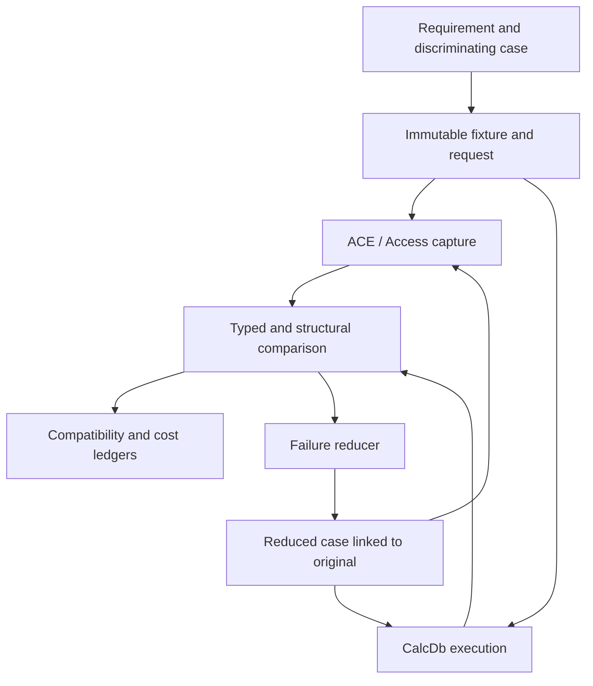

# I-15. Oracle, corpus, tests and performance

Revision 1 · Stage 1, response 3 · 2026-11-12

## One evidence path from question to regression

**D-EVIDENCE-1 — recommended; ACE remains the behavioral authority.** One harness describes a case, obtains or reuses an immutable oracle capture, runs CalcDb against the same semantic input, compares the appropriate observations and records the result. SQL, object-model and file tests are front ends to this harness. A second implementation can help localize a discrepancy but cannot vote ACE out of the specification.

Separate four kinds of evidence: user-supplied requirements/integration facts; documentary/reference facts; actual identified ACE executions; and CalcDb invariant/simulation results. A design recommendation is none of those observations. Every accepted compatibility rule points to its defining requirement and the evidence that establishes it. Unknown, refused and unimplemented cases remain visible failures; an expected target rejection is a pass only when CalcDb actually reproduces it.

**Figure F-16 — evidence and reduction flow.** Frozen inputs and original observations survive reduction. Mermaid source only; not render-verified.

## Oracle service and controlled processes

**D-ORACLE-1 — service direction and initial target decided.** The initial target is the user-reported ACEDAO.DLL 16.0.20527.20016. At service startup, resolve the actual loaded DAO/ACE binaries, paths, file versions and hashes; separately identify Access, ADO runtime/provider, Windows and the caller runtime. Record x64, locale, database sort/options, sandbox/host state and relevant filesystem/cache configuration. .NET Framework 4.8-family and .NET 10 LTS are independent client lanes. Do not choose behavior from an invisible oracle-build tag inside CalcDb.

Use one long-lived controller with versioned request/result schemas, batched work and owned worker processes. A request names the fixture snapshot, surface, operation sequence, capture policy and fault model. It receives a durable job ID before execution. The controller may retry a transport query for an existing job ID; it must not blindly execute an uncertain mutation again. Persist start/completion/crash/timeout dispositions and partial artifacts. A truncated response is an evidence failure, not an empty result.

Run Office-facing workers in a dedicated test profile/environment and configured logged-on test session, with isolated working/TEMP directories and the charter's private desktop arrangement tested explicitly. Keep a message pump and UI Automation dialog observer for owned processes. Verify the ownership of returned automation objects, their servers and UI processes before driving them: a new client process or private desktop does not prove that Office created an isolated server. Only start, drive or terminate processes created by the harness; never attach to the user's working Access/Excel instance. Preserve Trust Center, macro-security and HKLM settings. Unexpected dialogs become captured events with bounded recovery or an unresolved run; they cannot be dismissed with a universal affirmative answer.

Microsoft's automation guidance identifies user-profile, desktop and modal-dialog assumptions and does not promise reliable unattended Office execution.[^office] A private desktop is consequently a test configuration to validate, not a support guarantee. R-ORACLE-1 tests it before scaling the queue. Use separate environments for conflicting installations or global-state-sensitive concurrency experiments; serialize requests within an Office instance unless the case explicitly studies interaction. Recycle workers on controlled state boundaries or diagnosed contamination, while keeping the service and capture store alive.

Control startup, corpus copying and capture transfer separately from engine timing. Queue latency, worker startup and a missing cached answer are harness costs to reduce. No repeated human wait should be necessary for an already captured semantic input.

## Capture identity and exact comparison

The case key combines a versioned semantic request, fixture bytes/provenance and relevant environment dimensions. Store large files and traces by content digest, with an immutable manifest linking them. Transport digests detect loss or substitution; they do not replace the full evidence or become expected query answers. Captured original files are never rewritten when an expectation changes.

Typed values carry subtype and exact payload: integral width/sign, floating-point bits, Currency/Decimal scale and precision, native temporal precision, UTF-16 units and length, binary bytes, Null/Empty/error/missing distinctions, SAFEARRAY dimensions/lower bounds/element type, and inbound/outbound ByRef values captured within their valid lifetime. Assign capture-local object identity labels from actual identity observations; raw pointer addresses are diagnostic data, never portable expected values. Retain source field metadata and native bytes where the public projection loses information.

Each operation records return value and all relevant state immediately: position/population/edit flags, result schema, parameter values, counts, ordered error collections, HRESULT, Automation error information and callback/event sequence. Capture error state before diagnostic calls can overwrite it. Some observations themselves consume or change diagnostics; specify read order and use paired fresh runs for channels that cannot be observed together without interference. Keep localized raw descriptions; any permitted text normalization is a separately reviewed comparison rule, never a substitute for error number, source, order or lifetime.

Choose comparison policy by contract. Required row order is compared exactly. Where order is genuinely unspecified and experiments establish variation, preserve raw orders while comparing the admissible relation; unordered rows retain multiplicity, types and exact value payloads. Do not sort every result by default or reorder callback/error traces. Parallel CalcDb execution still equals its accepted serial reference, including row order and Double bits. Compare keys and opaque regions byte-for-byte where mandated. For other file content, compare decoded structure, references, allocation conservation and required semantic state; explain every ignored byte class through evidence rather than a growing ad hoc mask.

Time, randomness and external environment need an explicit comparison class too. Use fixed parameters for ordinary semantic tests and documented public seeding controls where applicable. Test the native nondeterministic function separately, capturing clock bounds, seed/state where exposed, result types and the evidenced relation among calls. Do not claim to inject CalcDb's effect source into proprietary ACE or demand equal random bits from independent unseeded runs. A case-specific admissible relation needs documentary or repeated oracle evidence; otherwise the case remains unresolved. Preserve every raw value and the uncertainty that limited the comparison. CalcDb's serial/parallel equivalence still uses the same controlled effect sequence and exact permitted observations.

## Corpus, preservation and reduction

Build the corpus from Access/ACE-created Jet 4 and ACCDB files across supported version/options families, plus generated fixtures with recorded creation recipes. Cover empty/minimal databases, every scalar/extended type, all supported sort families, compressed and uncompressed text, row/LV boundaries, AutoNumber, relationships, QueryDefs, user properties and preserved front-end payloads. Preserve originals, creation environment, legal provenance and fixture licences. Later encrypted/linked/complex cases enter the same corpus with explicit phase labels; an initial parser must preserve what it cannot yet execute.

Keep three distinct mutation tracks: legal semantic operations through ACE; format-driven boundary/malformed generation from the one format description; and deliberate crash/fault images. A malformed file rejected by ACE is still useful for bounded parsing, but rejection alone does not establish CalcDb's error mapping. Unknown structures are not silently removed by fixture minimization. A preservation case retains its protected bytes and reference relationships while reducing unrelated tables, rows and properties.

The reducer minimizes SQL syntax, operation sequence, data values, schema, file structures and schedule/fault events using the same harness. Keep the failure signature—typed mismatch, first error/effect difference, structural violation or crash class—and re-obtain ACE evidence for each reduced candidate that changes semantic input. Do not call a smaller case equivalent because CalcDb still fails. Preserve the original and the reduction chain so environment-sensitive or intermittent failures remain diagnosable.

Ordinary successful writes get independent ACE/Access opening and Compact & Repair checks on copies. Compare data, properties, references and protected payloads before and after repair, and capture logs/error tables. Access documentation says repair can lose damaged data, so a successful return alone cannot establish preservation.[^repair] Compact & Repair is neither a unique byte canonicalizer nor an automatic step that makes a CalcDb write acceptable. Interrupted files use the separate I-08 crash classification and independent first-opener branches.

## Deterministic execution and fault models

Use the real pager, cursor, transaction, lock, ownership and query code under injected effects. The simulator controls time, entropy, completion order and explicit scheduler boundaries; it records the seed, build, configuration and a complete event trace. A seed alone is not a stable replay specification across code changes. Stable operation/resource identities and an explicit trace-version check detect divergence. A missing event or disabled trace segment invalidates the claimed replay.

The blocking API does not require an async runtime to be testable. The deterministic adapter schedules effect completion and cooperative worker boundaries around the same state transitions. It may explore bounded interleavings or guided random schedules, then minimize a failure trace. Native stress and memory-model/unsafe-code analysis remain necessary for races not represented by those boundaries. A successful small model is evidence about that model, not proof of the whole implementation.

Inject failure before reservation, after allocation, during short/failed I/O, at publication, during flush, close and cleanup. Sweep isolated failures and persistent failure after the first fault; then selected combinations such as exhaustion during rollback or a second interruption during optional undo. Check resource conservation, generation validity and recorded uncertainty after each effect. Native adapter tests calibrate which partial writes, reorderings and persistence frontiers are actually permitted by each environment.

SQLite's testing documentation contributes allocation/I/O failure sweeps, compound faults and optimization-disabled checks as test-design concepts; its proprietary test suites are not thereby cleared for reuse.[^sqlite] Jingyu Zhou and coauthors' *FoundationDB: A Distributed Unbundled Transactional Key Value Store* (2021), §4, supports running production logic under deterministic effects and explicitly discusses simulator limits.[^fdb] CalcDb adopts neither that system's actor runtime nor its distributed transaction semantics. The cleared FrankenSqlite/asupersync reports supply ownership, trace-completeness and reduction lessons only.[^notes]

R-CRASH-1/2 provide external ACE traces before the CalcDb writer, then replay the implemented writer at every applicable cut. Process kill, OS/power loss, storage failure and interrupted recovery have separate outcomes. Real ACE evidence selects admissible survival/repair states; generic simulator assertions must not replace that oracle with stronger atomicity.

## Performance method and compatibility accounting

**D-PERF-1 — priorities decided; measurement method recommended.** Measure DAO/VBA row loops first, bulk SQL second and WASM third when choices conflict. Begin counters with the first end-to-end read slice. Do not wait for complete SQL or ADO before discovering that field access allocates, copies or synchronizes excessively.

| Workload family | Representative shapes | Primary cost observations |
| --- | --- | --- |
| DAO loop | MoveNext and ordinal/name Field.Value; short/long/repeated text; Seek/Find; bookmarks; small edits; sparse/wide rows. | Actual COM crossings, lookup probes, allocations, owned/copy/decode bytes, pin/map transitions and working set. |
| Bulk SQL | Selective/nonselective scans, joins with skew, groups/distinct, tied TOP, crosstabs, actions and spilling sorts. | Page patterns, probes, comparisons, expression/host calls, retained state, spill volume/passes and write/flush work. |
| Browser | Same semantics at bounded memory, direct versus broker I/O, import/export, quota and storage failures. | Linear-memory high-water mark, retained handles/pages, bridge copies/crossings, blocking time and actual persistence outcomes. |

Record compiler/runtime/build, CPU/storage, dataset shape, cache condition, plan and worker count. Compare paired runs with a fixed workload and randomized order; use repeated A/A runs to estimate noise before claiming a change. Separate cold/warm engine state from OS cache and warm-up/JIT/Office startup. Report distributions and outliers relevant to the path rather than one flattering minimum. Internal CalcDb counters are not asserted as measurements of ACE's internals.

An optimization proposal includes the semantic cases it must preserve, predicted cost change, actual executed path and measured result. Keep negative results and regressions in the performance ledger. Choose thresholds from observations; no numerical throughput, latency or memory target is invented here. Reopen cache/materialization/operator choices when a representative counter changes, while preserving the workload priority and semantic contracts.

The compatibility ledger has rows keyed by requirement/member/feature/context and capture: matched, mismatched, refused, missing or unresolved evidence. Track documentary expectations separately. Publish the declared initial-scope denominator and the complete planned product inventory side by side; deferred capabilities remain visible. An unavailable target member is a matching negative case only after both actual outcomes agree. Plan-shape checks and invariant checks support, but never inflate, the count of ACE-matched cases.

## Common experiment conditions and R-ORACLE-1

The experiment cards throughout Part I share these conditions unless a card explicitly varies them: selected and verified ACE/Access identities, x64 surface, Jet 4/ACCDB format, Windows locale, database sort/options, wildcard mode, sandbox/host state and declared transaction/open options. ADO records its own runtime/provider; managed callers record the selected .NET family and installed patch. Mutation/locking cases add filesystem, cache, flush and TEMP configuration. Browser cases declare their platform-specific substitutions explicitly.

Each case captures original fixture/hash, operation sequence, typed results/order/schema, errors/state/effects and before/after database/lock-file bytes with changed-page classification; relevant TEMP and I/O traces are retained. Read-only cases still check for writes. An incomplete trace or nondiscriminating fixture stays unresolved and gets a reduced follow-up. Differences across builds remain separate evidence requiring a declared target decision; no implementation chooses whichever recorded answer passes.

**R-ORACLE-1 — capture, isolation and service recovery; M.** Create a small known fixture covering all shared scalar tags, exact UTF-16/binary payloads, parameter omission, arrays and object identity, plus a clock/random-value case with declared controllability. Run DAO/Access and ADO as their drivers are available through direct/native/managed callers, recording loaded identities and all result channels; validate encode/decode without lossy JSON/string conversion. Cross worker reuse versus fresh processes, two job IDs versus a repeated ID, the same ID with a different request/fixture digest, transport loss, timeout, an owned dialog and worker death. Reject conflicting job-ID reuse and retain uncertain execution status; do not promise exactly-once mutation across a lost worker. Capture raw artifacts and lifecycle events. Compare repeated captures and a hand-audited baseline; content differences select additional environment dimensions or isolation boundaries, identity/corruption differences require fixing serialization before accepting downstream captures. Prove private-desktop UI handling and safe owned-process cleanup; unresolved automation configurations remain unavailable. Dependencies: user-selected installation and a minimal public-API driver, not a CalcDb implementation. Larger matrices start after this evidence path works.

## Sources and use boundaries

Exact material/version/use/licence status for all chapters is retained in the ledger below. Jackcess contributes inspected format facts and possible algorithms; it does not define ACE transactions, locking or SQL behavior. Before any code/resource port, pin the actual permitted material and check its own licence and notices. mdbtools remains facts-only. Other readers require per-material checks before reuse. No excluded direct FrankenSqlite/asupersync repository, documentation, package, mirror or external extract is consulted; only the cleared attached reports contribute concepts.

[^office]: Microsoft, [Considerations for server-side Automation of Office](https://support.microsoft.com/en-us/visio/considerations-for-server-side-automation-of-office) and [Considerations for unattended automation of Office](https://learn.microsoft.com/en-us/office/client-developer/integration/considerations-unattended-automation-office-microsoft-365-for-unattended-rpa), accessed 2026-11-12. Configuration risks inform R-ORACLE-1; no supported-execution claim or settings change follows.
[^repair]: Microsoft, [Compact and repair a database](https://support.microsoft.com/en-us/access/compact-and-repair-a-database), accessed 2026-11-12; documentary behavior, not an observed result on the selected build.
[^sqlite]: SQLite, [How SQLite Is Tested](https://sqlite.org/testing.html), selected §§2–3, 4 and 9, accessed 2026-11-12. Documentation concepts only; [copyright statement](https://sqlite.org/copyright.html) distinguishes public-domain deliverables from separately licensed material. No test/source code reused.
[^fdb]: Jingyu Zhou et al., [FoundationDB: A Distributed Unbundled Transactional Key Value Store](https://www.foundationdb.org/files/fdb-paper.pdf), SIGMOD 2021, DOI 10.1145/3448016.3457559, §4. Selected conceptual reference; paper copyright/abstracting notice inspected; no code or quoted implementation reused.
[^notes]: Supplied `frankensqlite.stage1.part3.md` §§8, 10; `asupersync.stage1.part4.md` §§7–8, part 5 §§4–7 and part 6 §§2–4. Cleared concepts, not requirements or external-source observations.

<!-- SOURCE_LEDGER_START -->
## Source ledger: exact material and permitted use

All public material was accessed 2026-11-12 unless a row states otherwise. A live page date is not an immutable source revision or an observed product build. No direct quotations, adaptations or code reuse were introduced by Part I; inspected source facts and concept use are classified below. A checked project statement or source header clears only the material identified, never uninspected resources/dependencies. The compact ledger in book-record retains the same IDs, version labels, use and licence-check status.

| ID | Exact material | Version / inspected extent | Use | Licence check / reuse boundary | Contribution |
| --- | --- | --- | --- | --- | --- |
| N | `calcdb-one-pager.md` | Draft 2; 2026-11-10 | Requirement authority | User-provided scope; not a code licence | All chapters; all N rows |
| C | `CHARTER.md` | Attached snapshot; undated | Requirement elaboration | User-provided; product says MIT | Scope elaboration only where consistent with N |
| V | `calcvba-integration-note.md` | 2026-11-12; CalcVBA 8115aa781 | Supplied Fact / Decided / Open | User-provided integration facts; no implementation inspected | 02,10,13,14 |
| U | `User scope/approval corrections in this conversation` | 2026-11-12 | Authoritative clarification | Not applicable | Canonical VARIANT; Stage 0 approval; ACE/.NET targets; crash/undo rules; all nine reports cleared; nonprescriptive implementation order and lengths; compact current-state record |
| A | `gpt6pro-book-prompt.md` | Attached assignment | Work instructions | User-provided | Stages, coverage, evidence, budgets and format |
| B | `book-record.md` | Canonical S1-r2 continuation input; current output S1-r3 | Continuation state | User-provided | Book state only; detailed cards moved into owning chapters |
| L-SYN | `synthesis.md` | Reviewed 2026-11-10; reports refer to 074c203/92501d5f | Concept only | Reviewed notes cleared by user; excluded repositories not accessed | Ownership, deterministic tests and measurement; not ACE evidence |
| L-FRANK | `frankensqlite-report.md` | Reviewed 2026-11-10; note provenance names 074c203 | Concept only | Reviewed notes cleared; no source licence/reuse claim | Single-path costs, path verification, storage/test lessons |
| L-ASYNC | `asupersync-report.md` | Reviewed 2026-11-10; note provenance names 92501d5f | Concept only | Reviewed notes cleared; no source licence/reuse claim | Owned work, cancellation, effect injection and reduction |
| S-MS-TXN | [Workspace.CommitTrans method (DAO)](https://learn.microsoft.com/en-us/office/client-developer/access/desktop-database-reference/workspace-committrans-method-dao) | 2022-03-18 DAO reference; accessed 2026-11-12 | Documented fact; not observed target-build behavior | Exact document licence not separately checked; no code/quotation reuse | 08: Workspace scope/nesting, flush intent and TEMP-exhaustion questions; actual target outcomes unobserved |
| S-MS-VARIANT | [VARIANT structure (oaidl.h)](https://learn.microsoft.com/en-us/windows/win32/api/oaidl/ns-oaidl-variant) | Retrieved 2026-11-12; online SDK reference | Documented ABI contract | Exact document licence not checked; no code reuse | 02,13: platform ABI conformance |
| S-MS-FACTORY | [REGCLS enumeration (combaseapi.h)](https://learn.microsoft.com/en-us/windows/win32/api/combaseapi/ne-combaseapi-regcls) | Displayed document update 2022-01-31; accessed 2026-11-12. | Documented class-factory registration mechanism | Exact article/example licence not separately checked; documentary facts only. No exact quotation, adaptation or code reuse. | 13: EXE-owned in-process factory feasibility and flags; not a universal DLL activation override. |
| S-MS-ACT | [Creating Registration-Free COM Objects](https://learn.microsoft.com/en-us/windows/win32/sbscs/creating-registration-free-com-objects) | Displayed document update 2021-01-07; accessed 2026-11-12. | Documented activation-context mechanism | Exact article/example licence not separately checked; documentary facts only. No exact quotation, adaptation or code reuse. | 13: ProgID/CLSID/DLL mappings and fallback support a scoped manifest candidate; actual unchanged-client and thread coverage remains R-ACT-1. |
| S-MS-NET | [Registration-free COM interop](https://learn.microsoft.com/en-us/dotnet/framework/interop/registration-free-com-interop) | Displayed document update 2026-07-12; accessed 2026-11-12. | Framework-specific deployment guidance | Exact article/example licence not separately checked; documentary facts only. No exact quotation, adaptation or code reuse. | 13: explicitly .NET Framework material; do not infer .NET 10 CLR deployment or arbitrary cross-runtime binary compatibility. |
| S-JACK-API | [Jackcess Database API](https://jackcess.sourceforge.io/apidocs/com/healthmarketscience/jackcess/Database.html) | Page labels itself 5.0.4; retrieved 2026-11-12 | Fact about reference implementation limits | Per-page licence not separately established; no code/algorithm reuse | 08,09: not a transaction/sharing oracle |
| S-JACK-FAQ | [Jackcess FAQ](https://jackcess.sourceforge.io/faq.html) | Live website; retrieved 2026-11-12; not commit-pinned | Reference capability/failure facts | Per-page licence not separately checked; facts only | 04,08,09: format feasibility and limits |
| S-JACK-LIC | [Jackcess LICENSE.txt](https://github.com/jahlborn/jackcess/blob/master/LICENSE.txt) | master snapshot retrieved 2026-11-12; no immutable commit claimed | Licence fact | Apache-2.0 text checked for this file only; no other file cleared by inference | Future reuse requires pinned exact files, headers, resources and notices |
| S-SQLITE-ATOMIC | [Atomic Commit In SQLite](https://sqlite.org/atomiccommit.html) | Live document retrieved 2026-11-12 | Concept: undo and ordering; not ACE behavior | Documentation public-domain statement checked at S-SQLITE-LIC; no code reused | 08: reasoning about rollback protocols and failure assumptions |
| S-SQLITE-LIC | [SQLite Copyright](https://sqlite.org/copyright.html) | Live public-domain statement checked 2026-11-12, including documentation coverage | Licence fact | Checked for cited SQLite documentation; no code/fixture/build-script reuse | 03,08,11,15: documentation concepts and separate material boundaries; no ACE behavior inferred |
| S-WEB-FS | [WHATWG File System Living Standard](https://fs.spec.whatwg.org/) | Living Standard last updated 2026-10-19; accessed 2026-11-12. Inspected snapshot d76d3455d5afe2f85754ed24ffdbf99fe30032d4: https://fs.spec.whatwg.org/commit-snapshots/d76d3455d5afe2f85754ed24ffdbf99fe30032d4/ . Snapshot preserves reading identity; canonical living page remains normative. | Selected handle IDL and acquisition/read/write/flush/close/writable-stream algorithms; documentary API facts only | IPR paragraph inspected: document CC BY 4.0; source-incorporated portions BSD-3-Clause; inherited W3C Software and Document Licence material acknowledged. No source implementation reuse or copied IDL. No exact quotation, adaptation or code reuse. | 03,14: dedicated-worker synchronous storage, exclusive handle ownership, Promise acquisition, partial/uncertain I/O and flush versus close/replacement; no claimed browser support or ACE-equivalent power-loss guarantee. |
| L-FRANK-1 | `frankensqlite.stage1.part1.md` | Supplied first-stage snapshot; cleared 2026-11-12; SHA-256 86b5b0c35efa642d3218f3adcc870ce255adf115341961d81ca96aa8f27a9f09 | Concept only; full read | User-cleared notes; no original source accessed/reused | 01–05: Storage/cache/index mechanisms, allocation costs and failed optimizations. |
| L-FRANK-2 | `frankensqlite.stage1.part2.md` | Supplied first-stage snapshot; cleared 2026-11-12; SHA-256 383f4d18ca9fd4a34ce2fb245c6137c69351d8a74f9f590e58f0180aba5d5557 | Concept only; full read | User-cleared notes; no original source accessed/reused | 02–05: I/O outcomes, private preparation, lazy decoding and cache ownership. |
| L-FRANK-3 | `frankensqlite.stage1.part3.md` | Supplied first-stage snapshot; cleared 2026-11-12; SHA-256 269986d53ca5654b225af8244239bf32b1e7fbf04677fdcb5265bf4b926afe6b | Concept only; full read | User-cleared notes; no original source accessed/reused | 01,03,05,15: Trace provenance, deterministic testing, reduction and path evidence. |
| L-ASYNC-1 | `asupersync.stage1.part1.md` | Supplied first-stage snapshot; cleared 2026-11-12; SHA-256 1029e85486f5e8c1ce257486c0ae447ff95991b0dec63cae1b84707231f27042 | Concept only; full read | User-cleared notes; no original source accessed/reused | 01,04,15: Explicit effects, scoped work, deterministic execution and test methodology. |
| L-ASYNC-2 | `asupersync.stage1.part2.md` | Supplied first-stage snapshot; cleared 2026-11-12; SHA-256 eed49b70bc3b3c4fa6a88d631c335a5b35ed6a53c9e9f7c5444d61b164f9e9a5 | Concept only; full read | User-cleared notes; no original source accessed/reused | 01–05: Admission before construction, ownership, preflight, identity and byte budgets. |
| L-ASYNC-3 | `asupersync.stage1.part3.md` | Supplied first-stage snapshot; cleared 2026-11-12; SHA-256 83baa515d6fe461c78076fd2b7d337eb537a61b6ebef8f84c0abd35ada880db0 | Concept only; full read | User-cleared notes; no original source accessed/reused | 01–04: Reserve/publish cleanup, callback boundaries, cancellation and conservation. |
| L-ASYNC-4 | `asupersync.stage1.part4.md` | Supplied first-stage snapshot; cleared 2026-11-12; SHA-256 3b6804a2ab93b14f44dc578f8cff3fc76aa17c4c28aab204d29565f3224a8195 | Concept only; full read | User-cleared notes; no original source accessed/reused | 01–04,06,15: Generation validity, progress-preserving I/O, checked parsing and trace completeness. |
| L-ASYNC-5 | `asupersync.stage1.part5.md` | Supplied first-stage snapshot; cleared 2026-11-12; SHA-256 04cd8c5c19d00b9002e80f2d628d9ecd61bac0164c2a73bfc8961713500df96e | Concept only; full read | User-cleared notes; no original source accessed/reused | 03,09,15: Replay testing, deferred reclamation, bounded streaming and performance evidence. |
| L-ASYNC-6 | `asupersync.stage1.part6.md` | Supplied first-stage snapshot; cleared 2026-11-12; SHA-256 7da0e66e981a4c3c148a86fef4154182f53ee08317222a78374e6667fe9c66f2 | Concept only; full read | User-cleared notes; no original source accessed/reused | 01–03,06,15: Ownership/latch rules, metadata lookup regressions and limits of model evidence. |
| S-JACK-FMT | [JetFormat.java](https://jackcess.sourceforge.io/xref/com/healthmarketscience/jackcess/impl/JetFormat.html) | Live official xref accessed 2026-11-12; exact release/commit unresolved | Selected source facts/concepts; no adaptation/reuse | Visible Apache-2.0 file header checked (HMS 2005); no blanket resource clearance | 04: format descriptors/page family |
| S-JACK-COL | [ColumnImpl.java](https://jackcess.sourceforge.io/xref/com/healthmarketscience/jackcess/impl/ColumnImpl.html) | Live official xref accessed 2026-11-12; exact release/commit unresolved | Selected source facts/concepts; no adaptation/reuse | Visible Apache-2.0 file header checked (HMS 2005); no blanket resource clearance | 02,04: Boolean/text codecs; sort descriptor |
| S-JACK-LONG | [LongValueColumnImpl.java](https://jackcess.sourceforge.io/xref/com/healthmarketscience/jackcess/impl/LongValueColumnImpl.html) | Live official xref accessed 2026-11-12; exact release/commit unresolved | Selected source facts/concepts; no adaptation/reuse | Visible Apache-2.0 file header checked (James Ahlborn 2014); no blanket resource clearance | 04: native long-value forms; do not inherit partial-read policy |
| S-JACK-MAP | [UsageMap.java](https://jackcess.sourceforge.io/xref/com/healthmarketscience/jackcess/impl/UsageMap.html) | Live official xref accessed 2026-11-12; exact release/commit unresolved | Selected source facts/concepts; no adaptation/reuse | Visible Apache-2.0 file header checked (HMS 2005); no blanket resource clearance | 04: map forms and allocation ownership |
| S-JACK-INDEX | [IndexData.java](https://jackcess.sourceforge.io/xref/com/healthmarketscience/jackcess/impl/IndexData.html) | Live official xref accessed 2026-11-12; exact release/commit unresolved | Selected source facts/concepts; no adaptation/reuse | Visible Apache-2.0 file header checked (HMS 2005); no blanket resource clearance | 05: physical/logical index distinction and page/entry structure |
| S-JACK-LEGACY | [GeneralLegacyIndexCodes.java](https://jackcess.sourceforge.io/xref/com/healthmarketscience/jackcess/impl/GeneralLegacyIndexCodes.html) | Live official xref accessed 2026-11-12; exact release/commit unresolved | Selected source facts/concepts; no adaptation/reuse | Visible Apache-2.0 file header checked (HMS 2008); no blanket resource clearance | 05: General Legacy key family |
| S-JACK-GENERAL | [GeneralIndexCodes.java](https://jackcess.sourceforge.io/xref/com/healthmarketscience/jackcess/impl/GeneralIndexCodes.html) | Live official xref accessed 2026-11-12; exact release/commit unresolved | Selected source facts/concepts; no adaptation/reuse | Visible Apache-2.0 file header checked (James Ahlborn 2011); no blanket resource clearance | 05: General family and differing weights |
| S-JACK-QUERY | [QueryImpl API](https://jackcess.sourceforge.io/apidocs/com/healthmarketscience/jackcess/impl/query/QueryImpl.html) | API page labelled 5.0.4; accessed 2026-11-12 | API facts | Exact API licence/source header not checked; no reuse | 06: SQL derived from native query records/properties |
| S-JACK-QUERYROW | [QueryImpl.Row API](https://jackcess.sourceforge.io/apidocs/com/healthmarketscience/jackcess/impl/query/QueryImpl.Row.html) | API page labelled 5.0.4; accessed 2026-11-12 | API facts | Exact API licence/source header not checked; no reuse | 06: native query-row fields and ordering |
| S-JACK-RELEASE | [Jackcess 5.0.4 source-package listing](https://sourceforge.net/projects/jackcess/files/jackcess/5.0.4/) | Published release/package metadata inspected 2026-11-12 | Metadata fact only | Source archive, NOTICE and fixtures not retrieved/checked | Does not establish that the live xref is this release |
| S-JACK-CHANGES | [Jackcess release notes](https://jackcess.sourceforge.io/changes-report.html) | Live notes; 4.0.11 and 5.0.4 entries inspected 2026-11-12 | Regression-scenario facts | Exact document licence not checked; no copied tests/code | Map promotion and QueryDef rendering cases to investigate; not ACE observations |
| S-JACK-RESOURCES | `index_codes_gen.txt / index_codes_ext_gen.txt and related weight resources` | Names visible in xref; unpinned; NOT opened | No use/reuse; pending material review | NOT checked; Java headers do not clear resource content | Before any port: retrieve exact archive, provenance, hashes, NOTICE and per-resource licence |
| S-MS-QUERY | [QueryDef object (DAO)](https://learn.microsoft.com/en-us/office/client-developer/access/desktop-database-reference/querydef-object-dao) | Live official documentation, accessed 2026-11-12 | Documented fact | Exact document licence not checked; no code/quotation reuse | 06: temporary/permanent QueryDef and properties |
| S-MS-CREATE | [CREATE TABLE (Access SQL)](https://learn.microsoft.com/en-us/office/client-developer/access/desktop-database-reference/create-table-statement-microsoft-access-sql) | Live official documentation, accessed 2026-11-12 | Documented compression fact | Exact document licence not checked; no reuse | Research context: compression state can differ; target-build test pending |
| S-MS-NET10 | [.NET support policy](https://dotnet.microsoft.com/en-us/platform/support/policy) | Live official page, accessed 2026-11-12 | Documented LTS classification | Exact document licence not checked; no reuse | 01,13: .NET 10 LTS; no installed patch assumed |
| S-MS-FILEID | [BY_HANDLE_FILE_INFORMATION](https://learn.microsoft.com/en-us/windows/win32/api/fileapi/ns-fileapi-by_handle_file_information) | Live official reference, accessed 2026-11-12 | Documented identity limitations | Exact document licence not checked; no code reuse | 03,08: identity is not path or a universal history witness |
| S-MS-USN | [Change journal records](https://learn.microsoft.com/en-us/windows/win32/fileio/change-journal-records) | Live official reference, accessed 2026-11-12 | Documented journal semantics/limits | Exact document licence not checked; no reuse | 03,08: continuity/gaps matter; no portable no-external-change proof |
| S-MS-FILTER | [Registering preoperation and postoperation callback routines](https://learn.microsoft.com/en-us/windows-hardware/drivers/ifs/registering-preoperation-and-postoperation-callback-routines) | Live official reference, accessed 2026-11-12 | Instrumentation mechanism fact | Exact document licence not checked; no driver code reused | R-CRASH-1: controlled observation must include relevant cached/paging activity |
| S-MS-FILTER-WRITE | [Writing preoperation and postoperation callback routines](https://learn.microsoft.com/en-us/windows-hardware/drivers/ifs/writing-preoperation-and-postoperation-callback-routines) | Live official reference, accessed 2026-11-12 | Instrumentation mechanism fact | Exact document licence not checked; no driver code reused | R-CRASH-1: external request control feasibility only |
| S-MS-FILTER-IO | [Processing I/O operations](https://learn.microsoft.com/en-us/windows-hardware/drivers/ifs/processing-i-o-operations) | Live official reference, accessed 2026-11-12 | Instrumentation mechanism fact | Exact document licence not checked; no driver code reused | R-CRASH-1: pend/resume mechanism; completeness still requires validation |
| S-MS-RST | [Recordset object](https://learn.microsoft.com/en-us/office/client-developer/access/desktop-database-reference/recordset-object-dao) | 2022-02-08; Access/Office 2013; accessed 2026-11-12 | Documentary fact; selected reference passages | Exact page/sample licence not separately checked; no code, adaptation or quotation reuse | 07: type distinctions; target policies pending |
| S-MS-NOMATCH | [Recordset.NoMatch](https://learn.microsoft.com/en-us/office/client-developer/access/desktop-database-reference/recordset-nomatch-property-dao) | 2022-02-08; DAO reference; accessed 2026-11-12 | Documentary fact; selected reference passages | Exact page/sample licence not separately checked; no code, adaptation or quotation reuse | 07: NoMatch versus movement/current position |
| S-MS-COUNT | [Recordset.RecordCount](https://learn.microsoft.com/en-us/office/client-developer/access/desktop-database-reference/recordset-recordcount-property-dao) | 2021-09-21; DAO reference; accessed 2026-11-12 | Documentary fact; selected reference passages | Exact page/sample licence not separately checked; no code, adaptation or quotation reuse | 07: population-dependent count |
| S-MS-BOOKMARK | [Recordset.Bookmark](https://learn.microsoft.com/en-us/office/client-developer/access/desktop-database-reference/recordset-bookmark-property-dao) | 2022-02-08; DAO reference; accessed 2026-11-12 | Documentary fact; selected reference passages | Exact page/sample licence not separately checked; no code, adaptation or quotation reuse | 07: bookmark families; representation ambiguity retained |
| S-MS-MARK | [Mark a position in a DAO Recordset](https://learn.microsoft.com/en-us/office/vba/access/concepts/data-access-objects/mark-a-position-in-a-dao-recordset) | 2022-01-22; Access VBA guidance; accessed 2026-11-12 | Documentary fact; selected reference passages | Exact page/sample licence not separately checked; no code, adaptation or quotation reuse | 07: bookmark use; no assumed payload ABI |
| S-MS-CLONE | [Recordset.Clone](https://learn.microsoft.com/en-us/office/client-developer/access/desktop-database-reference/recordset-clone-method-dao) | 2022-03-02; DAO reference; accessed 2026-11-12 | Documentary fact; selected reference passages | Exact page/sample licence not separately checked; no code, adaptation or quotation reuse | 07,08: clones and documented rollback trigger |
| S-MS-REQUERY | [Recordset.Requery](https://learn.microsoft.com/en-us/office/client-developer/access/desktop-database-reference/recordset-requery-method-dao) | 2022-03-21; DAO reference; accessed 2026-11-12 | Documentary fact; selected reference passages | Exact page/sample licence not separately checked; no code, adaptation or quotation reuse | 07: reexecution/lifecycle; exact state requires capture |
| S-MS-EDIT | [Recordset.Edit](https://learn.microsoft.com/en-us/office/client-developer/access/desktop-database-reference/recordset-edit-method-dao) | 2021-09-21; DAO reference; accessed 2026-11-12 | Documentary fact; selected reference passages | Exact page/sample licence not separately checked; no code, adaptation or quotation reuse | 07,09: edit timing; native/link qualification unresolved |
| S-MS-ADD | [Recordset.AddNew](https://learn.microsoft.com/en-us/office/client-developer/access/desktop-database-reference/recordset-addnew-method-dao) | 2021-09-21; DAO reference; accessed 2026-11-12 | Documentary fact; selected reference passages | Exact page/sample licence not separately checked; no code, adaptation or quotation reuse | 07: editing/defaults; context limitations retained |
| S-MS-UPDATE | [Recordset.Update](https://learn.microsoft.com/en-us/office/client-developer/access/desktop-database-reference/recordset-update-method-dao) | 2022-03-21; DAO reference; accessed 2026-11-12 | Documentary fact; selected reference passages | Exact page/sample licence not separately checked; no code, adaptation or quotation reuse | 07: update/failure state; no blanket index restriction |
| S-MS-DELETE | [Recordset.Delete](https://learn.microsoft.com/en-us/office/client-developer/access/desktop-database-reference/recordset-delete-method-dao) | 2021-09-14; contradictory reference wording; accessed 2026-11-12 | Documentary fact; selected reference passages | Exact page/sample licence not separately checked; no code, adaptation or quotation reuse | 07: documentary conflict, not grounds to remove Delete |
| S-MS-DELETE-GUIDE | [Delete a record from a DAO Recordset](https://learn.microsoft.com/en-us/office/vba/access/concepts/data-access-objects/delete-a-record-from-a-dao-recordset) | 2022-01-22; Access VBA guidance; accessed 2026-11-12 | Documentary fact; selected reference passages | Exact page/sample licence not separately checked; no code, adaptation or quotation reuse | 07: contrasts with Delete reference; no sample reused |
| S-MS-ROLLBACK | [Workspace.Rollback](https://learn.microsoft.com/en-us/office/client-developer/access/desktop-database-reference/workspace-rollback-method-dao) | 2021-09-14; Access/Office 2013; accessed 2026-11-12 | Documentary fact; selected reference passages | Exact page/sample licence not separately checked; no code, adaptation or quotation reuse | 08: current-level provisional baseline; lifecycle/failure probes |
| S-MS-TXN-GUIDE | [Use transactions in a DAO Recordset](https://learn.microsoft.com/en-us/office/vba/access/concepts/data-access-objects/use-transactions-in-a-dao-recordset) | 2021-09-13; Access VBA guidance; accessed 2026-11-12 | Documentary fact; selected reference passages | Exact page/sample licence not separately checked; no code, adaptation or quotation reuse | 08: file-server failure caution, not durable atomicity proof |
| S-MS-DEXEC | [Database.Execute](https://learn.microsoft.com/en-us/office/client-developer/access/desktop-database-reference/database-execute-method-dao) | 2022-03-18; internal contradiction retained; accessed 2026-11-12 | Documentary fact; selected reference passages | Exact page/sample licence not separately checked; no code, adaptation or quotation reuse | 08,11: flag/failure matrix; no universal atomicity inferred |
| S-MS-QEXEC | [QueryDef.Execute](https://learn.microsoft.com/en-us/office/client-developer/access/desktop-database-reference/querydef-execute-method-dao) | 2022-03-18; Access/Office 2013; accessed 2026-11-12 | Documentary fact; selected reference passages | Exact page/sample licence not separately checked; no code, adaptation or quotation reuse | 08,11: rollback wording and affected-count contract |
| S-MS-RSTOPTIONS | [RecordsetOptionEnum](https://learn.microsoft.com/en-us/office/client-developer/access/desktop-database-reference/recordsetoptionenum-enumeration-dao) | 2022-03-21; DAO reference; accessed 2026-11-12 | Documentary fact; selected reference passages | Exact page/sample licence not separately checked; no code, adaptation or quotation reuse | 07–09: options; dbSeeChanges context not generalized |
| S-MS-LOCKEDITS | [Recordset.LockEdits](https://learn.microsoft.com/en-us/office/client-developer/access/desktop-database-reference/recordset-lockedits-property-dao) | 2022-03-21; DAO reference; accessed 2026-11-12 | Documentary fact; selected reference passages | Exact page/sample licence not separately checked; no code, adaptation or quotation reuse | 09: optimistic/pessimistic documented timing; granularity pending |
| S-MS-OPENRST | [Database.OpenRecordset](https://learn.microsoft.com/en-us/office/client-developer/access/desktop-database-reference/database-openrecordset-method-dao) | 2022-03-18; DAO reference; accessed 2026-11-12 | Documentary fact; selected reference passages | Exact page/sample licence not separately checked; no code, adaptation or quotation reuse | 09,12: open options; linked-source distinctions |
| S-MS-LOCKFILE | [Introduction to lock files](https://learn.microsoft.com/en-us/previous-versions/troubleshoot/microsoft-365/microsoft-365-apps/access/lock-files-introduction) | 2025-05-26; previous-versions article; accessed 2026-11-12 | Documentary fact; selected reference passages | Exact page/sample licence not separately checked; no code, adaptation or quotation reuse | 09: partial bookkeeping/locking facts; no complete modern protocol |
| S-MS-LOCKAPI | [LockFileEx](https://learn.microsoft.com/en-us/windows/win32/api/fileapi/nf-fileapi-lockfileex) | 2021-10-13; Windows API reference; accessed 2026-11-12 | Documentary fact; selected reference passages | Exact page/sample licence not separately checked; no code, adaptation or quotation reuse | 09: mapped-access and release behavior; not ACE protocol |
| S-MS-NZ | [Application.Nz](https://learn.microsoft.com/en-us/office/vba/api/access.application.nz) | 2022-03-30; Access reference; accessed 2026-11-12 | Documentary fact; selected reference passages | Exact page/sample licence not separately checked; no code, adaptation or quotation reuse | 10: omitted-value context difference |
| S-MS-AND | [And operator](https://learn.microsoft.com/en-us/office/vba/language/reference/user-interface-help/and-operator) | 2022-03-30; VBA reference; accessed 2026-11-12 | Documentary fact; selected reference passages | Exact page/sample licence not separately checked; no code, adaptation or quotation reuse | 10: logical/bitwise and Null rules |
| S-MS-OR | [Or operator](https://learn.microsoft.com/en-us/office/vba/language/reference/user-interface-help/or-operator) | 2022-03-30; VBA reference; accessed 2026-11-12 | Documentary fact; selected reference passages | Exact page/sample licence not separately checked; no code, adaptation or quotation reuse | 10: logical/bitwise and Null rules |
| S-MS-DEFAULT | [Field.DefaultValue](https://learn.microsoft.com/en-us/office/client-developer/access/desktop-database-reference/field-defaultvalue-property-dao) | 2022-03-18; DAO reference; accessed 2026-11-12 | Documentary fact; selected reference passages | Exact page/sample licence not separately checked; no code, adaptation or quotation reuse | 07,10: default expression context/admission |
| S-MS-VALIDATION | [Field.ValidationRule](https://learn.microsoft.com/en-us/office/client-developer/access/desktop-database-reference/field-validationrule-property-dao) | 2022-03-18; DAO reference; accessed 2026-11-12 | Documentary fact; selected reference passages | Exact page/sample licence not separately checked; no code, adaptation or quotation reuse | 07,10: validation context/admission |
| S-MS-IIF | [IIf function (VBA)](https://learn.microsoft.com/en-us/office/vba/language/reference/user-interface-help/iif-function) | 2022-03-30; VBA reference; accessed 2026-11-12 | Documentary fact; selected reference passages | Exact page/sample licence not separately checked; no code, adaptation or quotation reuse | 10: documented eager arms; optimizer cases still measured |
| S-MS-IIF-ACCESS | [IIf function (Access)](https://support.microsoft.com/en-gb/access/functions/iif-function) | Live support page; Access 2016–2024/Microsoft 365; accessed 2026-11-12 | Documentary fact; selected reference passages | Exact page/sample licence not separately checked; no code, adaptation or quotation reuse | 10: query-context documentary support; exact error/effect order pending |
| S-MS-SANDBOX | [Functions and properties blocked by sandbox mode](https://support.microsoft.com/en-us/access/functions-and-properties-in-access-blocked-by-sandbox-mode) | Live support page; revision date not captured; accessed 2026-11-12 | Documentary fact; selected reference passages | Exact page/sample licence not separately checked; no code, adaptation or quotation reuse | 10: host/policy distinction; no changes to security settings |
| S-MS-EVAL | [Application.Eval](https://learn.microsoft.com/en-us/office/vba/api/access.application.eval) | 2022-03-30; Access reference; accessed 2026-11-12 | Documentary fact; selected reference passages | Exact page/sample licence not separately checked; no code, adaptation or quotation reuse | 10: Access-host UDF support only, not standalone discovery |
| S-MS-PARAMETERS | [PARAMETERS declaration](https://learn.microsoft.com/en-us/office/client-developer/access/desktop-database-reference/parameters-declaration-microsoft-access-sql) | 2022-06-14; Access/Office 2013; accessed 2026-11-12 | Documentary fact; selected reference passages | Exact page/sample licence not separately checked; no code, adaptation or quotation reuse | 11: declarations before query body |
| S-MS-PREDICATES | [ALL/DISTINCT/DISTINCTROW/TOP](https://learn.microsoft.com/en-us/office/vba/access/concepts/structured-query-language/all-distinct-distinctrow-top-predicates-microsoft-access-sql) | 2026-04-25; Access 2013/2016; accessed 2026-11-12 | Documentary fact; selected reference passages | Exact page/sample licence not separately checked; no code, adaptation or quotation reuse | 11: duplicate distinctions/TOP ties; identical-base-row identity unresolved |
| S-MS-TRANSFORM | [TRANSFORM statement](https://learn.microsoft.com/en-us/office/client-developer/access/desktop-database-reference/transform-statement-microsoft-access-sql) | 2022-06-14; Access/Office 2013; accessed 2026-11-12 | Documentary fact; selected reference passages | Exact page/sample licence not separately checked; no code, adaptation or quotation reuse | 11: fixed/dynamic headings; metadata phase is design/probe |
| S-MS-WILDCARD | [Access wildcard character reference](https://support.microsoft.com/en-us/access/access-wildcard-character-reference) | Live support page; Access 2016–2024/Microsoft 365; accessed 2026-11-12 | Documentary fact; selected reference passages | Exact page/sample licence not separately checked; no code, adaptation or quotation reuse | 10,11: two modes; API/option precedence not settled |
| S-MS-ISNULL | [IsNull function](https://learn.microsoft.com/en-us/office/vba/language/reference/user-interface-help/isnull-function) | 2022-01-22; VBA reference; accessed 2026-11-12 | Documentary fact; selected reference passages | Exact page/sample licence not separately checked; no code, adaptation or quotation reuse | 10: distinguish Null/Empty; broad wording does not replace And/Or tables |
| S-MS-REQUIRED | [Field.Required](https://learn.microsoft.com/en-us/office/client-developer/access/desktop-database-reference/field-required-property-dao) | 2022-03-18; DAO reference; accessed 2026-11-12 | Documentary fact; selected reference passages | Exact page/sample licence not separately checked; no code, adaptation or quotation reuse | 07,10: separate constraint from validation/zero-length allowance |
| S-MS-WHERE | [WHERE clause](https://learn.microsoft.com/en-us/office/vba/access/concepts/structured-query-language/where-clause-microsoft-access-sql) | Live Access 2013/2016 reference; revision date not captured; accessed 2026-11-12 | Documentary fact; selected reference passages | Exact page/sample licence not separately checked; no code, adaptation or quotation reuse | 10,11: predicate context, not a new scalar evaluator |
| S-MS-MFC-REQUERY | [CDaoRecordset wrapper reference](https://learn.microsoft.com/en-us/cpp/mfc/reference/cdaorecordset-class?view=msvc-170) | Live MFC reference, msvc-170; selected bookmark/Requery passages; accessed 2026-11-12 | Documentary fact; selected reference passages | Exact page/sample licence not separately checked; no code, adaptation or quotation reuse | 07: research context only; wrapper behavior not promoted to direct DAO contract |
| S-SQLITE-PLAN | [EXPLAIN QUERY PLAN](https://sqlite.org/eqp.html) | Page dated 2025-05-31; accessed 2026-11-12 | Diagnostic-design concept only | Documentation public-domain statement checked; no code reuse | 11: actual access-path inspection idea; no SQLite syntax/semantics adopted |
| S-MS-DAO-REF | [Microsoft Data Access Objects reference](https://learn.microsoft.com/en-us/office/client-developer/access/desktop-database-reference/microsoft-data-access-objects-reference) | Displayed document update 2021-09-21; accessed 2026-11-12. Office reference applicability is not an exact specification of ACE 16.0.20527.20016. | Public member-family inventory; documentary interface discovery only | Exact article/example licence not separately checked; documentary facts only. No exact quotation, adaptation or code reuse. | 12: DAO hierarchy, Field2/Recordset2/ComplexType and legacy members; reconcile with actual public metadata before claiming completeness. |
| S-MS-ADO-REF | [ADO API reference](https://learn.microsoft.com/en-us/office/client-developer/access/desktop-database-reference/ado-api-reference) | Displayed document update 2022-06-03; accessed 2026-11-12. Office reference applicability is not an exact specification of ACE 16.0.20527.20016. | Public API index; documentary surface inventory only | Exact article/example licence not separately checked; documentary facts only. No exact quotation, adaptation or code reuse. | 12: ADO member, property, event and enumeration coverage; no observed target-provider behavior. |
| S-MS-ADO-OBJECTS | [ADO objects and interfaces](https://learn.microsoft.com/en-us/office/client-developer/access/desktop-database-reference/ado-objects-and-interfaces) | Displayed document update 2022-03-17; accessed 2026-11-12. Office reference applicability is not an exact specification of ACE 16.0.20527.20016. | Public object/interface inventory | Exact article/example licence not separately checked; documentary facts only. No exact quotation, adaptation or code reuse. | 12: Record, Stream and associated object families remain in coverage; index alone does not establish completeness. |
| S-MS-DAO-DB-CLOSE | [Database.Close method (DAO)](https://learn.microsoft.com/en-us/office/client-developer/access/desktop-database-reference/database-close-method-dao) | Displayed document update 2021-09-14; accessed 2026-11-12. Office reference applicability is not an exact specification of ACE 16.0.20527.20016. | Documented explicit-close behavior; target lifecycle probe input | Exact article/example licence not separately checked; documentary facts only. No exact quotation, adaptation or code reuse. | 12: repeated Close error expectation; does not settle held-child lifetime or every transaction effect. |
| S-MS-DAO-WS-CLOSE | [Workspace.Close method (DAO)](https://learn.microsoft.com/en-us/office/client-developer/access/desktop-database-reference/workspace-close-method-dao) | Displayed document update 2021-09-14; accessed 2026-11-12. Office reference applicability is not an exact specification of ACE 16.0.20527.20016. | Documented explicit-close behavior; target lifecycle probe input | Exact article/example licence not separately checked; documentary facts only. No exact quotation, adaptation or code reuse. | 12: Workspace close/repeated-close expectations; full cleanup and retained-reference behavior require experiments. |
| S-MS-DAO-PROPERTIES | [Properties collection (DAO)](https://learn.microsoft.com/en-us/office/client-developer/access/desktop-database-reference/properties-collection-dao) | Displayed document update 2022-02-08; accessed 2026-11-12. Office reference applicability is not an exact specification of ACE 16.0.20527.20016. | Documented property collection policy | Exact article/example licence not separately checked; documentary facts only. No exact quotation, adaptation or code reuse. | 12: built-in versus user properties, duplicate names and deletion restrictions; persistent writes use the native catalog. |
| S-MS-DAO-CONTAINER | [Container object (DAO)](https://learn.microsoft.com/en-us/office/client-developer/access/desktop-database-reference/container-object-dao) | Displayed document update 2022-03-18; accessed 2026-11-12. Office reference applicability is not an exact specification of ACE 16.0.20527.20016. | Documented saved-object metadata view | Exact article/example licence not separately checked; documentary facts only. No exact quotation, adaptation or code reuse. | 12: distinguish Containers from live open-object collections; built-in construction limits and format-specific metadata probes. |
| S-MS-DAO-DOCUMENT | [Document object (DAO)](https://learn.microsoft.com/en-us/office/client-developer/access/desktop-database-reference/document-object-dao) | Displayed document update 2022-03-18; accessed 2026-11-12. Office reference applicability is not an exact specification of ACE 16.0.20527.20016. | Documented saved-object metadata view | Exact article/example licence not separately checked; documentary facts only. No exact quotation, adaptation or code reuse. | 12: Documents describe stored objects; metadata exposure does not authorize executing preserved front-end content. |
| S-MS-DAO-UPDATABLE | [Recordset.Updatable property (DAO)](https://learn.microsoft.com/en-us/office/client-developer/access/desktop-database-reference/recordset-updatable-property-dao) | Displayed document update 2021-09-14; accessed 2026-11-12. Office reference applicability is not an exact specification of ACE 16.0.20527.20016. | Documented recordset versus field updateability distinction | Exact article/example licence not separately checked; documentary facts only. No exact quotation, adaptation or code reuse. | 12: one writable field does not make every field writable; informs shared ISAM admission policy. |
| S-MS-DAO-PARAMETERS | [Parameters collection (DAO)](https://learn.microsoft.com/en-us/office/client-developer/access/desktop-database-reference/parameters-collection-dao) | Displayed document update 2022-02-08; accessed 2026-11-12. Office reference applicability is not an exact specification of ACE 16.0.20527.20016. | Documented parameter collection restrictions | Exact article/example licence not separately checked; documentary facts only. No exact quotation, adaptation or code reuse. | 12: DAO parameter declarations/values differ from ADO collection mutation; no direct Append/Delete. |
| S-MS-ADO-PARAMETERS | [Parameters collection (ADO)](https://learn.microsoft.com/en-us/office/client-developer/access/desktop-database-reference/parameters-collection-ado) | Displayed document update 2021-09-14; accessed 2026-11-12. Office reference applicability is not an exact specification of ACE 16.0.20527.20016. | Documented collection mutation and metadata discovery | Exact article/example licence not separately checked; documentary facts only. No exact quotation, adaptation or code reuse. | 12: manual parameters versus Refresh/automatic discovery; preserve bounded ownership and native execution state. |
| S-MS-ADO-CREATEPARAM | [CreateParameter method (ADO)](https://learn.microsoft.com/en-us/office/client-developer/access/desktop-database-reference/createparameter-method-ado) | Displayed document update 2021-09-14; accessed 2026-11-12. Office reference applicability is not an exact specification of ACE 16.0.20527.20016. | Documented parameter creation and required metadata | Exact article/example licence not separately checked; documentary facts only. No exact quotation, adaptation or code reuse. | 12: creation does not append automatically; size, precision and scale requirements inform binding probes. |
| S-MS-ADO-COMMAND | [Command object (ADO)](https://learn.microsoft.com/en-us/office/client-developer/access/desktop-database-reference/command-object-ado) | Displayed document update 2022-06-14; accessed 2026-11-12. Office reference applicability is not an exact specification of ACE 16.0.20527.20016. | Documented command/connection association | Exact article/example licence not separately checked; documentary facts only. No exact quotation, adaptation or code reuse. | 12: identical connection strings can create distinct Connection objects; do not merge session/error/transaction ownership. |
| S-MS-ADO-CONNECTIONSTRING | [ConnectionString property (ADO)](https://learn.microsoft.com/en-us/office/client-developer/access/desktop-database-reference/connectionstring-property-ado) | Displayed document update 2022-03-18; accessed 2026-11-12. Office reference applicability is not an exact specification of ACE 16.0.20527.20016. | Documented generic connection-string behavior | Exact article/example licence not separately checked; documentary facts only. No exact quotation, adaptation or code reuse. | 12: parsing, precedence and provider-specific arguments; CalcDb's internal ACE-string routing is a project design, not a Microsoft implementation fact. |
| S-MS-ADO-CURSORTYPE | [CursorType property (ADO)](https://learn.microsoft.com/en-us/office/client-developer/access/desktop-database-reference/cursortype-property-ado) | Displayed document update 2022-03-18; accessed 2026-11-12. Office reference applicability is not an exact specification of ACE 16.0.20527.20016. | Documented requested/effective cursor setting behavior | Exact article/example licence not separately checked; documentary facts only. No exact quotation, adaptation or code reuse. | 12: negotiation while open and request restoration after Close; exact ACE outcomes remain to test. |
| S-MS-ADO-RECORDCOUNT | [RecordCount property (ADO)](https://learn.microsoft.com/en-us/office/client-developer/access/desktop-database-reference/recordcount-property-ado) | Displayed document update 2021-09-14; accessed 2026-11-12. Office reference applicability is not an exact specification of ACE 16.0.20527.20016. | Documented count capability and cursor dependence | Exact article/example licence not separately checked; documentary facts only. No exact quotation, adaptation or code reuse. | 12: unknown count and cursor-specific policies differ from the DAO population counter. |
| S-MS-ADO-ADDNEW | [AddNew method (ADO)](https://learn.microsoft.com/en-us/office/client-developer/access/desktop-database-reference/addnew-method-ado) | Displayed document update 2021-09-14; accessed 2026-11-12. Office reference applicability is not an exact specification of ACE 16.0.20527.20016. | Documented add/edit transition behavior | Exact article/example licence not separately checked; documentary facts only. No exact quotation, adaptation or code reuse. | 12: current-row, automatic posting and immediate/batch distinctions; target-provider transitions need capture. |
| S-MS-ADO-CLOSE | [Close method (ADO)](https://learn.microsoft.com/en-us/office/client-developer/access/desktop-database-reference/close-method-ado) | Displayed document update 2021-09-14; accessed 2026-11-12. Office reference applicability is not an exact specification of ACE 16.0.20527.20016. | Documented Connection/Recordset close effects | Exact article/example licence not separately checked; documentary facts only. No exact quotation, adaptation or code reuse. | 12: child closure, command/parameter association, transaction and pending-edit/batch distinctions; no observed ACE result. |
| S-MS-ADO-SUPPORTS | [Supports method (ADO)](https://learn.microsoft.com/en-us/office/client-developer/access/desktop-database-reference/supports-method-ado) | Displayed document update 2021-09-14; accessed 2026-11-12. Office reference applicability is not an exact specification of ACE 16.0.20527.20016. | Documented capability-reporting limits | Exact article/example licence not separately checked; documentary facts only. No exact quotation, adaptation or code reuse. | 12: a reported capability does not guarantee success for every row/query. |
| S-MS-ADO-TRANSACTIONS | [BeginTrans, CommitTrans, and RollbackTrans methods (ADO)](https://learn.microsoft.com/en-us/office/client-developer/access/desktop-database-reference/begintrans-committrans-and-rollbacktrans-methods-ado) | Displayed document update 2021-09-14; accessed 2026-11-12. Office reference applicability is not an exact specification of ACE 16.0.20527.20016. | Documented generic connection transaction policy | Exact article/example licence not separately checked; documentary facts only. No exact quotation, adaptation or code reuse. | 12: connection scope, nesting and retaining attributes; does not prove ACE-specific support or crash durability. |
| S-MS-DAO-ERRORS | [Errors collection (DAO)](https://learn.microsoft.com/en-us/office/client-developer/access/desktop-database-reference/errors-collection-dao) | Displayed document update 2021-09-14; accessed 2026-11-12. Office reference applicability is not an exact specification of ACE 16.0.20527.20016. | Documented DAO error owner/order/lifetime | Exact article/example licence not separately checked; documentary facts only. No exact quotation, adaptation or code reuse. | 12: DBEngine error collection, replacement/persistence and VBA Err relationship; binding and reentry cases still need probes. |
| S-MS-ADO-ERRORS | [Errors collection (ADO)](https://learn.microsoft.com/en-us/office/client-developer/access/desktop-database-reference/errors-collection-ado) | Displayed document update 2022-03-02; accessed 2026-11-12. Office reference applicability is not an exact specification of ACE 16.0.20527.20016. | Documented provider-error collection behavior | Exact article/example licence not separately checked; documentary facts only. No exact quotation, adaptation or code reuse. | 12: Connection ownership, Clear and persistence; distinguish ADO runtime errors and warnings. |
| S-MS-ADO-ERROR | [Error object (ADO)](https://learn.microsoft.com/en-us/office/client-developer/access/desktop-database-reference/error-object-ado) | Displayed document update 2021-09-14; accessed 2026-11-12. Office reference applicability is not an exact specification of ACE 16.0.20527.20016. | Documented diagnostic fields and OLE error-information distinction | Exact article/example licence not separately checked; documentary facts only. No exact quotation, adaptation or code reuse. | 12: preserve ordered error fields and channel lifetime; no fabricated provider layer. |
| S-MS-DAO-CONNECTION | [Connection object (DAO)](https://learn.microsoft.com/en-us/office/client-developer/access/desktop-database-reference/connection-object-dao) | Displayed document update 2021-09-14; accessed 2026-11-12. Office reference applicability is not an exact specification of ACE 16.0.20527.20016. | Documented legacy ODBCDirect applicability | Exact article/example licence not separately checked; documentary facts only. No exact quotation, adaptation or code reuse. | 12: Access 2013's documented unsupported context motivates an exact-target negative probe; not permission to omit the interface. |
| S-MS-ITYPEINFO | [ITypeInfo interface (oaidl.h)](https://learn.microsoft.com/en-us/windows/win32/api/oaidl/nn-oaidl-itypeinfo) | Displayed document update 2022-07-27; accessed 2026-11-12. | Public callable-member/type metadata | Exact article/example licence not separately checked; documentary facts only. No exact quotation, adaptation or code reuse. | 12,13: permitted interface discovery and manifest reconciliation; no proprietary implementation inspection. |
| S-MS-IDISPATCH | [IDispatch::Invoke (oaidl.h)](https://learn.microsoft.com/en-us/windows/win32/api/oaidl/nf-oaidl-idispatch-invoke) | Displayed document update 2021-10-13; accessed 2026-11-12. | Documented Automation invocation contract | Exact article/example licence not separately checked; documentary facts only. No exact quotation, adaptation or code reuse. | 12,13: property get/put/putref, optional/named/reversed arguments, LCID and EXCEPINFO/argument-error handling; not a completed DAO/ADO binding test. |
| S-MS-COREGISTER | [CoRegisterClassObject (combaseapi.h)](https://learn.microsoft.com/en-us/windows/win32/api/combaseapi/nf-combaseapi-coregisterclassobject) | Displayed document update 2021-10-13; accessed 2026-11-12. | Documented class-object registration ownership | Exact article/example licence not separately checked; documentary facts only. No exact quotation, adaptation or code reuse. | 13: host EXE versus server DLL responsibilities, registration and lifetime; route coverage requires experiments. |
| S-MS-COCREATE | [CoCreateInstance (combaseapi.h)](https://learn.microsoft.com/en-us/windows/win32/api/combaseapi/nf-combaseapi-cocreateinstance) | Displayed document update 2021-10-18; accessed 2026-11-12. | Documented native class creation | Exact article/example licence not separately checked; documentary facts only. No exact quotation, adaptation or code reuse. | 13: distinguish CLSID/context/IID activation from ProgID resolution and QueryInterface. |
| S-MS-QUERYINTERFACE | [IUnknown::QueryInterface (unknwn.h)](https://learn.microsoft.com/en-us/windows/win32/api/unknwn/nf-unknwn-iunknown-queryinterface(refiid_void)) | Displayed document update 2022-08-31; accessed 2026-11-12. | Documented COM identity and reference contract | Exact article/example licence not separately checked; documentary facts only. No exact quotation, adaptation or code reuse. | 13: controlling IUnknown, static supported-interface set and retained references remain distinct from resource Close. |
| S-MS-ACTIVATECTX | [ActivateActCtx (winbase.h)](https://learn.microsoft.com/en-us/windows/win32/api/winbase/nf-winbase-activateactctx) | Displayed document update 2024-02-22; accessed 2026-11-12. | Documented activation-context lifecycle | Exact article/example licence not separately checked; documentary facts only. No exact quotation, adaptation or code reuse. | 13: thread-associated context/cookie ownership; nested calls and reentry need scoped host tests. |
| S-MS-DEACTIVATECTX | [DeactivateActCtx (winbase.h)](https://learn.microsoft.com/en-us/windows/win32/api/winbase/nf-winbase-deactivateactctx) | Displayed document update 2021-10-13; accessed 2026-11-12. | Documented activation-context lifecycle | Exact article/example licence not separately checked; documentary facts only. No exact quotation, adaptation or code reuse. | 13: matching cookie and reverse-order deactivation; actual host exception/reentry cleanup remains untested. |
| S-MS-ASSEMBLY-MANIFESTS | [Assembly Manifests](https://learn.microsoft.com/en-us/windows/win32/sbscs/assembly-manifests) | Displayed document update 2023-03-10; accessed 2026-11-12. | Documented deployment metadata | Exact article/example licence not separately checked; documentary facts only. No exact quotation, adaptation or code reuse. | 13: class, ProgID, type-library and threading declarations; historical examples/settings cannot be copied as target evidence. |
| S-MS-COINIT | [CoInitializeEx (combaseapi.h)](https://learn.microsoft.com/en-us/windows/win32/api/combaseapi/nf-combaseapi-coinitializeex) | Displayed document update 2024-11-12; accessed 2026-11-12. | Documented Windows thread/apartment initialization | Exact article/example licence not separately checked; documentary facts only. No exact quotation, adaptation or code reuse. | 13: native adapter initialization, incompatible mode changes and DllMain exclusion; portable COM has a separate no-apartment scope. |
| S-MS-NET-COM | [COM interop in .NET](https://learn.microsoft.com/en-us/dotnet/standard/native-interop/cominterop) | Displayed document update 2026-07-12; accessed 2026-11-12. | Documented modern .NET Windows COM capabilities | Exact article/example licence not separately checked; documentary facts only. No exact quotation, adaptation or code reuse. | 13: built-in COM interop versus alternative wrappers; unchanged PIA clients use their existing route, with runtime-specific evidence. |
| S-MS-RCW | [Runtime Callable Wrapper](https://learn.microsoft.com/en-us/dotnet/standard/native-interop/runtime-callable-wrapper) | Displayed document update 2023-04-19; accessed 2026-11-12. | Documented managed COM consumption | Exact article/example licence not separately checked; documentary facts only. No exact quotation, adaptation or code reuse. | 13: identity, type information, error and enumeration consumption beyond scalar calls; includes Framework-specific material. |
| S-MS-PIA | [Office primary interop assemblies](https://learn.microsoft.com/en-us/visualstudio/vsto/office-primary-interop-assemblies?view=visualstudio) | Displayed document update 2025-10-30; accessed 2026-11-12. | Documented Office/VSTO PIA inventory | Exact article/example licence not separately checked; documentary facts only. No exact quotation, adaptation or code reuse. PIA redistribution rights were not verified. | 13: Microsoft.Office.Interop.Access.Dao.dll inventory for Office 2010/2013/2016; does not identify the user's actual PIA binary or redistribution rights. |
| S-MS-COCLASS | [Compiler Error CS1613](https://learn.microsoft.com/en-us/dotnet/csharp/misc/cs1613) | Displayed document update 2021-09-15; accessed 2026-11-12. | Documented imported-interface coclass metadata behavior | Exact article/example licence not separately checked; documentary facts only. No exact quotation, adaptation or code reuse. | 13: PIA construction metadata is separate from string aliases; source is compiler guidance, not the user's DAO metadata. |
| S-MS-COM-REFERENCES | [Troubleshoot COM references](https://learn.microsoft.com/en-us/visualstudio/msbuild/troubleshoot-com-references?view=visualstudio) | Displayed document update 2025-11-21; accessed 2026-11-12. | Documented COM-reference build tooling | Exact article/example licence not separately checked; documentary facts only. No exact quotation, adaptation or code reuse. | 13: pinned PIA/pre-generated wrapper route and Framework-MSBuild alternative; build failure is separate from runtime COM compatibility. |
| S-MS-RESOLVECOM | [ResolveComReference task](https://learn.microsoft.com/en-us/visualstudio/msbuild/resolvecomreference-task?view=visualstudio) | Displayed document update 2025-07-28; accessed 2026-11-12. | Documented COM-reference build task | Exact article/example licence not separately checked; documentary facts only. No exact quotation, adaptation or code reuse. | 13: .NET Core MSBuild limitation; does not establish that .NET 10 cannot consume COM at runtime. |
| S-MS-TABLEDEF-CONNECT | [TableDef.Connect property (DAO)](https://learn.microsoft.com/en-us/office/client-developer/access/desktop-database-reference/tabledef-connect-property-dao) | Displayed document update 2022-03-18; accessed 2026-11-12. | Documented linked-table connection metadata | Exact article/example licence not separately checked; documentary facts only. No exact quotation, adaptation or code reuse. | 14: native Connect/source metadata informs source adapters; no cross-source transaction or pushdown equivalence is implied. |
| S-MS-DATABASE-TRANSACTIONS | [Database.Transactions property (DAO)](https://learn.microsoft.com/en-us/office/client-developer/access/desktop-database-reference/database-transactions-property-dao) | Displayed document update 2021-09-14; accessed 2026-11-12. | Documented transaction-capability property | Exact article/example licence not separately checked; documentary facts only. No exact quotation, adaptation or code reuse. | 14: explicit source capability rather than assumed cross-source atomicity. |
| S-MS-FIELD2-COMPLEX | [Field2.IsComplex property (DAO)](https://learn.microsoft.com/en-us/office/client-developer/access/desktop-database-reference/field2-iscomplex-property-dao) | Displayed document update 2021-09-14; accessed 2026-11-12. | Documented multivalue public representation; example structure inspected | Exact article/example licence not separately checked; documentary facts only. No exact quotation, adaptation or code reuse. | 14: child Recordset2 through field Value informs cursor reuse; does not prove all complex kinds have one physical representation. |
| S-MS-COMPACT | [DBEngine.CompactDatabase method (DAO)](https://learn.microsoft.com/en-us/office/client-developer/access/desktop-database-reference/dbengine-compactdatabase-method-dao) | Live documentation; displayed update not recorded; accessed 2026-11-12. Reference labelled Access 2013/2016. | Documented explicit compaction operation | Exact article/example licence not separately checked; documentary facts only. No exact quotation, adaptation or code reuse. | 14: closed/exclusive source, distinct destination and capacity for both copies; exact target behavior and safe opaque relocation remain to test. |
| S-MS-OLEDB-SESSION | [Data Source and Session Objects (OLE DB)](https://learn.microsoft.com/en-us/previous-versions/windows/desktop/ms714909(v=vs.85)) | Displayed document update 2016-07-05; accessed 2026-11-12. | Historical public OLE DB interface reference | Exact article/example licence not separately checked; documentary facts only. No exact quotation, adaptation or code reuse. | 14: source/session factories for commands, transactions and rowsets; required consumer behavior remains R-OLEDB-1. |
| S-MS-ODBC-DIAGNOSTICS | [Implementing SQLGetDiagRec and SQLGetDiagField](https://learn.microsoft.com/en-us/sql/odbc/reference/develop-app/implementing-sqlgetdiagrec-and-sqlgetdiagfield?view=sql-server-ver17) | Displayed document update 2026-05-27; accessed 2026-11-12. | Documented ODBC driver/Driver Manager diagnostics | Exact article/example licence not separately checked; documentary facts only. No exact quotation, adaptation or code reuse. | 14: per-handle diagnostic storage and ordering responsibilities; target driver outcomes remain to test. |
| S-MS-ODBC-CANCEL | [SQLCancel Function](https://learn.microsoft.com/en-us/sql/odbc/reference/syntax/sqlcancel-function?view=sql-server-ver17) | Live documentation; displayed update not recorded; accessed 2026-11-12. | Documented ODBC cancellation request/outcome distinction | Exact article/example licence not separately checked; documentary facts only. No exact quotation, adaptation or code reuse. | 14: processing a cancel request need not mean the operation was canceled; preserve handle state and completion diagnostics. |
| S-WEB-STORAGE | [WHATWG Storage Living Standard](https://storage.spec.whatwg.org/) | Living Standard last updated 2026-10-19; accessed 2026-11-12. Inspected snapshot 115691c5158395b89063dee09278703f10494171: https://storage.spec.whatwg.org/commit-snapshots/115691c5158395b89063dee09278703f10494171/ . Snapshot is reading identity, not a replacement for the canonical standard. | Selected persistence, clearing and quota passages; documentary API facts only | IPR paragraph inspected: document CC BY 4.0; source-incorporated portions BSD-3-Clause. No exact quotation, adaptation or code reuse. | 14: persistence permission and quota estimates are separate from durability barriers and reserved spill capacity; no browser crash experiment. |
| S-WEB-WASM-CORE-MEMORY | [WebAssembly Core: memory-type validation](https://webassembly.github.io/spec/core/valid/types.html#memory-types) | Page labelled WebAssembly 3.0, 2026-11-04; accessed 2026-11-12; no implementation build inspected. | Selected memory-limit validation; factual specification reference | Exact material licence not separately checked. No exact quotation, adaptation or code reuse. | 14 research: wasm32 address/page ceiling supports bounded memory design; not a promise of allocation or runtime support. |
| S-WEB-WASM-JS | [WebAssembly JavaScript Interface](https://www.w3.org/TR/2026/CRD-wasm-js-api-2-20261106/) | Dated Candidate Recommendation Draft, 2026-11-06; accessed 2026-11-12. Draft status retained; no browser behavior demonstrated. | Selected memory limits, growth, buffer-refresh and resource-failure passages | Document notice links the W3C permissive document licence; notice observed, full linked terms not separately reviewed. No exact quotation, adaptation or code reuse. | 14: memory growth/failure and JS view lifetime inform bridge budgets and reacquisition; not an observed browser guarantee. |
| S-WEB-HTML-WORKERS | [HTML Standard: Web workers](https://html.spec.whatwg.org/multipage/workers.html) | Living Standard last updated 2026-11-12; accessed 2026-11-12; no immutable snapshot pin. | Selected worker event-loop, termination and isolation algorithms | Exact material licence not separately checked. No exact quotation, adaptation or code reuse. | 14: queued cancellation and worker termination differ from graceful rollback; supports caller-worker/broker feasibility questions, not tested interruption outcomes. |
| S-WEB-HTML-DATA | [HTML Standard: Safe passing of structured data](https://html.spec.whatwg.org/multipage/structured-data.html) | Living Standard last updated 2026-11-12; accessed 2026-11-12; no immutable snapshot pin. | Selected Serializable/Transferable, platform-object and SharedArrayBuffer restrictions | Exact material licence not separately checked. No exact quotation, adaptation or code reuse. | 14: file-handle ownership and same-agent-cluster/cross-origin-isolation requirements constrain a VFS-only broker; no portable COM transport. |
| S-WEB-HTML-AGENTS | [HTML Standard: Agents and agent clusters](https://html.spec.whatwg.org/multipage/webappapis.html#agents-and-agent-clusters) | Living Standard; accessed 2026-11-12; exact displayed update not separately recorded in the memo; no immutable snapshot pin. | Selected worker-agent blocking permission | Exact material licence not separately checked. No exact quotation, adaptation or code reuse. | 14: only shared/dedicated worker agents permit potentially blocking Atomics operations; actual broker topology remains to be tested. |
| S-WEB-ECMA-ATOMICS | [ECMAScript 2024: DoWait and Atomics.wait](https://tc39.es/ecma262/2024/multipage/structured-data.html#sec-atomics.wait) | Fixed ECMAScript 2024 edition; accessed 2026-11-12. | Selected shared-buffer, expected-value, suspension, notification and timeout algorithms | Exact material licence not separately checked. No exact quotation, adaptation or code reuse. | 14: supports predicate-loop rendezvous design; notification/timeout is distinct from the broker's terminal I/O outcome. |
| S-WEB-JACK-ENCRYPT | [Jackcess Encrypt homepage](https://jackcessencrypt.sourceforge.io/) | Live homepage; 5.0.0 announcement dated 2026-09-12; accessed 2026-11-12. No source archive or immutable source revision inspected. | Project description and visible licence statement only; concept/factual input | Homepage states Apache licensing from 2.1.0. No exact source headers, NOTICE, resources or dependency licences inspected; no code-port clearance. No exact quotation, adaptation or code reuse. | 14: some Access encryption forms and codec-provider boundary; not complete native variant coverage or permission to reuse unexamined material. |
| S-MS-OFFICE-AUTOMATION | [Considerations for server-side Automation of Office](https://support.microsoft.com/en-us/visio/considerations-for-server-side-automation-of-office) | Live Microsoft Support article; accessed 2026-11-12; revision date not captured | Documented environmental limitations | Exact article licence not separately checked; no code, adaptation or quotation reuse | 15: user profile, interactive desktop/dialog and shared-server limitations; private desktop does not establish reliability or support |
| S-MS-OFFICE-RPA | [Considerations for unattended automation of Office](https://learn.microsoft.com/en-us/office/client-developer/integration/considerations-unattended-automation-office-microsoft-365-for-unattended-rpa) | Live official integration guidance; accessed 2026-11-12; revision date not captured | Documented environmental limitations | Exact article/sample licence not separately checked; no code, adaptation or quotation reuse | 15: identity/dialog/global-state considerations; no settings change or supported-automation claim inferred |
| S-MS-REPAIR-GUIDE | [Compact and repair a database](https://support.microsoft.com/en-us/access/compact-and-repair-a-database) | Live Microsoft Support article; accessed 2026-11-12 | Documented repair limitations | Exact article licence not separately checked; no code, adaptation or quotation reuse | 15: repair success is not preservation proof; capture lost content and repair diagnostics on independent copies |
| S-SQLITE-TEST | [How SQLite Is Tested](https://sqlite.org/testing.html) | Updated 2026-04-21 10:28:59Z; accessed 2026-11-12; selected §§2–4 and 9 | Test-design concepts; licence-classification facts | SQLite documentation public-domain statement checked; test page distinguishes proprietary TH3/dbsqlfuzz; no code or tests reused | 15: allocation/I/O/crash/compound failure sweeps, malformed inputs and optimization-disabled comparisons; no ACE semantics or external test suite adopted |
| S-FDB-SIM | [FoundationDB: A Distributed Unbundled Transactional Key Value Store — Jingyu Zhou et al., SIGMOD 2021](https://www.foundationdb.org/files/fdb-paper.pdf) | 2021 paper; DOI 10.1145/3448016.3457559; §4 and copyright notice inspected 2026-11-12 | Deterministic-testing concept | Paper copyright/abstracting notice inspected; no source, adaptation or quotation reuse; no code licence inferred | 15: production logic under controlled effects and simulator limits; no Flow runtime, distributed transaction semantics or benchmark targets adopted |
<!-- SOURCE_LEDGER_END -->
