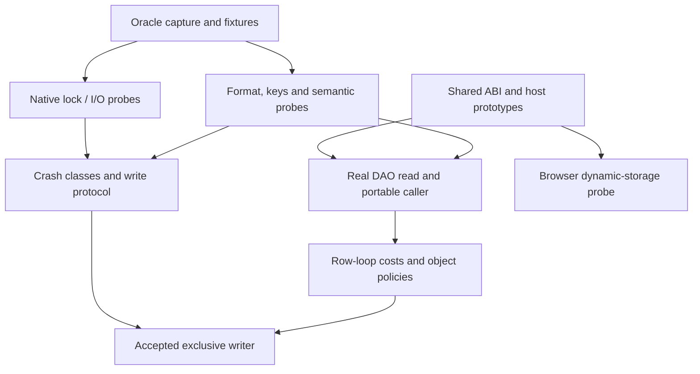
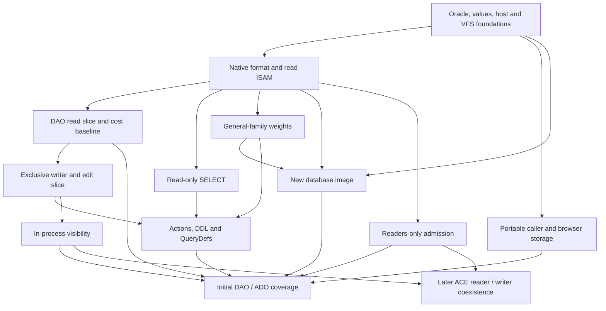

# I-16. Research and development sequence

Book **v1.1** · 2026-11-16 · [Release record](00-book-release.md).

**Scope and evidence:** [Scope and context](00-scope.md), PRD-01–09 and the accepted PRW-01–58 work list, including the owner’s PRW-52/53 corrections, govern this chapter. The construction index includes General-family weight tables, synthesized new-database images, SDK capture, structural value copies and COM-delivered call/release contexts. Each row names its acceptance families and deciding experiment branches. Shared cache, row/catalog and cursor results feed native and browser compositions; preservation before an old reader first acquires its page is an explicit dependency. [A-03](A-03-reconciliation-audit.md) records the current v1.1 requirement and completion outcomes, including the retained Date/Time Extended gap, ADO-ASYNC conflict and PRD-07/08 acceptance limits. Native experiments are specified and unexecuted.

**Requirement trace:** Primary: RQ-PROCESS-01, RQ-DEV-01, RQ-DEV-02. Shared obligations: RQ-LOCK-03, RQ-LOCK-04, RQ-SRC-03, RQ-ORACLE-01, RQ-ORACLE-03, RQ-ORACLE-04, RQ-LEDGER-01, RQ-ORACLE-05, RQ-TEST-01, RQ-STORE-04. Full requirement text and Part II ownership are in I-16.

## Plan from dependencies and risk

[Scope and context](00-scope.md), §§S1–S7, states the current product scope. PRD-01–09 and the accepted owner corrections govern this revision. **ADO may start alongside DAO; DAO retains priority.** No full-DAO completion dependency is added to ADO construction or research. The sequence puts evidence that could overturn an expensive choice before broad construction, meaning beyond the first same-width mutation slice. It preserves the workload priority: DAO row loops from VBA, then bulk SQL, then WASM where their requirements compete.

Develop small real paths through the intended architecture. The first useful path is an unchanged caller creating a genuine CalcDb DAO object, opening a native table, moving a cursor and obtaining owned field values through the shared foundation. It tests activation, ownership, format decoding, cursor lifetime and the dominant cost boundary together. A fake object returning constants can establish ABI mechanics but cannot complete that read milestone. A successful read milestone cannot complete the object-model inventory.

Several early investigations run independently: capture correctness; public ABI/activation; native lock and crash observation; file layouts and keys; and the portable caller/storage prototype. Read-only SELECT does not require the completed writer. Reader-only process sharing does not require ADO. ADO policy work does not require every DAO member to be complete. Later encryption or an external provider need their own prerequisites, not universal completion of shared writing. These are scheduling changes, not scope reductions or promotions.

Use **S** for one bounded question or local mechanism, **M** for several interacting mechanisms within one main boundary, **L** for a cross-service feature with a substantial behavioral matrix, and **XL** for a broad subsystem or several coupled compatibility matrices. These are relative complexity estimates, not dates, staffing predictions or elapsed durations. A research card and its eventual implementation can have different sizes. Refine estimates from actual evidence without changing what completion means.

## Research before commitment

The detailed cards and common capture conditions reside in A-02-experiments.md. Each Part I section retains a short question/outcome summary; I-15 defines evidence classes and the completed-write direction. A-01-sources.md contains the full source ledger. The original report identifies ACEDAO.DLL 16.0.20527.20016; PRD-02 separately reports Apartment registration on Office C2R x64 16.0.20527.20150. These supplied facts are not new captures and do not make the Office build every component’s DLL version. Each run records the implementations actually loaded. No Windows experiment is reported as executed here. [U-OWNER-ACE, U-PRD-01-09, U-OWNER-NET]

| Investigation bundle | Start when | Choice it must settle before broad construction |
| --- | --- | --- |
| R-ORACLE-1 | Public API driver and selected test installation exist. | Lossless captures, owned-process isolation, nondeterministic comparison and uncertain-job handling. |
| I-FOUNDATION-1, I-HOST-1 discovery | FOUND-SDK starts native capture with independent SDK declarations; shared/portable and host tests add the actual services they consume. | Exact target ABI, structural copy branches, service closure, Active bootstrap and runtime/provider/allocator ownership. No CalcVBA prerequisite for native capture. |
| R-ACT-1, I-HOST-1 execution cases | Native reference discovery starts immediately; CalcDb comparisons add minimal declarations and actual host/factory/value slices. | Unchanged creation/type-library/factory routes, actual Framework/.NET 10/.xll loading, propagation, Apartment delivery and residual lifetime; no full SQL prerequisite. |
| R-STRING-1 | Native getters and FOUND-SDK capture first; CalcDb comparisons add shared values and a small real decoded-row/public-call path. | Direct owned output versus reusable decode state, structural capture and selective caches, measured on the DAO path. |
| R-FMT-1, R-SORT-3 | Immutable native fixtures and capture/inspection work; the read-only R-FMT-2 index-envelope branch precedes key extraction. | One format description and the initial General-family tables. SORT-DERIVE is L per order and covers all 65,536 UTF-16 units plus contexts; SORT-CHECK retains discriminating key/behavior cases. Exact licensed resources or independently derived tables feed the same construction result. |
| R-CAT-1 | R-ORACLE-1 plus R-FMT-1 start bootstrap/property/query-row captures. | Separate CAT-NEW/B/P/Q/V/D/I/X branches settle the initial database image and argument/profile selection, native identity, MR2 maps, QueryDef Order/SQL, public lifetimes, DDL/relationships, binding and crash reopen. Add key/write, expression/SQL, transaction or host evidence only to affected branches; size L. |
| R-CURSOR-1 core | Native table fixtures and observable calls exist. | CUR-POS/ID and read POP/LIFE settle row root/body/occurrence identity, position, population and bookmark ownership before cursor interfaces are frozen; key/edit/query/provider branches follow their actual dependencies. |
| R-LOCK-1/2 and W-PROBE | Disposable native files, W-01 capture core and the small K-IO/K-LOCK interface sketch; no production W-03 prerequisite. | Basic native open/share/I/O/identity behavior first; independently develop crash observation and measure its actual coverage. Record ACE writes and flushes with contents, reconstruct candidate crash states and use independent openers; exact classification and its limits are settled during implementation. |
| R-FMT-2, R-PRESERVE-1, R-TXN-1, R-CRASH-1 | The external oracle can mutate and interrupt ACE. | Native mutation dependencies, opaque ownership, separate local lockers, live rollback and commit survival. First-opener outcomes guide crash parity; the precise pass condition is implementation work. R-CRASH-2 is retired; TXN-TEMP/LOCAL/MULTI and FAIL-OWNER retain live failures, while CRASH-FAILURE/FAIL-FRONTIER/FAIL-OWNERS retain interrupted effects and residual ownership. |
| R-EXPR-1, R-UDF-1 | Native scalar/context, restricted mutation and admitted native-host cases first; minimal I-HOST-1 only for CalcDb/CalcVBA comparison branches. | Declared/runtime types, resumable demand/coercion/cleanup, two wildcard profiles and mutation acceptance first; owned resolver/callback second; host-effect extension follows without a cycle. Joint R-SORT-3 range proofs wait only for their relevant text/key profiles. |
| R-SQL-1/3, R-SQL-2 | Scalar/context baseline and discriminating fixtures; key/catalog/cursor/host evidence only for corresponding branches. | Range inclusion versus demand and relational/crosstab policy; SQL-CONTINUE distinguishes settled skips from failing subsets, and SQL-OWNERACCESS retains default-Admin behavior alongside CHECK/DDL and named refusals. |
| R-DAO-1, R-ADO-1, R-ERR-1 | Native construction/binding use FOUND-SDK; ADO-ASYNC runs first with delayed native work and an event sink. CalcDb comparisons add only their exercised services. | Default-Admin/refusal scope, effective providers, member/error policy, MS-ADTG conformance and two-way persistence interchange; a native early-return conflict remains explicit. |
| R-WASM-1 | Actual portable runtime/foundation and minimal VFS prototype; native discovery and feature comparisons are separate. | Shared address/call/allocator domain, direct and dynamic broker routes, short/uncertain effects, failure cohort, qualified reader-only sharing and bounded memory before broad browser integration. |
| R-PAR-1 | An accepted serial path and cost baseline exist. | Exact serial equivalence and net benefit for each proposed parallel path. It never blocks ordinary serial delivery. |

**Figure F-17 — expensive decisions follow their deciding evidence.** This graph shows the main dependency cuts; the cards specify individual cases.

The last edge means the writer must respect evidenced cursor identity and edit/error policies; it does not require all DAO methods. W-PROBE is an external driver over native effects, using the K-IO/K-LOCK sketch rather than the completed W-03 implementation. Its basic open/share/identity/I/O probes feed W-03. PRD-07 permits low-level observation and control tooling, including a kernel driver, without proprietary decompilation. The preferred crash direction records writes, extent changes and flushes with their contents, reconstructs states, and compares ACE, Access and Compact & Repair outcomes for ACE and CalcDb images. The observation capability is one of the external inputs in II-16 §24.

**Crash parity remains the target:** CalcDb must leave a state no worse than an ACE crash at the corresponding point, including commit survival and dbForceOSFlush. Exact classification is ambitious and may not be fully achievable. R-CRASH-1/CRASH-OBS, CRASH-CONTROL and CRASH-RELATION supply the evidence; the method, precise pass condition and handling of unresolved write classes are settled during implementation. The preferred starting program uses one final image per page per publication unit. CRASH-ORDER-DATA/INDEX compare row/key order, each with MAP-BEFORE/AFTER; CRASH-ORDER-REPEAT-REMOVE/ADD are repeated-image fallbacks. TXN-FLUSH-LIVE separates explicit commit-time, implicit operation-end and write-behind observations, paired with interrupted cases in R-CRASH-1. These deciding observations precede broad construction beyond the first same-width writer slice. No private WAL or stronger invented crash guarantee replaces the target.

## Work packages and observable acceptance

Work identifiers remain stable. Early and later slices within a package are named below so their dependencies are explicit. A dependency on a slice does not imply completion of every feature in that work package. [II-16](II-16-development.md) distinguishes construction inputs, deciding observations and completion evidence in every row of its construction index. Its 81 active slice rows include three shared algorithm results; native and browser compositions consume those results and qualify their actual backends and callers. This count is an index of results, not an additive estimate or a claim of whole-book closure. Phase and obligation remain separate. D-UNDO-2 is a recorded, unplanned idea; it has no active construction slice or acceptance obligation. Route alternatives apply per operation/context, so a prepared browser path does not remove required dynamic acquisition.

| Work / size | Result and actual prerequisites | Acceptance evidence |
| --- | --- | --- |
| W-01 · L | Oracle capture core, immutable native histories, comparison/reduction and cost records. Approved scope and selected installation; R-ORACLE-1 qualifies the minimal service slice as it is built; broader callers/defects attach incrementally. | Exact typed/raw questions and owned attempts survive transport/capture failure without replay; semantic/identity/structural comparisons and T-COMPACT-1 controls retain missing evidence. Reduction preserves its evidence class; genuine DAO cost measurement starts with the first read slice. |
| W-02 · M | Shared target declarations, values and consumed Automation services. I-FOUNDATION-1 discovery; R-STRING-1 refines materialization after native reads; actual portable services/runtime qualify separate slices. | Independent SDK/real-runtime layout and structural copy/alias/allocator tests; actual type binding, errors, enumeration, factories and ADO events on required targets; exact canonical values, no private representation. |
| W-PROBE · M | Native I/O/exclusion basics and external ACE crash observation. W-01 capture core; small K-IO/K-LOCK contract sketch; no production W-03 dependency. | Basic native effects feed W-03. Record ACE writes/flushes with contents and reconstruct states for ACE, Access and Compact & Repair; submit CalcDb cut images to the same openers. Low-level observation/control tooling is permitted. Exact crash classification, coverage and the precise acceptance condition are settled during implementation under PRD-07. |
| W-03 · L | Blocking VFS/pager, native exclusion and qualified browser storage. The common cache algorithms feed both actual caches. W-03/private-images-coherence preserves a registered old source before its first page acquisition; selected production backing is an explicit input to it and the program executor. Minimal native declarations, W-PROBE basics and R-LOCK-1; available W-02 native contract; independent browser slice adds actual portable bootstrap and R-WASM-1. | Bounds, source/payload/request/grant lifetime and honest progress hold under faults. Raw counts require prefix evidence; direct/broker and reader-source routes retain owned completion. Native reads do not await complete crash tracing or portable delivery. |
| W-04 · XL | One format description for pages, rows, indexes, keys, catalog and properties, with reader, writer, validator, inspector and read ISAM/catalog paths. Shared row/catalog and cursor algorithms feed both actual read compositions without a Windows-adapter prerequisite for browser algorithms; W-01 capture core, W-02 native contracts, W-03 read foundation, R-FMT-1, the read branches of R-CAT-1 and CUR-POS/ID and read POP/LIFE evidence; R-SORT-3 for key-dependent Seek/lookup branches. | Jet 4/ACCDB fixtures decode through shared rules, including long values/catalogs/indexes; malformed references cannot escape bounds or budgets; public read results match captures. Native reads do not await full browser integration. The weight-table slice accepts exact Apache-2.0 Jackcess resources or independently derived data, with SORT-DERIVE/SORT-CHECK evidence and named other-sort Text-seek/key-write refusals. |
| W-05 · XL | Row/LV/allocation/index mutation, concurrent Workspace/Connection change sets, owned semantic/persistent receipts and live rollback. W-04, relevant format/key/preservation, cursor/edit, catalog/constraint, transaction and shared-expression evidence; same-width construction starts before broader mutation families. | Local conflicts follow ACE granularity and retry/error behavior; later commit and rollback preserve other lockers’ accepted changes. One final image per page per publication unit is the preferred write program, with order/timing experiments and a repeated-image fallback. Completed-write and crash targets follow PRD-07/08; their precise acceptance is completed during implementation. D-UNDO-2 is unplanned. |
| W-06 · L | Read-only SELECT and shared expression service. W-04; scalar R-EXPR-1; R-SQL-1/3; read cursors; host-sensitive cases add R-UDF-1/I-HOST-1. | Typed Access binder and scalar-demand graph over native ISAM/evaluator; exact range/join/equality/aggregate and schema/population policies, bounded value/state spill and actual-plan checks. Fixed crosstab metadata is independent of cell completion; full-row DISTINCTROW retains update provenance. No writer or optional worker prerequisite. |
| W-07 · XL | New database images, actions, DDL and native QueryDefs. The creator synthesizes the shared profile recipe using W-03 lease/executor and W-04 codecs/catalog/weights; it does not need an existing CalcDb-created database. Native metadata writes: W-05 + relevant R-CAT-1/transaction evidence; saved-SQL translation: parser/binder slice; execution: W-06 operators + R-SQL-2/3; branch-specific crash/preservation evidence. | Protected action enumeration with independent value demand, target/coalescing/count/error policies and shared mutation. Native CHECK/DDL/QueryDef integration, default-Admin OWNERACCESS and named secured-workgroup refusals, held-object invalidation and complete schema/property reopening; structural writers use parser/binder slice without full SQL execution. CAT-NEW/DAO-CREATE/EX-CREATE also cover complete initial images, exact creation arguments, the returned opened Database and partial-file failures; WASM-CREATE uses the same recipe. Existing phase and multi-file limits remain. |
| W-08 · XL | DAO activation/host, native read/edit and actual portable-client slices. R-ACT/native discovery and I-FOUNDATION/I-HOST first; W-03/04 reads, W-05 edits, W-07 full scope; R-WASM-1 qualifies real portable caller domains/storage. | Unchanged CalcVBA/.xll and both managed lanes select CalcDb. Portable typed/dispatch, errors, enumeration, ByRef/events and real runtime lifecycle use one qualified domain; complete applicable DAO coverage remains explicit. |
| W-09 · L | CalcDb ADO construction, read/query and edit/coverage slices. R-ADO-1/R-ACT-1 early; shared declarations, foundation and relevant W-04/05/06/07 services; no full DAO or later-provider prerequisite. | ACE database-provider strings, connectionless Recordsets/Streams and MSPersist persistence are supported. Other non-ACE database providers, including effective omitted/default providers, receive named, counted refusals. The host supplies its ADODB routing decision and per-add-in use inventory. Keep the adapter separable for the later OLE DB provider; complete applicable lifecycle/event/persistence coverage remains required. |
| W-10 · L | Readers-only process admission and full ACE in-process semantics in initial scope; the exclusive path remains the first cost baseline. | Distinct local lockers may retain concurrent private changes. Native experiments decide conflict granularity, retries, visibility and both resolution orders. Preserve registered old sources before overwrite and rebase later publication/rollback without external lock roles. Required reader processes coexist while external writers remain denied. |
| W-11 · L | Read beside an ACE writer; W-10's relevant native/visibility foundations and R-LOCK-3. | Protected descriptor/index/map/root/body/LV capture prevents mixed or wrong-row reads. Refresh, external identity and unread-source retention follow native policy; local epochs cannot replace source certificates. Network configurations have separate evidence. |
| W-12 · XL | Shared native writing; W-11, R-LOCK-4 and shared crash evidence. | The initial W-05/local-lockers-rebase result gains native external protection; fresh-image publication preserves unrelated row/index/map changes. Scoped rollback, lock promotion/reuse and exact uncertain grants match native policy. Conflict/error/transaction/crash matrices agree locally, then on identified SMB configurations. |

**Evidence delivery slice — W-01 with W-03/04/08.** II-15 starts with an exact question, native fixture, one genuine driver and a sealed typed/raw capture. Qualify job uncertainty, active values, observer order, actual implementation/owner identity and reproducible reset before broad cache reuse. Keep native creator/opener/mutator history, field/row/map/LV/index/opaque controls and a versioned comparison rule; unsupported evidence remains visible. Add real production effects and bounded schedule/fault plans as components arrive, retaining the prerequisite fault that exposes cleanup. Native differential reduction needs corresponding oracle evidence; a pure invariant/model failure uses its own exact predicate.

The first genuine DAO read loop adds semantic twins, actual member-entry and BSTR/copy/retention costs, diagnostic versus timing modes and paired A/A/A–B measurements. W-05 completed writes add relevant preimage controls and independent T-COMPACT-1 branches; fault families retain distinct post-trigger closure and commit-survivor obligations. The 44 active T-EVID families organize this work; T-EVID-30 is retired and its ID remains reserved. They do not impose full DAO/SQL, all defect classes or complete ACE tracing before the first useful slice. Full cards remain in A-02; II-16 consolidates the accumulated implementation dependencies and completion obligations.

### Slices that determine the useful order

**W-08 activation slice** starts with W-02 declarations and the actual host. Use the real factory/vtable/dispatch route before attaching database behavior. Run R-ACT-1 with a genuine `.xll`, CalcVBA and unchanged PIA clients under the installed Framework 4.8-family and .NET 10 LTS independently. Portable stand-in work is a CalcVBA dependency, with an executable minimal client path as its result. Windows success does not substitute for it. Native ACT-THREAD probes use FOUND-SDK and the two .NET lanes before CalcDb comparison; they do not wait for that portable dependency. [U-OWNER-NET]

**W-08 read slice** adds W-03/04. Exercise OpenDatabase, table recordset creation, MoveNext, ordinal/name Fields access, Seek and bookmarks as their mechanisms arrive. Include Close, held children, errors and empty results. The retained Field getter follows II-01’s edit-first branch and CUR-EDIT/DAO checks after Edit, AddNew, failed setters, CancelUpdate and Update. Instrument crossings, allocations, copies, decoding and pin/cache work immediately. This is the first representative end-to-end performance baseline. It may proceed before complete SQL and before exclusive writing.

**W-08 edit slice** adds W-05, evidenced defaults/validation and Workspace behavior. Exercise small edits, AddNew/Update/Delete, generated values, clone/cursor invalidation and live rollback through COM. **W-08 initial-scope coverage** converges with W-07 and the remaining member manifest, including properties, Collections, Containers/Documents and native QueryDefs. “Full DAO” cannot mean only commonly used methods; deferred capability contexts remain explicitly accounted for as I-12 defines.

**W-09 construction slice** runs early with activation and R-ADO-1. First run ADO-ASYNC against the native route, using delayed work and an event sink without waiting for CalcDb SQL or a writer. Then connection strings, closed-object state, parameter construction, defaults and error ownership expose policy needs before large storage investment. ADO-PROVIDER and R-ACT-1/ACT-ADO-SCOPE check the effective provider and selected implementation; MSPersist includes its Connection.Open/Execute persistence route. Read/query and write behavior then attach to their shared services. Prioritize DAO problems where effort competes, but do not impose an artificial dependency on the last unrelated DAO member. ADO completion still requires its complete applicable inventory, independent lifecycle tests and actual client activation.

**Shared expression slice — W-02/05/06 and the host prototype.** II-10 supplies typed-node binding, a resumable scalar policy, a checked builtin manifest and separate default/field/table adapters over the common foundation. W-05 takes restricted mutation expressions before full SELECT; W-06 adds complete required query contexts and parameter/version binding. R-EXPR-1 qualifies declared/runtime types, demand/error/cleanup order, provisional candidate acceptance and both pattern grammars. Like index candidates additionally need R-SORT-3 inclusion and error/effect-demand evidence; unresolved range optimization does not postpone scalar matching. I-HOST-1/R-UDF-1 first demonstrate one actual function through the supplied provider reference with owned signature/arguments/results, then extend effects, aliases, policy revocation and reentry. Register lowering/workers wait for accepted scalar equivalence and measured gain, not the other way around.

**W-04 weight tables per sort order (L per order).** `W-04/weight-tables-per-sort-order` takes one of two table inputs: the exact licensed Jackcess resource or an independently derived table. Both face SORT-DERIVE’s code-unit/context checks and SORT-CHECK’s framing, length, collision and public-behavior cases. W-05 consumes the result when a mutation changes indexed Text entries; the first scalar-only same-width update does not wait for it. Catalog-name creation/rename/deletion in W-07 always needs the applicable Text encoder. Other-order scans stay available and unsupported Text seeks/key writes receive counted `NotModelled.SortOrder` refusals.

**W-07 new database image (L).** `W-07/new-database-image` synthesizes a complete native image from `profile.creation.recipe`, with exact format/sort selection and every required system object classified. It uses the same private codecs and native program executor as other writes. II-09’s `CreationAttempt` owns exclusive create-new acquisition and any partial file; II-12’s F-122 publishes the opened Database only after the required image result. CAT-NEW and DAO-CREATE decide argument, object and failure behavior; EX-CREATE decides admission, and completed/interrupted files use T-COMPACT-1/R-CRASH-1. Browser WASM-CREATE composes the same result with owned storage acquisition. Existing-file reads and the first edit remain independent of this creator.

**SQL execution slice — W-06/07.** II-11 starts with the bounded parser/binder, scalar RowLease/continuation interface and native scan/range/nested-loop path. Then add exact temporary records and bounded sort, relational equality/aggregate state stores, UNION/subquery/crosstab policies and actual-plan inspection. Preserve the global accepted contribution/error frontier across spilling; fixed crosstab metadata need not await cell completion. Hash/batch/worker choices require separate equivalence and measured benefit. D-SQL-1 remains Recommended and D-PAR-1 remains Decided.

W-07 composes those sources with the existing mutation/Workspace service. D-ACTION-1 remains Provisional: spool only at the boundary selected by R-SQL-2/SQL-ACT-SELECT, otherwise a protected lazy enumeration cut with independent value visibility. Add source/target/coalescing/count policies, complete make-table phases and native DDL/QueryDef recipes. SQL-CONTINUE supplies the missing no-dbFailOnError branch: settle a candidate failure qualified by R-SQL-2/SQL-CONTINUE, retain its generated-value/effect receipts, advance the appropriate skipped counts, publish no error for that failure and continue once. Stop/rollback and uncertain storage outcomes stay separate. SQL CHECK has its own context/persistence descriptor; WITH OWNERACCESS OPTION remains supported on unsecured/default-Admin files, with ACE behavior selected by experiment. Secured-workgroup authentication and account/group/permission obligations are excluded; their named refusals and byte preservation remain required. Structural writers can consume the parser/binder slice before full SELECT coverage; native-successful required forms remain work when their integration is unresolved. The existing later encryption/provider labels remain intact.

**Integration slices — W-02/08/09.** II-13 begins with the single captured public declaration graph and independent target-ABI probes, then own/compatibility factory and type-library selection with real unchanged clients. Native reference discovery needs installed callers and capture; a minimal CalcDb prototype needs only the declarations and host/value slice. Test actual Framework 4.8-family and .NET 10 loading separately and together in the host qualified by I-HOST-1/HOST-RUNTIME, plus real CalcVBA and x64 .xll routes. Neither full SQL nor complete portable delivery is a prerequisite for detecting an unusable Windows creation route.

Explicitly load/pin, bootstrap outside DllMain, publish the immutable Active host binding, then expose compatibility creation. Captured factories/objects retain that binding; absent or retiring compatibility admission never falls back to standalone. CalcDb's own explicit standalone mode supplies native-file services without VBA. Follow ACE’s Apartment registration and ordinary COM delivery through the supplied references. Specify SAME-STA, MTA-CREATE, OWNER-BUSY, RAW-UNMARSHALLED, FINAL-RELEASE, ENGINE-IDENTITY and LOCAL-CONFLICT under ACT-THREAD; CalcDb adds no CalcVBA-specific thread policy. Retain arrays, descriptors, event frames, deferred error callbacks and allocator/module owners through residual shutdown. `CaptureValueStructural` separates `NoForeignCode`, `SingleObjectAddRef` and `ElementwiseCallout`; effectful aggregates retain backing and completed elements, then revalidate before reading the next element. Required native forms that cannot yet be copied safely remain counted gaps, not an assumed atomic source snapshot. W-04/05 then supply the real retained-Field read/edit path, and actual portable clients exercise the same declarations and complete consumed service set. T-INT-01..64 and the full R-ACT/I-FOUNDATION/I-HOST cards specify acceptance; all remain unexecuted.

**Object-model execution slices — W-08/09.** II-12 begins with nonregistering public declaration capture and executable member recipes, genuine object construction, stable interface identity and owned diagnostic publication. W-08 then joins the existing native read/edit path, schema drafts and QueryDef bindings, family-specific collection/retained-child policies, and the full applicable DAO inventory. Unsecured/default-Admin opening, unchanged access-control bytes, default-Admin OWNERACCESS behavior and named secured-workgroup refusals define the retained security boundary. Direct scalar calls use typed entries and reusable wrappers; accepted native mutations retain receipts through late result or cleanup failure.

W-09 may start alongside DAO with actual CalcDb ADO activation, native ACE-string routing and requested/effective options. Add query/native cursors, immediate edits, client/disconnected values, batch reconciliation, events through their supplied COM references, schema/Record/Stream and native-admitted ADTG/XML persistence, including MSPersist as their dependencies arrive. Those are slices of the initial ADO obligation, not dependencies on the later external OLE DB provider. ADO-PERSIST checks native-saved ADTG against the public TableGram specification and then both interchange directions, without presuming that Save output is a complete RDS message. [S-MS-ADTG, S-MS-ADO-PERSISTMORE] R-ADO-1 keeps a proven early-return async branch as a material conflict with D-CALL-1 for decision; unobserved or missing behavior is never counted as parity. Native-oracle batch/event/schema/persistence research needs ACE plus fixtures/capture and relevant host/fault setup; it can precede the CalcDb services needed for comparison runs. R-ERR-1 accompanies both surfaces from construction onward, including retained errors, bounded error-slot retirement and both managed-runtime lanes.

**W-10 readers-only slice** follows W-03/04 plus R-LOCK-2. It tests native admission, all open orders and a late writer. Default DAO shared read/write still maps to Step 1 physical exclusion in initial CalcDb; EX-DEFAULT counts the second-process default-open mismatch where ACE accepts it. Explicit shared read-only requests use Step 2. Compatible local bindings reuse the FileSession without merging their public rights or lockers.

**W-05 local-lockers-rebase and W-10 in-process semantics** are initial scope. Each Workspace or Connection is a LockerId; several private changes coexist. Native page/record conflict resources use captured retry settings and errors rather than an indefinite file-wide writer queue. A ResolutionAttempt holds the publication gate only while preparing/publishing over the current committed base. The rebuild retains accepted values and generated tickets; rollback settles only its own scope and preserves other owners’ changes. W-03/private-images-coherence preserves needed old sources before the first overwrite, including a reader that has not yet pinned its page. This precedes W-05/same-width-mutation. TXN-LOCAL and TXN-VIEW select public visibility and both resolution orders. W-11/W-12 later reuse these results with native external roles; local parity does not wait for those roles.

**Owned coordination across slices.** II-09 supplies authority-bound opens, exact grant ownership, queue/ancestor dependencies, retained work and one CloseAttempt handoff. Implement submit/cancel/Close schedules alongside the VFS and cursor slices; they do not await full SQL. R-PAR-1 still requires an accepted serial operator and measured gain before enabling each parallel execution path. W-11 first discriminates a read during Edit from a read during Update; W-12 first discriminates same-page unrelated updates and rollback survival.

**Browser delivery slice — W-02/03/08.** II-14 starts with actual CalcVBA typed/dispatch/ownership calls in the memory, call-table and allocator domain qualified by R-WASM-1/WASM-ABI and WASM-BOOT, plus a minimal native page read. Prefer one linked program on the caller worker, prepared direct handles, and a dedicated broker for dynamic acquisition. WASM-MAILBOX, WASM-PROGRESS, WASM-OPEN, WASM-CALLER-LOSS and WASM-BROKER-LOSS qualify the fixed mailbox, partial writes without assumed prefixes, late acquisition cleanup and caller/broker failure cohort before broad database integration. R-WASM-1/WASM-READERS qualifies native read-only handles and cooperating File/Web Lock readers as separate profiles; neither an accepted option nor an exclusive default handle proves many-reader behavior.

Attach W-04 reads, W-05 mutation/crash classes and W-06/07 spill/query work as available. Dynamic creation adds W-07/new-database-image and WASM-CREATE: acquire a genuinely new destination, execute the shared recipe, settle the partial-file/result outcome and retain the continuing lease. A prepared blank file does not satisfy CreateDatabase. Dynamic opens and spill, exact source ownership, actual callbacks/Close, exhaustion and distinct worker/browser/OS faults remain required cases. D-UNDO-2 is not planned for the browser or any other target. D-UNDO-1’s ACE-first baseline and conditional recovery constraints remain unchanged. A restricted prestaged prototype is partial initial coverage. JSPI is a measured alternative only through the complete real calling/reentry/owner chain. Add ADO under W-09 and reader/visibility combinations under W-10; no completed DAO/SQL or W-12 prerequisite is imposed on early feasibility.

**Figure F-18 — implementation branches converge on initial coverage.** Native shared writing remains later. The browser branch joins initial coverage because browser operation is initial scope, even if its feasibility work exposes a current limitation.

The diagram omits independent closed-object ADO probes and individual research dependencies for readability; the tables are authoritative. Initial coverage does not wait for the later coexistence branch. Conversely, “initial complete” cannot be claimed by omitting a difficult platform, activation route, required member or readers-only case from the denominator.

## Later work follows its own dependencies

I-14 supplies actual designs and the deciding experiments. Research, capability descriptors and seams begin early; implementation remains labelled later. Shared-writing combinations are tested after the corresponding feature and W-12 exist, rather than making W-12 a prerequisite for every feature's exclusive implementation.

| Work / size | Prerequisites and result | Acceptance |
| --- | --- | --- |
| W-L1 · L | Native encryption and credential/conversion operations. R-ENC-1; minimal exclusive format read, then phase-image/writer/crash and protected temporary services. | Native profiles, password/SID operations, codec/cache ownership, physical failure states and qualified conversion publication match. |
| W-L2 · XL | Native links and source-specific execution. R-LINK-1; catalog/binder/cursor, host source transport, transaction services for exercised branches. | Relink/refresh and source identity match; pushdown preserves demand/errors; participant receipts preserve unknown outcomes without invented distributed commit. |
| W-L3 · XL | Multivalue, attachment, calculated and history preservation. R-COMPLEX-1; catalog/row/LV and child cursors; writer/index/evaluator/coordinator as branches require. | Native association/group/child identity, bounded attachment wrappers and calculated timing match; completed closure and interrupted crash comparison stay distinct under PRD-07/08. |
| W-L4 · XL | Native compaction, publication and conservative repair. R-REBUILD-1; checked graph traversal, exclusive source, destination allocator/codec/index/writer and host publication. | Complete valid/opaque closure survives qualified relocation or preflight refusal; separate destination/source outcomes and explicit salvage uncertainty. |
| W-L5 · XL | Genuine OLE DB provider and real consumers. R-OLEDB-1; factory/ABI and minimal shared read/query values, then update/transaction/stream branches. | Actual native and Framework/.NET10 OleDb consumers verify properties, accessor offsets, HROW/stream owners and independent error/status channels; no initial ADO dependency. |
| W-L6 · L | ODBC driver and actual Driver Manager clients. R-ODBC-1; manager/target declarations and minimal shared query/cursor, then mutation/transaction/stream branches. | Handle/descriptor state, x64 arrays, GetData/PutData, diagnostics and cancellation/unknown transaction outcomes match actual clients. |

The initial ADO implementation never depends on W-L5. Linked-source semantics do not establish distributed durable atomicity. Compaction cannot relocate opaque references merely because their bytes can be copied. Encryption adds failure variants to the existing crash protocol rather than replacing it.

**Later implementation slices — W-L1..6.** II-14 starts encryption with native header/profile/credential reads, links with one actual source identity and schema, complex fields with separate parent/child and calculated descriptors, and rebuild with a complete ownership survey and separate destination. OLE DB begins with a genuine factory and bound rowset through an actual native consumer; ODBC with the actual Driver Manager and one descriptor/bound fetch. Extend only the corresponding mutation/transaction/stream branches as shared services arrive. Preserve initial CalcDb ADO's independence from the later provider.

The six full cards specify physical encryption/password/SID cases, relink/pushdown/source outcomes, attachment/history/calculation behavior, typed relocation and publication, x64 accessor/descriptor buffers and retained diagnostics. T-PLAT-01..65 retains 65 IDs, with optional-undo T-PLAT-21 retired and 64 active families. Completed-write closure and interrupted crash comparison remain separate under PRD-07/08; no later capability gains a blanket W-12 dependency, and no unsupported required case is counted as success.

## Acceptance as evidence accumulates

Each implemented slice gets four related checks: differential observable behavior; structural/ownership invariants; failures at the actual effect boundaries; and representative cost measurements. Use minimal fixtures first, then boundary values, generated combinations and maintained regression captures. Do not wait for feature completion to test failed allocation, short I/O, Close or reentry: those outcomes shape ownership and continuation design.

For ordinary writes, the target is a native file that opens without repair and has no required structural correction. T-COMPACT-1 links each kind of write to the structures it can damage and the observers expected to detect that damage. Its illustrative table guides implementation, which completes the list and precise acceptance condition. For interrupted writes, record/rebuild ACE states and run CalcDb cut images through the same independent openers. Record public acknowledgement, dbForceOSFlush and persistence events separately. PRD-07 leaves exact classification and unresolved write classes to implementation. D-UNDO-2 is unplanned; D-UNDO-1 retains the ACE-first baseline and the exact full-file predicate as constraints on any future reconsideration.

For queries, compare values, schema, errors/effects and ordering, and inspect the plan actually executed. Distinguish a successful action with skipped candidates from a failing call with surviving changes. For object models, compare state transitions and error lifetime, not only returned rows. Count NotModelled.UserLevelSecurity and NotModelled.AdoProvider as deliberate scope refusals; do not count them as matching native failures. T-OBJ-26 and T-SQL-77 are retired and remain reserved. Their former secured-success obligations leave the denominator; the current refusal, default-Admin and separate database-password/encryption cases remain. For portability, use the actual CalcVBA client on the target, including dynamic browser acquisition and memory exhaustion. A generic native unit test does not discharge COM activation, browser persistence or process-lock obligations.

An optimization enters only after its applicable compatibility cases remain matched and its measured cost improves the intended workload within noise. In particular, R-PAR-1 begins with the accepted serial operator, then adds scheduling variation, spills, failures and callback-sensitive rejection cases. An internal optimization failure must not replay user effects or turn a completed write into a retry. Keep rejected measurements so later work does not repeat the same unproductive change.

## Decision changes and current unresolved facts

The v1.1 decisions replace the file-wide writer premise with ACE in-process semantics, select Apartment delivery, narrow ADO and workgroup-security scope, fix the initial General-family inventory, and remove D-UNDO-2 from planned work. The platform Automation VARIANT/BSTR agreement is current, including the 24-byte Windows x64 VARIANT. The scope map below records those decisions and the owner’s retained default-Admin OWNERACCESS and MSPersist routes. Local-locker, publication, crash-direction, undo-retirement, format/creation, structural-copy, COM-delivery, action-continuation and ADO/provider/persistence mechanisms have their cards and construction dependencies here. D-UNDO-1’s unchanged conditional predicate is retained in A-01 as U-OWNER-RECOVERY. Document coverage and implementation acceptance are distinct; no native experiment is claimed.

The most consequential remaining facts are native crash/flush behavior and its usable classification method; lock, conflict and visibility policies; exact format/key/catalog variants; unchanged-client activation and lifetime; shared-service closure; and browser storage behavior. The external inputs and their purposes are listed in II-16 §24. The representation agreement is settled; delivery and integration of each consumed service still require their actual evidence. Native observations may refine a mechanism without changing the agreed scope.

The independent v1.0 review found design and evidence gaps; the accepted PRW list defines the bounded revision. A-03 now records all 83 v1.1 requirement outcomes, the nine completion criteria and an explicit disposition for each of the 23 review-named gaps. RQ-TYPE-01 still needs the exact Date/Time Extended public projection and shared operations through R-FMT-2, R-DAO-1/R-ADO-1 and any required I-FOUNDATION-1 shared-contract extension. ADO-ASYNC still tests the possible conflict with D-CALL-1. Criteria 6 and 7 retain the implementation-defined crash/completed-write acceptance and unexpanded-target limits. Document reconciliation does not establish native acceptance. The next implementation result remains W-01/R-ORACLE-1’s first identified native capture, with declaration and host discovery alongside it. Page guidance remains descriptive.

## Reconciled inventories

The counts below are definitions in the owning tables and graphs, not executions or individual generated cases. A-03 gives the per-family counts, retirement lists and edge-count method.

| Inventory | v1.1 count |
| --- | --- |
| Numbered test families | 677 retained IDs: 663 active, 14 retired; T-COMPACT-1 is counted separately. |
| Research/integration cards | 34 retained IDs: 33 active, R-CRASH-2 retired; T-COMPACT-1 remains within R-ORACLE-1. |
| Work packages and construction slices | 19 active packages; 81 active slices and retired W-05/optional-undo: 82 retained slice names. |
| Construction edges | 147 start + 35 completion additions = 182 unconditional edges; 41 named conditional edges; 223 typed edges, 221 distinct prerequisite/consumer pairs. Five conditional selectors remain unexpanded. |
| Selected observation graph | 24 nodes, 30 edges. |
| Sources | 618 active rows: 593 Fact, 19 Concept, 6 Code reuse; 10 retired IDs remain reserved, making 628 retained source identities. |
| Figures | 227 reserved IDs: 224 active, 3 retired; 226 active captions. |

The named start, completion and combined graphs are acyclic, including the union of the named conditional edges. That check does not expand the five selectors or qualify a target implementation. The two conditional edges also present unconditionally explain the difference between 223 typed edges and 221 distinct pairs.

## Complete scope map

The **83 stable requirement IDs and their owning chapters are retained**. Their current meanings and phases reflect [Scope and context](00-scope.md), PRD-01–09 and the accepted owner corrections. In the Authority column, S1–S7 mean the corresponding preamble sections; C, V and A retain the compatible supplied-source meanings recorded in A-01; PRD and PRW references identify decisions.md and the updated work.md. Repeated maps in the plan and final audit use these same rows. A retained row for an unplanned idea is not an active implementation obligation.

| Requirement | Authority | Phase | Required behavior | Owner I / II | Supporting I / II |
| --- | --- | --- | --- | --- | --- |
| RQ-PROD-01 | S1; C Purpose | Initial | Clean-room Rust Jet 4/ACE engine for DNA Calc; systems-language design remains readable outside Rust. | 01 | 13 |
| RQ-PROD-02 | S1/S3; PRD-02/03 | Initial | Existing VBA, .xll and .NET callers use CalcDb unchanged within the declared ACE/connectionless scope; the host decides which ADODB uses it routes to CalcDb. | 13 | 07,12 |
| RQ-PROD-03 | S1/S2/S7; PRD-04/05 | Initial | Jet 4 .mdb and ACE .accdb read/write interoperability within the default-Admin, provider and sort-order boundaries; no Jet 3 support. | 04 | 01 |
| RQ-PROD-04 | S1/S5; PRD-08 | Initial | Completed writes target ordinary Access/ACE opening without repair and no required structural correction. T-COMPACT-1 maps each write to threatened structures and detecting checks; implementation completes the list and precise pass condition. Interrupted states follow RQ-STORE-04. | 04 | 08,15 |
| RQ-PROD-05 | S1/S7 | Initial | Unknown content survives rewrites byte for byte; stored front-end objects remain readable. | 04 | 06,14 |
| RQ-PROD-06 | S1/S3/S7 | Initial | Core runs off Windows and in DNA Calc browser/wasm32 builds. | 14 | 01,03,13 |
| RQ-SQL-01 | S2; C SQL | Initial | All Access SQL; SELECT, joins, unions and subqueries; no private SQL dialect. | 11 | 10 |
| RQ-SQL-02 | S2 | Initial | Crosstabs: TRANSFORM and PIVOT, including result-schema construction. | 11 | 06 |
| RQ-SQL-03 | S2 | Initial | PARAMETERS declarations, typed binding and QueryDef parameter behavior. | 11 | 06,12 |
| RQ-SQL-04 | S2 | Initial | DISTINCTROW and its Access-specific row identity semantics. | 11 | 07 |
| RQ-SQL-05 | S2; C SQL | Initial | Append, update, delete and make-table action queries. | 11 | 07,08 |
| RQ-SQL-06 | S2; PRD-04; PRW-52 | Initial | Access DDL and its catalog/constraint effects within the unsecured/default-Admin boundary. WITH OWNERACCESS OPTION remains supported there, with ACE behavior decided by experiment; secured-workgroup obligations receive named, counted refusals. | 11 | 06,08 |
| RQ-SQL-07 | S2 | Initial | Both ANSI-89 and ANSI-92 wildcard modes. | 10 | 11 |
| RQ-SQL-08 | S2 | Initial | QueryDefs read and written in Access catalog form, in both directions. | 06 | 11,12 |
| RQ-SEM-01 | S2 | Initial | ACE results, value types and Null handling. | 10 | 02,11,15 |
| RQ-SEM-02 | S2; PRD-05 | Initial | ACE comparison behavior and byte-identical index keys for General, General – Legacy and the admitted Access 97 General variant. Other-order files remain readable by full scans; indexed Text seeks and key writes receive named, counted refusals until their tables are added by the same derivation/check process. | 05 | 10,11 |
| RQ-SEM-03 | S2 | Initial | ACE error numbers, error collections, timing and surface propagation. | 12 | 08,10,11,13,15 |
| RQ-DAO-01 | S2; PRD-04; PRW-52 | Initial | Full applicable DAO member inventory, including DBEngine, Workspace and Database, within the unsecured/default-Admin boundary; named logon, workgroup files, account/group changes and denied permission cases receive named, counted refusals. | 12 | 07,08 |
| RQ-DAO-02 | S2; C Object models | Initial | Table/dynaset/snapshot/forward-only recordsets; navigation, Seek, Find and bookmarks. | 07 | 12 |
| RQ-DAO-03 | S2; C Object models | Initial | Edit/AddNew/Update, TableDef, QueryDef, Field, Index, Relation and Parameter. | 12 | 06,07 |
| RQ-DAO-04 | S2; PRD-04; PRW-52 | Initial | Properties, Containers/Documents, collections, Errors and transactions; preserve access-control bytes, support default-Admin behavior and retain named refusals for secured-workgroup operations. | 12 | 06,08 |
| RQ-ADO-01 | S2/S3; PRD-03; PRW-53 | Initial | CalcDb ADO serves ACE database-provider strings plus connectionless Recordsets and Streams, including Provider=MSPersist persistence. Other non-ACE database providers, including effective omitted/default providers, receive named, counted refusals; no system-ADO pass-through. | 12 | 07,13 |
| RQ-ADO-02 | S2/S3; PRD-03 | Initial | Microsoft.ACE.OLEDB.12.0 and applicable ACE provider strings use CalcDb’s native-file services. Keep ADO separable for the later OLE DB provider; host ADODB routing is outside CalcDb’s specification. | 12 | 13 |
| RQ-COM-01 | S3 | Initial | DAO real interfaces, IUnknown, IDispatch, IIDs and dispids; early and late binding. | 13 | 02,12 |
| RQ-COM-02 | S3; PRD-02/03; C COM identity | Initial | Side-by-side identity uses own ProgIDs/CLSIDs and explicit host compatibility activation without registry changes; the host selects ADODB routing and CalcDb does not define the host’s routing policy. | 13 | 12 |
| RQ-COM-03 | S3; C COM identity | Initial elaboration | Windows x64; DAO PIA/.NET interoperability on installed .NET Framework 4.8-family and .NET 10 LTS; explicit per-user external redirection only, never HKLM. | 13 | 01 |
| RQ-LOCK-01 | S4 | Initial | Step 1: exclusion correct both ways between CalcDb and ACE processes. | 09 | 03,08 |
| RQ-LOCK-02 | S4 | Initial | Step 2: multiple processes may read while all writers are excluded. | 09 | 03,15 |
| RQ-LOCK-03 | S4/S7 | Later | Step 3: CalcDb reads beside an ACE writer. | 09 | 14,15,16 |
| RQ-LOCK-04 | S4/S7 | Later | Step 4: shared writing through the ACE lock-file protocol, including later network-share validation. | 09 | 14,15,16 |
| RQ-LATE-01 | S7 | Later | Encryption; preserve codec and key-service seams in the early file/pager design. | 14 | 03,04 |
| RQ-LATE-02 | S7 | Later | Linked tables; catalog identity, source capabilities and delegated access paths. | 14 | 06,07,11 |
| RQ-LATE-03 | S7 | Later | Complex fields: attachment, multivalue and calculated fields. | 14 | 02,04,06,07 |
| RQ-LATE-04 | S7 | Later | CalcDb compact and repair; separate validated rebuilding from conservative repair. | 14 | 04,05,06,08 |
| RQ-LATE-05 | S7 | Later | OLE DB provider; early ADO support must not depend on this later provider. | 14 | 12,13 |
| RQ-LATE-06 | S7 | Later | ODBC driver over the same engine and semantic services. | 14 | 11,12 |
| RQ-OUT-01 | S7 | Excluded execution | Forms, reports, macros and database modules are preserved/readable, never run by CalcDb. | 01 | 04,06,14 |
| RQ-OUT-02 | S7; PRD-04 | Excluded | Jet 3, server roles, a CalcDb SQL dialect and Jet 4 workgroup/user-level security are outside scope; the retained default-Admin and refusal behavior is specified in S2. | 01 | 04,11 |
| RQ-SRC-01 | S6; A Sources | Continuous | Use public documents, observed ACE, licensed Jackcess material and mdbtools format facts only. | 01 | 04,15 |
| RQ-SRC-02 | S6 | Continuous | No proprietary decompilation/disassembly; FrankenSqlite/asupersync only through reviewed attached notes. | 01 | 15 |
| RQ-SRC-03 | S6; A Sources | Continuous | Per-source/version use and licence ledger; exact-material checks before adaptation or code reuse. | 15 | 01,16 |
| RQ-ORACLE-01 | S6 | Continuous | ACE/Access are behavior oracles on Windows; capture answers keyed by their inputs. | 15 | 16 |
| RQ-ORACLE-02 | S6 | Continuous | One differential harness runs SQL, DAO and file operations; compares rows, types, errors and relevant bytes. | 15 | 04,07,11,12 |
| RQ-ORACLE-03 | S6 | Continuous | Refused, missing and mismatching cases all fail; never hide them from the denominator. | 15 | 16 |
| RQ-ORACLE-04 | S6 | Continuous | Corpus is a maintained product: version/options provenance, immutable originals and reduced failures. | 15 | 16 |
| RQ-ISAM-01 | S2 | Initial | One ISAM layer supplies tables, indexes, cursors and transactions to SQL, DAO and ADO. | 07 | 01,08,11,12 |
| RQ-STORE-01 | S5 | Initial | The Access file is authoritative; no alternative database side format and no CalcDb WAL. | 08 | 03,04 |
| RQ-STORE-02 | S5 | Initial | Every completed commit leaves a valid Access file; write ordering is a defined protocol. | 08 | 04,09 |
| RQ-STORE-03 | S5 | Initial | Opaque bytes are carried without reinterpretation or silent degradation. | 04 | 06 |
| RQ-FMT-01 | S5 | Initial | One data description defines pages, table definitions, usage maps and catalog rows. | 04 | 06 |
| RQ-FMT-02 | S5 | Initial | Reader, writer, validator, fuzzer and page inspector use that description; each rule cites evidence. | 04 | 15 |
| RQ-FMT-03 | S5; A Coverage; C Values | Initial elaboration | Rows, long values, allocation, index mutations and all listed Jet/ACE scalar field types/AutoNumber variants. | 04 | 02,05,07 |
| RQ-VAL-01 | S3; PRW-43 | Initial | CalcDb and CalcVBA share the exact platform Automation VARIANT and real BSTR, including the 24-byte Windows x64 VARIANT. Currency/Decimal/Date, conversions and functions use the shared scalar/foundation services. | 02 | 13 |
| RQ-VAL-02 | S3 | Initial | Conversions and VBA functions are shared; query and VBA value semantics agree. | 10 | 02,11 |
| RQ-VAL-03 | S3 | Early design | Settle strings, borrowing, decoding, ownership and BSTR materialisation before the hot DAO path. | 02 | 03,07,12 |
| RQ-EXPR-01 | S3 | Initial | ACE sandbox rules apply; function capability policy is explicit. | 10 | 12,13 |
| RQ-EXPR-02 | S3/S4; PRD-02 | Initial | Host functions are reached through the provider reference supplied to CalcDb. Applicable COM delivery rules determine execution context; native/host experiments define the observable route without a CalcVBA-specific CalcDb thread policy. | 10 | 13 |
| RQ-EXPR-03 | S3; C SQL and expression | Initial elaboration | Host functions are opt-in; queries using them carry nonportability metadata. | 10 | 06,11 |
| RQ-CONC-01 | S4; PRD-01 | Initial | Full ACE in-process semantics: each Workspace/Connection is a distinct locker; concurrent private changes, native conflict granularity, retry/error and visibility policy, and fresh-base resolution. Measure the exclusive path first without taxing every scalar call. | 09 | 02,03,07,15 |
| RQ-CONC-02 | S4 | Initial | One locking interface covers all four process-sharing steps from the first write path. | 09 | 03,08 |
| RQ-SIM-01 | S6 | Continuous | Inject time, I/O, scheduling and randomness; no hidden nondeterministic engine effects. | 15 | 03,09,10 |
| RQ-SIM-02 | S5/S6; PRD-07 | Continuous | Seeded replay, interleaving search and fault injection explore CalcDb persistence cuts. Record ACE writes/flushes with contents, reconstruct candidate states and compare both engines through independent openers; exact crash classification and acceptance are settled during implementation. | 15 | 08,09 |
| RQ-CALL-01 | S4 | Initial | Object calls block their caller thread; no async runtime is required. | 13 | 07,09,12 |
| RQ-CALL-02 | S4 | Initial | Measured internal workers preserve serial row order, Double sums and other observable outcomes. | 11 | 09,10,15 |
| RQ-CALL-03 | S4; PRD-02 | Initial | Use ACE-style Apartment delivery and supplied provider references under applicable COM rules. Optimise the single-STA caller path first; no internal latch crosses foreign code and CalcDb imposes no CalcVBA-specific thread policy. | 10 | 09,13 |
| RQ-CALL-04 | S4 | Initial | Background work has an owner, budget and cancellation protocol; locks/cursors settle at owner close. | 09 | 07,08,12 |
| RQ-PORT-01 | S3 | Initial | Format/ISAM/catalog/expression/SQL crates perform no direct I/O and compile for wasm32. | 01 | 03,14 |
| RQ-PORT-02 | S3 | Initial | The object model uses COM interfaces on every platform. | 13 | 12,14 |
| RQ-PORT-03 | S3 | Initial | CalcVBA-owned portable COM includes IUnknown, type info/GetIDsOfNames/Invoke, IErrorInfo/EXCEPINFO, IEnumVARIANT, class factories, ADO connection points/events, allocation and real BSTR/VARIANT/SAFEARRAY. No apartments or cross-thread/process marshaling. | 13 | 02,14 |
| RQ-PLAN-01 | S6 | Initial | Inspectable plans describe the plan actually executed; tests assert seek/scan shape as well as results. | 11 | 15 |
| RQ-PERF-01 | S6; A Priorities | Continuous | Performance budgets, noise control and failed-experiment ledger; DAO row loops > bulk SQL > WASM when they conflict. | 15 | 02,03,07,11,14 |
| RQ-PERF-02 | S6; A Priorities | Continuous | Count allocations, bytes copied, conversions, locality/working set, branches, I/O, synchronization and crossings; invent no targets. | 15 | 02,03,07,11 |
| RQ-LEDGER-01 | S6 | Continuous | Oracle-derived compatibility ledger for DAO members, SQL features and types. | 15 | 12,16 |
| RQ-ARCH-01 | S6; C Architecture | Continuous | One format, ISAM, evaluator, oracle and harness; narrow mechanically checked dependency rules. | 01 | 15 |
| RQ-PROCESS-01 | S6 | Continuous | Working implementation and clear tests take precedence over process apparatus. | 16 | 15 |
| RQ-DEV-01 | S6; PRD-01/06/07/08 | Sequence | Choose implementation order from actual dependencies and deciding experiments; prioritise DAO costs and preserve the current initial/later scope. List external inputs and purposes without assigning their owners, schedules, interim modes or platform completion split. | 16 | 09,14 |
| RQ-DEV-02 | S6; A Development; PRD-07/08 | Sequence elaboration | Work packages name results, prerequisites, S/M/L/XL sizes, acceptance families and deciding experiment branches. Investigate expensive uncertainty before broad construction; precise crash and completed-write acceptance is settled during implementation. | 16 | 15 |
| RQ-HOST-01 | C Purpose; V Open; S3 | Initial elaboration | Host external-data integration and an optional service interface reuse COM/ISAM; no second object model. | 13 | 12 |
| RQ-ORACLE-05 | S6; C Oracles | Continuous elaboration | Long-lived batched oracle; private desktop; only owned Office processes; UI Automation dialogs; no Trust Center or HKLM changes. | 15 | 16 |
| RQ-TYPE-01 | S3; C Values; V Values | Initial elaboration | Boolean; integer widths; Single/Double; Currency/Decimal; Date/extended date; Text/Memo/Hyperlink; binary/OLE; GUID; AutoNumber. | 02 | 04,05,10 |
| RQ-TEST-01 | S6; A Tests; C Quality | Continuous elaboration | Differential behavior, storage invariants, malformed inputs, crash cases and workload measurements; immutable expected evidence. | 15 | 16 |
| RQ-STORE-04 | S5; PRD-07 | Initial | A CalcDb crash must leave a state no worse than an ACE crash at the corresponding point, with the same commit-survival rules including dbForceOSFlush and repair marking. Record/rebuild states and compare independent openers; exact classification, pass conditions and unresolved classes are implementation questions. | 08 | 03,09,15,16 |
| RQ-STORE-05 | S5; PRD-09 | Recorded constraint; enhancement unplanned | D-UNDO-2 is an unplanned idea, reconsidered only if real write programs show a useful recovery window. D-UNDO-1 remains: under exclusion validate identity, integrity, extent and eligibility; full-read every page, require uncovered pages unchanged and covered pages exactly before or intended new, otherwise discard. Never undo a commit ACE requires to survive; no continuous-history witness is required. | 08 | 03,09,15 |
