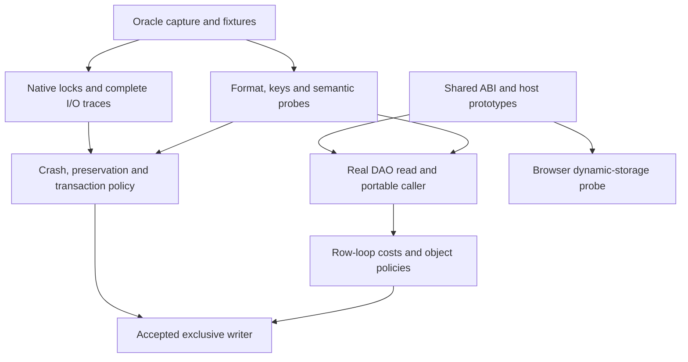
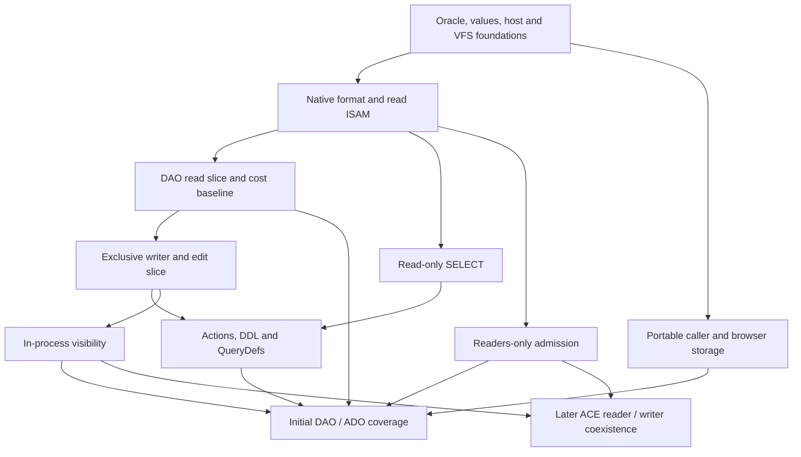

# I-16. Research and development sequence

Revision 1 · Stage 1, response 3 · 2026-11-12

## Plan from dependencies and risk

The one-pager fixes product scope, including initial and later capabilities. Its suggested implementation order is superseded by the user's instruction to do the actual planning here. The sequence below puts evidence that could overturn an expensive choice before that choice is embedded in a large implementation. It preserves the workload priority: DAO row loops from VBA, then bulk SQL, then WASM where their requirements compete.

Develop small real paths through the intended architecture. The first useful path is an unchanged caller creating a genuine CalcDb DAO object, opening a native table, moving a cursor and obtaining owned field values through the shared foundation. It tests activation, ownership, format decoding, cursor lifetime and the dominant cost boundary together. A fake object returning constants can establish ABI mechanics but cannot complete that read milestone. A successful read milestone cannot complete the object-model inventory.

Several early investigations run independently: capture correctness; public ABI/activation; native lock and crash observation; file layouts and keys; and the portable caller/storage prototype. Read-only SELECT does not require the completed writer. Reader-only process sharing does not require ADO. ADO policy work does not require every DAO member to be complete. Later encryption or an external provider need their own prerequisites, not universal completion of shared writing. These are scheduling changes, not scope reductions or promotions.

Use **S** for one bounded question or local mechanism, **M** for several interacting mechanisms within one main boundary, **L** for a cross-service feature with a substantial behavioral matrix, and **XL** for a broad subsystem or several coupled compatibility matrices. These are relative complexity estimates, not dates, staffing predictions or elapsed durations. A research card and its eventual implementation can have different sizes. Refine estimates from actual evidence without changing what completion means.

## Research before commitment

The detailed cards reside in their owning Part I sections. I-15 supplies common capture conditions, evidence classes and treatment of incomplete or conflicting runs. Begin with the user-reported ACE 16.0.20527.20016 and verify the loaded binaries before capturing answers. Nothing in this plan claims that the Windows experiments have run.

| Investigation bundle | Start when | Choice it must settle before broad construction |
| --- | --- | --- |
| R-ORACLE-1 | Public API driver and selected test installation exist. | Lossless captures, owned-process isolation, nondeterministic comparison and uncertain-job handling. |
| I-FOUNDATION-1, I-HOST-1 discovery | Supplied integration facts, available declarations and host capability inspection. | Shared ABI/allocators, actual loader/runtime ownership and the requirements for the smallest host/portable prototypes. |
| R-ACT-1, I-HOST-1 execution cases | The discovered declarations and minimal real host/factory prototype exist. | Unchanged caller activation, callback/shutdown ownership and route-specific gaps before broad object-model construction. |
| R-STRING-1 | Shared values plus a small decoded-row/public-call path exist. | Direct owned output versus reusable decode state and selective caches, measured on the DAO path. |
| R-FMT-1, R-CAT-1, R-SORT-3 | Immutable native fixtures and capture/inspection work. | Supported format descriptions, QueryDef/catalog mapping and exact key families; independent read facts can be gathered concurrently. |
| R-CURSOR-1 core | Native table fixtures and observable calls exist. | Row identity versus locator, bookmark representation/lifetime and relocation constraints before cursor interfaces are frozen. |
| R-LOCK-1/2 and W-PROBE | Disposable native test files and externally controlled observation exist. | Actual exclusion and readers-only admission; sufficiently complete ACE write/flush observation before accepting a writer design. |
| R-FMT-2, R-PRESERVE-1, R-TXN-1, R-CRASH-1/2 | The external oracle can mutate and interrupt ACE. | Native mutation dependencies, opaque ownership, live rollback, commit survival and first-opener crash classes. A CalcDb writer is not needed to obtain these answers. |
| R-EXPR-1, R-UDF-1 | Scalar capture works; add an instrumented host for host-sensitive cases. | Scalar/context baseline first; resolver/callback behavior second; effect-sensitive expression extensions then use that evidence. |
| R-SQL-1/3, R-SQL-2 | Scalar semantics and discriminating fixtures exist. | SELECT/metadata and rewrite boundaries; separately, action candidate/effect order, failure scope and affected counts. |
| R-DAO-1, R-ADO-1, R-ERR-1 | Construction and read cases work. | Member/collection/lifecycle/error policies incrementally; add write and SQL cases only when those prerequisites are relevant. |
| R-WASM-1 | Portable caller and VFS prototypes exist. | Dynamic open/create, storage ownership, bounded blocking rendezvous and honest durability outcomes before a complete browser engine depends on them. |
| R-PAR-1 | An accepted serial path and cost baseline exist. | Exact serial equivalence and net benefit for each proposed parallel path. It never blocks ordinary serial delivery. |

**Figure F-17 — expensive decisions follow their deciding evidence.** This graph shows the main dependency cuts; the cards specify individual cases. Mermaid source only; not render-verified.

The last edge means the writer must respect evidenced cursor identity and edit/error policies; it does not require all DAO methods. Likewise, formatting a native page correctly cannot settle when its write is permitted. W-PROBE first provides basic native I/O/exclusion probes for the read path; its fuller crash-observation slice validates cached/paging effects and complete interruption coverage before a trace supports writer acceptance. If that completeness cannot be demonstrated, retain an inconclusive crash result and continue unrelated read/ABI work; do not replace the missing answer with a preferred atomicity model.

## Work packages and observable acceptance

Work identifiers remain stable. Early and later slices within a package are named below so their dependencies are explicit. A dependency on a slice does not imply completion of every feature in that work package.

| Work / size | Result and actual prerequisites | Acceptance evidence |
| --- | --- | --- |
| W-01 · L | One oracle controller, corpus manifests, capture/replay/comparison and reduction; R-ORACLE-1 and the selected test installation. | Repeated and reduced SQL/object/file cases retain exact typed payloads, provenance and original evidence; transport loss never silently re-executes an uncertain mutation. |
| W-02 · M | Shared value/string declarations, ownership and allocators; I-FOUNDATION-1, with R-STRING-1 refining materialization after the read slice exists. | Native/managed/portable round trips preserve target layout, exact payloads and cleanup, including malformed UTF-16, array bounds, ByRef and allocation failure. |
| W-PROBE · M | External native I/O, lock and failure observation/control; W-01 and candidate VFS effects. | Basic slice validates native effects/exclusion independently; crash slice captures before/after write/flush/acknowledgement cuts, database/lock/TEMP and cached/paging I/O, detecting incomplete coverage. No CalcDb writer is needed. |
| W-03 · L | Blocking VFS, pager/cache, controlled effects and real exclusion; W-02 declarations/native ownership, W-PROBE basics, R-LOCK-1 and the approved crash contract. | Bounds, pins, generations, short/uncertain I/O and cleanup hold under faults; both ACE/CalcDb opening orders exclude unsafe access. Read-path delivery need not await complete crash tracing. |
| W-04 · XL | One format description, reader, validator, inspector and read ISAM/catalog path; W-01 capture core, W-02 native contracts, W-03 read foundation, R-FMT-1 and core R-CURSOR-1 identity evidence. | Jet 4/ACCDB fixtures decode through shared rules, including long values/catalogs/indexes; malformed references cannot escape bounds or budgets; public read results match captures. Native reads do not await full browser integration. |
| W-05 · XL | Exclusive row/LV/allocation/index mutator and live rollback; W-04, R-FMT-2/R-SORT-3/R-PRESERVE-1, cursor relocation, R-TXN-1, mutation-context R-EXPR-1 and W-PROBE's complete crash slice with early crash evidence. | Completed operations reopen normally with correct keys and preserved objects; failures/rollback have evidenced state; every applicable interrupted state meets the ACE-first baseline without private undo. |
| W-06 · L | SELECT, binder and common expression service; W-04, scalar R-EXPR-1, R-SQL-1/3 and read-cursor evidence. Host-sensitive paths add R-UDF-1/I-HOST-1. | Exact types, Nulls, metadata, order and errors for Access syntax, joins, TOP, DISTINCTROW, subqueries/unions and crosstabs; actual plans demonstrate intended scans/seeks. W-05 is not a blanket prerequisite. |
| W-07 · XL | Action queries, DDL and native QueryDefs; W-05/06, R-SQL-2, R-CAT-1 and transaction evidence. | Saved queries round-trip natively; constraints, generated values, effects, counts and partial failures agree; multi-file Workspace cases preserve their evidenced limits. |
| W-08 · XL | DAO/host delivery in activation, read, edit and coverage slices; prerequisites differ by slice below. | Required unchanged native/VBA clients and each managed-runtime lane use genuine interfaces, correct ownership/lifecycle/error policy and the shared engine. |
| W-09 · L | CalcDb ADO in construction, read/query and edit/coverage slices; R-ADO-1 and relevant W-02/04/05/06/07 mechanisms. | Connection/Command/Recordset and related inventory policies match; ACE provider strings select CalcDb's internal adapter; no unimplemented later provider is required. |
| W-10 · L | Readers-only admission and in-process visibility in separate slices; prerequisites below. | All admitted readers exclude new writers; versions/results preserve the selected visibility contract; interleavings and close/cancel release resources within budgets. |
| W-11 · L | Read beside an ACE writer; W-10's relevant native/visibility foundations and R-LOCK-3. | Concurrent native updates, relocation, delete and DDL cannot yield stale-invalid reads or unsafe cache reuse; supported network configurations have their own evidence. |
| W-12 · XL | Shared native writing; W-11, R-LOCK-4 and shared crash evidence. | ACE/CalcDb conflict, lock, timeout, transaction and recovery matrices agree for local and declared network-share configurations. |

### Slices that determine the useful order

**W-08 activation slice** starts with W-02 declarations and the actual host. Use the real factory/vtable/dispatch route before attaching database behavior. Run R-ACT-1 with a genuine `.xll`, CalcVBA and unchanged PIA clients under the installed Framework 4.8-family and .NET 10 LTS independently. Portable stand-in work is a CalcVBA dependency, with an executable minimal client path as its result. Windows success does not substitute for it.

**W-08 read slice** adds W-03/04. Exercise OpenDatabase, table recordset creation, MoveNext, ordinal/name Fields access, Seek and bookmarks as their mechanisms arrive. Include Close, held children, errors and empty results. Instrument crossings, allocations, copies, decoding and pin/cache work immediately. This is the first representative end-to-end performance baseline. It may proceed before complete SQL and before exclusive writing.

**W-08 edit slice** adds W-05, evidenced defaults/validation and Workspace behavior. Exercise small edits, AddNew/Update/Delete, generated values, clone/cursor invalidation and live rollback through COM. **W-08 initial-scope coverage** converges with W-07 and the remaining member manifest, including properties, Collections, Containers/Documents and native QueryDefs. “Full DAO” cannot mean only commonly used methods; deferred capability contexts remain explicitly accounted for as I-12 defines.

**W-09 construction slice** runs early with activation and R-ADO-1: connection strings, closed-object state, parameter construction, defaults and error ownership expose policy needs before large storage investment. Read/query and write behavior then attach to their shared services. Prioritize DAO problems where effort competes, but do not impose an artificial dependency on the last unrelated DAO member. ADO completion still requires its complete applicable inventory, independent lifecycle tests and actual client activation.

**W-10 readers-only slice** follows W-03/04 plus R-LOCK-2. It proves database and lock-file admission against real processes, including a late writer and all open orders. It can precede ADO and SQL completion. **W-10 visibility slice** follows the exclusive mutation/cost baseline and R-TXN-1/R-CURSOR-1 visibility results. Introduce bounded historical pages or stable result storage only for the contracts that need them. Verify long readers, reuse of freed locations, rollback/publication, exhaustion and Close. Neither slice assumes that in-process versions can reconstruct a page overwritten externally by ACE.

**Browser delivery slice — W-03 adapter plus W-08 portable integration.** R-WASM-1 and I-FOUNDATION-1 first establish feasibility. Deliver the selected direct/broker storage backend with the actual portable CalcVBA client, then attach W-04 reads, W-05 mutations and W-06/07 query behavior as each becomes available. Acceptance includes dynamic open/create, bounded spill expansion, real read/write/flush, exclusion, value ownership, callback reentry, exhaustion and interrupted outcomes through that client. Add CalcDb ADO under W-09 and reader/visibility combinations under W-10. A restricted prestaged prototype remains a partial result; its missing operations cannot disappear from initial coverage.

**Figure F-18 — implementation branches converge on initial coverage.** Native shared writing remains later. The browser branch joins initial coverage because browser operation is initial scope, even if its feasibility work exposes a current limitation. Mermaid source only; not render-verified.

The diagram omits independent closed-object ADO probes and individual research dependencies for readability; the tables are authoritative. Initial coverage does not wait for the later coexistence branch. Conversely, “initial complete” cannot be claimed by omitting a difficult platform, activation route, required member or readers-only case from the denominator.

## Later work follows its own dependencies

I-14 supplies actual designs and the deciding experiments. Research, capability descriptors and seams begin early; implementation remains labelled later. Shared-writing combinations are tested after the corresponding feature and W-12 exist, rather than making W-12 a prerequisite for every feature's exclusive implementation.

| Work / size | Prerequisites and result | Acceptance |
| --- | --- | --- |
| W-L1 · L | R-ENC-1 plus exclusive format/writer/persistence contracts; codec/key services with correct header exceptions and protected temporary data. | Supported native encrypted variants round-trip, errors and interrupted changes agree, and plaintext/cache identity cannot cross database/key domains. |
| W-L2 · XL | R-LINK-1, catalog/binder/ISAM/transaction and host transport capabilities; linked-source adapters. | Relink/schema changes, pushdown, row identity, updates, source failures and mixed transactions obey each source's actual limits. |
| W-L3 · XL | R-COMPLEX-1, catalog/row/LV ownership, evaluator and object policies; kind-specific multivalue, attachment and calculated-field support. | Parent/child identity, constraints, cleanup, rollback and DAO/ADO behavior match without orphaning unknown storage. |
| W-L4 · XL | R-REBUILD-1, exclusive writer, validated traversal and opaque-reference evidence; separate compaction and conservative repair. | Source survives failed rebuild, valid content and protected objects survive publication, and uncertain salvage/loss is explicit. |
| W-L5 · XL | R-OLEDB-1, shared query/transaction/error/type services and external ABI tests; genuine OLE DB provider. | Required native/System.Data.OleDb consumers verify negotiation, bindings, rowsets, transactions and diagnostics through the same engine. |
| W-L6 · L | R-ODBC-1, shared services and actual driver/manager ABI tests; ODBC driver. | Handle state, fetch/update/binding, truncation, data-at-execution, cancellation and diagnostics match required consumers. |

The initial ADO implementation never depends on W-L5. Linked-source semantics do not establish distributed durable atomicity. Compaction cannot relocate opaque references merely because their bytes can be copied. Encryption adds failure variants to the existing crash protocol rather than replacing it.

## Acceptance as evidence accumulates

Each implemented slice gets four related checks: differential observable behavior; structural/ownership invariants; failures at the actual effect boundaries; and representative cost measurements. Use minimal fixtures first, then boundary values, generated combinations and maintained regression captures. Do not wait for feature completion to test failed allocation, short I/O, Close or reentry: those outcomes shape ownership and continuation design.

For ordinary writes, acceptance includes independent ACE/Access opening and Compact & Repair inspection without requiring repair to make the file usable. For interrupted writes, use I-08's corresponding ACE baseline and independent first-opener branches. Record public acknowledgement, dbForceOSFlush and persistence events separately. Optional undo remains an additional CalcDb-first mechanism and is disabled without trustworthy proof that no external modification occurred. Do not reject an evidenced ACE repair class merely to claim stronger guarantees, or accept an invented repair class because it appears conservative.

For queries, compare values, schema, errors/effects and ordering, and inspect the plan actually executed. For object models, compare state transitions and error lifetime, not only returned rows. For portability, use the actual CalcVBA client on the target, including dynamic browser acquisition and memory exhaustion. A generic native unit test does not discharge COM activation, browser persistence or process-lock obligations.

An optimization enters only after its applicable compatibility cases remain matched and its measured cost improves the intended workload within noise. In particular, R-PAR-1 begins with the accepted serial operator, then adds scheduling variation, spills, failures and callback-sensitive rejection cases. An internal optimization failure must not replay user effects or turn a completed write into a retry. Keep rejected measurements so later work does not repeat the same unproductive change.

## Decision changes and current unresolved facts

This response updates D-LOCK-1, D-OBJECT-1 and D-LATER-1 scheduling because the user explicitly removed the suggested order's prescriptive status. It updates D-WASM-1's provisional mechanism because dynamic open/create requires an asynchronous acquisition path as well as prepared synchronous handles. I-12/13/14 and the plan carry those consequences; I-03 points to the browser VFS contract. D-UNDO-1's approved crash baseline is unchanged. Decisions and tasks in book-record remain one-line current entries; design reasons live in the chapters.

The most consequential remaining facts are the actual crash/flush sequence, complete native lock protocol, identity/visibility/error policies, exact format/key/catalog variants, unchanged-client activation coverage, CalcVBA's shared/portable declarations, and browser dynamic-storage/durability feasibility. Each has a named card and next experiment. Documentary differences and unavailable builds stay unresolved rather than being hidden by a compatibility mode. A result requiring a material scope change returns to the user; routine mechanism changes within these contracts update the affected chapters directly.

Part I now contains designs for every mapped requirement, with unresolved behavior expressed as a preferred mechanism and a deciding experiment. Part II deepens those same sections into structures, algorithms, invariants and acceptance cases. Begin with II-01 and II-02 so the dependency boundaries, values and ownership needed by every later algorithm are explicit; then continue II-03/04/05/06/07 before the full persistence and concurrency detail. The content determines response boundaries. Page guidance remains descriptive and never justifies dropping a required design or experiment.

## Complete scope map

The following map retains all 83 stable requirement IDs. The owner is both the Part I section and its matching Part II chapter; supporting sections are additional design locations. “Initial” and “Later” describe capability scope, not a mandatory implementation sequence. N denotes the one-pager, C the charter, V the integration note, A the assignment and U a user clarification. The current concise owner index is repeated in book-record; this table holds the full requirement text.

<!-- SCOPE_MAP_START -->
| ID | Scope | Requirement | Owner I / II | Supports | Authority |
| --- | --- | --- | --- | --- | --- |
| RQ-PROD-01 | Initial | Clean-room Rust Jet 4/ACE engine for DNA Calc; systems-language design remains readable outside Rust. | 01 | 13 | N What it is |
| RQ-PROD-02 | Initial | Existing VBA, .xll and .NET add-ins using ACE run unchanged inside DNA Calc. | 13 | 07,12 | N What it is |
| RQ-PROD-03 | Initial | Jet 4 .mdb and ACE .accdb read and write interoperability; no Jet 3 support. | 04 | 01 | N What it is; In |
| RQ-PROD-04 | Initial | Ordinary completed writes open in Access/ACE without repair; Compact & Repair finds nothing to fix. Interrupted states follow RQ-STORE-04. | 04 | 08,15 | N What it is |
| RQ-PROD-05 | Initial | Unknown content survives rewrites byte for byte; stored front-end objects remain readable. | 04 | 06,14 | N What it is; Out; P3 |
| RQ-PROD-06 | Initial | Core runs off Windows and in DNA Calc browser/wasm32 builds. | 14 | 01,03,13 | N What it is; P9 |
| RQ-SQL-01 | Initial | All Access SQL; SELECT, joins, unions and subqueries; no private SQL dialect. | 11 | 10 | N In; C SQL |
| RQ-SQL-02 | Initial | Crosstabs: TRANSFORM and PIVOT, including result-schema construction. | 11 | 06 | N In |
| RQ-SQL-03 | Initial | PARAMETERS declarations, typed binding and QueryDef parameter behavior. | 11 | 06,12 | N In |
| RQ-SQL-04 | Initial | DISTINCTROW and its Access-specific row identity semantics. | 11 | 07 | N In |
| RQ-SQL-05 | Initial | Append, update, delete and make-table action queries. | 11 | 07,08 | N In; C SQL |
| RQ-SQL-06 | Initial | Access DDL and its catalog/constraint effects. | 11 | 06,08 | N In |
| RQ-SQL-07 | Initial | Both ANSI-89 and ANSI-92 wildcard modes. | 10 | 11 | N In |
| RQ-SQL-08 | Initial | QueryDefs read and written in Access catalog form, in both directions. | 06 | 11,12 | N In |
| RQ-SEM-01 | Initial | ACE results, value types and Null handling. | 10 | 02,11,15 | N In; P1 |
| RQ-SEM-02 | Initial | ACE comparison/sort behavior and byte-identical index keys, including legacy sort orders. | 05 | 10,11 | N In; P3 |
| RQ-SEM-03 | Initial | ACE error numbers, error collections, timing and surface propagation. | 12 | 08,10,11,13,15 | N In |
| RQ-DAO-01 | Initial | Full DAO: DBEngine, Workspace, Database, and the complete required member inventory. | 12 | 07,08 | N In; C Object models |
| RQ-DAO-02 | Initial | Table/dynaset/snapshot/forward-only recordsets; navigation, Seek, Find and bookmarks. | 07 | 12 | N P2; C Object models |
| RQ-DAO-03 | Initial | Edit/AddNew/Update, TableDef, QueryDef, Field, Index, Relation and Parameter. | 12 | 06,07 | N P2; C Object models |
| RQ-DAO-04 | Initial | Properties, Containers/Documents, collections, Errors and transactions. | 12 | 06,08 | N In; C Object models |
| RQ-ADO-01 | Initial | ADO from VBA: Connection, Recordset, Command and related observable behavior. | 12 | 07,13 | N In; Next |
| RQ-ADO-02 | Initial | Microsoft.ACE.OLEDB.12.0 connection strings work through the CalcDb ADO surface. | 12 | 13 | N In |
| RQ-COM-01 | Initial | DAO real interfaces, IUnknown, IDispatch, IIDs and dispids; early and late binding. | 13 | 02,12 | N In; P9 |
| RQ-COM-02 | Initial | Side-by-side identity: own ProgIDs/CLSIDs; host compatibility activation without registry changes. | 13 | 12 | N In; C COM identity |
| RQ-COM-03 | Initial elaboration | Windows x64; DAO PIA/.NET interoperability on installed .NET Framework 4.8-family and .NET 10 LTS; explicit per-user external redirection only, never HKLM. | 13 | 01 | C COM identity; Platforms; U runtime targets |
| RQ-LOCK-01 | Initial | Step 1: exclusion correct both ways between CalcDb and ACE processes. | 09 | 03,08 | N In; P6; Next |
| RQ-LOCK-02 | Initial | Step 2: multiple processes may read while all writers are excluded. | 09 | 03,15 | N In; P6; Next |
| RQ-LOCK-03 | Later | Step 3: CalcDb reads beside an ACE writer. | 09 | 14,15,16 | N Later; P6; Next |
| RQ-LOCK-04 | Later | Step 4: shared writing through the ACE lock-file protocol, including later network-share validation. | 09 | 14,15,16 | N Later; P6; Next |
| RQ-LATE-01 | Later | Encryption; preserve codec and key-service seams in the early file/pager design. | 14 | 03,04 | N Later |
| RQ-LATE-02 | Later | Linked tables; catalog identity, source capabilities and delegated access paths. | 14 | 06,07,11 | N Later |
| RQ-LATE-03 | Later | Complex fields: attachment, multivalue and calculated fields. | 14 | 02,04,06,07 | N Later |
| RQ-LATE-04 | Later | CalcDb compact and repair; separate validated rebuilding from conservative repair. | 14 | 04,05,06,08 | N Later |
| RQ-LATE-05 | Later | OLE DB provider; early ADO support must not depend on this later provider. | 14 | 12,13 | N Later |
| RQ-LATE-06 | Later | ODBC driver over the same engine and semantic services. | 14 | 11,12 | N Later |
| RQ-OUT-01 | Excluded execution | Forms, reports, macros and database modules are preserved/readable, never run by CalcDb. | 01 | 04,06,14 | N Out |
| RQ-OUT-02 | Excluded | Jet 3, server roles and a CalcDb SQL dialect. | 01 | 04,11 | N Out |
| RQ-SRC-01 | Continuous | Use public documents, observed ACE, licensed Jackcess material and mdbtools format facts only. | 01 | 04,15 | N Sources; A Sources |
| RQ-SRC-02 | Continuous | No proprietary decompilation/disassembly; FrankenSqlite/asupersync only through reviewed attached notes. | 01 | 15 | N Sources; P11 |
| RQ-SRC-03 | Continuous | Per-source/version use and licence ledger; exact-material checks before adaptation or code reuse. | 15 | 01,16 | N Sources; A Sources |
| RQ-ORACLE-01 | Continuous | ACE/Access are behavior oracles on Windows; capture answers keyed by their inputs. | 15 | 16 | N P1 |
| RQ-ORACLE-02 | Continuous | One differential harness runs SQL, DAO and file operations; compares rows, types, errors and relevant bytes. | 15 | 04,07,11,12 | N P1 |
| RQ-ORACLE-03 | Continuous | Refused, missing and mismatching cases all fail; never hide them from the denominator. | 15 | 16 | N P1 |
| RQ-ORACLE-04 | Continuous | Corpus is a maintained product: version/options provenance, immutable originals and reduced failures. | 15 | 16 | N P1 |
| RQ-ISAM-01 | Initial | One ISAM layer supplies tables, indexes, cursors and transactions to SQL, DAO and ADO. | 07 | 01,08,11,12 | N P2 |
| RQ-STORE-01 | Initial | The Access file is authoritative; no alternative database side format and no CalcDb WAL. | 08 | 03,04 | N P3 |
| RQ-STORE-02 | Initial | Every completed commit leaves a valid Access file; write ordering is a defined protocol. | 08 | 04,09 | N P3 |
| RQ-STORE-03 | Initial | Opaque bytes are carried without reinterpretation or silent degradation. | 04 | 06 | N P3 |
| RQ-FMT-01 | Initial | One data description defines pages, table definitions, usage maps and catalog rows. | 04 | 06 | N P4 |
| RQ-FMT-02 | Initial | Reader, writer, validator, fuzzer and page inspector use that description; each rule cites evidence. | 04 | 15 | N P4 |
| RQ-FMT-03 | Initial elaboration | Rows, long values, allocation, index mutations and all listed Jet/ACE scalar field types/AutoNumber variants. | 04 | 02,05,07 | A Coverage; C Values |
| RQ-VAL-01 | Initial | Canonical COM Variant, BSTR, Currency, Decimal, Date and other basic values come from CalcVBA. | 02 | 13 | N P5; V Values; user clarification |
| RQ-VAL-02 | Initial | Conversions and VBA functions are shared; query and VBA value semantics agree. | 10 | 02,11 | N P5 |
| RQ-VAL-03 | Early design | Settle strings, borrowing, decoding, ownership and BSTR materialisation before the hot DAO path. | 02 | 03,07,12 | N P5; Next |
| RQ-EXPR-01 | Initial | ACE sandbox rules apply; function capability policy is explicit. | 10 | 12,13 | N P5 |
| RQ-EXPR-02 | Initial | UDF routing follows investigation of ACE/host integration; callback/runtime discovery remains an evidence-driven choice. | 10 | 13 | N P5; Next |
| RQ-EXPR-03 | Initial elaboration | Host functions are opt-in; queries using them carry nonportability metadata. | 10 | 06,11 | C SQL and expression |
| RQ-CONC-01 | Initial | Measure the exclusive path first; add in-process page snapshots without taxing every scalar call. | 09 | 02,03,07,15 | N P6 |
| RQ-CONC-02 | Initial | One locking interface covers all four process-sharing steps from the first write path. | 09 | 03,08 | N P6 |
| RQ-SIM-01 | Continuous | Inject time, I/O, scheduling and randomness; no hidden nondeterministic engine effects. | 15 | 03,09,10 | N P7 |
| RQ-SIM-02 | Continuous | Seeded replay, interleaving search and fault injection; interrupt real ACE and CalcDb at every write point and compare independently captured reopening states. | 15 | 08,09 | N P7; U crash correction |
| RQ-CALL-01 | Initial | Object calls block their caller thread; no async runtime is required. | 13 | 07,09,12 | N P8 |
| RQ-CALL-02 | Initial | Measured internal workers preserve serial row order, Double sums and other observable outcomes. | 11 | 09,10,15 | N P8 |
| RQ-CALL-03 | Initial | VBA user code executes only on the caller thread and never under an internal lock. | 10 | 09,13 | N P8 |
| RQ-CALL-04 | Initial | Background work has an owner, budget and cancellation protocol; locks/cursors settle at owner close. | 09 | 07,08,12 | N P8 |
| RQ-PORT-01 | Initial | Format/ISAM/catalog/expression/SQL crates perform no direct I/O and compile for wasm32. | 01 | 03,14 | N P9 |
| RQ-PORT-02 | Initial | The object model uses COM interfaces on every platform. | 13 | 12,14 | N P9 |
| RQ-PORT-03 | Initial | CalcVBA owns the portable COM stand-in: activation/allocation/BSTR/VARIANT/SAFEARRAY; no apartments or marshaling. | 13 | 02,14 | N P9 |
| RQ-PLAN-01 | Initial | Inspectable plans describe the plan actually executed; tests assert seek/scan shape as well as results. | 11 | 15 | N P10 |
| RQ-PERF-01 | Continuous | Performance budgets, noise control and failed-experiment ledger; DAO row loops > bulk SQL > WASM when they conflict. | 15 | 02,03,07,11,14 | N P10; A Priorities |
| RQ-PERF-02 | Continuous | Count allocations, bytes copied, conversions, locality/working set, branches, I/O, synchronization and crossings; invent no targets. | 15 | 02,03,07,11 | A Priorities |
| RQ-LEDGER-01 | Continuous | Oracle-derived compatibility ledger for DAO members, SQL features and types. | 15 | 12,16 | N P10 |
| RQ-ARCH-01 | Continuous | One format, ISAM, evaluator, oracle and harness; narrow mechanically checked dependency rules. | 01 | 15 | N P11; C Architecture |
| RQ-PROCESS-01 | Continuous | Working implementation and clear tests take precedence over process apparatus. | 16 | 15 | N P11 |
| RQ-DEV-01 | Sequence | Choose implementation order from evidence and actual dependencies; prove risky foundations early, prioritize DAO costs, and preserve initial/later capability scope. | 16 | 09,14 | N Next; U implementation-order correction |
| RQ-DEV-02 | Sequence elaboration | Work packages specify result, prerequisites, S/M/L/XL size and observable acceptance tests; expensive uncertainty is resolved first. | 16 | 15 | A Development |
| RQ-HOST-01 | Initial elaboration | Host external-data integration and an optional service interface reuse COM/ISAM; no second object model. | 13 | 12 | C Purpose; V Open; N Next |
| RQ-ORACLE-05 | Continuous elaboration | Long-lived batched oracle; private desktop; only owned Office processes; UI Automation dialogs; no Trust Center or HKLM changes. | 15 | 16 | C Oracles |
| RQ-TYPE-01 | Initial elaboration | Boolean; integer widths; Single/Double; Currency/Decimal; Date/extended date; Text/Memo/Hyperlink; binary/OLE; GUID; AutoNumber. | 02 | 04,05,10 | C Values; V Values |
| RQ-TEST-01 | Continuous elaboration | Differential behavior, storage invariants, malformed inputs, crash cases and workload measurements; immutable expected evidence. | 15 | 16 | A Tests; C Quality |
| RQ-STORE-04 | Initial | After a CalcDb crash, ACE/Access/CalcDb-first reopening finds a state no worse than an ACE crash at the corresponding point, with the same commit-survival rules including dbForceOSFlush and evidenced repair marking. | 08 | 03,09,15,16 | U Q1 answer, 2026-11-12 |
| RQ-STORE-05 | Optional enhancement constraint | Private undo may help CalcDb-first recovery only; record file identity and covered-page fingerprints and discard, never apply, if any external modification occurred or cannot be ruled out. | 08 | 03,09,15 | U Q1 answer, 2026-11-12 |
<!-- SCOPE_MAP_END -->
