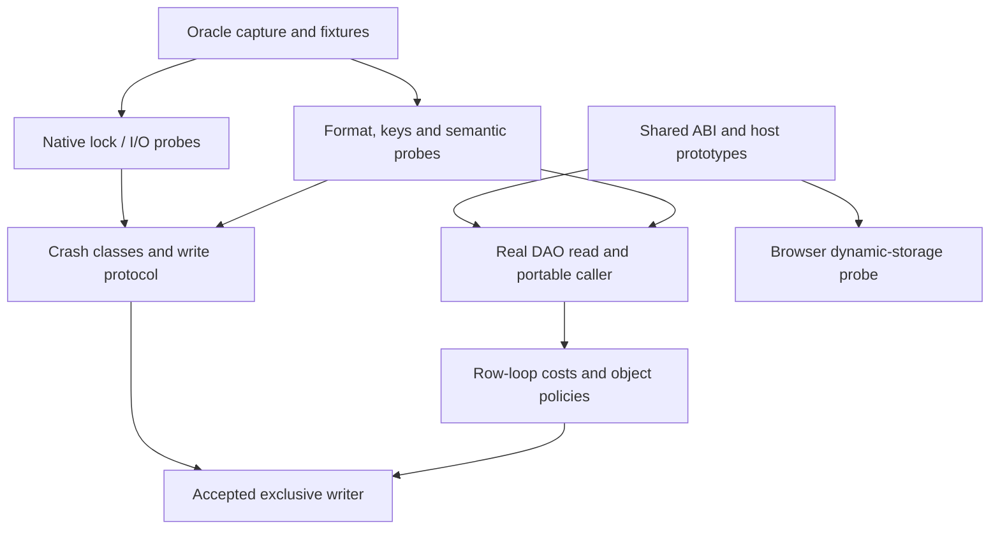
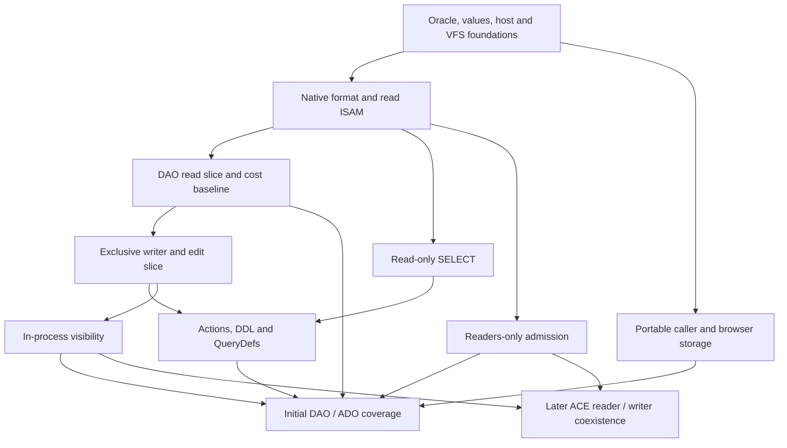

# I-16. Research and development sequence

Revision 12 · Part I review and Stage 2, response 13 · 2026-11-14

**Requirement trace:** Primary: RQ-PROCESS-01, RQ-DEV-01, RQ-DEV-02. Shared obligations: RQ-LOCK-03, RQ-LOCK-04, RQ-SRC-03, RQ-ORACLE-01, RQ-ORACLE-03, RQ-ORACLE-04, RQ-LEDGER-01, RQ-ORACLE-05, RQ-TEST-01, RQ-STORE-04. Full requirement text and Part II ownership are in I-16.

## Plan from dependencies and risk

The one-pager fixes product scope, including initial and later capabilities. Its suggested implementation order is superseded by the user's instruction to do the actual planning here. For the review's bracketed sequencing alternatives, the retained provisional scheduling choice is explicit: **ADO may start alongside DAO as written; DAO retains priority.** No full-DAO completion dependency is added to ADO construction or research. The sequence below puts evidence that could overturn an expensive choice before that choice is embedded in a large implementation. It preserves the workload priority: DAO row loops from VBA, then bulk SQL, then WASM where their requirements compete.

Develop small real paths through the intended architecture. The first useful path is an unchanged caller creating a genuine CalcDb DAO object, opening a native table, moving a cursor and obtaining owned field values through the shared foundation. It tests activation, ownership, format decoding, cursor lifetime and the dominant cost boundary together. A fake object returning constants can establish ABI mechanics but cannot complete that read milestone. A successful read milestone cannot complete the object-model inventory.

Several early investigations run independently: capture correctness; public ABI/activation; native lock and crash observation; file layouts and keys; and the portable caller/storage prototype. Read-only SELECT does not require the completed writer. Reader-only process sharing does not require ADO. ADO policy work does not require every DAO member to be complete. Later encryption or an external provider need their own prerequisites, not universal completion of shared writing. These are scheduling changes, not scope reductions or promotions.

Use **S** for one bounded question or local mechanism, **M** for several interacting mechanisms within one main boundary, **L** for a cross-service feature with a substantial behavioral matrix, and **XL** for a broad subsystem or several coupled compatibility matrices. These are relative complexity estimates, not dates, staffing predictions or elapsed durations. A research card and its eventual implementation can have different sizes. Refine estimates from actual evidence without changing what completion means.

## Research before commitment

The detailed cards and common capture conditions reside in A-02-experiments.md. Each Part I section retains a short question/outcome summary; I-15 defines evidence classes and T-COMPACT-1. A-01-sources.md contains the full source ledger. Begin with the user-reported ACE 16.0.20527.20016 and verify the loaded binaries before capturing answers. Nothing in this plan claims that the Windows experiments have run.

| Investigation bundle | Start when | Choice it must settle before broad construction |
| --- | --- | --- |
| R-ORACLE-1 | Public API driver and selected test installation exist. | Lossless captures, owned-process isolation, nondeterministic comparison and uncertain-job handling. |
| I-FOUNDATION-1, I-HOST-1 discovery | Supplied integration material, public declarations and actual host/client loading. | Exact target ABI/service closure, Active bootstrap and standalone selection, runtime/provider/allocator ownership before broad integration. |
| R-ACT-1, I-HOST-1 execution cases | Native reference discovery starts immediately; CalcDb comparisons add minimal declarations and actual host/factory/value slices. | Unchanged creation/type-library/factory routes, actual Framework/.NET 10/.xll loading, propagation, synchronized threading and residual lifetime; no full SQL prerequisite. |
| R-STRING-1 | Shared values plus a small decoded-row/public-call path exist. | Direct owned output versus reusable decode state and selective caches, measured on the DAO path. |
| R-FMT-1, R-SORT-3 | Immutable native fixtures and capture/inspection work. | Format descriptors and exact key families; read facts can be gathered concurrently. |
| R-CAT-1 | R-ORACLE-1 plus R-FMT-1 start bootstrap/property/query-row captures. | Separate CAT-B/P/Q/V/D/I/X branches settle native identity, MR2 maps, QueryDef Order/SQL, public lifetimes, DDL/relationships, binding and crash reopen. Add key/write, expression/SQL, transaction or host evidence only to affected branches; size L. |
| R-CURSOR-1 core | Native table fixtures and observable calls exist. | CUR-POS/ID and read POP/LIFE settle row root/body/occurrence identity, position, population and bookmark ownership before cursor interfaces are frozen; key/edit/query/provider branches follow their actual dependencies. |
| R-LOCK-1/2 and W-PROBE | Disposable native files, W-01 capture core and the small K-IO/K-LOCK interface sketch; no production W-03 prerequisite. | Basic native open/share/I/O/identity behavior first; independently develop crash observation and measure its actual coverage. Full tracing is the preferred evidence path, with the bounded alternative in I-08 if it proves impossible. |
| R-FMT-2, R-PRESERVE-1, R-TXN-1, R-CRASH-1/2 | The external oracle can mutate and interrupt ACE. | Native mutation dependencies, opaque ownership, live rollback, commit survival and first-opener crash classes. A CalcDb writer is not needed to obtain these answers. |
| R-EXPR-1, R-UDF-1 | Scalar/context and restricted mutation captures first; minimal I-HOST-1 route for instrumented host cases. | Declared/runtime types, resumable demand/coercion/cleanup, two wildcard profiles and mutation acceptance first; owned resolver/callback second; host-effect extension follows without a cycle. Joint R-SORT-3 range proofs wait only for their relevant text/key profiles. |
| R-SQL-1/3, R-SQL-2 | Scalar/context baseline and discriminating fixtures; key/catalog/cursor/host evidence only for corresponding branches. | Range inclusion versus demand, relational equality, exact aggregate/frontier and crosstab schema; action enumeration/value views, target/count/failure policy and independent CHECK/DDL/security recipes. |
| R-DAO-1, R-ADO-1, R-ERR-1 | Declaration, construction and binding cases begin immediately; read/query/write/host evidence is branch-specific. | Family publication/identity, client/batch/event/persistence and independently captured error channels select the public policies; native async conflicts remain visible. |
| R-WASM-1 | Actual portable runtime/foundation and minimal VFS prototype; native discovery and feature comparisons are separate. | Shared address/call/allocator domain, direct and dynamic broker routes, short/uncertain effects, failure cohort, qualified reader-only sharing and bounded memory before broad browser integration. |
| R-PAR-1 | An accepted serial path and cost baseline exist. | Exact serial equivalence and net benefit for each proposed parallel path. It never blocks ordinary serial delivery. |

**Figure F-17 — expensive decisions follow their deciding evidence.** This graph shows the main dependency cuts; the cards specify individual cases. Mermaid source only; not render-verified.

The last edge means the writer must respect evidenced cursor identity and edit/error policies; it does not require all DAO methods. W-PROBE is a small external driver over public native effects, using a contract sketch rather than the completed W-03 implementation. Its basic open/share/identity/I/O probes feed W-03. Its crash-observation slice first establishes passive cached/fast/paging coverage, then separately demonstrates controllable cuts and records post-trigger I/O settlement. A preconfigured observation capability stays within the charter's owned-process and no-security/HKLM-change rules. Missing coverage remains explicit; the run does not install instrumentation to repair an unavailable capability. This removes the circular dependency in which the production VFS would have to exist before its prerequisite probe could start.

If complete ACE tracing proves impossible, **continue the bounded exclusive native writer in D-WRITE-1**, with complete CalcDb persistence-cut exploration, semantically bracketed ACE interruption, native-state inspection and independent reopeners. Qualify operation/environment cases only where every CalcDb cut fits an established ACE survival/repair class; unresolved cases remain experimental or write-refused and visible in coverage. Unknown marking or persistence rules are not filled with an invented marker, private WAL or stronger atomicity. This is a writer development direction with explicit evidence limits, not a requirement to postpone all writing until perfect instrumentation exists.

## Work packages and observable acceptance

Work identifiers remain stable. Early and later slices within a package are named below so their dependencies are explicit. A dependency on a slice does not imply completion of every feature in that work package.

| Work / size | Result and actual prerequisites | Acceptance evidence |
| --- | --- | --- |
| W-01 · L | One oracle controller, corpus manifests, capture/replay/comparison and reduction; R-ORACLE-1 and the selected test installation. | Repeated and reduced SQL/object/file cases retain exact typed payloads, provenance and original evidence; transport loss never silently re-executes an uncertain mutation. |
| W-02 · M | Shared target declarations, values and consumed Automation services. I-FOUNDATION-1 discovery; R-STRING-1 refines materialization after native reads; actual portable services/runtime qualify separate slices. | Independent SDK/real-runtime layout and owned copy/alias/allocator tests; actual type binding, errors, enumeration, factories and ADO events on required targets; exact canonical values, no private representation. |
| W-PROBE · M | Small public-native-effects probe and external ACE observation; W-01 capture core plus K-IO/K-LOCK contract sketch, without production W-03. | Basic slice validates actual access/share, file identity/authority, request/grant lifetime, progress/uncertainty and exclusion. Later native-range profiles require controlled interference evidence for edit, read and physical publication roles. Crash slice distinguishes passive coverage from controllable cuts and actual process-death closure, then supplies explicit bounded crash classes where complete tracing is unavailable. |
| W-03 · L | Blocking VFS/pager, native exclusion and qualified browser storage. Minimal native declarations, W-PROBE basics and R-LOCK-1; available W-02 native contract; independent browser slice adds actual portable bootstrap and R-WASM-1. | Bounds, source/payload/request/grant lifetime and honest progress hold under faults. Raw counts require prefix evidence; direct/broker and reader-source routes retain owned completion. Native reads do not await complete crash tracing or portable delivery. |
| W-04 · XL | One format description, reader, validator, inspector and read ISAM/catalog path; W-01 capture core, W-02 native contracts, W-03 read foundation, R-FMT-1, the read branches of R-CAT-1 and CUR-POS/ID and read POP/LIFE evidence; R-SORT-3 for key-dependent Seek/lookup branches. | Jet 4/ACCDB fixtures decode through shared rules, including long values/catalogs/indexes; malformed references cannot escape bounds or budgets; public read results match captures. Native reads do not await full browser integration. |
| W-05 · XL | Exclusive row/LV/allocation/index mutator, Workspace/operation frames, owned semantic/persistent receipts and phase-specific live rollback using provisional D-WRITE-1/D-INDEX-1; W-04, relevant R-FMT-2/R-SORT-3/R-PRESERVE-1, CUR-ID/EDIT, R-CAT-1 relationship/field descriptors, R-TXN-1 and minimal shared mutation-expression evidence; constraints/cascades use native-created fixtures without full SQL execution. W-PROBE/R-CRASH-1/2 develop and qualify crash behavior alongside construction; TXN branches can settle small native fixtures independently. Optional D-UNDO-2 is a separate profile-specific addition after the baseline writer and recovery cuts are established. | Owned edit/generated-value/constraint/cascade and nested/statement outcomes match native traces; empty logical commits, multi-file receipts, handoffs and uncertain writes retain exact ownership. Completed operations pass T-COMPACT-1 with correct keys/preservation. Every cut of a qualified operation/environment fits its established ACE crash class without private undo; incomplete tracing uses the explicit bounded-evidence route, and unresolved cases remain counted. |
| W-06 · L | Read-only SELECT and shared expression service. W-04; scalar R-EXPR-1; R-SQL-1/3; read cursors; host-sensitive cases add R-UDF-1/I-HOST-1. | Typed Access binder and scalar-demand graph over native ISAM/evaluator; exact range/join/equality/aggregate and schema/population policies, bounded value/state spill and actual-plan checks. Fixed crosstab metadata is independent of cell completion; full-row DISTINCTROW retains update provenance. No writer or optional worker prerequisite. |
| W-07 · XL | Actions, DDL and native QueryDefs. Native metadata writes: W-05 + relevant R-CAT-1/transaction evidence; saved-SQL translation: parser/binder slice; execution: W-06 operators + R-SQL-2/3; branch-specific crash/preservation evidence. | Protected action enumeration with independent value demand, target/coalescing/count/error policies and shared mutation. Native CHECK/DDL/security/QueryDef integration, held-object invalidation and complete schema/property reopening; structural writers use parser/binder slice without full SQL execution. Existing phase and multi-file limits remain. |
| W-08 · XL | DAO activation/host, native read/edit and actual portable-client slices. R-ACT/native discovery and I-FOUNDATION/I-HOST first; W-03/04 reads, W-05 edits, W-07 full scope; R-WASM-1 qualifies real portable caller domains/storage. | Unchanged CalcVBA/.xll and both managed lanes select CalcDb. Portable typed/dispatch, errors, enumeration, ByRef/events and real runtime lifecycle use one qualified domain; complete applicable DAO coverage remains explicit. |
| W-09 · L | CalcDb ADO construction, read/query and edit/coverage slices. R-ADO-1/R-ACT-1 early; shared declaration/host/foundation event slices and relevant W-04/05/06/07 services; no full DAO or later-provider prerequisite. | Genuine CalcDb ADO plus internal ACE-string adapter; requested/effective policy, owned client/batch/event/diagnostic state, schema/Record/Stream and native-admitted ADTG/XML interchange. Complete inventory and async conflicts visible; no hidden Microsoft runtime or later-provider dependency. |
| W-10 · L | Readers-only admission and in-process visibility in separate slices; prerequisites below. | Required native readers coexist while late writers remain denied. Fresh-view admission closes before preservation selection; bounded histories, pending targets and allocation/schema intervals preserve selected visibility through Close/cancel and resource failure. |
| W-11 · L | Read beside an ACE writer; W-10's relevant native/visibility foundations and R-LOCK-3. | Protected descriptor/index/map/root/body/LV capture prevents mixed or wrong-row reads. Refresh, external identity and unread-source retention follow native policy; local epochs cannot replace source certificates. Network configurations have separate evidence. |
| W-12 · XL | Shared native writing; W-11, R-LOCK-4 and shared crash evidence. | Protected fresh-image rebase preserves unrelated row/index/map changes; scoped rollback, lock promotion/reuse and exact uncertain grants match native policy. Conflict/error/transaction/crash matrices agree locally, then on identified SMB configurations. |

### Slices that determine the useful order

**W-08 activation slice** starts with W-02 declarations and the actual host. Use the real factory/vtable/dispatch route before attaching database behavior. Run R-ACT-1 with a genuine `.xll`, CalcVBA and unchanged PIA clients under the installed Framework 4.8-family and .NET 10 LTS independently. Portable stand-in work is a CalcVBA dependency, with an executable minimal client path as its result. Windows success does not substitute for it.

**W-08 read slice** adds W-03/04. Exercise OpenDatabase, table recordset creation, MoveNext, ordinal/name Fields access, Seek and bookmarks as their mechanisms arrive. Include Close, held children, errors and empty results. Instrument crossings, allocations, copies, decoding and pin/cache work immediately. This is the first representative end-to-end performance baseline. It may proceed before complete SQL and before exclusive writing.

**W-08 edit slice** adds W-05, evidenced defaults/validation and Workspace behavior. Exercise small edits, AddNew/Update/Delete, generated values, clone/cursor invalidation and live rollback through COM. **W-08 initial-scope coverage** converges with W-07 and the remaining member manifest, including properties, Collections, Containers/Documents and native QueryDefs. “Full DAO” cannot mean only commonly used methods; deferred capability contexts remain explicitly accounted for as I-12 defines.

**W-09 construction slice** runs early with activation and R-ADO-1: connection strings, closed-object state, parameter construction, defaults and error ownership expose policy needs before large storage investment. Read/query and write behavior then attach to their shared services. Prioritize DAO problems where effort competes, but do not impose an artificial dependency on the last unrelated DAO member. ADO completion still requires its complete applicable inventory, independent lifecycle tests and actual client activation.

**Shared expression slice — W-02/05/06 and the host prototype.** II-10 supplies typed-node binding, a resumable scalar policy, a checked builtin manifest and separate default/field/table adapters over the common foundation. W-05 takes restricted mutation expressions before full SELECT; W-06 adds complete required query contexts and parameter/version binding. R-EXPR-1 qualifies declared/runtime types, demand/error/cleanup order, provisional candidate acceptance and both pattern grammars. Like index candidates additionally need R-SORT-3 inclusion and error/effect-demand evidence; unresolved range optimization does not postpone scalar matching. I-HOST-1/R-UDF-1 first demonstrate one actual caller-thread function with owned signature/arguments/results, then extend effects, aliases, policy revocation and reentry. Register lowering/workers wait for accepted scalar equivalence and measured gain, not the other way around.

**SQL execution slice — W-06/07.** II-11 starts with the bounded parser/binder, scalar RowLease/continuation interface and native scan/range/nested-loop path. Then add exact temporary records and bounded sort, relational equality/aggregate state stores, UNION/subquery/crosstab policies and actual-plan inspection. Preserve the global accepted contribution/error frontier across spilling; fixed crosstab metadata need not await cell completion. Hash/batch/worker choices require separate equivalence and measured benefit. D-SQL-1 remains Recommended and D-PAR-1 remains Decided.

W-07 composes those sources with the existing mutation/Workspace service. D-ACTION-1 remains Provisional: spool only at a qualified boundary, otherwise a protected lazy enumeration cut with independent value visibility. Add source/target/coalescing/count policies, complete make-table phases and native DDL/QueryDef recipes. SQL CHECK has its own context/persistence descriptor; supported Jet 4 security/workgroup forms require real integration. Structural writers can consume the parser/binder slice before full SELECT coverage; native-successful required forms remain work when their integration is unresolved. The existing later encryption/provider labels remain intact.

**Integration slices — W-02/08/09.** II-13 begins with the single captured public declaration graph and independent target-ABI probes, then own/compatibility factory and type-library selection with real unchanged clients. Native reference discovery needs installed callers and capture; a minimal CalcDb prototype needs only the declarations and host/value slice. Test actual Framework 4.8-family and .NET 10 loading separately and together in the qualified host, plus real CalcVBA and x64 .xll routes. Neither full SQL nor complete portable delivery is a prerequisite for detecting an unusable Windows creation route.

Explicitly load/pin, bootstrap outside DllMain, publish the immutable Active host binding, then expose compatibility creation. Captured factories/objects retain that binding; absent or retiring compatibility admission never falls back to standalone. CalcDb's own explicit standalone mode supplies native-file services without VBA. Qualify context propagation and synchronized Both with actual MTA calls and callback provenance. Retain arrays, descriptors, event frames, deferred error callbacks and allocator/module owners through residual shutdown; source lifetime and mutation-stable copy traversal are separate obligations. W-04/05 then supply the real retained-Field read/edit path, and actual portable clients exercise the same declarations and complete consumed service set. T-INT-01..64 and the full R-ACT/I-FOUNDATION/I-HOST cards specify acceptance; all remain unexecuted.

**Object-model execution slices — W-08/09.** II-12 begins with nonregistering public declaration capture and executable member recipes, genuine object construction, stable interface identity and owned diagnostic publication. W-08 then joins the existing native read/edit path, schema drafts and QueryDef bindings, family-specific collection/retained-child policies, and the full applicable DAO inventory. Secured Jet 4 account/permission cases remain initial work where the selected target accepts them. Direct scalar calls use typed entries and reusable wrappers; accepted native mutations retain receipts through late result or cleanup failure.

W-09 may start alongside DAO with actual CalcDb ADO activation, native ACE-string routing and requested/effective options. Add query/native cursors, immediate edits, client/disconnected values, batch reconciliation, caller-thread events, schema/Record/Stream and native-admitted ADTG/XML persistence as their dependencies arrive. Those are slices of the initial ADO obligation, not dependencies on the later external OLE DB provider. R-ADO-1 keeps a proven early-return async branch as a material conflict with D-CALL-1 for decision; unobserved or missing behavior is never counted as parity. Native-oracle batch/event/schema/persistence research needs ACE plus fixtures/capture and relevant host/fault setup; it can precede the CalcDb services needed for comparison runs. R-ERR-1 accompanies both surfaces from construction onward, including retained errors, bounded error-slot retirement and both managed-runtime lanes.

**W-10 readers-only slice** follows W-03/04 plus R-LOCK-2. It proves database and lock-file admission against real processes, including a late writer and all open orders. It can precede ADO and SQL completion. **W-10 visibility slice** follows the exclusive mutation/cost baseline and R-TXN-1/R-CURSOR-1 visibility results. Introduce bounded historical pages or stable source/result storage only for the contracts that need them. Install the logical admission hold before preservation selection; include pending targets without active reads and release/convert at qualified outcomes. Verify long readers, allocation/schema reuse, private snapshot cuts, rollback/publication, spill exhaustion and Close. Neither slice assumes that in-process versions can reconstruct a page overwritten externally by ACE.

**Owned coordination across slices.** II-09 supplies authority-bound opens, exact grant ownership, queue/ancestor dependencies, retained work and one CloseAttempt handoff. Implement submit/cancel/Close schedules alongside the VFS and cursor slices; they do not await full SQL. R-PAR-1 still requires an accepted serial operator and measured gain before enabling each parallel execution path. W-11 first discriminates a read during Edit from a read during Update; W-12 first discriminates same-page unrelated updates and rollback survival.

**Browser delivery slice — W-02/03/08.** II-14 starts with actual CalcVBA typed/dispatch/ownership calls in a qualified memory, call-table and allocator domain, plus a minimal native page read. Prefer one linked program on the caller worker, prepared direct handles, and a dedicated broker for dynamic acquisition. Qualify the fixed mailbox, partial writes without assumed prefixes, late acquisition cleanup and caller/broker failure cohort before broad database integration. Native read-only handles and cooperating File/Web Lock readers are separate profiles; neither an accepted option nor an exclusive default handle proves many-reader behavior.

Attach W-04 reads, W-05 mutation/crash classes and W-06/07 spill/query work as available. Dynamic opens and spill, exact source ownership, actual callbacks/Close, exhaustion and distinct worker/browser/OS faults remain required cases. Optional browser undo stays disabled without qualified file incarnation and disarm durability; the exact user predicate and ACE-first baseline remain unchanged. A restricted prestaged prototype is partial initial coverage. JSPI is a measured alternative only through the complete real calling/reentry/owner chain. Add ADO under W-09 and reader/visibility combinations under W-10; no completed DAO/SQL or W-12 prerequisite is imposed on early feasibility.

**Figure F-18 — implementation branches converge on initial coverage.** Native shared writing remains later. The browser branch joins initial coverage because browser operation is initial scope, even if its feasibility work exposes a current limitation. Mermaid source only; not render-verified.

The diagram omits independent closed-object ADO probes and individual research dependencies for readability; the tables are authoritative. Initial coverage does not wait for the later coexistence branch. Conversely, “initial complete” cannot be claimed by omitting a difficult platform, activation route, required member or readers-only case from the denominator.

## Later work follows its own dependencies

I-14 supplies actual designs and the deciding experiments. Research, capability descriptors and seams begin early; implementation remains labelled later. Shared-writing combinations are tested after the corresponding feature and W-12 exist, rather than making W-12 a prerequisite for every feature's exclusive implementation.

| Work / size | Prerequisites and result | Acceptance |
| --- | --- | --- |
| W-L1 · L | Native encryption and credential/conversion operations. R-ENC-1; minimal exclusive format read, then phase-image/writer/crash and protected temporary services. | Native profiles, password/SID operations, codec/cache ownership, physical failure states and qualified conversion publication match. |
| W-L2 · XL | Native links and source-specific execution. R-LINK-1; catalog/binder/cursor, host source transport, transaction services for exercised branches. | Relink/refresh and source identity match; pushdown preserves demand/errors; participant receipts preserve unknown outcomes without invented distributed commit. |
| W-L3 · XL | Multivalue, attachment, calculated and history preservation. R-COMPLEX-1; catalog/row/LV and child cursors; writer/index/evaluator/coordinator as branches require. | Native association/group/child identity, bounded attachment wrappers and calculated timing match; completed closure and interrupted ACE crash class stay distinct. |
| W-L4 · XL | Native compaction, publication and conservative repair. R-REBUILD-1; checked graph traversal, exclusive source, destination allocator/codec/index/writer and host publication. | Complete valid/opaque closure survives qualified relocation or preflight refusal; separate destination/source outcomes and explicit salvage uncertainty. |
| W-L5 · XL | Genuine OLE DB provider and real consumers. R-OLEDB-1; factory/ABI and minimal shared read/query values, then update/transaction/stream branches. | Actual native and Framework/.NET10 OleDb consumers verify properties, accessor offsets, HROW/stream owners and independent error/status channels; no initial ADO dependency. |
| W-L6 · L | ODBC driver and actual Driver Manager clients. R-ODBC-1; manager/target declarations and minimal shared query/cursor, then mutation/transaction/stream branches. | Handle/descriptor state, x64 arrays, GetData/PutData, diagnostics and cancellation/unknown transaction outcomes match actual clients. |

The initial ADO implementation never depends on W-L5. Linked-source semantics do not establish distributed durable atomicity. Compaction cannot relocate opaque references merely because their bytes can be copied. Encryption adds failure variants to the existing crash protocol rather than replacing it.

**Later implementation slices — W-L1..6.** II-14 starts encryption with native header/profile/credential reads, links with one actual source identity and schema, complex fields with separate parent/child and calculated descriptors, and rebuild with a complete ownership survey and separate destination. OLE DB begins with a genuine factory and bound rowset through an actual native consumer; ODBC with the actual Driver Manager and one descriptor/bound fetch. Extend only the corresponding mutation/transaction/stream branches as shared services arrive. Preserve initial CalcDb ADO's independence from the later provider.

The six full cards now specify physical encryption/password/SID cases, relink/pushdown/source outcomes, attachment/history/calculation behavior, typed relocation and publication, x64 accessor/descriptor buffers and retained diagnostics. T-PLAT-01..64 links those mechanisms to explicit acceptance families. Completed-write closure and interrupted ACE crash classes are separate; no later capability gains a blanket W-12 dependency, and no unsupported required case is counted as success.

## Acceptance as evidence accumulates

Each implemented slice gets four related checks: differential observable behavior; structural/ownership invariants; failures at the actual effect boundaries; and representative cost measurements. Use minimal fixtures first, then boundary values, generated combinations and maintained regression captures. Do not wait for feature completion to test failed allocation, short I/O, Close or reentry: those outcomes shape ownership and continuation design.

For ordinary writes, acceptance includes **T-COMPACT-1** in I-15/A-02: independent ACE/Access opening, calibrated repair detection and before/after content/structure comparison. Repair cannot make an otherwise unacceptable original write pass. For interrupted writes, use I-08's corresponding ACE baseline and independent first-opener branches. Record public acknowledgement, dbForceOSFlush and persistence events separately. Optional undo remains additional CalcDb-first help. Under exclusion, validate file identity, manifest/extent and eligibility; full-read every database page, require each uncovered page unchanged and each covered page exactly its before-image or intended new image, and otherwise discard. No continuous-history witness is required by this revised external-change predicate; stale committed or ambiguous undo still cannot be applied. Do not reject an evidenced ACE repair class merely to claim stronger guarantees, or accept an invented repair class because it appears conservative.

For queries, compare values, schema, errors/effects and ordering, and inspect the plan actually executed. For object models, compare state transitions and error lifetime, not only returned rows. For portability, use the actual CalcVBA client on the target, including dynamic browser acquisition and memory exhaustion. A generic native unit test does not discharge COM activation, browser persistence or process-lock obligations.

An optimization enters only after its applicable compatibility cases remain matched and its measured cost improves the intended workload within noise. In particular, R-PAR-1 begins with the accepted serial operator, then adds scheduling variation, spills, failures and callback-sensitive rejection cases. An internal optimization failure must not replay user effects or turn a completed write into a retry. Keep rejected measurements so later work does not repeat the same unproductive change.

## Decision changes and current unresolved facts

The Part I review adds provisional D-WRITE-1, makes D-LOCK-1's first two native mechanisms concrete, replaces D-UNDO-1's former history-witness predicate with the user's exact full-file image test, and corrects D-VALUE-1 to the intended real platform VARIANT/BSTR contract. I-03/08/09 and I-02/13 carry those changes. Full source/experiment material now lives in A-01/A-02; figure status records actual emitted tables and diagram source. Decision status labels and scope IDs are synchronized with book-record; reasons remain in chapters.

The most consequential remaining facts are the actual crash/flush sequence, complete native lock protocol, identity/visibility/error policies, exact format/key/catalog variants, unchanged-client activation coverage, CalcVBA's shared/portable declarations, and browser dynamic-storage/durability feasibility. Each has a named card and next experiment. Documentary differences and unavailable builds stay unresolved rather than being hidden by a compatibility mode. A result requiring a material scope change returns to the user; routine mechanism changes within these contracts update the affected chapters directly.

Part I now contains designs for every mapped requirement, with unresolved behavior expressed as a preferred mechanism and a deciding experiment. Part II deepens those same sections into structures, algorithms, invariants and acceptance cases. Part II has now developed II-01 through II-14; the next planned chapter is II-15. The content determines response boundaries. Page guidance remains descriptive and never justifies dropping a required design or experiment.

## Complete scope map

The 83 stable requirements retain their scope/phase and owner. The Nov 13 corrections refine RQ-PROD-04, RQ-VAL-01, RQ-PORT-03 and RQ-STORE-05 without reducing initial coverage. Every Part I owner explicitly cites its IDs; Part II chapter numbers match those owners.

| Requirement | Authority | Phase | Required behavior | Owner I / II | Supporting I / II |
| --- | --- | --- | --- | --- | --- |
| RQ-PROD-01 | N What it is | Initial | Clean-room Rust Jet 4/ACE engine for DNA Calc; systems-language design remains readable outside Rust. | 01 | 13 |
| RQ-PROD-02 | N What it is | Initial | Existing VBA, .xll and .NET add-ins using ACE run unchanged inside DNA Calc. | 13 | 07,12 |
| RQ-PROD-03 | N What it is; In | Initial | Jet 4 .mdb and ACE .accdb read and write interoperability; no Jet 3 support. | 04 | 01 |
| RQ-PROD-04 | N What it is | Initial | Ordinary completed writes open in Access/ACE without repair and pass calibrated T-COMPACT-1: independent branches, no repair indicators or required structural correction, preserved content and clean-control compaction changes. Interrupted states follow RQ-STORE-04. | 04 | 08,15 |
| RQ-PROD-05 | N What it is; Out; P3 | Initial | Unknown content survives rewrites byte for byte; stored front-end objects remain readable. | 04 | 06,14 |
| RQ-PROD-06 | N What it is; P9 | Initial | Core runs off Windows and in DNA Calc browser/wasm32 builds. | 14 | 01,03,13 |
| RQ-SQL-01 | N In; C SQL | Initial | All Access SQL; SELECT, joins, unions and subqueries; no private SQL dialect. | 11 | 10 |
| RQ-SQL-02 | N In | Initial | Crosstabs: TRANSFORM and PIVOT, including result-schema construction. | 11 | 06 |
| RQ-SQL-03 | N In | Initial | PARAMETERS declarations, typed binding and QueryDef parameter behavior. | 11 | 06,12 |
| RQ-SQL-04 | N In | Initial | DISTINCTROW and its Access-specific row identity semantics. | 11 | 07 |
| RQ-SQL-05 | N In; C SQL | Initial | Append, update, delete and make-table action queries. | 11 | 07,08 |
| RQ-SQL-06 | N In | Initial | Access DDL and its catalog/constraint effects. | 11 | 06,08 |
| RQ-SQL-07 | N In | Initial | Both ANSI-89 and ANSI-92 wildcard modes. | 10 | 11 |
| RQ-SQL-08 | N In | Initial | QueryDefs read and written in Access catalog form, in both directions. | 06 | 11,12 |
| RQ-SEM-01 | N In; P1 | Initial | ACE results, value types and Null handling. | 10 | 02,11,15 |
| RQ-SEM-02 | N In; P3 | Initial | ACE comparison/sort behavior and byte-identical index keys, including legacy sort orders. | 05 | 10,11 |
| RQ-SEM-03 | N In | Initial | ACE error numbers, error collections, timing and surface propagation. | 12 | 08,10,11,13,15 |
| RQ-DAO-01 | N In; C Object models | Initial | Full DAO: DBEngine, Workspace, Database, and the complete required member inventory. | 12 | 07,08 |
| RQ-DAO-02 | N P2; C Object models | Initial | Table/dynaset/snapshot/forward-only recordsets; navigation, Seek, Find and bookmarks. | 07 | 12 |
| RQ-DAO-03 | N P2; C Object models | Initial | Edit/AddNew/Update, TableDef, QueryDef, Field, Index, Relation and Parameter. | 12 | 06,07 |
| RQ-DAO-04 | N In; C Object models | Initial | Properties, Containers/Documents, collections, Errors and transactions. | 12 | 06,08 |
| RQ-ADO-01 | N In; Next | Initial | ADO from VBA: Connection, Recordset, Command and related observable behavior. | 12 | 07,13 |
| RQ-ADO-02 | N In | Initial | Microsoft.ACE.OLEDB.12.0 connection strings work through the CalcDb ADO surface. | 12 | 13 |
| RQ-COM-01 | N In; P9 | Initial | DAO real interfaces, IUnknown, IDispatch, IIDs and dispids; early and late binding. | 13 | 02,12 |
| RQ-COM-02 | N In; C COM identity | Initial | Side-by-side identity: own ProgIDs/CLSIDs; host compatibility activation without registry changes. | 13 | 12 |
| RQ-COM-03 | C COM identity; Platforms; U runtime targets | Initial elaboration | Windows x64; DAO PIA/.NET interoperability on installed .NET Framework 4.8-family and .NET 10 LTS; explicit per-user external redirection only, never HKLM. | 13 | 01 |
| RQ-LOCK-01 | N In; P6; Next | Initial | Step 1: exclusion correct both ways between CalcDb and ACE processes. | 09 | 03,08 |
| RQ-LOCK-02 | N In; P6; Next | Initial | Step 2: multiple processes may read while all writers are excluded. | 09 | 03,15 |
| RQ-LOCK-03 | N Later; P6; Next | Later | Step 3: CalcDb reads beside an ACE writer. | 09 | 14,15,16 |
| RQ-LOCK-04 | N Later; P6; Next | Later | Step 4: shared writing through the ACE lock-file protocol, including later network-share validation. | 09 | 14,15,16 |
| RQ-LATE-01 | N Later | Later | Encryption; preserve codec and key-service seams in the early file/pager design. | 14 | 03,04 |
| RQ-LATE-02 | N Later | Later | Linked tables; catalog identity, source capabilities and delegated access paths. | 14 | 06,07,11 |
| RQ-LATE-03 | N Later | Later | Complex fields: attachment, multivalue and calculated fields. | 14 | 02,04,06,07 |
| RQ-LATE-04 | N Later | Later | CalcDb compact and repair; separate validated rebuilding from conservative repair. | 14 | 04,05,06,08 |
| RQ-LATE-05 | N Later | Later | OLE DB provider; early ADO support must not depend on this later provider. | 14 | 12,13 |
| RQ-LATE-06 | N Later | Later | ODBC driver over the same engine and semantic services. | 14 | 11,12 |
| RQ-OUT-01 | N Out | Excluded execution | Forms, reports, macros and database modules are preserved/readable, never run by CalcDb. | 01 | 04,06,14 |
| RQ-OUT-02 | N Out | Excluded | Jet 3, server roles and a CalcDb SQL dialect. | 01 | 04,11 |
| RQ-SRC-01 | N Sources; A Sources | Continuous | Use public documents, observed ACE, licensed Jackcess material and mdbtools format facts only. | 01 | 04,15 |
| RQ-SRC-02 | N Sources; P11 | Continuous | No proprietary decompilation/disassembly; FrankenSqlite/asupersync only through reviewed attached notes. | 01 | 15 |
| RQ-SRC-03 | N Sources; A Sources | Continuous | Per-source/version use and licence ledger; exact-material checks before adaptation or code reuse. | 15 | 01,16 |
| RQ-ORACLE-01 | N P1 | Continuous | ACE/Access are behavior oracles on Windows; capture answers keyed by their inputs. | 15 | 16 |
| RQ-ORACLE-02 | N P1 | Continuous | One differential harness runs SQL, DAO and file operations; compares rows, types, errors and relevant bytes. | 15 | 04,07,11,12 |
| RQ-ORACLE-03 | N P1 | Continuous | Refused, missing and mismatching cases all fail; never hide them from the denominator. | 15 | 16 |
| RQ-ORACLE-04 | N P1 | Continuous | Corpus is a maintained product: version/options provenance, immutable originals and reduced failures. | 15 | 16 |
| RQ-ISAM-01 | N P2 | Initial | One ISAM layer supplies tables, indexes, cursors and transactions to SQL, DAO and ADO. | 07 | 01,08,11,12 |
| RQ-STORE-01 | N P3 | Initial | The Access file is authoritative; no alternative database side format and no CalcDb WAL. | 08 | 03,04 |
| RQ-STORE-02 | N P3 | Initial | Every completed commit leaves a valid Access file; write ordering is a defined protocol. | 08 | 04,09 |
| RQ-STORE-03 | N P3 | Initial | Opaque bytes are carried without reinterpretation or silent degradation. | 04 | 06 |
| RQ-FMT-01 | N P4 | Initial | One data description defines pages, table definitions, usage maps and catalog rows. | 04 | 06 |
| RQ-FMT-02 | N P4 | Initial | Reader, writer, validator, fuzzer and page inspector use that description; each rule cites evidence. | 04 | 15 |
| RQ-FMT-03 | A Coverage; C Values | Initial elaboration | Rows, long values, allocation, index mutations and all listed Jet/ACE scalar field types/AutoNumber variants. | 04 | 02,05,07 |
| RQ-VAL-01 | N P5; V Values; U correction 2026-11-13 | Initial | Shared values use the exact platform Automation VARIANT and real BSTR, including 24-byte Windows x64 VARIANT; CalcVBA is being corrected from its current private 16-byte form. Shared Currency/Decimal/Date and conversions/functions remain CalcVBA-owned. | 02 | 13 |
| RQ-VAL-02 | N P5 | Initial | Conversions and VBA functions are shared; query and VBA value semantics agree. | 10 | 02,11 |
| RQ-VAL-03 | N P5; Next | Early design | Settle strings, borrowing, decoding, ownership and BSTR materialisation before the hot DAO path. | 02 | 03,07,12 |
| RQ-EXPR-01 | N P5 | Initial | ACE sandbox rules apply; function capability policy is explicit. | 10 | 12,13 |
| RQ-EXPR-02 | N P5; Next | Initial | UDF routing follows investigation of ACE/host integration; callback/runtime discovery remains an evidence-driven choice. | 10 | 13 |
| RQ-EXPR-03 | C SQL and expression | Initial elaboration | Host functions are opt-in; queries using them carry nonportability metadata. | 10 | 06,11 |
| RQ-CONC-01 | N P6 | Initial | Measure the exclusive path first; add in-process page snapshots without taxing every scalar call. | 09 | 02,03,07,15 |
| RQ-CONC-02 | N P6 | Initial | One locking interface covers all four process-sharing steps from the first write path. | 09 | 03,08 |
| RQ-SIM-01 | N P7 | Continuous | Inject time, I/O, scheduling and randomness; no hidden nondeterministic engine effects. | 15 | 03,09,10 |
| RQ-SIM-02 | N P7; U crash correction | Continuous | Seeded replay, interleaving search and fault injection; interrupt real ACE and CalcDb at every write point and compare independently captured reopening states. | 15 | 08,09 |
| RQ-CALL-01 | N P8 | Initial | Object calls block their caller thread; no async runtime is required. | 13 | 07,09,12 |
| RQ-CALL-02 | N P8 | Initial | Measured internal workers preserve serial row order, Double sums and other observable outcomes. | 11 | 09,10,15 |
| RQ-CALL-03 | N P8 | Initial | VBA user code executes only on the caller thread and never under an internal lock. | 10 | 09,13 |
| RQ-CALL-04 | N P8 | Initial | Background work has an owner, budget and cancellation protocol; locks/cursors settle at owner close. | 09 | 07,08,12 |
| RQ-PORT-01 | N P9 | Initial | Format/ISAM/catalog/expression/SQL crates perform no direct I/O and compile for wasm32. | 01 | 03,14 |
| RQ-PORT-02 | N P9 | Initial | The object model uses COM interfaces on every platform. | 13 | 12,14 |
| RQ-PORT-03 | N P9; U Part I review 2026-11-13 | Initial | CalcVBA-owned portable COM includes IUnknown, type info/GetIDsOfNames/Invoke, IErrorInfo/EXCEPINFO, IEnumVARIANT, class factories, ADO connection points/events, allocation and real BSTR/VARIANT/SAFEARRAY. No apartments or cross-thread/process marshaling. | 13 | 02,14 |
| RQ-PLAN-01 | N P10 | Initial | Inspectable plans describe the plan actually executed; tests assert seek/scan shape as well as results. | 11 | 15 |
| RQ-PERF-01 | N P10; A Priorities | Continuous | Performance budgets, noise control and failed-experiment ledger; DAO row loops > bulk SQL > WASM when they conflict. | 15 | 02,03,07,11,14 |
| RQ-PERF-02 | A Priorities | Continuous | Count allocations, bytes copied, conversions, locality/working set, branches, I/O, synchronization and crossings; invent no targets. | 15 | 02,03,07,11 |
| RQ-LEDGER-01 | N P10 | Continuous | Oracle-derived compatibility ledger for DAO members, SQL features and types. | 15 | 12,16 |
| RQ-ARCH-01 | N P11; C Architecture | Continuous | One format, ISAM, evaluator, oracle and harness; narrow mechanically checked dependency rules. | 01 | 15 |
| RQ-PROCESS-01 | N P11 | Continuous | Working implementation and clear tests take precedence over process apparatus. | 16 | 15 |
| RQ-DEV-01 | N Next; U implementation-order correction | Sequence | Choose implementation order from evidence and actual dependencies; prove risky foundations early, prioritize DAO costs, and preserve initial/later capability scope. | 16 | 09,14 |
| RQ-DEV-02 | A Development | Sequence elaboration | Work packages specify result, prerequisites, S/M/L/XL size and observable acceptance tests; expensive uncertainty is resolved first. | 16 | 15 |
| RQ-HOST-01 | C Purpose; V Open; N Next | Initial elaboration | Host external-data integration and an optional service interface reuse COM/ISAM; no second object model. | 13 | 12 |
| RQ-ORACLE-05 | C Oracles | Continuous elaboration | Long-lived batched oracle; private desktop; only owned Office processes; UI Automation dialogs; no Trust Center or HKLM changes. | 15 | 16 |
| RQ-TYPE-01 | C Values; V Values | Initial elaboration | Boolean; integer widths; Single/Double; Currency/Decimal; Date/extended date; Text/Memo/Hyperlink; binary/OLE; GUID; AutoNumber. | 02 | 04,05,10 |
| RQ-TEST-01 | A Tests; C Quality | Continuous elaboration | Differential behavior, storage invariants, malformed inputs, crash cases and workload measurements; immutable expected evidence. | 15 | 16 |
| RQ-STORE-04 | U Q1 answer, 2026-11-12 | Initial | After a CalcDb crash, ACE/Access/CalcDb-first reopening finds a state no worse than an ACE crash at the corresponding point, with the same commit-survival rules including dbForceOSFlush and evidenced repair marking. | 08 | 03,09,15,16 |
| RQ-STORE-05 | U Q1 plus Part I review correction, 2026-11-13 | Optional enhancement constraint | Private undo is optional CalcDb-first help. Under exclusion validate identity, integrity, rollback eligibility and full-file manifest/extent; every uncovered page unchanged and every covered page exactly its before-image or intended new image, otherwise discard. No continuous-history witness is required; never undo a commit the native survival rules require retaining, even before public success. | 08 | 03,09,15 |
