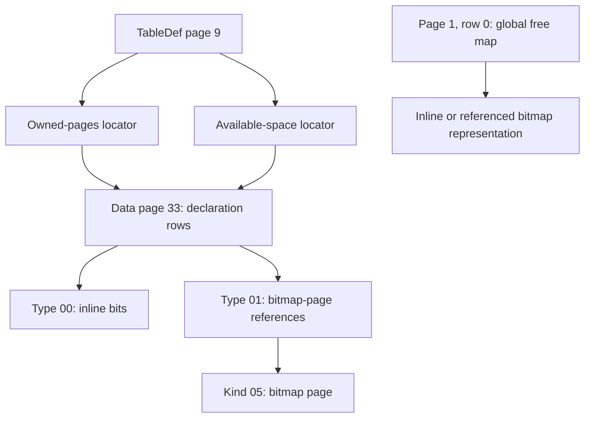
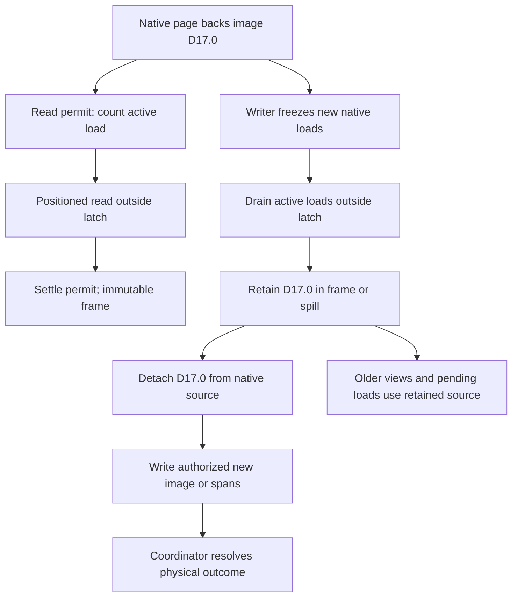

# II-03. VFS, pager and page cache

Revision 2 · Stage 2, response 3 · 2026-11-13

The recommended implementation is a bounded pool of stable, immutable page images above buffered, explicitly positioned I/O. A write transaction owns separate mutable images. Native page references determine what to fetch; a visibility resolver determines which image may satisfy the fetch. The pager never writes an uncommitted image to the database merely to evict it. It executes the transaction coordinator's ordered native write program.

This chapter makes **D-PAGER-1 — Recommended** concrete. The CLOCK/admission tuning remains provisional under the workload measurements in I-15; native write ordering remains **D-WRITE-1 — Provisional**, decided by R-FMT-2, R-TXN-1 and R-CRASH-1/2. Initial external admission remains I-09's provisional held-handle protocols, with R-LOCK-1/2 deciding compatibility. The chapter supplies mechanisms, not another definition of the shared contracts.

**Requirement trace:** §§1–3 support RQ-PROD-03/04/05, RQ-FMT-01, RQ-VAL-03 and RQ-STORE-03; §§2–6 implement the pager portions of RQ-STORE-01/04/05, RQ-LOCK-01/02 and RQ-CONC-01/02; §§2.5 and 5 retain RQ-PROD-06, RQ-PORT-01 and RQ-LATE-01 seams; §§7–8 support RQ-SIM-01 and RQ-PERF-01/02. Full requirement ownership remains I-16. Transactions, row codecs and native locking receive their own detailed chapters.[^authority]

## 1. The native objects that enter the cache

### 1.1 Geometry and bootstrap

Use **4,096 bytes per page** for the Jet 4 profile and the inspected ACE-family profiles. Number pages from zero. Page 17 therefore occupies `[0x00011000, 0x00012000)`. The number in a native page reference is not a byte offset, a frame number or a pointer. Every conversion uses checked arithmetic and the selected file profile's limits.[^format]

Bootstrap has no validated page size yet. Read a bounded header prefix through the byte-oriented VFS, identify the admitted signature and complete format/version fields, then obtain the full page using the selected descriptor. The inspected reference places the format code at byte 20; CalcDb's probe reads at least bytes 0–23 so adjacent version bytes cannot be silently ignored. Do not select a disk format from the installed ACEDAO.DLL version or the filename extension. An Office 2016-family engine can open several native formats. R-FMT-1 supplies the accepted signatures, version combinations, feature restrictions and malformed-header outcomes; an unfamiliar combination is not silently treated as Jet 4.[^format]

The following constants are **source-backed layout hypotheses for the target oracle**, not bytes captured from ACE 16.0.20527.20016. The exact reference material is seven Jackcess files at commit `be0a2139b087a227d14cafd4ea231306a5a3a862` (2026-09-13, mirror of SVN trunk revision 1514). Its identity is distinct from release 5.0.4 and the live xref site. Each selected file's Apache-2.0 header was checked. Only named passages were studied; the chapter's algorithms are CalcDb design, with no Java code port. A-01 records the material, hashes and read extent.[^provenance]

### 1.2 Kind, subtype and expected role

For a nonzero page, the first byte supplies a broad kind. A caller must also supply the role expected from the reference it followed.[^types]

| Byte at page +0 | Reference kind | What a pager consumer must distinguish |
| --- | --- | --- |
| `00` | Invalid/deallocated | A full page can be readable as raw evidence without being an admissible table, index or map page. Page 0 is handled separately. |
| `01` | Data | Ordinary table records, usage-map declaration rows and LVAL storage use this broad kind. |
| `02` | Table definition | The schema/catalog decoder supplies continuation and descriptor rules; a page-kind check does not validate a table. |
| `03` | Intermediate index node | The index decoder checks its child references and entry envelope. |
| `04` | Index leaf | The index decoder checks entries and row references; key bytes are not decoded as a data-page slot array. |
| `05` | Usage-map bitmap | A referenced bitmap page, distinct from the data-page row containing a map declaration. |

Three different interpretations of bytes +4 through +7 make the data-kind distinction unavoidable. An ordinary table-data page contains a TableDef page number; a usage-map declaration page can contain zero; an LVAL page contains `4C 56 41 4C`, the bytes for `LVAL`. Treating the last sequence as a little-endian owner number would send a reader towards a meaningless page. A schema decoder can authenticate an ordinary page's owner, while a long-value walker expects the LVAL subtype.[^table][^long]

The cache stores the immutable image once. It does not key separate copies by “table,” “map” or “LVAL.” Interpretation is a checked view over that image. A failed request for an ordinary table page must not poison the cache against a later, correct request for the same bytes as a map-declaration page. Cache generic envelope results separately from contextual results such as “belongs to TableDef 9”; include descriptor identity in any memoized contextual validation.

Page 0 also has a representation issue. The reference applies an XOR mask beginning at byte `0x18`; its first mask byte is `B5`. A constructed stored byte `A5` there becomes `10` in the decoded header and becomes `A5` again when encoded. Raw crash evidence and optional-undo fingerprints cover the stored bytes, including `A5`, not the decoded `10`. Keep raw/decoded tags explicit. Ordinary unencoded pages can use the same backing buffer for both views; a transformed header uses separate owned storage or a proven reversible transformation into a private output buffer. Never mask a pinned shared buffer in place.[^format][^channel]

This header transformation is part of the basic format path. It does not admit the deferred encrypted-file capability. A nonidentity page codec has its own format/codec identity and output budget; unsupported encryption must be detected before a page is accepted as ordinary plaintext.

### 1.3 A data page with two rows

**Figure F-19 — constructed Jet 4 data-page envelope and insertion.** Numeric layout hypothesis backed by the named reference files; no ACE capture. Byte ranges are half-open except the inclusive offset pairs in the table. The record bodies are deliberately opaque here; II-04 supplies their column encoding.

Let physical page 17 belong to TableDef page 9. Two slots point to record bodies of 16 and 24 bytes. The reference layout has a 14-byte fixed header, two-byte slots, a row count at +12 and a free-byte count at +2. Its maximum slot count is 255.[^format][^table]

| Page offsets, hex | Initial bytes | Interpretation |
| --- | --- | --- |
| `00–01` | `01 01` | Data kind; second byte follows the reference creator's pattern. |
| `02–03` | `C6 0F` | Little-endian free count `0x0FC6 = 4038`. |
| `04–07` | `09 00 00 00` | TableDef owner 9. |
| `08–0B` | `AA BB CC DD` | Opaque bytes retained exactly in this example. |
| `0C–0D` | `02 00` | Two row slots. |
| `0E–0F` | `F0 0F` | Slot 0 starts at `0x0FF0 = 4080`. |
| `10–11` | `D8 0F` | Slot 1 starts at `0x0FD8 = 4056`. |
| `12–0FD7` | Uninterpreted free-region bytes | Packed free interval `[0x12, 0x0FD8)`. |
| `0FD8–0FEF` | Opaque 24-byte body | Row 1; file interval `[0x00011FD8, 0x00011FF0)`. |
| `0FF0–0FFF` | Opaque 16-byte body | Row 0; ends at the page boundary. |

The free count is not an estimate: `4056 − (14 + 2×2) = 4038` for this packed fixture. It does not follow that every page's reusable space is one such interval. Deleted slots, overflow arrangements and native compaction rules belong to the row/allocation description. An allocator must prove the actual placement, not write into a guessed hole because the free count is large enough.

For the address calculation, append a fully prepared 20-byte record. The payload starts at `0x0FC4`; slot 2, at `0x12`, becomes `C4 0F`; the row count becomes `03 00`; and the free count becomes `B0 0F` (`4016`). The new directory ends at `0x14`, and `0x0FC4 − 0x14 = 4016`. Thus the in-memory mutation changes these regions:

| Region | Before | Intended image |
| --- | --- | --- |
| Free count `[2,4)` | `C6 0F` | `B0 0F` |
| Row count `[12,14)` | `02 00` | `03 00` |
| New slot `[18,20)` | Previously free bytes | `C4 0F` |
| New payload `[4036,4056)` | Previously free bytes | Exactly the row encoder's 20 output bytes |

These are edits to a private image. They do not by themselves constitute a complete native insertion: the table count, relevant index entries and usage maps can require other changes. The coordinator may also require an intermediate page image or a different physical transfer granularity. The free bytes outside these regions, the old rows and the opaque header bytes remain copied from the original image.

A slot is not simply a 16-bit offset. The inspected layout uses `0x1FFF` for the offset, `0x8000` for deletion and `0x4000` for overflow. For example, `D8 4F` is raw word `0x4FD8`, whose offset remains `0x0FD8` with overflow set. Its body can begin `02 23 01 00`: row 2 on page `0x000123 = 291`, whose file-page start is `0x00123000`. This is a one-byte row number followed by a three-byte little-endian page number; reading the four bytes as one page integer is wrong.[^table][^byteutil]

Masking does not establish memory safety: `0x1FFF` can still represent 8191, outside this 4096-byte page. Slot 0 ends at the page boundary; slot *i* ends at the previous slot's masked start. Check the whole directory and the selected extent before making a span. Leave the meaning of any other flag bit to the profile. A deleted slot reached by a table scan and a target reached through an authenticated overflow reference need different contextual treatment; the pager must not erase that distinction.[^table]

The reference describes bytes +8–+11 as a write stamp. That description is not an observed ACE transaction protocol. Preserve the bytes until R-FMT-2 establishes the permitted update rule; do not use them as a checksum, page generation, LSN or commit word. Likewise, seeing a creator write `01` at +1 does not prove that every readable native page must have that value.[^table]

### 1.4 Usage-map rows and bitmap pages

**Figure F-20 — map declarations and their physical backing.** Mermaid source emitted; not render-verified. The two map references can reach different rows of the same data page. The global free-map declaration is another data-page row, at page 1, row 0.[^channel][^maps]



In the inspected Jet 4 TableDef layout, map locators begin at +55 and +59. Construct `02 21 00 00` at +55 and `03 21 00 00` at +59: ownership uses row 2 of page 33, and available space uses row 3 of that same page. Two logical maps therefore require **one mutable page-33 image per transaction revision**, with edits composed into it. Two independent copies that are later written in sequence would lose whichever row edit the second copy omitted.[^format][^maps]

For an inline declaration at page 33 offset `0x0F00`, the constructed bytes `00 10 00 00 00 13` mean type `00`, base page 16 and first bitmap byte `13`. Low bits describe earlier pages, so the set bits name pages 16, 17 and 20. Adding page 18 changes the byte at page offset `0x0F05` from `13` to `17`; its physical file address is `0x00021F05`. This is a calculation over a constructed declaration, not a claim that one byte alone completes a native allocation.[^maps]

A reference declaration begins with type `01`, followed by four-byte little-endian bitmap-page numbers. For `01 28 00 00 00`, block 0 is on page 40. Its bitmap starts at page offset 4; page 17 tests byte `4 + floor(17/8) = 6`, mask `02`, at physical address `0x00028006`. Each such page represents `(4096−4)×8 = 32736` pages. Block 1's pointer is at declaration offset +5 and describes the next group of 32736 pages. Offset +5 means something different in an inline declaration.[^maps]

The bit's meaning belongs to the map's role. Table ownership means the page belongs to that table; the available-space map offers a placement candidate that still needs a slot/space check; the global free map marks pages available for allocation. A set global bit must not be interpreted as “allocated.” A bitmap's representable range can extend beyond EOF, but an ordinary read still needs an existing complete page. New-page access instead requires a private allocation reservation.[^maps][^channel]

The pager provides `Pin(page)` and composes page images; the allocation service interprets these maps and their invariants. It should pass the pager actual page numbers and phase-specific images, not expose a generic “set allocation bit” operation that conceals which native page and declaration row will change.

## 2. Positioned I/O and owned file effects

### 2.1 One actual file object

A `FileSession` holds the opened handle, checked file identity, session incarnation, admitted mode, selected profile, observed extent and outstanding I/O owners. Names are used to open or report a file; they are not cache keys. On Windows, prefer `GetFileInformationByHandleEx(FileIdInfo)` and the returned volume identity plus 128-bit file identifier where supported. Record fallback limitations rather than claiming a 64-bit identifier is sufficient on every filesystem. Reopening starts a new session incarnation even when the pathname or bytes match.[^fileid][^fileid128]

Within one engine, bind aliases of an admitted writable file to the same file-session coordinator where the required open semantics allow it. Two independent writable caches must not develop for the same file object. Establish identity through the actual admitted handle, not a racy path probe followed by an unrelated reopen. Retain the admission lease until all I/O, live transaction state and required owner lifetimes settle.

The initial Windows candidates are unchanged: exclusion uses share flags zero; reader-only sharing requests `GENERIC_READ` with `FILE_SHARE_READ` alone. These are held, noninheritable handles. The latter admits readers but denies a writer opening during their lifetime if the candidate matches the native clients' actual access requests. R-LOCK-1/2 test both opening orders, aliases and overlapping reader lifetimes. An ACE read-only request that itself requires write access can make the candidate too restrictive; establish the observed native admission protocol before relaxing it.[^createfile]

Read-only sharing does not make the cache an external-write coherence mechanism. Initial operation assumes no admitted external writer. Timestamp polling and rereading page 0 cannot make later live-ACE sharing safe; R-LOCK-3/4 must supply that protocol before it is enabled.

### 2.2 Address and transfer representation

The database page unit and the OS transfer unit are separate. Prefer buffered I/O initially. `FILE_FLAG_NO_BUFFERING` introduces device-dependent alignment constraints; 4096-byte database pages alone do not satisfy them. `FILE_FLAG_WRITE_THROUGH` changes persistence timing and is not the default substitute for an explicitly requested flush. Neither a successful write nor page alignment establishes atomicity.[^buffering][^createfile]

```text
PageRange(profile, page_number, backend_offset_limit) -> ByteRange | Failure
    require page_number is in profile's admitted reference domain
    start = checked_u64_multiply(page_number, profile.page_size)
    end = checked_u64_add(start, profile.page_size)
    require end <= profile.maximum_file_extent
    require end <= backend_offset_limit
    return [start, end)
```

This pure function allocates nothing and performs no I/O; time and space are O(1). Existence is checked separately against the extent associated with the read permit. A cached file length is not permission to extend or truncate. A native three-byte page field, a 64-bit file offset and a wasm32 memory index are different types; narrowing among them is explicit and checked.

For page `0x1234`, the request is `[0x01234000, 0x01235000)`. The Windows low offset is `0x01234000`, the high offset zero, and the count `0x1000`. An adapter arithmetic test can also exercise offset `0x1_0000_0000` with high word 1 without asserting that a 4-GiB file is admitted by this database profile.

Use one terminal result shape for each primitive transfer:

```text
TransferReceipt {
    file_incarnation, request_id, request_generation
    attempted_range
    status: Complete | EndOfFile | Failed | Cancelled
    proven_prefix_bytes
    possible_effect_range: Optional<ByteRange>
    native_error
}
```

A successful short transfer supplies an exact completed prefix. A failed write may have an uncertain suffix or whole attempted range even if an API output variable happens to contain zero. The adapter must justify its stronger “no effect” classification from the actual result, not infer it from zero initialization. Requests return only after their native operation has settled. These receipts describe transfers, not transaction success or durability.

### 2.3 Reading exactly one existing page

Read directly into a reserved, unpublished frame. Do not zero-fill an incomplete native page and publish it as valid data.

```text
ReadFullPage(file, permit, range, frame) -> FullBytes | ReadFailure
    inputs: stable file/extent permit; exactly one page-sized writable frame
    ownership: this load owns frame exclusively; no PagePin exists yet
    require permit covers this complete range and frame.length == range.length
    done = 0
    while done < range.length:
        r = file.read_at(range.start + done, frame.bytes[done : range.length])
        require r is terminal and r.proven_prefix_bytes <= range.length - done
        record r when capture is enabled
        done += r.proven_prefix_bytes
        if r.status is Failed or Cancelled:
            return ReadFailure(r, bytes_received=done)
        if done == range.length:
            return FullBytes(frame)
        if r.status is EndOfFile or r.proven_prefix_bytes == 0:
            return TruncatedPage(expected=range.length, actual=done)
    return FullBytes(frame)
```

If EOF is reported together with the exact remaining bytes, the full page has arrived; otherwise EOF is truncation. The completion test follows the error test and precedes the EOF test. Failure paths retain the original native error and release the unpublished frame only after I/O ownership settles. The loop advances only a proved prefix, uses the same file/view permit throughout and stops on zero progress. Its cost is O(P) bytes and O(number of primitive completions); an ordinary successful page miss is intended to require one read request.[^readfile][^linux-pread]

A complete byte read is not a valid record. Transform the page according to its representation, validate the generic envelope, then let the requesting decoder validate kind, subtype, owner and row/index bounds. Preserve full opaque pages when the operation is authorized to inspect or copy them. “Unknown to this decoder” must not silently become permission to discard bytes.

### 2.4 A blocking Windows adapter with explicit request lifetime

Use a handle opened with `FILE_FLAG_OVERLAPPED`, unassociated with an I/O completion port, one owned request/event per outstanding transfer and a blocking completion wait. This is the preferred implementation beneath the synchronous VFS: independent caller-owned workers can issue positioned misses without a shared seek-pointer race, while a simple DAO loop needs no extra engine thread. A reusable per-caller/worker request slot avoids creating an event on every miss. Its `OVERLAPPED`, event and buffer belong to exactly one live request at a time.[^readfile][^writefile][^overlapped]

```text
WinTransferAt(file, direction, offset, buffer) -> TransferReceipt
    request = borrow_idle_request_slot()
    request.generation += 1
    initialize request with low_32(offset), high_32(offset), its own event
    retain file lease, request, and exact buffer ownership
    submitted = submit_ReadFile_or_WriteFile(file, request, buffer)
    if submitted is immediate failure other than IO_PENDING:
        receipt = classify_that_terminal_failure()
    else:
        receipt = wait_GetOverlappedResult_for_this_request()
    release request slot and I/O owners only after terminal settlement
    return receipt
```

The exact adapter captures the error immediately, checks the transferred count and distinguishes immediate success, pending completion, EOF and failure. An event-based request is not also sent through an independently owned completion-port path. Such a second completion route would need additional settlement accounting.[^overlapped][^async-io]

Cancellation requests `CancelIoEx` for that request, then still waits for the original operation to settle. Success can win the cancellation race. A cancelled wait does not authorize freeing the frame, closing the file handle or recycling the `OVERLAPPED`. Close first prevents new admission, settles retained work and requests, then ends the handle's share lease. No cache latch is held during these waits.[^cancel]

Extend and truncate through an explicit extent operation. Prefer the supported `FileEndOfFileInfo` handle operation; a pointer-based fallback must serialize the seek/EOF pair with every pointer-sensitive user. Drain overlapping tail requests before shrinking. Windows documents undefined contents after extension: initialize every newly exposed native page before publishing references to it. A page of zeros would not by itself be a valid table, index or map page anyway. Extension/truncation failures have their own possible effects; they cannot be represented as a failed zero-byte page write.[^eof]

A flush is another recorded operation on the owned handle. `FlushFileBuffers` requires the appropriate write access. The coordinator selects its placement and determines the public result; the VFS does not flush after every page, hide a failed flush during Close, or equate ordinary completion with `dbForceOSFlush` survival. R-CRASH-1/2 retain the native-build/filesystem/hardware qualification.[^flush][^commit]

### 2.5 Linux and browser realization

The Linux adapter uses `pread`/`pwrite` with checked `off_t` conversion and no `O_APPEND` flag. Linux documents the surprising combination in which `pwrite` on an append-opened descriptor appends despite the supplied offset. Advance positive short transfers; retry an interruption before transfer only while the same request remains wanted. Preserve earlier progress if a later transfer fails. `fsync` is separate and can surface delayed errors; file synchronization alone is not a claim about a newly created or removed directory entry. Linux's zero-readable extension still requires native page initialization.[^linux-pread][^linux-read][^linux-write][^linux-fsync][^linux-truncate]

This is a Linux mapping, not a claim that every POSIX or native filesystem has identical semantics. Its locking adapter must supply the required participation/exclusion model; an advisory lock cannot promise Windows-style denial against an arbitrary nonparticipating process. The page and receipt algorithms remain shared.

For WASM, keep I-14's direct preopened OPFS sync-handle path and its dedicated owning broker for dynamic acquisition. Supply an explicit `at` offset, check returned counts and retain buffers until the exact request settles. Handle creation is asynchronous even though access-handle methods are synchronous. Browser flush is an underlying-storage operation with the specified platform limitations; neither `close()` nor a successful write establishes the selected ACE forced-flush class. R-WASM-1 determines admitted deployments and honest outcomes. No extra browser scheduler or COM transport is introduced here.[^browser]

## 3. Image identity, frame storage and pins

### 3.1 Separate four identities

Page 17 can be freed and later reused as an index page. A RAM slot can also be reused while the database page remains unchanged. Neither reuse may revive an old pin, completion or bookmark. Use these identities internally:

| Identity | Contents | Changes when |
| --- | --- | --- |
| `FileIncarnation` | Actual admitted file identity plus a nonreused session token | The file session ends/reopens or its identity assumptions are invalidated. |
| `PageObject` | File incarnation, native page number, allocation incarnation | A locally understood free/reuse transition publishes. |
| `ImageId` | Page object, image serial and applicable profile/codec identity | A distinct immutable image is created. |
| `FrameHandle` | Stable block/slot and slot generation | RAM backing is rebound to another image. |

These fields are engine metadata. They are never stored in the native page's spare or unknown bytes. The allocation service supplies reuse transitions; inspecting `01` or `04` at the same page number is not a substitute for tracking them.

A read begins with `(page_number, view_token)`, but resolves that pair to an **image identity** before cache lookup. Do not make the database-wide commit generation part of every physical frame key. If an update changes pages 17 and 44 while TableDef page 9 is unchanged, readers before and after it can share the same page-9 image. Only pages whose contents or allocation lifetime change need new identities.

The view token expresses the selected cursor/operation policy. It does not impose one snapshot policy on all DAO recordset types. A cursor can select a newer view at an evidenced boundary while old pins still preserve the bytes needed by a running operation. Sparse records are required for resident/loading images, changed pages and genuinely retained history; default unchanged mappings need not occupy one entry for every page in the file.[^cache-concepts]

### 3.2 Concrete structures

```text
FilePager {
    session: Retained<FileSession>
    profile: Immutable<FormatDescriptor>
    view_resolver: CurrentAndRetainedImageBindings
    page_entries: SparseMap<PageNumber, PageEntry>
    image_directory: SparseMap<ImageId, ImageRecord>
    frames: StableBlocks<FrameSlot>
    clock_hand
    accounts: clean, loading, dirty, history, spill, metadata, io_scratch
}

PageEntry {
    page_object
    current_image
    native_source_image: Optional<ImageId>
    physical_state: Readable | Freezing | Writing | Uncertain
    active_native_loads
    retained_versions
}

ImageRecord {
    id
    visibility: Current | Private(transaction, scope) | Historical(interval)
    source: NativeSource | ResidentOnly | Spill(locator)
    residency: Absent | Loading(token) | Ready(frame_handle)
    retained_target_owners
}

FrameSlot {
    slot_generation
    backing: StableContiguousBytes[page_size]
    image_id
    state: Free | Loading | Immutable | MutablePrivate | SpillInFlight
    pin_count, io_references, handoff_references
    clock_reference_bit
    admission_class: ReuseCandidate | Scan
}
```

Image lifecycle, physical-file state and cache residency are deliberately separate. A historical image can be immutable, absent from RAM and reloadable from spill. A current image can be evicted while the native file remains its source. A clean historical frame becomes **non-discardable** once its native page has been overwritten unless another complete copy exists. A single `Clean/Dirty/Retired` enum cannot express these cases safely.

Allocate backing bytes in stable blocks. Growing the pool adds blocks; it never reallocates the bytes underlying a pin. Metadata arrays may move if handles resolve them safely, but a borrowed page address cannot. The directory should contain compact frame handles rather than separately allocated wrapper objects for each field or row. Begin with one short cache metadata latch and a bounded token pool; shard only if the measured contention justifies the added ordering rules.

### 3.3 Row views over a retained pin

`PagePin` owns an immutable image and a stable frame borrow. `RowGuard` adds the row locator, checked extent, schema identity and cursor-position generation. A cursor can retain one page pin while walking several slots on page 17. Repeated scalar field reads then reuse the guard without a hash lookup, OS operation or atomic pin increment for every field. Moving to another row still invalidates row-local spans even if the page pin remains.

The following operation is a bounded *envelope* decoder. It deliberately does not decode columns or decide whether an overflow/deleted combination is a visible table row.

```text
CheckedSlot(pin, profile, role, row_index) -> SlotView | FormatFailure
    require pin exposes profile.page_size complete logical native bytes
    validate broad kind and role-specific data subtype
    count = read_u16_le(pin.bytes, profile.row_count_offset)
    require count <= profile.max_rows_per_data_page
    require row_index < count
    directory_end = checked_add(profile.slot_base, checked_multiply(2, count))
    require directory_end <= profile.page_size
    raw = read_u16_le(pin.bytes, profile.slot_base + 2 * row_index)
    start = raw & profile.row_offset_mask
    if row_index == 0:
        end = profile.page_size
    else:
        prior = read_u16_le(pin.bytes, profile.slot_base + 2 * (row_index - 1))
        end = prior & profile.row_offset_mask
    require directory_end <= start <= end <= profile.page_size
    validate flag combination for role, or return a classified unknown case
    return SlotView(borrow pin, [start, end), flags=raw without offset bits)
```

For the illustrated profile, `row_count_offset=12`, `slot_base=14`, `max_rows=255` and `row_offset_mask=0x1FFF`. Scalar little-endian loads must tolerate unaligned byte addresses; casting a file span to a host struct is not the decoder. The function performs O(1) reads and allocates no row buffer. Whole-page validation, where required, checks all slots in O(number of slots); its result can be cached on this immutable image. Contextual ownership and column validity remain separate checks.

A returned span borrows the pin; releasing or moving the enclosing guard ends that borrow. Following the overflow example copies the four-byte locator into a value, obtains the target page pin, checks the target row count, and only then obtains its body span. Preserve the original row identity separately from the physical target. A traversal tracks `(page,row)` pairs, not just pages, and has explicit hop/byte bounds; two distinct legitimate rows on the same page are not a cycle. Detailed overflow/LV end conditions and native errors belong to II-04/R-FMT-2.

For a page change, reserve enough capacity to hold old and new cursor pins during handoff. A scalar value result follows II-02's materialization rules and owns its output; it never leaves the public boundary as a pointer into the frame. No mutable-page borrow or cache latch crosses a callback. Reentry can leave a pin memory-safe while invalidating the cursor/schema interpretation, so the continuation checks those generations before further use.

## 4. Cache misses, source permits and replacement

### 4.1 Coalescing without an asynchronous engine

A shared miss installs one bounded `LoadToken` for an `ImageId`. Waiters retain the token independently of the loading caller's stack. The winning caller may perform the read synchronously; coalescing requires state and ownership, not a background task per page.

```text
PinPage(pager, page_number, view, owner) -> PagePin | Failure
    target = resolve_visible_image_and_retain(page_number, view, owner)
    repeat:
        with cache_metadata_latch:
            if target has Ready(frame) with matching image and slot generation:
                acquire pin; mark reuse as appropriate
                transfer target ownership to pin; return pin
            if target has Loading(token):
                attach bounded waiter; action = Wait(token)
            else:
                token = install_reserved_load_token(target)
                action = Lead(token)

        if action is Wait:
            outcome = wait outside latch, with this waiter's cancellation
            if cancelled or failed:
                with cache_metadata_latch:
                    detach waiter and release any installed handoff obligation exactly once
                release target; return its terminal outcome
            with cache_metadata_latch:
                claim pin from token's retained completed image
                detach waiter and release its handoff obligation
            transfer target ownership to pin; return pin

        reserve loading capacity and obtain an unpublished stable frame
        acquire the target's source permit outside the cache latch
        read the complete image from that native or spill source
        settle source permit and all native request ownership
        transform/check generic envelope without exposing partial bytes
        with cache_metadata_latch:
            validate token, target, file incarnation and slot generation
            if any step failed or session disallows publication:
                remove Loading binding only if it still names this exact token
                complete this token with that failure; preserve any successor binding
            else:
                publish immutable Ready image
                retain loader pin if still wanted
                retain handoff reference until attached waiters claim or cancel
                complete token successfully
        wake waiters outside latch
        settle all reservations/owners; return loader pin or terminal outcome
```

Every exit after installing a token, including frame admission, source-permit acquisition, codec allocation and validation failure, completes that token and wakes its waiters. Token metadata is reserved before insertion. A frame bound is insufficient if pending-miss records or waiters can grow without accounting. The final revalidation prevents a late completion from publishing under a reused slot/session.

The handoff reference prevents immediate eviction between successful load completion and a waiting reader claiming its pin. It is released when all attached waiters have claimed or cancelled; failure tokens need no frame. A later independent retry may install a new token without changing the outcome already promised to old waiters. Cancelling one waiter does not cancel a read another waiter still needs. If all owners cancel, the native request still settles before its destination and file lease can be recycled.

An exclusive **file** does not imply a single **engine thread**. Only a genuinely single-owner cache path can omit shared metadata synchronization. When caller-owned parallel work is active, it uses the same coordinated states. Neither path adds per-field atomics to an already pinned row loop.[^cache-concepts][^async-concepts]

### 4.2 The read/overwrite race

Checking a generation after a read detects a stale result but cannot turn a mixed old/new byte buffer into a coherent page. Initial exclusion prevents external writers; CalcDb must also coordinate its own native writes with its own cache loads.

A native-source permit is a logical lifetime obligation. Acquisition briefly checks `Readable` and the expected `native_source_image`, increments the page's active-load count, then releases the metadata latch before I/O. A spill-source permit instead retains an immutable spill record. These permits are distinct from the cache's short mutex and from the external admission lease.

**Figure F-21 — preserving the old image before native overwrite.** Mermaid source emitted; not render-verified. Existing pins keep their own buffers; native loads must drain.



Before the first overwrite, reserve the writer's preservation workspace, freeze affected native sources in a deterministic order, drain active loads, and preserve every old image still required by pins, retained visibility owners, rollback scopes **or pending target loads**. A load token may already own a target without yet holding a native read permit. Redirect that target to a retained frame/spill source before overwriting; waiting until logical commit loses its old data.

Reserve preservation capacity before the freeze. Otherwise loaders can hold all frames while waiting for a frozen page, while the writer waits for a frame to preserve it. The first implementation has one admitted writer, which simplifies this ordering; a coordinator may not wait on an unfinished load that itself needs that coordinator to unfreeze its source.

After physical effects, a coordinator-issued publication permit changes the affected current-image bindings together at the selected logical boundary. This is in-memory visibility coordination, not a claim that disk writes were atomic. Unchanged pages keep their existing image identities. If a write has unresolved effects, the native source remains `Uncertain`; neither an old nor a final new image is advertised as reloadable merely because the cache has a copy of it. Subsequent public operation policy is the transaction coordinator's responsibility.

### 4.3 CLOCK and scan admission

Use a persistent CLOCK hand and one reference bit per ordinary resident candidate. Separate admission for a forward scan from evidence of repeated reuse. A scan can insert cold frames or use a bounded scan allowance, so walking a large table does not automatically displace a repeatedly used TableDef or index root. Page kind is a hint, not a reason for an unbounded permanently pinned metadata class. Tune these choices using the DAO/bulk/WASM workload measurements; do not import performance claims from the concept reports.[^cache-concepts]

```text
TryReclaim(cache) -> ReusableFrame | NoCandidate
    limit = 2 * current_number_of_candidates
    for at most limit probes:
        with cache_metadata_latch:
            frame = advance persistent CLOCK hand
            skip if pinned, I/O-owned, handoff-owned, mutable or spill-in-flight
            skip unless image has a valid reload source
            if reference_bit is set:
                clear it; continue
            remove the exact image-to-frame binding
            advance slot generation; clear binding; return frame
    return NoCandidate
```

Eviction must coordinate with native-source detachment. Under the same protected state transition, either the frame is still reconstructible and can leave, or it becomes required old-image storage and stays. A native source that is being frozen cannot be treated as an unconditional reload promise while the writer depends on that frame as its sole before-image.

Worst-case victim selection is O(R) probes for R candidates; the bounded sweep avoids an infinite loop when all frames are pinned. Record probes per miss, all-pinned outcomes and admission-class residency. If the requester itself holds the only releasable pins, waiting for them deadlocks. Release independent optional prefetch, use an already admitted spill path, or return the evidenced resource failure. Do not silently shorten a visibility lifetime or flush private database pages to make space.

## 5. Private images and live spill

### 5.1 Compose all changes to one physical page

The transaction overlay maps a `PageObject` to its current private revision. On first modification, copy the complete admitted native page so unknown bytes survive. For page 17, that is a 4096-byte copy before changing the free count, row count, slot and payload. For the two map declarations on page 33, both updates go through the same overlay entry.

```text
BeginPageEdit(transaction, page_object, scope) -> MutablePageLease | Failure
    require transaction owns the admitted writer role
    reserve necessary image, metadata and rollback-retention capacity
    input = retain and pin transaction's complete visible image for page_object
    retain the first-before image needed by scope, if not already retained
    if input is private, unsealed and has no external read borrows or other owners
       and the required scope-before image is already distinct immutable backing
           (or this scope requires no before-image):
        transfer input ownership to exclusive mutable lease
    output = copy complete logical native image into owned private backing
    assign fresh image revision and transaction/scope ownership
    install overlay binding only after construction succeeds
    return exclusive mutable lease of output
```

The lease is short and exclusive. If establishing a new scope-before image retains the current input itself, freeze it and copy for the edit; that same backing cannot remain mutable. Uniqueness includes rollback/history owners, not just read pins. A private image exposed to a reader or sealed into the persistence program becomes immutable; another edit creates a revision unless uniqueness proves mutation safe. A nested statement scope keeps the earliest image required to undo that scope. Its existence does not imply that nested DAO commits are independently durable; II-08 owns those semantics.

The routine costs O(P) bytes on a required page copy, O(1) expected overlay lookup and explicit retained-image capacity. It allocates no per-field wrapper. Failure before binding leaves the previous overlay unchanged and releases its reservations. Mutation validation still checks the resulting page/record/map invariants before it can be sealed.

### 5.2 Spill the private workspace, not uncommitted native pages

Use transaction-owned temporary storage for complete dirty/history images when their admitted RAM allowance is exhausted. A spill record contains transaction/scope identity, file/page/allocation/image identity, representation tag, payload length and an integrity field, followed by the complete bytes. The in-memory or spillable locator index has its own bound. A payload moving to disk does not make its metadata free.

This storage is live workspace. It is not the Access database, a required recovery journal or a new native WAL. Restart does not replay it. Optional durable undo remains the separately specified feature in I-03/I-08. A private checksum here detects damaged workspace; it does not add a checksum field to a Jet page.

```text
SpillImage(image, spill_owner) -> SpillLocator | Failure
    retain resident immutable image and its existing charge
    reserve complete spill record and index-entry capacity
    write record to owned temporary extent; retain exact progress receipts
    if any write fails or has uncertain completion:
        keep resident source authoritative; settle failed extent; return failure
    publish validated locator as the image's reload source
    only now allow unpinned resident backing to be reclaimed
    return locator
```

On load, validate record identity, declared size and integrity before making a frame visible. On failed spill, do not free the only correct image. Temporary capacity, disk-full conditions and loss of the spill device remain operation failures handled by the coordinator. An unmodified source file may still permit rereading clean pages, but it cannot reconstruct a private update that existed only in the failed workspace.

Separate charges cover resident clean/loading frames, dirty images, rollback history, reader history, codec/LV scratch, temporary bytes and index metadata. Admit a transition's peak overlap, not merely its final state: spill briefly needs the old frame, output record and new locator; a cursor page switch needs two pins; freezing a page needs preservation capacity. The same accounting permits tighter WASM deployments without inventing different file semantics.[^async-concepts]

## 6. Turning page revisions into native effects

### 6.1 A concrete multi-page program

Extend the running example with an update on data page 17 that grows a long value and changes an index key. Use old LVAL page 31, new LVAL page 80, index leaf 44, TableDef page 9, and whichever declaration/bitmap pages actually hold their native maps. Assume page31 contains no other live LV rows and that its retirement is admitted by the selected native rule; otherwise retiring this value does not free the page. These page assignments are constructed; the actual allocator and native references supply them in a real file.

| Native object | Prepared images or effects | Why final dirty pages alone are insufficient |
| --- | --- | --- |
| New LVAL page 80 | Absent → fully initialized LVAL image | Extent and initialization precede incoming references in the preferred program. |
| Map declaration page 33 and/or bitmap page 40 | Before → allocation image → final free-space/release image | Distinct logical maps can share a physical page; intermediate revisions can be required. |
| Index leaf 44 | Before → old-key-removed image → final new-key image | Removal and installation surround the row change in the provisional program. |
| Data page 17 | Before → new row/LV-reference image | Old readers/rollback need the complete before-image independently of disk progress. |
| TableDef/catalog pages | Changes only if this operation requires them | Counts/roots/descriptors publish after their referenced structures are valid. |
| Old LVAL page 31 | Release only after it becomes unreachable | Reuse cannot precede removal of references and retained-image preservation. |

**Figure F-22 — phase-specific images of repeated native pages.** A constructed dependency table; no claim about ACE write ordinals or durability barriers. This instantiation uses an inline global free-map declaration on page 1 and the applicable, validated LVAL ownership bitmap on page 40, selected by this column's native descriptors. Every additional affected available-space/declaration page is expanded into its own program step. LVAL ownership can be column-specific; an absent or invalid column-map descriptor does not imply membership in the ordinary table data-owned map. II-04 gives the concrete metadata path.[^long][^table]

| Step | Native page / image | Must follow | Constraint illustrated |
| --- | --- | --- | --- |
| A | 80 / `L80.initialized` | Admitted extent operation | Full native page initialized before incoming reference. |
| B1 | 1 / `G1.reserve80` | A | Clear page 80's global free bit. |
| B2 | 40 / `M40.own80` | B1 | Set page 80's bit in that LVAL owner's map. |
| C | 44 / `I44.old_key_removed` | B2 | Old index reference removed before the row change. |
| D | 17 / `D17.new_row` | C | New LV locator and row payload installed. |
| E | 44 / `I44.final` | D | Same leaf receives a distinct later image. |
| F | Required TableDef/catalog image | E | Only operation-required descriptors/counts/roots change. |
| G1 | 40 / `M40.release31` | F, or E if F is absent | Remove ownership after the old LV storage becomes unreachable. |
| G2 | 1 / `G1.free31` | G1 | Set page 31's global free bit; defer actual reuse within the commit. |
| H | Native resolution / requested flush effects | Applicable predecessors in the evidenced program | Logical, persistence and acknowledgement transitions remain explicit. |

For a constructed global declaration whose row starts at `0x0FBB`, type 00 and base 0, page 80's free bit is at page-1 offset `0x0FBB+5+10 = 0x0FCA`, mask `01`; clear it in B1. In ownership bitmap page 40, set mask `01` at offset `4+10 = 0x0E` in B2. Later, page 31 uses mask `80`: clear it at bitmap offset 7 in G1, then set it at global-declaration offset `0x0FC3` in G2. The same page number has opposite membership meanings in the two maps. These byte calculations do not settle the native ordering; R-FMT-2/R-CRASH-1 confirm or change the proposed B1/B2 and G1/G2 sequence.

The format/transaction coordinator compiles this graph. The pager takes immutable image revisions and explicit effects:

```text
NativeWrite {
    operation_id, step_id, page_object, image_id
    page_relative_span, absolute_range
    purpose: Initialize | Allocate | RemoveReference | RowPayload |
             InstallReference | Catalog | Free | NativeState
    predecessors
}

NativeBarrier {
    step_id, predecessor_effects, requested_durability_capability
}
```

Seal each logical phase image, then produce its encoded stored-byte image in private output storage before issuing native writes. Identity-codec pages can share the immutable backing; page 0 must reapply its selected header mask. The step's source bytes, receipts and optional-undo before/intended images all use the stored-byte domain. A complete page image is the unit of preparation, preservation and inspection. It is **not necessarily the physical write unit**. The preferred provisional start is full initialization for a new page and complete phase images for existing pages; emit a full-page transfer for an existing phase unless native format/crash evidence selects bounded spans. Keep the span-capable interface from the outset. For the insertion in §1.3, the candidate dirty spans are `[2,4)`, `[12,20)` and `[4036,4056)`; the middle span includes unchanged old slot bytes. Their physical starts are `0x11002`, `0x1100C` and `0x11FC4`. Selecting separate writes also selects new crash cuts, so it requires evidence rather than a byte-count optimization alone.

This preferred full-page starting candidate is provisional, not a claim of atomicity or a promise to reproduce ACE with 4096-byte writes. R-FMT-2/R-CRASH-1 can require a different span order, repeated overwrite or flush boundary. Conversely, assuming small changed spans are safer is also unsupported. Preserve every required intermediate image of page 33 or 44; sorting a set of dirty page numbers or writing only their final images loses the dependency program.

Any needs-repair/in-progress marking is a `NativeState` effect only after its real field and meaning are evidenced. Do not assign that role to page-17 bytes +8–+11, an unused header byte or a CalcDb-private flag. If the trace identifies no universal commit word, the program has none. Extent growth, truncation, map publication and byte writes remain separate effects; last-step tail truncation requires its own native crash evidence.

### 6.2 Exact effects, uncertainty and publication

```text
WriteAuthorizedSpan(file, step, immutable_image, authorization) -> WriteReceipt
    require immutable_image is an already encoded stored-byte image
    require authorization covers this image, phase and exact range
    require old native source was detached safely before first overwrite
    retain file, image, request state and transaction effect owner
    done = 0
    while done < step.length:
        r = file.write_at(step.start + done,
                          immutable_image[step.image_offset + done : step.image_end])
        update the preallocated step receipt; emit r to bounded capture if enabled
        require r.proven_prefix_bytes <= step.length - done
        done += r.proven_prefix_bytes
        if r.status is not Complete or r.possible_effect_range exists:
            stop program advancement; return failed/uncertain receipt with all progress
        if r.proven_prefix_bytes == 0:
            return no-progress failure with prior effects retained
    return transfer-completed receipt; perform no implicit flush or commit
```

Reserve the minimal effect-record storage before submission: completed prefix, uncertain range, last native cause and step identity remain writable even if later allocation fails. Detailed per-request capture can stream to separately budgeted storage; it cannot be the sole place recording whether disk changed. The loop performs O(span length) transferred bytes and O(number of completions) bookkeeping, with no additional page copy in the suffix loop.

All branches settle native request ownership before releasing buffers; the coordinator retains the aggregate receipt, requisite images and file-state obligation after this function returns. A short successful write continues the exact authorized suffix. A failed or uncertain write does not restart at byte zero, rerun the row operation, or proceed to its successors. A completed predecessor supplies submission/completion ordering only; persistence ordering requires the program's actual barriers and the declared failure model.

For page `0x1234`, suppose 1536 bytes complete and the following request fails with unknown suffix effects. The definite prefix is `[0x01234000,0x01234600)`; the possibly affected suffix is `[0x01234600,0x01235000)`. The native file can contain a third page image. Retaining both the old and intended images in RAM does not make either an honest description of disk. Mark the native source uncertain and give the transaction layer the receipts.

Ordinary commit, forced-flush completion, public acknowledgement and the earliest survival frontier remain separate events. In-memory publication needs the coordinator's permit at the evidenced boundary; a page-write helper cannot decide it. A later flush error must not erase an earlier native commit-survival fact. The implementation preserves this distinction even when a public surface ultimately exposes only one error code.[^commit][^flush]

### 6.3 Optional undo remains optional

I-03 and I-08 contain the identical authoritative recovery predicate: same file identity and eligible record; full-file read under exclusion; every uncovered page unchanged; every covered page equal to its before-image or intended new image; compatible extents; otherwise discard before recovery writes. II-03 does not introduce a different fingerprint scope.

The pager supplies stored-byte images and complete effect/extent receipts to that optional feature. A legitimate interruption at an intermediate map or index image can fail the before-or-final-image test, as can the partial write above. That conservative rejection is allowed; do not broaden the predicate to accept arbitrary intermediate images. Durable disarming must precede the earliest evidenced native survival frontier. If that cannot be established for an operation/backend without altering ordinary/forced survival classes, leave undo disabled there.

ACE-first safety never depends on this file or on private spill. If complete ACE write tracing proves unavailable, the writer still develops as the bounded exclusive native writer already selected in I-08: complete CalcDb cut exploration, bracketed ACE interruptions, preserved native images and independent ACE/Access/Compact & Repair first-openers. Qualify the cases actually supported; unknown cases remain explicit. Missing tracing does not authorize a new recovery format or a claim that final-file equality proves crash parity.

## 7. Cost model tied to native access patterns

### 7.1 DAO row loops

For a cursor already on page 17, repeated fixed-width `Field.Value` reads require no page read and no 4096-byte copy. They validate the row/field interpretation and produce the owned scalar described in II-02. Whether the language/runtime adds an allocation is measured separately from the pager. Text conversion and BSTR allocation are not counted as page-cache costs merely because the text originated on a page.

When traversal advances from slot 0 to slot 1 in the two-row fixture, it can retain the same pin and decode a new extent; the actual cursor order is selected by its traversal policy. Crossing to another table page needs one lookup plus, on a cold miss, a full-page transfer and envelope validation. The next table page is selected from the table traversal/ownership structures; it is not assumed to be page 18. Encountering a kind-05 page at that physical location would not make it the next record page.

Measure these paths separately: same-row repeated fields; next slot on the same page; next data page; overflow target; first and later LV chunks; index-root/leaf traversal followed by a row fetch. Record cache lookups, native read requests/bytes, decoded spans, frame copies, latch acquisitions, pinned capacity and value conversion costs. The composite public-call time must still include COM and surface policy, but these counters identify whether the pager caused a regression.

Keep a sparse overlay lookup out of each repeated scalar access when the cursor has already selected and pinned its image. A current-image change invalidates the relevant guard at its policy boundary; it does not justify rescanning all cache metadata for every field. A warmed index root and a current data page must not become collateral victims of unrelated scan admission without appearing in the measurements.

### 7.2 Bulk scans and prefetch

Prefetch follows native ownership/traversal information under a retained view. Derive the eligible page list first, then identify adjacent physical runs. A run such as pages 17, 18 and 19 can use one larger positioned read only if all three pages are admitted, the extent is complete, destination ownership is stable and the source permits cover the same required visibility. Logical scan order remains separately recorded. Three referenced pages 17, 80 and 44 are not one contiguous run.

Start with bounded single-page reads and a small explicit scan allowance. Add run coalescing only after measurements show useful request reduction. It may require a contiguous multi-page slab or scatter-capable adapter; copying a large temporary read buffer into individual frames can consume the savings. Count both transferred bytes and memory-copy bytes. Each page still has its own image identity and validation outcome. With a short coalesced read, complete leading pages may be published only under an explicit per-page outcome policy; no incomplete trailing page is promoted to valid data.

Prefetch work uses a retained cursor/session owner with cancellation and budget, never a previous call's stack context. Stop admission at owner Close, settle outstanding reads, and discard obsolete results by identity. A failed speculative read records an outcome but does not surface an error before the serial operation reaches the page if that would change native error/effect order. The demand path selects the appropriate observed failure policy. No worker invokes VBA.

### 7.3 Memory and I/O equations

Let P be the selected page size; R the number of resident clean/current frames; L the loading frames; D private dirty frames; H retained historical frames; and X separately allocated transform/scratch bytes. Payload RAM is approximately

`P × (R + L + D + H) + X`,

with shared frames counted once, plus directory/token/overlay/locator metadata and allocator overhead. A retained pin is not an extra P-byte allocation, but it can prevent reclamation of P bytes. Report both owned capacity and unreclaimable residency.

For a row insertion that touches k distinct existing physical pages, first-write copies can approach `k×P`, plus preserved revisions for statement rollback, old readers or repeated native phases. Editing two map rows on the same physical page contributes one current private page, not two independent copies. A new page needs initialized output but no native before-image; a deleted page can still need historical bytes. Complete images may spill, but the index and all simultaneously required workspace must fit the admitted bound.

Expected directory lookup is O(1) with the chosen hash map; a page read/copy is O(P); a checked slot is O(1); full slot validation is O(slot count); CLOCK can take O(R) probes; and a native-reference walk is proportional to its actual checked hops and payload. A sequential scan's I/O count depends on ownership-map fragmentation and cache residency, not merely total file length. None of these expressions is a benchmark result.

The first measurements compare retained cursor pins against repinning, scan admission against uniform admission, full-page versus qualified span writes, and page-at-a-time versus qualified contiguous-run reads. Optimize DAO row loops first when the results conflict with bulk throughput, then consider the tighter WASM memory case. A change must preserve the same accepted rows, errors, effects and crash classes before its cost improvement is relevant.

## 8. Implementation slices and discriminating checks

W-PROBE's basic native open/identity/read/lock facilities precede the corresponding W-03 adapter slice. Complete ACE crash tracing is not a prerequisite for constructing a bounded read cache. Build W-03 in these concrete increments:

| Slice | Concrete result | Acceptance before the dependent slice |
| --- | --- | --- |
| Positioned adapter | Checked addresses, owned requests, exact progress, extent/flush receipts | Immediate/pending/short/EOF/error/cancel/Close traces settle once; no seek-pointer interference. |
| Read cache | Stable frame blocks, sparse directory, typed image identities, pins | Native header/data/map fixtures read correctly; concurrent misses and eviction conserve ownership. |
| Private overlay | Composed page edits, scope-before images, immutable sealing and spill | Page-17/header/slot bytes and shared map-row edits survive rollback/pressure; no native write occurs merely on eviction. |
| Coherence | Source permits, freeze/drain/detach and atomic binding publication | A reader obtains a complete selected image before, during and after native overwrite. |
| Native program executor | Phase images, dependency steps, range writes and separate barriers | Every actual effect is recorded; uncertainty stops ordinary program advancement; repeated map/index images remain distinct. |
| Browser realization | Direct/broker ownership and bounded rendezvous | R-WASM-1 verifies real acquisition, caller blocking, buffer settlement and declared persistence limitations. |

These are slices of the existing work items, not new research dependencies. The deterministic checks below exercise the production pager/adapter state machines. They are designed here; they have not run against a CalcDb implementation or the selected ACE build.

| Check | Fixture and injected event | Required observation |
| --- | --- | --- |
| T-PAGER-01 | Page 17's two-row envelope, third-row insertion and overflow locator from §1 | Exact extents, little-endian fields, free count and target address match; no out-of-bounds span. |
| T-PAGER-02 | Slot offset `0x1FFF`, count 256, truncated slot array or reversed extents | Bounded classified rejection before dereferencing or allocating from untrusted counts; original bytes retained for diagnostics. |
| T-PAGER-03 | Ownership and free-space declarations on page 33; inline and referenced bitmap forms | Each map uses its own meaning/locator; both row edits compose into one physical image. |
| T-PAGER-04 | Two misses for image D17.0; reversed worker scheduling | One shared load, independent pins, bounded token/waiter metadata and a handoff reference until claims finish. |
| T-PAGER-05 | Leader cancels; another waiter stays; then all waiters cancel in another run | Needed read survives one cancellation; every native request settles; no abandoned token or premature buffer reuse. |
| T-PAGER-06 | Read 1024, 2048, 1024 bytes; repeat with prefix then EOF/error | Full frame publishes once in the first case; incomplete page never publishes or inherits a recycled frame's tail. |
| T-PAGER-07 | Immediate success, pending completion, cancellation losing to success and Close while pending | One completion owner; file lease/frame/request remain alive until terminal settlement. |
| T-PAGER-08 | Writer freezes page 17 while an active read and a not-yet-permitted target load exist | Active load drains; pending target gets retained old source; no mixed page, self-wait or preservation-capacity deadlock. |
| T-PAGER-09 | Pin old page 17; free/reuse native page 17 as an index | Old pin stays the old image; new lookup uses a new allocation/image identity; stale slot completion cannot publish. |
| T-PAGER-10 | All frames pinned, including the requester's current page | CLOCK terminates; admission has an explicit outcome; no live pin eviction, uncommitted writeback or infinite self-wait. |
| T-PAGER-11 | Spill disk fills after a prefix; later load has a damaged integrity field | Resident authoritative image survives failed spill; damaged spill never supplies a page pin. |
| T-PAGER-12 | Map page and leaf page each have two mandatory phase revisions | Neither final-image coalescing nor page-number sorting removes predecessor edges. |
| T-PAGER-13 | Native span completes 1536 bytes then fails; separate flush/extent failure | Exact progress and possible effects retained; native source uncertain; no semantic retry or invented rollback success. |
| T-PAGER-14 | Masked page-0 example and raw before-image capture | `A5` stored/`10` decoded domains stay distinct; fingerprint and write encoder use the correct bytes. |
| T-PAGER-15 | Long scan competes with a hot TableDef/root/current row, then prefetch owner closes | Bounded residency and useful hit-rate/probe counters; no retained stack context or late publication into a closed session. |
| T-PAGER-16 | Two initial reader processes plus a late native writer, both open orders | Real R-LOCK-2 execution confirms exclusion; simulator correctness alone is insufficient. |

Check conservation of frame capacity, pins, target owners, handoff references, request owners, tokens, spill records and open leases after each trace, including every failure branch. Record page number, image identity, request range and actual state transition so reduction can preserve the causal race. Error-number and public object-state comparisons remain the DAO/ADO harness's responsibility; these internal checks do not redefine them.

The examples' byte arithmetic and source constants were checked while drafting. That limited check is not an executed storage engine test. No native ACE, Access, Windows adapter, .NET, CalcVBA or browser result is reported here.

### 8.1 What changes the provisional mechanisms

| Evidence | Present direction and deciding outcome |
| --- | --- |
| R-FMT-1/2 | Confirm page geometry, subtype/slot/map rules and preservation fields against native fixtures; add a distinct descriptor rule when actual formats differ. Never patch decoder constants from a DLL build label alone. |
| R-LOCK-1/2 | Confirm held-handle exclusion and reader-only stability; if nominal native readers require different rights, replace admission with the evidenced protocol before relaxing denial. |
| R-TXN-1 and R-CRASH-1/2 | Confirm or change phase order, span granularity, marker meaning, barriers and survival/acknowledgement boundaries; keep bounded writer development if tracing remains incomplete. |
| R-CURSOR-1/R-DAO-1 | Determine which cursor/operation owners actually retain old images and when they may advance views; cache pins do not select a new isolation policy. |
| R-WASM-1 | Confirm real dedicated-worker/broker capabilities and failure settlement; expose unsupported durability rather than equating browser flush with ACE. |
| I-15 workload method | Retain simple CLOCK and bounded scan admission unless measured DAO/bulk/WASM costs justify another policy; compare working set, lookups, copies, I/O and contention, not elapsed time alone. |

Full experiment conditions and outcome branches remain in [A-02-experiments.md](A-02-experiments.md). This chapter adds fixture/check detail within those existing tasks. The source ledger is [A-01-sources.md](A-01-sources.md).

## Sources used in this chapter

The following references identify facts and cleared concepts; the chosen cache structures, receipts and algorithms are proposed CalcDb design. The Jackcess material is pinned for this chapter and is not treated as an ACE crash oracle. No excluded repository, proprietary disassembly or mdbtools implementation was used.

[^authority]: [N], [U], [A], [B] Authoritative supplied scope, user corrections and concrete-mechanics steering, book assignment and current continuation record. No change to initial/later product scope.
[^provenance]: [S-JACK-FMT], [S-JACK-TYPES], [S-JACK-CHANNEL], [S-JACK-TABLE], [S-JACK-MAP], [S-JACK-LONG], [S-JACK-BYTEUTIL] Jackcess, selected files at commit `be0a2139b087a227d14cafd4ea231306a5a3a862`, retrieved 2026-11-13. Exact individual SHA256 values and inspected passages are recorded in A-01; all seven file headers checked as Apache-2.0. Earlier live-xref readings remain separately identified.
[^format]: [S-JACK-FMT] Jackcess, [JetFormat.java, pinned source](https://github.com/jahlborn/jackcess/blob/be0a2139b087a227d14cafd4ea231306a5a3a862/src/main/java/com/healthmarketscience/jackcess/impl/JetFormat.java): format detection, Jet4 geometry/offset methods and inspected ACE-family inheritance. Reference facts, not selected-build execution.
[^types]: [S-JACK-TYPES] Jackcess, [PageTypes.java, pinned source](https://github.com/jahlborn/jackcess/blob/be0a2139b087a227d14cafd4ea231306a5a3a862/src/main/java/com/healthmarketscience/jackcess/impl/PageTypes.java): page-kind constants.
[^channel]: [S-JACK-CHANNEL] Jackcess, [PageChannel.java, pinned source](https://github.com/jahlborn/jackcess/blob/be0a2139b087a227d14cafd4ea231306a5a3a862/src/main/java/com/healthmarketscience/jackcess/impl/PageChannel.java): global-map location/meaning, page addressing and header mask path. Its I/O loop and synchronization policy are not adopted.
[^table]: [S-JACK-TABLE] Jackcess, [TableImpl.java, pinned source](https://github.com/jahlborn/jackcess/blob/be0a2139b087a227d14cafd4ea231306a5a3a862/src/main/java/com/healthmarketscience/jackcess/impl/TableImpl.java): slot flags/bounds, row envelope, page creation, overflow locator and write-stamp comment. Native policy still requires R-FMT-2.
[^maps]: [S-JACK-MAP] Jackcess, [UsageMap.java, pinned source](https://github.com/jahlborn/jackcess/blob/be0a2139b087a227d14cafd4ea231306a5a3a862/src/main/java/com/healthmarketscience/jackcess/impl/UsageMap.java): declaration pointers, inline/reference forms and bitmap addressing; PageChannel distinguishes the global free-map role.
[^long]: [S-JACK-LONG] Jackcess, [LongValueColumnImpl.java, pinned source](https://github.com/jahlborn/jackcess/blob/be0a2139b087a227d14cafd4ea231306a5a3a862/src/main/java/com/healthmarketscience/jackcess/impl/LongValueColumnImpl.java): LVAL page header and physical locators. Detailed value/chunk policy is deferred to II-04.
[^byteutil]: [S-JACK-BYTEUTIL] Jackcess, [ByteUtil.java, pinned source](https://github.com/jahlborn/jackcess/blob/be0a2139b087a227d14cafd4ea231306a5a3a862/src/main/java/com/healthmarketscience/jackcess/impl/ByteUtil.java): three-byte integer byte order. No utility code ported.
[^fileid]: [S-MS-FILEID] Microsoft, [BY_HANDLE_FILE_INFORMATION](https://learn.microsoft.com/en-us/windows/win32/api/fileapi/ns-fileapi-by_handle_file_information), updated 2021-04-02; filesystem/reuse limitations and ReFS identifier qualification; read 2026-11-13.
[^fileid128]: [S-MS-FILEID128] Microsoft, [FILE_ID_INFO](https://learn.microsoft.com/en-us/windows/win32/api/winbase/ns-winbase-file_id_info), updated 2024-02-22; read 2026-11-13.
[^createfile]: [S-MS-CREATEFILE] Microsoft, [CreateFileW](https://learn.microsoft.com/en-us/windows/win32/api/fileapi/nf-fileapi-createfilew), sharing/caching/overlapped handle documentation, read 2026-11-13. Native ACE admission remains an experiment.
[^buffering]: [S-MS-BUFFERING] Microsoft, [File buffering](https://learn.microsoft.com/en-us/windows/win32/fileio/file-buffering), updated 2025-05-31; alignment and device-cache qualifications; read 2026-11-13.
[^readfile]: [S-MS-READFILE] Microsoft, [ReadFile](https://learn.microsoft.com/en-us/windows/win32/api/fileapi/nf-fileapi-readfile), positioned requests, complete-buffer lifetime, short reads/EOF and overlapped completion; read 2026-11-13.
[^writefile]: [S-MS-WRITEFILE] Microsoft, [WriteFile](https://learn.microsoft.com/en-us/windows/win32/api/fileapi/nf-fileapi-writefile), request/buffer lifetime, offsets and completion; read 2026-11-13.
[^overlapped]: [S-MS-OVERLAPPED-RESULT] Microsoft, [GetOverlappedResult](https://learn.microsoft.com/en-us/windows/win32/api/ioapiset/nf-ioapiset-getoverlappedresult), exact request result/wait and event ownership; read 2026-11-13.
[^async-io]: [S-MS-ASYNC-IO] Microsoft, [Synchronous and asynchronous I/O](https://learn.microsoft.com/en-us/windows/win32/fileio/synchronous-and-asynchronous-i-o), updated 2025-07-08; read 2026-11-13.
[^cancel]: [S-MS-CANCELIOEX] Microsoft, [CancelIoEx](https://learn.microsoft.com/en-us/windows/win32/api/ioapiset/nf-ioapiset-cancelioex), updated 2021-10-13; cancellation request versus terminal completion; read 2026-11-13.
[^eof]: [S-MS-SET-FILE-INFO], [S-MS-EOF-INFO], [S-MS-SET-EOF] Microsoft, [SetFileInformationByHandle](https://learn.microsoft.com/en-us/windows/win32/api/fileapi/nf-fileapi-setfileinformationbyhandle), [FILE_END_OF_FILE_INFO](https://learn.microsoft.com/en-us/windows/win32/api/winbase/ns-winbase-file_end_of_file_info), and [SetEndOfFile](https://learn.microsoft.com/en-us/windows/win32/api/fileapi/nf-fileapi-setendoffile), extent operations and undefined extension content; read 2026-11-13.
[^flush]: [S-MS-FLUSH] Microsoft, [FlushFileBuffers](https://learn.microsoft.com/en-us/windows/win32/api/fileapi/nf-fileapi-flushfilebuffers), updated 2021-10-13; read 2026-11-13. These documented OS semantics do not themselves establish ACE crash parity.
[^commit]: [S-MS-TXN] Microsoft, [Workspace.CommitTrans](https://learn.microsoft.com/en-us/office/client-developer/access/desktop-database-reference/workspace-committrans-method-dao), updated 2022-03-18; ordinary/forced-flush distinction. The user's crash requirement and R-CRASH-1/2 select the actual compatibility comparison.
[^linux-pread]: [S-LINUX-PREAD] Linux man-pages 6.19, [pread/pwrite](https://man7.org/linux/man-pages/man2/pread.2.html), dated 2026-02-08, read 2026-11-13; positioned I/O and O_APPEND qualification. Direct Open Group pages were unavailable; this is explicitly Linux evidence.
[^linux-read]: [S-LINUX-READ] Linux man-pages 6.19, [read](https://man7.org/linux/man-pages/man2/read.2.html), dated 2026-02-08, read 2026-11-13; progress, EOF and interruption.
[^linux-write]: [S-LINUX-WRITE] Linux man-pages 6.19, [write](https://man7.org/linux/man-pages/man2/write.2.html), dated 2026-02-08, read 2026-11-13; short transfers and error effects.
[^linux-fsync]: [S-LINUX-FSYNC] Linux man-pages 6.19, [fsync](https://man7.org/linux/man-pages/man2/fsync.2.html), dated 2026-02-08, read 2026-11-13; synchronization, delayed errors and directory-entry qualification.
[^linux-truncate]: [S-LINUX-TRUNCATE] Linux man-pages 6.19, [truncate/ftruncate](https://man7.org/linux/man-pages/man2/ftruncate.2.html), dated 2026-04-12, read 2026-11-13; explicit length and extension semantics.
[^browser]: [S-WEB-FS] WHATWG File System, [snapshot d76d3455d5afe2f85754ed24ffdbf99fe30032d4](https://fs.spec.whatwg.org/commit-snapshots/d76d3455d5afe2f85754ed24ffdbf99fe30032d4/), 2026-10-19; sync access-handle acquisition/read/write/flush/close. Same pinned document as I-14; live page reread 2026-11-13.
[^cache-concepts]: [L-FRANK-1], [L-FRANK-2] Supplied `frankensqlite-report.stage1-part1.md` §4 and `frankensqlite-report.stage1-part2.md` §§4,7: sparse page/version identity, persistent reclamation position, coalesced loads, owned images and cost measurement. Cleared concept input; no transferred engine behavior or performance result.
[^async-concepts]: [L-ASYNC-2], [L-ASYNC-5] Supplied `asupersync-report.stage1-part2.md` §§3–4 and `asupersync-report.stage1-part5.md` §7: explicit reservations, operation settlement and bounded retention. Cleared concepts; no report-specific runtime or external repository used.
