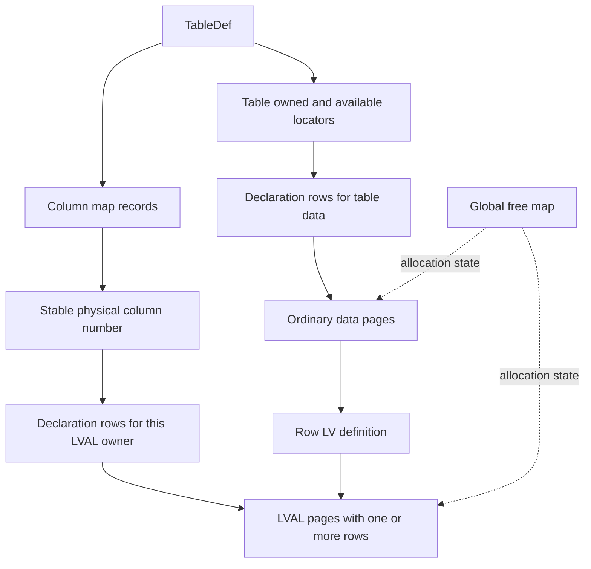

# II-04. Format, rows, long values and allocation

Revision 1 · Stage 2, response 3 · 2026-11-13

This chapter specifies the physical layer that turns a checked page image into a row, a field or a long value, and turns an accepted logical change into complete native page images and reference changes. **The preferred design is a compiled format description, raw-preserving row edits and an allocator that plans the complete map/reference change before publishing it.** Concrete Jet 4/ACE structures drive that design below. II-03 supplies page identity, pins, positioned I/O and phase-image execution; it does not decide what a field or allocation bit means.

**Requirement trace:** §§1–6 satisfy RQ-FMT-01/02/03 and the native Jet 4/ACE boundary in RQ-PROD-03; §§7–10 supply long values, allocation and RQ-STORE-03/RQ-PROD-05 preservation; §12 supplies RQ-PROD-04's normal-write interoperability and calibrated T-COMPACT-1 acceptance. RQ-TYPE-01 and RQ-VAL-01/03 use II-02's real platform VARIANT/BSTR boundary. RQ-STORE-01/02/04/05 use the existing transaction/crash design; RQ-LATE-01/03/04 retain codec, complex-value and rebuild hooks without making those later capabilities prerequisites for ordinary native writes. Front-end payloads remain readable and unexecuted under RQ-OUT-01/02. Full scope text is in I-16.

**Evidence boundary.** The numeric layouts are observations of permitted Jackcess material at commit `be0a2139b087a227d14cafd4ea231306a5a3a862`, with exact file hashes, inspected passages and licence-header checks in A-01. Microsoft documents support the separately identified API/type facts. All shown database bytes are constructed hypotheses, independently checked arithmetically; none is an ACE capture. The user-reported first oracle remains ACEDAO.DLL **16.0.20527.20016**. R-FMT-1/2 must confirm or change each proposed native profile on that build. The CalcDb pseudocode is original design, with no reference code port or adoption of Java coercion, damaged-file handling or write ordering.[^authority][^fmt]

## 1. One physical description, compiled for the actual schema

### 1.1 Rules and their evidence

**D-FMT-1 — Recommended. D-OPAQUE-1 — Recommended.** Retain one source of physical layout rules, but compile small checked readers and emitters for the selected file profile and schema. A DAO field access should use a bound column descriptor and a few loads, not interpret a general schema language. A raw-preserving writer needs the same coordinates as the reader; an inspector needs their explanation; a fuzzer needs both valid constructors and ways to violate particular constraints.

The description has four layers. `PageProfile` specifies envelopes and locators. `TableLayout` describes the logical TableDef stream, columns, map references and type-dependent metadata. `RowLayout` binds physical column positions to fixed offsets or variable-directory positions. `ValueCodec` describes an exact payload, with coercion performed separately by the shared semantic service. The selected profile carries an immutable identity; schema binding carries its own incarnation. Neither is inferred from a cached page's current contents after the binding was made.

| Rule member | Concrete use |
| --- | --- |
| `rule_id`, applicability and evidence | `jet4.row.column_count`, applicable to the admitted row family; reference pin plus native fixture/capture IDs and unresolved cases. |
| Location expression and width | Row count at `0`, width 2; mask size `(C+7)/8`; an LV locator is `u8 row` followed by `u24LE page`. |
| Byte order and interpretation | Unsigned little-endian structural counts; type-specific numeric sign and word order; Boolean value bit. |
| Bounds and dependencies | A variable index requires the stored V and trailer to exist; page kind alone does not establish LVAL ownership. |
| Reference role | TableDef continuation, data owner, map declaration, bitmap backing, overflow body, LV chunk or catalog link. |
| Existing-byte policy | Preserve exactly, patch an understood scalar, relocate only with a known reference rule, or retain at the same address. |
| New-byte policy | Qualified creator template and admitted form-selection rule; distinct from what an existing reader can accept. |
| Fault classification | Exact failed predicate and bounded location, supplied to the native error adapter; no accidental host exception or partial successful value. |

Descriptions generate offsets, checked span access and inspection labels. Handwritten systems routines implement bounded traversal, allocation and memory ownership using those generated rules. Avoid a descriptive language powerful enough to hide arbitrary callbacks, allocation or I/O inside a scalar location expression. Inspectors and failures print the rule ID, physical page/slot, logical field and descriptor identity, making a wrong offset reducible to a small fixture.

Validation is layered: memory-safe envelope checks; contextual row/type/reference checks; and an explicit whole-object/file audit. Agreement among generated reader, writer and validator establishes internal consistency only. Acceptance additionally needs independently produced ACE bytes, hand-calculated witnesses, behavioral comparison and the calibrated repair test. Malformed generators deliberately break one relationship—such as an EOD preceding a requested field—rather than merely feeding bytes from the same valid encoder back to its decoder.

### 1.2 Page families and a TableDef that crosses pages

The candidate family uses 4096-byte pages. The reference kinds are `00` database header, `01` data, `02` TableDef, `03` index interior, `04` index leaf and `05` usage bitmap. Kind `01` includes ordinary records, map-declaration rows and LVAL rows; their bodies require different descriptions. II-03 gives the byte-level page envelope and header transform. This chapter does not cast page bytes to native structs or assume that the host's packing, alignment or endianness matches them.[^fmt][^pagetypes]

Keep format generation separate from executable build. In the pinned detector, file-version bytes `01`, `02`, `03`, `05` and `06` select the Jet 4, ACE 2007, ACE 2010, ACE 2016 and ACE 2019 profiles respectively. Those are reference profile labels; an Office16 executable does not by itself select one. Unsupported signatures and feature combinations require explicit recognition before mutation; Jet 3 remains outside scope.[^fmt]

The inspected TableDef has its next-page number at page offset +4. A continuation contributes bytes `[8,4096)` to the logical definition stream; its first eight bytes are the continuation envelope. The first page retains its initial layout. Column definitions, names and following structures can therefore cross physical boundaries. The reference collects the stream into a larger buffer; CalcDb should use a bounded segment view while parsing, then allocate the small owned schema descriptors once. Repeated append-and-copy of the complete prefix would make a large TableDef unnecessarily quadratic.[^table]

For a two-page constructed TableDef on pages 9 and 52, logical byte 4100 maps to continuation offset `8+(4100−4096)=12`, hence file offset `52×4096+12 = 0x0003400C`. The logical continuation locator and every traversed page are checked against the opened extent and expected subtype. Track visited page numbers and charge both the maximum stream length and metadata budget. A nonzero next pointer is not permission to allocate an unbounded buffer. Unknown trailer blocks remain anchored to their logical and physical source ranges until their relocation rules are established. The second continuation starts at logical byte 8184, because each continuation adds 4088 rather than 4096 bytes.

The reference's TableDef coordinates include a row count at +16, an AutoNumber-related counter at +20, a table-type byte at +40, historical column and variable counts at +41/+43, active column count at +45, index counts at +47/+51 and ordinary table map locators at +55/+59. These fields have different widths and meanings; the full catalog/index interpretation belongs to II-06/II-05. In particular, the AutoNumber-related field is not a licence to invent a counter-consumption or rollback rule.[^fmt][^table]

### 1.3 Column coordinates


The row itself does not contain a type tag for every field. An authenticated table descriptor supplies the physical column number, storage class, fixed offset or variable-directory index, and scalar codec. API collection position and display order cannot substitute for any of those coordinates.

The inspected Jet 4 column-definition block is 25 bytes. The inspected ACE profiles inherit this layout, with profile-specific interpretation of the type-dependent region.

| Relative byte in column block | Encoding / meaning | Row use |
|---|---|---|
| +0 | u8 native type code | Select the scalar/storage codec. |
| +5–6 | u16LE physical column number | Select the row-mask bit. |
| +7–8 | u16LE variable-directory index | Select the variable field's start/end words. |
| +9–10 | u16LE distinct column ID | Preserve this identity separately; it is not the row-mask index. |
| +11–14 | Type/profile-dependent information | Numeric precision/scale, text sort information or the ACE complex-column ID use overlapping positions; do not give this region one universal meaning. |
| +15 | u8 flags | The reference's bit 0 is set for fixed storage and clear for variable storage. Preserve other bits and apply their admitted meanings. |
| +16 | u8 extended flags | Additional type/profile-dependent flags. |
| +21–22 | u16LE fixed-data offset | Offset relative to the fixed-data base, which is row byte +2. |
| +23–24 | u16LE declared column length | Length/capacity semantics depend on type; use the type's actual fixed size when reading a fixed scalar. |

The reference's table-definition header also distinguishes the historical maximum column count at +41, historical variable count at +43, and active column count at +45. Those are three different u16 fields. The reader sorts active physical columns and variable-directory indices separately; an API/display ordinal is a fourth coordinate. [^fmt][^col][^table]

The reference's 255 active-column limit and 255 data-page row-slot limit do not make the row's stored physical-column count an eight-bit field. The row count is a u16 and historical/deleted positions matter. Decode it unsigned into a wider integer, derive its mask length, and bound that length against the actual row extent. Do not impose C <= 255 as a memory-safety rule. Conversely, the two-byte encoding does not prove ACE accepts every value through 65535. Native semantic limits remain experimental.


## 2. The ordinary row envelope

**Figure F-23 — ordinary row regions and reversed directory.** Source-backed layout hypothesis, emitted as a Markdown table; not ACE-confirmed or render-verified.

For this profile, let L be the row-body byte length from the checked page slot, C its first u16LE, M = ceil(C/8), and V its stored variable-slot count when a variable trailer is present. The row's own C determines the mask width, including on an old row after schema changes.

| Increasing address | Contents |
|---|---|
| 0–1 | C, the physical-column count recorded in this row. |
| 2 onward | Fixed storage, placed by descriptor offsets; then variable field bodies. |
| After the actual variable payload | Optional padding needed to retain an existing row extent. |
| Beginning of the variable trailer | EOD u16LE: relative offset of the actual variable payload end. |
| Next words | Variable starts in reverse index order: start[V−1], …, start[0], each u16LE. |
| Immediately before the mask | V u16LE. |
| Final M bytes | Row mask, bit 0 of each byte describing the earlier physical column. |

A row with no variable slots has no EOD/starts/V trailer. It can still have padding immediately before its final mask. A current table with variable columns is not sufficient proof that an old row contains a variable trailer: that row can predate the first variable column.

For a non-Boolean fixed field, byte position = 2 + descriptor.fixedOffset, relative to the row start. Null fixed fields retain their fixed storage width in the inspected writer. A decoder returns Null from the mask without interpreting those bytes; it must not treat a cleared bit as permission to remove four bytes from a Long field and shift subsequent fields.

For ordinary fields, a set mask bit means non-Null and a clear bit means Null. For an ordinary, noncalculated Boolean field, the same bit holds the Boolean value itself; there is no ordinary scalar payload for that value. The reference maps a physically absent appended ordinary column to Null and an absent ordinary, noncalculated Boolean bit to False. The latter is a concrete reference behavior for the target oracle to confirm, not permission to invent a separate disk Boolean-null encoding. [^nullmask][^col][^table]

If a variable trailer is present, put T = L−M, the mask start. Its words are:

```text
V word                 at T−2
start[j] word          at T−4−2*j
end[j] word            at T−6−2*j
EOD word               at D = T−2*V−4
```

For the final variable field, end[j] is the EOD word. For earlier fields it is the next field's start. Equal adjacent offsets are legal for a zero-length field. The mask distinguishes Null from a non-Null empty Text/Binary field.

Do not require EOD == D. The reference captures EOD first, inserts padding, and only then emits the trailer. The valid relationship for the described layout is EOD <= D. Padding is outside field contents. [^table]

The inspected profile's ordinary-row writer limit is 4060 bytes. Its unrelated generic 1900 constant is not the Jet 4 row-envelope limit; nor is the 4076-byte long-value row capacity the ordinary row limit. Distinguish writer admission, valid native semantic limits, and the mandatory bounds check against the actual slot extent. [^fmt]


## 3. Two complete row bodies


### 3.1 Row A: fixed Long, Text, Boolean and Null Text

**Figure F-24 — complete 19-byte row A.** Constructed byte table; arithmetic checked, not an ACE capture or render-verified figure.

This is a 19-byte row-body fixture, not a complete database page. It uses deliberately uncompressed UTF-16LE Text bytes; a separate text codec profile decides when native compression is appropriate.

| Physical column | Value | Placement |
|---|---|---|
| 0, Id | Long 42 | Fixed offset 0, width 4. |
| 1, Name | Text “Hi” | Variable index 0. |
| 2, Flag | True | Mask bit only. |
| 3, Notes | Null Text | Variable index 1. |

```text
04 00 2A 00 00 00 48 00 69 00 0A 00 0A 00 06 00 02 00 07
```

| Row byte(s), decimal | Hex | Interpretation |
|---|---|---|
| 0–1 | 04 00 | C = 4, therefore M = 1. |
| 2–5 | 2A 00 00 00 | Signed little-endian Long 42. |
| 6–9 | 48 00 69 00 | Two UTF-16 code units, H and i. |
| 10–11 | 0A 00 | EOD = 10. |
| 12–13 | 0A 00 | start[1] = 10. |
| 14–15 | 06 00 | start[0] = 6. |
| 16–17 | 02 00 | V = 2. |
| 18 | 07 | Id non-Null, Name non-Null, Flag True, Notes Null. |

Here T = 18 and D = 18−4−4 = 10. Name's start word is at 18−4 = 14; its end word is at 12. The resulting slice [6,10) contains four bytes. Notes uses [10,10), but its cleared bit makes the result Null. Changing only the last byte from 07 to 0F makes Notes a non-Null empty Text under the fixture's schema. Changing 07 to 03 makes Flag False without changing the row's payload length.

A mutation to Name that leaves all lengths unchanged may permit a narrow private-image patch, but this fixture is not evidence for a native write width, flush boundary or crash guarantee. The complete mutation still obeys the qualified page/index/write program.


### 3.2 Row B: a deleted variable slot, an appended field and padding

**Figure F-25 — row B with a deleted position and pre-trailer padding.** Constructed byte table; arithmetic checked, not an ACE capture or render-verified figure.

Use the explicit schema evolution below. It illustrates known coordinates; it does not assert that every ACE DDL/repair path forever forbids ordinal reuse.

Delete Name, physical column 1 / variable index 0. Keep Id at physical 0, Flag at physical 2, and Notes at physical 3 / variable index 1. Add Tag at physical 4 / variable index 2. The new descriptor has historical C = 5 and V = 3 even though only four columns are active.

The original fixture A remains a row with C = 4, V = 2 and M = 1. A read of the appended Tag first checks physical 4 >= row C 4, then returns the absent ordinary-field result without reading a putative third variable offset. The old Name bytes remain part of the old raw row until an evidenced mutation rule authorizes replacing them. A display order such as Tag, Flag, Id, Notes does not alter these physical coordinates.

Construct a new row with Id = 42, Flag = False, Notes = “X”, and Tag = non-Null empty Text. Its deleted variable position 0 has zero-length storage. Use an explicitly chosen minimum extent of 24 bytes to demonstrate padding, with five zero padding bytes before the trailer.

```text
05 00 2A 00 00 00 58 00 00 00 00 00 00 08 00 08 00 06 00 06 00 03 00 19
```

| Row byte(s), decimal | Hex | Interpretation |
|---|---|---|
| 0–1 | 05 00 | C = 5, M = 1. |
| 2–5 | 2A 00 00 00 | Id 42. |
| 6–7 | 58 00 | Notes “X”. |
| 8–12 | 00 00 00 00 00 | Padding. |
| 13–14 | 08 00 | EOD = 8. |
| 15–16 | 08 00 | start[2] = 8, for Tag. |
| 17–18 | 06 00 | start[1] = 6, for Notes. |
| 19–20 | 06 00 | start[0] = 6, the deleted variable position. |
| 21–22 | 03 00 | V = 3. |
| 23 | 19 | Bits 0, 3 and 4 set; physical 1 is deleted and Flag's bit 2 is False. |

Now T = 23 and D = 23−6−4 = 13. EOD = 8 is smaller than D. The spans are slot 0 [6,6), Notes [6,8), and Tag [8,8). The last is non-Null because mask bit 4 is set. Padding [8,13) belongs to none of these fields.

Both records were independently constructed and checked for exact hex, mask, offset, text and padding arithmetic. This verifies the examples, not native compatibility.


## 4. Bounded decoding and private row encoding


### 4.1 A bounded field decoder

Use II-03's RowGuard and checked slot span. The guard retains the immutable final page image and the original logical row identity; a FieldBytes view borrows it. No host-struct casts or page-pointer escape across cursor movement are required.

The following is original systems pseudocode. It separates safety-required local validation from a diagnostic full-row traversal. Native corruption/error timing still belongs to R-FMT-1/2 and the DAO/ADO error harness.

```text
OpenRowEnvelope(guard, profile):
    body = guard.checked_body_span
    require body.length >= 2
    C = load_u16_le(body, 0), widened before arithmetic
    M = (C + 7) / 8, with integer division
    require M <= body.length - 2
    return borrow(body, C, mask_start = body.length - M, mask_size = M)

ReadFieldBytes(envelope, descriptor):
    require descriptor belongs to the guard's schema identity
    p = descriptor.physical_number
    require p is a validated nonnegative metadata coordinate

    present_bit = false
    if p < envelope.C:
        present_bit = test_bit(envelope.mask, p)

    if descriptor stores an ordinary Boolean in the mask:
        return Boolean(present_bit) through the selected native profile
    # Calculated Boolean follows ordinary presence and a wrapped payload.
    if not present_bit:
        return Null

    if descriptor uses fixed storage:
        begin = checked_add(2, descriptor.fixed_offset)
        end = checked_add(begin, descriptor.actual_storage_width)
        require 2 <= begin <= end <= known_payload_limit
        return FieldBytes(guard, begin, end)

    T = envelope.mask_start
    require T >= 2
    V = load_u16_le(body, T - 2)
    j = descriptor.variable_index
    require 0 <= j < V
    trailer_size = checked_add(4, checked_multiply(2, V))
    require trailer_size <= T - 2
    D = T - trailer_size
    EOD = load_u16_le(body, D)
    require 2 <= EOD <= D
    a = load_u16_le(body, T - 4 - 2*j)
    b = load_u16_le(body, T - 6 - 2*j)
    require known_fixed_end <= a <= b <= EOD
    return FieldBytes(guard, a, b)
```

The bound descriptor's storage width includes any admitted wrapper; it is not inferred from the public scalar width. If the variable directory has been validated, `known_payload_limit` for a fixed field is its first variable start, so fixed bytes cannot overlap variable data. For a local fixed-field read with no established trailer, the mandatory memory boundary is the mask start; that weaker check does not prove the whole row structurally valid. The schema compiler prepares a prefix of maximum fixed ends by physical coordinate; row binding selects the entry for C without rescanning all columns on every field access. `known_fixed_end` is computed from the two-byte header and every validated active fixed-storage interval with physical number below C, regardless of its Null bit. Ordinary mask-only Boolean consumes no such interval. Full validation and writer admission reject overlapping active fixed intervals unless a specifically evidenced alias rule permits them. Historical deleted fixed bytes can leave additional unexplained space; their absence from today's active descriptor does not authorize compacting that space away.

The mask check deliberately precedes every variable-directory lookup. It handles an old fixed-only row after a variable column is added without interpreting arbitrary fixed bytes as V. It also avoids reading nonexistent offsets for appended ordinary columns. An ordinary Boolean field follows its mask-specific branch before the ordinary Null branch.

For a concrete fixed-only witness, `01 00 2A 00 00 00 01` has C=1, four Long bytes and one mask byte: seven bytes total, with no variable trailer. After an ordinary variable field is appended at physical position 1, this old row still yields Long 42 and Null for the new field. It never reads its last two Long bytes as V.

Full row validation can additionally walk all V starts, require monotone boundaries within the admitted payload region, and account for every preserved or known region. It is useful before a full rewrite or as an explicit inspection operation. Whether an ordinary Field.Value should report another unused field's corruption eagerly is an observable native policy, not a reason to skip the local bounds that make each access safe.

There is no allocation proportional to untrusted C or V: the mask and field data are borrowed spans, and directory words are loaded on demand. A local scalar lookup costs O(1) word/bit loads after descriptor and row binding. Full directory validation costs O(V). Allocation for a BSTR/SAFEARRAY or an owned raw binary result belongs to II-02 and its budget. Reject checked arithmetic overflow, mask underflow, an index outside V, descending needed offsets, a field extending into the trailer, and a mismatched schema/image identity before publishing a value.

Do not require today's table maximum C to be greater than every old row's C in order to avoid an out-of-bounds read. The row extent bounds its own mask; the active descriptor chooses a tested physical coordinate. A stronger current/historical count relationship may be a qualified native invariant, but it is not established merely by the reference's field names.


### 4.2 Encoding without losing historical material

A new-row encoder consumes a validated storage layout, already coerced values, raw preservation spans where required, an admitted final extent, and a reservation owner. It returns privately owned row bytes and any long-value/reference dependencies; it does not issue VFS writes.

```text
PlanRow(layout, values, prior_row):
    validate physical coordinates, fixed widths and variable coordinates
    select the qualified new C/V and retained historical regions
    preflight every encoded length, mask and directory byte with checked math
    preserve or explicitly account for every prior byte range
    reserve row scratch and any long-value placement resources
    reject an extent exceeding the admitted ordinary-row writer profile
    return a side-effect-free plan

EncodeRow(plan):
    obtain exclusively owned private row storage
    emit C and fixed regions at their declared offsets
    build mask bits by physical number
    append variable bodies in storage-index order
    record zero-length starts for required deleted/gap positions
    remember EOD
    if plan.has_variable_trailer:
        emit required padding, then EOD, reversed starts and V
    else:
        emit only the required padding
    emit the mask
    verify the emitted length and all planned boundaries
    transfer row-image ownership and dependencies to the mutation planner
```

For an existing row, “re-encode the active columns” is not a sufficient preservation plan. It can lose historical fixed bytes, old variable bodies, unsupported field payloads, mask positions or padding with as-yet unknown native significance. A known fixed-width update can retain the complete old body and patch its admitted value/mask range; growth, type changes and schema changes need a qualified reconstruction or relocation rule. This is an evidence obligation for the full supported operation, not a permanent permission to leave initial-scope features unimplemented.

Unknown descriptor flags and opaque native fields survive a supported operation unless the experiment establishes a permitted change. Newly created bytes can follow an admitted creator template; that does not authorize normalizing existing bytes. All failures release unpublished scratch, borrowed guards and reservations under their owners, and leave the authoritative image and logical cursor state untouched until the transaction layer accepts the prepared mutation.


## 5. Scalar payloads and calculated-result wrappers


### 5.1 Native kinds and storage classes

The first column below is a **native table column type code**. DAO and ADO type enums, Automation `VARTYPE`, expression categories and the physical fixed/variable column flag are distinct namespaces. A NUMERIC field can have a constant 17-byte payload while occupying the row's variable-field area; an ordinary Boolean value can have a public Boolean type while occupying no ordinary field-body byte. AutoNumber and Hyperlink are metadata/behavioral distinctions layered over a stored scalar kind. [^datatype][^col]

The widths/codecs in this table describe ordinary noncalculated payloads. Section 5.6 can replace the inner codec, especially for Boolean, Money and NUMERIC, as well as adding a wrapper.

| Native code | Kind in pinned source | Payload / codec candidate | Qualification and preservation requirement |
| --- | --- | --- | --- |
| `01` | BOOLEAN | Ordinary Boolean: one value bit in the row's null-mask allocation; no ordinary payload byte | Bit 0/1 means False/True; calculated Boolean uses a wrapped payload byte instead (§5.6). Probe Null assignment behavior at the API; never infer that one bit can also represent Null. |
| `02` | BYTE | 1 byte, **unsigned** | Access documents 0–255. Java's signed `byte` return is a library representation choice. |
| `03` | INT | Signed 16-bit little-endian | Exact two's-complement representation. |
| `04` | LONG | Signed 32-bit little-endian | Same scalar payload under a Long AutoNumber column; generation/reservation is a separate operation. |
| `05` | MONEY | Signed 64-bit little-endian integer, scale 4 | Store the scaled integer exactly; rounding/coercion belongs to the evidenced value-conversion boundary. |
| `06` | FLOAT | 4 bytes, IEEE binary32 | Preserve bits when untouched; do not canonicalize signed zero or NaN payloads. Admission of nonfinite/special values remains a probe. |
| `07` | DOUBLE | 8 bytes, IEEE binary64 | Same distinction between bit preservation and native admission. |
| `08` | SHORT_DATE_TIME | 8 bytes, IEEE binary64 carrying Automation DATE-style day/time values | Preserve the original bits. Interpret negative fractions correctly; do not round to host milliseconds. |
| `09` | BINARY | Byte span; ordinary variable-field data | Descriptor supplies field limits and placement. Embedded zeros have no string meaning. Fixed placement needs its own evidence, discussed below. |
| `0A` | TEXT | Exact UTF-16 code units, either ordinary little-endian bytes or compressed representation | Null, empty and nonempty values differ; compressed marker/toggles are physical encoding. |
| `0B` | OLE | Binary long value | Decode its native long-value envelope, then preserve the payload, including any OLE wrapper. No activation or transcoding. |
| `0C` | MEMO | Text long value | Native long-value envelope plus the same text codec. Hyperlink metadata does not introduce another scalar row type. |
| `0F` | GUID | 16 bytes | First 4-, 2-, 2-byte components are little-endian; last 8 bytes retain byte order. |
| `10` | NUMERIC | 17 bytes: sign + four 32-bit magnitude words | Words are most-significant first; each word is little-endian. Scale and precision are descriptor fields. Constant payload length does not imply fixed row placement. |
| `11` | BIG_BINARY | Reference reports a 3992-byte internal binary kind | Preserve as opaque content when encountered; comments associate it with Jet 4 `MSysAccessObjects.Data`. Do not infer a general user-created scalar capability. |
| `12` | COMPLEX_TYPE | 4-byte reference value | This is part of complex-value storage, not an independently complete Long field implementation. Preserve and route through the complex capability seam. |
| `13` | BIG_INT | Signed 64-bit little-endian | Large Number; format/feature admission and DAO/ADO exposure are separate probes. |
| `14` | EXT_DATE_TIME | 42 ASCII bytes | Exact days, seconds and seven fractional decimal digits; see §5.5. Must remain in ordinary-type scope. |

Jackcess's `UNSUPPORTED_FIXEDLEN` (`FE`) and `UNSUPPORTED_VARLEN` (`FF`) are library fallback enum values; do **not** publish them as established Jet/ACE native type codes. A code's presence in this table also does not prove that every file-profile version admits it. [^datatype]

Microsoft's user-facing field-size documentation is useful for unsigned Byte and public ranges, but is not the row-layout authority: it describes Decimal as 12 bytes. The pinned physical reference uses a 17-byte NUMERIC payload. These are different layers, not reasons to alter the physical decoder. Microsoft also explicitly documents Large Number as an eight-byte signed integer with range −2^63 through 2^63−1. [^fieldsize][^large]


### 5.2 Exact-width numbers and raw preservation

For an ordinary field, first consult its row-mask state. An absent/null field does not become a numerical zero just because bytes at its fixed offset are zero. For an ordinary noncalculated Boolean, dispatch to the Boolean mask rule **before** applying the ordinary null rule: the same mask allocation stores its actual value. The pinned implementation's `storeInNullMask` and `readFromNullMask` establish that special case. §§2–4 supply the exact mask address and stored column-number mapping. [^col]

The checked reader accepts an already bounded `FieldSlice`, its immutable `ColumnDescriptor`, and its row-presence information. It does not accept a raw page pointer and recalculate row offsets itself. Proposed original control structure:

```text
read_native_field(column, row_mask, field_slice):
    if not column.is_calculated and column.native_kind == Boolean:
        return NativeBoolean(row_mask.value_bit(column.stored_number))

    if row_mask.is_null(column.stored_number):
        return NativeNull(with_original_storage_span_if_present)

    require field_slice lies wholly inside the validated row value area
    if column.is_calculated:
        return decode_calculated_field(column, field_slice)  // see §5.6
    codec = selected_format.codec_for(column.native_kind, column.flags)
    require codec admits this descriptor and this field length
    return codec.decode_exact(field_slice, column)
```

`NativeNull`, `NativeBoolean`, and the other labels above describe transient physical views, not a second shared value ABI. At the public boundary, II-02 projects through the real platform VARIANT/BSTR contract. On Windows x64 that VARIANT is 24 bytes.

The mask accessors include §4's bounded absent-column rule. `decode_calculated_field` receives the in-row slice and its retained source: for calculated Memo it first resolves the native long-value content and then unwraps that content; it does not unwrap the twelve-byte LV definition as though it were the calculated result.

For signed integers, read an unsigned little-endian word then interpret the exact width as two's complement; do not invoke implementation-defined unaligned loads or narrow a host integer before checking range. Byte alone is unsigned. For FLOAT/DOUBLE, load/store the raw integer bit pattern and reinterpret only for an operation that needs the mathematical value. Retain untouched field bytes through row relocation even when a value has also been materialized for an API caller.

Money's raw integer is a signed count of 1/10,000 units. Rescaling a requested replacement value, detecting overflow and determining tie rounding happen before emission, under the shared semantic service and native-oracle result. The fixed-width codec then serializes the already accepted integer. NUMERIC has a different representation and cannot be implemented by reusing the Currency codec.

#### Independently calculated little-endian examples

| Kind / value | Physical payload | Check |
| --- | --- | --- |
| Byte 255 | `FF` | Unsigned value 255, not −1. |
| Long −2 | `FE FF FF FF` | 32-bit two's complement. |
| Large Number −2^63 | `00 00 00 00 00 00 00 80` | Preserve all 64 bits. |
| Currency −12.3456 | `C0 1D FE FF FF FF FF FF` | Signed scaled integer −123456. |
| Single 1.5 | `00 00 C0 3F` | Bits `3FC00000`. |
| Double negative zero | `00 00 00 00 00 00 00 80` | Bitwise distinct from positive zero; identical bytes to the preceding integer example have a different descriptor. |

These examples were calculated with standard integer arithmetic and Python `struct`, independently of Jackcess and ACE. They validate the explanation's arithmetic, not ACE acceptance or mutation behavior.


### 5.3 Decimal: scale in metadata, magnitude in four words

Pinned source reads one sign byte and sixteen magnitude bytes. For little-endian row data it reverses the bytes **within each four-byte word**, then interprets the combined 16 bytes as an unsigned big-endian magnitude. Equivalently, the stored payload is:

| Byte offsets | Meaning |
| --- | --- |
| `0` | Sign; reference writer emits `00` positive and `80` negative |
| `1..4` | `w0`, most-significant 32-bit magnitude word, little-endian |
| `5..8` | `w1`, little-endian |
| `9..12` | `w2`, little-endian |
| `13..16` | `w3`, least-significant 32-bit magnitude word, little-endian |

The exact mathematical value is `sign × M × 10^(−scale)`, where `M = w0·2^96 + w1·2^64 + w2·2^32 + w3`. There is no scale byte in this 17-byte value. For an ordinary noncalculated NUMERIC column, pinned Jet 4/ACE descriptor constants put precision at descriptor offset 11 and scale at 12, with the type deciding the interpretation of those positions; text uses some of the same metadata area for sort information. Calculated columns are dispatched separately by the factory, and the descriptor writer explicitly omits numeric precision/scale there; a calculated wrapper needs its own recognition and evidence. [^col][^datatype][^fmt]

NUMERIC's reference descriptor bounds are precision 1–28 and scale 0–28. Validate the particular descriptor, the available bytes, the value's permitted decimal digit count and the accepted sign representation. The pinned reader treats any nonzero sign byte as negative, while the writer uses `80`. That asymmetry is **not** enough evidence to accept every sign byte as an ACE-native canonical encoding. Probe noncanonical sign bytes and negative zero as separate cases; untouched data stays bitwise intact. [^col][^datatype]

Original checked decoding/emission:

```text
decode_numeric(slice, column):
    require length(slice) == 17
    require descriptor_scale_and_precision_are_admitted(column)
    magnitude = 0 in a checked unsigned 128-bit container
    for each of the four consecutive 4-byte groups after the sign:
        magnitude = magnitude * 2^32 + read_u32_le(group)
    sign_class = admitted_numeric_sign(slice[0], selected_profile)
    require magnitude fits the column's evidenced precision rules
    return ExactDecimalView(magnitude, sign_class, column.scale,
                            original_bytes = slice)

emit_numeric(accepted_decimal, column):
    exact = semantic_service.rescale_and_validate(accepted_decimal, column)
    reserve exactly 17 bytes
    write canonical sign selected by the qualified native profile
    emit words of exact.magnitude from most to least significant,
        writing each word little-endian
```

Example at scale 2: −123.45 has magnitude 12345 (`3039`), hence:

```text
80 | 00 00 00 00 | 00 00 00 00 | 00 00 00 00 | 39 30 00 00
```

Example at scale 0, magnitude `1234567890123456789012345678`:

```text
00 | 00 00 00 00 | EB 35 FD 03 | 91 7A 79 6D | 4E F3 38 BE
     w0=00000000   w1=03FD35EB   w2=6D797A91   w3=BE38F34E
```

Both examples have exactly 17 bytes. All 28-digit magnitudes fit in the 96-bit magnitude of an Automation DECIMAL, but that mathematical observation is not a memory-layout identity. The native 17-byte payload cannot be copied over a COM DECIMAL, which has its own scale, sign and field layout.[^decimal] Descriptor-invalid magnitudes or unknown accepted extensions need explicit disposition rather than an unchecked narrowing cast.


### 5.4 Ordinary Date/Time and GUID

Ordinary Date/Time stores a Double-shaped quantity. Microsoft defines Automation DATE's day zero as 1899-12-30; the integral part is signed and the time of day is the **absolute value** of its fractional part. Therefore raw −1.25 means 1899-12-29 06:00, and raw −0.25 and +0.25 both describe 1899-12-30 06:00. Do not use floor for the day part, and do not sort or compare dates by casually assuming the raw floating-point order is chronological before the epoch. Native comparison and index semantics are II-05/II-10 probes. [^date][^col]

| Raw date value | Raw bytes | Civil interpretation under Automation DATE |
| --- | --- | --- |
| −1.25 | `00 00 00 00 00 00 F4 BF` | 1899-12-29 06:00 |
| −0.25 | `00 00 00 00 00 00 D0 BF` | 1899-12-30 06:00 |
| +0.25 | `00 00 00 00 00 00 D0 3F` | 1899-12-30 06:00 |

Pinned ColumnImpl already preserves original date bits in one read/write path to avoid conversion loss. Its Java date projections round to milliseconds; CalcDb must not import that rounding. An unchanged row keeps the original eight bytes, including distinctions lost by a particular caller projection. Treat these values as civil date/time data without adding a timezone or daylight-saving adjustment merely because a host date library offers one. [^col][^date]

For GUID, the canonical textual identifier `00112233-4455-6677-8899-aabbccddeeff` has the reference row payload:

```text
33 22 11 00 | 55 44 | 77 66 | 88 99 AA BB CC DD EE FF
```

Decode the first three numerical components by their specified widths and leave the final eight-byte sequence unchanged. GUID AutoNumber creation policy, string formatting, accepted input text and the public VARIANT/DAO/ADO projection are separate semantic observations; this physical mapping does not settle them. [^col]


### 5.5 Date/Time Extended: 42 bytes and 100 ns units

Pinned ColumnImpl supplies a concrete 42-byte reference layout:

| Offset / length | Encoding | Meaning |
| --- | --- | --- |
| `0 / 19` | ASCII decimal digits, zero-padded | Day count since 0001-01-01, with that date represented by 0 |
| `19 / 1` | `3A` | Colon separator |
| `20 / 12` | ASCII decimal digits, zero-padded | Whole seconds since midnight |
| `32 / 7` | ASCII decimal digits | Fraction of a second in units of 10^−7 seconds |
| `39 / 3` | `3A 37 00` | `:7` plus zero terminator |

There is no separator between the 12-digit second count and the 7-digit fraction. For 0001-01-02 01:02:03.1234567, the complete byte string is:

```text
0000000000000000001:0000000037231234567:7\0
```

Its length is 42; the visible `\0` denotes one zero byte, not two printed characters. The corresponding day/second/tick tuple is `(1, 3723, 1234567)`. The seven fractional digits represent **100-nanosecond increments**, by direct arithmetic. [^col]

Microsoft independently documents a 42-byte encoded string, the range 0001-01-01 through 9999-12-31 23:59:59.9999999, and seven fractional digits. Its same article calls the accuracy “1 nanosecond,” which conflicts with that decimal precision and the pinned layout; record this source inconsistency rather than promising single-nanosecond storage. Its input guidance says excess digits are rounded; the pinned source writer truncates nanoseconds to 100 ns. **CalcDb must measure the target's actual rounding for each public path.** [^extended]

The exact physical view should retain the day count, seconds, fraction and all 42 original bytes. A checked fresh-value decoder requires exact length, digits in the numeric runs, the evidenced separators/trailer, days in the admitted range, whole seconds below 86400 and fraction below 10^7. For the documented date range, the maximum day count is independently calculated as 3,652,058. Parse digits using checked arithmetic or range-bounded accumulation; a 19-digit field is not permission to overflow a machine integer. Alternate trailer scales, noncanonical padding and malformed values are explicit probes, not silently normalized on read.

Internally, conversion to a single count of 100 ns ticks is also possible with checked arithmetic; keeping the tuple makes the origin/range and precision visible. At a public boundary, use the actual observed DAO/ADO/provider exposure and the II-02 shared semantic service. An extended value must not travel through `Double`, ordinary `DATE`, or a millisecond timestamp as its only representation. If the exact Automation projection is unresolved, retain and inspect the native view while the **R-FMT-2 / I-FOUNDATION-1 / R-DAO-1** probe closes it; this is an integration task, not removal of the type from scope.


### 5.6 Calculated fields change the physical envelope and scalar dispatch

This is a normal descriptor-dependent native codec case, not a separate deferred row engine. Pinned `ColumnImpl` recognizes calculated columns with `(extFlags & 0xC0) != 0`, reads the named column's **ResultType property** when present, and resolves the effective kind from that property before dispatch. The property reader is consequently a narrow prerequisite for decoding those columns, not for all ordinary fields. Its writer records nominal length 39 for calculated fixed-result or scale/precision kinds; for calculated Text it adds 23 to the ordinary descriptor length. It does not enable Unicode compression there. These writer choices are reference facts to qualify, not fresh evidence from the selected ACE build. [^col]

The inspected `CalculatedColumnUtil.java` defines this wrapper around the stored result:

| Relative bytes | Reference structure | Safe treatment |
| --- | --- | --- |
| `0..15` | Prefix initialized to zero by the reference writer | Unknown semantic fields; preserve existing bytes. |
| `16..19` | Little-endian 32-bit payload length `N` | Check representable length and bounds before taking a payload view. |
| `20..19+N` | Actual result payload | Dispatch by the resolved result kind and calculated special cases. |
| `20+N..22+N` | Three trailing bytes initialized to zero by the writer | Preserve; semantic meaning not established by this source. |

The reference emitter uses total length `N+23`. Its reader permissively passes a value shorter than 20 bytes through as bare data and otherwise clamps the declared length to available bytes. CalcDb must not adopt that clamping as validation: record these candidate noncanonical forms in R-FMT-2 and select a bounded native-accepted grammar. Nominal descriptor length39 is not the actual encoded payload length for every calculated type. [^calc]

| Result kind | Reference codec inside/around the wrapper |
| --- | --- |
| Ordinary fixed scalar results | General calculated reader unwraps, then uses the scalar codec; an empty inner payload maps to Null for fixed kinds. Writer emits actual scalar width plus23. |
| Boolean | **Not stored as the row-mask value bit.** Reference payload is one byte: `FF` True, `00` False; wrapped sizes are24 bytes. Reader treats an empty payload as False and nonzero first byte as True. Row-null and noncanonical payload admission still require native probes. |
| Text | Wraps the encoded text; descriptor unit capacity subtracts23 before interpreting text length. |
| Memo | The wrapper is **inside the long-value content**: collect/stream the native LV payload and then unwrap. It is not wrapped around the row's LV locator/definition. |
| NUMERIC and other scale/precision kinds such as Money | A separate numeric payload with inline scale/sign; do not use the ordinary 17-byte codec or ordinary descriptor-scale rule. |

For calculated numeric payloads, the reference writer places a two-byte little-endian length equal to payload length minus2; then a scale byte, a sign byte (`00` or `80`), then magnitude bytes. Magnitude length is a multiple of4 up to16. Its order differs from ordinary NUMERIC: if the magnitude has an initial four-byte remainder before complete eight-byte groups, reverse that first four-byte group; reverse each following eight-byte group separately. The resulting group sequence is most-significant first. Thus a 12-byte magnitude consists of a most-significant little-endian32 word followed by a little-endian64 word. A 16-byte magnitude uses two little-endian64 words, most-significant first. [^calc]

Example calculated −123.45 with a 16-byte inner numeric payload:

```text
0E 00 | 02 | 80 | 00 00 00 00 | 39 30 00 00 00 00 00 00
length  scale sign   high32              low64
```

The inner payload is16 bytes; the outer wrapper records `10 00 00 00` at offset16 and totals39 bytes. This is independently constructed from the reference layout, not an ACE fixture. The source accepts length0 as an available-bytes fallback and rounds/clamps magnitude lengths; those reader tolerances need explicit probes rather than silent production normalization. A checked decoder validates both outer and inner lengths, admits the profile's supported magnitude widths and scales, retains unknown wrapper spans and projects the exact decimal through II-02. Recomputing and storing the calculated result uses the same row engine, transaction images and semantic evaluator as the rest of CalcDb; it does not permit raw copies of stale computed bytes after a dependency changes.

R-FMT-2 needs ordinary-versus-calculated Boolean, empty versus Null inner results, each numeric magnitude width, 4/8-byte ordering, scale carried in the payload, calculated Text/Memo envelope placement, altered unknown prefix/trailer bytes and a changed dependency followed by native recomputation. These tests establish the wrapper and codec mechanics; full expression semantics remain with their existing owners.


## 6. Text, Binary and OLE payloads


### 6.1 Text is a byte grammar

For the Jet 4/ACE Unicode profile, ordinary uncompressed text is a sequence of UTF-16LE code units of a known byte length. No terminal zero is needed. Compressed text begins `FF FE`, starts in a one-byte compressed mode and uses zero bytes to toggle between compressed and uncompressed segments. A compressed nonzero byte widens to a UTF-16 code unit in U+0001 through U+00FF. Pinned reference decoding handles mixed segments; its writer only generates wholly compressed strings when all units fit that range and compression saves space, otherwise it writes the uncompressed representation. [^col]

| Bytes | Reference interpretation / purpose |
| --- | --- |
| `FF FE 41 E9 42` | Compressed units `0041 00E9 0042`, “AéB”. |
| `FF FE 41 00 2D 4E 00 42` | Compressed “A”; toggle; UTF-16LE U+4E2D “中”; toggle; compressed “B”. |
| `41 00 00 00 42 00` | Ordinary uncompressed units `0041 0000 0042`: embedded zero is part of a three-unit string. |
| `41 00 3D D8 00 DE 42 00` | Ordinary uncompressed units for “A”, surrogate pair `D83D DE00`, “B”; preserve four UTF-16 units. |
| `41 00 00 D8 42 00` | Raw uncompressed units `0041 D800 0042`; retain the lone surrogate as a code unit for investigation. ACE admission/projection requires a probe. |

The last example does not claim that ACE will accept a newly written lone surrogate. It establishes why a borrowed byte span or exact BSTR cannot be replaced by a Unicode-scalar-only string type that silently substitutes U+FFFD. Null, an empty string, U+0000 and an embedded U+0000 are four distinct cases.

Two unresolved cases are particularly important. First, the pinned compressed decoder scans **every zero byte** as a toggle, including while in an uncompressed segment; a mixed segment whose UTF-16 payload itself contains a zero byte needs native evidence. Do not invent an escape sequence by analogy with another compression scheme. Second, raw uncompressed text beginning U+FEFF starts with `FF FE`, which collides with the compressed marker. Its native encoding choice must be captured. A blanket “fallback to UTF-16LE for everything else” writer is not complete until these cases are resolved. [^col]

The bounded decoder therefore has an explicitly selected grammar per qualified native profile. It performs a checked scan/count pass before allocating the destination BSTR; checks every segment boundary and even-length UTF-16 segment; and copies 16-bit units without Unicode normalization or replacement. On malformed/unknown encodings it retains the original bytes for validation/diagnosis and returns the established error disposition. It does not manufacture a successful DAO field value from a lossy string. The writer emits the qualified profile's canonical form for new/replaced text and preserves the old representation for untouched fields. Maximum units, compressed payload length and row-size limits are checked independently.


### 6.2 A concrete bounded text scanner

The following original scanner expresses the inspected zero-toggle candidate; it is enabled only for a profile whose corresponding grammar is qualified. `emit_unit` first counts or later writes an exact 16-bit unit, with checked capacity. A fragment source is a stable encoded field or LV stream, not a mutable cursor buffer. No UTF-16 normalization or Unicode-scalar validation is introduced by this scanner.

```text
ScanText(candidate_profile, encoded_stream, emit_unit, budget):
    prefix = peek at most two bytes without losing stream position
    if prefix is not FF FE:
        consume complete little-endian pairs, charging bounded input work
        emit each exact u16
        require no final unmatched byte
        return

    consume FF FE
    mode = compressed; pending_low_byte = none
    for each next byte b, charging bounded input work:
        if b == 00:
            require pending_low_byte is none
            mode = opposite(mode)
        else if mode == compressed:
            emit_unit(zero_extend_u8(b))
        else if pending_low_byte is none:
            pending_low_byte = b
        else:
            emit_unit(pending_low_byte + 256*b)
            pending_low_byte = none
    require pending_low_byte is none
    apply qualified terminal-mode and empty-segment rule
```

For the mixed example, mode changes occur at encoded offsets3 and6; bytes `2D 4E` form one wide unit. The state, pending byte and marker-prefix recognition survive an LV chunk boundary. A zero inside a purported wide unit is deliberately not assigned an invented escape meaning. R-FMT-2 must distinguish a forbidden sequence, a different native grammar and a reference-reader limitation before the production profile covers it.

For an owned BSTR result, run a bounded count/validation pass, reserve `2×units` payload bytes plus the real BSTR allocator's overhead, then emit from the same immutable bytes. With external LV data, either retain an admitted encoded spool or repeat the bounded traversal under the same view; measure the extra reads. Failure discards the unpublished result. An explicit chunk API can deliver earlier chunks only under its own evidenced partial-delivery contract. Fresh text encoding chooses among qualified forms after exact length/coercion checks; untouched text retains its original representation.


### 6.3 Binary and OLE preservation

For ordinary BINARY, the physical view is an exact byte span, including zero bytes. For OLE it is an exact long-value payload plus its native envelope and references. Bytes that happen to look like an OLE object header, executable document, image or string do not justify decoding, activating, reserializing or stripping that wrapper. Row relocation copies accepted bytes and updates only the separately understood references required by the move. Native chunking and allocation remain the long-value section's responsibility. [^col][^datatype]

**Reference inconsistency requiring care:** `ColumnImpl.read` returns bytes for BINARY/BIG_BINARY, and the variable-field writer also returns byte content; the pinned fixed writer groups BINARY/BIG_BINARY with COMPLEX_TYPE and emits an integer. That source behavior is not a reliable prescription for CalcDb's fixed-binary writer. Preserve existing opaque bytes and qualify creation/replacement from native descriptors and ACE-produced fixtures. This does not defer ordinary BINARY support or permit opaque rewrites that happen to pass a generic API coercion.


## 7. Long-value definitions, rows and traversal


### 7.1 Twelve-byte definitions

An ordinary row's variable field can contain a **long-value definition**; an external value's definition is twelve bytes. The eventual external LVAL row is a different structure from the ordinary table row and does not carry an ordinary row's column-count, variable-offset table or null mask. [^long]

| Offset in definition | Width | Interpretation in inspected source |
|---|---:|---|
| `+0` | 4 | Little-endian word: low 30 bits are encoded payload length; top two bits select storage form. |
| `+4` | 1 | External form's starting row number. Decode as an unsigned byte. |
| `+5` | 3 | External form's starting page number, unsigned little-endian. |
| `+8` | 4 | Opaque/write-stamp field. The reference writer emits zero; the reference reader does not use it to find the value. |
| `+12` | variable | Inline payload only. External definitions end at twelve bytes. |

The discriminant is `word & 0xC0000000`; the encoded length is `word & 0x3FFFFFFF`. The four-byte pointer is **row first, then the three page bytes**. It is not a little-endian 32-bit page number. For example, `02 34 12 00` means row 2 on page `0x1234`.

| Discriminant | First-word example for length 100 | Storage form | Contents of target external row |
|---|---|---|---|
| `0x80000000` | `64 00 00 80` | Inline | No external target; bytes begin at definition `+12`. Reference writer writes zeros in the following two four-byte fields. |
| `0x40000000` | `64 00 00 40` | One external row | Payload bytes alone; there is no four-byte next pointer in that row. |
| `0x00000000` | `64 00 00 00` | Chained external rows | Four-byte next locator followed by this chunk's payload. |
| `0xC0000000` | `64 00 00 C0` | Unrecognized by the inspected reader | Do not reinterpret as another form. Native malformed-input behavior needs its own oracle case. |

For calculated Memo (§5.6), the assembled LV payload includes the calculated-result wrapper, and its declared length includes those wrapper bytes.

The length counts **payload bytes only**. It excludes the twelve-byte definition and every four-byte chained-row locator. For Long Text this is the encoded byte count; it is not a BSTR code-unit count. Reassemble or stream encoded bytes through the text codec with state retained across chunk boundaries. A storage chunk need not end at a text-codec state boundary. [^long]

Do not turn reference **writer choices** into universal format rejection limits. For Jet4-family constants, the inspected writer chooses inline only when payload is at most 64 bytes **and** the enclosing row has room for twelve definition bytes plus that payload. Otherwise it chooses one external row for payload at most 4076 bytes, and chained rows for longer payloads. The 64-byte threshold is not evidence that every larger inline value is forbidden by ACE. Likewise, the reader must not reject a valid alternative partition of a chained value merely because this writer would choose fuller chunks. [^long][^fmt]

Preserve an existing definition's opaque bytes unless an evidenced mutation rule authorizes replacing them. Zero in a newly constructed reference fixture means exactly that; it does not establish an ACE checksum, commit stamp, transaction sequence or general reset rule.


### 7.2 LVAL pages and packed chunks

The inspected LVAL page uses the same basic slot envelope as a data page, with a literal tag in the position that an ordinary table-data page uses for ownership information. [^long][^table][^fmt]

| Page offset | Width | LVAL-page field in the reference creator |
|---|---:|---|
| `0x0000` | 1 | Data page kind `01`. |
| `0x0001` | 1 | Creator emits `01`; preserve/profile this byte instead of making it a universal unchecked constant. |
| `0x0002` | 2 | Little-endian free-space counter. New page starts at `4096 − 14 = 4082`. |
| `0x0004` | 4 | Literal bytes `4C 56 41 4C`, ASCII `LVAL`. |
| `0x0008` | 4 | Opaque/write-stamp word; creator emits zero. |
| `0x000C` | 2 | Little-endian row/slot count. |
| `0x000E` onward | 2 per slot | Slot offset words, with the established offset/flag interpretation. |
| From page end downward | variable | Packed rows. Each row may contain one entire external value or one chained chunk. |

For the Jet4-family reference profile, the maximum external LV row size is **4076 bytes**. A full chained row therefore carries **4072 payload bytes** after its four-byte next locator. One slot costs another two bytes. A page can have several shorter LV rows; its byte counter and slot-count limit are separate admission checks. The reference `rowFitsOnDataPage` tests `row_length + 2 <= free_space` and `slot_count < 255`. The table-row limit of 4060 bytes is a different constant. [^fmt][^table]

In a fresh 4096-byte LVAL page, a 4076-byte row begins at `4096 − 4076 = 20 = 0x0014`. The first slot ends at byte 16. Four bytes remain between the slot directory and row body. The free counter is therefore `4082 − 4076 − 2 = 4`, even though the row already occupies the largest size this reference writer will emit.

Neither a set available-space bit nor a positive free-byte counter proves that a requested row fits. Check the complete validated page image, the slot limit, row envelope and the applicable native packing rule. A slot with deleted flags is not automatically a reusable hole: an overflow target can intentionally carry a deleted bit while remaining live through a root-row pointer.


### 7.3 Constructed long-value fixtures

These are reproducible layout hypotheses supported by the pinned source, **not ACE observations**. All arithmetic and the exact displayed bytes were checked with a separate small Python fixture builder. They are suitable starting inputs to R-FMT-2 and later byte-inspector tests.

#### 7.3.1 Inline three-byte binary value

The fifteen-byte ordinary-row field is:

```text
03 00 00 80  00 00 00 00  00 00 00 00  41 00 42
```

The encoded length is three; the payload is the binary sequence `41 00 42`. It is not three bytes of a null-terminated string. Null versus an empty/non-null long value belongs to the enclosing row and column semantics; this fixture deliberately uses a nonempty binary value to avoid pretending that the zero-length edge case has been settled.

#### 7.3.2 One external row containing 100 bytes

The definition points to row 0 on page 70 (`0x46`):

```text
64 00 00 40  00 46 00 00  00 00 00 00
```

If that page contains only this 100-byte row, its first sixteen bytes are:

```text
01 01 8C 0F  4C 56 41 4C  00 00 00 00  01 00 9C 0F
```

The row begins at `0x0F9C = 3996`; the free counter is `0x0F8C = 3980`. The row's bytes are all payload: interpreting its first four bytes as a next locator would silently discard part of this value.

#### 7.3.3 Two chunks containing 4080 payload bytes

**Figure F-26 — a 4080-byte value in two LVAL rows.** Constructed page/row layout table; arithmetic checked, not an ACE capture or render-verified figure.

The twelve-byte definition points to row 0 on page 80 (`0x50`):

```text
F0 0F 00 00  00 50 00 00  00 00 00 00
```

`0x0FF0 = 4080`; the high flag bits are zero, selecting a chain.

| Item | Page 80 | Page 81 |
|---|---|---|
| File offset | `0x00050000` | `0x00051000` |
| Row number | 0 | 0 |
| Physical row extent | `[0x0014, 0x1000)` | `[0x0FF4, 0x1000)` |
| Row size | 4076 | 12 |
| Next locator | `00 51 00 00` = row 0, page 81 | `00 00 00 00` = terminal locator emitted by reference writer |
| Payload extent | `[0x0018, 0x1000)` | `[0x0FF8, 0x1000)` |
| Payload size | 4072 | 8 |
| Payload recipe | Byte `i` is `i mod 256`, for `0 <= i < 4072` | `41 42 43 44 45 46 47 48` |

First sixteen bytes of page 80:

```text
01 01 04 00  4C 56 41 4C  00 00 00 00  01 00 14 00
```

First sixteen bytes of page 81:

```text
01 01 E4 0F  4C 56 41 4C  00 00 00 00  01 00 F4 0F
```

The complete twelve-byte row on page 81 is:

```text
00 00 00 00  41 42 43 44 45 46 47 48
```

The payload count is `4072 + 8 = 4080`; physical external-row bytes are `4076 + 12 = 4088`. Adding the two next locators to the declared length would be a codec error. The sixteen-byte headers include one two-byte slot apiece, so the free counters are 4 and 4068 respectively.

One external value does not necessarily own each of its containing pages exclusively. For a short tail, the reference writer may pack other rows into the same LVAL page. Reclaiming an old value therefore starts from its exact `(page, row)` chain and the applicable native ownership evidence, never from “all these pages belong only to this value.”


### 7.4 Bounded long-value traversal

The inspected reader is permissive in ways that are **not a CalcDb policy specification**. It sizes its result from the definition, walks a chain while bytes remain, clips a final oversized chunk to the remaining count, and shortens some inconsistent inline/single values with a warning. Its loop does not establish a cycle/hop bound. It terminates by the declared byte count rather than insisting on a zero next locator. These facts are useful malformed-input probes, not behaviors to adopt without ACE evidence. [^long]

The healthy-value path should first produce a validated `LongValuePlan` without allocating the declared length. That plan carries the form, encoded byte count, starting locator or inline slice, source view identity, owning column/format descriptor and preserved opaque fields. It is invalid to allocate nearly 1 GiB merely because the low 30 length bits permit that integer.

Original design pseudocode:

```text
InspectLongValue(field, column, view):
    require field belongs to the already bounded ordinary-row field extent
    require at least the selected profile's 12 definition bytes
    raw = load_u32_le(field, 0)
    kind = raw & 0xC0000000
    length = raw & 0x3FFFFFFF
    reserve metadata/work budget; do not allocate length bytes here

    if kind == INLINE:
        require checked range [12, 12 + length) lies in field
        classify any extra bytes using the selected format policy
        return InlinePlan(retain field's immutable owner/lease,
                          view, field[12:12+length], opaque_definition_fields)

    require kind is SINGLE or CHAIN
    require external-definition extent is valid under the selected profile
    first = (load_u24_le(field, 5), load_u8(field, 4))
    validate first locator in the external-value context
    return ExternalPlan(kind, length, first, retained column/view owner,
                        copied opaque_fields)
```

The walker consumes one pinned row at a time and distinguishes a format contradiction, a resource limit and an I/O failure. It must not turn any of those into a shorter successful value.

```text
VisitExternalValue(plan, sink, operation_budget):
    remaining = plan.encoded_length
    locator = plan.first
    seen = budgeted set of (page, row)

    repeat according to the plan's form and zero-length policy:
        require locator not already in seen; add locator to seen
        charge one page/row visit and checked work against operation_budget
        with owned pin = load exact immutable page for (plan.view, locator.page):
            # Scope releases the pin on every success, error and cancellation.
            validate LVAL subtype, page bounds, slot bounds and contextual flags
            row = validated extent for locator.row
            if plan.kind == SINGLE:
                payload = row
                next = none
            else:
                require row length >= 4
                next = copy locator from row[0:4] while pin is held
                payload = row[4:]

            classify payload length against remaining under the selected profile
            reject or report unresolved damaged-value policy; no silent truncation
            require progress for every nonterminal continuation
            next_remaining = remaining - admitted payload length
            if next_remaining == 0:
                validate the qualified terminal shape while row bytes are held
            sink consumes admitted payload without retaining a borrowed slice
            remaining = next_remaining
            if remaining == 0:
                return successful completion
        require CHAIN and a valid nonterminal next locator
        locator = next
```

“Terminal-shape rule” is deliberately profile evidence. The reference writer emits a zero locator, but its reader ignores a nonzero locator after satisfying the declared length. Until R-FMT-2 settles the accepted shapes and ACE error surface, the implementation must preserve that distinction. It must not follow unrelated bytes beyond the declared value just to find a zero marker. Similarly, a terminal pointer before enough payload has been consumed is an early-termination contradiction; there is no implicit zero filling.

Cycle detection keys include the row number because several chunks may share a page. A page-only visited set would reject a legitimate different row on a previously visited page. Bounds include the current opened extent, permitted page-number range, slot count, physical row bounds, chunk size policy and total checked arithmetic. A hard safety budget must produce its explicit resource outcome; it must not label every large healthy value corrupt. The positive-payload rule supplies a length-derived bound for the ordinary healthy chain, while explicit cycle detection covers malformed cycles before they exhaust a generous byte count.

The result boundary chooses either a completely admitted owned result or an explicit streaming interface with stated partial-delivery/error behavior. A BSTR pointer, `VARIANT`, recordset field or callback cannot retain a raw span into an evictable page. Long Text decoding retains compression and code-unit state across visits. Memory admission and result ownership are independent of native on-disk chunk boundaries.


## 8. Overflow, deletion and logical row identity

The inspected table implementation distinguishes the row's stable **header/root locator** from its **final data locator**. A root with its overflow bit set contains a four-byte `(u8 row, u24LE page)` locator. The root's entire physical extent can be larger than four bytes; only the leading locator is required to follow it. [^table]

The slot flags are not a context-free row-state enum. With `OFFSET_MASK=0x1FFF`, `DELETED=0x8000` and `OVERFLOW=0x4000`:

| Context | Deleted bit | Overflow bit | Inspected interpretation |
|---|---:|---:|---|
| Root encountered by normal table scan | 0 | 0 | Ordinary visible row. |
| Root encountered by normal table scan | 0 | 1 | Visible logical row; follow its locator. |
| Root encountered by normal table scan | 1 | either | Deleted root; do not yield a logical row. |
| Target reached from a validated live overflow root | 1 | 0 | Can be live final row data; deleted flag suppresses an independent scan result. |
| Target reached from a validated live overflow root | either | 1 | Another overflow locator, subject to bounds and cycle checks. |

The reference growing update writes a replacement row into a new slot, marks that target slot deleted, writes its locator into the original root and sets the root overflow flag. An in-place update is used when the existing final-row extent suffices; serialization is given a minimum of the old row size. If a previously overflowed row grows again, the original root can be redirected to a new target. A target may share the root's physical page, so planning separate stale page copies would lose one of the edits. [^table]

For illustration, a target row beginning at `0x0FA0` has slot word `0x8FA0` (`A0 8F`) when marked as an overflow target. Those two bytes alone do not make its payload garbage. A live root at `0x0FE0` with word `0x4FE0` (`E0 4F`) may contain locator `02 21 00 00`, meaning slot 2 on page 33. A normal scan skips the target but resolves the root to it. These are constructed flag/locator bytes, not a complete table-row fixture.

The reference delete function sets **both** deleted and overflow bits on the original root, removes index entries and updates the row count. It does not, in that inspected path, reclaim all overflow or long-value bodies. That is evidence that deletion must not be equated with immediate native reclamation; it is not proof of ACE's retention policy. The reference writer also zeroes the rest of the old root extent when turning it into an overflow stub. Neither this clearing policy nor the source's lack of reclamation should be silently inherited. R-FMT-2 must determine native update/delete/slot-reuse behavior and the bytes to preserve.

For CalcDb, enumerate and preserve the old row/overflow/LV graph under its immutable view before overwriting any root or target that is still needed for rollback, existing readers or pending loads. Page reuse changes physical incarnation. A chain retained as bare page numbers would otherwise reopen a different value after reuse. Reclamation needs the old immutable payload to have independent backing where its lifetime outlasts the native bytes; retaining only a descriptor is insufficient.


## 9. Native maps, allocation and retirement


### 9.1 Map roles and the owner of an LVAL page

The source presents three different meanings for a set membership bit. A generic untyped `usedPages` abstraction is insufficient. [^maps][^table][^long][^channel]

| Role | Meaning of set membership | What it does not establish |
|---|---|---|
| Global allocation/free map | Page is free in the reference allocation convention. Allocation removes the bit; deallocation adds it. | That the page is safe to use without the relevant native graph, reserved-page and unknown-content rules. |
| Object ownership map | Page belongs to the identified table-data, index or long-value-column owner. | That every row on a page belongs to one value, or that an enumeration from one object covers every native owner. |
| Available-space map | An owned page is a candidate for a further row/chunk. | That this particular row fits, that a deleted target is reusable, or that the page is globally free. |

#### Native column-map metadata


**Figure F-27 — table and column ownership paths.** Native-reference hypotheses and the required ownership distinction; Mermaid source emitted, not render-verified.



The ownership paths summarize positive membership; the dotted global paths mean allocation-state lookup, where a live allocated page has its free bit clear. Row-reference edges mean reachability. An actual map declaration can use inline bits or referenced bitmap pages.


In the pinned `TableImpl` constructor, ordinary table owned/free maps are read from their fixed TableDef locations first. Column definitions and index definitions follow. The parser then consumes column-usage-map records until its sentinel. A record is a two-byte column number plus two four-byte UsageMap locators, each physically a row byte followed by a three-byte page number. It matches the stable column number and calls `col.setUsageMaps(owned, available)`. This is distinct from assuming that every page is in the ordinary table's two maps. [^table][^maps]

The table creator explicitly reserves two table maps, one map per physical index and **two per long-value column**. It creates the latter as inline maps and arranges each pair on the same map-declaration data page. That pairing is an inspected creator choice. Existing-data parsing should follow the descriptors rather than infer adjacency or a fixed row number. [^table]

In the pinned `LongValueColumnImpl`:

1. `setUsageMaps` unconditionally installs `UmapLongValueBufferHolder`.
2. `postTableLoadInit` installs `LegacyLongValueBufferHolder` only if no holder has been assigned.
3. The map-aware holder consults that column's owned/available maps. A new LVAL page is added to both. Discarding a current candidate removes it from that available map; it does not globally free the page.
4. The legacy holder uses a table-shared extra-page buffer. Its own source comment describes behavior dating from before column maps were understood. It is **reference bookkeeping fallback**, not native proof that a long value belongs to the ordinary table data-owned map.

There is a revealing pinned/live discrepancy. Pinned `TableImpl.readColumnUsageMaps` catches certain invalid map descriptors, resets both map objects to null and still calls `setUsageMaps`; the pinned LV setter has no null guard. A newer live xref setter has an added fallback. This research does not substitute that newer logic or label either recovery policy correct for ACE. CalcDb must not derive a safe writer path from missing or invalid ownership descriptors.

II-03 F-22 now identifies bitmap 40 as the applicable validated LVAL ownership map for its constructed example. Missing/invalid ownership descriptors do not select an implicit ordinary-table owner.


For an owner whose native map roles have been validated, preflight checks `Available(owner) ⊆ Owned(owner)` and checks that a selected existing owned page is not globally free. A contradiction is an inconsistent fixture or unresolved native rule, never permission to repair bits automatically. These local checks do not pretend that one map provides a complete census of every native owner.

### 9.2 Inline rebase, reference promotion and bitmap allocation

An inline map has type byte `00`, a little-endian four-byte base page at `+1`, then low-bit-first membership bits at `+5`. The represented capacity is derived from the **actual declaration-row extent**: `(row_length − 5) × 8`. The Jet4 creator uses 64 bitmap bytes, making a 69-byte declaration and a 512-page window. A reference declaration has type byte `01` followed by little-endian four-byte bitmap-page numbers at `+1`; its capacity is derived from `floor((row_length − 1) / 4)`. [^maps][^fmt]

A bitmap page is kind `05`; the creator emits `05 01 00 00`, and bits begin at byte 4. Thus one 4096-byte bitmap covers `(4096 − 4) × 8 = 32736` database page numbers. A 69-byte reference declaration holds 17 pointers, representing 556512 pages. This arithmetic is a bitmap representation capacity, not permission to exceed the selected format's file-size limit.

For page number `p`, a reference map selects pointer index `p / 32736`; inside that bitmap, bit position is `p % 32736`, byte offset `4 + floor(bit / 8)`, mask `1 << (bit % 8)`. For an inline map use `p − base` instead. Object and global maps must retain separate missing-block/implicit-bit semantics. In the reference, absent object blocks mean no members, whereas newly created global blocks are initialized with free bits set. A zero pointer is not permission to read page zero.

#### Inline rebase

Start with a 69-byte object map, base 0, whose only members are 400 and 410. Adding page 600 falls outside its `[0,512)` window, but the three actual members fit inside a new window beginning at 400. The reference aligns a new start down to a multiple of eight; 400 already meets that condition.

| Declaration-relative offset | Before | After | Meaning |
|---|---|---|---|
| `+0` | `00` | `00` | Remains inline. |
| `+1..4` | `00 00 00 00` | `90 01 00 00` | Base 0 becomes base 400. |
| `+55` | `01` | `00` | Old encoding of page 400 is removed. |
| `+56` | `04` | `00` | Old encoding of page 410 is removed. |
| `+5` | `00` | `01` | New relative bit 0 encodes page 400. |
| `+6` | `00` | `04` | New relative bit 10 encodes page 410. |
| `+30` | `00` | `01` | New relative bit 200 encodes page 600. |

All other bytes in this constructed bitmap are zero. The membership transform is exact: `{400,410}` becomes `{400,410,600}`. A shift of the base without relocating the bitset would silently change page ownership.

The inspected source uses a strict `< capacity` condition for fitting a newly based window, even though the representation itself has the calculated number of bits. Do not promote that conservative source boundary into an ACE format rule. Test both exact-capacity endpoints and one past them.

#### Promotion to bitmap pages

Members 8 and 700 cannot share a 512-page window. A reference declaration can point to one bitmap page covering both. If that bitmap is page 90, declaration bytes `+0..4` are `01 5A 00 00 00`. Bitmap byte 5 has bit 0 set for page 8; bitmap byte `4 + floor(700/8) = 91 = 0x5B` has mask `0x10` set for page 700. Both memberships still require an admitted owner role and complete native map metadata; this byte example does not establish ownership of an arbitrary reserved page.

CalcDb's complete private replacement image must preserve every old member while changing the encoding. Do not adopt the reference's intermediate “clear declaration, write type, then re-add members” disk sequence merely because that writer uses it; emit any such intermediate images only if the native operation/crash evidence qualifies them. Publication order follows the qualified native write program, and bitmap backing must be initialized before an incoming reference is published unless an evidenced native protocol establishes a different safe phase.

#### Global-map growth and its own allocation

The global map cannot use the object map's movable-window reasoning indiscriminately. The pinned source keeps the global inline map anchored at zero. Its global promotion marks all pages through the current append frontier used and explicitly admits losing previously freed holes. Pinned `PageChannel.allocateNewPage` appends a page instead of searching for reusable holes. These are reference writer policies, **not ACE native-allocation requirements**. CalcDb must preserve the actual native free-set representation unless R-FMT-2 establishes a required native transition that changes it.

Allocation of a map bitmap creates a real dependency: that bitmap page itself must be marked allocated in the global map, possibly requiring another bitmap. The reference handles this through deferred pending allocation. The CalcDb proposal is to solve the finite reservation closure in private state before native publication.

**Figure F-28 — map growth includes the bitmap itself.** Constructed allocation dependency table; not an ACE write trace or render-verified figure.

For example, suppose a 512-page file has an inline global declaration, with page 37 known free and all other in-file pages used. The operation reserves appended payload page 512 and a new global bitmap page 513. The new reference declaration's pointer is `01 02 00 00` (little-endian 513). The initialized bitmap retains page 37 free and marks pages 512 and 513 used. Its own page cannot still look free merely because it was allocated while expanding the map. Bits beyond the current extent follow the evidenced global-map convention but are never handed out as existing pages without a corresponding initialized extent operation. This is an original constructed planning example, not an observed ACE growth schedule.


| Prepared object | Exact role in the example | Publication dependency to qualify |
| --- | --- | --- |
| Payload page512 | Newly initialized owner-specific page | Do not publish its incoming live reference before its initialized image and allocation/owner state. |
| Global bitmap page513 | Kind05; page37 remains free, pages512/513 are used | Initialize it before the declaration points to it; include its own allocation in the prepared bitmap. |
| Global declaration row | Type01; pointer bytes `01 02 00 00` identify bitmap513 | Replace the old inline representation with the complete native reference form. |
| Applicable owner/available maps | Membership for payload512 and any other required structures | Compose aliases on shared physical pages; retain required intermediate phases. |

The example intentionally requests append placement to exercise map growth while retaining a hole. It does not prescribe an append-only allocator.


Original design pseudocode:

```text
PlanAllocation(owner, requested_rows, view):
    candidates = validated owned-and-available pages for this owner and view
    verify each candidate page and fit; availability alone does not authorize use
    reserve selected free/new pages in one private allocation namespace
    pending_map_updates = memberships required by all reserved pages

    while pending_map_updates require new native map storage:
        charge bounded metadata/work budget
        reserve each needed bitmap/declaration page exactly once
        add those pages' own allocation effects to pending_map_updates
        reject impossible capacity/size/ownership cases before publication

    construct complete page, map and reference images
    prove old memberships preserved except explicit requested deltas
    build physical-page phase graph, merging multiple edits to the same page
    return immutable reservation plan and qualified publication requirements
```

Reservation is not early publication. A graph cycle involving ownership or a shared physical page is resolved by the actual native operation protocol and crash experiment, not by recursively calling an allocator until it happens to stop.


### 9.3 Reuse, reclamation and preservation

For an existing page, a free global bit and a kind byte are not sufficient evidence that every prior reference is gone. An allocator needs the selected profile's valid native free-state, reserved-page exclusions and the supported object's reachable graph. Unknown/catalog/front-end objects and unsupported native relationships keep their storage protected. A blanket scan that understands only table rows and indexes cannot prove the rest unreachable.

Three transitions deserve separate fixtures:

| Transition | Native effects to establish | Incorrect shortcut |
|---|---|---|
| Add row/chunk to owned page | Slot, body, byte counter and possibly available-space membership; ownership stays with same object. | Mark the whole page newly allocated or globally free because availability changed. |
| Allocate new owner page | Global allocated state, complete page contents, applicable owner-map membership, available-space membership and incoming logical reference. | Publish an LV descriptor before its target or owner exists. |
| Retire last live content on page | Remove every relevant incoming native reference; retain required immutable old images; apply evidenced owner/global/page-header transition; establish reuse timing. | Free each page encountered while deleting one value, even though another row/chunk or snapshot still needs it. |

The inspected `PageChannel.deallocatePage` overwrites only its invalid-header prefix and adds the global free bit; it does not wipe the entire page. Existing payload remnants are therefore not evidence that the page is live, and zeroing the rest is not automatically a compatibility-preserving change. Conversely, source append-only behavior does not remove page reuse from CalcDb's full implementation scope. Measure ACE reuse, tombstone behavior, page/slot retention, tail truncation and repair effects in R-FMT-2; qualify persistence cuts with R-CRASH-1/2.

The provisional CalcDb direction remains I-08's prepared mutation: retain old images, initialize new storage, publish evidenced native allocation/ownership before reachability, then retire old references/storage according to the qualified phase graph. This section supplies the graph's concrete vertices—LVAL descriptors and chunk rows, overflow roots and targets, declaration rows, bitmap pages and owner/free-space bits—without claiming that Jackcess's file-write order specifies ACE crash behavior.


## 10. Preparing a native mutation without discarding unknown content

### 10.1 Patch, reconstruct or relocate according to what is known

An update begins with a `RowEdit` tied to the logical root identity and immutable old row image. It records changed fields, already evaluated replacement values and any effects already consumed, such as an AutoNumber reservation. The physical encoder never evaluates VBA, repeats a conversion callback or invents a different error order to obtain a convenient size. It can estimate lengths only after the corresponding public semantics permit that evaluation. The Workspace coordinator remains responsible for statement frames and their failure disposition.

Use three preparation paths. For an evidenced same-width change, clone the old image privately and patch only the known payload/mask ranges. For a change whose complete row layout is understood, rebuild a private row while carrying raw bytes for every untouched field and each protected gap. For growth that cannot fit the existing row extent, prepare a new final row and the native overflow/root transition. Choosing the third path is not permission to move arbitrary opaque bytes: the preservation obligations apply to the moved body as well.

| Retained material | Representation in the mutation plan | Permitted treatment |
| --- | --- | --- |
| Untouched understood field | Raw field span plus descriptor, even if a public value has also been read | Copy the original bytes; do not regenerate through a narrower public projection. |
| Historical fixed/variable material | Physical column coordinates, raw ranges and evidenced DDL/rewrite rule | Retain until an applicable rule authorizes reclamation or relocation. |
| Unknown bytes at a known position | `OpaqueSpan` with original address and relocation policy | Patch elsewhere while keeping the protected range identical. |
| Unknown payload with known container references | Raw payload plus the understood reference sites and ownership edges | Move only if every relevant reference can be updated under the evidenced rule. |
| Unknown reference-bearing block | Anchored block with unresolved outgoing/incoming reference constraint | Keep its location; refuse a mutation that would invalidate that constraint. |
| Native free space | Region admitted by the selected allocation/slot rule | Reuse only under that rule; zeros or lack of a known reference do not establish it. |

These policies satisfy **RQ-STORE-03 and RQ-PROD-05**. Front-end objects, properties, OLE wrappers and unsupported complex/encrypted content are never reconstructed from the subset the engine understands. A complete graph of known table/index references is not a complete graph of all native references. Mark the boundary of understanding explicitly. If a supported operation still requires an unresolved move, its refusal is a visible compatibility shortfall to close through R-PRESERVE-1, not a successful implementation of that operation.

The reports' preflight, stable-generation and evidence ideas support this choice, as concept input only. No whole-file replacement or private WAL is introduced. The real file's page and reference transitions remain authoritative.[^concepts]

### 10.2 Original mutation-planning algorithm

Inputs are the bound schema, a stable read view, a logical edit with semantic effects already resolved, and the admitted native writer profile. The output is an owned, immutable `MutationPlan`; it contains page images, dependencies and exact preservation claims, not merely a bag of dirty pages.

```text
PrepareNativeEdit(edit, schema, view, budget):
    bind root and final row identities under view
    retain the old row, relevant indexes and old LV reference graph
    capture descriptor/image/allocation dependencies

    for each changed field in the established semantic order:
        take its already accepted value; do not call user code again
        plan exact native bytes and any LV placement
    retain original bytes for untouched fields and protected spans

    choose admitted in-place, reconstruction or overflow form
    reserve row and map storage to a finite metadata closure
    plan required index removals/additions and native catalog/count changes
    compose all edits by physical page AND required phase
    reserve writer scratch and retained old-image backing before freeze

    verify bounds, references, ownership, membership deltas and preservation
    require each required phase has a qualified native publication rule
    revalidate dependencies at the coordinator's publication boundary
    return owned phase images, expected dependencies and progress schema
```

The planner releases all unpublished buffers and reservations on failure. It does not promise that earlier user-visible effects or AutoNumber reservations can be undone independently of ACE semantics; those belong to the coordinator's statement/transaction policy. A dependency mismatch requires revalidation or rejection under that policy, and may only recompute effect-free physical work. Budget failures remain resource failures rather than “corrupt file.”

The amount of structural work is proportional to the row/long-value bytes and the affected native map/index/catalog structures. Retained before-images and output images have separate owners; they cannot alias mutable backing. Large actions can spill call/transaction workspace under II-03's ownership rules without creating a replay log. Index split algorithms and exact key emission come in II-05, but their allocations and page phases already participate in this plan.

### 10.3 Concrete ordering and retirement

For replacing a chained long value, prepare all replacement rows and locators privately, initialize the target LVAL pages, establish the evidenced global and applicable column ownership/availability state, publish the changed ordinary-row definition together with required index/catalog effects, then retire the old value's slots/pages according to native ownership. Multiple values may share an LVAL page, so retiring one chain may only retire its rows. Old images needed by snapshots, rollback or pending loads need valid backing before any native overwrite or reuse.

That is the preferred provisional direction under **D-WRITE-1**, not a claim about ACE write ordinals. Required intermediate images of a shared map page remain separate phases. Required completion ordering is distinct from persistence ordering. Any needs-repair marking, commit-survival frontier and `dbForceOSFlush` barrier must come from R-CRASH-1/2, not an invented header bit. The optional undo file in I-03/I-08 does not make any phase safe for an ACE-first opener.

If complete ACE crash tracing proves impossible, continue the bounded exclusive writer with complete CalcDb cut exploration, bracketed native kills and independent next-opener comparisons. Qualify the operations and environments for which those observations establish the required parity; keep unresolved transitions explicit. This chapter adds the exact row/LV/map structures to those cases, without strengthening the baseline into a private recovery guarantee.

### 10.4 AutoNumber and field wrappers

An AutoNumber column is a scalar representation plus metadata and allocation behavior. Long-valued AutoNumber uses the native Long codec; a Replication ID uses the GUID codec. Microsoft exposes incrementing and random-number choices. DAO's documented `dbAutoIncrField` is a public attribute value; it is not the byte mask at native column offset +15. Keep native flags, DAO/ADO enums and `VARTYPE` separate.[^autonum][^attributes]

The coordinator obtains the generated value at the evidenced point, records any counter/random-source effect once, and passes the accepted scalar to the encoder. It must not scan `MAX(id)+1`, regenerate a GUID on a physical retry, or assume rollback returns a consumed number. Explicit-value inserts, reseeding, failed Update, CancelUpdate, transaction rollback, random Long and GUID generation each have a native probe. The TableDef counter and related metadata are part of the physical write set when their rule requires it. Large Number support does not by itself establish a Large Number AutoNumber variant.

Calculated fields and other wrappers require codec dispatch by native flags and schema metadata as well as the base type code. Their stored result, expression/property metadata and update semantics must remain associated; re-encoding only the visible result is not complete support. The physical wrapper findings and deciding probe appear with the scalar codecs above. Complex fields retain their later feature-specific ownership service; recognizing a four-byte complex key alone does not implement attachments or multivalued fields.

## 11. Cost model for the implementation

**DAO row loops retain first priority.** `MoveNext` within a resident data page reuses its pin. A fixed Long `Field.Value` needs the cached column descriptor, a mask lookup and an unaligned-safe four-byte decode, followed by the established value boundary; it need not allocate a row object or parse every variable field. A variable field adds the stored V, two offset words and bounded slice checks. Full directory validation can be memoized per immutable row/image where doing so does not change public error timing. Repeated access to an unchanged compressed field uses II-02's measured decode/materialization policy rather than unconditionally caching all strings.

| Operation / shape | Work and memory to measure | Native I/O to measure |
| --- | --- | --- |
| Fixed scalar in current row | Descriptor lookup, mask/word loads, value construction; no mandatory heap allocation in the physical codec | None on a resident pinned image. |
| Variable Text in current row | Directory loads; scan/count and exact UTF-16 emission; BSTR bytes and boundary allocations | Data page plus LV pages only if external. |
| Sequential table scan | Owned-page traversal, row-slot parsing, requested columns; preserve scan order | Distinct native data pages, physical runs and read amplification; don't read unrelated LVALs. |
| Small same-width update | Raw private-page copy/patch, affected key generation, preservation checks | Distinct touched pages versus repeated phase writes and barriers. |
| Long-value stream | Encoded bytes, chunk visits, text state, visited-locator budget, sink buffers | Distinct LVAL pages and revisits; several rows can share one page. |
| Row growth / map promotion | Row encoding, root/target revisions, bitmap transforms, allocation closure and old-image backing | New pages, map/declaration/index/catalog writes and any native flushes. |

For a length-N long value in the illustrated maximal chunk layout, approximately `ceil(N/4072)` chained rows are needed; actual rows and pages come from the qualified packing policy. Count rows, distinct pages and physical reads separately. A shared tail page or repeated page in a chain changes those counts. The materialized-result path additionally needs the final BSTR or byte-array allocation, possibly a separate encoded buffer if the decoder cannot stream directly. Reserve the chosen working set before starting the owned result.

Bulk SQL can read batches of row locators and field views over retained page runs, while keeping byte views and semantic values distinct. It may avoid conversions for unused fields. It must not reorder overflow/LV failures or observable conversions in ways that violate the selected serial behavior. WASM uses the same descriptors with smaller budgets and explicit checked address conversions; the three-byte on-disk page locator does not justify unchecked arithmetic in a 32-bit host offset. No benchmark rates are asserted here. R-STRING-1 and I-15's workload method measure allocations, copies, page traffic, phase writes and boundary costs on the real implementation.

## 12. Verification, deciding experiments and completion criteria

### 12.1 Designed tests

The following are acceptance specifications for implementation, not reported executions. The constructed row, scalar, LVAL and map examples in this chapter have been checked with independent arithmetic. None establishes native compatibility by itself.

| Test | Fixture and required result |
| --- | --- |
| T-FMT-01 Profile selection | Jet 4 and independently created ACE-feature variants choose explicit descriptors; unknown/Jet 3 profiles never enter an ordinary writable codec accidentally. |
| T-FMT-02 TableDef segments | A column/name/map block crosses a continuation boundary; decoding matches the logical stream, with bounded handling of cycles, missing pages and truncated blocks. |
| T-FMT-03 Row A | The 19 bytes yield Long 42, Text “Hi”, True and Null; changing mask07→0F yields empty Notes without changing its extent. |
| T-FMT-04 Row B | The 24 bytes preserve a deleted directory position, EOD8 before trailer13, False and a non-Null empty field; display order has no effect. |
| T-FMT-05 Historical counts | Old fixed-only rows and rows across mask-byte boundaries survive column additions/deletions; needed absent columns do not cause a trailer read. |
| T-FMT-06 Malformed row | Mask/trailer underflow, invalid j, descending needed offsets and inconsistent fixed extents produce bounded typed failures without leaked pins or over-allocation. |
| T-FMT-07 Scalar bytes | Width/sign/endian witnesses decode and re-emit exactly; NUMERIC word order and GUID component order are checked independently. |
| T-FMT-08 Precision | Decimal28 and one-tick Extended Date/Time survive untouched relocation without a Double/millisecond round trip; public projections match their native lane. |
| T-FMT-09 Text grammar | Latin-1, mixed mode, NUL, leading FEFF, zero-valued wide bytes and surrogate cases distinguish accepted encoding, accepted input and exact preservation. |
| T-FMT-10 Wrapper and binary | Ordinary Boolean mask0=False; calculated presence1 plus wrapped00/FF=False/True, while clear/absent presence=Null under the candidate rule. Check numeric inline scale and4/8-byte groups, actual versus nominal wrapper length, Memo unwrapping after LV resolution, and exact Binary/OLE bytes. |
| T-FMT-11 LV forms | Inline, single and 4080-byte two-chunk fixtures agree on payload length, locator order, slot extents and free counters. |
| T-FMT-12 LV malformed/stream | Truncation, cycles, early termination, final extra bytes/nonzero locator, split text units and consumer failure settle ownership and return the native error/partial-stream policy. |
| T-FMT-13 Overflow identity | A visible root reaches a deleted-marked body once; scans do not yield the body independently; same-page edits compose and reuse cannot revive a stale identity. |
| T-FMT-14 Map roles | Object, available and global-free maps retain distinct meanings; column-specific LVAL maps are selected from real descriptors. |
| T-FMT-15 Rebase/promotion | Memberships survive inline rebase and reference promotion exactly; capacity endpoints, missing-block semantics and protected declaration tails are checked. |
| T-FMT-16 Allocation closure | Growing the global map allocates its own bitmap exactly once, preserves existing holes and never offers beyond-EOF bytes as an existing initialized page. |
| T-FMT-17 Reclamation | Deleting one LV among packed neighbors retains every live neighbor and required old image; page/slot reuse follows native evidence. |
| T-FMT-18 Opaque preservation | Supported edits beside properties/front-end objects preserve protected bytes, references and reachability; unsafe relocation refuses before publication. |
| T-FMT-19 Native completion | ACE-first, Access-first and calibrated actual Access Compact & Repair branches pass from frozen normal-write images, with typed content and native invariants intact. |
| T-FMT-20 Crash phases | Row overflow, LV replacement and map growth exercise every CalcDb phase/span cut and the available ACE cut matrix, including forced-flush survival and repair-state parity. |
| T-FMT-21 Generated values | Increment/random/GUID, explicit-value/reseed and failed/cancelled/rolled-back insert paths reproduce native generation and counter effects without duplicated semantic work. |
| T-FMT-22 Budgets and cost | Hot field paths meet the stated allocation structure; huge counts/lengths and large healthy values distinguish resource limits from corruption; measured costs have provenance. |

### 12.2 Which observations change the provisional choices

**R-FMT-1** identifies signatures, page/column descriptors, TableDef continuation geometry and feature-specific wrappers from independently generated files. It starts with raw inspection after R-ORACLE-1, before a production writer. Stable coordinates populate one compiled profile; file-visible variants create explicit variants; unresolved signatures or metadata keep affected mutations unsupported. An executable build label alone is not a descriptor selector.

**R-FMT-2** now has concrete discrimination points: row C/V/mask boundaries and historical columns; numeric word/sign and fixed/variable placement; complete text grammar; exact Extended Date/Time and calculated-value wrappers; LV 63/64/65 with different row room and 4075/4076/4077 boundaries; old/new column maps; overflow/deleted targets; inline rebase/promotion; and global growth with free holes. Capture the complete descriptors and changed-page closure, not just the requested row. The full expanded card is in A-02. Native results choose creator policy, legitimate read shapes, normalization/rounding and reuse timing; they do not remove listed initial-scope types.

**R-PRESERVE-1** checks protected byte ranges together with their identities, references, ownership and reachability. Raw equality of an orphaned object is a failure. Native normalization seen only during Compact & Repair is not automatically authorized during ordinary Update. **R-TXN-1, R-CURSOR-1 and R-DAO-1 and R-ADO-1** supply generated-value effects, logical row identity and public projection/error timing for the corresponding physical cases; they are branch-specific dependencies, not a reason to delay unrelated codec construction.

**R-CRASH-1/2** confirm or change the prepared publication graph, retirement order and actual write granularity for these structures. All comparisons use independent next ACE, Access and actual Compact & Repair branches with ordinary versus `dbForceOSFlush` outcomes. Complete source-writer order is never substituted for those observations. T-COMPACT-1's calibrated clean/damaged controls are required for “finds nothing to fix”; a successful command return or no `MSysCompactErrors` table alone is insufficient. Normal completed images and interrupted crash images have different acceptance comparisons, as already specified in A-02.

### 12.3 Implementation result

Build the descriptor compiler and byte inspector alongside checked row/scalar readers, then exact private encoders and the raw-preservation model. Add LV traversal, owner-map resolution and allocation closure using the same structures. Connect those prepared edits to the pager's phase-image executor as native mutation evidence arrives. The result of this chapter is a concrete W-04/W-05 storage component with visible coverage: each supported profile/operation has source facts, native fixtures, generated/malformed tests, preservation checks and the relevant crash/repair evidence. It is not certified by a self-generated round trip.

**Next book task: Stage 2, response 4 — II-05 Indexes and sort-order keys.** Expand index-page envelopes, entry masks and prefix compression, row references, composite native keys, comparison descriptors, traversal/split/delete algorithms and their connection to the mutation planner, with worked bytes and the deciding R-SORT-3/R-FMT-2 cases.


## Sources

Exact versions, hashes, selected read extents, licence checks and permitted use are in [A-01](A-01-sources.md). Full experiment cards are in [A-02](A-02-experiments.md). All direct source study remains factual/conceptual, with original CalcDb pseudocode and no source adaptation or port.

[^authority]: [N, C, U, A, B] Supplied one-pager, charter and assignment; user corrections and current working record. These govern scope, exact platform VARIANT/BSTR and ACE-first crash parity; they are not public implementation evidence.
[^fmt]: [S-JACK-FMT] Jackcess, [JetFormat.java](https://github.com/jahlborn/jackcess/blob/be0a2139b087a227d14cafd4ea231306a5a3a862/src/main/java/com/healthmarketscience/jackcess/impl/JetFormat.java), selected constants/inheritance at the immutable pin above; see A-01 for exact hash/read extent. Geometry, ordinary-row and LV bounds, field coordinates and map capacities are reference facts awaiting target qualification.
[^pagetypes]: [S-JACK-TYPES] Jackcess, [PageTypes.java](https://github.com/jahlborn/jackcess/blob/be0a2139b087a227d14cafd4ea231306a5a3a862/src/main/java/com/healthmarketscience/jackcess/impl/PageTypes.java), complete kind declarations at the same pin.
[^table]: [S-JACK-TABLE] Jackcess, [TableImpl.java](https://github.com/jahlborn/jackcess/blob/be0a2139b087a227d14cafd4ea231306a5a3a862/src/main/java/com/healthmarketscience/jackcess/impl/TableImpl.java), selected TableDef/column parsing, row reading/encoding, update/delete, overflow and map construction passages at the same pin.
[^col]: [S-JACK-COL] Jackcess, [ColumnImpl.java](https://github.com/jahlborn/jackcess/blob/be0a2139b087a227d14cafd4ea231306a5a3a862/src/main/java/com/healthmarketscience/jackcess/impl/ColumnImpl.java), selected descriptors, scalar/text/GUID/date codecs, flags and calculated dispatch at the same pin. Earlier live-xref readings remain separately identified in A-01.
[^nullmask]: [S-JACK-NULLMASK] Jackcess, [NullMask.java](https://github.com/jahlborn/jackcess/blob/be0a2139b087a227d14cafd4ea231306a5a3a862/src/main/java/com/healthmarketscience/jackcess/impl/NullMask.java), complete file at the same pin; physical-column mask addressing and absent-column behavior.
[^datatype]: [S-JACK-DATATYPE] Jackcess, [DataType.java](https://github.com/jahlborn/jackcess/blob/be0a2139b087a227d14cafd4ea231306a5a3a862/src/main/java/com/healthmarketscience/jackcess/DataType.java), enum/size/scale declarations and selected accessors at the same pin; API projections and Java coercions are not adopted.
[^calc]: [S-JACK-CALC] Jackcess, [CalculatedColumnUtil.java](https://github.com/jahlborn/jackcess/blob/be0a2139b087a227d14cafd4ea231306a5a3a862/src/main/java/com/healthmarketscience/jackcess/impl/CalculatedColumnUtil.java), complete file at the same pin; wrapper and calculated result codecs, including reader tolerances that remain native probes.
[^long]: [S-JACK-LONG] Jackcess, [LongValueColumnImpl.java](https://github.com/jahlborn/jackcess/blob/be0a2139b087a227d14cafd4ea231306a5a3a862/src/main/java/com/healthmarketscience/jackcess/impl/LongValueColumnImpl.java), selected definitions/chunks/page creator and legacy/column map holders at the same pin; permissive damaged-value behavior is not transferred.
[^maps]: [S-JACK-MAP] Jackcess, [UsageMap.java](https://github.com/jahlborn/jackcess/blob/be0a2139b087a227d14cafd4ea231306a5a3a862/src/main/java/com/healthmarketscience/jackcess/impl/UsageMap.java), selected locator/inline/reference/global handlers at the same pin; membership representation is distinguished from writer policy.
[^channel]: [S-JACK-CHANNEL] Jackcess, [PageChannel.java](https://github.com/jahlborn/jackcess/blob/be0a2139b087a227d14cafd4ea231306a5a3a862/src/main/java/com/healthmarketscience/jackcess/impl/PageChannel.java), allocation/deallocation passages at the same pin; append/free-hole behavior is a reference choice, not an ACE requirement.
[^fieldsize]: [S-MS-FIELD-SIZE] Microsoft, [Set the field size](https://support.microsoft.com/en-us/access/set-the-field-size), Number range/size table, accessed2026-11-13. Public field sizing does not specify the complete native row representation.
[^large]: [S-MS-LARGE-NUMBER] Microsoft, [Using the Large Number data type](https://support.microsoft.com/en-us/access/using-the-large-number-data-type), eight-byte range and compatibility implications, accessed2026-11-13.
[^date]: [S-MS-DATE-TYPE] Microsoft, [DATE Type](https://learn.microsoft.com/en-us/cpp/atl-mfc-shared/date-type?view=msvc-170), updated2026-02-27, accessed2026-11-13; origin and absolute fractional-day interpretation.
[^extended]: [S-MS-EXT-DATETIME] Microsoft, [Using the Date/Time Extended data type](https://support.microsoft.com/en-us/access/using-the-date-time-extended-data-type), size/range, seven digits and rounding guidance, accessed2026-11-13. The contradictory one-nanosecond wording is retained as an evidence issue.
[^decimal]: [S-MS-DECIMAL] Microsoft, [DECIMAL structure](https://learn.microsoft.com/en-us/windows/win32/api/wtypes/ns-wtypes-decimal), 96-bit magnitude and separate scale/sign/ABI fields; current ledger records the inspected extent.
[^autonum]: [S-MS-AUTONUM] Microsoft, [Introduction to data types and field properties](https://support.microsoft.com/en-us/access/introduction-to-data-types-and-field-properties), AutoNumber field-size/NewValues passages, accessed2026-11-13; counter consumption and rollback require the target oracle.
[^attributes]: [S-MS-DAO-FIELD-ATTR] Microsoft, [Field.Attributes property (DAO)](https://learn.microsoft.com/en-us/office/client-developer/access/desktop-database-reference/field-attributes-property-dao), updated2021-09-21, accessed2026-11-13; public attribute constants are not native flags.
[^concepts]: [L-ASYNC-2, L-ASYNC-4, L-FRANK-1, L-FRANK-2] User-cleared `asupersync-report.stage1-part2.md` §§2/4/8, `asupersync-report.stage1-part4.md` §5, `frankensqlite-report.stage1-part1.md` §7 and `frankensqlite-report.stage1-part2.md` §§4–7: preflight/generation/ownership and evidence concepts only. No external source repository was consulted.
