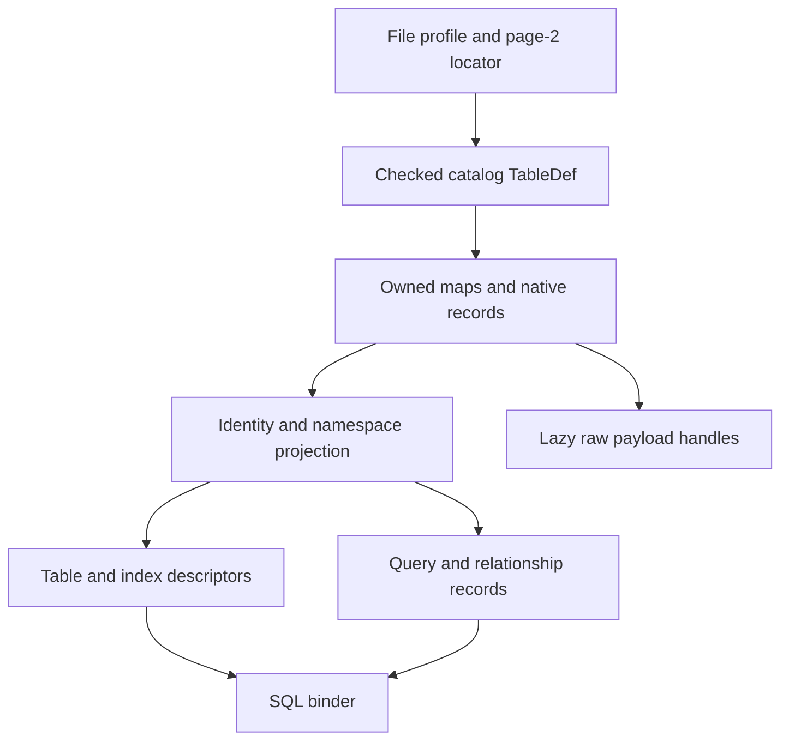
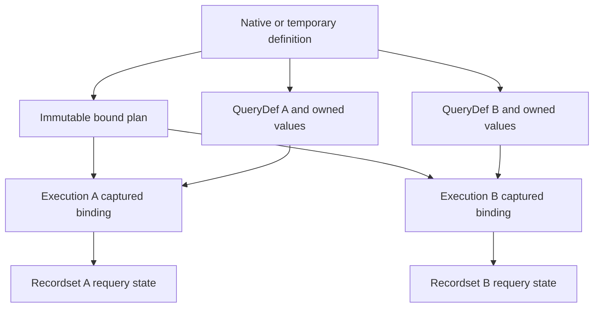

# II-06. Catalog, properties and QueryDefs

Revision 1 · Stage 2, response 5 · 2026-11-13

**Requirement trace:** Primary RQ-SQL-08. Shared obligations: RQ-PROD-05, RQ-STORE-03, RQ-FMT-01, RQ-SQL-02, RQ-SQL-03, RQ-SQL-04, RQ-SQL-06, RQ-DAO-03, RQ-DAO-04, RQ-EXPR-03, RQ-CALL-03, RQ-CALL-04, RQ-LATE-02, RQ-LATE-03, RQ-LATE-04 and RQ-OUT-01. The full scope text is in I-16. K-CATALOG uses II-04's native row/LV codecs and II-05's index mutation service; binding and object-model adapters consume the resulting descriptors.

This chapter specifies the catalog bootstrap, typed native identities, relationships and ownership rows, property-block grammar, saved-query records, preserving edits and derived execution state. It develops D-CATALOG-1's recommended native authority and immutable descriptor design. The serializer recipes, public invalidation transitions and native write schedules are provisional under the named R-CAT-1 branches and their format/transaction/crash dependencies.

**Evidence boundary.** The concrete source mechanics use the exact Jackcess commit `be0a2139b087a227d14cafd4ea231306a5a3a862`, acquired and inspected as recorded in A-01. That pin is not a release identification. Microsoft documentation establishes public documentary contracts, with contradictions retained as experiments. Worked bytes are constructed and independently calculated; no ACE or reference Java encoder execution occurred here. The initial native oracle remains the user-reported ACEDAO.DLL 16.0.20527.20016, subject to the environment capture. All new figures are emitted as tables/Mermaid source and are not render-verified. Native ordinary output must pass the independent ACE/Access and T-COMPACT-1 checks; the crash baseline remains ACE-first parity.

## 1. Catalog bootstrap without a binder cycle

**Requirement trace:** RQ-SQL-08, RQ-DAO-03, RQ-DAO-04, RQ-FMT-01, RQ-PROD-05 and RQ-STORE-03.

`MSysObjects` is itself a native table. The pinned implementation opens its TableDef directly at physical page 2, checks the page kind, and feeds its definition through the ordinary table decoder. The starting point is therefore a format-profile bootstrap locator, followed by the same TableDef segmentation, usage-map traversal and record decoder used for ordinary tables. No SQL statement, catalog name lookup, expression evaluator or DAO collection is needed to discover the first table. For the candidate 4096-byte geometry, the first catalog TableDef starts at file offset `2 × 4096 = 0x2000`; its records generally occupy other pages listed by its maps. Do not interpret page 2 as a flat array of catalog entries. [^S-JACK-CATDB-PIN]

The minimum bootstrap decoder reads column definitions before it interprets catalog rows. Bind required fields by their native column identities and validated names/types, not fixed offsets guessed from one `MSysObjects` record. Its historical physical column positions, variable slots and deleted fields remain subject to II-04. Bootstrap decoding is explicitly property-free: it admits the known ordinary physical system-column codecs without eagerly completing calculated-column ResultType or other property-dependent semantics. Ordinary catalog field reads do not evaluate defaults or validation rules. After the catalog/property service is available, normal table descriptors can complete the metadata-dependent codecs described in II-04. Large `LvProp` and front-end payloads remain lazy handles under the opened view, rather than being loaded to enumerate table names.

The next bootstrap issue is namespace identity. The reference uses `0x0F000000` as its default top-level parent, then resolves the `Tables`, `Databases` and `Relationships` containers. It also contains a scan path for files where the `(ParentId, Name)` catalog index is unavailable or has an unsupported sort order; that path discovers container IDs and the system-table parent from actual rows. These mechanisms justify a profile seed and checked native discovery. They do not justify one universal constant for every parent ID, or selecting the first row named `Tables` regardless of ancestry. [^S-JACK-CATDB-PIN]

CalcDb should start with a bounded structural scan of the small catalog identity projection. It establishes the self-entry, parent relationships and selected profile's required namespaces, and detects duplicate identities or ambiguous container candidates. A recognized indexed path may accelerate subsequent lookup. For an unqualified catalog key encoder, scanning can still expose records for inspection; it does not supply the missing identifier-comparison semantics. Public lookup must use evidenced name equality, and writing an affected catalog index requires its exact native key encoder. Host `ToUpper`, Java `equalsIgnoreCase`, or a Unicode normalization routine is not automatically that rule.

**Figure F-37 — bootstrap dependencies.** The diagram describes dependency direction, not disk-write order. Mermaid source only, not render-verified.



An original bootstrap operation can be expressed as follows. The caller owns the file/view permit and budgets; returned strings and descriptors own their storage. Any lazy payload reference carries its view/image dependency. No borrowed row buffer survives cursor movement.

```text
BootstrapCatalog(file_view, qualified_profile, budget) -> CatalogSnapshot | Error:
    root = checked profile.catalog_tdef_page          # candidate value 2
    seed = DecodePhysicalTableDef(root, file_view, budget, StorageOnly)
    # II-04 segmented view; defer property-dependent semantic completion
    projection = BindCatalogFields(seed,
        required = [Id, ParentId, Name, Type, Flags],
        optional_known = [Owner, DateCreate, DateUpdate, LvProp,
                          Database, ForeignName, Connect])
    entries = owned bounded vector
    for row in ScanOwnedRows(seed, file_view, projection, budget):
        charge row count, copied name bytes, metadata bytes and traversal work
        decode required field values with exact native kinds
        retain source row-root identity and opaque row/payload references
        copy identity projection into entries before releasing row view
    record identity/audit anomalies; require an unambiguous qualified self-entry
    retain ambiguous Id buckets; never resolve them silently
    namespaces = ResolveNativeNamespaces(entries, qualified_profile)
    reject an ambiguous/missing required namespace without choosing by name alone
    by_id = bounded immutable lookup with Unique / Ambiguous / Absent results
    by_name = same checked result forms for (namespace, evidenced name equality)
    ambiguous buckets retain all owned source records for diagnostics/preservation
    attach lazy descriptors and properties; do not execute expressions
    return immutable snapshot with file/catalog incarnation and view dependencies
```

The identity scan costs the catalog data pages and projected fields, not every user table or long property. Index construction in RAM is linear in the number of projected records for a bounded hash table; an immutable sorted vector instead costs `O(n log n)` comparison work to build and gives predictable storage. Subsequent table opens load the particular TableDef and its relevant properties, retaining the descriptor for DAO row loops. Unexpected parent cycles outside the profile's root conventions, duplicate IDs, a bad page-2 role, a table ID outside the file extent, and a catalog data page with the wrong owner are distinct malformed-input cases. An unsupported object type is not by itself corruption; preserve it as opaque and deny only unsupported interpretation or mutation.

Structural admission and a whole-catalog integrity audit have different error boundaries. A raw inspector can retain duplicate/orphan/cyclic records as bounded diagnostics; an affected semantic lookup cannot silently pick one. Whether an unrelated DAO open fails immediately, later lookup fails, or useful access remains available is a native surface policy. Do not turn every audit anomaly into an invented eager ACE open error.

## 2. Native identity and typed locators

The following is a field projection, not a claim that every profile has exactly these columns in this order. The row's TableDef supplies physical layout and nullability.

| Native field | Role used by the catalog design |
| --- | --- |
| `Id` | Signed native object identity; a TableDef page locator only for an admitted object kind whose rule says so. |
| `ParentId` | Namespace/container identity. It is not generally a file page number. |
| `Name` | Original native text, with a separate lookup representation. |
| `Type` | Signed 16-bit source discriminator; dispatch before interpreting `Id` or associated payload. |
| `Flags` | 32-bit flags, retaining unknown bits. The reference recognizes system bits `80000000`/`00000002` and hidden bit `00000008`. |
| `Owner` | Opaque native ownership data, relevant to qualified creation/security behavior. |
| `DateCreate`, `DateUpdate` | Native date values and raw encodings; timestamp updates belong to the actual operation policy. |
| `LvProp` | Property-group payload carried through the ordinary LV mechanism. |
| `Database`, `ForeignName`, `Connect` | Linked-source metadata; preserve independently of whether provider execution is available. |

The raw catalog Flags bits are a separate encoding from public DAO attribute constants; translate through an evidenced mapping. The pin recognizes type 1 for a local table, 4 for an ODBC-linked table, 5 for a query, 6 for another linked table, and 8 for a relationship. The type-1 path uses `Id` to open the TableDef. The linked paths have their own metadata and descriptor handling. Queries group their native query records by object ID. Relationships also have a catalog identity although their individual field-pair rows live in `MSysRelationships`. Other types, including stored Access front-end objects, remain visible to preservation and raw-object access without being reclassified as tables. [^S-JACK-CATDB-PIN]

**Figure F-38 — constructed catalog projection and typed locators.** This is a field-payload hypothesis, not a complete native row or an ACE capture. No adjacent placement of the listed payloads is implied.

| Field | Constructed value | Ordinary uncompressed payload bytes |
| --- | --- | --- |
| `Id` | Local TableDef page 42 | `2A 00 00 00` |
| `ParentId` | Container identity `0x0F000002` | `02 00 00 0F` |
| `Type` | Local table 1 | `01 00` |
| `Flags` | Hidden bit `0x00000008` | `08 00 00 00` |
| `Name` | `Orders` | `4F 00 72 00 64 00 65 00 72 00 73 00` |

The local table locator resolves to byte offset `42 × 4096 = 0x2A000`, where the reader expects a TableDef. Applying that multiplication to `ParentId` would be a category error. The actual `Name` payload can use II-04's text compression; the displayed UTF-16LE bytes deliberately avoid claiming a compression choice.

For non-page objects, the reference allocator scans for the greatest negative `Id` and increments it, using the signed minimum as a search sentinel. With no earlier synthetic ID, its first returned candidate is sentinel-plus-one, `0x80000001`. Thus an occupied synthetic identity `0x80000017` has candidate successor `0x80000018` in that implementation. This is a native-qualification candidate, not CalcDb's universal object-ID allocator. Native ID consumption, reuse after deletion, rollback and failures belong in R-CAT-1/R-TXN-1. A relationship's negative identity must never be passed to the pager. [^S-JACK-CATDB-PIN]

Native identity and in-memory incarnation are separate. Keep an object token containing the opened database identity, native object ID, and an allocation/incarnation token managed by CalcDb. The token detects drop/recreate and reuse while the process is open; it is not serialized into an unused native byte. A renamed object can retain native identity while changing name lookup. A dropped-and-recreated object with the same spelling must not acquire the old object's token merely because a dictionary lookup succeeds. II-07/II-12 will decide what a held public object does after each transition; retaining an old descriptor is storage safety, not a promise that every DAO call continues to succeed.

## 3. Relationships across catalog rows and logical indexes

**Requirement trace:** RQ-DAO-03, RQ-SQL-02, RQ-SQL-06, RQ-SQL-08, RQ-FMT-01 and RQ-STORE-03.

An enforced relationship is more than a catalog name. Microsoft documents a unique index on the referenced key and a foreign index created by the engine on the referencing table. The pinned writer additionally shows the native coordination required: a type-8 catalog object, one `MSysRelationships` row per field pair, and reciprocal foreign-key logical index metadata in the two TableDefs. The logical index may share an existing physical tree as described in II-05; ownership of the relationship metadata does not imply a newly duplicated B-tree. [^S-MS-RELATION][^S-JACK-CATDB-PIN][^S-JACK-REL-CREATE-PIN]

| `MSysRelationships` column | Source interpretation |
| --- | --- |
| `szRelationship` | Relationship name used to group field-pair records. |
| `ccolumn` | Number of field pairs, repeated in the records. |
| `icolumn` | Zero-based position of this pair. |
| `grbit` | Relationship flags. |
| `szReferencedObject`, `szReferencedColumn` | Referenced/primary table and column. |
| `szObject`, `szColumn` | Referencing/foreign table and column. |

The ordinal is semantic: row traversal order must not silently reorder a compound relationship. A decoder groups by an unambiguous native relationship identity/name association, validates a bounded consistent `ccolumn`, rejects duplicated or missing ordinals, and resolves each table/column under the same catalog view. Preserve records with unsupported flags and raw names; do not silently ignore a missing endpoint and claim the resulting list is the full native relationship set. A malformed relationship record can block affected writes even when unrelated table reads remain useful.

The public flags `1` (one-to-one), `2` (not enforced), `4` (inherited), `256` (cascade update), `4096` (cascade delete), `16777216` (left default join) and `33554432` (right default join) come from Microsoft's enumeration. The pin additionally recognizes `0x2000` as null-on-delete; that bit requires its own native capture rather than being exposed as an invented DAO constant. Default join preference and referential-integrity enforcement are different consumers of metadata. [^S-MS-REL-FLAGS][^S-JACK-REL-PIN]

**Figure F-39 — constructed two-column relationship.** Source-backed row/descriptor witness; no ACE observation or rendered result is claimed.

Let `Orders(CompanyId, OrderId)` on TableDef page 42 be referenced by `Lines(CompanyId, OrderId)` on page 43. Construct relationship `OrdersLines` with cascade update/delete flags `0x1100`. Its two relationship rows contain:

| Pair | `ccolumn` | `icolumn` | `grbit` | Referenced | Referencing |
| --- | ---: | ---: | --- | --- | --- |
| 0 | 2 | 0 | `0x00001100` | `Orders.CompanyId` | `Lines.CompanyId` |
| 1 | 2 | 1 | `0x00001100` | `Orders.OrderId` | `Lines.OrderId` |

For this constructed field-payload witness, declare count, ordinal and flags as native Long fields. Their payloads for count, first ordinal, second ordinal and flags are respectively `02 00 00 00`, `00 00 00 00`, `01 00 00 00`, and `00 11 00 00`. Their actual record offsets come from the relationship table's TableDef. Assume its primary-side logical index number is 3 and foreign-side number is 5. In II-05's 28-byte logical index descriptor, the link fields are:

| Relative position | Orders logical index 3 | Lines logical index 5 |
| --- | --- | --- |
| +12, relationship-side discriminator | `01` | `02` |
| +13, related logical index, LE32 | `05 00 00 00` | `03 00 00 00` |
| +17, related TableDef page, LE32 | `2B 00 00 00` | `2A 00 00 00` |
| +21, cascade-update byte | `01` | `01` |
| +22, cascade-delete byte | `01` | `01` |
| +23, logical index type | `02` | `02` |

These links identify logical index slots, not the physical data-index ordinal or root page. Both sides' existing/new logical-to-physical associations must be accounted for before calculating the affected tree set. Unknown bits and skipped descriptor fields survive the patch. Removing one relationship cannot free a shared physical tree that another logical index still owns.

The relationship descriptor binds primary and foreign physical column identities plus their codec/key descriptors. Matching public type names alone is insufficient proof that the two keys are comparable. Probe AutoNumber/Long pairings, text lengths and sort metadata, Decimal precision/scale, self-references, existing child rows, duplicate columns, cycles, and each Null pattern in a compound key. The reference creator skips an all-null foreign tuple but checks a partially null tuple. That distinction must be tested on ACE before it becomes the row engine's referential-integrity rule. Cascade order, errors, cycles and transaction effects belong to the shared ISAM/SQL mutation machinery; catalog code must not implement a second cascade engine.

## 4. Ownership records and application metadata

The pinned table-creation path adds both an `MSysObjects` row and `MSysACEs` rows. Its ACL fields are `ObjectId`, `SID`, `ACM` and `FInheritable`. It obtains prospective SIDs from the parent container, tries the `MSysDb` object's `Owner` for new ownership, and contains fallback constants for an Admin-like SID and full access. Those fallbacks are observations of a permissive reference writer, not an ACE permission-inheritance specification. [^S-JACK-CATDB-PIN]

CalcDb must preserve existing owner/ACL payloads and qualify the exact creation policy for the target file and caller. A successful table-data round trip does not establish that access-control records may be omitted or reset. Microsoft's documentation distinguishes `.mdb` user-level security from the `.accdb` family, which does not provide that feature; the presence of catalog ownership/access-control structures must therefore be interpreted in the actual file/profile context. Keep the later encryption capability separate from this metadata. [^S-MS-USER-SECURITY]

System and hidden flags are presentation/engine metadata, not grounds for discarding an object. Forms, reports, macros and database modules retain catalog records, properties, raw payloads and known references. Opening a raw-object handle does not run code or activate the Access front end. Unknown native objects remain in the same preservation inventory. Reclaiming a page requires proven ownership and absence of retained references; it cannot be based on the fact that CalcDb has no executable descriptor for its owner.

### 4.1 Application-owned references and names

**Requirement trace:** RQ-PROD-05, RQ-OUT-01, RQ-DAO-04, RQ-LATE-02, RQ-LATE-03, RQ-LATE-04. Preserve Forms, Reports, Macros, Modules and other unmodelled catalog payloads with their native identities and references. The catalog may enumerate them and expose the required Containers/Documents/raw-object views without constructing executable Access application objects. Reading a code-bearing object or a stored expression is not an instruction to run it.

Rename and delete require a reference-impact analysis. A table's Name field, a relationship row's table-name field, a query expression's identifier and an opaque form's internal name reference have different encodings and owners. Searching every binary blob for matching UTF-16 and replacing it would corrupt strings, lengths or unrelated identifiers. A known name-based reference is rewritten only when the chosen DAO/DDL/Access operation's native behavior requires it. An identity-based reference remains tied to identity. An opaque reference is preserved when the operation can retain its target and location; otherwise the operation needs an evidenced native rewrite/invalidation rule before its publication path is supported.

Access Name AutoCorrect is a separate source of application-side behavior. Microsoft's description says its dependency name maps concern tables, queries, forms and reports, and that map updates occur when objects are saved and closed. It also lists names in macros/code among changes it does not correct.[^cat-autocorrect] Therefore the oracle fixture records the Access Name AutoCorrect options and separates the engine-only mutation from a subsequent Access UI open/save. Do not attribute every later catalog delta to the earlier DAO rename. Do not implement an extra automatic rewrite of VBA source under the catalog's preservation requirement.

## 5. Native property grammar and payload codecs

The property service binds a catalog object's native `LvProp` value to an immutable `RawPropertyBlob`, an ordered structural directory, and optional decoded property values. It retains the outer long-value identity separately from offsets inside the assembled blob. The inner property records do not own database pages. Reading, extending or replacing `LvProp` uses II-04's ordinary row and long-value machinery; property framing begins only after that machinery has produced an admitted byte sequence. The pinned reference's save path updates the system-catalog property column at the retained row identity. It explicitly assumes properties come from that catalog column; this is reference behavior, not proof that every ACE feature stores all metadata there.[^s8p-maps]

Use this separation for RQ-SQL-08, RQ-DAO-03, RQ-DAO-04, RQ-STORE-03 and RQ-PROD-05. A property collection presented by DAO is a semantic view of an object. Some built-in properties come from descriptors or object state; the adapter must not equate that collection with the records physically present in one `LvProp` blob.

The exact in-scope signature in the inspected JetFormat is **`4D 52 32 00` (`MR2\0`)**. The same source recognizes `4B 4B 44 00` (`KKD\0`) for Access 97. Recognizing the latter signature does not add Jet 3 support to CalcDb. Jet 4 and inherited ACE profiles use UTF-16LE for names. Property names use an explicit byte length and uncompressed text; they are not zero-terminated strings.[^s8p-format]

**Figure F-40 — property-blob framing.** Source-derived hypothesis table for Jet 4/ACE; native profile qualification remains R-CAT-1. Offsets in a row are relative to its stated enclosing object.

| Object / offset | Width | Meaning in the inspected grammar |
| --- | ---: | --- |
| Blob +0 | 4 | `MR2\0` signature. |
| Section +0 | 4 LE | Total section length, including its six-byte header. |
| Section +4 | 2 LE | Kind: `0080` names, `0000` default values, `0001` column values, `0002` index values. |
| Names-section +6 onward | Repeated | Two-byte encoded-name byte length followed by those name bytes. |
| Value-section +6 | 4 LE | Total map-name-block length, including this four-byte length. |
| Map-name block +4 | 2 LE plus bytes | Encoded map-name byte length and uncompressed name. Canonical empty name occupies a six-byte block. |
| Value record +0 | 2 LE | Total value-record length, including its eight-byte header. |
| Value record +2 / +3 | 1 / 1 | Full property flags byte / native property data-type code. |
| Value record +4 / +6 | 2 LE / 2 LE | Name-dictionary ordinal / payload byte count. |
| Value record +8 | Payload count | Type-specific value, followed by any protected residual bytes up to the record end. |

Section lengths delimit the blob; there is no section-count field in this grammar. A names section sets the dictionary used by subsequent value sections; another names section replaces that context in the reference reader. Retain each dictionary's identity and each value section's dictionary association. A single global dictionary assembled from all decoded names would change the interpretation of a blob with repeated name sections. The reference reads the map name only when its name-block length exceeds six, and advances to the declared end; shorter or extended noncanonical forms therefore need separate profile qualification. The fresh writer's ordinary form is `4 + 2 + encoded_name_bytes`.[^s8p-maps]

A property map's identity is **(block kind, native name identity)**. A column named `Code` and an index named `Code` have separate blocks. The reference uses a case-folded lookup name plus block kind; CalcDb retains original UTF-16 and binds its lookup rule to native name-comparison evidence. It must not import the Java lookup function as an ACE specification. Repeated maps, duplicate dictionary names and repeated property records remain ordered raw structures until R-CAT-1 establishes their semantic precedence. A convenience map that overwrites a duplicate cannot be the preservation representation.

The outer native value also has an absent/Null state and may have a zero-length byte sequence. The reference maps either to empty property maps before inspecting an inner signature. Preserve those outer states distinctly, and use the MR2 grammar only for a present nonempty payload. R-CAT-1 determines which public getters and mutations treat them equivalently; the parser must not manufacture a signature error merely because no blob was stored.

### 5.1 Property payload codecs and state distinctions

The one-byte property type is a native data-type code. It is distinct from DAO `DataTypeEnum`, ADO enums and Automation `VARTYPE`. Most scalar payloads can use II-04's underlying scalar routines with a property-specific descriptor; the enclosing grammar and exceptional representations remain explicit.[^s8p-maps][^s8p-column]

| Stored property kind | Required codec distinction |
| --- | --- |
| BOOLEAN `01` | One explicit payload byte. The inspected reader treats a nonzero byte as true; its writer emits `FF` for true and `00` for false. This is separate from an ordinary row's Boolean mask bit and from the two-byte `VARIANT_BOOL`. |
| MEMO `0C` | Inline text bytes inside this property record; the reference decodes them with a Text scalar codec. There is no nested twelve-byte long-value descriptor. |
| OLE `0B` | Inline binary payload inside the record; the outer `LvProp` may itself be a long value. |
| BINARY `09`, property named `GUID`, payload length 16 | The reference applies GUID component byte order while retaining the stored BINARY type. Other sixteen-byte binary properties do not acquire GUID semantics from their length alone. |
| TEXT `0A` and MEMO `0C` | Names are always uncompressed in this grammar; values are handled separately. The inherited decoder recognizes the ordinary text compression framing. The reference property writer's synthetic column has compression disabled. Native write selection needs its own fixture. |

The reference derives some default kinds and flags from recognized names: `Required` and `AllowZeroLength` Boolean; `DefaultValue` and `Expression` Memo; `ValidationRule` and `ValidationText` Text; `GUID` Binary. These are useful probes and binding hints, not a licence to reinterpret an unknown property's bytes based on a familiar-looking name. It also gives names to two flags: bit `01` for the DAO DDL setting and bit `80` for an engine-set skip-handler state. The latter interpretation is source commentary requiring native evidence before CalcDb uses it to suppress or trigger any semantic action.[^s8p-mapimpl][^s8p-mapapi]

Retain the complete raw flag byte. In particular, the reference's semantic `createProperty` path can OR bit `01` into known exact-case names even when reading an existing record. Its stated intention to retain flags therefore does not make a read-and-reserialize cycle a byte-preserving transform. CalcDb stores raw flags independently of the decoded meaning and changes only the bits that the accepted operation and qualified native policy authorize.

Keep at least these states distinct: no property record; an explicit zero-length payload of a known variable type; a decoded value; an unknown typed payload; a deferred decode failure; and an API-level Null assignment whose persistence behavior has not yet been determined. The inspected property writer skips an in-memory property whose value is null. Its name can still appear in the generated names section because names are collected before values are emitted. That implementation cannot establish whether ACE deletes a particular property, stores another representation, exposes Null transiently, or rejects the assignment. R-CAT-1 captures `.Value = Null`, `.Value = Empty`, empty BSTR, zero-length byte array, deletion and omitted initial value separately. A zero-length Boolean payload is malformed for the illustrated codec; a zero-length text payload must not be interpreted as a missing record.

The synthetic Text column used by the reference writer also inherits that column type's size limits; converting Memo to this synthetic Text path does not establish the native limit for every Memo-valued property. Probe long custom properties and long default/expression metadata directly. The parser's representable lengths, the reference implementation's accepted range, and ACE's property-specific limits belong in separate fields of the format profile.

## 6. Worked property bytes and the preserving editor

**Figure F-41 — three distinct property maps sharing one dictionary.** Constructed source-derived bytes, checked by an original arithmetic script and a separate decoder over the literal. No ACE file or reference encoder was executed to obtain this fixture.

The dictionary is ordinal 0=`Caption`, 1=`Required`, 2=`Tag`. The object default map has Memo `Caption="Demo"`; column map `Code` has Boolean `Required=True` with DDL bit set; index map `Code` has a custom Text `Tag="I"`. The two named maps deliberately share the same name while differing in block kind. This is a grammar witness, not a claim that every combination of metadata is accepted for every ACE object.

| Absolute range | Length | Complete bytes / decoded structure |
| --- | ---: | --- |
| 0–3 | 4 | `4D 52 32 00` |
| 4–9 | 6 | `30 00 00 00 80 00` — names section, total length 48. |
| 10–25 | 16 | `0E 00 43 00 61 00 70 00 74 00 69 00 6F 00 6E 00` — Caption. |
| 26–43 | 18 | `10 00 52 00 65 00 71 00 75 00 69 00 72 00 65 00 64 00` — Required. |
| 44–51 | 8 | `06 00 54 00 61 00 67 00` — Tag. |
| 52–63 | 12 | `1C 00 00 00 00 00 06 00 00 00 00 00` — default section length 28; empty map-name block length 6. |
| 64–79 | 16 | `10 00 00 0C 00 00 08 00 44 00 65 00 6D 00 6F 00` — flags 00, Memo, ordinal 0, eight payload bytes. |
| 80–99 | 20 | `1D 00 00 00 01 00 0E 00 00 00 08 00 43 00 6F 00 64 00 65 00` — column section length 29; name block 14, name Code. |
| 100–108 | 9 | `09 00 01 01 01 00 01 00 FF` — flags 01, Boolean, ordinal 1, one-byte true. |
| 109–128 | 20 | `1E 00 00 00 02 00 0E 00 00 00 08 00 43 00 6F 00 64 00 65 00` — index section length 30; same name Code. |
| 129–138 | 10 | `0A 00 00 0A 02 00 02 00 49 00` — flags 00, Text, ordinal 2, two payload bytes for I. |

The lengths sum to `4 + 48 + 28 + 29 + 30 = 139`. All record ordinals are relative to the names section at offset 4. `Required` is neither in the index map nor in the default map. Replacing default Caption `Demo` with `Test` preserves every byte outside `[72,80)`. Replacing it with `Example` increases its payload from8 to14 bytes, its record from16 to22, the default section from28 to34, and the whole blob from139 to145. The two later sections are copied unchanged, shifted six bytes; the names section and every dictionary ordinal stay unchanged.

This controlled example has only understood sections and no unexplained positional references. It demonstrates length accounting and preservation spans, not permission to shift arbitrary opaque blocks in an unfamiliar native blob.

### 6.1 Bounded decoding and exact preservation

`RawPropertyBlob` owns immutable bytes or a retained immutable backing capable of reproducing those bytes; a borrowed span into an evictable page is insufficient. A lightweight directory stores offsets, lengths, section kinds, dictionary association and decode status. Decode string names into exact UTF-16 code units under an admitted byte interpretation; preserve source bytes even when a semantic view cannot represent an unknown or malformed name. No property is evaluated while the blob is read.

The following original algorithm parses framing before typed values. It uses unsigned loads to make arithmetic checks explicit, while the profile separately restricts accepted ranges. The reference uses signed Java short loads for several two-byte fields; that does not prove the high half of the unsigned field is a legal native range.

```text
ReadPropertyDirectory(outer_value, format, budget) -> owned directory or structured error:
    if admitted outer value is absent/Null or has zero bytes:
        return empty directory retaining that exact outer-state tag
    raw = admitted assembled bytes of outer_value
    require raw is immutable for directory lifetime
    check admitted signature and total-byte budget
    directory = reserve bounded offset entries
    active_dictionary = none; cursor = 4
    while cursor < raw.length:
        require at least 6 bytes remain
        length = checked_u32le(raw, cursor)
        require length >= 6 and length <= raw.length - cursor
        section = [cursor, cursor + length); kind = u16le(cursor + 4)
        if kind == 0x80:
            names = scan length-prefixed name spans within section
            charge name count, encoded bytes and UTF-16 decode budget
            retain duplicates, raw spelling, and any unaccepted decode state
            active_dictionary = append dictionary descriptor(names, section)
        else if kind is an admitted value-block kind:
            retain section with active_dictionary identity
            scan an admitted map-name block; retain name-block residual bytes
            while a value record remains:
                require 8 bytes for its header
                n = u16le(record_start); bytes = u16le(record_start + 6)
                require n >= 8 and n <= section.end - record_start
                require bytes <= n - 8
                retain flags, type, ordinal, payload span, residual span
                validate ordinal against this section's dictionary if decodable
                charge count and advance exactly n bytes
        else:
            retain the complete opaque section without guessing its grammar
        cursor = section.end
    seal directory only after all selected structural checks succeed
```

An empty section, absent dictionary, noncanonical map-name block, odd encoded-name byte count, repeated name dictionary, duplicate property, unknown type and unknown section kind get distinct outcomes. An unknown but correctly bounded section can remain preserved. A malformed framing boundary prevents a trustworthy structural edit of that blob. A missing semantic view need not prevent a read-only operation on unrelated table data. The native API's eventual failure and error number remain surface policy; parser diagnostics do not leak as invented DAO errors.

Typed values are decoded lazily through a `(stored_type, property_identity, format_profile)` descriptor. Fixed-size scalar reads check the admitted payload width; Boolean requires an explicit byte; variable payloads retain length and text-codec state. Decode failures remain attached to the exact raw record. A call requesting an owned value materializes a platform VARIANT/BSTR or byte array with II-02 ownership. The outer property object cannot retain a caller's borrowed VARIANT or a page address across calls.

**Preferred preserving editor, provisional under R-CAT-1:** no-op produces the exact original blob; a known same-length value replacement patches only the qualified payload/flag spans; a length-changing replacement reconstructs the minimum understood length hierarchy and copies every protected range. The edit plan records dictionary identity and raw-record identity, rather than finding a record again by a normalized name after mutation.

Adding a name should preserve all existing dictionary ordinals when the qualified profile permits an append to that dictionary. That is a necessary condition, not a general preservation proof. An unknown later section might depend on dictionary count, section offsets, a checksum, or another relationship not represented in the known grammar. A length-changing edit with such unresolved dependencies is not admitted until the relevant branch is understood. Do not renumber existing ordinals, merge dictionaries, sort maps, collapse duplicates, drop unused names or clear padding as incidental cleanup. Conversely, an opaque property blob does not prevent unrelated row changes that retain that native value and all its referenced storage unchanged.

```text
PreparePropertyEdit(object_view, request, policy, budget) -> PreparedCatalogChange:
    validate object incarnation and native operation phase
    resolve built-in handler or persistent custom-property record
    preserve the distinction between detached CreateProperty and Append
    perform only the checks/coercions evidenced at this native phase
    own all accepted input values and exact name bytes
    if request is a no-op under the evidenced policy:
        retain original raw blob and any separately required metadata effects
    else:
        parse/admit the affected property directory
        resolve exact record and dictionary, including duplicate policy
        choose qualified patch or reconstruction; reject unsafe opaque dependency
        compute checked output lengths; reserve full bytes or bounded owned spool
        emit edited ranges and copy protected ranges in original order
        independently validate known framing and retained-span identities
    if encoded outer state or serialized blob bytes changed, or the native recipe requires a rewrite:
        prepare outer LvProp row/long-value replacement through II-04
    otherwise retain the original LV/row source unchanged
    include evidenced catalog indexes, metadata, allocation and invalidation effects
    return owned change with before-images and native phase dependencies
```

The request can change a table or field constraint, so a built-in property handler may require table/index work beyond its property payload. A change to `Required`, a default, or a validation rule must not be acknowledged solely because the blob was rewritten. Existing-row checks, coercion, syntax validation, timing of evaluation and rollbackability belong to the native operation policy, decided by R-CAT-1 with R-EXPR-1 and R-TXN-1. No read of property metadata invokes its expression. Handler selection also must not replay arbitrary saved flag 80 state as an executable command.

For a relocated `LvProp`, the prepared change initializes replacement LV rows/pages, includes qualified owner/global maps, publishes the changed catalog-row reference at the selected native phase, and retires prior storage only under the applicable visibility/rollback rules. Index changes are limited to catalog fields that actually changed; a new property value does not automatically change every catalog index. Native timestamp/stamp changes, if observed, are explicit members of the plan. Completion still uses D-WRITE-1 and R-CRASH-1/2; there is no property-specific atomicity promise or private recovery dependency.

## 7. DAO property projection and persistence

DAO's documented collection contains built-in and user-defined properties. `CreateProperty` makes the detached object; `Append` makes the new property a collection member, duplicate names fail there, and deletion is allowed for user-defined properties rather than built-ins. Model those phases separately so allocation or validation at creation does not move an append-time error earlier. The native ordinal enumeration and mutation visibility still require capture.[^s8p-ms-collection]

The Property object's public `Value` is a Variant, with `Name`, `Type` and `Inherited` as distinct metadata. Inherited recordset-field properties are views of underlying TableDef/QueryDef metadata, not independent copies to save automatically into the file. Context-sensitive built-in properties can fail when read or written through an inappropriate object state; a generic blob setter is therefore insufficient.[^s8p-ms-property]

Microsoft describes user-defined properties as belonging to persistent objects and documents the DDL argument's permission significance. Changing DDL to non-DDL requires delete-and-recreate because no corresponding mutable DDL property is exposed. This should be tested in the actual supported file/security context; the flags byte alone does not establish the required MDB or ACCDB permission behavior. Full DAO coverage remains subject to the actual format and object context.[^s8p-ms-create]

The public Property.Type is writable before appending and read-only afterward. The documented type list spans capabilities that an underlying database may reject; the public enum list is not a table of native payload encodings accepted by every ACE file format. Capture the full error collection and the phase of rejection for each type family rather than inferring support from one byte in a blob.[^s8p-ms-type]

A property handle binds the owning object incarnation, map kind/name identity and property identity. Its semantic value view records the relevant catalog generation. Deletion, rename, rollback, explicit collection Refresh and rebuilding an object under a reused name may invalidate or refresh held objects differently; their policies must not silently rebind a stale property handle to a different property. Data-only updates retain valid descriptor views. A default or validation change invalidates the bound expression and relevant mutation policy; a caption change need not discard unrelated query execution plans unless its observable metadata dependencies require it.

The cost model separates first blob acquisition, structural scanning, name lookup, scalar conversion and public-value allocation. A scan is linear in encoded bytes and records; subsequent lookups use an admitted ordinal/hash index that retains native comparison semantics. Charge retained raw bytes, directory entries, decoded names and cached values independently. Copying a large blob for one short string assignment is visible as serialized bytes plus outer LV/page changes, not hidden in a constant-time property setter. LRU or other cache eviction may drop derived decode state while retained snapshots still have valid native backing. The hot DAO field loop does not enumerate or decode the full property blob per Value call.

## 8. Native QueryDef objects, discriminators and role rows

The inspected reader first enumerates `MSysObjects` entries whose `Type` is 5 and whose `Name` is nonnull. It collects each object's `Id`, `Name` and `Flags`, then reads `MSysQueries` and associates each query row's `ObjectId` with that catalog `Id`. An orphan row is reported and skipped by this reference reader. CalcDb must retain the orphan in its preservation view and diagnostic inventory; silently dropping it during an unrelated edit would modify the file beyond the requested operation. The reader loads the query system table on first query access. That lazy access is a useful implementation choice, not an assertion that native ACE uses the same bootstrap sequence.[^qdatabase]

The native object's identifier is distinct from its display name and from the physical row locator of each `MSysQueries` row. A rename changes lookup metadata; it is not permission to generate a new identity. An object dropped and recreated with the same identifier/name must acquire a different in-memory incarnation. That incarnation belongs to CalcDb's validity model, not to an invented field in the Access file.

`QueryImpl.Row` exposes the following named fields. These are decoded accessor types in the inspected implementation; the file's actual `MSysQueries` TableDef still supplies physical column numbers, types, widths, variable-field offsets, text compression and LV locations. In particular, a Java String accessor alone does not prove a particular TEXT-versus-MEMO storage choice.[^qimpl]

| Native column | Decoded value | Meaning retained by CalcDb |
| --- | --- | --- |
| `Attribute` | nullable byte | Role discriminator; keep all eight bits, so the end value is `FF`, not an accidental negative application enum. |
| `Expression` | nullable text | SQL expression or query-family-specific text; preserve explicit UTF-16 length and native source span. |
| `Flag` | nullable signed 16-bit value | Context-specific type, option or join bits. Its interpretation depends on `Attribute` and query kind. |
| `LvExtra` | nullable signed 32-bit value | Additional role data; the reference uses a positive value as a declared Text parameter size. |
| `Name1`, `Name2` | nullable text | Role-specific names, aliases, target columns, directions, external sources or reserved markers. |
| `ObjectId` | nullable signed 32-bit value | Link to the owning `MSysObjects.Id`. |
| `Order` | nullable byte sequence | Raw ordering metadata. The inspected code retains it but does not interpret it. |

The row owner keeps the native row locator, source image identity and encounter ordinal separately from these fields. The encounter ordinal is an in-memory diagnostic aid. It is never serialized into `Order` merely because it is an integer.

Two different kind encodings are present. The reference masks the catalog object's flags with `F0` to choose the query class; the type row, `Attribute=1`, carries a different value in `Flag`.[^qformat][^qapi]

| Query family | Catalog flag class, hex | Type-row `Flag`, decimal |
| --- | ---: | ---: |
| SELECT | `00` | 1 |
| Make-table | `50` | 2 |
| Append | `40` | 3 |
| Update | `30` | 4 |
| Delete | `20` | 5 |
| Crosstab | `10` | 6 |
| Data definition | `60` | 7 |
| Pass-through | `70` | 8 |
| UNION | `80` | 9 |

The pin contains a deliberate fallback: when the masked object class is zero, a recognized type-row value may select a non-SELECT query class. Constructors also check consistency against a present type row; unsuccessful classification falls back to an unknown query wrapper. These are reference acceptance rules, not a native validity specification. CalcDb retains both discriminators and records which rule interpreted them. R-CAT-1 must distinguish a legitimate target encoding from stale or damaged metadata. Unknown families remain preserved and inspectable; executing or rewriting a family requires its qualified semantics and serialization recipe.

### 8.1 Role rows and overloaded fields

The fixed attribute vocabulary is small; the number and size of rows are not fixed.[^qformat][^qimpl]

| Attribute | Role | Fields used in the inspected query readers |
| ---: | --- | --- |
| `00` | Start marker | Defined as a constant; semantics not established by these readers. |
| `01` | Query type | `Flag` selects type; other fields vary by family. |
| `02` | Parameter declaration | `Name1` is the declaration name; `Flag` is the data type; positive `LvExtra` supplies Text length. |
| `03` | Query options | `Flag` carries SELECT/UNION/owner-access bits; `Name1` carries the TOP count text. |
| `04` | External database | `Name1` is the path; `Expression` carries source-type text. |
| `05` | Table/source | `Name1` source name, `Name2` alias; `Expression` can qualify a source or carry UNION fragment text. |
| `06` | Output/assignment/value | `Expression` is the expression; aliases, targets and crosstab roles use the other fields. |
| `07` | Join | `Name1`/`Name2` identify sources, `Expression` the condition; `Flag` 1/2/3 maps to INNER/LEFT/RIGHT in the reference. |
| `08` | WHERE | `Expression` is the predicate text. |
| `09` | GROUP BY | Ordered expression rows; crosstabs additionally inspect flags. |
| `0A` | HAVING | `Expression` is the predicate text. |
| `0B` | ORDER BY | `Expression` is the sort expression; `Name1="D"` denotes descending in the reference. |
| `FF` | End marker | Defined as a constant; preserve its row and unknown payload. |

The option bits recognized in attribute 3 are `0001` for a star projection, `0002` for DISTINCT, `0004` for owner-access, `0008` for DISTINCTROW, `0010` for TOP and `0020` for PERCENT. `0002` also selects UNION rather than UNION ALL in the UNION reader. Keep these as bits with a query-family context. A generic enum which assigns one meaning to every `Flag` value would misread parameters and joins. The reference's SELECT formatter takes precedence branches for DISTINCT, DISTINCTROW and TOP; that code is not evidence that every combined bit pattern is either valid or correctly reconstructed by the reference. Test the combinations ACE actually produces.[^qformat][^qbase][^qunion]

Declared parameter type values in the pin include Bit=1, Byte=2, Short=3, Long=4, Currency=5, IEEESingle=6, IEEEDouble=7, DateTime=8, Binary=9, Text=10, LongBinary=11 and Guid=15; zero is printed as `Value`. This is the inspected reader's supported mapping. It does not narrow CalcDb's required type support or prove how ACE serializes newer numeric/date parameter declarations. A parameter's native type record, public DAO `Type`, inferred expression type and an assigned value's VARIANT subtype are related but distinct pieces of state.[^qformat][^qtypes]

## 9. A worked parameterized query

**Figure F-42 — constructed MSysQueries role rows — source-derived logical construction, not a captured ACE file.** The following row set describes a parameterized SELECT. The encounter sequence is chosen for this worked reconstruction. `O0` through `O11` are opaque tags for retained `Order` payloads, not proposed native bytes or rank numbers. This table intentionally does not fabricate start/end records, default properties, design-view metadata or complete native serialization.

```sql
PARAMETERS [pMin] Long, [pPrefix] Text(12);
SELECT TOP 5 O.OrderID, C.CompanyName AS Customer
FROM Customers AS C INNER JOIN Orders AS O
  ON C.CustomerID = O.CustomerID
WHERE O.Amount >= [pMin] AND C.CompanyName Like [pPrefix]
ORDER BY O.Amount DESC, O.OrderID;
```

Choose the constructed object ID `0x12345678`, catalog `Type=5`, masked flag class `00`, and name `qRecentOrders`. The ID is a legal-width illustration, not an allocation recommendation. Every listed row has that same `ObjectId`; a dash means native Null, not an empty string or zero.

| Encounter | Attr | Expression | Flag | LvExtra | Name1 | Name2 | Order |
| ---: | ---: | --- | ---: | ---: | --- | --- | --- |
| 0 | 1 | — | 1 | — | — | — | O0 |
| 1 | 2 | — | 4 | — | `[pMin]` | — | O1 |
| 2 | 2 | — | 10 | 12 | `[pPrefix]` | — | O2 |
| 3 | 3 | — | 16 | — | `5` | — | O3 |
| 4 | 5 | — | — | — | `Customers` | `C` | O4 |
| 5 | 5 | — | — | — | `Orders` | `O` | O5 |
| 6 | 6 | `O.OrderID` | — | — | — | — | O6 |
| 7 | 6 | `C.CompanyName` | — | — | `Customer` | — | O7 |
| 8 | 7 | `C.CustomerID = O.CustomerID` | 1 | — | `C` | `O` | O8 |
| 9 | 8 | `O.Amount >= [pMin] AND C.CompanyName Like [pPrefix]` | — | — | — | — | O9 |
| 10 | 11 | `O.Amount` | — | — | `D` | — | O10 |
| 11 | 11 | `O.OrderID` | — | — | — | — | O11 |

Several byte-level checks are possible without claiming a complete physical row. Under II-04's ordinary fixed-field codecs, `ObjectId` is `78 56 34 12`; the Long declaration's 16-bit `Flag` is `04 00`; the Text declaration's `Flag` and `LvExtra` are `0A 00` and `0C 00 00 00`; the TOP option field is `10 00`. Uncompressed UTF-16LE for the bracketed name `[pMin]` is `5B 00 70 00 4D 00 69 00 6E 00 5D 00`. A real row's field locations, null bitmap, variable directory, text compression and LV references come from the catalog table descriptor and II-04. These displayed byte strings must not be concatenated and called an `MSysQueries` record.

The bracketed native Name1 spellings in this constructed example do not establish that public Parameter.Name includes brackets. Resolve declaration identifiers through the qualified grammar/name policy and capture the public name separately. The internal representation can map the first two attribute-2 rows to declared parameter slots, the two attribute-6 rows to result projections, and the attribute-11 rows to ordered sort terms. Assigning `pMin=100` and `pPrefix="A*"` changes owned execution cells. It does not edit the two declaration rows. Wildcard mode is execution/binding context; the stored `Like` expression does not by itself identify which wildcard policy the caller selected.

The example's native experiment creates this query through both DAO `.SQL` and Access's designer, then captures the catalog owner, every query row including raw `Order`, all query/field properties, the public `.SQL` BSTR, Parameters and Fields metadata. Reorder projections, parameters and sort terms separately; reopen and compact independent copies. That produces a real writer recipe and separates public SQL normalization from physical encounter order.

## 10. Query ordering, SQL views and family-specific forms

The pin's `QueryImpl.Row` reads and writes the `Order` byte sequence. `DatabaseImpl.getQueries` traverses the query table and appends rows to each owner's list; `QueryImpl` filters those lists by attribute. It never sorts on `Order`, decodes an integer from it, or validates a fixed width. Its query tests build many logical rows with `Order=null`. Thus this exact source establishes retention and encounter-order consumption, not native order-byte semantics.[^qdatabase][^qimpl][^qtest]

**Preferred provisional reader:** retain every raw `Order` value and physical encounter ordinal, and reconstruct using the reference-compatible encounter sequence for fixtures on which the native result agrees. Mark the selected ordering profile in the descriptor. An unsupported or conflicting profile still permits preservation and raw inspection; it does not permit a fabricated projection or parameter order. **Preferred writer:** use the row order and exact order-byte recipe established by the corresponding native creation/edit capture. Preserve untouched payloads byte for byte. Do not generate sequential four-byte values as a guessed universal format. R-CAT-1's ordering branch selects unsigned bytewise, integer, contextual or other ordering only after the native captures distinguish them.

The probe must avoid the weak test of a single output column. Use parameter order, three projections with the same types but different names, multiple sort terms, and joins whose construction order differs from catalog encounter order. Include large enough query structures to exercise any counter width, and compare creation, edit, close/reopen and Compact & Repair. Capture both logical typed rows and page bytes: physical row relocation alone does not prove semantic reordering. If duplicate/missing/nonnull ordering fields occur, capture ACE's actual choice or error instead of imposing uniqueness merely for implementation convenience.

SQL text is another derived view. The reference inserts its runtime's line separator, chooses quoting heuristically, combines repeated predicates for one join in reverse encounter order, and normalizes UNION fragment whitespace. Its file-based tests expect a trailing U+0000 in two DDL/pass-through strings. None of these facts proves the exact DAO `.SQL` BSTR returned by the target ACE build.[^qimpl][^qunion][^qtest]

Keep the raw expression text, the parsed semantic tree and any captured/generated public SQL view distinct. They can share owned storage where safe, but one must not overwrite another by normalization. A `.SQL` getter is length-based, including any embedded U+0000 that the native contract exposes. The source-test trailing NUL is a regression case to investigate, not an unconditional writer suffix. Microsoft also explicitly warns that creating a permanent QueryDef can add spaces, semicolons or line breaks to its SQL property. CalcDb therefore needs an evidenced serializer for the public string independently of a semantics-preserving AST pretty printer.[^msqsql]

### 10.1 Query families have different persistence shapes

| Family | Source-derived storage mechanism | CalcDb consequence and native question |
| --- | --- | --- |
| SELECT | Attribute-specific rows form projections, sources, joins, predicates, groups and orderings. | Preserve expression strings and row roles; bind the parsed structure without losing original representation. |
| Make-table | Type-row `Name1` names the target; `Name2` and `Expression` supply external target information; SELECT rows describe input. | Catalog creation goes through the shared DDL/mutation service. Capture target-name quoting and external source semantics. |
| Append | Type row identifies the target; column-row `Name2` supplies target columns; bit `8000` distinguishes VALUES rows from source projections. | Keep positional source-to-target mapping, duplicate target/error rules and values-vs-select kind. |
| Update | Attribute-6 rows pair `Name2` targets with `Expression` assignments. | Keep assignment order/provenance for the shared action service; do not infer simultaneous-vs-sequential evaluation from row order alone. |
| Delete | Uses SELECT-like source/predicate structure with deletion projections. | Bind target provenance separately from displayed values. |
| Crosstab | Column flags distinguish pivot (`0001`), ordinary output (`0002`) and transform (neither bit); grouping rows can carry ordinary-output flags. | Preserve all raw fields, including how any `PIVOT IN` text is embedded. Dynamic result headings remain an execution/metadata issue. |
| DDL | Type-row `Expression` contains the command; the reference bypasses its standard clause/semicolon wrapper. | Parse as Access DDL on execution; do not run it because the object was opened or `.SQL` was read. |
| Pass-through | Type-row `Expression` contains external SQL; `Name1` contains connection text in the reader. | Preserve external syntax without feeding it to the local Access grammar. Execution attaches to the later provider capability. |
| UNION | Source rows whose `Name2` is `X7YZ_____1` or `X7YZ_____2` hold the two recognized fragments; the second can contain further UNION syntax. | These are storage slots, not a two-arm language limit. Preserve operator order and branch semantics; qualify general edited serialization. |

These mechanisms come from the corresponding pinned subclasses.[^qmake][^qappend][^qupdate][^qdelete][^qcross][^qddl][^qpass][^qunion] The source recognizes fewer query-kind flag classes than all commented DAO constants. Preserve unrecognized classes and extend through native evidence; never reinterpret `90` or another unknown class as SELECT just to produce SQL.

`Connect`, `ReturnsRecords`, timeout and other persistent properties are descriptor inputs whose native storage ownership must be captured. The source's connection-string field does not establish that every public property is represented by that one row. Microsoft documents setting `Connect` before `ReturnsRecords`; the Connect page's introductory “read-only” wording conflicts with its setting instructions and examples. Type-info, actual setter behavior and catalog deltas resolve that documentary inconsistency. `ReturnsRecords` applies to pass-through behavior; it is not the general mechanism by which CalcDb decides that a local action query has no rowset.[^msqconnect][^msqreturns]

For ODBC execution, documented `ODBCTimeout=-1` selects the containing object's timeout and zero disables that timeout. Preserve the sentinel and inheritance rule; do not flatten it into a positive constant while saving. The older `Prepare`/Direction examples concern external-driver/ODBCDirect behavior. They do not define CalcDb's local plan-cache interface or supply native parameter-direction bytes for a local Access query.[^msqtimeout][^msqprepare][^msparamdirection]

## 11. QueryDef lifetime, parameters and native editing

The public lifetime boundary is clear: Microsoft describes named permanent QueryDefs as saved collection members, and empty-name temporary QueryDefs as object-owned definitions that are not saved or appended. Temporary definitions use the same SQL/metadata services but do not allocate a persistent object ID or native query rows merely because they are prepared or executed. Promotion to a named persistent object follows the tested public operation sequence; naming/appending rules must not be approximated by an arbitrary internal “save” flag.[^msquery][^msquerydefs]

Use three owned structures:

```text
QueryDefinition:
    native object handle or temporary identity
    definition incarnation, native row/property preservation view
    semantic form, declaration set, public-SQL view state

ParameterSet:
    owner QueryDef instance and declaration incarnation
    stable declaration identities, names/types/order
    owned values and assignment state; no borrowed caller VARIANTs

ExecutionBinding:
    accepted definition/dependency token
    owned or immutably shared value snapshot
    recordset/requery continuation policy
```

The declaration set is metadata; the values belong to a particular object/execution context. Microsoft's Parameters collection cannot have objects appended or deleted directly. Changing declarations is a definition edit, normally through SQL, while setting `Parameter.Value` supplies arguments. The SQL reference documents that supplied values continue to apply until reset. The API therefore supports a hot path which replaces one owned value cell without rewriting catalog rows or recompiling unchanged expression structure.[^msparams][^msqsql][^msparam]

Distinguish unassigned internal state from an explicitly supplied `Null`, and distinguish a null BSTR from a zero-length BSTR where the public conversion contract requires it. This internal distinction does not preselect ACE's initial getter value or missing-parameter error. R-CAT-1/R-DAO-1 captures getter and execute behavior for untouched, Empty, Null, omitted and wrong-type values. Value assignment performs the required public coercion at the evidenced point, copies/dereferences caller-owned storage under II-02's Automation contract, and leaves the previous cell intact if the selected atomic-set policy fails. Native timing decides whether some conversion is deferred to execution.

An opened recordset needs its own accepted binding. Microsoft's Requery documentation says the no-argument form reuses the definition and parameter values used originally, while supplying the QueryDef permits its current values. Consequently, mutating a QueryDef's parameter cell cannot unconditionally mutate every existing recordset's value vector. Use an immutable snapshot or an equivalent owned version, and let the public operation select the correct version.[^msrequery]

`.SQL` rewrite invalidates the declaration binding even if the new text happens to reuse a name or ordinal. The preferred provisional implementation creates a new declaration incarnation and makes old parameter handles explicitly stale; the initial candidate starts fresh unassigned value cells for the new definition. R-CAT-1 may instead show value survival or live handle retargeting for particular edits. Implement that as a measured name/declaration mapping, with type and identity checks; never let an old ordinal accidentally write a different new parameter. Public wrapper identity and storage ownership can then reproduce the observed policy without sacrificing memory safety.

Nested saved queries add declaration origins. A parameter exposed by a dependency is not necessarily a row declared in the outer object's own `MSysQueries` set. Keep `(origin query incarnation, origin declaration, exposure path)` internally before applying ACE's name-merging/type-inference rule. The outer caller supplies its execution binding; a value assigned earlier to a separately opened inner QueryDef object must not be assumed to act as global storage. Cases with identical names but differing declarations, repeated references to one inner query, undeclared names and parameterized crosstabs determine native exposure order, aliasing, coercion and missing-value errors.

Parameters.Refresh's official page describes refreshing a collection to current schema without settling held parameter objects or assigned values after an SQL rewrite. QueryDefs.Refresh's page states that the method is unsupported while its remarks specifically discuss nonpersistent Connection.QueryDefs. R-CAT-1 therefore tests Database.QueryDefs, Connection.QueryDefs and QueryDef.Parameters independently; neither page supplies a universal refresh policy.[^msparamrefresh][^msqrefresh]

**Figure F-43 — QueryDef instances and captured execution bindings.** Original ownership design; arrows mean retained definition/plan/value inputs. Parameter capture and public lifetime transitions are qualified by R-CAT-1; Mermaid source only, not render-verified.




### 11.1 Loading and editing the native definition

The following is original CalcDb design, using the native row roles above. It is not a translation of the reference parser. All loop counts and decoded text/LV bytes consume the caller's budget; the owning snapshot or copied field storage outlives every borrowed view.

```text
LoadQueryDefinition(catalog_snapshot, query_handle, budget) -> owned definition:
    check handle incarnation and lookup the catalog owner
    require a supported catalog-object class for query inspection
    retain owner raw record, flags, properties and source identity
    acquire MSysQueries through catalog bootstrap descriptors
    for each admitted candidate row in an evidenced owner lookup/scan:
        charge scan, decode and traversal work even for an unmatched owner
        decode ObjectId using that system table's descriptor
        if it is not this owner's ID: continue
        charge row count and retained/decoded bytes
        retain row locator, before bytes, raw Order and encounter ordinal
        decode named role fields without collapsing Null to zero/empty
    classify both catalog and type-row discriminators
    apply qualified role cardinality and ordering profile
    produce lossless native view plus supported semantic-role references
    release cursor/page pins; keep owned bytes or snapshot-owned references
    return an inspectable definition; compile only when the public call needs it
```

The lookup may scan the system table until its relevant indexes are qualified. It must not use a guessed index key, and it must not retain one page pin per expression row. Unknown rows, ambiguous singleton roles, orphan ownership and unsupported expression forms are classified separately from malformed row lengths. Reconstructing a SQL string successfully does not authorize persistence.

```text
PrepareQuerySqlEdit(query_instance, caller_sql, context, budget) -> prepared edit:
    own the incoming explicit-length string
    snapshot the accepted old definition and object incarnation
    perform the syntax/metadata work required at this native public boundary
    select the native recipe for file profile, query family and edit operation
    build typed clause/parameter roles; assign only evidenced row/order forms
    match preserved native fragments using owner, role and source identity
    determine touched query rows, object metadata and property/LV closure
    reject only this edit if coupled opaque state cannot be preserved safely
    prepare full row/index/map changes through II-04/II-05 mutation services
    retain required before-images and every ordered output phase
    return owned edit plus deferred declaration/descriptor publication action

ApplyPreparedQueryEdit(edit, transaction_policy):
    validate object incarnation and all prepared storage dependencies
    execute the selected native write program under the existing lock policy
    publish or retain the new definition according to native visibility outcome
    advance affected declaration/plan identities at that same logical boundary
    settle owned scratch, pins and prepared values on every terminal outcome
```

Parsing, dependency resolution, field discovery and errors must occur at the target's observable call boundaries. A `.SQL` setter that accepts unresolved references must not be changed into an eager full-execution binder merely for convenience. Conversely, deferred compilation must not postpone a native setter error. No effectful user function is invoked speculatively to guess metadata. The experimental matrix records the setter, getter, Parameters/Fields access, Refresh and execution separately.

Existing native rows untouched by the edit retain their raw fields, order bytes and associated opaque state. A whole definition replacement can legitimately need a new complete row set, but its native recipe must explicitly identify displaced metadata and preservation behavior. The writer does not round-trip every query in the file through an SQL pretty printer when one query changes. New/changed rows still participate in native system-table indexes, LV allocation, usage maps and D-WRITE-1's crash-qualified phases. Neither an AST property nor a private side catalog can substitute for that closure.

## 12. Catalog snapshots, namespace dependencies and held objects

**Requirement trace:** RQ-SQL-08, RQ-DAO-03, RQ-DAO-04, RQ-PROD-05, RQ-SQL-03, RQ-SQL-06. **D-CATALOG-1 remains Recommended.** The native records are authoritative; CalcDb uses immutable decoded descriptors with explicit lifetimes. The particular native mutation recipes and public refresh/error transitions remain provisional under R-CAT-1. This distinction matters: choosing a descriptor cache does not establish when ACE invalidates a held Field or recompiles a QueryDef.

The catalog has three different notions of identity. A native catalog identifier locates the recorded object within one file. A physical TableDef root, catalog row locator or LvProp descriptor identifies particular storage. A CalcDb object incarnation distinguishes the lifetime of a logical object, including a deleted object whose native identifier or page is later reused. A name is an attribute and a lookup key within a namespace; it is not any of these identities. Keep those values separate in the types. In particular, a positive table Id which denotes a TableDef page is not a general conversion from every MSysObjects.Id to a page number.

Use the following original in-memory shape. The native numbers and byte ranges come from the preceding decoders. The serials and epochs below exist only in memory; none is a new field written to an Access file.

```text
CatalogSnapshot {
    file_incarnation, visibility_ticket
    publication_serial
    object_directory: NativeObjectId -> Unique(ObjectEntry) | Ambiguous(owned raw handles)
    # an absent key returns Absent; namespace lookup has the same checked result forms
    namespaces: NamespaceId -> NamespaceIndex
    native_sources: retained image/read-source ownership
    budget: descriptor bytes + raw retained capacity + pins/history
}
ObjectEntry {
    native_id, native_type, parent_id
    original_name: owned exact UTF-16
    object_incarnation
    definition_epoch, property_epoch
    catalog_row: stable logical root locator + source image identity
    raw_record_and_properties: checked ranges / lazy owned source
    decoded_descriptor: optional immutable descriptor
}
BindingDependency {
    object_incarnation, required_definition_epoch
    dependency_kind                 // row shape, index, default, query definition ...
}
NamespaceDependency {
    namespace_incarnation, required_epoch
    lookup_descriptor               // includes lookup rules and qualified search path
    result_identity_or_absence
}
```

An ObjectEntry owns its exact name or retains a valid immutable source for it. A temporary scratch decode cannot back a published entry. Large raw objects and property values remain lazy: a stable source means an actual retained page image or a valid II-03 read-source permit for the view, not a page number that will be reread after an overwrite. When a retained view needs bytes that the writer is about to replace, II-03 preserves the old source first. Reclaim the descriptor and its raw provenance together when their final owner releases them; account the real backing allocation if a small range retains a large blob.

Bootstrap can begin with a bounded scan over the catalog, as above, before it has enough information to use the native name index. After admission, use a compiled identifier-comparison profile and a compact name directory per namespace. Its hash function must agree with that comparison: names equal under the selected profile must hash to the same bucket. Until that equivalence is established for a profile, use ordered lookup or a bounded scan rather than a host-language case-folding hash whose false negatives look like missing objects. Retain original UTF-16 for public names, reserialization and diagnostics. R-CAT-1 varies ASCII case, accented forms, composed/decomposed strings, trailing spaces, punctuation and bracket quoting, independently of data-column collation. Jackcess's own map-key folding is evidence of its implementation, not a native identifier-comparison specification.

### A dependency can be the absence of a name

A bound query must depend on what it failed to resolve as well as what it found. Consider the constructed definition `SELECT [p] AS X FROM T` in a context where the target treats unresolved `[p]` as an implicit parameter. Initially T has only column A, and the binder records p as a parameter. Later, a column named p is added to T. The query text, existing A descriptor and explicit parameter declarations have not changed, but binding may now resolve p as a field. A plan cannot retain the old parameter classification after the relevant binding changes. With the coarse full-table definition epoch used in this example, positive dependency validation already detects the alteration. Negative dependencies also record why the name was unresolved; they become decisive with finer column-specific dependencies or when a new name in an earlier, previously empty scope shadows a positive hit in another scope. R-CAT-1 and R-SQL-3 establish the actual precedence and error/type behavior; the example illustrates the dependency mechanism, not an observed ACE result.

Record the searched namespace and its epoch for every unresolved lookup that can affect successful binding, including implicit parameters and host function resolution. A miss in one scope followed by a hit in another also depends on the earlier miss. Adding a local name can shadow the later hit. Use coarser namespace epochs initially; measuring many unrelated rebinding events may justify per-name generations later. No native name-map or Access application dependency graph is required to maintain these in-process binding dependencies.

**Figure F-44 — constructed catalog incarnation and dependency witness.** In-memory values illustrate CalcDb's chosen validity mechanism. They are not on-disk fields or observed ACE counters.

| Transition | Native bytes / public operation | In-memory consequence | Next use of a previously bound plan |
| --- | --- | --- | --- |
| Initial bind | Table T has native Id 48; column A exists; p is unresolved in the example context | Object incarnation 700, definition epoch 11, column namespace epoch 20 | Plan records T/700/11 and the negative p lookup at epoch 20. |
| Data-only update | A row value changes, with schema and execution context unchanged | Data visibility changes through the transaction layer; these catalog epochs stay unchanged | Reuse semantic binding; acquire the required data view and fresh execution state. |
| Add column p | T still has Id 48, but its row schema and namespace change | New definition epoch 12 and namespace epoch 21 | Rebind before execution, including implicit-parameter classification and result metadata. |
| Roll back that alteration, where native rollback applies | Prior native definition is restored | Publish fresh epochs 13 and 22 for the restoration event | Do not validate a continuation solely because bytes happen to resemble the original. A normal new call may rebind to the restored definition. |
| Drop T and create another T reusing Id 48 | Name and native number are reused | New object incarnation 701 | A handle for incarnation 700 cannot attach to 701. Adapter policy decides the native-compatible stale-object result. |

The serial allocation is process-local and monotonic for the owning registry. Counter exhaustion fails or replaces the registry incarnation under a controlled path; it cannot wrap into an old valid token. Rollback need not destroy an older retained snapshot used by an admitted reader. It publishes a new current view and leaves the reader's old view subject to the previously established visibility policy. Object validity, collection membership, public result metadata and data visibility therefore have separate state.

### Collection snapshots do not define engine visibility

Microsoft documents that a TableDefs collection is initially populated on first reference, can lag another user's schema changes, and has an explicit Refresh operation. It also says collection field order can lag OrdinalPosition changes until refresh.[^cat-refresh] Implement this with an adapter-owned collection image or membership/ordering state above the catalog. Do not force every catalog lookup to use a stale public collection, and do not make the collection automatically current merely because the internal descriptor directory is current.

An enumeration retains the membership and object tokens required by its observed policy. Refresh builds a candidate membership image from the admitted catalog view, validates it, and swaps the adapter state only at the evidenced transition. Previously returned TableDef, Field, Property, Relation and Parameter interfaces keep their own identities. A collection's refreshed list does not authorize rebinding a removed child's interface to a newly created object with the same name. Native experiments distinguish same-Database edits, another Database object in the same Workspace, another Workspace, and later external-process edits. For the initial exclusion and reader-only modes there is no permitted external writer; later live-ACE sharing adds a real freshness check before catalog reuse rather than trusting these in-memory epochs.

An engine descriptor can know a new physical field layout before an existing Recordset's public Fields collection changes or fails. Conversely, a public metadata getter may refresh while a previously opened cursor still has a valid earlier view. The adapter's policy chooses which descriptor/view it requests. The catalog provides the versions and ownership needed to implement that policy without silently mixing two row layouts. R-CURSOR-1/R-DAO-1 determine held cursor behavior; R-CAT-1 captures the catalog events and dependency changes.

## 13. Binding, captured parameters and a bounded plan cache

**Requirement trace:** RQ-SQL-08, RQ-SQL-02, RQ-SQL-03, RQ-SQL-06, RQ-EXPR-03, RQ-CALL-03, RQ-CALL-04. Read a native QueryDef into its preservation representation first. The executable form is derived from an evidenced query-row interpretation or the public SQL view selected by that profile. The binding path may need table/column/index/property descriptors, but the catalog reader must not invoke binding to obtain those descriptors. QueryDef cycles are a binding error or unsupported native construct to diagnose, not a recursive bootstrap path.

An execution instance contains the immutable bound plan, an owned or immutably shared parameter frame captured at the native-qualified boundary, current data/transaction view, cursor/operator state, cancellation owner and accounting. The reusable QueryDef ParameterSet is a different owner: later assignment, reentry or Close cannot mutate or clear an active execution's captured values accidentally. A cached plan contains none of the last caller's parameter values, Recordset position, output buffers, by-reference VARIANT addresses or active locks. Parameter slots use II-02's real Automation values and explicit copy/clear rules; their validity and reset behavior follow the owning DAO/ADO object. A plan's immutable parameter layout can be shared while each public QueryDef/Command instance owns its values separately.

Choose a cache key from definition identity and semantic context. For a persistent QueryDef this includes file/catalog incarnation, native object identity and definition epoch, plus the relevant context below. For a temporary QueryDef use its object-owned definition incarnation. Ad-hoc SQL may use owned exact SQL bytes plus a context key; preserve the original SQL and do not invent a text canonicalizer that changes literals, identifier resolution, errors or observable metadata. A cache hit is an optimization of the same binding result, not another query-definition authority.

| Dependency dimension | What requires a fresh binding or execution setup | Scope of the dependency |
| --- | --- | --- |
| Query definition and parameters | SQL/native row edit, declared type/order change, nested QueryDef change | Definition incarnation and epochs; recursive dependency traversal has cycle and work bounds. |
| Names and row shape | Add/drop/rename of referenced objects, field type/storage-coordinate change, `SELECT *` expansion, a previously missing name becoming resolvable | Object definitions plus positive and negative namespace dependencies. |
| Physical access path | Selected index removed/replaced, sort descriptor changes, schema-dependent covering proof invalidated | The actual index/descriptor used by the executed plan. |
| Write semantics | Default, validation, generated-value, relationship or constraint changes relevant to the action | Dependencies of the affected insert/update/delete path, including metadata-only expressions that are not selected as output. |
| SQL and comparison context | Wildcard/dialect option, identifier resolution profile, relevant locale/collation changes | Explicit compilation context; never an unkeyed process-global switch. |
| Functions and sandbox | Resolver/registry generation, host binding, relevant capability or sandbox context changes | Function and permission dependencies; the caller-thread/effect rules of I-10 still apply. |
| Ordinary row data | Different rows/values or visibility | Fresh execution/data view; no unconditional semantic rebind when no binding assumption depends on the data. |
| Statistics | Updated estimates or index distinct-count information | Optional plan choice invalidation; correct execution cannot depend on an estimate being exact. |
| Presentation/custom metadata | A caption or unrelated custom property changes | Property views update; rebind only if a specific executed operation consumes that property. |

Use an owner-and-view-specific validity certificate covering definition identity, selected catalog-view identity and publication serial, plus the relevant resolver/function, options, host and sandbox generations. An unchanged catalog serial alone cannot validate a changed host/context. A cheap comparison of that whole certificate precedes, when needed, validation of the plan's actual dependencies. Keep the certificate with the owning binding, not as one mutable “last checked” field shared by callers of an immutable plan. The reviewed concept reports support generation validation, owned metadata and a fused entry check as ideas; neither their transaction semantics nor SQLite's persistent schema representation transfers to Jet/ACE.[^cat-concepts]

```text
AcquireExecutable(definition_handle, caller_context, owned_parameter_state):
    inputs are owned handles; no borrowed client VARIANT pointer is retained
    acquire the catalog/data visibility permitted for this public operation
    resolve definition_handle by file + object incarnation, not name alone
    capture definition and semantic-context tickets

    candidate = bounded_cache.lookup(definition_identity, context_key)
    if candidate exists:
        if this owner's full view/context certificate is not current:
            validate object, namespace, query, function, option and sandbox dependencies
        if every dependency is valid:
            reconcile public parameter state under the evidenced declaration-change policy
            require owner parameter layout/incarnation to match the plan's declaration layout
            capture an owned parameter frame at the required native boundary
            make fresh execution state over candidate and that captured frame
            retain this owner/view/context validity certificate
            return execution

    reserve bounded parse/bind/output capacity before growing owned buffers
    bind against one coherent catalog view; record positive and negative dependencies
    do not execute user functions as a side effect of cache lookup or preparation
    validate the definition/context ticket before publishing the reusable result
    if that ticket changed:
        if binding was effect-free and the bounded retry policy permits it:
            restart binding against the newly admitted view/context
        else:
            obtain a qualified retained-view continuation or fail without replay
        do not fall through without a valid definition/view/context ticket
    reconcile declarations; require a matching parameter-layout ticket
    capture the execution-owned parameter frame at the required boundary
    build fresh execution state and optionally admit the immutable plan to the cache
    return execution
```

Validation is O(d) in recorded dependencies after a relevant catalog publication, with a constant-size fast check in the unchanged case. Binding cost is the parser/binder's measured work, charged to its owner. Host metadata resolution is effect-free only when its actual contract says so; a callback during binding follows the same no-replay and continuation rules as other foreign calls. Cache allocation failure may skip cache admission if the execution can still proceed within its reserved budget; it must not turn an optional cache into an unexplained public failure. Failure to obtain mandatory parse/execution memory follows the normal error contract. Cache eviction releases owned syntax, descriptors and raw source retention; it cannot invalidate a plan actively retained by a call or Recordset.

If a VBA callback changes schema during execution, entry validation has already happened and is insufficient. I-10's callback continuation records the descriptor/visibility obligations it must revalidate after foreign code returns. A changed ticket can require a native-compatible conflict or continuation against a retained version. It never authorizes replaying the callback or restarting an already-effectful action automatically. Apply the same discipline to a schema mutation that has performed writes: stale metadata detection is not permission to retry the DDL from the start. The supplied FrankenSqlite report's failed DDL-retry approach is a useful warning about this class of error, not a prediction of ACE's exact error number.[^cat-concepts]

### Persistent definition, public SQL and executable plan are distinct artifacts

The word “compiled” in the public QueryDef documentation describes use of a saved query. It does not give CalcDb permission to serialize its own operator tree into a native private blob. Preserve any unmodelled compiled/dependency records according to their known references. Where editing invalidates such a record, use the native invalidation or regeneration recipe established by R-CAT-1; blindly retaining a stale execution artifact can be as wrong as deleting it. Successful CalcDb execution of a freshly parsed SQL string is only one test. ACE's SQL getter, query design reopening, native execution and protected records must also agree with the accepted output profile.

Likewise, changing a parameter's Value is an execution-state operation. It does not append an MSysQueries parameter row or replace the parameter declaration's type. A temporary QueryDef carries its definition and properties in object-owned memory; any later transition to persistence must follow the specific public operation and its native rules. Distinguish object-level Close, destruction, requery, SQL replacement and database close when deciding which value owner and plan owner are released. R-CAT-1's CAT-Q/V branches in A-02 define the native matrix that selects those transitions.

## 14. Prepared catalog mutations and native publication

**D-CATALOG-1 remains Recommended for native authority and immutable views; its serializers and native publication schedules remain Provisional under R-CAT-1, R-TXN-1 and R-CRASH-1/2.** The preferred implementation prepares one operation across native table definitions, properties, system-table rows, indexes, maps and ownership records. It publishes a new in-memory catalog view at the coordinator's evidenced visibility boundary. A separate private catalog store or an atomic file replacement would not implement the required native operation.

For `TableDefs.Append`, start with an object-owned transient definition. Microsoft places duplicate-name and invalid-definition errors at Append and requires at least one field before appending. Construction and property assignments can still have their own errors, so the native validation schedule is preserved rather than moving every possible failure to object creation. [^S-MS-CREATE-TABLEDEF]

The initial create-table program reserves the complete finite allocation closure in private state: TableDef/continuations, table and LV maps, empty or populated index roots, and any system-table growth caused by catalog/ACL/property rows. It prepares table/column properties together with that operation. The reference first writes a TableDef, adds catalog/ACL records, and later saves properties; this is useful for identifying participating structures, but its statement order is not the required ACE order. [^S-JACK-TABLE-CREATE-PIN][^S-JACK-TABLE]

The candidate native phase direction is to establish allocated target structures and their ownership before publishing catalog references to them; complete required property/relationship/index/ACL associations within the actual native operation closure; publish required counts or catalog descriptors only after their referents are valid; then perform evidenced native resolution/flush steps. If an existing system-table index or row changes more than once across those phases, retain the intermediate images as II-05 does. Physical dependency cycles and a native trace that uses earlier discoverability can change the phase graph. Do not assign an unused field to a commit or needs-repair marker. Successful completion is checked by independent ACE/Access opening and the calibrated T-COMPACT-1 branch; interrupted states use the ACE crash comparison.

```text
PrepareCatalogChange(request, catalog_view, transaction_policy, budget)
    -> OwnedCatalogChange | Error:
    run the target operation's ordered validation steps
    bind names, object incarnations and related descriptors in catalog_view
    capture owned semantic inputs once, including injected timestamp decisions
    collect native participants: rows, properties, TableDefs, trees, maps, ACLs
    build preservation constraints and reject unknown required relocation rules
    solve allocation and shared-page closure in private images
    encode exact changed rows and descriptor patches through II-04 / II-05
    compile the qualified native operation phases; retain repeated page images
    prepare replacement catalog projection and explicit dependency invalidations
    return owned images, read dependencies, reservations and visibility plan

ApplyCatalogChange(prepared, coordinator) -> Result:
    revalidate object/incarnation and physical dependencies at the allowed boundary
    obtain the coordinator's operation-specific native publication permit
    execute the phase program with owned I/O lifetimes and observed error policy
    on qualified visibility, publish the prepared catalog view and invalidations
    on uncertain native effects, retain uncertainty and follow coordinator policy
```

No helper here chooses whether DDL starts, joins, commits or escapes a Workspace transaction. The R-TXN-1 policy selects that behavior per operation. Semantic work whose effects have occurred is not repeated merely because physical allocation needs replanning. Raw-record ownership prevents a later catalog cursor advance from invalidating saved patches; simultaneous edits to rows on one physical system-table page compose through one image revision. Cost is proportional to the changed metadata and tree/map closure, plus native validation scans such as verifying existing foreign keys. It is not necessarily constant for DDL.

### Rename and drop

Rename changes at least the name-bearing catalog row and affected catalog index keys. Relationship records also store table and column names; properties and native query rows may have name-bearing fields. The operation must follow the native closure for its actual surface, with preserved raw bytes for unrelated objects. An identifier token in a compiled plan can survive spelling changes only if its native/public semantics permit that; blanket text substitution into stored SQL, expressions or opaque front-end bytes is unsafe.

Application-owned name maps and Access Name AutoCorrect are handled under §4's separate engine/host comparison; they are not rewritten by generic text substitution.

Drop first resolves references and the native error/DDL policy. Its preferred physical direction withdraws the object and relationship/index references before releasing now-unreachable storage, then updates actual allocation ownership and performs evidenced native resolution. A surviving shared tree, packed LV row, catalog row neighbor or opaque reference prevents whole-page reclamation. The empty/retired pages that an interrupted operation may leave are judged against native crash behavior; a private cleanup pass must not invent stronger ACE-first recovery. In-memory removal uses a fresh incarnation/visibility transition, and held handles remain bound to their original object identity until the adapter applies the tested invalidation or refresh behavior.


Publishing a new in-process CatalogSnapshot has a separate time from writing its native pages and acknowledging a commit. The statement/Workspace policy chooses who sees private schema changes, whether the operation participates in rollback, and when another Database object must refresh. On write failure, retain the transaction outcome and actual uncertainty from II-03; do not publish a success view because a proposed descriptor was already built. On rollback, restore the appropriate native state and publish fresh current generations as described above. No private catalog side file, new on-disk generation counter or atomic database-file replacement is introduced.

R-CAT-1's ordinary-output branches independently reopen with ACE and Access and run T-COMPACT-1. Its interrupted-operation branches reuse R-CRASH-1/2's native comparator and keep the original failed-state copy for every opener. Access may change application metadata just by completing an application-specific operation, so those changes must be classified against controls rather than erased from the comparison. The optional undo rules remain in I-03/I-08; no catalog-private recovery shortcut weakens ACE-first parity.

## 15. Cost model and implementation slices

Catalog work should be concentrated at database open, first use of a descriptor, an explicit metadata operation, or an actual invalidation. A DAO field-read loop over an already-open Recordset carries the bound field coordinate and valid descriptor; it does not scan MSysObjects, decode LvProp or perform a catalog-name lookup on every Value getter. These are implementation choices whose benefit must be measured in the priority order of DAO row loops, bulk SQL, then WASM.

| Path | Work to count | Capacity and lifetime |
| --- | --- | --- |
| Open/bootstrap | Header/root reads, system TableDef decode, bounded catalog scan or admitted index seeks, namespace comparisons | Small initial directory; large property/front-end payloads remain lazy with explicit source retention. |
| First TableDef/QueryDef use | Native row reads, property/QueryDef decoding, exact UTF-16 names, dependent descriptor admission | Owned descriptor and necessary raw provenance; no uncharged pin of every catalog page. |
| Repeated DAO field access | Bound coordinate validation, field codec and COM value materialization | Existing cursor/descriptor plus required BSTR/VARIANT return ownership; zero catalog traversal in the unchanged case. |
| Repeated QueryDef execution | Publication-ticket check, dependency validation only when needed, parameter binding and fresh operator state | Shared immutable plan; independently owned parameter values and per-execution work. |
| One property edit | Parsed directory lookup, native value encoding, retained unknown ranges, LV/row/index phase construction | Peak old-plus-new blob capacity, replacement pages, snapshots/history and native write bytes. |
| DDL / saved SQL replacement | Reference closure, name/constraint checks, schema/query serialization, invalidation dependencies | All prepared allocations and phase images; peak bytes and failure frontier measured explicitly. |
| Collection Refresh | Membership/ordering comparison and required object admission | New adapter collection image plus any retained enumeration; cost scales with actual members. |
| Plan-cache miss/eviction | Parse/bind work, dependency vector construction, ownership release | Separate limits for reusable plan bytes, descriptors, raw metadata, execution scratch and retained histories. |

Report cold and warm behavior separately, with actual catalog pages touched and native bytes written. A property edit that lengthens an outer LvProp long value may affect rows, overflow/LV chains and indexes; “one metadata property” is not a one-page cost assumption. Likewise a new relation may add multiple catalog rows and logical/physical index work on both tables. Use fixtures that vary object count, fields and indexes per table, QueryDef row count, property-blob length, retained cursors and repeated schema changes. Measure comparisons and bytes inspected, allocations/capacity, copied bytes, cache retention, I/O pattern, synchronization and boundary crossings; no benchmark result is claimed by the examples here.

The implementation order follows mechanisms that can be built and checked independently:

1. **W-04 catalog read slice:** native root/bootstrap, schema validation, opaque object directory, property parser and lossless QueryDef row capture. R-ORACLE-1/R-FMT-1 and the read branches of R-CAT-1 suffice; execution and a catalog writer are not prerequisites.
2. **W-04 descriptor slice with W-06 binding:** compile TableDef/index/relationship/property descriptors, bind read queries and record namespace/object dependencies; expose the required metadata through W-08/W-09 as their surfaces become available. Expression-dependent results add the relevant R-EXPR/R-SQL evidence.
3. **W-05/W-07 native metadata-write slice:** property changes, create/rename/drop and relationship/query row mutation use the shared row/LV/index allocator and transaction machinery. Add only the relevant R-FMT-2, R-PRESERVE-1, R-CAT-1, R-TXN and crash evidence. A structural property writer does not await a complete SELECT executor.
4. **W-07 saved-query translation and execution slice:** the Access parser/binder supplies tested native row recipes, parameter/result metadata and action/DDL behavior; complete execution depends on the corresponding W-06/W-07 operators. Temporary QueryDefs share those services with transient ownership.
5. **W-08/W-09 held-object and refresh slice:** finish the surface-specific membership, property, parameter, Close, error and reuse transitions, including both .NET client lanes and the portable COM caller. Runtime/COM execution is a test surface; the catalog codec remains independent.

R-CAT-1 grows to **L** because it now covers independent bootstrap, property grammar, query-row serialization, DDL/relationship closure and lifetime/invalidation branches. The single experiment ID remains a family of controlled fixtures, not one monolithic run. Its basic native-record observations begin before SQL execution. Writer construction continues on qualified native recipes while unresolved representations and crash classes remain explicit coverage failures rather than silently becoming a reduced product scope.


## 16. Acceptance witnesses

These are **32 designed acceptance tests**, not reported native passes. The original property/catalog/query arithmetic fixtures are separately identified as calculated checks. Their bytes qualify the internal examples; only the native corpus and differential executions qualify ACE compatibility. The complete conditions and outcome branches are in [R-CAT-1](A-02-experiments.md#r-cat-1--native-querydefs-catalog-round-trips-and-invalidation).

| Test | Discriminating fixture and acceptance |
| --- | --- |
| T-CAT-01 | Bootstrap from the admitted page2 profile, decode the real catalog TableDef and locate records through maps; no binder, evaluator or SQL recursion. |
| T-CAT-02 | Catalog historical/deleted physical columns and reordered visible fields still bind required native fields correctly; invalid roots, map ownership and bounded lengths fail safely. |
| T-CAT-03 | Table, query, relationship, linked and container IDs retain type-specific meaning; negative IDs and ParentId never become accidental page locators. |
| T-CAT-04 | Native identifier equality, namespace ancestry, duplicate names and original UTF-16 spelling agree across cases/locales; hash equality matches the admitted comparer. |
| T-CAT-05 | Structural scan remains usable when a catalog index profile is unsupported; public lookup and writes do not silently acquire guessed collation semantics. |
| T-CAT-06 | Decode the complete 139-byte MR2 fixture with section starts 4/52/80/109; default, column Code and index Code remain distinct. |
| T-CAT-07 | Absence, Null, Empty, empty BSTR, empty binary, zero and false retain distinct public/native outcomes at each supported property phase. |
| T-CAT-08 | Property Boolean, inline Memo/OLE and name-sensitive Binary GUID use the explicit property codec; no nested LV or ordinary-row Boolean assumption. |
| T-CAT-09 | No-op blob equality; Demo→Test changes only the qualified payload; Demo→Example yields 145 bytes with unchanged protected later sections. |
| T-CAT-10 | Repeated dictionaries, duplicate properties/maps, raw flags and record tails remain ordered/provenance-bound; an unsafe affected reconstruction fails before publication. |
| T-CAT-11 | Overflowing/short section and record lengths, bad ordinals, bad fixed payload widths, cycles and budget exhaustion cannot escape owned bounds or leave partial persistent output. |
| T-CAT-12 | CreateProperty/Append/Delete/Type/Inherited and context-specific built-ins match native validation, mutability, persistence and error timing. |
| T-CAT-13 | MSysQueries fields retain raw values and identity; Attribute, type-row Flag, row-specific Flag and object/public type domains remain distinct. |
| T-CAT-14 | Clause/parameter/field reordering and independent compaction distinguish physical encounter order from Order-byte semantics; only the admitted profile orders semantic rows. |
| T-CAT-15 | SELECT, joins, UNION with three arms, crosstab, append/update/delete, make-table, DDL and preserved pass-through definitions round-trip through their specific native representation. |
| T-CAT-16 | Public SQL normalization and exact BSTR length are captured independently of raw query records; CR/LF, semicolons, JOIN predicate order and any U+0000 are handled by the qualified policy. |
| T-CAT-17 | Parameter declaration/type/order, Value retention and Recordset.Requery with/without a QueryDef agree; cached plans never borrow or cross-share owner values accidentally. |
| T-CAT-18 | Temporary/permanent QueryDef creation and Name transitions have the observed collection/persistence/error behavior, compared with opener controls. |
| T-CAT-19 | Default/validation/Required changes apply their actual syntax/coercion/existing-row/error policy and invalidate the affected expression/mutation descriptors. |
| T-CAT-20 | Compound relationship rows and reciprocal logical-index bytes agree; shared physical trees remain correctly owned, and every compound Null/cascade case uses the native policy. |
| T-CAT-21 | Owner/MSysACEs and MDB/ACCDB security-context effects are preserved or generated by qualified recipes; permissive reference fallbacks are not substituted for native behavior. |
| T-CAT-22 | Create/alter closure includes TableDefs, properties, catalog/ACL rows, native indexes and all maps; detached construction versus Append failures remain at the observed phase. |
| T-CAT-23 | Engine-only rename and Access Name AutoCorrect controls remain distinguishable; known references follow native behavior and opaque front-end content survives without generic text replacement. |
| T-CAT-24 | Drop/recreate with native ID/name/page reuse creates a new logical incarnation; shared trees/LV pages and surviving opaque references prevent premature reclamation. |
| T-CAT-25 | Explicit/nested Workspace operations, DDL participation, rollback, failure and Close have the measured native outcomes; catalog publication and durability are tracked separately. |
| T-CAT-26 | Positive and negative name dependencies, shadowing and SELECT-star metadata changes invalidate precisely enough for correct binding; restoration of old bytes cannot create token ABA. |
| T-CAT-27 | Held TableDef/Field/Property/QueryDef/Parameter and enumerators follow each collection's actual Refresh/requery/error policy; refreshed membership does not silently retarget an old interface. |
| T-CAT-28 | Same Database, same Workspace/different Database and different Workspace views remain coherent; later live-ACE mode adds real external freshness qualification. |
| T-CAT-29 | Cache-on/off and two simultaneous execution owners agree; schema changes during callbacks neither duplicate effects nor use stale coordinates after reentry. |
| T-CAT-30 | Every qualified native catalog write cut, including repeated images of one page and forced flush, stays within its ACE crash class for each independent next opener. |
| T-CAT-31 | Completed outputs pass independent ACE/Access metadata and query use, protected-byte/reference comparison and calibrated T-COMPACT-1. |
| T-CAT-32 | Cold/warm bootstrap, property edits, repeated executions, Refresh and eviction expose actual bytes/allocations/I/O; retained descriptors/plans/raw spans obey budgets and settle at their named owner boundary. |

The next chapter, **II-07 ISAM, cursors and constraints**, takes the admitted TableDef/index/relationship descriptors and the property-bound mutation policy from this chapter. It develops recordset population, position, bookmarks, seeks, edits, generated values and constraint enforcement without creating a second catalog or expression engine.

## Sources

[^S-JACK-CATDB-PIN]: [S-JACK-CATDB-PIN] Exact pinned [DatabaseImpl.java](https://github.com/jahlborn/jackcess/blob/be0a2139b087a227d14cafd4ea231306a5a3a862/src/main/java/com/healthmarketscience/jackcess/impl/DatabaseImpl.java); inspected constants, bootstrap, catalog/relationship/ACL writes, lazy property resolution, table-type dispatch and table finders. Exact hashes and read extents are in the A-01 source ledger. Source facts/concepts only; no code port.
[^S-MS-RELATION]: [S-MS-RELATION] Microsoft, [Relation object (DAO)](https://learn.microsoft.com/en-us/office/client-developer/access/desktop-database-reference/relation-object-dao), reference requirements, index side effects and public relationship behavior; native details remain to be measured.
[^S-JACK-REL-CREATE-PIN]: [S-JACK-REL-CREATE-PIN] Exact pinned [RelationshipCreator.java](https://github.com/jahlborn/jackcess/blob/be0a2139b087a227d14cafd4ea231306a5a3a862/src/main/java/com/healthmarketscience/jackcess/impl/RelationshipCreator.java), read in full, especially validation, logical-index creation and reciprocal references.
[^S-MS-REL-FLAGS]: [S-MS-REL-FLAGS] Microsoft, [RelationAttributeEnum enumeration (DAO)](https://learn.microsoft.com/en-us/office/client-developer/access/desktop-database-reference/relationattributeenum-enumeration-dao), updated 2022-03-21.
[^S-JACK-REL-PIN]: [S-JACK-REL-PIN] Exact pinned [RelationshipImpl.java](https://github.com/jahlborn/jackcess/blob/be0a2139b087a227d14cafd4ea231306a5a3a862/src/main/java/com/healthmarketscience/jackcess/impl/RelationshipImpl.java), read in full, flags and endpoint mapping.
[^S-MS-USER-SECURITY]: [S-MS-USER-SECURITY] Microsoft, [What happened to user-level security?](https://support.microsoft.com/en-us/access/what-happened-to-user-level-security), accessed 2026-11-13; format-family difference only.
[^cat-autocorrect]: [S-MS-NAME-AUTOCORRECT] Microsoft, [Set name AutoCorrect options](https://support.microsoft.com/en-us/access/set-name-autocorrect-options), live page inspected 2026-11-13. Application metadata/lifecycle facts only; no native name-map format or serializer is specified.
[^s8p-maps]: [S-JACK-PROPMAPS-PIN] S-JACK-PROPMAPS-PIN: Jackcess `PropertyMaps.java`, exact commit `be0a2139b087a227d14cafd4ea231306a5a3a862`; full file read 2026-11-13. Apache-2.0 header inspected. [Pinned source](https://github.com/jahlborn/jackcess/blob/be0a2139b087a227d14cafd4ea231306a5a3a862/src/main/java/com/healthmarketscience/jackcess/impl/PropertyMaps.java). Reference facts only; original examples and pseudocode; no source port or native execution.
[^s8p-format]: [S-JACK-FMT] Existing S-JACK-FMT: additional same-pin inspection of lines 121–124,790–810,1025–1055,1125–1150 establishes signature/charset selection. [Pinned source](https://github.com/jahlborn/jackcess/blob/be0a2139b087a227d14cafd4ea231306a5a3a862/src/main/java/com/healthmarketscience/jackcess/impl/JetFormat.java).
[^s8p-column]: [S-JACK-COL, S-JACK-DATATYPE] Existing scalar source ledger: `ColumnImpl.java` at the same pin, additional passages 284–312,505–525,850–915,1490–1660,1680–1805,1860–1900,2060–2095; `DataType.java`95–132. Synthetic-column defaults, scalar codecs, compression policy and Boolean conversion. Exact hashes and inspected extents are recorded in A-01; no adaptation.
[^s8p-mapimpl]: [S-JACK-PROPMAPIMPL-PIN] S-JACK-PROPMAPIMPL-PIN: Jackcess `PropertyMapImpl.java`, same exact pin; full file and Apache-2.0 header read 2026-11-13. [Pinned source](https://github.com/jahlborn/jackcess/blob/be0a2139b087a227d14cafd4ea231306a5a3a862/src/main/java/com/healthmarketscience/jackcess/impl/PropertyMapImpl.java). Flag meanings beyond public DDL documentation are reference assertions awaiting native evidence.
[^s8p-mapapi]: [S-JACK-PROPMAP-PIN] S-JACK-PROPMAP-PIN: Jackcess `PropertyMap.java`, same exact pin; full file and Apache-2.0 header read 2026-11-13. [Pinned source](https://github.com/jahlborn/jackcess/blob/be0a2139b087a227d14cafd4ea231306a5a3a862/src/main/java/com/healthmarketscience/jackcess/PropertyMap.java). Public reference interface and metadata names, not an ACE API specification.
[^s8p-ms-collection]: [S-MS-DAO-PROPERTIES] Existing S-MS-DAO-PROPERTIES, Microsoft [Properties collection (DAO)](https://learn.microsoft.com/en-us/office/client-developer/access/desktop-database-reference/properties-collection-dao), updated 2022-02-08, reopened2026-11-13. Documentary semantics; no sample reuse.
[^s8p-ms-property]: [S-MS-DAO-PROPERTY-OBJECT] S-MS-DAO-PROPERTY-OBJECT, Microsoft [Property object (DAO)](https://learn.microsoft.com/en-us/office/client-developer/access/desktop-database-reference/property-object-dao), updated 2021-09-14, read 2026-11-13. Documentary semantics; no sample reuse.
[^s8p-ms-create]: [S-MS-DAO-CREATEPROPERTY] S-MS-DAO-CREATEPROPERTY, Microsoft [TableDef.CreateProperty method (DAO)](https://learn.microsoft.com/en-us/office/client-developer/access/desktop-database-reference/tabledef-createproperty-method-dao), updated 2022-03-18, read 2026-11-13. Documentary semantics; no sample reuse.
[^s8p-ms-type]: [S-MS-DAO-PROPERTY-TYPE] S-MS-DAO-PROPERTY-TYPE, Microsoft [Property.Type property (DAO)](https://learn.microsoft.com/en-us/office/client-developer/access/desktop-database-reference/property-type-property-dao), updated 2022-03-18, read 2026-11-13. Documentary semantics; no sample reuse.
[^qdatabase]: [S-JACK-CATDB-PIN] Jackcess [`DatabaseImpl.java`](https://raw.githubusercontent.com/jahlborn/jackcess/be0a2139b087a227d14cafd4ea231306a5a3a862/src/main/java/com/healthmarketscience/jackcess/impl/DatabaseImpl.java), exact pin above, header and `getQueries` lines 1537–1584 inspected. The same exact material is consolidated with the catalog inspection in A-01.
[^qimpl]: [S-JACK-QUERYIMPL-PIN] Jackcess [`QueryImpl.java`](https://raw.githubusercontent.com/jahlborn/jackcess/be0a2139b087a227d14cafd4ea231306a5a3a862/src/main/java/com/healthmarketscience/jackcess/impl/query/QueryImpl.java), exact pin; full file read, including role selection, query classification, Row fields, SQL rendering and join combination. Exact Apache-2.0 header checked. Mechanism facts only; no source port or code adaptation.
[^qformat]: [S-JACK-QUERYFORMAT-PIN] Jackcess [`QueryFormat.java`](https://raw.githubusercontent.com/jahlborn/jackcess/be0a2139b087a227d14cafd4ea231306a5a3a862/src/main/java/com/healthmarketscience/jackcess/impl/query/QueryFormat.java), exact pin; full file read. Exact Apache-2.0 header checked; constants/mappings treated as source facts.
[^qapi]: [S-JACK-QUERYTYPE-PIN] Jackcess [`Query.java`](https://raw.githubusercontent.com/jahlborn/jackcess/be0a2139b087a227d14cafd4ea231306a5a3a862/src/main/java/com/healthmarketscience/jackcess/query/Query.java), exact pin; full file read, particularly the two type enumerations. Exact Apache-2.0 header checked.
[^qbase]: [S-JACK-BASESELECT-PIN, S-JACK-SELECT-PIN] Jackcess [`BaseSelectQueryImpl.java`](https://raw.githubusercontent.com/jahlborn/jackcess/be0a2139b087a227d14cafd4ea231306a5a3a862/src/main/java/com/healthmarketscience/jackcess/impl/query/BaseSelectQueryImpl.java) and [`SelectQueryImpl.java`](https://raw.githubusercontent.com/jahlborn/jackcess/be0a2139b087a227d14cafd4ea231306a5a3a862/src/main/java/com/healthmarketscience/jackcess/impl/query/SelectQueryImpl.java), exact pin; full files read. Exact Apache-2.0 headers checked; source behavior, not proof of all ACE flag combinations.
[^qunion]: [S-JACK-UNIONQUERY-PIN] Jackcess [`UnionQueryImpl.java`](https://raw.githubusercontent.com/jahlborn/jackcess/be0a2139b087a227d14cafd4ea231306a5a3a862/src/main/java/com/healthmarketscience/jackcess/impl/query/UnionQueryImpl.java), exact pin; full file read and header checked.
[^qtypes]: [S-JACK-DATATYPE] Jackcess [DataType.java](https://raw.githubusercontent.com/jahlborn/jackcess/be0a2139b087a227d14cafd4ea231306a5a3a862/src/main/java/com/healthmarketscience/jackcess/DataType.java), exact pin, scalar enum constants inspected; existing source S-JACK-DATATYPE.
[^qtest]: [S-JACK-QUERYTEST-PIN] Jackcess [`QueryTest.java`](https://raw.githubusercontent.com/jahlborn/jackcess/be0a2139b087a227d14cafd4ea231306a5a3a862/src/test/java/com/healthmarketscience/jackcess/query/QueryTest.java), exact pin; full file read and Apache-2.0 header checked. Source test expectations were studied, not executed. Its factory supplies null Order bytes; file-test expectations include longer UNION syntax and DDL/pass-through trailing U+0000.
[^msqsql]: [S-MS-QUERY-SQL] Microsoft, [QueryDef.SQL property (DAO)](https://learn.microsoft.com/en-us/office/client-developer/access/desktop-database-reference/querydef-sql-property-dao), accessed 2026-11-13. Documented dialect, parameter reuse and permanent-SQL normalization.
[^qmake]: [S-JACK-MAKETABLE-PIN] Jackcess [`MakeTableQueryImpl.java`](https://raw.githubusercontent.com/jahlborn/jackcess/be0a2139b087a227d14cafd4ea231306a5a3a862/src/main/java/com/healthmarketscience/jackcess/impl/query/MakeTableQueryImpl.java), exact pin; full file read and header checked.
[^qappend]: [S-JACK-APPEND-PIN] Jackcess [`AppendQueryImpl.java`](https://raw.githubusercontent.com/jahlborn/jackcess/be0a2139b087a227d14cafd4ea231306a5a3a862/src/main/java/com/healthmarketscience/jackcess/impl/query/AppendQueryImpl.java), exact pin; full file read and header checked.
[^qupdate]: [S-JACK-UPDATE-PIN] Jackcess [`UpdateQueryImpl.java`](https://raw.githubusercontent.com/jahlborn/jackcess/be0a2139b087a227d14cafd4ea231306a5a3a862/src/main/java/com/healthmarketscience/jackcess/impl/query/UpdateQueryImpl.java), exact pin; full file read and header checked.
[^qdelete]: [S-JACK-DELETE-PIN] Jackcess [`DeleteQueryImpl.java`](https://raw.githubusercontent.com/jahlborn/jackcess/be0a2139b087a227d14cafd4ea231306a5a3a862/src/main/java/com/healthmarketscience/jackcess/impl/query/DeleteQueryImpl.java), exact pin; full file read and header checked.
[^qcross]: [S-JACK-CROSSTAB-PIN] Jackcess [`CrossTabQueryImpl.java`](https://raw.githubusercontent.com/jahlborn/jackcess/be0a2139b087a227d14cafd4ea231306a5a3a862/src/main/java/com/healthmarketscience/jackcess/impl/query/CrossTabQueryImpl.java), exact pin; full file read and header checked.
[^qddl]: [S-JACK-DDLQUERY-PIN] Jackcess [`DataDefinitionQueryImpl.java`](https://raw.githubusercontent.com/jahlborn/jackcess/be0a2139b087a227d14cafd4ea231306a5a3a862/src/main/java/com/healthmarketscience/jackcess/impl/query/DataDefinitionQueryImpl.java), exact pin; full file read and header checked.
[^qpass]: [S-JACK-PASSQUERY-PIN] Jackcess [`PassthroughQueryImpl.java`](https://raw.githubusercontent.com/jahlborn/jackcess/be0a2139b087a227d14cafd4ea231306a5a3a862/src/main/java/com/healthmarketscience/jackcess/impl/query/PassthroughQueryImpl.java), exact pin; full file read and header checked.
[^msqconnect]: [S-MS-QUERY-CONNECT] Microsoft, [QueryDef.Connect property (DAO)](https://learn.microsoft.com/en-us/office/client-developer/access/desktop-database-reference/querydef-connect-property-dao), update 2022-03-18, accessed 2026-11-13. Connection text and property ordering; contradictory introductory mutability wording retained as a probe.
[^msqreturns]: [S-MS-QUERY-RETURNS] Microsoft, [QueryDef.ReturnsRecords property (DAO)](https://learn.microsoft.com/en-us/office/client-developer/access/desktop-database-reference/querydef-returnsrecords-property-dao), update 2022-02-08, accessed 2026-11-13. Pass-through record-return behavior and Connect-before-ReturnsRecords.
[^msqtimeout]: [S-MS-QUERY-TIMEOUT] Microsoft, [QueryDef.ODBCTimeout property (DAO)](https://learn.microsoft.com/en-us/office/client-developer/access/desktop-database-reference/querydef-odbctimeout-property-dao), update 2021-09-14, accessed 2026-11-13. Timeout inheritance and zero sentinel.
[^msqprepare]: [S-MS-QUERY-PREPARE] Microsoft, [QueryDef.Prepare property (DAO)](https://learn.microsoft.com/en-us/office/client-developer/access/desktop-database-reference/querydef-prepare-property-dao), update 2021-09-14, accessed 2026-11-13. ODBC preparation/example context, not local plan persistence.
[^msparamdirection]: [S-MS-PARAM-DIRECTION] Microsoft, [Parameter.Direction property (DAO)](https://learn.microsoft.com/en-us/office/client-developer/access/desktop-database-reference/parameter-direction-property-dao), update 2021-09-14, accessed 2026-11-13. ODBC input/output metadata context.
[^msquery]: [S-MS-QUERY] Microsoft, [QueryDef object (DAO)](https://learn.microsoft.com/en-us/office/client-developer/access/desktop-database-reference/querydef-object-dao), accessed 2026-11-13. Existing source S-MS-QUERY.
[^msquerydefs]: [S-MS-QUERYDEFS] Microsoft, [QueryDefs collection (DAO)](https://learn.microsoft.com/en-us/office/client-developer/access/desktop-database-reference/querydefs-collection-dao), accessed 2026-11-13. Permanent/temporary naming and membership; exact mutation timing remains a native question.
[^msparams]: [S-MS-DAO-PARAMETERS] Microsoft, [Parameters collection (DAO)](https://learn.microsoft.com/en-us/office/client-developer/access/desktop-database-reference/parameters-collection-dao), update 2022-02-08, accessed 2026-11-13. Existing S-MS-DAO-PARAMETERS; no Append/Delete.
[^msparam]: [S-MS-DAO-PARAMETER] Microsoft, [Parameter object (DAO)](https://learn.microsoft.com/en-us/office/client-developer/access/desktop-database-reference/parameter-object-dao), update 2021-09-14, accessed 2026-11-13. Value changes and metadata properties.
[^msrequery]: [S-MS-REQUERY] Microsoft, [Recordset.Requery method (DAO)](https://learn.microsoft.com/en-us/office/client-developer/access/desktop-database-reference/recordset-requery-method-dao), update 2022-03-21, accessed 2026-11-13. Existing S-MS-REQUERY; no-argument versus supplied QueryDef parameter behavior.
[^msparamrefresh]: [S-MS-PARAM-REFRESH] Microsoft, [Parameters.Refresh method (DAO)](https://learn.microsoft.com/en-us/office/client-developer/access/desktop-database-reference/parameters-refresh-method-dao), update 2021-09-14, accessed 2026-11-13. Generic schema refresh, not SQL-rewrite lifetime detail.
[^msqrefresh]: [S-MS-QUERYDEFS-REFRESH] Microsoft, [QueryDefs.Refresh method (DAO)](https://learn.microsoft.com/en-us/office/client-developer/access/desktop-database-reference/querydefs-refresh-method-dao), update 2021-09-14, accessed 2026-11-13. Unsupported-method wording with Connection-specific remarks.
[^cat-refresh]: [S-MS-TABLEDEFS-REFRESH] Microsoft, [TableDefs.Refresh method (DAO)](https://learn.microsoft.com/en-us/office/client-developer/access/desktop-database-reference/tabledefs-refresh-method-dao), updated 2021-09-14; inspected 2026-11-13. Documentary collection behavior; exact held-object transitions remain R-CAT-1/R-DAO-1 experiments.
[^cat-concepts]: [L-ASYNC-4, L-ASYNC-6, L-FRANK-1] Supplied, reviewed `asupersync-report.stage1-part4.md` §3, `asupersync-report.stage1-part6.md` §5 and `frankensqlite-report.stage1-part1.md` §7. Generation validity, metadata semantics, entry validation and stale-DDL retry lessons are concept input only. No external implementation was inspected and no ACE behavior follows from these reports.
[^S-MS-CREATE-TABLEDEF]: [S-MS-CREATE-TABLEDEF] Microsoft, [Database.CreateTableDef method (DAO)](https://learn.microsoft.com/en-us/office/client-developer/access/desktop-database-reference/database-createtabledef-method-dao), object construction versus Append validation.
[^S-JACK-TABLE-CREATE-PIN]: [S-JACK-TABLE-CREATE-PIN] Exact pinned [TableCreator.java](https://github.com/jahlborn/jackcess/blob/be0a2139b087a227d14cafd4ea231306a5a3a862/src/main/java/com/healthmarketscience/jackcess/impl/TableCreator.java), read in full. Source facts, not ACE ordering evidence.
[^S-JACK-TABLE]: [S-JACK-IDXIMPL-PIN, S-JACK-TABLE] Existing S-JACK-TABLE / S-JACK-IDXIMPL-PIN evidence in II-04/II-05 supplies segmented definitions, row mutation and the 28-byte logical index slots; those chapters retain the exact source records.
