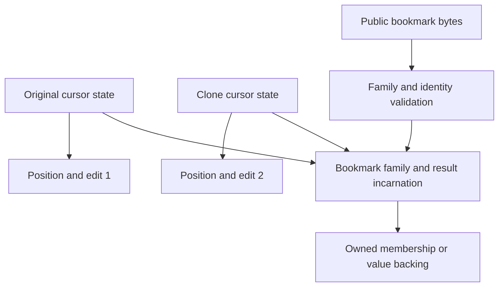

# II-07. ISAM, cursors and constraints

Revision 1 · Stage 2, response 6 · 2026-11-13

**Requirement trace:** Primary RQ-DAO-02 and RQ-ISAM-01. Shared obligations: RQ-PROD-02, RQ-SQL-04, RQ-SQL-05, RQ-DAO-01, RQ-DAO-03, RQ-ADO-01, RQ-LATE-02, RQ-LATE-03, RQ-ORACLE-02, RQ-FMT-03, RQ-VAL-03, RQ-CONC-01, RQ-CALL-01, RQ-CALL-03, RQ-CALL-04, RQ-PERF-01 and RQ-PERF-02. I-16 owns the complete scope text. K-CURSOR is implemented using II-03's page-image ownership, II-04's native row roots and codecs, II-05's full-entry/index mutation service and II-06's schema/relationship descriptors. II-08 owns transaction and persistent failure resolution.

This chapter specifies the executable ISAM mechanisms and their public policy boundaries: physical enumeration and row binding, result population, positioning and search, bookmark families, edit buffers, generated values, constraints and cascades. D-CURSOR-1 remains Provisional for native visibility/lifecycle transitions under R-CURSOR-1/R-DAO-1. Its shared mechanism and the original internal data structures below provide the implementation direction; a single global snapshot rule does not stand in for those transitions.

**Evidence boundary.** Microsoft documentation is cited as documentary evidence, with contradictions retained in the experiment. Reference mechanisms use the exact Jackcess commit `be0a2139b087a227d14cafd4ea231306a5a3a862`; exact files, headers, hashes and inspected extents are in A-01. That pin is not a release identification. Native bytes and state tables labelled constructed are independently calculated witnesses, not captured ACE results. No ACE or reference Java encoder execution occurred here. The initial oracle remains the user-reported ACEDAO.DLL 16.0.20527.20016, subject to environment capture. The real platform Automation ABI remains unchanged, including the 24-byte Windows x64 VARIANT and real BSTR. All new figures are emitted as tables/Mermaid source and are not render-verified. [^authority]

## 1. Cursor policies and the state they own

**Requirement trace:** RQ-DAO-02, RQ-ISAM-01, RQ-DAO-01, RQ-ADO-01, RQ-SQL-04, RQ-SQL-05, RQ-CALL-01, RQ-CALL-04, RQ-PERF-01 and RQ-PERF-02.

**D-CURSOR-1 remains Provisional.** Implement one physical navigation/mutation mechanism with an explicit policy selected for the public cursor. The unresolved parts are membership timing, refresh visibility, public failure transitions and lifetime effects under R-CURSOR-1/R-DAO-1; they do not justify four independent storage engines. The physical mechanism returns a checked row identity, end boundary or typed failure. The policy determines how that outcome changes the public state.

The public enum remains complete: Table=1, Dynaset=2, Snapshot=4, ForwardOnly=8 and Dynamic=16. Microsoft's enum describes Dynamic as dynaset, while the Recordset overview limits dynamic cursors to the legacy ODBCDirect workspace and says that workspace is unsupported by the documented Access generation. Retain the member and capture the actual target's acceptance/error in each context. Do not silently turn a request for Dynamic into the native-file dynaset mechanism. The later provider path can supply a genuinely dynamic source without changing the local engine's machinery.[^c-s9-types][^c-s9-rst]

`OpenRecordset` first binds source identity, explicit versus omitted Type, Options and LockEdit, then admits the resulting capability combination. Omitted Type can follow the documented default selection; an explicitly supplied type is a request whose actual result or error must match the native target. Conflicting option flags and read-only/locking arguments are checked in the observed order. A query, linked TableDef and directly opened native table need not admit the same type even if they ultimately read identical rows.[^c-s9-open]

| Selected policy | Native or derived navigation source | Retained state chosen by CalcDb |
| --- | --- | --- |
| Table | Owned-page scan or selected logical index over one native table | Physical scan/index position, owned logical row-root anchor, descriptor and refresh token. |
| Dynaset | Ordered stream of result occurrences with base-row provenance | Incremental membership store, identity-to-occurrence lookup where needed, refreshable base-row access, bounded spill. |
| Snapshot | Ordered result values under a retained source view | Stable values already produced; input versions and an unfinished producer for values not yet produced, or a completed value spool. |
| Forward-only | Forward result producer under the admitted visibility policy | Current row and bounded transport/lookahead state; no arbitrary backward occurrence directory. |
| Dynamic/provider | Later source capability selected by the external adapter | Provider-backed membership/visibility interface with separate public policy and captured negotiation. |

This table specifies mechanisms, not a claim that opening every snapshot instantly evaluates every output expression or that every dynaset sees all later inserts. The source interface must represent membership and value visibility separately. `VisibleRow(root, view)` is not automatically the same view used to decide whether that root belongs to a result or where it occurs in its order.

The cursor is a compact object with explicit ownership:

```text
Cursor:
    owner_handle, open_incarnation, public_policy, requested_options
    source_descriptor + descriptor/capability certificate
    source_view and membership_view
    family_handle                         # shared eligible result identity
    position_tag                          # Before / At / After / Empty / Undefined / DeletedCurrent
    current_occurrence?                   # result occurrence, not only base row
    current_row_token? + physical_anchor?
    observed_bof, observed_eof, no_match
    population_observation + member_store_handle
    selected_index? + physical_navigator
    derived_filter_text, derived_sort_text + creation_recipe_generation
    current_image_pin? + reusable_decode_scratch
    edit_state + owned_edit_buffer?
    last_modified_token?
    row_view_generation, operation_serial
```

A query can produce the same base row more than once. Its `current_occurrence` therefore cannot be replaced by a base-row bookmark, nor can a clone's position be stored in the shared membership producer. The member store records an occurrence identity, the source row identities needed for refresh/update, the required output values or their stable producing context, and its order position. Wide projections use offsets into owned arenas/spill blocks; they do not require a heap object per cell. A base row's relocation changes physical resolution while retaining the admitted logical identity. Deletion/reuse must never redirect a stale occurrence to an unrelated new row.

A clone shares the eligible family, descriptor and backing resources while owning its position, selected navigation state, pending edit and observation counters. The preferred implementation shares a producer/member store to avoid repeating a query; counters exposed by each cursor remain separately representable until R-CURSOR-1 settles whether population by one clone immediately changes another clone's RecordCount. This freedom costs a small observation state, not duplicate result values.

## 2. Native root identity and physical position

**Requirement trace:** RQ-ISAM-01, RQ-DAO-02, RQ-FMT-03, RQ-VAL-03, RQ-PERF-01 and RQ-PERF-02. The physical mechanism returns root identities and guarded field views. The public policy selects which view and population the operation is allowed to observe; BOF/EOF, NoMatch and EditMode are projected separately.

A base-table cursor carries an access path and a current logical row. For a table scan, the path is an owned-page-map iterator plus a row-slot position. For an index scan, it is the physical index descriptor, bounded tree/leaf position and full-entry anchor described in II-05. The current logical row is a root locator with a lifetime token. Its final data body may be somewhere else. Updating a row so that its final body moves cannot silently turn its identity into the body's new address.

The inspected reference keeps separate header/root and final-data row IDs in `TableImpl.RowState`; `TableScanCursor` uses the table's owned-page map and row slots; `IndexCursorImpl` uses an `IndexData.EntryCursor`. These are useful mechanism facts. The reference's current/previous positions, local modification counters and failed-find restoration rules are its own API behavior, not proof of DAO cursor behavior. Its cursor savepoint identity includes table and index numbers, which is insufficient as CalcDb's lifetime check across files, reopen, drop/recreate or page reuse. [^p-s9-table][^p-s9-scan][^p-s9-indexcursor][^p-s9-cursor]

Use the following original internal representation. Names describe ownership; they are not proposed on-disk fields or a public bookmark encoding.

```text
RowToken {
    file_incarnation, table_incarnation
    root_page, root_slot, root_incarnation
}
RowBinding {
    token
    visibility_ticket, table_layout_incarnation
    root_image_guard, root_slot_extent
    final_image_guard, final_slot_extent
    optional decoded_row_directory
    row_value_generation
}
ScanAnchor = BeforeAll | AfterAll | NativeRoot(page, slot, root_incarnation)
IndexAnchor = BeforeAll | AfterAll |
              FullEntry(owned_native_key, root_token, index_incarnation)
```

`root_incarnation` detects a physical root slot reused for a different row. Initially, the file coordinator can maintain it for locally observed transitions because exclusion prevents unobserved external writers. Use a sparse registry for identities that have escaped into active cursors, edits, membership spools or bookmarks; a full heap object for every row in the database is unnecessary. An ordinary transient scan candidate needs only the selected view and physical location until it becomes retained. Store the cursor's current token inline and reuse its reserved observer slot when moving; an older identity needs separate retained storage only when another owner still holds it. Creating a bookmark or extending a membership spool can therefore allocate without making every resident MoveNext allocate. Registry reclamation must outlive internal handles and the family-owned mappings for issued public bookmarks; client byte-array copies are not reference-counted engine handles. Counter wrap requires a controlled new registry incarnation or failure, not reuse of an old valid token.

A page-image ID establishes which bytes are read; it does not establish that the logical row still exists in a later visibility state. Conversely, a valid row token does not prove that a cached body span belongs to the newly admitted view. Validate both when rebinding. Historical token validation consults identity retained for the selected view, not only the current slot registry: a row valid in an old snapshot must not disappear merely because the current view retired its root. Rollback resolves the recorded identity transition according to the native bookmark/visibility policy; it never assigns a replacement row the old token merely because its restored bytes match. A byte fingerprint is not a replacement for identity: a delete and later insert can recreate exactly the same bytes. Later sharing with an external ACE writer requires the native freshness and reuse protocol from R-LOCK-3/4; timestamp polling does not extend the local generation scheme into that protocol.

## 3. An owned-page scan yields roots and suppresses overflow bodies

The ordinary table owned map determines the candidate page sequence. The available-space map is irrelevant to enumeration: it can omit full pages and is a placement hint. Column-owned LVAL maps likewise do not belong in the ordinary row scan. A checked map iterator supplies increasing page numbers for a forward scan and decreasing numbers for a reverse scan; each data page supplies row-slot numbers in the corresponding direction. This is a source-compatible physical enumeration mechanism, not an SQL `ORDER BY` guarantee or a complete statement about an unindexed DAO table's observable order. [^p-s9-scan][^p-s9-map]

Read the page under one admitted visibility ticket, validate its kind/owner and directory, then inspect root slot flags. A deleted-marked slot encountered in this enumeration is not yielded. A live overflow root is yielded once and resolved only when its requested fields require a body. Crucially, a deleted-marked body reached through that root is not skipped. Context determines whether the bit suppresses an independent table row or belongs to a still-live overflow body, as II-04 established. [^p-s9-table]

**Figure F-45 — complete constructed page 17 with a same-page overflow target.** This is an arithmetic witness over the II-03/II-04 grammar, not an ACE-created page. Page size is 4096; the owning TableDef is page 9. All ranges not listed below are zero for reproducibility, without asserting that ACE clears them.

| Page offset, hex | Bytes | Interpretation |
| --- | --- | --- |
| `0000–000D` | `01 01 B6 0F 09 00 00 00 00 00 00 00 03 00` | Data envelope, free count 4022, owner 9, three row slots. |
| `000E–000F` | `F0 4F` | Slot 0: live overflow root at `0FF0`. |
| `0010–0011` | `DD 0F` | Slot 1: ordinary root at `0FDD`. |
| `0012–0013` | `CA 8F` | Slot 2: deleted-marked overflow body at `0FCA`. |
| `0FCA–0FDC` | `04 00 2B 00 00 00 48 00 69 00 0A 00 0A 00 06 00 02 00 07` | II-04's 19-byte Row A shape with Id 43. |
| `0FDD–0FEF` | `04 00 2A 00 00 00 48 00 69 00 0A 00 0A 00 06 00 02 00 07` | Same row shape with Id 42. |
| `0FF0–0FF3` | `02 11 00 00` | Root 0 points to slot 2 on page 17. |
| `0FF4–0FFF` | Twelve zero bytes | Remaining root extent; no extra logical row. |

The slot directory ends at `0014`. The packed row area starts at `0FCA`, giving `0x0FCA−0x0014=4022` free bytes. Slot 0 occupies 16 bytes, although only its first four bytes are the overflow locator. Slots 1 and 2 occupy 19 bytes each. Masking their slot words before calculating extents yields nonoverlapping intervals; treating `8FCA` as an unmasked byte offset does not.

A forward physical scan produces `(root17:0, Id43)` and `(root17:1, Id42)`. It does not produce slot 2 independently. Fetching the first logical row resolves the already pinned page's slot 2 rather than performing a second physical read. An ascending single-Long Id index would instead contain these reconstructed entries in this order:

| Logical value | Complete source-derived entry bytes | Root returned |
| --- | --- | --- |
| 42 | `7F 80 00 00 2A 00 00 11 01` | page 17, slot 1 |
| 43 | `7F 80 00 00 2B 00 00 11 00` | page 17, slot 0 |

The index suffix is `u24BE(page) || u8(slot)`; the overflow locator is `u8(slot) || u24LE(page)`. Neither entry points to slot 2. This single fixture distinguishes scan order from index order, root from body, and the two locator encodings. Its full 4096-byte construction and independent decode are checked; it is not a complete database or a claim about ACE's preferred packing.

The original scan algorithm returns a tentative result; it does not directly change public cursor properties:

```text
NextRoot(scan_state, selected_view, direction, budget) -> Candidate | End | Error:
    require table/layout and view tickets are valid for this operation
    work = tentative navigation state over the selected owned-map view
    loop:
        if no current candidate page, or candidate slot crossed its directory:
            page_number = next owned-map page after work.page_anchor
            if absent: return End with the completed traversal ticket
            pin = AcquireCheckedDataPage(selected_view, table, page_number)
            directory = ValidateSlotEnvelope(pin)
            work.replace_page(pin, directory, first slot for direction)
        slot = work.take_next_slot(direction)
        charge one slot inspection even when the slot is skipped
        header = checked slot flags and extent
        if header.is_deleted_root: continue
        token = AcquireRetainableRootIdentity(selected_view, table, page, slot)
        return Candidate(token, guarded root extent, move(work), selected_view)
```

The implementation can keep tentative position changes in fixed-size locals and reuse the cursor's map/slot buffers, retaining the old pin until successful admission or failure policy releases it. A directory check can be cached per immutable page image. Full envelope validation is bounded by the native slot limit and actual page bytes. Empty pages, pages containing only suppressed slots and sparse map segments still consume traversal budget; none is a reason to loop without charging work. A wrong owner, truncated page or invalid slot extent is an error, not a successful end-of-table result.

The mechanism's forward and reverse scans are symmetric; the public adapter decides whether the requested recordset supports reverse movement. Refreshing the map or resuming after a locally appended row is a visibility transition selected by R-CURSOR-1. A retained map position never authorizes switching only the map to a new view while continuing to use old root pages accidentally.

## 4. Resolve a body under one coherent visibility state

For a current logical row, inspect the root first. A deleted root produces a deleted/missing-row classification for the adapter; it does not continue through an old pointer merely because the old body is still present. A live root's overflow chain then resolves through checked locations under the same visibility ticket. Validate the referenced page family, table ownership, row-slot range, extent and pointer width before following it. Charge every hop and reject cycles by `(page,slot)` within that traversal. A resource limit is a resource failure, not proof of file corruption.

```text
BindRow(token, selected_view, table_layout, budget) -> RowBinding | RowAbsent | Error:
    validate token's file/table/root incarnation under selected_view
    root = pin and validate token.root page and slot
    if root.deleted: return RowAbsent(reason = DeletedRoot)
    current = root; visited = bounded traversal set
    loop:
        require visited.insert(current.page, current.slot) succeeds
        charge hop and any new image retention
        if not current.overflow:
            body = ValidateRowEnvelope(current.extent, table_layout)
            return binding owning root/body guards and selected_view ticket
        require current.extent has at least four bytes
        target = DecodeOrdinaryLocator(current.extent.first4)
        current = pin/check target within selected_view and table ownership
        # a target's deleted bit suppresses scan enumeration; do not reject it here
```

These are memory-safety and ownership invariants, not a claim that every unusual chain shape is a valid ACE output. The admitted format profile controls which shapes the writer may create. A raw inspector may describe additional bounded structures without making them writable. The public error adapter chooses the native-compatible response and point of failure from R-FMT-2/R-CURSOR-1; the physical routine does not invent a DAO error number.

Do not release the root identity when the body is found. The next indexed update/delete needs the root locator, while row field decoding needs the final extent. If both occupy one page, share one immutable guard/image identity; if an edit touches both, compose into one prepared page revision. Keeping two stale writable copies would lose either the root-pointer change or body change. When the next operation admits a newer view, reconstruct the binding from its root and discard cached offsets or values tied to the earlier body generation.

Field access remains lazy. A fixed scalar uses the compiled field coordinates and the row mask; a variable field uses the checked row directory; a long value begins with an owned or guarded descriptor whose later read remains tied to its admitted image source. A Field object retains its column descriptor, not a byte pointer into whichever row happened to be current when the object was obtained. Repeated field-name resolution is cached independently of row movement; row-local decoded values expire when `row_value_generation` changes. The public value returned across COM owns the necessary BSTR/SAFEARRAY/value storage, so moving the cursor cannot invalidate it.

## 5. An index position is a full entry, including the root locator

II-05 provides the native key encoder, inclusive high-fence descent and typed bounds. ISAM binds that physical index to its selected visibility and combines its candidate root with `BindRow`. It must retain the distinction between a user-key equality group and a single entry. The source `RowIdImpl` orders ordinary references by page then slot; `IndexData` orders key bytes before those row IDs. Its special first/last IDs are in-memory sentinels, not locators to serialize into a page. [^p-s9-rowid][^p-s9-index]

For the duplicate group already used in II-05, all three user keys are `7F 80 00 00 2A`, representing the constructed Long 42. Their root locators are `01 23 45 02`, `01 23 45 07` and `01 23 45 FE`. `KeyLow(K)` begins before all three; `KeyHigh(K)` ends after all three. `FullEntry(K, page0x012345, slot7)` names the middle row alone. After a bookmark restores a particular root under an index, reconstruct its current full key and seek the exact full entry, checking that the returned locator equals the requested root. Seeking merely the first duplicate of its key can silently position on another row.

A lower-bound result is an insertion boundary or candidate, not necessarily an existing current row. That distinction matters after deletion. The inspected `EntryCursor` tracks modification counts and refreshes bounds plus its current/previous entries; its `Position` explicitly represents an entry that is no longer present as a between position. That is a useful mechanism explanation for the no-double-advance rule below. [^p-s9-index]

**Figure F-46 — deleted-anchor continuation in a duplicate group.** Original state trace over constructed entries; no native cursor-policy result is asserted.

| Step | Available entries in selected order | Navigation consequence |
| --- | --- | --- |
| Before mutation | `42:...:02`, `42:...:07`, `42:...:FE`, `43:...:01` | Current full anchor is `42:...:07`. |
| The current root is deleted | `42:...:02`, `42:...:FE`, `43:...:01` | The old full anchor remains an ordering boundary, not a readable row. |
| Qualified next operation refreshes | Same ordered entries | A strict search after the old anchor selects `42:...:FE`. |
| Publish candidate | Same | Accept `42:...:FE` directly; incrementing its slot again would skip it. |

Implement continuation with an explicit distinction between an unchanged retained position and a refreshed candidate:

```text
ContinueIndex(navigation, admitted_view, direction, budget):
    if retained image/path and required visibility remain valid:
        return AdjacentEntry(navigation, direction, budget)
    anchor = policy-owned continuation anchor captured before invalidation
    bound = qualified continuation rule(anchor, direction)
    candidate = SearchBoundary(admitted_view, bound, direction, budget)
    return candidate                 # search has already advanced to its candidate
```

The qualified continuation rule is not universally “after the old key.” A current row whose own key changed may require rebinding its current identity and continuing from its new order position; another operation may preserve the old boundary or require requery. Those public transitions remain R-CURSOR-1. A deleted row's retained full-entry bytes can still be a valid ordering boundary: validating the index/view/anchor does not require that old row token to be readable. Resolving a bookmark to a current row does require the separate row-availability check. The mechanism can represent each without borrowing a freed page or silently skipping duplicates. Likewise, reaching EOF does not decide whether a later insertion becomes discoverable: retain the relevant last anchor and population ticket, then apply the evidenced boundary-refresh policy.

An index can omit rows under its native flags. The inspected `IndexCursorImpl` explicitly warns that indexed traversal may omit entries for indexes that ignore Nulls. Thus the planner cannot replace a complete table scan with an arbitrary index walk solely because the fields are convenient. It needs a completeness proof for the query or an admitted extra path for omitted rows. The behavior of explicitly selecting such an index on a DAO table cursor is an oracle question rather than a reason to add rows the tree does not contain. [^p-s9-indexcursor]

The reference also applies row-value matchers after an index candidate and selects a Java case-insensitive matcher for some unique-index operations. CalcDb does not adopt that matcher as native equality. Residual checking, text collation, Nulls and shortened-key collisions belong to the admitted comparison profile and R-SORT-3. A residual predicate may reject a candidate, but the continuation must still use the full entry so that another duplicate or collision candidate remains reachable.

## 6. Population, visibility and result storage

The preferred provisional dynaset mechanism fixes initial candidate membership against the opening membership view, incrementally stores occurrence identities, and refreshes payload values through the separately qualified read view. Its ordered occurrence sequence survives a base row's key change unless the native policy explicitly repositions it. Own inserts, deletes, qualifying/nonqualifying edits and another cursor's updates have distinct membership transitions. The experiment changes unread source rows after Open but before their first access, and compares updates to already visited rows; those two interventions discriminate an opening keyset from a membership stream that remains live while being populated.

If ACE instead admits later candidates during initial population, replace the opening-membership cutoff with the observed frontier refresh rule. Keep the same member store and occurrence identity model. A later insert becoming visible is a policy result; it must not accidentally happen merely because an index page was repinned. Conversely, refreshing the value of an already admitted row must not silently rerun its predicate and remove it from the dynaset when native behavior would retain it.

For a snapshot, prefer one retained source view plus lazy result production. Produced values are owned by its result store; unproduced values retain enough input versions to be computed consistently. A plain list of physical page numbers is insufficient after a writer changes those pages. Pinning every page forever is also not the design: use the pager's version retention with charged ownership and, where cheaper, copy values into a bounded spillable spool. Retaining a snapshot can then cause either old image retention or result storage; charge the larger graph actually retained, including LV dependencies, rather than only the small cursor object.

Producing ahead can execute expressions, surface an error or consume a stream earlier. Consequently the spool cannot be filled eagerly merely to escape version-retention pressure when doing so would alter observable call timing. Preserve the source versions, spill safely retained material, or return the specified resource failure at the actual operation boundary. R-CURSOR-1 with R-EXPR-1 selects whether a particular expression is evaluated at Open, during population or on field access. The same rule prevents a forward-only optimization from changing UDF call order. Microsoft's overview documents local temporary storage and failure when that space is exhausted, but it does not prescribe CalcDb's buffer shape or a universal eager evaluation schedule.[^c-s9-rst]

Population has three different numbers:

```text
PopulationState:
    produced_occurrences                 # internal materialization progress
    observed_live_count                  # the public policy's count
    completed_source                     # exact end discovered, not guessed
    deletion_observations                # counted once per affected occurrence
    ordinal_directory_or_spill_index
    producer_failure?                    # typed, with observed delivery point
```

`RecordCount` is an observation of this state for non-table cursors, not an implicit `COUNT(*)`. The documentation distinguishes visited/populated records from the eventual total, says Requery resets the observation, and warns that rollback can leave the public count stale. It also distinguishes immediate own deletion from another user's deletion discovered by positioning. Table counts and result counts therefore have separate producers; neither is borrowed from II-05's persisted index distinct-entry counter.[^c-s9-count]

A scalar property getter must not run the remaining query just to obtain an attractive exact number. `MoveLast` on an admitted scrollable result requests completion, so its cost can include all remaining rows and spill writes. `MoveFirst` can then reuse the first retained occurrence. An ordinal setter is different: the AbsolutePosition reference bounds assignment by the already populated count, so extending population to satisfy an out-of-range assignment would invent behavior. Keep the public count even when the internal materializer knows more through a required operator such as sorting.[^c-s9-absolute]

`AbsolutePosition` and `PercentPosition` do not establish durable identity. AbsolutePosition is a zero-based result ordinal whose availability, no-current result and deleted-current behavior are public policy. PercentPosition uses the admitted population and can return a rounded approximation after assignment. Its remarks include table-type use while its sample comment restricts use to dynaset/snapshot; keep that disagreement as a target probe, not a reason to remove the member. The preferred internal algorithm uses a live-ordinal directory for eligible result stores and a separate native-table positioning policy; no universal `100 * ordinal / count` formula is claimed.[^c-s9-percent]

A practical ordinal directory is a contiguous occurrence vector with a deletion bitmap and a per-block live count. Finding the nth live occurrence uses prefix counts plus a scan inside one bounded block. A Fenwick tree over block counts gives O(log b) updates/selections for b blocks without shifting all later entries after deletion; a simpler vector is preferable when measured mutation volume is small. These are CalcDb choices. Public timing, rounding, stale counts and unsupported contexts remain separate from the data structure. Spill directories retain block offsets and checksummed temporary-file records in the permitted local temporary store; none becomes native database metadata.

## 7. Position flags and failure transitions

The position tag, BOF, EOF and NoMatch are independent fields. The documented implications are one-way: BOF or EOF implies no current record, but both False does not prove a valid current row. In particular, deleting the current row can leave both flags unchanged. Opening an empty set establishes both True; an ordinary successful positioning establishes both False. Moving past the end establishes EOF; repeating that outward MoveNext is an error.[^c-s9-bof][^c-s9-next]

NoMatch starts False. An unsuccessful Find/Seek sets it True and invalidates the current row; the Move methods do not clear it. This means a cursor can have a valid current row and NoMatch=True after successful movement following a failed search. It cannot be represented by one `has_current` Boolean plus a computed NoMatch getter.[^c-s9-nomatch]

**Figure F-47 — constructed state trace.** This trace is an executable design witness assembled from documentary rules; it is not an ACE capture. Exact errors and transitions not specified here remain native probes.

| Operation on an initially nonempty three-row scrollable result | Position | BOF / EOF | NoMatch | Key implementation obligation |
| --- | --- | --- | --- | --- |
| Open | First occurrence | False / False | False | Own the first row view; retain producer frontier. |
| Failed FindFirst | Undefined | Capture native flag result | True | Retire current borrowed values even if the old page stays cached. |
| Successful MoveFirst | First occurrence | False / False | True | Do not reset search history. |
| MoveLast | Last occurrence | False / False | True | Complete population where the selected result policy requires it. |
| MoveNext | After end | False / True | True | Current values become unavailable. |
| MoveNext again | After end | False / True | True | Return the native error; do not restart. |

The BOF page's movement table permits an inward relative move from a one-ended state; the Move method text broadly rejects relative Move when either flag is set unless a valid bookmark is supplied. The preferred provisional policy uses the detailed directional table for positional eligibility and the method-specific rule for explicit bookmark validation. R-CURSOR-1 compares `MoveNext` with `Move 1`, and `MovePrevious` with `Move -1`, at both boundaries. If the native methods differ, keep different adapter transitions over the same physical navigation primitive.[^c-s9-bof][^c-s9-move]

A search miss is not an I/O error, malformed page, callback exception or exhausted resource budget. Keep those outcomes distinct all the way through the adapter. Likewise, validating an illegal argument before navigation, failing while materializing a later row, and reaching ordinary EOF may leave different cursor/edit states. A temporary navigation object protects memory and pins; it does not automatically promise that every public failure restores the old position.

The cursor policy therefore describes transitions by phase: admission, edit disposition, search/population progress, publication and failure. For ordinary accepted movement, the documented baseline abandons unposted changes; `Move 0` is also documented to cancel Edit/AddNew while obtaining current underlying values. The target experiment settles whether an argument error, end boundary or later read failure abandons the buffer before or after failure. There is no silent Update in the movement primitive.[^c-s9-next][^c-s9-move]

```text
PositionCursor(cursor, request, call_budget) -> PublicOutcome:
    retain cursor owner and admitted descriptor/view
    policy = ResolveCursorPolicy(cursor, request)
    admission = policy.Admit(request, cursor.public_state)
    if admission fails: return its exact public failure transition
    operation = new operation serial; reserve bounded navigation state
    copy any anchor/bookmark arguments needed after reentry
    apply policy's admitted pre-navigation edit disposition
    invalidate row-local borrowed views at the selected boundary
    candidate = NavigateOrPopulate(source, admission, call_budget)
    # candidate owns its row identity, pins and newly produced state
    validate owner/open incarnation, descriptor and source certificate
    if context changed:
        use only an admitted retained-view continuation, or fail without replay
    apply policy's outcome transition:
        Found: install owned position/pin, update flags and population observation
        End: install the correct boundary, retain any required anchor
        NotFound: install undefined position and the search NoMatch transition
        Failure: apply this operation/phase's measured failure policy
    release obsolete pins and tentative state without replacing the public error
    return resulting public outcome
```

This wrapper allocates only when its bounded retained state must grow; ordinary within-page movement reuses existing storage. A large displacement consumes candidate rows or populated ordinals until its distance is exhausted. It must use checked signed arithmetic for the public Long distance: negating the most-negative Long in the same width is invalid. Bookmark-relative movement validates and positions from the supplied identity before measuring displacement; it is not pointer arithmetic on the current row directory.

## 8. Seek: argument semantics above native bounds

The selected logical index controls traversal; changing it does not sort native data pages. The new index must exist, and Seek requires one. Capture position, pending edit, NoMatch and bookmark behavior immediately after `.Index = name`; do not infer that assigning Index performs a MoveFirst because examples do so explicitly.[^c-s9-index]

For Seek, bind the comparison operator and each supplied argument before encoding native keys. The documentary method model searches forward for `=`, `>=`, `>` and backward for `<`, `<=`; it gives a special end-duplicate caveat. Omitted trailing arguments are Null defaults, not an internal prefix wildcard. The tutorial conflicts about direction and which operators permit omissions. Prefer the method model provisionally, retaining actual missing-slot information until qualification and testing every operator with explicit Null and omitted trailing values separately.[^c-s9-seek][^c-s9-seek-guide]

The thirteen public argument slots do not establish thirteen supported indexed columns in every file format; the selected catalog descriptor supplies actual arity. Preserve the argument state produced by ABI binding: supplied values, permitted omissions, explicit Null, Empty, ByRef inputs and exceptional values. Apply the qualified Seek conversion for each declared index field, including any string-to-number conversion ACE accepts. Do not turn typed arguments into SQL text and parse that text as an alternative conversion route. Missing first/middle arguments, omitted trailing arguments, extra supplied arguments, invalid comparison strings and an invalid selected index receive separate precedence captures. Every actual indexed field participates in the admitted key; an unknown field codec cannot be omitted from a composite key merely because the known prefix is encodable.

Once a complete key K and comparison domain are qualified, II-05's bounds provide a concrete implementation. In this table, `KeyLow(K)` precedes every equal-key locator; `KeyHigh(K)` follows every equal-key locator; `Predecessor(bound)` means the greatest real entry strictly below that bound. These are tagged internal states, never persisted sentinel locators.

These operations select an eligible physical boundary or key group. The public duplicate-selection rule is applied after that selection for every operator. In particular, a reverse `<` search whose first eligible group is the terminal duplicate group does not automatically select the greatest row locator. Captures choose the required starting entry and continuation; ordinary B-tree tie order remains an internal storage rule.

| Operator in an admitted index-order relation | Preferred physical operation | Required acceptance check |
| --- | --- | --- |
| `=` | `LowerBound(KeyLow(K))` | Candidate's user key equals K under the admitted equality rule. |
| `>=` | `LowerBound(KeyLow(K))` | Candidate satisfies the admitted relation. |
| `>` | `LowerBound(KeyHigh(K))` | Skip the complete equal-key group. |
| `<=` | `Predecessor(KeyHigh(K))` | Candidate satisfies the relation and the shared duplicate-selection policy. |
| `<` | `Predecessor(KeyLow(K))` | Exclude every equal-key locator; apply the shared duplicate-selection policy. |

The lowering returns a search plan: one or more proved candidate intervals, traversal direction, residual predicate where required, duplicate-selection policy and stopping rule. A residual rejection advances within that admitted candidate set. It is not NoMatch until the selected search space is exhausted. Row access, conversion or residual evaluation failure is a typed error, not a rejected candidate. Long-key shortening, unusual scalar encodings and collation equivalence use only the range proof and residual rule qualified for that descriptor; a single boundary probe is insufficient where those proofs do not hold.

The table is an algorithm over an explicitly admitted relation. It is not evidence that public comparison on every descending/mixed index equals unsigned native-key comparison. For ordinary full-key ascending cases the lowerings are the preferred direct path. For descending cases, the provisional candidate is comparison in selected index order; the experiment below distinguishes that from natural value order while keeping the documented search direction. Keep an ordered scan implementation parameterized by the qualified relation, coercions and duplicate policy. It is an executable semantic reference and a fallback where that known relation lacks a proved efficient native range lowering. An unresolved relation, unknown comparison codec or missing indexed-field interpretation remains unqualified; scanning does not settle it. Before qualification, the mixed-direction index-order rule remains only the preferred design candidate used to construct discriminating tests.

**Figure F-48 — constructed mixed-direction discriminator.** Use two Long columns and index `(A ascending, B descending)`. The full physical order is:

| Ordered entry | A | B | Distinct row label |
| ---: | ---: | ---: | --- |
| 0 | 1 | 9 | r0 |
| 1 | 1 | 7 | r1 |
| 2 | 1 | 7 | r2 |
| 3 | 2 | 8 | r3 |
| 4 | 2 | 4 | r4 |
| 5 | 3 | 6 | r5 |

For requested tuple `(2,8)`, the source-derived key codec from II-05 gives the constructed ten-byte user key `7F 80 00 00 02 80 7F FF FF F7`. The first five bytes encode ascending Long 2; the next five encode descending Long 8. Row locators are excluded from this comparison key. These are independently calculated bytes, not an ACE capture.

| Seek operator at `(2,8)` | Index-order relation, chosen provisional candidate | Natural ascending tuple relation with the same search direction |
| --- | --- | --- |
| `=` | r3 | r3 |
| `>=` | r3 | r3 |
| `>` | r4 | r5 |
| `<=` | r3 | r4 |
| `<` | r2 | r4 |

The differing outputs make the experiment decisive. Add a second query at duplicate tuple `(1,7)`, with duplicates on two leaf pages and again at the end of the index. Capture the selected native row identity and its neighboring MoveNext/MovePrevious results. Public duplicate selection need not equal the lowest/highest physical row locator merely because the tree needs that tie-breaker. Repeat with all-descending indexes, each Null position, text collation-equal strings and the long-key collision cases of II-05. The native capture selects the relation and boundary/duplicate rules; no inferred rule gets promoted solely by passing a self-generated tree test.

A missing trailing argument is especially revealing in this index: Null has its own direction-dependent encoding. Replacing an omitted B with `FieldPrefixLow(A)` would search a different interval from encoding `(A, Null)`. Retain both mechanisms internally, use the actual DAO lowering for Seek, and reserve prefix bounds for operations whose semantics really specify a leading-field range.

For a key update or local index mutation while a table cursor is open, the navigator reuses II-05's owned full-entry anchor and revalidation rules. The public policy decides whether the current row moves in the selected order. A successful key lookup still resolves a logical root and validates row availability; a tombstoned slot, changed incarnation or malformed overflow chain cannot be reported as an ordinary miss without the native disposition.

## 9. Find: result order, predicates and safe acceleration

Find operates on eligible dynaset/snapshot result occurrences. The criteria is an Access expression context analogous to a WHERE restriction without its keyword. Its parser/coercion/date/wildcard rules come from the expression/SQL service; locale-sensitive client string formatting is not a second criteria dialect. The method reference distinguishes first/last/next/previous search origins and reports undefined position plus NoMatch on failure.[^c-s9-findfirst]

The preferred FindNext/FindPrevious traversal excludes the current occurrence, preventing repeated calls from returning the same match indefinitely. The public wording calls the origin the current record without explicitly spelling out inclusivity; qualify this preferred rule using consecutive matching rows, a singleton result, a changed criterion and recovery after a failed Find. `FindFirst`/`FindLast` start at the result's ends; reverse search may need to complete population first. A current row's base identity is insufficient to locate the next occurrence when a join produces duplicates.[^c-s9-findnext][^c-s9-findprevious]

Compile a repeated criterion once against the result field mapping and the exact semantic/context certificate, keeping an owned syntax/constant arena and reusable evaluation scratch. Bind result aliases and expressions to their declared output slots. An accepted criterion can use a base index only if the planner proves equivalence for membership, result order, comparison/coercion, visibility and observable effects. For a result ordered by descending Amount, a Name index can identify matching base identities but its first leaf match is not necessarily the result's first match. Intersect with membership and select the appropriate result occurrence, or scan in result order.

The serial reference algorithm is a directional occurrence scan with the shared evaluator. It charges inspected rows, evaluated fields and host effects, including rejected candidates. An accelerated equality/range search may reduce those reads only when skipping evaluation is permitted. It cannot suppress an earlier error or side-effectful UDF by preselecting a later match. Text prefix optimization must use the exact collation/pattern semantics and any residual predicate; UTF-16 `StartsWith` is not a substitute.

```text
FindOccurrence(cursor, method, owned_criteria, budget):
    bound = CompileOrReuseCriterion(result_schema, criteria, context_certificate)
            or return its typed failure
    navigation = StartFromPublicFindOrigin(method, cursor) or return typed failure
    loop:
        step = navigation.NextCandidate(budget)
        if step is End: return NotFound
        if step is Error: return its typed failure
        occurrence = step.Candidate
        retain occurrence/view and load required values, or return typed failure
        result = EvaluateCriterionOnce(bound, occurrence, budget)
        if callback changed context:
            continue only through a valid retained continuation, else fail
        if result is Error: return its typed failure
        if result is accepted true under the criterion's Null/error policy:
            return Found(owned occurrence and position)
        # only the qualified false/Null outcome advances to another candidate
```

All effects already performed remain performed on error; the adapter never restarts this loop silently after reentry. Cache eviction can discard compiled criteria but cannot invalidate one retained by the active call. Predicate compilation and candidate acquisition failures use the same public phase accounting as other navigation, including the pending edit's fate.

## 10. Filter, Sort and a derived Recordset

DAO Filter and Sort configure a subsequently opened Recordset. Their assignment is not a command to remove or reorder the current cursor's existing occurrences. Filter is a restriction expression; Sort supplies a new order for eligible dynaset/snapshot sources and supersedes the originating QueryDef order when the derived object is created. Table ordering instead belongs to Index, and Sort is not documented for forward-only cursors.[^c-s9-filter][^c-s9-sort]

Store the property text and a creation-recipe generation on the source cursor, independently of its active membership/order. The setter performs only the validation and public effects established for that setter. Bind the derived predicate/order and reserve its resources when `Recordset.OpenRecordset` actually creates the child; a malformed expression's exact error point remains a probe. The Filter documentation specifically places its locale-formatted numeric expression failure at the next OpenRecordset, which rules out unconditional eager evaluation of every setter.[^c-s9-filter]

The preferred child mechanism transforms the parent's complete admitted result, including occurrences not yet populated, without changing the parent's current position. A filter can stream eligible occurrences; a sort may have to complete candidate production and retain/spill sort keys plus occurrence identities. The child owns a new result/bookmark family, while sharing immutable backing and base-row provenance where valid. Its type/options determine its own updateability and scrolling behavior. Closing the parent releases its cursor state but cannot free backing retained by the child; exact public lifetime/transaction effects still follow the captured lifecycle policy.

For example, take a parent ordered by `OrderID`, assign `Filter = "Amount > 100"` and `Sort = "Amount DESC, OrderID"`, then open the derived cursor. The parent retains its original sequence and position; the proposed child is built from the parent's admitted occurrences that pass the filter, with the requested child order. Whether an unread base row altered between those calls participates is decided by the source membership/value policy, not by an accidental fresh SQL query against the whole database. R-CURSOR-1 compares parent/child field values, membership, type, bookmarks and counts before and after each alteration, as well as a snapshot parent with subsequently changed base rows.

Reuse the expression and sort services, but do not implement this by concatenating untrusted property text into reconstructed SQL and reopening the base query. Such reconstruction could repeat UDF effects, change captured parameters, lose parent membership restrictions, and change duplicate occurrences. If the native target actually reexecutes some source form, represent that as an explicit qualified creation recipe rather than hiding it inside a convenience method.

The current Recordset.OpenRecordset reference also has a documentary inconsistency: its syntax lists Type and Options while the parameter table contains Database-style Name and LockEdit entries. The callable interface manifest/type information settles the real signature; the prose is not permission to add parameters to the ABI.[^c-s9-derived-open]

## 11. Bookmarks, clones and requery families

An internal bookmark token contains a family identity and incarnation, a result occurrence or native logical-row token, and sufficient version/locator resolution evidence. It never exposes a borrowed pointer or relies solely on an on-page slot. An index leaf's four locator bytes and an overflow locator's four differently arranged bytes are storage references, not the public Bookmark format. A retained snapshot bookmark can resolve to a spool occurrence even when its source row has since been deleted; a live cursor's deletion rule is a different policy.

Microsoft allows interchange between a Recordset and its clones, rejects interchange between independently opened Recordsets, and specifies an error for a deleted-record bookmark. The property page suggests String storage while the concept article calls the returned value a Byte array; the public ABI therefore needs an actual typed capture. The preferred candidate is an owned one-dimensional `VT_ARRAY|VT_UI1` result, with native rank, bounds, byte length and accepted setter forms established by R-CURSOR-1. Do not publish a guessed fixed byte layout or infer it from a VBA variable declaration.[^c-s9-bookmark][^c-s9-mark]

Capture the direct COM VARIANT, its active type and SAFEARRAY element type/rank/bounds; then separately test VBA Variant/Byte()/String assignment behavior. Conversion performed by the client must not be mistaken for the server's return type. The portable stand-in follows the same qualified shape; Windows x64 uses the real 24-byte Automation VARIANT already specified in II-02. The getter copies/transfers owned public storage according to that contract, and allocation failure must not move the cursor.

A public bookmark is an owned value, not an engine object reference. Clients may copy its Byte array or BSTR without notifying CalcDb and later present any surviving copy. If the encoding uses issued tickets or an identity lookup, those mappings and necessary stale-identity/tombstone evidence are owned by the live bookmark family until its qualified expiry or invalidation. They cannot be reclaimed by counting returned values or presumed outstanding copies. Repeated gets for one occurrence can reuse its issued ticket while returning independently owned public storage. New ticket allocation is budgeted before returning success; exhaustion cannot invalidate bookmarks already issued. This requirement need not pin a native page per bookmark: retained logical identities resolve through the current admitted family/view, and snapshot families already own the required value backing. Spilling an issued-ticket map must preserve previously issued values and lookup behavior. Surviving client bytes do not keep a closed family or database session open.

Bookmark validation is layered: input representation and bounds, family/incarnation, occurrence/row identity, current capability and target row availability. Invalid or adversarial byte arrays cannot choose arbitrary pages. Store enough family identity to reject an independently opened but byte-identical table. A pure representation decoder performs no field evaluation or native mutation. Resolving a valid identity can require ordinary row I/O, and that failure remains distinct from invalid bookmark syntax.

**Figure F-49 — proposed identity and lifetime ownership.** Original design. Cursor-to-family edges denote retained engine ownership; the public bookmark path denotes validation, not a client reference that keeps the family alive. Native Close/Requery invalidation policy remains provisional.



Clone construction does not copy current position or a table cursor's selected Index under the documented model. It initially lacks a current row and can be positioned independently. Closing either object leaves the other open; closing a clone during a pending transaction is nevertheless documented to cause implicit rollback. Accordingly Close first executes the measured Workspace/lifecycle transition and then releases this cursor's ownership; a reference decrement alone would miss a database-visible effect.[^c-s9-clone]

Prefer keeping shared family backing alive while an eligible clone retains it. The concept article's broad statement that Close invalidates saved bookmarks must be qualified against clone interchange and independent closure: test a bookmark obtained from the original after closing that original, assigning it in a live clone, and the converse. If ACE invalidates a shared bookmark generation, change that public generation without destroying storage still needed by the surviving clone. COM reference lifetime, resource-open lifetime and bookmark validity are separate.

Requery prepares a new execution using II-06's retained or explicitly supplied parameter binding, then applies its measured replacement transition. The preferred design gives the caller a new result incarnation and detaches it from the old family while existing clones retain their old backing; R-CURSOR-1 tests whether native behavior instead refreshes or invalidates some shared family state. Old bookmarks are not silently rebound to rows with the same values in the new execution. A failed Requery likewise needs a captured disposition for the old row, population, pending edit and retained parameter binding.

LastModified retains its originating owner, result incarnation, row identity and successful-operation receipt. Clone construction and Requery have explicit LastModified transitions rather than copying a bare token into a new family. The preferred new clone starts with its own idle edit state and owner history; native probes decide any observable inherited history. On Requery, retain, clear or invalidate the old receipt according to the captured policy, but never rebind it by row number, matching field values or a reused native locator. Capture the LastModified getter and subsequent Bookmark assignment independently after success, failure, rollback and deletion.

The Requery documentation places a successful nonempty result at its first record and describes the supplied-QueryDef exception to Restartable checking. Restartable's own page says a table cursor returns False. Keep the member, the type/context admission and the supplied-definition transition separate; do not implement Requery as merely flushing cached pages.[^c-s9-requery][^c-s9-restartable]

## 12. Query provenance and field-level updateability

**Requirement trace:** RQ-ISAM-01, RQ-DAO-01, RQ-DAO-02, RQ-DAO-03, RQ-SQL-04, RQ-SQL-05 and RQ-ADO-01.

The cursor producer must retain enough provenance to distinguish a result occurrence from the base records that produced it. An output row number, projected primary-key value or bytewise comparison of every visible field is not an adequate replacement for native row identity. A query can omit keys, repeat one base row through a join, project one base field twice under different names, or produce equal values from different source records. The binder and execution operators therefore carry a compact lineage descriptor alongside the ordinary result slots. This is an in-memory execution structure; it creates no native hidden column.

Microsoft distinguishes Recordset.Updatable from the DataUpdatable property of individual fields: a dynaset may contain both writable and read-only fields, while snapshot and forward-only objects report nonupdatable. The Field reference excludes AutoNumber fields from DataUpdatable. These documentary contracts justify per-field capability metadata, but do not establish the complete target-build rules for joins, permissions, options or a row that has disappeared. [^r-s9-updatable][^r-s9-dataupdatable]

```text
ResultOccurrence:
    family_incarnation, occurrence_id             # result position identity
    source_rows[]                                # stable RowTokens or AbsentSide
    projection_values_or_recipes[]
    membership_evidence, value_visibility_policy

OutputFieldOrigin:
    Direct(source_slot, table_incarnation, physical_column_id)
    | Derived(expression_identity)
    | Aggregate(group_identity)
    | ProviderOrigin(provider_capability)

UpdateMap:
    field_origins[], per_field_capabilities[]
    candidate_target_sets                         # edit/add/delete can differ
    join_multiplicity_and_nullable_sides
    native_consistency_policy, permission_context
    definition_and_schema_dependencies
```

The occurrence ID is distinct from every source row token. A one-to-many join can have two output occurrences referring to one parent, and a projection can have two columns referring to the same base field. Alias resolution happens once during binding, using physical column identity and the source slot, not a fresh lookup of the output field's current spelling at Update. The public SourceField and SourceTable strings are separately projected metadata. Their documentation describes original names despite aliases, and also cautions that SourceTable is not meaningful on a table-type Recordset. Do not derive the engine's mutation target from a public string property with that limitation. [^r-s9-sourcefield][^r-s9-sourcetable]

**Figure F-50 — constructed result occurrences and base-row ownership.** Original in-memory design witness, not native file bytes or an ACE observation.

Let parent row `P7` have `CompanyId=7, CompanyName="North"`, and let child rows `C10` and `C11` both reference CompanyId 7. Parent `P8` has no matching child. A query projecting parent name, child ID, child Amount and `Child.Amount*2` yields:

| Occurrence | Parent source token | Child source token | Writable-origin candidates | Derived output |
| --- | --- | --- | --- | --- |
| J0 | P7 | C10 | CompanyName→P7.CompanyName; ChildId→C10.Id; Amount→C10.Amount | Amount*2 |
| J1 | P7 | C11 | CompanyName→P7.CompanyName; ChildId→C11.Id; Amount→C11.Amount | Amount*2 |
| J2 from a left join | P8 | AbsentSide | Parent origins retained; child insertion needs its own native policy | Expressions over the null-extended side |

The table lists origins, not a promise that every listed field is writable. A consistency policy may prohibit a parent update which would affect several result occurrences. A native inconsistent-update policy may permit it, in which case the engine mutates P7 once and applies the separately captured refresh behavior to J0/J1. Referential integrity is still enforced by the common mutation service. An absent outer-join side is not a fabricated row with every field Null; whether assigning to it creates a child row, fails, or requires additional key fields is an explicit R-CURSOR-1 provenance branch.

The preferred implementation computes structural updateability during binding and combines it with source capabilities, requested cursor options and current permission context. Actual mutation revalidates the retained target and affected capabilities. It must not conclude that a successful Updatable getter guarantees that a later Edit, assignment or Update succeeds. Conversely, a missing visible primary key does not prove a local native table is unidentifiable: the row-root mechanism remains available. The broad unique-index sentences in some DAO edit references require the local/linked and table/dynaset controls in the experiment, not a blanket refusal to edit local heap tables.

For `dbConsistent` versus `dbInconsistent`, prefer a policy attached to the update map rather than a bypass around constraint enforcement. Microsoft's DAO one-to-many guidance describes the effect on parent-side updates and says the option is ignored for table, snapshot and forward-only recordsets; the enumeration includes snapshot in its applicability wording. Record both sources and measure actual option/type handling. Neither text establishes that a database relationship declared as enforced can be violated merely by requesting inconsistent dynaset updates. [^r-s9-inconsistent][^r-s9-options]

`DISTINCT` and `DISTINCTROW` cannot share a deduplication key by accident. The SQL reference says DISTINCT selects unique projected tuples and makes the result nonupdatable; DISTINCTROW considers complete source records and has a different effect when only some joined tables contribute output fields. The implementation therefore keeps source identity available through the appropriate operator. TOP does not by itself remove updateability. The exact update map after DISTINCTROW, join nesting or hidden fields is captured in R-SQL-3 and the provenance branch, including comparisons with and without a supporting index. [^r-s9-predicates]

A query-surface capability matrix covers single tables, aliases, repeated projected fields, one-to-one/one-to-many/many-to-many joins, outer joins, aggregates, UNION, crosstabs, DISTINCT/DISTINCTROW, linked sources and permissions. The Access query-editing guidance supplies useful cases but includes front-end behavior and exceptions, so it is fixture input, not the complete DAO implementation rule. In particular, a query being read-only does not make a successful read an unsupported operation. [^r-s9-queryedit]

For a qualified update, project changed output slots onto base physical fields before preparing native bytes. If two aliases target the same base field, apply the captured assignment policy rather than producing two independent writes. If a result row can legally update more than one base table, build one semantic operation containing those target records, then apply the native atomicity/failure scope through II-08; do not silently commit separate table edits. AddNew and Delete require their own target derivation. The edit target for a joined occurrence does not automatically determine what Delete means for that occurrence.

This mapping costs O(output fields plus retained source slots) at bind/occurrence construction and O(changed fields plus affected target records) when preparing a simple edit, excluding constraints and physical mutation. Source tokens are fixed-width internal entries; projected BSTRs and long values retain their ordinary separate ownership. Deduplicating a parent token within a batch can save storage, but the occurrence order and target multiplicity needed by native behavior must survive that compression.

## 13. The owned edit buffer and its public transitions

**Requirement trace:** RQ-ISAM-01, RQ-DAO-02, RQ-DAO-03, RQ-VAL-03, RQ-CALL-01 and RQ-CALL-04.

A mutation starts with the qualified update route supplied by the source/provenance descriptor. It does not infer updateability from a non-null row pointer or from the fact that a query returned a unique-looking value. The route identifies the base row or rows, writable base columns, operation kind and surface policy. The same mutation engine accepts DAO edits and SQL actions; their candidate-selection, evaluation and public-state transitions remain distinct.

An edit owns its state independently of the cursor's borrowed row view:

```text
RowEdit
    edit_id, owner_cursor, schema_incarnation, source_route
    kind: Existing | New
    original_identity: optional logical RowToken
    original_evidence: owned field/raw spans plus conflict-comparison policy
    cells: [Unchanged(raw_ref) | Accepted(owned_value) | Unset]
    assigned_columns, semantic_changes
    effects: ordered completed default/generation/assignment receipts
    generated_tickets
    prior_position, public_edit_mode
    edit_ownership_permit: optional
    failure_continuation, execution_state
```

`assigned_columns` records what the caller wrote; `semantic_changes` records the qualified comparison result after conversion. They differ when the caller assigns the original value, changes text spelling within one index equivalence class, or explicitly assigns Null after AddNew supplied a default. Neither can be discarded merely because the physical row bytes happen to compare equal. Validation, computed values, native counters and LastModified can still have operation-specific behavior.

Unchanged long values remain bounded raw references tied to retained images. A field assignment takes ownership of the incoming value before the COM argument or row scratch can disappear. This uses II-02's real platform VARIANT/BSTR ownership rules; the edit layer does not introduce another Automation layout. Field objects can be retained while a cursor moves, so their access resolves through the owner and current edit/position state rather than retaining a pointer into an old row buffer.

Microsoft describes Edit as copying the current row into an edit buffer, retaining the current record, and rejecting missing-current/read-only/non-updatable situations. Movement or closure can abandon an unposted edit. The design therefore treats movement as a surface transition before changing the physical cursor; it does not let disposal of a page pin accidentally determine whether an edit survives. [^e-m-edit]

| Public call | Preferred initial transition | State retained for the deciding probe |
| --- | --- | --- |
| `Edit` | Validate the route/current row; obtain any early edit permit; capture originals and expose an Existing buffer. | Old row identity, original field evidence, EditMode, position and lock outcome. |
| `AddNew` | Create a New buffer, populate its qualified defaults/generated fields and retain the prior position separately. | Default/generated receipts; supplied versus omitted columns; prior position. |
| Field assignment | Convert into temporary owned storage; run the assignment-phase checks; install only the accepted candidate. | Old cell on failure, dirty/assigned bits and any effects already consumed. |
| `Update` | Execute the mutation schedule, then apply the outcome's cursor/EditMode/LastModified transition. | Prepared result, failure continuation, commit/visibility receipt. |
| `CancelUpdate` | Cancel the private edit according to its effect/lock policy while preserving current navigation state. | Generated-value disposition and actual transaction state. |
| `Delete` | Start a deletion from the qualified current-row route, without requiring an Edit buffer. | Deleted-current identity and continuation position; observed behavior if an edit already exists. |

The table is an implementation direction, not an invented complete DAO truth table. Repeated Edit/AddNew, Update without an edit, CancelUpdate without an edit, Delete during an edit, failed field assignment and failed Update each receive their own R-CURSOR-1/R-DAO-1 transition cases. Test both success and failure with `EditMode`, field getters, LastModified, bookmark, BOF/EOF/NoMatch, current-row errors and transaction depth captured immediately afterwards.

The preferred candidate on a prepublication validation failure is to retain an editable buffer so the caller can correct it; it releases resources that are no longer necessary but does not silently throw away accepted input. The EditMode documentation explicitly treats interrupted validation as a situation in which the caller inspects the mode to choose Update or CancelUpdate. The exact retained fields, lock ownership and mode after each error remain native observations. [^e-m-editmode]

Cancellation must not call Workspace.Rollback as a convenience. CancelUpdate documents cancellation of pending Edit/AddNew changes without moving the current record or updating BOF/EOF. A separate modification guide contains broad wording about pending transactions; R-TXN-1 compares an earlier successful change A, pending edit B, CancelUpdate and later rollback/commit to settle any exceptional scope. An edit cancellation is not automatically a cancellation of the user's transaction. [^e-m-cancel][^e-m-modify]

LastModified is an owner-scoped bookmark result from a successful add or modification through that Recordset. It is not a database-wide “latest row,” a substitute for `MAX(AutoNumber)`, or necessarily the current position after AddNew/Update. The documented AddNew behavior retains the formerly current record; the caller can use LastModified to select the inserted row. Keep that result in the owner's bookmark family and test clone initial state, rollback, failed Update, subsequent deletion and Requery separately. A new result incarnation must not silently retarget a retained LastModified bookmark; its public retention/invalidation follows the measured transition. [^e-m-last][^e-m-add]

## 14. Defaults, assignment checking and generated values

**Requirement trace:** RQ-DAO-03, RQ-FMT-03, RQ-VAL-02, RQ-VAL-03, RQ-SEM-03 and later RQ-LATE-03.

The edit service distinguishes `Unset`, explicit Null, Empty, an empty BSTR and an unchanged native value. In the preferred AddNew path, the default is applied once when the new buffer is established. A later explicit Null assignment replaces that value; Update does not reapply the default because it sees Null. SQL insertion has its own supplied-column bitmap: an omitted target and an explicitly supplied Null are separate inputs, including when source expressions produce Null.

This is an important boundary with the reference implementation. The inspected TableImpl add path substitutes its column default for a null input cell, then applies column validation, generated values, calculated fields and row validation. Its array API does not encode all the DAO and SQL distinctions above. It contributes a concrete inventory of necessary stages, not the public scheduling or missing-value rule for CalcDb. [^e-m-table]

A compiled `MutationSemantics` descriptor binds each base column's storage codec, public conversion, default expression, required/nonempty rules, field-validation adapter, generated-value service, and a capability slot for later calculated-field dependencies. It also binds table validation, each relevant logical constraint and the deduplicated physical index set. Catalog generations invalidate the descriptor when a default/rule/relationship changes. The descriptor contains policy-selected stage ordinals; a shared column list is not permission to change native error precedence by sorting fields alphabetically.

For Text/Memo, Required and AllowZeroLength are separate tests:

| Required | AllowZeroLength | Null candidate | Empty-string candidate |
| --- | --- | --- | --- |
| False | False | Not rejected by these two properties alone | Reject |
| False | True | Not rejected by these two properties alone | Not rejected by these two properties alone |
| True | False | Reject | Reject |
| True | True | Reject | Not rejected by these two properties alone |

This is the property-level documentary matrix, before validation rules, indexes, conversions or other constraints. The Field.Required reference says field validity is checked before index validity; that supports a candidate ordering edge but does not specify the order among two fields or all other failure classes. Ordinary Boolean's stored mask representation and public Null coercion still follow II-04 and the field codec. [^e-m-required][^e-m-zero]

`ValidateOnSet` is a Recordset Field setting controlling immediate validation when Value is assigned. **Preferred provisional policy:** conversions and representation admission happen at assignment; with ValidateOnSet enabled, run the qualified field checks there; otherwise defer the corresponding semantic checks until Update. Update still performs its required integrity checks. This preference follows the ValidateOnSet page's distinction between early checking and waiting for Update. The Field.ValidationRule page's broader claim that the rule is ignored when ValidateOnSet is false is retained as a documentary conflict, not adopted as permission to persist an invalid row. R-CURSOR-1 and R-EXPR-1 test the same invalid value under both settings, through both DAO and SQL. [^e-m-validate-set][^e-m-validation]

Default expressions and validation rules use their own expression contexts. Microsoft's DefaultValue reference excludes UDFs, aggregate functions, query/form/other-field references, and says it does not apply to AutoNumber or Long Binary. A field validation rule is confined to that field; a TableDef rule can reference multiple fields in its row, subject to the documented restrictions. These admission rules are checked when binding metadata and again where a schema change invalidates it. Do not test replay using a UDF in a default context that ACE rejects; use admitted clock/random expressions there and put host-function effect probes in admitted SQL assignment contexts. [^e-m-default][^e-m-validation][^e-m-table-validation]

Validation acceptance is not SQL WHERE acceptance. Bind a context-specific result adapter for True, False, Null and errors, then qualify its outcomes against the native oracle. `Required=False` does not settle what a particular rule does with Null. Capture validation text, error number, the complete Errors collection and the phase of failure. Contradictory rules and malformed/unsupported expressions are not silently treated as True.

### Generated-value tickets

A generated scalar is an effectful result with a lifecycle:

```text
GeneratedTicket
    operation_id, row_attempt_id, table/column incarnation
    kind: IncrementingLong | RandomLong | ReplicationGuid | other qualified kind
    value: owned native-compatible scalar
    allocation_evidence: counter or generator context
    public_visibility_phase
    disposition: Reserved | Published | ConsumedWithoutRow | ReleasedByNativeRule
```

The initial DAO candidate allocates ordinary generated fields as part of AddNew's observable new buffer, then retains them across field edits and a correctable Update failure. R-CURSOR-1's read-before-assignment/read-after-assignment sequence can move allocation later if ACE does so. For SQL actions, generation occurs at the qualified per-row stage, after whichever target-value steps the native schedule requires. The ticket prevents physical sizing, index preparation, lock conflict handling or a second I/O attempt from generating a second value.

The TableDef generator state participates in the operation even if no final row survives. The preferred policy never returns a consumed number merely to remove a gap. Native evidence alone selects disposition on CancelUpdate, failed validation, failed unique/FK check, duplicate explicit insert, rollback, Close, process interruption and force-flush commit. Reopening and inspecting the next generated value are necessary; looking only at surviving rows misses the counter effect.

The pinned Long generator preincrements the table's stored last-issued counter, its explicit-insert path can raise that counter, and one failed-add path attempts to restore a value. Its GUID generator uses Java random UUID generation. Those are useful discriminating cases, not proof of ACE's gap policy or GUID distribution. The physical scalar and table metadata mechanisms are already described in II-04. Random Long, replication GUID, explicit values, reseeding and exhaustion need separate native cases; no `MAX(id)+1` allocator is acceptable. [^e-m-table][^e-m-column]

**Later capability, RQ-LATE-03:** calculated fields consume the accepted base-row values and qualified dependencies before their stored result is encoded. This is the extension hook for the later complex/calculated-field work, not a prerequisite that W-05 implement every calculated-field family. Until the capability is qualified, preserve its metadata/raw results and refuse affected mutations that require unavailable recalculation; recognizing the stored wrapper alone does not enable writing it. The inspected TableImpl sorts calculated dependencies and evaluates them before its row validator. CalcDb should compile a stable dependency order, reject or qualify cycles at the native phase, and use the same expression service as the rest of the engine. The persisted wrapper/result type is II-04's concern. Do not pretend that storing a caller-supplied scalar implements a calculated column, or infer that every calculated dependency admitted by the reference is admitted by ACE. [^e-m-table]

## 15. Optimistic originals, pessimistic ownership and failed Update

**Requirement trace:** RQ-DAO-01, RQ-DAO-03, RQ-ISAM-01, RQ-CONC-01 and RQ-CALL-04.

Pessimistic ownership and optimistic conflict detection are two policies over the same edit. Microsoft describes pessimistic locking beginning at Edit and optimistic comparison immediately before Update; its LockEdits article describes page locking. Those statements determine the initial public timing model, while I-09's native lock captures determine actual ranges/granularity and row-locking options for each target profile. A page pin is not an edit lock, and an in-process mutex is not native cross-process exclusion. [^e-m-lock]

For an existing row, capture a logical identity/incarnation plus the original comparison evidence. Retaining the original row image gives exact bytes when needed, but comparing the entire data page would spuriously report a conflict when another row on that page changes. Conversely, comparing only the caller's dirty fields could lose an unrelated concurrent change if ACE compares the full record.

**Preferred provisional conflict rule:** compare the original logical row using the qualified whole-row policy, excluding unrelated page/layout changes. Keep the evidence granular enough to select exact field-byte, typed-value or field-subset comparison if R-CURSOR-1/R-TXN-1 requires it. A changed page generation triggers revalidation; it is not itself the public conflict verdict. In-process row incarnation detects deletion/reuse even when the replacement has identical values. Whether another writer's change-and-restore is a conflict requires native measurement rather than an automatic “any version changed” rule.

At Update, obtain the policy-selected ownership, resolve the current root/body and compare originals before accepting the mutation. A retained pessimistic permit may prevent some conflicts, but it does not eliminate dependency checks: schema changes, owner shutdown, conversion callbacks and resource failure still exist. The coordinator must not hold a short-lived page latch across a host callback or a blocking wait.

The Update reference says a conflicting update can fail and a subsequent explicit Update can continue with the caller's changes; Move 0 can instead refresh the record. The Edit reference and RecordsetOptionEnum disagree about the role of `dbSeeChanges`. Implement a named `ConflictContinuation` carrying the original evidence, candidate values and first-failure state. Let the next public call select the qualified transition; never turn a first failed Update into an automatic force-overwrite retry. Capture the second Update, Move 0, CancelUpdate and Close independently for each source kind. [^e-m-update][^e-m-edit][^e-m-options]

If the first attempt failed after a known accepted semantic step but before publication, effect-free physical planning may be repeated using the accepted values and tickets. If it failed after a write with uncertain completion, retain the coordinator's progress receipt. Neither path permits rerunning an SQL UDF, sampling a clock/random default again, or allocating another AutoNumber under the same attempt. An explicit user call may have distinct native semantics; it is not conflated with an invisible implementation retry.

## 16. One semantic mutation and a concrete row/index witness

**Requirement trace:** RQ-ISAM-01, RQ-DAO-03, RQ-SQL-05, RQ-FMT-03, RQ-STORE-02 and RQ-STORE-03.

The mutation service consumes the edit or an already qualified action target. Its output is an owned `PreparedMutation`:

```text
PreparedMutation
    operation/statement scope, target row incarnations
    accepted before/after logical values and generation receipts
    ordered semantic steps and completed-effect receipts
    row/LV plans, old/new keys, logical-constraint results
    per-physical-tree deltas, allocation/map/count changes
    cascade work graph and scheduled overlay states
    schema/row/tree/view dependencies
    immutable physical phase images and progress schema
    public outcome continuation
```

It retains complete keys long enough to prepare each tree delta; reusable encoder scratch cannot back two retained old/new keys. Logical constraints remain individually identified even when several logical indexes share one physical tree. II-05 supplies one physical delta per tree, native Null membership and uniqueness rules, prefix compression, splits and count policy. It also explains why the four-byte row locator breaks ties between equal physical entries without becoming part of user-key uniqueness.

**Figure F-51 — constructed same-width row and index mutation.** Source-derived byte hypothesis; independently calculated, not an ACE capture.

Use four physical columns: Long `OrderID` at fixed offset 0, Long `Qty` at fixed offset 4, Text `Note` at variable slot 0, and Boolean `Active` in mask bit 3. All fields are present, Active is True, and Note is uncompressed UTF-16LE `Hi`. The native row is:

| Row offset | Bytes before | Meaning |
| --- | --- | --- |
| 0–1 | `04 00` | Four physical columns |
| 2–5 | `2A 00 00 00` | OrderID 42 |
| 6–9 | `07 00 00 00` | Qty 7 |
| 10–13 | `48 00 69 00` | Note Hi |
| 14–15 | `0E 00` | End of variable data at 14 |
| 16–17 | `0A 00` | Variable field starts at 10 |
| 18–19 | `01 00` | One variable slot |
| 20 | `0F` | Presence bits and Boolean True |

Changing Qty to 9 changes only row offset 6 from `07` to `09` under the admitted same-width patch rule. Its other raw bytes, historical layout and root locator are preserved. Let that root be page `0x00012A`, slot 3. A simple ascending Long index on Qty has:

| Item | Old | New |
| --- | --- | --- |
| Native row scalar | `07 00 00 00` | `09 00 00 00` |
| User-key bytes | `7F 80 00 00 07` | `7F 80 00 00 09` |
| Index root locator | `00 01 2A 03` | `00 01 2A 03` |
| Complete leaf entry | `7F 80 00 00 07 00 01 2A 03` | `7F 80 00 00 09 00 01 2A 03` |

This is a nine-byte complete entry before page-level common-prefix compression. The table row stores Long little-endian; the index stores its biased order bytes and then a big-endian three-byte root page plus slot. A key-preserving overflow-body relocation would retain that leaf locator. [^e-m-index] Changing Qty need not change the independent OrderID tree, but its logical constraints and any operation-specific counters still follow their own rules.

For an ordinary noncascading row, the preferred provisional schedule is: establish the edit/ownership route and required conflict evidence; complete accepted base/generated values and, when the later capability is enabled, calculated values; perform required field/table validation; check qualified unique and relationship rules in their selected order; prepare the physical closure; revalidate and submit it to the transaction coordinator. The order between independent unique/FK errors, row versus field rules and generator consumption is a native policy, not an arbitrary sorted iteration. Pair deliberately conflicting violations to determine it. The schedule may move stages when evidence requires, while preserving the separation between effectful semantic work and repeatable physical work.

```text
PostEdit(edit, operation_policy, budget) -> MutationOutcome:
    # initial qualified single-publication-unit policy
    require edit owner and route are live under the selected public policy
    scope = coordinator.begin_operation(operation_policy)
    try:
        step_state = retain edit's already completed effects and generated tickets
        bind schema/route dependencies; acquire required edit/update ownership
        if edit.kind == Existing:
            resolve its original row identity/incarnation
            perform the selected original-row conflict check
        else:  # New
            require no original-row comparison target
            validate the insertion route, schema and retained generation tickets
            leave native row-root allocation to physical preparation
        accepted = finish_semantic_steps_once(edit, step_state, scope)
        graph = prepare_ordered_row_and_constraint_work(accepted, scope, budget)
        images = PrepareNativeMutation(graph, schema, scope.view, budget)
        revalidate dependencies without replaying semantic effects
        if changed: select a qualified retained-view continuation or fail
        outcome = coordinator.publish(images, graph.public_continuation)
        apply outcome's edit/position/LastModified transitions
        return outcome
    on prepublication_error:
        resolve scope and edit continuation by operation/failure policy
        release unpublished reservations and tentative physical images
        retain or dispose accepted input/effects exactly as that policy requires
        return mapped outcome with no invented successful rollback
    on known_persistent_failure:
        resolve only the native-selected failed-operation scope
        retain surviving changes, counts and exact rollback outcome
        apply the evidenced edit continuation; return mapped failure
    on uncertain_persistent_error:
        retain coordinator progress and admitted next actions
        apply the evidenced failed-call state; do not retry semantic steps
        return mapped outcome
```

The algorithm does not imply whole-statement atomicity for every action. The coordinator supplies the statement and Workspace disposition, including the `dbFailOnError` matrix in I-08. Preparing one row or a qualified cascade unit before publication is distinct from preparing an entire action's successful and failing candidates before any effects. If native failure leaves a successful prefix of a cascade, compile that policy into ordered publication units with retained progress, rather than validating the entire graph before the first persistent effect. The displayed single-unit path applies only where its observed failure scope permits it. A memory-budget error cannot be reported as a constraint violation.

The physical closure contains the root/body and long-value images, every affected physical index, native ownership/free-space maps, row and index metadata, and any generated counter changes. Unchanged opaque spans retain II-04's preservation obligations. Native page write order and acknowledgement remain the coordinator's phase program; this chapter's semantic schedule is not a disk-write schedule.

## 17. Foreign keys and cascades use scheduled overlays

**Requirement trace:** RQ-ISAM-01, RQ-DAO-03, RQ-SQL-05, RQ-SQL-06, RQ-SEM-03 and RQ-CALL-04.

II-06 supplies ordered relationship field pairs and reciprocal logical-index links. Compile them into a `RelationshipPlan` that retains endpoint incarnations, ordinal column mappings, key encoders/comparers, enforcement flags and qualified cascade policy. A reference to the parent is a typed key comparison; generic case folding, public column-type names or four-byte page addresses do not establish compatibility.

The inspected FKEnforcer checks child-to-parent existence, restricts parent changes where children exist, and walks matching children for update/delete cascades. Its Null exemption is for an all-null tuple; its comparison helper and recursion-depth shortcuts are implementation choices. In particular, nested updates can bypass a class of parent checks under its assumed cascade context. CalcDb must not copy that blanket bypass: a child can participate in several relationships, and an incoming cascade can violate a different one. Each constraint must either be checked against the correct scheduled overlay or have a specific proof that this transition preserves it. [^e-m-fk]

**Preferred provisional algorithm:** enumerate each affected relationship's old-key matches into a bounded ordered stream of row identities before modifying the lookup key that produced that stream. For a small cascade the stream is an owned vector; for a large cascade it spills through the call workspace. It stores identities and required before-key evidence, not merely mutable leaf slots. A policy-selected work queue then processes those targets, records obligations and stages physical changes. It preserves discovery order unless native evidence chooses another schedule.

The overlay gives each constraint the logical state required at its stage: base committed/private values plus the scheduled writes already applicable to that check, with explicit parent-transition obligations for a cascade. It is not permission to validate all uniqueness only against a convenient end state. A key swap that violates immediate uniqueness remains a violation unless the native operation actually permits it. Distinguish operation-wide planned after-images used for ownership/reference closure from the particular logical overlay against which a scheduled constraint is evaluated.

**Figure F-52 — constructed compound-key cascade and collisions.** Logical work witness with native key bytes; no native ordering or transaction result claimed.

In this independent fixture, parent `Orders(CompanyId, OrderId)` changes from `(1,7)` to `(1,9)`. Children are `Lines(CompanyId, OrderId, LineNo)` with existing rows `(1,7,1)` and `(1,7,2)`. Both relationship fields are Long ASC:

| Item | Bytes or identity |
| --- | --- |
| Old compound user key | `7F 80 00 00 01 7F 80 00 00 07` |
| New compound user key | `7F 80 00 00 01 7F 80 00 00 09` |
| Parent identity | root `(0x00012A,3)` |
| Captured child identities | roots `(0x000130,1)` and `(0x000130,4)` |
| Child scalar edits | OrderId `07 00 00 00 → 09 00 00 00`; CompanyId unchanged |

The cascade discovers the two children using the old two-column key, then retains their identities while their FK index entries move to the new key. A naive loop that mutates the same leaf range it traverses risks skipping, revisiting or reading a shifted entry. The retained stream removes that physical dependence without promising that every public cursor retains the same membership.

If parent `(1,9)` already exists, the unique-parent check collides. If child `(1,9,1)` already exists under a unique three-column index, the first child update collides. A child table rule can reject OrderId 9, and a third relationship can reject one child's new tuple. The preferred initial schedule detects restrictions/parent-key admissibility before child mutation, processes children in captured native-index order and applies each child's field/table/unique/other-FK checks at its qualified stage. R-SQL-2/R-TXN-1 decide which failure is reported first, whether prior children survive, whether the parent has changed, and which counts the caller receives. The byte example does not settle those policies.

The work graph needs more than a visited set. Key each work item by target row incarnation, operation kind, incoming relationship and intended old/new tuple. Maintain the row's composed field assignments separately. Reaching the same row twice with identical assignments may permit coalescing physical preparation, but observable check/evaluation multiplicity follows the native schedule. Two paths assigning incompatible values require an explicit native conflict/error policy; last-writer-wins is not a default. A repeated node in an active dependency path identifies a cycle for the qualified self/cyclic relationship rule. **Preferred provisional termination policy:** coalesce an identical composed target image into the already planned physical row change and stop expanding its descendants again; an idempotent cycle is discharged at that fixed point. Reject incompatible assignments or a cycle that requires a different target image at the selected semantic phase rather than guessing a winner or iterating indefinitely. R-SQL-2/R-TXN-1 confirms this for accepted self/multipath/cyclic fixtures; native rejection of even an idempotent shape selects the same rejection, while native acceptance of changing cycles requires an evidenced finite transition schedule. Each incoming logical obligation still receives the checks and observable evaluation multiplicity prescribed by that schedule. Coalescing physical work never by itself suppresses a required check.

For deletes, collect restrictive dependencies and cascading targets with the same discipline. Repeated discovery of one row must not decrement counts or free pages twice. A child that is also an ancestor or the original row remains one physical identity with multiple logical obligations. “Set null on delete” is a separately qualified metadata case; Required and other relationships can make it fail. The ordinary DAO cascade flags do not justify exposing an undocumented reference-only flag.

```text
ExpandCascade(seed, scope, policy, budget):
    pending = ordered queue(seed)
    rows = bounded map from RowToken to composed row change
    obligations = bounded edge/transition set
    while pending has work:
        w = pop by qualified traversal schedule
        validate w's target incarnation and relationship descriptor
        admission = classify w against composed row changes and active ancestry
        if admission == ConflictingAssignments or ChangingCycle:
            return qualified native failure with retained progress
            # a later admitted finite-cycle policy replaces this branch explicitly
        else if admission == RepeatedTransition or IdempotentCycle:
            discharge the incoming logical obligation under the native schedule
            perform its required checks/effects exactly at their prescribed count
            charge work; do not expand this physical transition again
            continue
        else:  # NewTransition or compatible extension of a composed row change
            compose its target image and record the new transition/obligation
            evaluate this stage's constraints against its selected overlay
            for each newly affected relationship transition in qualified order:
                matches = capture bounded identities for the old key
                enqueue transitions with provenance, ancestry and before evidence
            advance scheduled overlay at the policy-selected logical boundary
            charge identities, edges, encoded keys, retained bytes and work
    return rows, obligations, operation schedule and physical-closure inputs
```

The queue and spool avoid recursion-depth dependence and allow cancellation/resource failure at defined checkpoints. They do not invent a public cascade-depth limit. If native ACE rejects a depth/shape, reproduce that outcome; otherwise the internal implementation may spill or return its qualified resource failure rather than truncate the cascade. Check cancellation disposition with the coordinator; a caller's request cannot silently erase already acknowledged changes.

Action-query candidate stabilization and cascade stabilization share mechanisms but have different owners. D-ACTION-1/R-SQL-2 selects whether the action can collect candidate identities before assignments. Cascade work cannot eager-evaluate every child's effectful expression merely to simplify a graph. An action that updates its own search key or inserts from its target must not revisit new entries through the original physical scan, while evaluation count, order and partial-failure behavior remain serial-equivalent.

## 18. Delete and physical retirement

**Requirement trace:** RQ-DAO-01, RQ-DAO-02, RQ-FMT-03, RQ-STORE-03, RQ-PERF-01 and RQ-PERF-02.

The current Microsoft Delete method page says unsupported, while its DAO deletion guidance explicitly supports table/dynaset deletion and supplies deleted-current behavior. The guidance says deletion does not automatically advance; it gives different field-read errors for the deleting table/dynaset cursor and for a clone positioned at the deleted row. The preferred policy follows that detailed supported operation, with R-CURSOR-1 capturing each exact error and subsequent move/bookmark transition. CalcDb keeps a deleted-current continuation token distinct from BOF/EOF and never substitutes the next row merely because the storage iterator can find it. [^e-m-delete][^e-m-delete-guide]

At the physical layer, deletion removes the qualified index memberships, marks the logical root under the selected native rule, adjusts the appropriate metadata and plans long-value/body retirement. The reference marks the root and removes entries using the original row ID, but this does not establish immediate reclamation of every overflow or LVAL page. II-04's ownership graph and II-03's retained-image obligations decide which bytes are still needed. No scan-visible body is accidentally left behind, and shared LV/index/map storage is not freed twice. [^e-m-table]

## 19. Coordinate cursor movement with mutation publication

Every locally accepted row mutation publishes a small change description through the file/table coordinator: affected table and physical indexes, old/new root locators when a qualified operation changes them, root retirement/reuse, and new data/index/map image generations. This is process memory used by active owners, not an auxiliary native change log. A first implementation can increment table/index generations and lazily rebind on the next use. Fine-grained notifications can later avoid reseeking unaffected cursors, provided they preserve the same public state transitions.

An update that changes only an unindexed fixed field can invalidate the current row's decoded values without invalidating an unchanged index order. A growing update can change the body location while retaining the root and key. An indexed-field update removes one full entry and installs another; a split can move an unchanged entry to another leaf. These are different reasons to drop different caches. Keep their generation dimensions separate enough to avoid a mandatory tree descent after every field read, while retaining a conservative fallback after any event whose affected set is unknown.

Physical safety does not settle query or cursor semantics. Consider a selected index over Amount with values 10,20,30. An action sets `Amount = Amount + 100` for the qualifying initial rows. If the action iterates the live index and moves each entry ahead of its frontier, it can encounter its own changed entry again. Retaining an old full-entry anchor prevents dangling pointers but does not prevent this repeat. Nor does a visited set alone protect against newly created/reused roots being misclassified.

**Preferred provisional action mechanism:** bind candidate enumeration to the statement's admitted source view. If that view has stable immutable index/row backing and its timing agrees with the native action policy, the action may stream its root tokens while writing a separate current overlay. Otherwise use a bounded spillable identity spool only at an evidenced selection/evaluation boundary before the affected access path is changed. If native effects interleave selection with mutation and prohibit that eager capture, use a qualified relocation-stable traversal/continuation instead; an all-candidate spool is not a universal fallback. Candidate identity includes its source incarnation. Lookup of the row for the actual action then follows the statement's evidenced conflict/visibility rules, and each action occurrence has its own consumed-effects record. R-SQL-2/R-TXN-1 choose candidate timing and failure behavior; R-CURSOR-1 separately chooses ordinary user-driven cursor loops.

Do not evaluate a volatile/user function twice to rebuild the spool or repeat an action after a stale descriptor is detected. Qualification, expression evaluation, conversion, generated-value reservation and mutation publication have explicit ownership and consumption points. A spool that stores only row IDs can be insufficient when a qualifying predicate or computed assignment already consumed an effect; retain the corresponding accepted result or continuation ticket. Private spill is disposable execution storage under the VFS and is never a recovery authority for the native file.

For the priority DAO loop, avoid forcing all candidate rows into a spool merely because `Edit` exists. A direct table/index cursor retains its current row and edit state; after Update, the adapter applies the measured position/continuation transition. The bulk action's stable-candidate mechanism is invoked where its semantics require it. Both consumers ultimately use the same root resolver and mutation service, but they need not share candidate-population policy.

## 20. Bulk row extraction and provider caches

**Requirement trace:** RQ-DAO-01, RQ-DAO-02, RQ-VAL-03, RQ-PERF-01, RQ-PERF-02 and RQ-LATE-02.

GetRows is a distinct cursor operation rather than repeated public Field.Value calls. Its documented result is a two-dimensional array indexed by field first and record second; it includes all result fields, including Memo and Long Binary values. The current record advances to the next unread row. A short result can mean EOF, or inability to retrieve a particular row: the reference's deleted-row case returns the completed prefix, leaves the inaccessible row current and does not raise a runtime error. The example's later comment about position differs from those remarks; the native capture records position explicitly. [^r-s9-getrows]

Use an internal bulk extraction loop that shares physical traversal, lazy decode and conversion with scalar access. Each completed element is an owned Automation value before its page pin or decode scratch can be reused. The call result owns the SAFEARRAY and its elements; an internal batch cannot return borrowed string bytes in its place. The preferred construction reserves checked descriptor/element capacity and then fills an operation-owned result builder, trimming the exposed shape to the completed prefix without repeating expression evaluation. Counts, omitted/Null/invalid NumRows arguments and empty-result shape are policy inputs captured under R-CURSOR-1, not unbounded allocation instructions.

GetRows admission includes the active edit state. Its bulk-read binding selects the qualified value source: a retained edit-buffer image, a stored current-row image, or the appropriate rejection. Calling the physical decoder must not accidentally bypass accepted private edits, and an AddNew buffer need not have a native root. When a private buffer participates, retain its edit identity/generation and owned values for the whole extracted row so reentry cannot mix pre- and post-callback fields. Its disposition before extraction, during advancement, on short return and on failure belongs to CUR-BULK/CUR-EDIT; no implicit Update or unconditional CancelUpdate is introduced.

```text
GetRows(cursor, supplied_count, policy, budget) -> PublicOutcome:
    state = operation-owned progress, retained input/context and failure phase
    completed = 0; builder = Absent; state.phase = Admission
    try:
        count = policy.decode_count_argument(supplied_count)
        check shape arithmetic and policy admission before result construction
        edit_read_policy = policy.admit_bulk_read(cursor.edit_state, count)
        builder = owned two-dimensional result builder, field dimension fixed
        while completed < count:
            state.phase = Acquisition
            position = policy.classify_for_bulk_read(cursor, edit_read_policy)
            if position is End: break
            if position is QualifiedDeletedShortReturn:
                leave that occurrence current; break
            if position is an invalid position: raise its typed failure
            ticket = capture cursor/definition/view validity for this iteration
            row = acquire_current_bulk_read_binding(cursor, edit_read_policy, ticket)
            if row is policy.short_return_deleted_row:
                leave that occurrence current; break
            if row is another failure: raise it
            for each output field in the native evaluation order:
                state.phase = FieldMaterialization
                materialize from row binding into unpublished owned result cells
                # never reread mutable cursor.current to fetch the next field
                if callback invalidated ticket:
                    use a qualified retained continuation or raise without replay
            commit this result row to builder; completed += 1
            state.phase = Advancement
            advance through the policy's internal movement primitive and record it
        state.phase = Finalization
        finalize owned array with completed rows and observed empty-case shape
        return policy.success(builder, state)
    on any admission/acquisition/decode/evaluation/advance/finalization failure:
        destroy unpublished partial cells without changing retained progress
        return policy.settle_failure(failure, state.phase, state, builder, completed)
```

The pseudocode does not make every failure a successful short return. Decode errors, resource failures and host errors retain their own result/state policies; the documented deleted-row case is one specific branch. If materializing a field fails, destroy the unpublished partially filled result row correctly. Failure settlement consumes the builder, including its Absent state, and releases retained row guards; it either clears every initialized value while returning Error or transfers the permitted completed prefix exactly once. Whether earlier output is returned and which cursor state survives that failure is measured. A forward-only producer cannot be rewound to repair an allocation error after effects have occurred. Internal read-ahead must not silently skip an inaccessible row that should terminate the returned prefix.

**Figure F-53 — constructed bulk result and cursor frontier.** These values illustrate array ownership and movement, not an ACE execution.

| Result coordinate | Value | Origin |
| --- | --- | --- |
| (0,0) | Long 10 | first extracted record, Id |
| (1,0) | BSTR `North` | first extracted record, Name |
| (0,1) | Long 11 | second extracted record, Id |
| (1,1) | BSTR `South` | second extracted record, Name |
| Next unread position | occurrence for Id 12 | outside the returned two-row array |

For two fields and three returned records, six canonical Windows x64 VARIANT elements account for `6 × 24 = 144` bytes before SAFEARRAY metadata, strings, binary arrays and allocation overhead. This is an ABI arithmetic example, not a benchmark or fixed total size. Numeric scalars need no separate per-cell payload allocation; BSTR and binary values need their correct owned backing. The call removes repeated COM crossings for those fields, not their semantic conversions or required copying. A mixed row containing a large Memo can dominate bytes copied even when there are few fields.

DAO CacheSize, CacheStart and FillCache describe a different cache: the documented facility serves engine-connected ODBC sources. CacheStart is a bookmark in the qualifying dynaset, and FillCache operates within that cache window. The documentation says cached records need not reflect concurrent server changes and describes resetting the size to force refill. These properties must not be wired to the native database page-cache size or to the in-memory cursor population budget. [^r-s9-cachesize][^r-s9-cachestart][^r-s9-fillcache]

The initial native-file implementation still exposes and probes the members' local-source errors/no-op/property behavior as required by full DAO; it does not pretend local prefetch is ODBC caching. Later linked-source support supplies provider-cache capabilities under the same cursor interface, including connection-busy behavior, row fetching, ownership and invalidation. Public cache controls, internal page prefetch and result-population storage remain separate counters and mechanisms.

## 21. Cost model and implementation slices

**Requirement trace:** RQ-ISAM-01, RQ-VAL-03, RQ-CONC-01, RQ-CALL-01, RQ-CALL-04, RQ-PERF-01 and RQ-PERF-02.

Prioritize the retained DAO cursor path: keep its descriptor, column lookup result, current immutable page image and bounded decode scratch across calls. Resident navigation should inspect slot/entry metadata without creating a row object or filling a dictionary of all field values. The Field object holds a physical-column binding guarded by schema and recordset lifetime; its Value getter resolves the current row through that binding. Holding the Field object does not pin yesterday's row or make a stale schema binding valid.

| Operation | Common-path work to measure | Exceptional or boundary work to measure separately |
| --- | --- | --- |
| MoveNext within a data page | slot/flags test, position update, row-view generation increment | deleted roots and independently enumerated overflow bodies skipped; live overflow roots retained; visibility refresh and next owned page |
| MoveNext within an index leaf | full-entry cursor advance and row-root lookup | peer transition, reseek after mutation, row page miss or overflow-body fetch |
| Resident scalar Field.Value | bound field lookup, null/type extraction and one public value construction | context coercion, retained original/new edit value, malformed scalar |
| Text Field.Value | bounded native decoding and real BSTR output | long-value traversal, compression, repeated output ownership and conversions |
| Seek | argument coercion, qualified key/bound encoding, tree descent and any residual test | mixed-direction/partial-key policy, collision groups, cold pages and unsuccessful-position state |
| FindNext | reusable criterion binding, candidate traversal and ordered residual evaluation | non-sargable scans, effectful/erroring expressions, index/order proof failure |
| Bookmark get/set | small owned public representation and family validation | relocation, deletion, reuse, stale family, overflow decode after resolution |
| Edit/Update | original evidence, changed fields, accepted constraint steps, affected trees | row/LV growth, cascades, shared-tree aliases, conflicts, before-images and persistence |
| GetRows | one public call, owned rectangular elements and internal traversal | large field bytes, short-return row, shape/resource failure and provider fetch |
| Clone/Requery/Close | own cursor state, family/view references, defined coordinator transition | population invalidation, retained spool cleanup, pending edits and transaction effects |

The model counts retained capacity as well as allocations. A million-row scrollable dynaset can avoid eagerly decoding values yet still require O(N) row identities; joining several tables increases lineage per occurrence. Spill those identities through an owned bounded temporary store when permitted by the observed population/visibility policy. A snapshot that must retain values may instead spend O(total result bytes), or retain old page versions whose actual reachable bytes are charged to the same owner. Neither strategy permits an unbounded pin on every visited page disguised as a constant-size cursor.

For a table scan over P reached data pages and R examined row slots, physical enumeration costs O(P+R), excluding value decoding and malformed-link detection. An index scan adds actual index entries/peers and row-page locality; a cold Seek pays the touched tree height plus row resolution and any residual range. A scrolling population's append cost is per produced occurrence, while random position lookup needs an in-memory or spilled ordinal directory. Full cardinality is not computed merely to simplify that directory. Resident benchmarks report page hits separately from cold I/O and record how much population was already present.

For mutation, let C be changed fields, I the distinct affected physical trees, A the transitively affected base rows, and B the total retained/emitted native page-image bytes. A simple noncascading edit pays its value/constraint work plus C field preparation, I tree preparations and B image work; an apparently one-field update can still rebuild a variable row and several tree pages. Cascades add candidate searches, accepted assignment/constraint work and prepared pages for A rows. The implementation must report shared-tree deduplication and unchanged-key avoidance rather than counting each public logical index as an independent physical tree.

Counters include COM calls, dispatch/name lookup, conversions, BSTR/SAFEARRAY allocations, native bytes read and decoded, copied result/edit bytes, pins/history retained, identity/spool bytes, constraint index probes, tree reseeks, callback crossings, lock acquisition and write/flush effects. The first corpus crosses narrow fixed rows, compressed text, variable rows, long values, duplicate keys, sparse maps, joins and cascading edits. It uses the user's selected Windows ACE build and separate .NET Framework 4.8-family/.NET 10 clients, but native DAO/VBA call paths remain their own measured lanes. No fabricated latency or throughput target follows from the structures above.

Implementation starts with W-04's read cursor: owned maps, row roots, bounded decode, basic position, field handles and index navigation. The initial R-CURSOR-1 identity/state cases can run before a SQL executor; use table cursors and simple native-created fixtures. W-05 adds row edit buffers, the minimal shared default/validation service, generated-value policy, the constraint/cascade engine and prepared native mutation, using native-created relationship fixtures. It requires the relevant cursor/write/transaction evidence, not every later provider or query case. W-06 adds query producers with explicit provenance and population; W-07 composes them with mutation for action selection, richer join updateability and action-specific cascade/error coverage. W-08/09 attach DAO/ADO activation, read and edit slices as their dependencies arrive; they do not wait for complete W-07 before exposing the read cursor. Exact W identifiers and dependency boundaries are reconciled in I-16.

R-CURSOR-1 qualifies CUR-POS/POP/ID/SEEK/EDIT/PROV/BULK/LIFE branches independently. R-FMT-1/2 and R-SORT-3 settle native references/keys, R-CAT-1 supplies schema and relationship descriptors, R-EXPR-1 supplies context semantics, and R-TXN-1/R-SQL-2/R-CRASH-1/2 settle logical/persistent failure scope. Later live-ACE sharing adds R-LOCK-3/4 observations without changing an exclusive-mode source counter into a claim of external freshness. Full cards live in A-02; the chapter's algorithms remain implementable while those public policies are qualified case by case.

## 22. Acceptance witnesses

**Requirement trace:** RQ-DAO-02, RQ-ISAM-01, RQ-ORACLE-02 and the shared requirements cited in the sections above. These are designed acceptance cases, not executed ACE results. Each public test compares the complete state/effect/error trace with its native control, including a subsequent call after failure. Byte witnesses test arithmetic and interpretation independently; they do not establish native acceptance by themselves. The full R-CURSOR-1 card and its branch outcomes are in A-02.

| ID | Required witness |
| --- | --- |
| T-ISAM-01 | The complete constructed 4096-byte page 17 yields exactly roots 17:0 and 17:1 in the physical scan; slot 2 is an overflow body, not a third logical row; free space 4022 and extents decode correctly. |
| T-ISAM-02 | Root and body guards remain coherent under one admitted view; same-page resolution shares one image, multi-hop resolution charges work, and cycles/bad owners/truncation fail distinctly from ordinary EOF. |
| T-ISAM-03 | Ordinary `slot+u24LE(page)` and index `u24BE(page)+slot` references decode by their stated roles; index and bookmark identity never silently become the final overflow-body address. |
| T-ISAM-04 | Lazy field access respects historical physical columns, variable directories, raw scalar precision and LV ownership; faults appear at the captured call phase, and public values survive cursor movement. |
| T-ISAM-05 | Retained old-view identities survive current-view retirement where required; deletion/reuse, rollback, drop/recreate and generation exhaustion never redirect a stale token to a replacement row. |
| T-ISAM-06 | Full-entry restore selects the intended duplicate root; refresh after deletion/split/empty-leaf removal returns the first eligible successor/predecessor without an extra increment. |
| T-ISAM-07 | Null-omitting/unsupported/lossy index access has an explicit completeness/range proof; a convenient incomplete index cannot silently replace a complete scan. |
| T-ISAM-08 | Omitted/explicit cursor type and all relevant option/locking combinations have native results/errors, including Dynamic/provider-only contexts, read-only/append-only and mutually exclusive options. |
| T-ISAM-09 | Current-row validity, DeletedCurrent, BOF/EOF, NoMatch and EditMode remain independent through empty/singleton/many-row movement, failed searches and deletion. |
| T-ISAM-10 | Named moves and signed Move agree with their captured boundary rules; Move 0, bookmark-relative movement, Long-minimum displacement and failures preserve the correct edit/position state. |
| T-ISAM-11 | Changes to unread versus visited rows distinguish membership and value cutoffs for each policy; insert/key-change/delete visibility comes from policy, not cache eviction or accidental repinning. |
| T-ISAM-12 | RecordCount tracks the actual native observation at partial population, own/external deletion and rollback; AbsolutePosition limits and PercentPosition rounding/applicability do not force invented eager cardinality. |
| T-ISAM-13 | All five Seek operators select the native row on ASC/DESC/mixed indexes, including duplicates at terminal groups and across leaves; the mixed-direction discriminator changes the policy only when native evidence selects it. |
| T-ISAM-14 | Omitted/Null/Empty/ByRef/wrong-type Seek arguments preserve their distinct coercion/error semantics; every actual indexed field participates, and residual rejection continues the qualified candidate interval. |
| T-ISAM-15 | Find first/last/next/previous operates in result occurrence order, including duplicate base identities, alias bindings, wildcard/collation rules and errors/effects; accelerated and serial paths have equivalent traces. |
| T-ISAM-16 | Filter/Sort setters and derived OpenRecordset creation preserve the observed parent state, membership restriction, child order, parameter/effect ownership and new-family behavior. |
| T-ISAM-17 | Raw Bookmark VARIANT type/array bounds or BSTR length, clone interchange, unrelated-family rejection and malformed setters match; issued tickets remain valid until qualified expiry regardless of client copying. |
| T-ISAM-18 | Clone initial position/index/edit/history, parent/clone Close, pending-transaction rollback effects and Requery success/failure have native transitions; old LastModified/bookmarks never silently retarget a new incarnation. |
| T-ISAM-19 | Result occurrences retain correct base provenance through omitted keys, aliases, duplicate projected fields and joins; local equal-value heap rows remain distinct targets. |
| T-ISAM-20 | Updatable/DataUpdatable, permissions, consistent/inconsistent options and null-extended sides select actual per-field and operation-specific edit/add/delete routes; query support is not reduced to one coarse writable flag. |
| T-ISAM-21 | Membership, ordinal directories, issued bookmark maps, old images/LVs and result spools obey ownership/budgets; pressure never eager-evaluates effects merely to release versions. |
| T-ISAM-22 | Owned edit originals and accepted fields survive eviction/reentry; failed assignment leaves its qualified prior state, and no borrowed VARIANT/BSTR or scratch key escapes. |
| T-ISAM-23 | Repeated Edit/AddNew, Update without edit, failed Update, movement, Delete-during-edit and Close reproduce EditMode, buffer contents, LastModified and subsequent-call outcomes. |
| T-ISAM-24 | Earlier successful change A and pending edit B distinguish CancelUpdate from statement/Workspace rollback; lock and generated-ticket disposition follow the native scope. |
| T-ISAM-25 | Omitted targets, Unset, explicit Null, Empty and empty BSTR remain distinct; defaults are applied at the observed phase and are not reapplied after an explicit assignment. |
| T-ISAM-26 | Required/AllowZeroLength, ValidateOnSet, field/table validation, Null acceptance and paired violations reproduce phase, check order, ValidationText and full error collection. |
| T-ISAM-27 | Increment/random/ReplicationID variants, explicit accepted values, failed checks, cancellation, rollback/reopen and exhaustion reproduce stored counters and visible values without invisible regeneration. |
| T-ISAM-28 | Later calculated-field dependency/result handling follows R-COMPLEX-1; initial operations preserve unaffected opaque metadata/results and account visibly for affected unsupported recalculation. |
| T-ISAM-29 | Optimistic evidence distinguishes another row on the same page, same/other field changes, relocation, delete/reuse and change-and-restore; a page generation alone is not a conflict verdict. |
| T-ISAM-30 | First conflict, explicit second Update, Move 0, CancelUpdate and Close have separate continuations; physical reprepare retains accepted values/tickets and uncertainty never causes effect replay. |
| T-ISAM-31 | The constructed 21-byte Qty 7→9 row changes only the admitted payload byte; old/new 9-byte complete index entries retain root (0x12A,3), and the real page editor preserves unrelated native spans. |
| T-ISAM-32 | Shared logical indexes produce one physical delta per tree while each constraint follows its own schedule; null membership, uniqueness and shortened-key collision behavior match the admitted profile. |
| T-ISAM-33 | FK existence/restriction uses ordered compound endpoint mappings and qualified key semantics; all-null and partly-null tuples, self-reference and another relationship's obligations are tested separately. |
| T-ISAM-34 | The compound(1,7)→(1,9)cascade captures original child roots once before key movement; a key-moving action uses only its qualified selection/evaluation boundary and cannot revisit its own new entries. |
| T-ISAM-35 | Multipath identical/conflicting assignments and self/cyclic relationships terminate through the qualified policy, preserving required check/effect multiplicity without duplicate physical retirement or invented depth limits. |
| T-ISAM-36 | Parent unique, child unique, field/table validation and other-FK collisions select native precedence, counts and rollback/partial-progress scope; planned final images do not create deferred uniqueness. |
| T-ISAM-37 | Delete retains the native deleted-current/clone/bookmark behavior; root/body/LV/index retirement respects ownership and old-view backing, and counts/reclamation cannot happen twice. |
| T-ISAM-38 | GetRows returns the correct typed field-first array and frontier, including EOF/deleted-row short returns; every field uses one retained occurrence binding, and decode/advance/finalization failures use the captured state policy. |
| T-ISAM-39 | Local CacheSize/CacheStart/FillCache behavior and later provider caching are distinct from page cache/prefetch; DAO and ADO reuse physical mechanisms with separately captured surface policies. |
| T-ISAM-40 | Resident/cold Move/Field/Seek/Find/GetRows and edit/cascade benchmarks expose crossings, allocation/copy/decode, retained/spilled bytes, reseeks and actual I/O/flush work without invented targets. |
| T-ISAM-41 | Every qualified row/cascade/generated-counter native write cut is compared under R-CRASH-1/2, including dbForceOSFlush; completed outputs pass independent reopen and calibrated T-COMPACT-1. |
| T-ISAM-42 | Callback reentry, owner shutdown, cancellation and resource failure retain one valid continuation or fail at the qualified point; they cannot mix rows in one result, replay effects, leak ownership or claim unobserved rollback. |

## Sources

[^c-s9-types]: [S-MS-DAO-RST-TYPES] Microsoft, [RecordsetTypeEnum enumeration](https://learn.microsoft.com/en-us/office/client-developer/access/desktop-database-reference/recordsettypeenum-enumeration-dao), updated 2022-03-21; constants and Dynamic description inspected 2026-11-13.
[^c-s9-rst]: [S-MS-RST] Microsoft, [Recordset object (DAO)](https://learn.microsoft.com/en-us/office/client-developer/access/desktop-database-reference/recordset-object-dao), updated 2022-02-08; Remarks on types, default selection and temporary storage additionally inspected 2026-11-13. Documentary contracts, not target execution.
[^c-s9-open]: [S-MS-DAO-OPEN-RST] Microsoft, [Database.OpenRecordset](https://learn.microsoft.com/en-us/office/client-developer/access/desktop-database-reference/database-openrecordset-method-dao), live page inspected 2026-11-13, syntax/arguments and capability contexts; no example reuse.
[^c-s9-count]: [S-MS-COUNT] Microsoft, [Recordset.RecordCount](https://learn.microsoft.com/en-us/office/client-developer/access/desktop-database-reference/recordset-recordcount-property-dao), updated 2021-09-21; Remarks additionally inspected 2026-11-13, population, deletion, rollback and Requery observations.
[^c-s9-absolute]: [S-MS-DAO-ABS-POS] Microsoft, [Recordset.AbsolutePosition](https://learn.microsoft.com/en-us/office/client-developer/access/desktop-database-reference/recordset-absoluteposition-property-dao), updated 2021-09-21; Remarks and applicability inspected 2026-11-13.
[^c-s9-percent]: [S-MS-DAO-PCT-POS] Microsoft, [Recordset.PercentPosition](https://learn.microsoft.com/en-us/office/client-developer/access/desktop-database-reference/recordset-percentposition-property-dao), updated 2021-09-14; Remarks and conflicting sample applicability comment inspected 2026-11-13, no sample reuse.
[^c-s9-bof]: [S-MS-DAO-BOF] Microsoft, [Recordset.BOF](https://learn.microsoft.com/en-us/office/client-developer/access/desktop-database-reference/recordset-bof-property-dao), updated 2022-03-21; Remarks and movement tables inspected 2026-11-13.
[^c-s9-next]: [S-MS-DAO-MOVENEXT] Microsoft, [Recordset.MoveNext](https://learn.microsoft.com/en-us/office/client-developer/access/desktop-database-reference/recordset-movenext-method-dao), updated 2021-09-21; Remarks inspected 2026-11-13, outward boundary and unposted edit behavior.
[^c-s9-nomatch]: [S-MS-NOMATCH] Microsoft, [Recordset.NoMatch](https://learn.microsoft.com/en-us/office/client-developer/access/desktop-database-reference/recordset-nomatch-property-dao), updated 2022-02-08; full Remarks additionally inspected 2026-11-13.
[^c-s9-move]: [S-MS-DAO-MOVE] Microsoft, [Recordset.Move](https://learn.microsoft.com/en-us/office/client-developer/access/desktop-database-reference/recordset-move-method-dao), updated 2022-03-21; arguments and Remarks inspected 2026-11-13, including explicit bookmark, forward-only restriction, Move 0 and boundary conflict.
[^c-s9-index]: [S-MS-DAO-INDEX] Microsoft, [Recordset.Index](https://learn.microsoft.com/en-us/office/client-developer/access/desktop-database-reference/recordset-index-property-dao), updated 2022-03-02; Remarks additionally inspected 2026-11-13.
[^c-s9-seek]: [S-MS-DAO-SEEK] Microsoft, [Recordset.Seek](https://learn.microsoft.com/en-us/office/client-developer/access/desktop-database-reference/recordset-seek-method-dao), updated 2022-03-21; parameters/Remarks additionally inspected 2026-11-13; documentary direction, Null and end-duplicate caveats.
[^c-s9-seek-guide]: [S-MS-DAO-SEEK-GUIDE] Microsoft, [Find a record in a table-type DAO Recordset](https://learn.microsoft.com/en-us/office/vba/access/concepts/data-access-objects/find-a-record-in-a-table-type-dao-recordset), updated 2022-01-22; direction and omitted-key passages additionally inspected 2026-11-13; disagreement retained.
[^c-s9-findfirst]: [S-MS-DAO-FINDFIRST] Microsoft, [Recordset.FindFirst](https://learn.microsoft.com/en-us/office/client-developer/access/desktop-database-reference/recordset-findfirst-method-dao), updated 2022-03-21; Parameters/Remarks inspected 2026-11-13, source context, direction, literal conventions and failure; no sample reuse.
[^c-s9-findnext]: [S-MS-DAO-FINDNEXT] Microsoft, [Recordset.FindNext](https://learn.microsoft.com/en-us/office/client-developer/access/desktop-database-reference/recordset-findnext-method-dao), live page inspected 2026-11-13; Parameters/Remarks, next occurrence versus origin wording.
[^c-s9-findprevious]: [S-MS-DAO-FINDPREV] Microsoft, [Recordset.FindPrevious](https://learn.microsoft.com/en-us/office/client-developer/access/desktop-database-reference/recordset-findprevious-method-dao), live page inspected 2026-11-13; Parameters/Remarks, previous occurrence and applicability.
[^c-s9-bookmark]: [S-MS-BOOKMARK] Microsoft, [Recordset.Bookmark](https://learn.microsoft.com/en-us/office/client-developer/access/desktop-database-reference/recordset-bookmark-property-dao), updated 2022-02-08; Remarks additionally inspected 2026-11-13, family/deletion/representation.
[^c-s9-mark]: [S-MS-MARK] Microsoft, [Mark a position in a DAO Recordset](https://learn.microsoft.com/en-us/office/vba/access/concepts/data-access-objects/mark-a-position-in-a-dao-recordset), updated 2022-01-22; prose on Byte array, LastModified, Close and forward-only applicability additionally inspected 2026-11-13; no copied example.
[^c-s9-clone]: [S-MS-CLONE] Microsoft, [Recordset.Clone](https://learn.microsoft.com/en-us/office/client-developer/access/desktop-database-reference/recordset-clone-method-dao), updated 2022-03-02; full Remarks additionally inspected 2026-11-13, initial no-current state, independent Close, rollback and Index omission.
[^c-s9-requery]: [S-MS-REQUERY] Microsoft, [Recordset.Requery](https://learn.microsoft.com/en-us/office/client-developer/access/desktop-database-reference/recordset-requery-method-dao), updated 2022-03-21; Remarks additionally inspected 2026-11-13, current position and Restartable exception, using II-06's parameter distinction.
[^c-s9-restartable]: [S-MS-DAO-RESTARTABLE] Microsoft, [Recordset.Restartable](https://learn.microsoft.com/en-us/office/client-developer/access/desktop-database-reference/recordset-restartable-property-dao), updated 2021-09-14; Remarks inspected 2026-11-13.
[^c-s9-filter]: [S-MS-DAO-FILTER] Microsoft, [Recordset.Filter](https://learn.microsoft.com/en-us/office/client-developer/access/desktop-database-reference/recordset-filter-property-dao), updated 2021-09-21; Remarks inspected 2026-11-13, subsequent-open behavior and numeric-expression failure timing.
[^c-s9-sort]: [S-MS-DAO-SORT] Microsoft, [Recordset.Sort](https://learn.microsoft.com/en-us/office/client-developer/access/desktop-database-reference/recordset-sort-property-dao), updated 2022-02-08; Remarks inspected 2026-11-13, subsequent-open ordering and applicability.
[^c-s9-derived-open]: [S-MS-DAO-DERIVED-OPEN] Microsoft, [Recordset.OpenRecordset](https://learn.microsoft.com/en-us/office/client-developer/access/desktop-database-reference/recordset-openrecordset-method-dao), updated 2022-03-21; syntax and mismatched parameter table inspected 2026-11-13; signature remains subject to the interface manifest.
[^p-s9-cursor]: [S-JACK-CURSOR-PIN] Jackcess `CursorImpl.java`, exact commit `be0a2139b087a227d14cafd4ea231306a5a3a862`, full file and Apache-2.0 header read 2026-11-13; source state, movement, savepoint and failure behavior only. [Pinned source](https://github.com/jahlborn/jackcess/blob/be0a2139b087a227d14cafd4ea231306a5a3a862/src/main/java/com/healthmarketscience/jackcess/impl/CursorImpl.java).
[^p-s9-scan]: [S-JACK-TABLESCAN-PIN] Jackcess `TableScanCursor.java`, same exact pin, full file/header read; map/slot traversal and root filtering. [Pinned source](https://github.com/jahlborn/jackcess/blob/be0a2139b087a227d14cafd4ea231306a5a3a862/src/main/java/com/healthmarketscience/jackcess/impl/TableScanCursor.java).
[^p-s9-indexcursor]: [S-JACK-INDEXCURSOR-PIN] Jackcess `IndexCursorImpl.java`, same exact pin, full file/header read; index entry cursor, candidate/residual matching, Null-omission warning and reference partial-lookup semantics. [Pinned source](https://github.com/jahlborn/jackcess/blob/be0a2139b087a227d14cafd4ea231306a5a3a862/src/main/java/com/healthmarketscience/jackcess/impl/IndexCursorImpl.java).
[^p-s9-rowid]: [S-JACK-ROWID-PIN] Jackcess `RowIdImpl.java`, same exact pin, full file/header read; ordinary page/slot order and tagged sentinel comparison. [Pinned source](https://github.com/jahlborn/jackcess/blob/be0a2139b087a227d14cafd4ea231306a5a3a862/src/main/java/com/healthmarketscience/jackcess/impl/RowIdImpl.java).
[^p-s9-table]: [S-JACK-TABLE] Existing exact-pinned `TableImpl.java`; additional inspected 951–1055 and 3370–3675 cover root/body resolution, modification-sensitive cached row state and guarded interpretation. No new whole-file-read claim.
[^p-s9-map]: [S-JACK-MAP] Existing exact-pinned `UsageMap.java`; additional inspected 897–1130 cover PageCursor positions, local modification counts and forward/reverse page enumeration.
[^p-s9-index]: [S-JACK-INDEX-PIN] Existing exact-pinned `IndexData.java`; additional inspected 1–160 and 2420–2785 cover entry sentinels, local modifications, retained bounds/positions and the explicit between position after deletion. All use is factual/conceptual; no code port, reference execution or native ACE observation.
[^e-m-edit]: [S-MS-EDIT] Microsoft, Recordset.Edit, https://learn.microsoft.com/en-us/office/client-developer/access/desktop-database-reference/recordset-edit-method-dao, updated 2021-09-21, inspected 2026-11-13. Public buffer/admission/timing facts; contradictory dbSeeChanges and broad unique-index wording remain experiments.
[^e-m-editmode]: [S-MS-EDITMODE] Microsoft, Recordset.EditMode, https://learn.microsoft.com/en-us/office/client-developer/access/desktop-database-reference/recordset-editmode-property-dao, updated 2021-09-14, inspected 2026-11-13.
[^e-m-cancel]: [S-MS-CANCELUPDATE] Microsoft, Recordset.CancelUpdate, https://learn.microsoft.com/en-us/office/client-developer/access/desktop-database-reference/recordset-cancelupdate-method-dao, updated 2022-03-21, inspected 2026-11-13. Pending edit and unchanged navigation state.
[^e-m-modify]: [S-MS-MODIFY-GUIDE] Microsoft, Modify an existing record in a DAO Recordset, https://learn.microsoft.com/en-us/office/vba/access/concepts/data-access-objects/modify-an-existing-record-in-a-dao-recordset, updated 2022-01-22, inspected 2026-11-13. Its broad pending-transactions wording is not adopted as a Workspace rollback contract.
[^e-m-last]: [S-MS-LASTMODIFIED] Microsoft, Recordset.LastModified, https://learn.microsoft.com/en-us/office/client-developer/access/desktop-database-reference/recordset-lastmodified-property-dao, updated 2025-07-09, inspected 2026-11-13.
[^e-m-add]: [S-MS-ADD] Microsoft, Recordset.AddNew, https://learn.microsoft.com/en-us/office/client-developer/access/desktop-database-reference/recordset-addnew-method-dao, updated 2021-09-21, inspected 2026-11-13.
[^e-m-required]: [S-MS-FIELD-REQUIRED] Microsoft, Field.Required, https://learn.microsoft.com/en-us/office/client-developer/access/desktop-database-reference/field-required-property-dao, updated 2022-03-18, inspected 2026-11-13.
[^e-m-zero]: [S-MS-FIELD-ZEROLEN] Microsoft, Field.AllowZeroLength, https://learn.microsoft.com/en-us/office/client-developer/access/desktop-database-reference/field-allowzerolength-property-dao, updated 2022-03-18, inspected 2026-11-13.
[^e-m-validate-set]: [S-MS-VALIDATEONSET] Microsoft, Field.ValidateOnSet, https://learn.microsoft.com/en-us/office/client-developer/access/desktop-database-reference/field-validateonset-property-dao, updated 2021-09-14, inspected 2026-11-13.
[^e-m-validation]: [S-MS-VALIDATION] Microsoft, Field.ValidationRule, https://learn.microsoft.com/en-us/office/client-developer/access/desktop-database-reference/field-validationrule-property-dao, updated 2022-03-18, inspected 2026-11-13.
[^e-m-default]: [S-MS-DEFAULT] Microsoft, Field.DefaultValue, https://learn.microsoft.com/en-us/office/client-developer/access/desktop-database-reference/field-defaultvalue-property-dao, updated 2022-03-18, inspected 2026-11-13.
[^e-m-table-validation]: [S-MS-TABLE-VALIDATION] Microsoft, TableDef.ValidationRule, https://learn.microsoft.com/en-us/office/client-developer/access/desktop-database-reference/tabledef-validationrule-property-dao, updated 2021-09-14, inspected 2026-11-13.
[^e-m-lock]: [S-MS-LOCKEDITS] Microsoft, Recordset.LockEdits, https://learn.microsoft.com/en-us/office/client-developer/access/desktop-database-reference/recordset-lockedits-property-dao, updated 2022-03-21, inspected 2026-11-13.
[^e-m-update]: [S-MS-UPDATE] Microsoft, Recordset.Update, https://learn.microsoft.com/en-us/office/client-developer/access/desktop-database-reference/recordset-update-method-dao, updated 2022-03-21, inspected 2026-11-13.
[^e-m-options]: [S-MS-RSTOPTIONS] Microsoft, RecordsetOptionEnum, https://learn.microsoft.com/en-us/office/client-developer/access/desktop-database-reference/recordsetoptionenum-enumeration-dao, updated 2022-03-21, inspected 2026-11-13.
[^e-m-delete]: [S-MS-DELETE] Microsoft, Recordset.Delete, https://learn.microsoft.com/en-us/office/client-developer/access/desktop-database-reference/recordset-delete-method-dao, updated 2021-09-14, inspected 2026-11-13.
[^e-m-delete-guide]: [S-MS-DELETE-GUIDE] Microsoft, Delete a record from a DAO Recordset, https://learn.microsoft.com/en-us/office/vba/access/concepts/data-access-objects/delete-a-record-from-a-dao-recordset, updated 2022-01-22, inspected 2026-11-13.
[^e-m-table]: [S-JACK-TABLE] TableImpl.java at exact Jackcess pin be0a2139b087a227d14cafd4ea231306a5a3a862; additional inspected passages and exact hash in A-01. Source sequence, raw-value retention, counter and calculated-field mechanics, not an ACE behavior/correctness claim.
[^e-m-column]: [S-JACK-COL] ColumnImpl.java at the same pin; property validation/default dispatch and generated-value implementations, inspected exact file header and additional passages. No source port or reference-code execution.
[^e-m-fk]: [S-JACK-FKENFORCER-PIN] FKEnforcer.java at the same pin, full file and Apache-2.0 header inspected. https://github.com/jahlborn/jackcess/blob/be0a2139b087a227d14cafd4ea231306a5a3a862/src/main/java/com/healthmarketscience/jackcess/impl/FKEnforcer.java. Relationship traversal and source Null/depth/comparison choices, not native cascade or atomicity evidence.
[^e-m-index]: [S-JACK-INDEX-PIN] IndexData.java at the same exact Jackcess pin; additional read of lines 650–885, with existing II-05 integer/key/entry facts used for the original constructed witness. No source-code adaptation or execution.
[^r-s9-updatable]: [S-MS-DAO-UPDATABLE] Microsoft, [Recordset.Updatable property (DAO)](https://learn.microsoft.com/en-us/office/client-developer/access/desktop-database-reference/recordset-updatable-property-dao), updated 2021-09-14; remarks inspected 2026-11-13. Documentary recordset/field distinction, not a complete native capability matrix.
[^r-s9-dataupdatable]: [S-MS-FIELD-DATAUPDATABLE] Microsoft, [Field.DataUpdatable property (DAO)](https://learn.microsoft.com/en-us/office/client-developer/access/desktop-database-reference/field-dataupdatable-property-dao), updated 2021-09-14; syntax/remarks inspected 2026-11-13. AutoNumber exclusion and containing-object applicability; sample not reused.
[^r-s9-sourcefield]: [S-MS-FIELD-SOURCEFIELD] Microsoft, [Field.SourceField property (DAO)](https://learn.microsoft.com/en-us/office/client-developer/access/desktop-database-reference/field-sourcefield-property-dao), updated 2022-03-18; syntax/remarks inspected 2026-11-13. Public original-name metadata, not mutation identity.
[^r-s9-sourcetable]: [S-MS-FIELD-SOURCETABLE] Microsoft, [Field.SourceTable property (DAO)](https://learn.microsoft.com/en-us/office/client-developer/access/desktop-database-reference/field-sourcetable-property-dao), updated 2022-03-18; syntax/remarks inspected 2026-11-13. Includes table-type Recordset limitation.
[^r-s9-inconsistent]: [S-MS-DAO-INCONSISTENT] Microsoft, [Change tables involved in a one-to-many relationship in a DAO Recordset](https://learn.microsoft.com/en-us/office/vba/access/concepts/data-access-objects/change-tables-involved-in-a-one-to-many-relationship-in-a-dao-recordset), updated 2022-01-22; full article excluding example reuse inspected 2026-11-13. Scope wording compared with enum; actual relationship enforcement remains a native probe.
[^r-s9-options]: [S-MS-RSTOPTIONS] Microsoft, [RecordsetOptionEnum enumeration (DAO)](https://learn.microsoft.com/en-us/office/client-developer/access/desktop-database-reference/recordsetoptionenum-enumeration-dao), updated 2022-03-21; complete enum table inspected 2026-11-13. Context/version conflicts are retained.
[^r-s9-predicates]: [S-MS-PREDICATES] Microsoft, [ALL, DISTINCT, DISTINCTROW, TOP predicates](https://learn.microsoft.com/en-us/office/vba/access/concepts/structured-query-language/all-distinct-distinctrow-top-predicates-microsoft-access-sql), accessed 2026-11-13; DISTINCT/DISTINCTROW/TOP semantics and updateability remarks inspected. Exact behavior remains R-SQL-3.
[^r-s9-queryedit]: [S-MS-QUERY-EDITABILITY] Microsoft, [Edit data in a query](https://support.microsoft.com/en-us/access/edit-data-in-a-query), live article inspected 2026-11-13, applicability Access 2016–2024/Microsoft 365; editability restrictions and exceptions used as fixture input only, with front-end behavior distinguished.
[^r-s9-getrows]: [S-MS-DAO-GETROWS] Microsoft, [Recordset.GetRows method (DAO)](https://learn.microsoft.com/en-us/office/client-developer/access/desktop-database-reference/recordset-getrows-method-dao), accessed 2026-11-13; signature/remarks and contradictory example position comment inspected, no sample reused. Exact typed shape and failure-state cases remain native tests.
[^r-s9-cachesize]: [S-MS-DAO-CACHESIZE] Microsoft, [Recordset.CacheSize property (DAO)](https://learn.microsoft.com/en-us/office/client-developer/access/desktop-database-reference/recordset-cachesize-property-dao), updated 2021-09-14; syntax/remarks inspected 2026-11-13. ODBC source scope; not the native page cache.
[^r-s9-cachestart]: [S-MS-DAO-CACHESTART] Microsoft, [Recordset.CacheStart property (DAO)](https://learn.microsoft.com/en-us/office/client-developer/access/desktop-database-reference/recordset-cachestart-property-dao), updated 2021-09-14; syntax/remarks inspected 2026-11-13. Provider-cache bookmark/window and refresh behavior.
[^r-s9-fillcache]: [S-MS-DAO-FILLCACHE] Microsoft, [Recordset.FillCache method (DAO)](https://learn.microsoft.com/en-us/office/client-developer/access/desktop-database-reference/recordset-fillcache-method-dao), accessed 2026-11-13; signature/parameters/remarks inspected. Bounded cache-window filling and concurrent visibility; sample not reused.
[^authority]: [N, C, U, A, B] Authoritative one-pager scope, compatible charter, user corrections, governing assignment and current record. Public sources and constructed witnesses do not change product scope or establish an ACE execution result.
