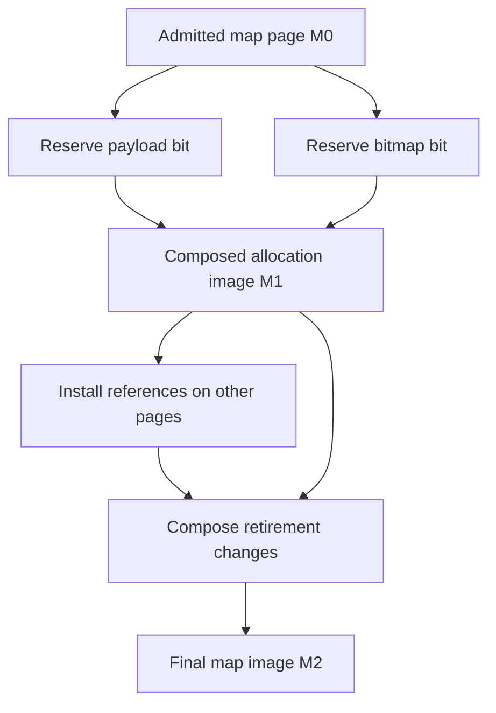
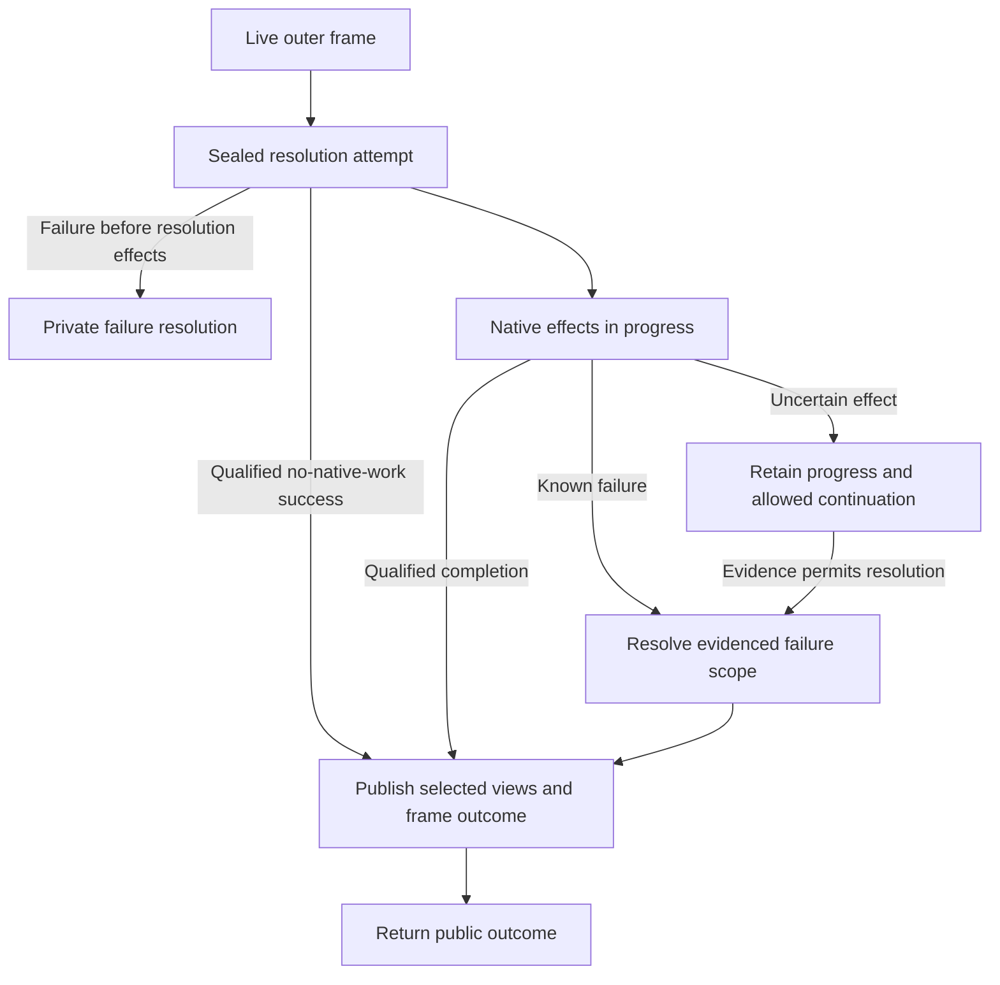
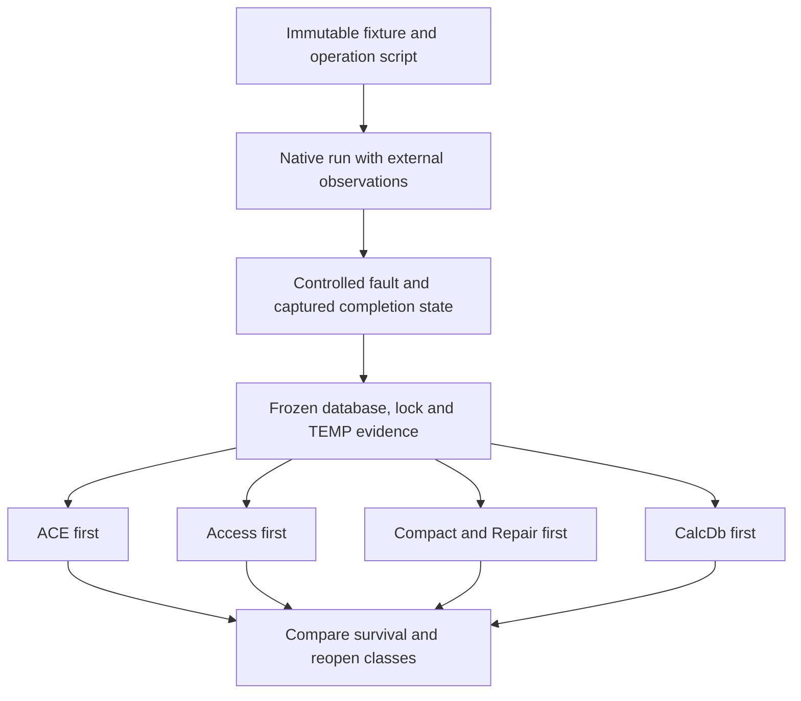
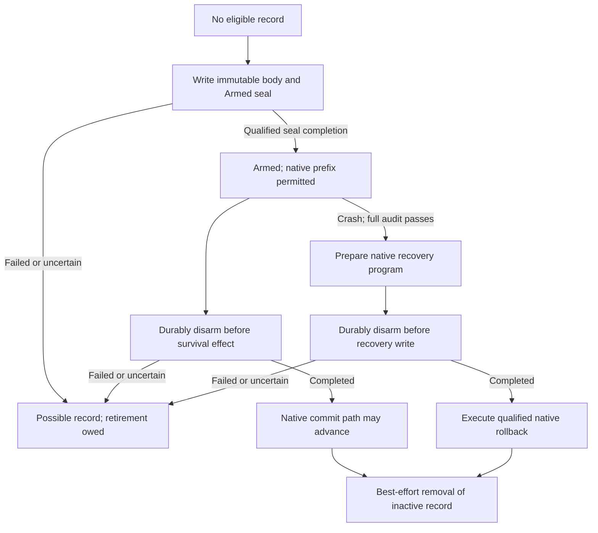

# II-08. Transactions, write ordering and crash recovery

Revision 2 · Stage 2, response 8 · 2026-11-13

**Requirement trace:** Primary RQ-STORE-01, RQ-STORE-02, RQ-STORE-04 and RQ-STORE-05. Shared obligations: RQ-PROD-04, RQ-FMT-03, RQ-SQL-05, RQ-SQL-06, RQ-SEM-03, RQ-DAO-01, RQ-DAO-04, RQ-ADO-01, RQ-LOCK-01, RQ-LOCK-03, RQ-LOCK-04, RQ-LATE-04, RQ-ISAM-01, RQ-CONC-02, RQ-SIM-02, RQ-CALL-04, RQ-ORACLE-02, RQ-ORACLE-03, RQ-ORACLE-05, RQ-PERF-01 and RQ-PERF-02. I-16 owns the complete scope map. II-03 supplies effect receipts and page-image ownership; II-04/05/06 supply native row/map/tree/catalog builders; II-07 supplies accepted semantic mutations and cursor outcomes. This chapter owns the resolution that connects them. II-09 deepens locking and visibility.

Implement one coordinator for each logical transaction owner, backed by identity-keyed native file participants. It retains explicit and operation scopes, compiles immutable native phase images, resolves logical and persistent outcomes separately, and preserves the same attempt through failure. D-TXN-1 and D-WRITE-1 remain Provisional with named branch experiments. D-UNDO-1 is the user's Decided ACE-first baseline and exact whole-file image predicate; D-UNDO-2 separately marks the preferred optional one-shot recovery protocol Provisional.

**Evidence boundary.** Microsoft documentation constrains public and operating-system behavior; it does not provide an execution trace of the selected ACE build. Exact reference-source facts remain pinned to Jackcess commit `be0a2139b087a227d14cafd4ea231306a5a3a862`, without assigning it an unsupported release identity. SQLite and the cleared supplied reports contribute labelled concepts only. Constructed pages, state traces, codec sizes and simulation examples below have independent arithmetic checks; none is an ACE capture. No ACE, Windows backend or reference Java encoder execution occurred here. The initial oracle remains the user-reported ACEDAO.DLL 16.0.20527.20016, subject to actual environment capture. Figures are emitted as tables/Mermaid source and are not render-verified. The platform Automation VARIANT/BSTR contract remains unchanged.[^authority]

## 1. The Workspace owns logical transaction scope

**Requirement trace:** RQ-STORE-01, RQ-STORE-02, RQ-DAO-01, RQ-DAO-04, RQ-ISAM-01 and RQ-CALL-04. **D-TXN-1 remains Provisional.** Implement one coordinator per logical transaction owner, with the native file coordinators beneath it. DAO's owner is the Workspace; ADO's connection-facing owner has its own adapter and capability policy. A Database object, an ISAM cursor and an action executor enlist work; none independently commits the Workspace.

Microsoft documents Workspace-wide transaction scope, current-level nesting resolution and separate Workspaces for overlapping non-nested transactions. An inner commit remains reversible by its enclosing transaction. DBEngine transaction methods route to the default Workspace. These statements support the frame mechanism below; they do not specify a cross-file durable commit protocol. [^txn-begin][^txn-guide]

Represent membership at two levels. `DatabaseBinding` records a public open handle, its Workspace, permissions, schema context and verified file identity. `FileParticipant` is the coordinator's physical participant for that file identity and incarnation. Two handles opened on the same native file can share one participant while retaining their separate public object state. Paths are diagnostic labels, not participant keys. A second Workspace uses another private transaction view over the same file coordinator; it does not acquire access to the first Workspace's uncommitted overlay.

Read registration and write enlistment are distinct. Opening a read cursor records its ownership and visibility policy without eagerly making every open database a write participant. Prefer write enlistment at the first accepted mutation; the participant then owns the required file lease, base view, private images and rollback obligations until the measured resolution policy releases them. A Database opened after BeginTrans still joins the active Workspace scope when its work requires enlistment. Capturing the read view at BeginTrans, first access or each statement remains the visibility decision of R-TXN-1/TXN-VIEW and II-09; lazy physical enlistment cannot accidentally choose that decision.

The core structures are original CalcDb structures, not an ACE log format:

```text
WorkspaceCoordinator {
    owner_incarnation, surface_policy, operation_serial
    state: Open | Resolving | Closing | FailedResolution | Closed
    explicit_frames: contiguous stack<ExplicitFrame>
    active_operations: owned operation frames and suspended continuations
    participants: FileIdentity -> FileParticipant
    engine_option_generation, resolution_receipt_slot
}
ExplicitFrame {
    frame_id, parent_id?, logical_begin_serial
    first_change_directory: PageKey -> ScopeBefore
    logical_delta_tail, allocation_ticket_tail, effect_receipt_tail
    participant_membership_delta, required_resolution_capabilities
    nested_force_requests, scope_budget
}
FileParticipant {
    verified_identity + open_incarnation, owned_native_handle
    required_lease, admitted_base_view, private_overlay
    schema/row/index generation dependencies
    native_effect_progress, unresolved_durability_intents
}
```

`PageKey` includes file identity/incarnation and native page number. `ScopeBefore` owns a complete immutable image, a spill locator, or an explicit ABSENT state. The directories contain handles to images; they do not copy 4,096 bytes into every frame entry. Typed logical deltas additionally retain catalog/object state, root-identity transitions, generated-value disposition and public observations that a page image alone cannot restore.

A BeginTrans with no mutation is consequently small: validate the live owner, options/context and current nesting limit; reserve one frame entry and its minimum error/cleanup state; then push the frame. It does not clone the database, enumerate its pages, flush an existing ordinary commit or allocate a native marker merely because a nesting level began. R-TXN-1/TXN-NEST confirms those public transitions and selects the actual accepted depth and error. Do not bake an unverified numeric nesting limit into the file format or coordinator.

Transaction support is a capability, not the presence of a frame. Database.Transactions reports an object's support, while Recordset.Transactions is documented False for snapshots and forward-only recordsets and True for native table/dynaset contexts. A read cursor reporting False must not cancel a Workspace transaction that also owns writable native tables. Its value does not establish the visibility policy of its reads. [^txn-db-support][^txn-rst-support]

Use a participant capability descriptor with separately represented native transaction support, nested support, operation classes, provider enlistment and required error/ignore behavior. The DAO references say unsupported ISAM objects can ignore the transaction methods without an error, while the methods are called on a Workspace that can contain more than one source. Probe that mixed-source boundary rather than generalizing an all-or-nothing Workspace Boolean. The later ODBC route also has a documented nesting restriction. Keep those branches visible in the adapter; do not make a nontransactional external write look reversible by placing an empty CalcDb frame around it. [^txn-begin]

## 2. Nested frames retain the earliest required image

The private overlay stores the newest image visible to its owning transaction. Each active rollback scope retains the earliest image it needs for pages first changed in that scope. The retained before-image and the newest image must be different immutable revisions once another owner needs both. II-03 supplies the image handles, uniqueness test and spill backing; this chapter supplies scope ownership.

**Figure F-54 — constructed two-file nesting trace.** Values are deliberate witness values, not captured ACE outcomes. Page numbers identify already validated data pages in distinct files. The table describes the preferred current-level policy, with no native writes yet issued.

| Call or mutation | Explicit depth | File A page 17 value | File B page 21 value | Required scope-before ownership |
| --- | --- | --- | --- | --- |
| Initial | 0 | 7 | 100 | None |
| Begin outer; A: 7→9 | 1 | 9 | 100 | Outer owns A17=7 |
| Begin inner; A: 9→11; B: 100→101 | 2 | 11 | 101 | Inner owns A17=9 and B21=100 |
| Commit inner | 1 | 11 | 101 | Outer keeps A17=7 and adopts B21=100 |
| Rollback outer | 0 | 7 | 100 | Resolved scope releases its ownership after dependent views settle |

The inner commit must not replace the outer A17 before-image with 9. If the outer frame did not already own B21, adopting the inner B21 before-image is correct: it is the value before the enclosing transaction's first change to that page. Rollback of the inner frame instead would restore A17=9 and B21=100 while preserving the outer frame and its A17=7 obligation. Microsoft's Rollback reference describes restoration to the current transaction's starting state; R-TXN-1/TXN-NEST tests this exact distinction, including a third level and an empty level. [^txn-rollback]

The merge prepares all metadata capacity before changing the stack. It transfers ownership of handles and receipts rather than copying page bodies:

```text
CommitInner(ws, supplied_options) -> PublicOutcome:
    require live owner, admitted call, and explicit depth > 1
    child = top frame; parent = previous frame
    policy = resolve options/context and nested-force disposition
    plan = reserve parent directory capacity and receipt links
    # reservation failure has not changed either frame or native bytes
    for (page, before) in child.first_change_directory:
        if parent has no scope-before for page:
            plan.adopt(page, before)
        else:
            plan.release_child_ownership_after_merge(before)
    plan.adopt logical deltas, allocation dispositions and effect receipts
    plan.combine qualified force intent and membership obligations
    install prepared merge; remove child frame
    retain latest private-overlay images without publishing to other owners
    return the native-selected success and remaining scope state
```

With a hash directory this costs expected O(k) metadata work for k child-touched pages and O(k) added handles in the worst case; page payload copy cost is zero for the merge itself. A sorted vector can provide deterministic merge walks when that representation fits the workload. The chosen structure must not introduce an allocation per repeated edit to a page already represented in the scope. Directory growth, effect records and simultaneous image versions remain budgeted costs.

A scope-before page is a restoration input, not an instruction to overwrite the entire current page blindly. A generated counter or other accepted effect can have a native disposition that survives logical rollback. Its surviving field changes must be reapplied to the rollback target image where necessary. Likewise, catalog handles, cursor identities, counts and lock state need typed resolution. If the native policy permits unrelated surviving changes to the same physical page, compose the target from the selected logical state; a stale whole-page before-image cannot erase them. This is one reason to keep logical deltas and complete physical images together.

II-09 makes that qualification explicit for shared writing. If CalcDb changes one row from 7 to 9 while ACE changes a neighboring row from 100 to 101, a rollback that must preserve ACE's change restores `(7,101)`, not the complete old page's `(7,100)`. Whole-page restoration requires continuous native ownership that excluded intervening changes to the restored bytes, or an observed rollback scope that includes them. Otherwise compose the scope-specific reversal over freshly protected current images, including shared index/map/catalog bytes. R-LOCK-4/TXN-RANGE selects the applicable case; retained historical images alone do not authorize native restoration.

Private rollback first builds a resolution plan over the affected scope: choose the images to restore, preserve any effects that survive, settle allocation tickets and object generations, and determine public cursor transitions. Only after its required metadata/resources are secured does it install the selected private view. Scope-owned readers and held values are not destroyed merely because the latest overlay changes; their policy either retains the older backing or explicitly invalidates their public generation. Reclamation waits for remaining owners.

When any covered native effect has occurred, rollback additionally executes the qualified native restoration program. A discarded overlay cannot undo a completed map or index write. The same progress receipt must survive rollback failure: a Rollback call can itself become a known failure or an uncertain persistent outcome. Do not pop the frame and then discover that its only before-image has been freed.

## 3. Operation frames are separate from explicit nesting

An `Edit` buffer, an ISAM Update operation, an action-query statement and an explicit BeginTrans level have different lifetimes. Represent them separately even when an implementation can share retained image handles. The pending edit in II-07 has not necessarily changed any database image; a statement can contain many accepted row operations; an explicit level can contain many statements and non-query edits.

```text
OperationFrame {
    operation_id, owning_explicit_frame?, surface_call_kind
    source/evaluation boundary and candidate continuation
    policy: row unit / statement unit / qualified partial-progress units
    operation_before_directory and logical delta sequence
    accepted-input and generated-value receipts
    selected_failure_scope, affected-count observation, error collection
    publication_units and their definite/possible effects
}
```

Outside an explicit transaction, prefer an internal operation owner whose successful resolution publishes according to that operation's native policy. Call it an automatic operation frame; do not claim that it is an ACE implicit SQL transaction. A noncascading DAO Update can be a single semantic unit. An action may have a statement-wide reversible scope, or ordered units that leave a native permitted prefix or subset on failure. Inside an explicit transaction, successful operation work merges into the current user frame, preserving the user frame's earlier obligations.

The public flag does not define every failure class. Database.Execute's option table says dbFailOnError does not roll back, whereas its remarks describe rollback of successful changes when affected records are locked. QueryDef.Execute gives the positive rollback wording. The same documents discuss implicit-transaction changes in earlier Jet versions. Retain that conflict and use the preferred statement-undo rule where dbFailOnError is admitted, with R-TXN-1/TXN-STMT and R-SQL-2 selecting exact behavior by operation and failure. [^txn-dexecute][^txn-qexecute]

**Figure F-55 — preferred operation ownership matrix.** This is a design matrix pending native classification, not a promise that every failure rolls back the same scope.

| Explicit user frame | Statement policy | Success | Failure resolution to test |
| --- | --- | --- | --- |
| Absent | One-row DAO mutation | Publish its admitted native operation | Selected row/cascade effects and edit continuation |
| Present | One-row DAO mutation | Merge the operation into the current user frame | Keep, reverse or retain the qualified part of this operation; earlier user work remains represented |
| Absent | Action with admitted dbFailOnError | Resolve the statement owner | Prefer reversal of this statement's successful row work; classify counters, callbacks and physical failure separately |
| Present | Action with admitted dbFailOnError | Merge statement changes into the user frame | Prefer statement-only reversal while preserving earlier user work and the user's remaining depth |
| Either | Action without that statement policy | Resolve ordered accepted units | Preserve the observed successful set and counts; do not invent universal action atomicity |
| Either | DDL/catalog/QueryDef mutation | Use the operation's qualified catalog schedule | Capture metadata, schema-generation, cursor and persistent consequences for that exact operation |

For a discriminating fixture, perform change A successfully, start an action B that changes several distinguishable rows and fails on its middle candidate, then perform change C if allowed. Observe A, every candidate of B, C, explicit depth through subsequent resolution calls, RecordsAffected, the complete error collection, generated counters and held cursor/catalog objects. Repeat with both Execute surfaces, the flag absent/present, no explicit transaction/one/two levels, and first/middle/last failure. A failed syntax bind and a late I/O failure cannot be assigned the same continuation merely because both return an error.

A statement undo frame must capture its first-change image even if the enclosing user frame already has an earlier one. Suppose A has changed page 17 from 7 to 9, then B changes it from 9 to 11 before failing. Statement-only reversal restores 9; restoring the user frame's image 7 would erase A. On a successful B, transfer only the obligations not already owned by the user frame and retain accepted effect receipts. On a partial B, preserve the exact surviving logical units before updating the public count.

The executor does not re-run a statement to discover its successful set. It retains candidate occurrences, accepted values, generated tickets and effect observations as work proceeds. Statement reversal can restore database state, but cannot unsend a callback or make an external UDF effect never have happened. Native evaluation count and ordering remain observable. The failure receipt records those effects even when the statement's row images are reversed.

DDL follows the same framework with catalog-specific inputs: TableDef and catalog-row images, index/usage maps, schema and object incarnations, dependent held descriptors and any generated object IDs. Prefer keeping reversible native catalog changes within the explicit frame when the tested operation supports it; R-CAT-1 and TXN-DDL decide CREATE, ALTER, DROP, index and relationship changes separately. An external linked-table creation or provider command can have different capabilities. Its presence does not authorize an invisible commit of earlier local work or a fictitious rollback of external effects.

## 4. Resolution plans include all enlisted files

Build one `ResolutionPlan` for the selected scope before starting its required native work. It names every participant, target logical view, required phase program, durability intent, rollback disposition and public observation. The plan is immutable once persistent publication begins; progress is appended to reserved receipt slots. A topology change or newly discovered participant before publication requires revalidation and an amended plan. After publication begins it requires the measured continuation, not an unnoticed restart of the call.

For multiple native files, prefer preparation and resource reservation across the known participant set, then publication under a stable participant order where that does not change observable behavior. The order uses verified identities and is stable within the process; it is not a database filename sort masquerading as a durable protocol. Do not release an earlier participant's lock and silently replay its semantic changes just because a later file cannot be admitted. Late enlistment while other leases are held needs the lock manager's explicit contention/deadlock policy; never wait while holding a pager metadata latch. II-09 selects the externally compatible lock timing.

A successful Workspace resolution installs the resulting in-process views as one coordinator event. Readers receive an admissible view vector, not half of the new vector because one cache entry happened to publish first. This does not require every reader to use a global snapshot: the view vector only encodes the participants and visibility promise of that particular owner/operation. Other cursor policies can refresh later according to II-07/II-09.

**Figure F-56 — constructed multi-file effect receipt.** The offsets illustrate native file work; they do not establish an ACE cross-file ordering.

| Participant | Native step | Definite result before the next error | What must remain represented |
| --- | --- | --- | --- |
| A | Data page 17 at byte offset 69,632 | Complete image write | New A bytes may already be visible through the file |
| A | Index page 40 at byte offset 163,840 | Complete image write | A's structural closure may have advanced farther than B's |
| B | Data page 21 at byte offset 86,016 | Write attempted; completion uncertain | Old and intended B images are retained, neither is asserted to be the actual file |
| A and B | Required final force-flush sequence | Not completed | No successful forced-commit receipt exists |

The logical fact that all work belonged to one Workspace does not convert this receipt into either “nothing committed” or “everything committed.” The resolution policy may retain a usable transaction, require qualified restoration, expose a surviving subset, or end in a state requiring close/reopen. R-TXN-1/TXN-MULTI and R-CRASH-1/2 select those outcomes. Do not create a two-phase-commit side file to supply a stronger promise. Nor may the coordinator return an invented success simply because one participant was definitely written.

Reserve enough progress storage before each native submission that an out-of-memory error cannot erase the last step's definite or possible effects. Per-participant progress includes phase/image identity, completion/uncertainty, logical resolution state, flush requests and completions, and permitted next actions. The public error mapper consumes this receipt; it does not decide the durable state by looking only at the last Win32 error code.

## 5. Ordinary commit, nested force requests and engine options

Use distinct logical and durability fields in a `CommitReceipt`. An inner logical commit merges obligations into its parent; an outer logical commit can finish while its ordinary updates remain subject to the declared cache/device survival class. `dbForceOSFlush` is documented as flushing updates instead of leaving them temporarily cached, while ordinary CommitTrans can return before the updates reach disk. This is a public durability-intent distinction, not the byte schedule for implementing it. [^txn-commit]

For an outer commit, the preferred initial policy remains I-08's: complete the required native writes, then complete the supported forced-flush sequence when the call requests it; ordinary commit does not add an unconditional forced flush. The native stage compiler and backend receipts determine which completions satisfy that intent. Failures after writes, during flush or before returning remain different from failures before publication. A caller can lose the success acknowledgement after its commit has crossed a native survival frontier; a receipt cannot infer “uncommitted” from the missing acknowledgement.

An inner `CommitTrans(dbForceOSFlush)` is particularly discriminating. The public references do not settle whether it flushes rollback-capable native changes immediately, propagates a force requirement to the outer level, or has some narrower effect. Prefer recording the request on the inner resolution receipt and provisionally propagating its effective intent to the parent, without declaring the inner changes independently committed. TXN-FLUSH compares inner forced commit followed by outer rollback, outer ordinary commit and outer forced commit, with interruptions after each boundary. If ACE flushes still-reversible changes earlier, the implementation needs the evidenced early-write and restoration program; if it ignores or confines the request, remove the propagated effective intent while retaining the trace of the original call. Until classified, that branch cannot borrow the outer-forced case's acceptance evidence.

Record the effective engine configuration with every capture. DBEngine.SetOption documents runtime overrides including UserCommitSync, ImplicitCommitSync, shared/exclusive asynchronous delays and FlushTransactionTimeout, plus memory/lock-related limits. The article's example registry path is Office 12.0; it does not identify the active path or defaults of the supplied Office 16 build. The oracle records supported option queries, explicit overrides and any unresolved provenance instead of installing guessed registry values. [^txn-options]

The coordinator retains an engine-option generation and the options relevant to each accepted operation. A runtime change is a public event: capture whether it affects existing pending work, only later operations, or an explicit drain. Do not let an implementation thread read whichever option happens to be current halfway through a program. A policy can intentionally rebind an option at a measured boundary; that boundary and its failure behavior are then part of the program.

DBEngine.Idle is another explicit event. Its documentation describes pending engine work, cache refresh and release of read locks; it also discusses pending writes. Route it through the engine scheduler and the affected coordinator/view policies. It is not synonymous with Workspace.CommitTrans or proof that a force-flush durability barrier completed. An uncommitted overlay cannot be written merely to empty the cache unless the native policy and crash analysis authorize that phase. [^txn-idle]

## 6. TEMP exhaustion is a transaction state, not a generic allocation error

The DAO transaction references describe a workstation TEMP transaction log, a runtime error when its storage is exhausted, potentially indeterminate partial commitment if CommitTrans then follows, and rollback as a distinct resolution. This is documentary evidence for an exceptional state to reproduce. It neither supplies the file format of ACE's TEMP log nor authorizes CalcDb to require an authoritative private journal before ACE can reopen the database. [^txn-commit][^txn-rollback]

CalcDb's preferred normal path keeps uncommitted page revisions privately and may spill them into owned temporary storage. Distinguish three stores even if an allocator supplies all of them: live transaction staging/before-images, retained reader history, and the optional crash-undo record. The first two support ongoing ownership and visibility. Their accidental survival on disk does not make them recovery authority. The optional record has the separate full-file eligibility and disarm rules specified later in this chapter.

Budget admission for a scope includes its worst simultaneous preservation requirement: the old page revision, the modified revision, image-directory growth, allocation/constraint receipts, the native program's sealed images, and enough reserved outcome/cleanup metadata to settle a fault. Copying or spilling one image can temporarily need both the source frame and the encoded output buffer. Count that overlap. A large user transaction can contain a small resident index of images and immutable spill blocks; it must not flush uncommitted database pages simply because the RAM budget has been reached.

Use a narrow, checked spill record with workspace/frame/image identity, kind, declared length, integrity check and owned payload. This is an internal live-storage format. Writes and reads are bounded; a damaged or missing record is a resource/storage failure, not a valid before-image. A partial spill write never replaces the sole retained copy until completion has been verified. When spilling a before-image is required to admit a new mutation, failure occurs before granting that mutation access to the editable page.

An exhausted TEMP-like store does not always have the same consequences as an ordinary pre-admission resource rejection. Model `ResourceFailureDisposition` in the operation/Workspace receipt: no accepted changes; accepted private changes with valid rollback; known native effects; or uncertain native effects. Its fields also name the still-supported public operations. They are internal classifications and do not invent a new public DAO error. The selected native error collection and subsequent CommitTrans/Rollback/Close behavior come from TXN-TEMP and R-CRASH-2.

Prefer refusing additional mutation after exhausted staging while preserving the already owned rollback data and a reserved resolution path. That is the implementation starting direction, not permission to promise stronger behavior than the measured target. If ACE's exhaustion branch can commit an accepted subset or loses part of its logical rollback facility, capture its actual surviving set and implement that qualified continuation through explicit progress units. Never choose a random subset merely to imitate the word “indeterminate.” Unknown native behavior remains unknown; it does not justify returning success or replaying the failed action.

The capture must distinguish a full TEMP volume, a denied TEMP creation, a short TEMP write, a failed TEMP flush, a missing spill file, a full database volume and memory pressure. Put TEMP and the database on separately controlled volumes for the first discriminator, then test the shared-volume case. Freeze the files before opening the database with another engine. Log the successful A/B/C operation sequence and probe the next generated value; row counts alone cannot identify the accepted and lost work. The relative failure point is a public/semantic and persistent milestone, not equality of ACE's and CalcDb's temporary byte consumption.

## 7. Close, clone and Requery settle the owning scope explicitly

A public Close is a lifecycle operation with an outcome, not just the last decrement of a file pointer. Workspace.Close is documented to roll back unresolved transactions through the transaction-method references, and calling Close on an already closed Workspace or Database is separately documented as an error. The underlying coordinator can remain owned long enough to complete or report required cleanup, while held COM child objects retain their identity and later expose the qualified closed-object errors. [^txn-begin][^txn-wclose][^txn-dclose]

Prefer Workspace.Close to select resolution of all pending levels, settle accepted operation continuations and native requests, then detach public children and release file obligations. It must not invoke one current-level rollback and forget deeper frames. If restoration fails, preserve the precise unresolved file/progress state and expose the measured Close outcome. The return path cannot claim a clean rollback merely because the public Workspace is now unusable.

Clone.Close is a different input. The Clone reference says closing either cursor leaves the other cursor open, yet closing a clone during a pending transaction invokes implicit Rollback. The preferred starting policy routes the clone-close event to the coordinator's current-level rollback policy and only then releases that cursor's ownership; TXN-CLOSE determines whether the actual target unwinds more levels, when the remaining cursor is refreshed/invalidated, and how a failed rollback changes the close result. Resource-open lifetime and transactional effects remain separate. [^txn-clone]

Database.Close has no comparable scope detail in its short reference. Prefer detaching that public binding while the Workspace retains any enlisted native handle and rollback obligations needed to resolve its transaction. TXN-CLOSE compares close of one of two participating databases, close of the last binding to one file, duplicate handles for one file and subsequent CommitTrans/Rollback. If ACE closes or resolves a wider scope, change the explicit policy and lock-release boundary; do not hide the result in an object destructor. Final COM Release and explicit Close are also separate capture cases because their error delivery differs.

Requery belongs to cursor recreation and population. Its documentation describes re-execution/repopulation and parameter handling; it does not define a general transaction commit. Prefer creating the new result under its Workspace's admitted current view, with II-07's explicit pending-edit and family-incarnation policy. Requery after a commit or rollback may expose different rows, but cannot repair an uncertain persistent transaction by silently rerunning its writes. Capture failure of Requery separately from failure of the transaction that preceded it. [^txn-requery]

These events can arrive during callback reentry. Before calling the host, retain the owning frame/operation incarnation and its continuation, release internal metadata latches, and record that the call can be invalidated by a nested lifecycle transition. On return, revalidate the receipt and owner; do not continue publishing into a frame that a callback rolled back or closed. If the target forbids a particular reentrant transition, its native error is a policy result, not a reason to leave a lock held across host code.

## 8. The ADO adapter uses the coordinator without importing DAO policy

ADO transaction methods are connection-scoped. Its BeginTrans can return the nesting level, support depends on the provider, and connection Attributes can request an automatically started successor transaction after commit or rollback. Unsupported-provider calls and resolution without an active transaction are documented errors. These are surface inputs to the same coordinator machinery, not proof that an ADO connection has DAO Workspace membership or identical clone/Close rules. [^txn-ado]

Retain an adapter-selected `ResolutionSuccessor`: no new scope, or a fresh transaction scope under the qualified retaining policy. Prefer reserving the next frame's local metadata before resolving the old one, while keeping their identities separate. If an external provider can fail beginning the successor after the prior commit succeeded, the result must retain that committed outcome and report the failed successor creation. It cannot undo the successful commit to make the call look atomic. Retaining must not resurrect old before-images, bookmarks or consumed generated tickets as though the old transaction never ended.

The connection capability descriptor also retains provider transaction/DDL declarations, isolation negotiation, accepted nesting and affected command/cursor routes. II-12/R-ADO-1 owns the complete public inventory and event order; this chapter provides the operation and resolution substrate. DAO and ADO work can therefore begin alongside each other while their public policies remain independently captured. Later ODBC/OLE DB adapters may enlist remote participants; no distributed durable atomicity follows merely from reusing the local coordinator types.

## 9. Compile a native operation into a persistence program

**Requirement trace:** RQ-STORE-01, RQ-STORE-02, RQ-STORE-04, RQ-STORE-05, RQ-PROD-04, RQ-FMT-03, RQ-ISAM-01, RQ-SQL-05 and RQ-CALL-04.

**D-WRITE-1 remains Provisional.** The preferred initial writer retains uncommitted work in private page revisions and publishes an admitted operation or outer-commit unit through one coordinator under exclusion. Its starting direction is unchanged: prepare and reserve; establish a native in-progress state only when one is evidenced; initialize newly assigned storage; publish native allocation and ownership; remove obsolete index references; install row/LV changes and new index references; publish operation-required catalog metadata; release unreachable storage; resolve native/logical state and the selected flush/acknowledgement policy. This section compiles that direction into actual page revisions. R-FMT-2, R-TXN-1 and R-CRASH-1/2 choose any required changes per operation and environment.

The unit of compilation is the complete physical closure of an accepted semantic change. II-07's `PreparedMutation` supplies row identities, accepted values, generated-value receipts, the scheduled constraint work and the effects already performed. II-04 supplies row/LV/map images; II-05 supplies physical-tree deltas; II-06 supplies catalog closure. The coordinator may replan their physical placement while keeping those semantic receipts. It cannot restart a callback, default evaluation, generated value or cascade merely because a page split needs another allocation.

Keep three dependency meanings explicit. A **build dependency** says which private images must exist before another can be encoded. A **transfer dependency** says which native requests must settle successfully before a later request is submitted. A **persistence dependency** says which effects must survive before another effect may survive under the named fault model. The first two do not create the third. Windows normally buffers file writes and later drains cached data; the file-cache documentation gives no general inference that completed page A must survive before subsequently completed page B after power loss. [^w-caching]

Therefore each proposed persistence edge carries the actual native barrier or qualified backend property that supplies it. An edge lacking that evidence remains a hypothesis in the crash model. Adding a forced flush at every arrow would change both cost and potentially ordinary-commit survival, so it is not an automatic way to finish the design. An operation with an unqualified intermediate class remains experimental or refused in that profile while other writer operations advance. The full writer remains in scope.

The required final graph is a necessary condition, not the crash argument. A completed update must have correct rows, entries, ownership and descriptors. A terminated update may leave an incomplete index, newly allocated pages or a native needs-repair state only where its corresponding ACE crash class supports that result. The program has no invented repair offset and no universal on-disk commit word. A field called a write stamp by an open reader is insufficient evidence for either role.

## 10. Page revisions, reservations and typed effects

The following are original in-memory structures. None is a new native file format. Store variable-size lists in owned contiguous arenas, identify objects by stable handles, and reserve the minimal progress record before the first native effect.

```text
PublicationUnit {
    semantic_receipts, operation_policy, qualified_profile
    participants[], input_view_certificates[]
    native_role_receipts[], protected_source_certificates[]
    reservation_plan, page_revision_chains[]
    native_effects[], dependency_edges[]
    selected_visibility_transition, public_outcome_continuation
    rollback_obligations, progress_record
}
PageRevision {
    file_incarnation, page_number, allocation_incarnation
    revision_id, previous_revision_id
    decoded_image, immutable_stored_image
    native_role, changed_ranges, referenced_targets
    preserved_unknown_ranges, source_obligations, protected_base_certificate
}
Reservation {
    file_incarnation, page_number, native_owner
    origin: ExistingFree | Append
    before_extent_and_image, private_allocation_generation
    native_reservation_or_allocator_ownership?
    required_owner_maps[], required_global_map_revision
    disposition: Reserved | Installed | Retired | Released
}
NativeEffect = ResizeExtent | TransferSpan | FlushHandle
TransferSpan {
    step_id, page_revision_id, stored_image_range, file_range
    purpose, predecessor_transfers[], persistence_requirements[]
}
ProgressRecord {
    current_step, next_effect, execution_state, settled_steps
    proven_prefix, possible_effect_range, pending_cancel_id, deferred_boundary
    last_native_cause, extent_outcome, completed_flushes
    native_state_class, allowed_continuations
}
```

A newly allocated page is not necessarily an absent page. If page 80 was a free page within the original file, its old bytes and extent already existed; `ExistingFree` retains that fact. Only newly exposed ranges beyond the original EOF have an absent before-state. This distinction matters to rollback, preserving historical images, allocation failure and the optional undo predicate. A map bit is not proof that the bytes were absent.

Reservations from row growth, index splits and map self-expansion share one namespace per enlisted file. II-04's finite allocation closure assigns a required bitmap page once, adds that page's own ownership effects, and repeats until every reference can be encoded. There is no separate index allocator that can hand out a page already reserved for an LVAL chain. Existing free holes remain distinct from append capacity; map expansion does not authorize discarding holes that the reference writer happens to lose.

That namespace prevents conflicting CalcDb reservations; it does not reserve storage against ACE. A shared-mode candidate becomes externally exclusive only under the qualified allocator ownership or an evidenced native reservation. If a still-private candidate is lost, physical preparation may choose another location without regenerating accepted AutoNumbers or callbacks. Existing edit/transaction obligations remain owned. R-LOCK-4/WRITE-ALLOC selects the native reservation and release transitions.

The physical key for composing edits is `(file incarnation, page number, allocation incarnation)`. A TableDef stream patch, two map rows and a catalog row can resolve to one page. Start from one admitted image and compose all patches whose effects belong to the same stage. Later stages derive from that composed revision, never independently from the original page. Thus `M0 → M1 → M2` is one chain of complete images. Writing an independently built M2 that forgot M1's unrelated bit would undo an earlier mutation while appearing to complete a later one.

Under shared writing, the admitted base is refreshed under II-09's qualified native publication footprint. Reapply retained effect-free deltas to that base after checking originals, identity, schema and constraints; preserve unrelated current rows, entries, map bits and counters. A private candidate page is not automatically a current native base. Each sealed revision retains its source certificate and the native role intervals needed through transfer completion and any unresolved continuation. A logical edit owner does not by itself supply this physical protection. A release/refresh between M1 and M2 requires the profile's explicit recomposition transition; a presealed stale M2 cannot cross that gap unchanged.

**Figure F-57 — physical-page composition across phases.** This is an in-memory ownership/dependency diagram, not a native record format or observed ACE schedule.



The page chain preserves both images if the qualified program writes both. Before choosing that preservation set, §19 closes fresh selection of the affected current views. Before any overwrite, the pager freezes the affected native sources, drains their permitted loads and preserves images required by active readers, rollback scopes and pending target loads. These obligations attach to actual image identities. They do not disappear because two revisions happen to compare equal. In shared mode, preservation reads also need the qualified native protection; a local source freeze cannot exclude ACE. Encoding happens into private storage; stored-byte receipts and hashes refer to those encoded bytes, including page 0's header masking where relevant.

## 11. Finalize and check the phase graph

The planner first settles the complete *logical* allocation/reference closure, then expands the chosen native transition protocol into revisions and effects. This order avoids treating a partially discovered index split as a finished publication plan. It also exposes cycles: an object-map declaration can share a page with another structure, and initializing a new map can require allocating that map itself.

```text
CompileNativeProgram(prepared, scope, profile, budget) -> Program | Failure:
    require accepted semantic receipts and scope are still owned
    reserve minimal effect/outcome storage and preservation workspace
    require current protected bases and native role receipts for shared output
    close shared row/LV/tree/catalog allocation reservations under budget
    bind every descriptor, reference and actual physical page incarnation
    validate final native object graphs and preservation masks
    select the profile's transition template for each affected object
    compose same-stage edits by physical page into complete revisions
    bind each source/transfer to its qualified native ownership interval
    connect successive revisions of each physical page
    expand extents, initialized targets, map publication and reference edges
    expand all operation-required catalog and native-state transitions
    add reclamation only after every relevant live reference is withdrawn
    attach qualified barriers and separate acknowledgement conditions
    if a dependency cycle remains:
        require an evidenced intermediate/native transition that breaks it
        otherwise return unsupported-transition evidence, without writing
    encode each sealed revision into owned stored bytes
    choose the qualified complete-page or span transfer plan
    validate every predecessor, range, owner, extent and progress slot
    return immutable program plus rollback and visibility continuations
```

The cycle result identifies the operation and missing transition; it is not a blanket prerequisite for all writer construction. Researchers can run the candidate in the deterministic VFS and compare its cuts with native controls without enabling that candidate as accepted file output.

Checking the final graph includes actual index maxima and peer rules, row-root versus body addresses, column-specific LVAL ownership, global free membership, TableDef counts/descriptors and catalog references. Native fields whose semantics remain opaque are preserved. A row update is not permission to rewrite every TableDef counter, and an index's source-named `uniqueEntryCount` is not substituted for current cardinality. A generated-value counter or prescribed native bookkeeping update stays in the closure even when the visible row count is unchanged.

After expansion, each physical revision has a unique immediate predecessor. Every transfer lies inside its exact image and native extent; every target reference names storage initialized and owned according to the selected transition policy. A retirement includes the proved referents being removed and any retained-view obligations. The validator also checks program metadata: no emitted effect lacks a progress slot, no barrier depends on a future step, and no callback can be demanded after the first write by an allegedly pure encoding stage.

Use a deterministic topological traversal with the policy's stable tie order. It costs O(V+E) for V effects and E edges after the byte-level builders finish. Complete-image validation costs O(total inspected image bytes), with bounded key/chain work from the supplying layers. A tie may use file/page locality only when the qualified policy allows both orders and their error/crash traces. Initially execute one effect at a time; enabling several in-flight writes adds combinations of partial completion and survival to the experiment, even when their final byte ranges do not overlap.

## 12. Worked indexed-key update: three transfers, two pages

**Figure F-58 — isolated 42→43 phase images.** This extends II-05's constructed example into complete independently decoded page images. It is not an ACE-created database, an observed native write sequence or a proof of crash parity.

Let index root leaf page `0x90`, owned by TableDef `0x20`, contain Long 42 at `(17,0)` and Long 50 at `(18,2)`. Data page 17 has one ordinary seven-byte row at offset `0x0FF9`: `01 00 2A 00 00 00 01`. Its header records one slot at `0x0FF9` and free space 4073. Page 17's owner is also `0x20`.

| Program revision | Complete index entries or row bytes | Selected header/payload facts |
| --- | --- | --- |
| `I90.0` | `7F8000002A00001100`, `7F8000003200001202` | Prefix 4; packed payload 14; boundary-mask byte 1=`42`; free count `12 0E`. |
| `I90.1` | `7F8000003200001202` | Prefix 0; packed payload 9; boundary-mask byte 1=`02`; free count `17 0E`. |
| `D17.1` | `01 00 2B 00 00 00 01` | Slot/root unchanged; key byte changes at page offset `0x0FFB`, file offset `0x00011FFB`. |
| `I90.2` | `7F8000002B00001100`, `7F8000003200001202` | Prefix 4; packed payload 14; mask/free restored to their final forms. |

The initial candidate submits `I90.1 → D17.1 → I90.2`, followed by any operation-required bookkeeping and native resolution. All pages and rows in this isolated example are already allocated; actual descriptor/counter evidence determines whether its full operation has further pages. The index prefix, entry boundaries and free count are rebuilt for *each* image. The last index image is not constructed by dropping one changed scalar into the intermediate singleton representation. [^w-index]

The complete before/final index pages differ only at byte `0x01E4`, file offset `0x000901E4`, where `2A` becomes `2B`. Nevertheless the three full-page candidate transfers write 12,288 bytes: one data-page transfer and two leaf transfers. That is an arithmetic cost of this candidate, not a measured ACE cost. A one-byte final difference does not authorize deleting the intermediate phase or issuing a one-byte write.

The transfer-boundary states are deliberately visible to the crash comparison. After `I90.1`, the table still contains 42 while this index omits it. After `D17.1`, the table contains 43 while the index still omits it. After `I90.2`, row and index agree. The first two are incomplete native graphs. They are accepted crash states only if the corresponding native operation and fault model establish an allowed missing-entry/repair outcome. Otherwise R-CRASH-1 changes the order, granularity or evidenced native transition. The word “remove” in the preferred program is not evidence that these states are safe.

Partial writes add distinct states inside each complete-page transfer. For instance, a tear that installs the new mask/header but retains the old entry stream is not equal to any whole revision in the table. The deterministic model must decode or classify those images directly; it cannot approximate a 4,096-byte write as an atomic swap. The optional undo predicate remains before-or-intended only: `I90.1` is neither `I90.0` nor `I90.2`, so a recovery seeing that complete intermediate page discards the optional record.

## 13. Long-value replacement and opposite map meanings

Use II-04's external-value grammars to replace a 100-byte value on LVAL page 70 with a 4,080-byte chain on pages 80 and 81. Assume pages 80 and 81 are validated free pages already inside the file, and the old value is the only live row on page 70. The reservation records therefore contain real prior bytes for 80/81. No extent growth occurs in this particular fixture. If page 70 contains another live LV row, its whole-page release steps below are absent and the applicable row retirement/availability changes replace them.

The old definition is `64 00 00 40 00 46 00 00 00 00 00 00`. The intended definition is `F0 0F 00 00 00 50 00 00 00 00 00 00`. Page 80 has a 4,076-byte row beginning at `0x0014`: a four-byte next locator `00 51 00 00` plus 4,072 payload bytes. Page 81 has a twelve-byte row at `0x0FF4`: a terminal locator and eight payload bytes. The free counts are 4 and 4,068, respectively. The declared 4,080-byte length excludes both next locators. These are the same source-backed hypotheses and constructed dimensions used in II-04. [^w-long]

Suppose the validated global declaration row begins at page-1 offset `0x0FBB`, is inline type 00 with base zero, and the owning column's LVAL map uses bitmap page 40. This choice of owner must come through the column-map metadata; TableDef ownership does not automatically put LVAL pages in the ordinary table-data map.

**Figure F-59 — LV publication and repeated map revisions.** The sequence is a provisional transfer program. Other affected availability/declaration pages are expanded from their real descriptors; this table does not declare them unnecessary.

| Step | Target revision / effect | Required change and predecessor |
| --- | --- | --- |
| L1 | `L81.initialized` | Build the complete terminal row in reserved page 81. |
| L2 | `L80.initialized` | Build the complete first row with its pointer to 81; preferred transfer follows L1. |
| A1 | `G1.allocate80_81` | Clear the two global free bits after the initialization candidate. |
| A2 | `M40.own80_81` | Set the owner bits after A1 in the preferred candidate. |
| K1 | Old-key-removal index revision, if the key also changes | Remove the old reference according to the operation's index policy. |
| D1 | Data-row revision | Install the new external definition and accepted scalar changes. |
| K2 | Final index/ancestor revisions, if required | Install new references after D1 in the candidate. |
| C1 | Actual TableDef/catalog bookkeeping | Include only operation-required changes, composed with all aliases. |
| R1 | `M40.release70` | Clear old ownership after every reference to this value is gone. |
| R2 | `G1.free70` | Publish old storage free after R1; defer its reuse within the commit. |
| N1 | Qualified native resolution and selected flush | Preserve distinct native, visibility and acknowledgement outcomes. |

Initializing the terminal chunk first is a concrete starting direction for a chain. It is not a claim that allocating an owner-visible orphan, or temporarily exposing only one map change, has no native crash effect. Owner maps and Compact & Repair can discover structures that are not yet reachable through a table row. R-FMT-2/R-CRASH-1 inspect both reachability paths.

The exact bit coordinates are:

| Page membership | Global free declaration | Column-owner bitmap |
| --- | --- | --- |
| Page 80 | Offset `0x0FCA`, mask `01`; allocate by clearing | Offset `0x0E`, mask `01`; own by setting |
| Page 81 | Offset `0x0FCA`, mask `02`; allocate by clearing | Offset `0x0E`, mask `02`; own by setting |
| Page 70 | Offset `0x0FC8`, mask `40`; free by setting | Offset `0x0C`, mask `40`; release by clearing |

Compute the global coordinate as `0x0FBB + 5 + floor(page/8)` and the bitmap coordinate as `4 + floor(page/8)`. Preserve the other six bits in the page-80/81 byte and every unrelated map byte. Here G1 and M40 each need an allocation revision and a later retirement revision. The retirement image derives from the allocation image so it retains the new memberships. [^w-maps]

The example does not require erasing page 70 before it becomes free. The inspected PageChannel reference invalidates a short header prefix during deallocation, but that is its policy. CalcDb includes such a write only when the selected native rule requires it, retaining the old bytes for every remaining rollback/visibility obligation. Reuse of a freed physical page starts a new allocation incarnation even if the later contents happen to match old bytes.

The displayed retirement candidate assumes its profile permits reuse after reference withdrawal. Shared LV retirement may additionally depend on native participant/retention conditions. II-09 and R-LOCK-4/WRITE-LV select those conditions and the corresponding native map state; withholding a page only in a private list cannot stop ACE allocating a page already marked free. Native reuse eligibility is separate from retaining an immutable old image for a CalcDb reader.

If the same operation instead appends pages, the graph includes explicit extent effects before any transfer to newly exposed bytes. A successful extent increase is not initialized native storage: Windows documents undefined contents in the newly extended range. A resize failure also has a separate outcome from a zero-byte transfer failure. The model includes the extent at its reported or uncertain length before native reopen. [^w-eof]

## 14. Index split and stable-root publication

The byte-balanced split from II-05 turns the old 602-entry leaf containing Long 0…601 into a 259-entry left leaf containing −1 and 0…257, and a 344-entry right leaf containing 258…601. The recomputed payloads are 2,073 and 2,067 bytes. The new high fence is the complete entry for 257 at row root `(0x2101,5)`, not merely the scalar 257. Entry payload and child-pointer byte order remain the established index grammar. [^w-index]

**Figure F-60 — stable root changes role after its children are prepared.** Constructed isolated subtree; no ACE trace or atomic-root-write claim.

| Physical page | Before | Intended image |
| --- | --- | --- |
| Root `0x0100` | Kind 04 leaf holding the old entries | Kind 03 interior, level 1, one explicit fence to `0x0120`, header tail `0x0121`. |
| New left `0x0120` | Validated free storage, or absent append range as separately recorded | Kind 04; 259 entries; prefix 1; payload 2,073; next leaf `0x0121`. |
| New right `0x0121` | Its own recorded prior allocation/extent state | Kind 04; 344 entries; prefix 3; payload 2,067; previous leaf `0x0120`. |
| Physical index descriptor | Root page `0x0100` | Root page remains `0x0100`; actual counts/maps still change. |

The new root's explicit entry is `7F 80 00 01 01 00 21 01 05 00 00 01 20`; its header tail is `21 01 00 00`. The child pointer in the entry is big-endian, while the header tail is little-endian. A singleton uncompressed root payload occupies thirteen bytes, marks boundary bit 13 and leaves 3,603 payload-area bytes free. The constructed left/right images have reciprocal leaf links. Data pages containing the referenced row roots and the TableDef/maps are outside this isolated fixture.

The preferred root-growth program initializes both children with their final links, publishes their allocation/ownership, installs any required new row payload, then transfers the new root image and required bookkeeping. The public root address remains stable, reducing descriptor changes. The root transfer still crosses sectors and can tear; its before/final kind change does not supply atomicity. Complete-child preparation avoids uninitialized targets, but an interruption during root replacement can still require the native repair class. The experiment compares that class, the owner-map-discoverable children and subsequent opening behavior.

A nonroot split makes the ordering problem even clearer. Suppose existing right leaf R retains 258…601, a new left leaf L holds −1…257, parent P currently selects R for the whole old range, and Q is R's previous leaf if present. The preferred candidate initializes L; publishes its ownership; installs R's reduced entries and new previous link; connects Q to L when needed; then publishes P's added high fence and any affected ancestors. All images preserve the chosen leaf peer rules. This sequence intentionally prioritizes fully formed targets before parent publication, but its interrupted search gap is an experiment subject.

There is no purely syntactic ordering that keeps every old and new traversal simultaneously complete. If R loses 0…257 before P selects L, an old parent descent can miss them. If P selects L first while R still holds all old entries, the right child's interval and leaf traversal can expose duplicates or inconsistent fences. Updating sibling links adds its own asymmetric cuts. A safe candidate cannot be justified by choosing a pleasing arrow order or by claiming “new pages are unreachable”: an ownership scan or a sibling link may already expose them.

The phase compiler records that conflict explicitly. R-CRASH-1 must establish which missing/duplicate/repair outcomes occur under the native operation, whether it uses a real intermediate marking transition, and which data spans or repeats are required. If an accepted profile needs more than the displayed candidate, expand it into additional immutable revisions. Do not invent an index generation bit, reinterpret an opaque stamp, or add a shadow root hidden from ACE. This is a bounded implementation problem with concrete witness states, not a reason to stop implementing all splits until every native trace is complete.

## 15. Catalog publication and deletion use the same physical machinery

A catalog operation can change data rows in MSysObjects, property/LV storage, MSysQueries rows, relationship endpoints, physical/logical index descriptors, catalog index paths and ownership maps. Its phase graph is compiled from the native closure already bound by II-06. A created table's data/index/definition targets must be initialized and owned before the chosen publication of its discoverable catalog references. The order of catalog row versus catalog index updates remains part of that operation's concrete native template; “catalog last” does not make the catalog's internal writes atomic.

For deletion, withdraw the relevant logical references before making their storage reusable. In particular, a drop with relationship endpoints cannot free a TableDef while a surviving endpoint names it, and deletion of a property LV cannot reclaim a packed page containing an unrelated live row. A shared physical index remains owned while another logical descriptor uses it. The compiler treats protected opaque references as retention obligations until the applicable capability can interpret them; absence from the modelled SQL graph is not proof of absence from the native file.

DDL may require several revisions of the same system-table data/index page, just as the key update does. Preserving an old catalog row in RAM helps held readers; it does not make the on-disk catalog coherent during a partially completed change. Actual native marks, counts, discovery paths and post-crash repair behavior remain explicit. The operation's Workspace participation and failure scope are supplied by the transaction policy, not by the catalog helper's choice to call a writer.

Tail truncation is last only after the actual reference/ownership closure proves that no surviving native object needs those pages. Retained readers must have alternate image backing and all overlapping loads/transfers must settle before the extent is shortened. A temporary lack of live table rows is insufficient if an index, bitmap, continuation page, native auxiliary structure or opaque object still occupies the tail. The preferred initial allocator can defer a valid truncation to avoid another risky transition; it must change that policy if native-visible length, allocation or failure semantics require the truncation in the operation under test.

## 16. Coalescing private work and compiling persisted rollback

Repeated updates in a private outer transaction can avoid retaining a complete page copy for every scalar assignment. A scope needs the earliest before-image required for its own rollback, plus images still owned by nested frames, public views or pending physical phases. Its mutable final overlay can absorb later accepted changes. That memory optimization does not imply that all native effects may be collapsed to one final write.

Consider accepted updates 42→43 and then 43→44 to the same indexed row. If neither crossed the selected native persistence/publication frontier, the physical planner may derive the final row/key pair directly while retaining the two calls' counts, generated values, constraint/error observations and frame undo obligations. It may omit the intermediate stored 43 only when the operation/transaction profile permits the resulting crash classes. Native counters can record additions even when final row values cancel out; a 42→43→42 transaction is not automatically a physical no-op. A child commit also does not erase the parent's earlier rollback image.

Within one physical program, two writes of page G may be merged only if all consumers of the intervening revision, all native reference/marking dependencies and all required observed persistence cuts remain satisfied. Equal final bytes alone are insufficient. In the LV example, combining allocation with release of page 70 would make the old page free before the data-row reference is withdrawn. In the key example, collapsing the two leaf images removes the very before/after relationship whose native crash effects are being qualified. Treat coalescing as a transformation with a named equivalence test and measured byte/request saving.

Rollback before any relevant database effect can release private revisions and reservations after restoring the selected scope's logical view. Once effects reached the native file, rollback is a new native program from the known physical progress to the required rollback target. It is not a reverse loop that writes every saved before-image in reverse submission order. Restoring maps can publish a free page too early, an old row can point to storage whose header was invalidated, and several logical undo records can alias one physical page.

For the LV example, suppose the new definition and new index have been installed but page 70 has not yet been reclaimed. A candidate rollback first removes the new index reference, restores the old row definition while page 70 remains valid and owned, restores the old index entry, and only then releases 80/81 after all new references are gone. If page 70 was already retired, its required original data and ownership must be restored before the old row can point to it. If a phase partially overwrote page 17, the rollback compiler also needs the actual possible-effect classification; it cannot label the target restored merely because it owns D17's before-image.

In shared mode, refresh and revalidate the restoration closure under its qualified native roles. Apply only the selected scope's reversal where other actors' changes must survive; a retired page number cannot identify an unrelated later occupant as rollback storage. The resulting program retains its own ownership intervals, before/current targets and progress through failure. The exclusive witnesses do not establish that a whole saved page remains a valid shared restoration target after a native protection gap.

Both rollback success and rollback failure retain the native policy's counts, generated-counter disposition, remaining Workspace state and admissible next actions. Restoration transfers themselves have crash cuts and errors. A rollback program must meet the same ACE-first baseline as a commit program; an emergency private repair or assumed successful buffer release cannot replace it. The optional recovery file is a separate, conditional feature and does not make this live rollback program authoritative after process death.

## 17. Execute from reserved receipts and stop on uncertainty

Keep effect execution small and deterministic. II-03 owns exact transfer settlement; this executor owns which settled result permits the next native effect. The initial serial schedule makes each possible-effect range attributable to one current step. Immutable images and their source descriptors stay owned until the associated native request is fully settled.

```text
RunNativeProgram(program, coordinator) -> NativeOutcome:
    require frozen program, held admission and reserved progress storage
    require an executable continuation permit for progress.next_effect
    require no unresolved native request is being silently restarted
    detach/preserve every source before its first native overwrite
    while program.progress.next_effect is not End:
        effect = selected effect at program.progress.next_effect
        require predecessor completion and selected profile prerequisites
        if a new cancellation or its deferred checkpoint is due:
            action = coordinator.classify_cancel(program, program.progress)
            match action:
                ContinueSameProgram:
                    record the handled request and its required public disposition
                DeferUntil(boundary):
                    retain the request and boundary in reserved progress state
                    fall through to submission of this exact effect
                StopAtQualifiedBoundary(resolution):
                    require resolution covers this settled native phase
                    mark progress HandedOff; transfer program and all obligations
                    return coordinator.take_owned_continuation(resolution)
        mark effect Started in its preallocated receipt
        result = execute_and_settle_exact_effect(effect)
        record proven bytes, possible effects, extent and native cause
        if result contains uncertainty:
            quarantine affected native source bindings
            mark progress NeedsResolution
            return coordinator.resolve_uncertain(program.progress)
        if result is failure:
            mark progress NeedsResolution
            return coordinator.resolve_known_failure(program.progress)
        record settled completion; advance only the justified frontier
        advance progress.next_effect to the exact selected successor
    return coordinator.resolve_completed_program(program.progress)
```

“Started” is process-local progress bookkeeping, not a new on-disk transaction record. A process crash loses it; the native file must already satisfy the selected first-opener baseline. A detailed simulator/trace stream can spill, but the current step's minimal outcome receipt must remain writable even if tracing or ordinary allocation fails.

For a successful short transfer, II-03 continues only the exact authorized suffix of the same immutable image. For a failed or uncertain transfer, the program stops and retains the already proved prefix and possible-effect range; it does not restart from byte zero, continue to the next map write or regenerate the row. Windows requires buffers and asynchronous request structures to remain valid through completion, and a pending return is not a completed write. Its write API also does not promise atomicity for an ordinary multi-sector page transfer. [^w-writefile]

Before every callback or wait that may reenter higher layers, retain the scope and the exact continuation. User cancellation after a native effect has begun cannot be implemented by simply dropping the future/request. The native operation must settle; the policy then chooses rollback, a retained uncertain state, or another evidenced outcome. No callback required for semantic evaluation is introduced into the supposedly frozen physical loop.

The cancellation classification is exhaustive. `ContinueSameProgram` records a request that does not stop this phase, including a surface that does not admit cancellation there; it does not repeatedly rediscover that same request in a busy loop. `DeferUntil` retains the request while finishing the exact remaining effects up to the named qualified boundary, which may be completion of the required native resolution; it falls through to the next recorded submission rather than looping back to classification. `StopAtQualifiedBoundary` hands ownership to the coordinator, which resolves the admitted scope or compiles a distinct rollback/continuation program from the recorded progress. It never restarts the original program's first effect. If a native failure arrives before a deferred boundary, the failure resolver receives the retained cancellation and selects the observed error/state precedence. The completion resolver also settles a request deferred to End. A cancellation after required commit survival cannot authorize reversing that surviving commit.

An error while writing a new page is not automatically harmless. The file can already be extended; global/owner maps may have changed; the storage may contain a partial native header; and a later native opener can inspect it. Conversely, a definite pre-submission resource failure must not be reported as an uncertain database mutation. The receipt distinguishes those cases, while the public error mapping and remaining Workspace usability follow the native surface policy.

Do not use a successful reread alone to erase a previously uncertain durability result. It can establish current visible bytes under the held protocol, but does not establish which buffered effects will survive a different fault. A fresh admitted continuation can use that new evidence only through a coordinator transition that states what was learned and which guarantees remain unknown.

## 18. Flush, Close and reference mechanisms

Ordinary completion, native commit survival, forced-flush completion, in-process publication and acknowledgement remain separate frontiers. The initial Windows forced-flush implementation drains the program's required writes and calls `FlushFileBuffers` on each participant's relevant writable database handle in the qualified sequence. It records the result of each call. The API flushes buffered information for the specified file; it does not establish a complete ACE protocol or a cross-file commit point. [^w-flush]

A failed flush does not mean that no data reached storage, and successful later work cannot retroactively change which commit-survival facts were already established. The ordinary path does not add an unconditional flush. Nor is closing a handle an implicit replacement for the selected forced-flush action: Microsoft's buffered-I/O guidance explicitly leaves unforced buffered data to the caching policy when a file is closed. Exact native Close semantics remain a surface experiment, separate from this OS fact. [^w-close]

Keep buffered I/O as the initial adapter. `FILE_FLAG_NO_BUFFERING` has alignment constraints tied to device geometry; a 4,096-byte Jet/ACE page alone does not satisfy every requirement. Hardware caching remains outside the full control described by that flag. A switch to unbuffered or write-through operation is therefore a backend/profile change requiring its own survival and cost evidence, rather than a flag added to simplify the write graph. [^w-buffering]

The exact pinned Jackcess `PageChannel` contributes a useful contrast at the mechanism level. Its nested `startWrite`/`finishWrite` calls maintain a counter and optionally force on completion of the outermost logical write. Its ordinary writes operate directly on the file channel; allocation extends the file and updates the global free map; deallocation writes an invalid-header prefix; `flush` calls `force(true)` and Close calls flush. Those facts do not supply Workspace rollback, an ACE commit marker or native crash ordering. The full file and Apache-2.0 header were read for this chapter. CalcDb's program structures and algorithms above are original; none of those reference write or flush choices is adopted as an ACE requirement. [^w-channel]


The chapter's cost model and R-CRASH-1/2 specifications below carry the workload measurements, independent reopeners and bounded evidence path for these concrete programs.

## 19. Resolve an outer frame through an owned publication attempt

**Requirement trace:** RQ-STORE-01, RQ-STORE-02, RQ-STORE-04, RQ-STORE-05, RQ-ISAM-01, RQ-CONC-02 and RQ-CALL-04. D-TXN-1 and D-WRITE-1 remain Provisional; the data structures here implement their selected direction without making a native survival claim.

An outer commit joins three already concrete objects: the Workspace frame's accepted semantic work, the native phase program compiled from its page revisions, and an outcome receipt that remains meaningful if the operation cannot finish. Keep one owner for that join. The pager owns individual I/O request lifetimes; it must not decide that a completed page write commits a transaction. The cursor owns a pending edit; it must not discard a completed mutation because marshalling the public return subsequently fails.

Use a compact `ResolutionAttempt` allocated or reserved before the first native effect. Its handle contains a Workspace incarnation and resolution serial so a delayed completion cannot settle a newer attempt. It retains all participating file identities, the top frame's logical generation, an admitted program version, image/backing owners, the required native lease references and the already accepted effect receipts. Each participant has its own progress state. The enclosing attempt owns the policy that interprets the participant vector.

```text
ResolutionAttempt {
    workspace_incarnation, frame_id, resolution_serial
    logical_policy_id, environment_id, requested_force_intent
    retained_semantic_receipts, frame_retention_owner
    participant[] { file_identity, file_incarnation, lease,
                    native_role_receipts, view_admission_hold,
                    program_id, effects_progress, source_state,
                    native_resolution_evidence, flush_evidence }
    publication_recipe, completed_logical_nodes, reserved_public_outcome_storage
    optional_recovery_obligation          # includes a possibly Armed setup
    cancellation_requested, required_next_action
}

ResolutionReceipt {
    logical_scope_outcome                 # selected frames remain/merge/unwind
    participants[]                       # exact file-specific effect outcomes
    published_view_ids, retained_old_views
    native_survival_evidence              # not inferred from return status
    force_outcome, return_prepared, adapter_handoff?, caller_observed_return?
    completed_counts_and_generation_receipts
    primary_error, ordered_secondary_errors, permitted_continuation
}
```

`native_survival_evidence` is a typed record of the established phase and fault model. It can say that a required flush completed under a named adapter contract; it cannot say that a native transaction is durable merely because the file currently contains its intended bytes. Return evidence names its observer: the engine records preparation and handoff to its adapter, while a caller or external controller can record an actually observed return. Leave that last fact unknown when it is not observed. A host or marshalling failure can prevent delivery after a native operation has crossed a survival frontier; none of these return fields substitutes for that frontier.

Before selecting the preservation set or allowing a native effect to invalidate its sources, acquire II-09's logical `ViewAdmissionHold` for each affected view domain. It closes fresh registration at the old current publication while already registered readers retain their owned sources. The attempt first retains the preparation view/private-read context it needs; it cannot request fresh admission behind its own hold. Claim the hold and snapshot registered-view obligations under short visibility synchronization, then reserve and preserve outside latches, including independent targets and pending loads. A new reader cannot register the old publication between this snapshot and overwrite. The hold may span I/O; it is not the short publication permit and does not replace external native protection.

At the qualified logical or failure outcome, apply the selected publication and release or convert each hold. A partial participant outcome can leave only the unresolved domains restricted. A private failure settles its hold according to the unchanged public state; uncertainty may retain restricted admission and the same resolution owner. No destructor or unconditional cleanup path reopens admission. The policy determines the relation to required flushes, so the hold is neither automatically released after the last write nor automatically retained until every force operation finishes.

The publication recipe is prepared before persistence: which image/view bindings, catalog generations, cursor invalidations, counts and logical frame transitions must change together. Reserve its bounded metadata, deferred-release queue and the minimal error/progress record then. Publication performs no disk reads, user callbacks or unbounded allocation. Detach obsolete VARIANT/interface-backed owners into that queue; drain it outside publication permits and metadata latches while the attempt still owns its continuation, because destruction can reenter the host. Detailed diagnostics may use separately fallible storage; losing those diagnostics cannot lose the minimum record of what was attempted. Do not use an error-string allocation failure as a reason to erase a completed native operation.

**Figure F-61 — one resolution attempt with separate persistent and logical outcomes.** This is CalcDb's proposed internal state machine; it does not assign an ACE on-disk commit state.



The edge from known failure to publication can publish a surviving prefix or a failed rollback outcome. It does not mean that every failure is recoverable automatically. The continuation can require an explicit caller operation or an independent reopen, selected by R-TXN-1/R-CRASH-2. The private-failure edge is available only before any nonrepeatable logical/publication/frame transition or possible native database effect. An empty commit can take the no-native-work success edge; a later error must retain its resolved frame even though no page was written.

```text
ResolveOutermost(workspace, requested_intent, budget) -> ResolutionReceipt:
    attempt = reserve minimal attempt, participant and outcome storage
    require matching live Workspace/frame incarnation and owner
    claim the resolution slot, retain Workspace/frame ownership and arm its guard atomically
    try:
        bind the selected transaction and failure policies
        retain the preparation input view/private-read context
        freeze accepted effects, generated values and candidate private revisions
        discover the full currently known participant/mutation closure
        reserve known resources and bounded view-admission ownership
        acquire/revalidate required native roles without metadata latches
        for shared sources, refresh/revalidate and rebase retained effect-free deltas
        close the physical footprint without replaying accepted semantic work
        claim logical fresh-view admission holds in the admitted participant order
        snapshot registered views plus independent preservation obligations
        reserve remaining history/program/rollback capacity outside latches
        compile operation-specific programs and their legal resolution boundaries
        prepare allocation-free in-process publication recipe
        confirm all semantic dependencies without replaying completed effects
        prepare optional recovery only if this exact operation/backend qualifies
        revalidate claimed owner/frame/operation generations after callbacks/waits
        if cancellation can settle before nonrepeatable resolution effects:
            return settle_private_attempt_by_policy(attempt)
        bind every possible native effect to the already owned attempt
        result = execute_resolution_program(attempt,
                    on_publication_node = publish_and_settle_admission_by_policy,
                    on_frame_node = resolve_selected_logical_frames)
        if result is HandedOff to a qualified owned continuation:
            return settle_or_transfer_owned_continuation(attempt, result)
        if result contains uncertain persistent effects:
            return retain_uncertain_attempt_and_map_continuation(attempt, result)
        if result is a known failure:
            return resolve_known_failure_by_native_policy(attempt, result)
        require every required effect, force, publication and frame node resolved
        record final participant evidence and return the selected public outcome
    on error before any nonrepeatable logical/publication/frame transition
                    and before any possible native database effect:
        settle private scope and any possibly Armed optional-record obligation
        release only resources whose obligations have resolved
        return the retained primary error and frame continuation
    on any other error:
        retain or hand off this same attempt, outstanding requests and receipts
        classify known/uncertain effects and all completed logical nodes
        preserve the already selected frame transitions, including an empty commit
        map only the evidenced error and permitted continuation
```

The resolution program combines the native effect graph with typed `PublishViews`, `ResolveFrames` and requested-flush nodes. Its selected policy determines whether a flush belongs before a logical publication, after it, or at a distinct native transition. The publication recipe and release/conversion of admission can run only at their admitted logical/failure nodes; a failure continuation can retain restricted admission. A flush failure after a logically resolved native commit must retain that fact. This represents different native orders without hiding them in unconditional cleanup code.

A qualified stop can hand the attempt to a native rollback or another explicit resolution continuation. `HandedOff` is distinct from completion of the original program: transfer its receipts and ownership once, without asserting that the abandoned suffix completed or executing resolution twice. The receiving handler drives call-owned work to its permitted boundary before the blocking call returns. Only state that the captured public policy allows to remain with a named transaction/file owner can outlive the call; a handoff is not permission for unowned background work.

An optional-record setup can have persistent effects before any database write. A failed seal may leave a possibly Armed record, so private-attempt failure settlement must retain or retire that obligation before allowing later writes. The optional-undo section gives the disarm protocol; releasing the frame or merely disabling the option does not erase a persistent record. A failure to settle that obligation remains in the permitted continuation even when the database itself is unchanged.

The resolution claim is protected immediately, including policy-binding failure. Every exit after a successful claim releases a still-private claim or transfers the same attempt to its retained continuation. Every callback, wait and deferred destruction that can change ownership ends with an incarnation/generation check before work continues; the displayed check before submission is the final one, not the only one. A nested Close or rollback can invalidate the preparation, but cannot free an image or effect receipt still owned by this attempt. After effects begin, the executor preferably returns total typed outcomes. Record each completed logical node alongside native progress, including when an empty commit has no native program. Unexpected errors in publication, flush, result construction or error mapping use the same retained-attempt path, never an unwinding destructor that implies successful rollback or revives an already resolved frame.

For multiple files, the result is a vector, not one Boolean. If file A's writes completed, file B's write is uncertain and file C was never touched, retain those three facts. A forced flush of A does not flush B by implication. Stable participant ordering reduces avoidable deadlocks and gives repeatable traces, but supplies no cross-file power-loss atomicity. When late participant discovery changes the resource order, settle or replan only work that is still repeatable; never rerun an accepted callback or silently commit one participant to escape the ordering problem. The exact native partial-failure disposition remains TXN-MULTI/R-CRASH-2 evidence.

Within one process, acquire a short publication permit for the required set of file/view generations at the selected transition. The earlier admission holds have already closed the preservation race. Readers admitted to an older view keep its backing; readers that require the newly published state cannot combine an old index with a new data page by separately observing page writes. II-03 detaches old native backing before overwrite, so pending loads and retained snapshots do not reread historical bytes from an already changed file. This ownership rule is independent of the DAO visibility policy: it does not force all cursors onto the same snapshot. Shared-mode reloads require II-09's still-valid source certificate or independently owned immutable inputs; local serials and in-process multi-file ordering do not establish external freshness or atomicity.

On uncertainty, mark the affected native sources and participant state unresolved. Prefer suspending new mutations and fresh reads that depend on the uncertain effect's dependency closure until the qualified continuation settles it; that closure can include catalog descriptors, maps, index paths and reachable rows beyond the directly uncertain byte ranges. Existing retained views may remain usable if their backing and public lifetime policy permit it. Do not invent a universal public "poisoned database" error or automatically make every unrelated Database in the Workspace unusable. The native error and follow-up-call trace determines which operations remain admissible; the internal receipt represents more detail than the public error number.

## 20. Cancellation and teardown preserve the same attempt

Cancellation is an input to the current attempt, not a replacement for its result. Before nonrepeatable resolution transitions or native database effects, a private preparation can be abandoned according to statement/transaction scope while retaining any optional-record obligation. An already completed logical transition remains completed even when no native write was needed. After a native request has been submitted, the file handle, immutable source bytes, request state and effect receipt must remain owned until completion is known or the adapter has retained the uncertainty in a surviving owner. II-03 supplies that request-lifetime mechanism. The Workspace coordinator decides which logical obligations remain afterwards.

The supplied asupersync report parts contribute two concepts here: explicit obligations that survive a cancellation request, and a drain/finalize sequence before an owner closes. CalcDb adopts their purpose through its existing blocking call and file-session design. It does not import a runtime, require actors for DAO objects, or interpret runtime task cancellation as database rollback. The supplied report's trace-loss lesson also applies: a truncated diagnostic trace cannot silently count as a complete replay. [^r-obligations]

| Point where cancellation or Close arrives | Owned state and preferred handling | Required native question |
| --- | --- | --- |
| Before accepted semantic work | Release tentative resources; retain the applicable public call/error state. | Whether this public surface admits cancellation at that point. |
| After defaults, generated values or callbacks, before native writes | Preserve completed effects and generation tickets while resolving the selected private scope. | Which effects/counters survive cancellation or failed posting. |
| During a native write or flush | Record the request; settle request ownership and collect progress before classifying the attempt. | Whether native effects completed, failed or remain uncertain. |
| After native survival, before public return | Preserve the surviving commit and its outcome receipt. | Actual return/error/lifetime behavior; no cancellation-induced reversal of required survival. |
| During live rollback or optional recovery | Treat the rollback writes as their own program with progress and crash cuts. | Allowed interruption, remaining state and next-opener behavior. |

No metadata latch is held while waiting for I/O, running a callback or invoking a release path that can reenter user code. Before native submission, reentry can invalidate descriptors or dependencies; the continuation must use retained accepted work, a qualified stable view or a captured failure. After submission, a reentrant attempt to mutate or resolve the same owner must pass the active-attempt policy. It cannot take a second writer role while the first attempt's progress remains unresolved. R-TXN-1/TXN-CLOSE and the cursor/host reentry experiments determine the public behavior; internal serialization must not expose an accidental deadlock.

A Close-triggered rollback is an explicit coordinator event with a cause and affected object/frame identities. Final interface release is a separate event. Destructors release only resources they still own; they cannot perform an unrecorded best-effort rollback and then hide its failure. During process destruction, there may be no caller to receive a failure. The file state still has to meet the native crash baseline, and any outstanding recovery eligibility has to be interpreted exactly as it would after abrupt death. No clean-shutdown path is used as evidence for the process-kill case.

The first implementation should keep cancellation checkpoints outside small, nonallocating publication transitions and preserve native-request ownership across every wait. This is a bounded critical section, not a promise that the surrounding commit is uninterruptible. Whether work runs on the caller thread or on a host-scheduled worker changes who waits, not the file and transaction obligations. A WASM backend exposes its own completed/uncertain effect contract through the same attempt; it cannot report Windows force-flush semantics merely because a JavaScript storage promise resolved.

## 21. Crash comparison uses a fault model and an outcome relation

**Requirement trace:** RQ-STORE-04, RQ-STORE-05, RQ-SIM-02, RQ-ORACLE-02, RQ-ORACLE-05 and RQ-CALL-04. R-CRASH-1/2 qualify native crash behavior. D-UNDO-1's ACE-first baseline remains Decided; the proposed phase order remains Provisional.

The reference unit is a named operation under a captured environment and failure model. The environment includes the actual ACE/Access binary versions and hashes, file format/profile, bitness, locale, engine options, filesystem/storage configuration, participant set, open modes and transaction history. The starting oracle is the user's reported ACEDAO.DLL 16.0.20527.20016; the harness still captures what was actually loaded. The .NET Framework 4.8-family and .NET 10 caller lanes retain their own activation and interop metadata. A changed runtime or provider is not silently treated as the same oracle case.

Use at least three fault families. Process death retains the running operating system and whatever cache behavior follows termination. OS/VM loss discards a declared set of volatile state. Torn or misdirected storage faults additionally require an explicit transfer/sector model. One family's observations do not establish another's rules. Failure injection that returns a disk-full error while the process continues is a fourth kind of experiment with a live continuation; it is not a process crash in disguise.

Keep the native interrupted database image immutable and branch each next-opener experiment independently. The observable outcome includes the logical rows and typed values, indexes and relationships, catalog/schema objects, generated counters, commit survivors, errors, repair requests, native state bytes and database/lock-file mutations. Relevant TEMP existence and contents are supporting evidence. An ACE open that repairs or rewrites the file changes the state; Access, Compact & Repair and CalcDb must therefore start from their own copy or identity-preserving snapshot of the original interrupted state.

Do not implement "no worse" as a single health ranking such as clean < needs repair < unreadable. A clean database that loses a required surviving commit is wrong. A successful repair that discards rows is not the same outcome as ordinary-open success. Establish a per-case comparison relation with explicit commit-survival constraints and admitted reopen/repair classes. Prefer the same evidenced class, including a native needs-repair indication when the corresponding native case requires it. Any accepted refinement must be justified against the user's no-worse requirement and the same commit rules; it is never inferred from a pleasant-looking final database.

```text
CrashCase {
    immutable_fixture_id, operation_script_id, environment_id
    transaction_history, accepted_effect_inputs, public_acknowledgements
    observation_boundary, fault_model, trigger_and_observed_cut
    trace_coverage, frozen_database_set, lock_and_temp_state
}
ReopenObservation {
    opener_identity_and_options, starting_image_identity
    open_result_and_ordered_errors, repair_request_and_result
    surviving_logical_changes, typed_rows_and_schema, generated_state
    structural_findings, changed_native_ranges, lock_file_changes
}
```

Separate observed examples from established bounds. A commit surviving one ordinary-commit trial does not establish that every such commit must survive. A commit lost in a trial does not authorize losing every acknowledged commit. Documentation, controlled variation and the storage model determine which conclusions the capture supports. Preserve ambiguous and contradictory cases with a reduced next experiment; do not normalize them out of the compatibility denominator.

T-COMPACT-1 continues to apply to completed healthy output. Its baseline, positive controls and semantic/structural comparisons distinguish normal repacking from a repair. Interrupted files use the corresponding native crash class, so an ACE-equivalent needs-repair result is not rejected merely for failing the healthy-output condition. Conversely, successful Compact & Repair never rescues a completed mutation that should already have opened normally. The test performs no automatic in-place repair before the ordinary-open branches.

## 22. Observe writes without confusing observation with control

W-PROBE first builds a passive trace of the smallest fixed-row update/commit and a second fixture that changes allocation or an index shape. Register the relevant open, write, flush, extent, lock and cleanup/close observations against verified file identities. Record the database, its native lock file and relevant TEMP files separately. Filtering only the original user process is insufficient as a completeness criterion: the declared observation boundary must account for all operations that reach the targeted file at that boundary.

Use the charter's isolated, owned-process oracle environment. The run does not install kernel components or change Trust Center, macro-security or HKLM settings; a filter-based lane requires an already configured test environment with that observation capability. If it is unavailable, record the missing capability and use the bounded observation path below. Only terminate the specific harness-owned process instance, verified through its retained handle and creation identity. An ordinary user's running Access instance is never a convenient substitute.

Microsoft's minifilter interfaces allow separate preoperation and postoperation callbacks and allow cached or paging I/O to be skipped. Read/write requests also have both IRP and fast-I/O forms. The probe must retain these distinctions and must not configure away a relevant class while advertising complete write coverage. [^r-filter-register][^r-filter-fast]

A passive event stores a stable event ID, its pre/post relationship, operation/range, target identity, request flags, thread/process context, return status and reported progress, together with owned payload bytes or a stated payload-capture limitation. Capture buffers at a legal boundary and retain their ownership; a raw pointer to a caller's write buffer is not a durable trace. Pre/post callback order is an observed partial order, not proof of the order in which sectors reached stable storage. One original call can generate several lower operations, while caching can combine effects. Preserve the relationships that can be established instead of forcing them into one alleged ACE page-write sequence.

The trace manifest includes operation classes requested and seen, filter position/configuration, payload coverage, buffer-capacity limits, sequence gaps, dropped-event counters and the terminal outstanding-request set. Native operation acknowledgements are captured outside the process being killed. A saturated trace fails the completeness claim explicitly. Logging uses independent ownership and preferably separate transport/storage from the test database; observer timing and any perturbation from instrumentation are measured with control runs.

An observed callback is not necessarily a place where the experiment can pause safely. Microsoft permits `FLT_PREOP_PENDING` only for IRP-based operations; its documented deferred-work route excludes paging I/O and other unsafe contexts. Therefore, establish a separate controllable-cut capability for each request class. Do not turn fast I/O into another path or force flushes simply to make it easier to stop, without recording that intervention as a different environment. [^r-filter-pend]

Filter placement is another coverage limit: I/O generated by a minifilter can be directed below a particular instance and is then visible only below that point. This public mechanism is a reason to calibrate the probe's observation boundary, not evidence that ACE uses such an unobserved path. [^r-filter-generated] A test driver exercises each claimed request class and checks which observations arrive. Trace completeness is established relative to that tested boundary; it is not inferred from a large event count.

**Figure F-62 — capture and independent first-opener branches.** Each branch receives the frozen interruption state. The capture does not run one opener to prepare another's input.



For process death, record both the termination request and process termination. `TerminateProcess` initiated by another process is asynchronous and requests cancellation of pending I/O; termination waits for pending I/O to complete or cancel. A controller must therefore distinguish the trigger from the later observed cut. Holding an I/O indefinitely while waiting for process termination can prevent that termination from completing; the probe needs a bounded, documented request-release/cancellation protocol. [^r-terminate]

After death, capture the continuing file/cache effects at the declared process-crash boundary before any ordinary opener. Do not take an uncontrolled byte-by-byte copy while writes are still changing the source and call it one crash image. Use a consistent capture mechanism appropriate to the model, record any drain interval and retain the post-termination trace. An identity-preserving VM/volume snapshot is required where file identity is part of the case. For power-loss testing, a capture procedure that flushes the database first destroys the condition under test. The snapshot/fault adapter must define what volatile state it drops and demonstrate that it has not strengthened durability merely to obtain a readable file.

A native lock file is evidence, not a substitute for the kernel's live lock state. Capture its bytes and existence before interruption, after the modeled fault and after each independent opener. Never delete a supposedly stale lock file to make a branch pass. Lock release and delayed cleanup can explain an opening failure; retain those events alongside the error instead of treating every failed open as database corruption.

The full experiment matrix covers insert/update/delete, same-width and relocating rows, short and chained LV replacement, usage-map transitions, index split/root/empty-page changes, generated counters, compound cascades, table/index/relationship/property/QueryDef mutations, nested/statement/multi-file resolution, ordinary and forced commit, and live rollback. Start with the small fixtures; add the format-specific classes as their byte interpretation becomes available. The external ACE probe does not depend on a completed CalcDb writer or a complete SQL implementation.

## 23. Enumerate persistence cuts, including states outside API prefixes

The deterministic VFS runs the actual CalcDb coordinator, phase compiler and pager. It separately models application-visible bytes, pending cached effects, stable storage, file length, request completion and loss/tearing rules. Model parameters are evidence-backed assumptions, not fixed claims that every 4,096-byte page is atomic or every completed write is stable. A seed records one exploration; a systematic scheduler explores the dependency-respecting alternatives needed by a small fixture.

For a concrete reasoning example, use three application-ordered writes:

1. Index page 44 becomes `I1`, with the obsolete entry removed.
2. Data page 17 becomes `D1`, with the new row value.
3. Index page 44 becomes `I2`, with the new entry installed.

`I0` and `D0` are their original images. Under an **illustrative whole-image model** that permits the latest retained stable version of each page to advance independently, the possible pairs after all three write completions are the product `{I0,I1,I2} × {D0,D1}`. This model intentionally omits tearing so the ordering issue can be seen; it is not a native storage guarantee.

**Figure F-63 — six constructed stable-image pairs versus four application-prefix pairs.** None is labelled an observed ACE outcome.

| Stable index / data pair | An application-prefix image? | Question exposed |
| --- | --- | --- |
| `I0 / D0` | Yes: before the first write | Original state remains. |
| `I1 / D0` | Yes: after obsolete-key removal | Old row remains but its old index entry is absent. |
| `I1 / D1` | Yes: after the row write | New row exists before its new index entry. |
| `I2 / D1` | Yes: after new-key installation | Intended row/index pair. |
| `I0 / D1` | No | New row can coexist with the old index image in this model. |
| `I2 / D0` | No | New index image can coexist with the old row image in this model. |

Testing only after each API write misses the last two pairs. Adding torn sectors, partial extent operations, overlapping range writes or a failure during rollback introduces further states. A successful modeled terminal flush can constrain this simple model to the final pair, but only to the extent promised by that model. The real adapter's declared flush/device contract and ACE's forced-commit behavior must justify the corresponding claim. Do not add a flush between every pair merely to make the enumeration smaller: it changes the program and may change ordinary-commit survival.

```text
ExploreCuts(fixture, program, storage_model, evidence_relation):
    frontier = one state containing coordinator, pager and model snapshots
    while frontier has unexplored state:
        s = remove one state
        validate ownership, bounded images and this phase's admitted graph obligations
        for event in enabled completions, persistence events, faults and call events:
            next = execute the real component transition under event
            record event, effects and any public acknowledgement
            if event is a selected crash:
                for frozen in storage_model.allowed_post_trigger_closure(next):
                    compare phase/model invariants and native outcome relation
                    retain unresolved outcomes rather than declaring success
            else:
                enqueue if its relevant state/evidence key is new
```

The state key includes surviving native bytes/extents, pending effects, current program node, logical frames, accepted semantic effects, publication generations, force/acknowledgement evidence and relevant resource ownership. Equal database hashes alone do not identify equivalent simulator states: two states can contain identical current bytes while differing in a pending flush, an Armed optional record or an already acknowledged commit. Partial-order reduction can commute genuinely independent operations only when these retained observations and future transitions are equivalent. It cannot commute two writes to the same map page just because they originated from different logical maps.

Structural assertions are phase-specific. The key-removal intermediate image can intentionally lack an entry while remaining a validly decoded page; it must satisfy its admitted crash class, not the final graph's row/index completeness invariant. The post-trigger closure is also fault-specific. Process termination explores permitted pending-I/O completion/cancellation and subsequent cache effects before the chosen capture boundary. OS/device loss applies the declared volatile-state loss and storage rules. A live injected I/O error continues through the coordinator's ordinary failure transition instead of being frozen as if the process had died.

A failing trace retains exact source images, input and model versions, operation script, event ordering, fault details and comparison evidence. Reduction removes logical rows, effects or schedule choices only while preserving the same failure classification and required preconditions. Replaying a byte mutation against a different page-layout profile is not a reproduction. The supplied clean-room reports contribute deterministic replay and reduction concepts, not a claim that their SQLite/runtime crash model is ACE's. [^r-replay]

If complete ACE write-point capture cannot be achieved, keep the same writer direction. Continue complete CalcDb cut exploration for the declared model, externally bracket native operations/commits, reduce unexplained native states and qualify only supported operation/environment cases. An uncontrolled trigger, missing write class or dropped trace remains a named coverage limitation. Other writer cases can advance while a difficult case remains experimental. The full native writer remains scope; a private WAL, atomic file replacement or a stronger universal atomicity promise cannot replace the missing evidence.

## 24. Native opening remains authoritative during failed recovery

**Requirement trace:** RQ-STORE-01, RQ-STORE-02, RQ-STORE-04, RQ-STORE-05, RQ-LOCK-01, RQ-LATE-04 and RQ-SIM-02. **D-UNDO-1 remains Decided** by the user's crash-baseline and external-change-check instructions. **D-UNDO-2 — Provisional:** use the bounded private record below with one-shot disarm before recovery writes, initially for qualified complete-before restoration profiles. R-CRASH-2 selects the private representation, lifecycle and operation/backend enablement; it does not reopen the user's external-change predicate.

The normal opener first establishes the native file identity and admission lease, then recognises the database state using the same native rules whether a CalcDb undo record exists or not. Before the optional audit completes, this recognition is read-only: no main-file cleanup, repair, open-time stamping or native marking may change the bytes being compared. Lock-file effects required to acquire the qualified lease remain separately recorded; they do not authorise a main-file mutation. A missing, incomplete, disarmed or rejected record leaves the native opening policy in force. In particular, a native needs-repair state is not permission to guess a repair flag, clear an unknown header field, run Compact & Repair automatically, or restore arbitrary pages from the private record. A successfully completed ordinary write must satisfy T-COMPACT-1; an interrupted write is compared with the corresponding ACE crash class. Those are distinct acceptance conditions.

Live rollback and crash recovery have different evidence. A live coordinator retains the precise operation scope, attempted-write receipts, completed semantic effects and generated-value dispositions. It can compile a native rollback program from that evidence where the selected failure policy calls for rollback. A reopened process has none of those volatile facts. It can use an optional record only after its immutable data, control state, identity, lengths and complete current-file image satisfy the specified checks. The record's presence is never evidence that the engine owes an outer Workspace rollback.

Optional complete-before restoration remains disabled for unqualified shared profiles. The exact whole-file predicate and exclusion required below do not supply the live shared rollback algorithm in II-09; they remain separate conditions on this optional enhancement. ACE-first safety with the private record absent continues to apply when another process participated.

An already changed file must remain usable by ACE without the optional file. This applies after a failed recovery write as well as after the original crash. Therefore every recovery program has its own interruption analysis. A pagewise copy of all before-images is not automatically such a program: it could restore an old index reference before its data/LV target, or free a new page while a surviving current reference still reaches it. The image check establishes whether this record may be considered; the native rollback program establishes which byte effects are admissible.

SQLite's atomic-commit description contributes two useful review questions: whether recovery metadata can be partially persisted, and what happens when recovery itself is interrupted. Its recovery protocol assumes later SQLite openers honour the rollback journal. CalcDb cannot inherit that premise for an ACE-first opener, nor transfer SQLite's journal deletion, super-journal, page-sector or atomicity rules. The private record below is original CalcDb design; no SQLite code or format is reused.[^u-sqlite]

## 25. A sealed record describes the complete stored-byte domain

Choose one immutable record per admitted native publication operation, with a separate append-only control trailer. An outer commit may be that operation; a frame containing only private images needs no crash undo yet. Never append fresh page intentions to an Armed record while a previous native program can still be interrupted. All intended images and the relevant disarm boundary must be known before the record is sealed.

Let P be the native page size; B the physical file length before the operation; F the intended physical length after it; and N = ceil(max(B,F)/P). The manifest has exactly one entry for every page number in [0,N). It partitions them into C, the covered pages, and U, the uncovered pages. C includes every page affected by any native phase within that extent, even if its final bytes equal its before bytes. U pages must have identical before/intended presence, length and contents. The partition includes page 0, all catalog and TableDef pages, every ownership/free-space map, index, data and long-value page, and unallocated physical pages. Logically free space still has physical bytes.

`ABSENT` denotes absence from the physical extent, not absence from an allocation map. If page 80 is physically present but free before allocation, retain its complete existing bytes as its before-image. If an operation appends page 81 beyond B, page 81's before state is ABSENT. Freeing page 80 without truncating the file does not make its intended state ABSENT. Any final partial page records its exact positive byte count; normal complete-page database geometry remains the format validator's separate concern. Temporary growth beyond both recorded extents is not silently covered: a crash retaining that extra extent fails the length check.

Fingerprints use **stored bytes**, including page-0 masking and any applicable stored representation. Decoded row values, logical schema hashes, used-byte spans or a hash of only the pages that were dirty in the cache are insufficient. Unknown padding and stale bytes in an uncovered page participate. On a covered page, retain the complete before-image when present and a fingerprint of the complete intended image. The preferred fingerprint is SHA-256, with a versioned domain prefix, page number, presence and byte count before the bytes. Its use is an integrity/change-detection choice, not an authentication claim. Full before bytes are compared directly when available; all current fingerprints are recomputed from the full read.

### A concrete private codec

Use a bounded little-endian v1 codec for the first Windows implementation. It is a CalcDb-private format and contributes no fields to an MDB, ACCDB or lock file. The 160-byte header contains an eight-byte `CALCUNDO` signature, format/header/page/hash identifiers, a versioned identity kind, volume serial and 128-bit file ID, B, F, N, covered count, manifest/image/seal offsets, a 16-byte operation nonce and a 32-byte native-profile identifier. That profile is bound to its qualified backend/identity namespace as well as its native operation policy; a volume/file-ID pair is not compared across arbitrary computers as if it were globally unique. The operation nonce identifies this record; it is not evidence of the database's lifetime or a native commit identity. Other backends must supply a qualified versioned identity representation or leave this optional feature unavailable.

**Figure F-64 — proposed 96-byte private manifest entry.** All offsets are relative to one CalcDb entry, not to a native database page. This is an original representation to implement and fuzz.

| Byte range | Representation | Meaning and validation |
| --- | --- | --- |
| 0–7 | `u64LE page_number` | Entries are exactly 0 through N−1, without gaps or duplicates. |
| 8–11 | `u32LE role` | U or C; unknown values reject the record. |
| 12–15 | `u32LE before_count` | 0 only for ABSENT; otherwise 1 through P. |
| 16–19 | `u32LE intended_count` | Same range, independently checked against F. |
| 20–23 | `u32LE presence_flags` | Before-present and intended-present bits; reserved bits are zero. |
| 24–31 | `u64LE before_blob_offset` | C/present points to its complete verified before-image; other cases use zero. |
| 32–63 | 32-byte before fingerprint | Domain includes page number, presence and count. |
| 64–95 | 32-byte intended fingerprint | Same domain; U requires equality with its before state. |

The manifest is followed by the covered before-image blobs and a 128-byte Armed seal. A control frame consists of an eight-byte control signature, kind/version, operation nonce, generation, immutable-body length/hash, reserved bytes and a frame hash. The seal binds the entire header, manifest and image payload. The sole subsequent frame is a 128-byte Disarmed record for the same body and operation, with the next generation. The loader accepts precisely the Armed length or the complete Armed-plus-Disarmed length. An unknown frame, extra bytes, partial tail, conflicting nonce, digest mismatch or invalid reserved field makes the record unusable. It never falls back from a damaged Disarmed tail to the preceding Armed seal.

This strict tail rule does not assume that a 128-byte write is atomic. If no part of a disarm has persisted, an older Armed state can still be seen after a crash before disarm completion; the coordinator must not yet have crossed the native survival boundary. If a qualified durability operation has completed, the backend's declared model must rule out losing that disarm while retaining a later native commit that it protects. Checksums cannot establish that ordering by themselves.

Validate lengths and every addition/multiplication before allocating or seeking. N is derived again from B, F and the format's admitted size bounds. Blob extents must be within the immutable body, nonoverlapping and consistent with their manifest entry; the before-image fingerprints must match their actual blobs. The profile identifier selects a recognised immutable recovery policy in CalcDb, never an executable callback or arbitrary path supplied by the file. Discovery starts from the database the user opened and a recognised private-record location; a record cannot redirect recovery to a filename stored inside itself.

Windows supplies opened-handle identity through the volume and file identifier. `FILE_ID_INFO` supplies a 128-bit identifier, while the older 64-bit form has explicit filesystem limitations. Microsoft also documents possible ID reuse and changes on some filesystems. The profile records those limits; paths and timestamps do not replace identity. A matching operation nonce in a sidecar does not cure an unsupported database identity contract.[^u-id128][^u-id]

This remains the selected current-image check. It does not add a USN journal, continuous history witness or proof that no previous external write ever occurred. A changed-and-restored history indistinguishable under the agreed identity/image predicate is not rejected merely because that history is possible.

## 26. Seal and disarm before the relevant native effect

The optional record has a short control-state machine, separate from the database's native state. Keep its minimal state and possible external effects in the preallocated coordinator receipt. A write or flush failure can leave a valid record even if the call that created it returned an error.

**Figure F-65 — optional-record lifecycle and one-shot recovery.** Edges are coordinator transitions; each durability edge is qualified for the declared fault model. No node is an MDB/ACCDB commit flag.



Build the record under the same exclusive lease that protects the native operation. Stream the complete before-file once, checking its length and opened-handle identity while obtaining each U fingerprint and each C before-image. Intended C fingerprints come from the already sealed stored-byte final images, not from a later reread of a partly written database. A page changed in intermediate phases but restored in the final plan still belongs to C. If preparation finds an image outside the declared extent, missing intended bytes or an inconsistent coverage set, disable optional recovery for this operation before arming; it cannot guess the eventual image.

Finish all immutable bytes and the seal, then request the sidecar durability capability required by the chosen profile. The initial Windows candidate uses `FlushFileBuffers` on the sidecar's own writable handle. Microsoft describes that call as a file-specific flush with an explicit success/failure result; neither its documentation nor the act of writing the seal establishes a complete storage-device fault guarantee. Do not substitute a volume flush or flush the database merely to make the private record durable. The native database program and its ordinary/`dbForceOSFlush` distinctions remain unchanged.[^u-flush]

The preferred candidate needs one completed seal flush after the complete body and control frame are written. Integrity validation rejects a partially persisted body/seal rather than attempting recovery from it. A backend/profile can require a stricter private-file publication sequence, but its justification must be recorded. An absent sidecar after a crash is always an allowed loss of the optional enhancement.

The compiler identifies the **first effect whose submission could cross the earliest evidenced native commit-survival frontier**, accounting for all allowed persistence schedules. Disarm must complete before that effect is submitted. Waiting until its completion, until a final database flush, or until the public return is too late. Earlier buffered writes may persist without another explicit flush. If a retained native prefix can itself already contain a commit that must survive, the disarm boundary moves before that prefix; it is not saved by calling the API result uncertain.

Append the Disarmed frame and complete its qualified sidecar durability operation while the coordinator still prevents the crossing effect. Only that completed receipt releases the native program. If the disarm write, flush or its completion is uncertain, retain the original progress and stop normal advancement. A timeout or cancellation does not mean that the disarm did not happen, and also does not establish that it did. Native error/continuation policy decides the public outcome; the engine does not cross the boundary and hope cleanup will succeed later.

There is a practical limitation: a profile whose frontier is earlier than any useful recoverable database prefix may have no worthwhile Armed window. If the frontier is not identifiable, or the required sidecar ordering cannot be established without changing native database survival, optional undo remains disabled for that profile. The native writer continues without it. This is expected per-operation qualification, not a reason to insert an invented native dirty bit.

### Prevent a stale Armed record from surviving into later work

At most one credible Armed candidate is allowed for a file in the first implementation. Use a fresh operation-specific record; do not truncate a prior inactive record back into an apparently Armed prefix for reuse. If discovery finds multiple credible candidates, never select one by filename, timestamp or an unverified counter: reject recovery from the ambiguous set and resolve its retirement obligation. Before admitting another native mutation, resolve any earlier candidate through a completed disarm or qualified permanent retirement. A failed initial seal flush deserves the same treatment: the record may nevertheless be fully readable and Armed after a subsequent crash. Silently dropping its in-memory pointer and continuing creates a stale undo candidate that could later match another operation's bytes.

A parser rejection, external-change rejection or unsupported candidate means discard, with zero recovery writes. The running coordinator immediately makes the candidate ineligible and attempts qualified retirement. It can record a parsed nonce only if that nonce was validated; an unreadable or malformed record retains a retirement obligation identified by the candidate's opened handle and discovery identity, without inventing a nonce. If retirement itself fails or is uncertain, retain the cleanup obligation and its cause; do not claim that the record was removed, resurrect an older record, or admit a new mutation that could leave this candidate credible. Before optional arming, lack of private storage can simply select the baseline path. After an Armed record may exist, continuing requires resolving that ownership obligation. R-CRASH-2 tests this failure distinction explicitly.

The preferred recovery path also **disarms before its first database write**. It spends the optional recovery opportunity once: a crash during the attempted restoration leaves a disarmed record and the independently safe native crash state. This sacrifices repeatable private recovery to simplify eligibility and cleanup. The immutable before-image payload stays owned by the live recovery operation until its writes settle, even though the record is no longer eligible for a fresh opener. Re-enabling replayable recovery would require separate evidence that every restart, cleanup and later mutation preserves eligibility; it is not needed for the initial optional feature.

## 27. Full-file audit before any recovery write

The authoritative acceptance predicate is unchanged:

**At recovery, every uncovered page is unchanged and every covered page equals either its complete before-image or its complete intended new image; otherwise discard the whole record.** Identity, record integrity, rollback eligibility and the recorded extent alternatives are also required. A page's known intermediate native revision is still a third image and is rejected. The optional mechanism must not broaden its accepted images merely because the native phase program legitimately wrote such a revision.

Use the database handle protected by exclusion for the whole audit and subsequent recovery attempt. Keep the validated sidecar handle and immutable body stable too. The audit streams the entire current database in page order, using O(P) read space plus compact C classification state. It never performs a recovery write while some other page remains unchecked. In particular, a successful check of data page 17 cannot authorise its restoration before an uncovered header or catalog page at the end of the file is examined.

```text
AuditUndo(db, record, exclusion, profile, budget) -> Eligible | Reject | AuditFailure:
    require exclusive lease still names this opened database object
    r = ValidateBoundedRecordAndAllBeforeBlobs(record, budget)
    if r is Invalid: return Reject with no database writes
    if r is IOFailure or ResourceFailure: return AuditFailure with no database writes
    if control state is not exactly Armed: return Reject
    if identity/profile/rollback eligibility is not admitted: return Reject
    L = checked current physical length
    if L not in {record.before_length, record.intended_length}: return Reject
    mismatch = false; states = reserved compact classification for C
    for each manifest entry in exact page-number order:
        current = ReadExactPhysicalPageOrAbsent(db, entry.page, L)
        if reading or classifying fails:
            if mismatch: return Reject(recorded mismatch, secondary diagnostic failure)
            return AuditFailure with no database writes
        if entry.role == U:
            mismatch |= not MatchRecordedBaseline(entry, current)
        else:
            b = ExactBeforeBytesAndPresenceEqual(entry, current)
            n = IntendedFingerprintAndPresenceEqual(entry, current)
            states[entry] = Both if b and n else Before if b else Intended if n else Third
            mismatch |= not (b or n)
    if current length/identity or held admission changed: return Reject
    if mismatch: return Reject with recorded mismatch classes
    return Eligible(record identity, exact body hash, L, states, retained handles)
```

`ReadExactPhysicalPageOrAbsent` uses the captured L to derive presence and exact tail length. An EOF inside an expected page is an error, not ABSENT. No unrecorded extra bytes are permitted. The loop may continue after a definite mismatch while reads remain possible to capture further mismatches, but rejection is irreversible within this audit. A later I/O, resource or diagnostic failure cannot replace that known rejection with AuditFailure or retain eligibility; return Reject with the secondary failure and proceed to the qualified discard protocol. Before any mismatch is established, an I/O or resource failure returns zero recovery writes and an explicit unresolved audit outcome rather than falsely claiming an external writer was detected. A successful audit always reads the complete current database.

The returned token is valid only while its database/record handles and exclusive admission remain held and no native effect has occurred. Releasing the lease or handing control to a mutating callback invalidates it. Recovery can reread a page for transfer or verify the before payload on demand, but it cannot use a later convenience reopen under the assumption that the earlier audit still applies.

### Constructed extent and page-state witness

Take a synthetic manifest whose before file has 81 pages and whose intended file has 82 pages: B = 331,776 bytes and F = 335,872 bytes at P = 4,096. C is `{1,17,40,44,80,81}`; the remaining 76 pages are U. The roles correspond to the earlier global map, data row, ownership map, index leaf, newly allocated existing-free page 80, and appended page 81. This witness checks the private predicate and byte arithmetic; its synthetic payloads are not an ACE-created database.

**Figure F-66 — whole-file predicate outcomes.** All rows assume a supported matching identity, intact Armed record and eligible operation unless the row explicitly changes one of them.

| Current physical state | Image/extent result | Consequence |
| --- | --- | --- |
| Exact before file, including page 80's old bytes; page 81 absent | Pass | No database restoration is needed; retire the candidate before later work. |
| Complete before/intended mixture, length B, page 81 absent | Pass if every present page matches an allowed complete image | Recovery still needs a qualified native rollback program. |
| Complete mixture, length F, page 81 equal to its intended full page | Pass | Presence and extent agree with the intended alternative. |
| Page 80 contains zeroes although its recorded existing-free bytes were different | Reject | Free allocation status does not erase the before bytes. |
| Uncovered page 0 differs by one stored byte | Reject | Checking only the data/index write set would be unsafe. |
| Page 44 is the old-key-removed intermediate image | Reject | A known native phase image is not an accepted third alternative. |
| A covered page combines a prefix of before with a suffix of intended | Reject unless the result equals one entire recorded alternative | A full-page write is not assumed atomic. |
| File length B + 1, or F + 4,096 | Reject | Neither intermediate nor unrecorded extent is accepted. |
| All intended images plus a Disarmed control frame | Ineligible regardless of matching bytes | The image predicate cannot undo commit-survival disarming. |
| Same pathname, different opened-handle identity | Reject | A path does not identify the original database object. |

A separate partial-tail witness uses lengths P+7 and P+11. A present seven-byte or eleven-byte tail is tested against the corresponding complete recorded state; a nine-byte tail is rejected. This tests the codec's length logic without declaring such a file a valid Jet/ACE database. The native parser independently determines whether the file is a supported ordinary or interrupted state.

## 28. Recovery executes an admitted native rollback program

An Eligible token is input to the coordinator, not permission for `for each C: write before`. Compile a recovery program from the observed before/intended vector, the immutable before data and the operation's qualified native profile. Initialise old targets before restoring references to them; remove references to newly allocated targets before releasing their ownership or truncating appended extent. Shared map pages and index pages may need phase-specific revisions, exactly as on the forward path. Preserve unknown/native opaque spans. A generated counter or catalog field restores only when the selected rollback policy says it belongs to that scope.

The preferred optional enhancement restores the recorded before file only for profiles whose eligible scope really permits that result. If native rollback retains a generated counter or another effect that the recorded before image would erase, disable this complete-before optional restoration for that operation. Do not quietly redefine the before-image to mean a partly synthesised recovery result or broaden the image predicate. A later selective-restoration design would need its own explicit policy and interruption analysis. The initial complete-before restoration profile is easiest to explain and test; it is not assumed applicable to every DAO operation.

Some eligible mixtures may lack an established recovery sequence. The profile must enumerate or symbolically cover the mixtures it can produce under its declared faults and show a native-compatible recovery path for every state it elects to recover. A mixture outside that admitted set is discarded without a database write. This is a recovery-capability restriction, not a new external-change detector. If this distinction provides little useful coverage, disable the enhancement for that operation instead of complicating the baseline writer.

```text
RecoverOptionalUndo(db, record, profile, budget) -> RecoveryOutcome:
    lease = acquire native-compatible exclusion on the opened database
    audit = AuditUndo(db, record, lease, profile, budget)
    if audit is Reject:
        discard candidate through its qualified retirement protocol
        return NativeOpenContinuation(no recovery writes, retirement receipt)
    if audit is AuditFailure:
        retain the possible-Armed record and mutation-admission obligation
        return NativeOpenContinuation(no recovery writes, audit failure, retained obligation)
    if every covered state is Before or Both and length is before_length:
        retire candidate; return AlreadyBefore with retirement receipt
    program = CompileQualifiedNativeRollback(audit, record, profile)
    if no admitted program exists:
        discard candidate through its qualified retirement protocol
        return NativeOpenContinuation(no recovery writes, retirement receipt,
                                      retained obligation if retirement failed or is uncertain)
    reserve source buffers, effect receipts and retained before-image ownership
    disarm = DurablyDisarm(record, profile.sidecar_fault_model)
    if disarm is not confirmed:
        retain record obligation; return FailedBeforeRecoveryWrite(disarm)
    freeze/detach native backing needed by admitted readers and pending loads
    for each enabled recovery effect in program:
        r = ExecuteAuthorizedNativeEffect(effect, retained before data)
        retain completed and possible effects in the coordinator receipt
        if r failed or is uncertain:
            stop advancement; retain native-state obligation
            return profile.recovery_failure(receipts, disarmed record)
    complete only the rollback barriers/visibility transitions the profile requires
    remove inactive record when convenient; preserve any cleanup failure
    return profile.recovery_success(receipts)
```

The implementation wraps the entire sequence in ownership-aware failure settlement. Failure while compiling, reserving or disarming performs no recovery database write; failure after the first native effect retains that effect and the required file-state obligation. No exception can release the live source buffer of a pending write. No catch path claims success merely because the loop stopped. The already retained public/error policy maps the outcome without discarding the primary cause when cleanup also fails.

One-shot disarming is also what happens before a recovery program that ultimately performs no useful write because of a later allocation/I/O failure. That lost enhancement is acceptable. After a second crash, the record is inactive and ACE-first safety must already follow from the native image. Do not automatically re-arm it from the same before images. A later fresh operation can create a fresh record only after prior ownership obligations are resolved.

Recovery ordering must be qualified under the same distinctions as ordinary writing: process termination while the OS/cache remains alive, loss of volatile OS/device state, and the specified torn/failed/reordered storage model. Microsoft distinguishes buffered write completion from explicit flushing and warns that hardware caching is outside parts of the documented buffering model. Consequently a restored page visible through the file handle is not by itself proof that the rollback survives power loss.[^u-flush][^u-buffer]

Native rollback may require particular barriers or repair-state transitions. Execute those because the native profile requires them; do not add a blanket database flush solely to retire the sidecar. The coordinator decides the acknowledgement point. The one-shot control record removes the need to keep a private recovery promise alive across later ordinary database work.

## 29. Enablement, cost and discriminating recovery cases

Start with single-file, fixed-extent native operations whose rollback-eligible prefix, earliest survival boundary, exact complete before/intended images and recovery-write crash classes can be established. Extend to existing-free allocation, append and admitted truncation as independent cases. A multi-database Workspace is not made durably atomic by several private undo files. Optional multi-file recovery remains disabled until one qualified participant policy acquires the required exclusion, audits every affected participant before any recovery write, disarms consistently, and reproduces native partial/final survival. This limits the optional enhancement; it does not defer native multi-file Workspace coordination.

| Condition | Optional choice | Baseline behavior |
| --- | --- | --- |
| No useful eligible window, unknown survival frontier, unsupported identity or sidecar durability | Disabled before arming | Run the qualified native writer without private recovery. |
| One known fixed-extent operation, all native and recovery cuts qualified | Enable for that explicit profile | ACE-, Access- and CalcDb-first native states remain independently acceptable. |
| Existing-free allocation or append | Enable only after the specific extent/ownership cases pass | Old free-page bytes and physical ABSENT remain distinct. |
| Covered third/torn image, changed U page, mismatched length/identity or invalid record | Discard with zero recovery writes | Follow native opening/error/repair policy. |
| Sidecar seal/disarm/retirement uncertain | Retain its eligibility/cleanup obligation; stop conflicting advancement | Never invent a successful rollback or cross a protected survival boundary. |
| Crash after recovery disarm | No private replay | The recovery program's native cut is accepted independently of the inactive record. |

For a before file of B bytes and a current file of L bytes, construction reads B bytes and a successful audit reads L bytes; both hash or compare all those bytes. The simple codec stores 96N manifest bytes plus the complete present C before-images, a 160-byte header and one or two 128-byte control frames. Its working RAM is O(P+C classification/plan metadata), not O(B). Large manifests and before images stream or use owned temporary backing. In the 82-page witness the manifest is 7,872 bytes; the five present C before-images occupy 20,480 bytes; the Armed record is 28,640 bytes, becoming 28,768 after disarm. These are constructed size calculations, not performance measurements.

Keep this whole-file cost outside the ordinary DAO row loop when the feature is disabled. Count its full-read bytes, hash bytes, before-image bytes, private flush calls, native recovery writes, retained receipts and discarded opportunities separately from ordinary commit cost. Private storage capacity must cover the possible Disarmed frame before arming where the backend can reserve it; a nominal reservation still does not excuse handling a later write failure.

R-CRASH-2 must distinguish at least these recovery outcomes: exact before, exact intended, admitted mixed complete pages, a native intermediate page, a torn page, changed uncovered header/catalog/map, physical free-page reuse, actual append/absence, partial tails, all forms of length mismatch, identity mismatch, invalid seal/body/control tail, disarm loss before versus after confirmed completion, and record retirement failure. Include an apparently failed seal that nevertheless leaves a valid Armed record, followed by an attempted second operation. Include interruption after successful disarm but before the first recovery write, and every admitted recovery write cut with the private record absent or inactive. These cases select whether the enhancement is enabled; they do not change the selected external-change predicate.

The constructed manifest/codec checks can verify exact coverage, byte offsets, digest domains, lengths and zero-write rejection behavior without an ACE installation. They cannot demonstrate native commit-survival parity, file-identity lifetime guarantees, real sidecar durability, or the safety of a native recovery schedule. Those remain separately named R-CRASH-1/2 and R-LOCK-1 observations on the selected ACE/backend configuration.

## 30. Costs and implementation slices

The priority remains DAO row edits, then bulk actions, then constrained browser execution. For an ordinary row update, count the pages copied on first modification in each active rollback scope, immutable intermediate images, distinct and repeated page transfers, preserved LV/history bytes, key encoding work, effect/publication records and actual flushes. A 21-byte scalar row can still require a 4,096-byte source-preserving page image and more than one index-page revision. Report those costs rather than advertising the scalar payload size as the write cost.

Let `P` be the format page size, `V` the simultaneously retained distinct page-image revisions, `E` the native effect count, `S` the transferred byte total and `F` the number of force operations actually issued. The main image charge is approximately `P × V`, with explicit metadata, temporary indexes and codec output added; the persistent byte cost is `S`, not merely `P` times the count of final dirty pages. Build/validation cost is linear in the represented program graph and page validation work, apart from the indexes used for lookup. Graph scheduling uses a bounded ready structure and stable identifiers; it does not repeatedly scan every dirty page to find a runnable step.

Scope-local first-before retention and merging permit repeated edits to reuse a private mutable image when II-03's ownership rules allow it. They do not remove an intermediate native image that is required by the qualified persistence program. Optional undo incurs its separately stated whole-file manifest/read cost and must not be charged to normal DAO edits while disabled. Live spill remains independently budgeted, including locator metadata and the temporary peak where both resident and spilled copies are retained.

Measure at least: repeated updates to one page versus dispersed pages; no-index and one/many-index rows; a key-preserving edit versus a key change; inline versus chained long values; each nesting depth; successful and failing action prefixes; ordinary versus forced outer and inner resolution; one versus several files; cold and resident before-images; private-spill pressure and failed spill; late flush failure and uncertain writes; optional recovery audit and restoration. Record allocation counts, copied/transferred bytes, native requests, force completions, wait time and retained/spilled capacity. Compare public results and effects before comparing performance.

W-PROBE starts with external observation and qualified cut control independently of W-03's full implementation. W-03 supplies effect receipts, retained backing and deterministic fault seams. W-05 builds private frames and operation scopes first, then same-width row programs, allocation/LV/index programs, live persisted rollback and force/failure handling as their evidence becomes available. W-07 adds action/DDL-specific composition and partial outcomes. Native fixtures exercise the mutation coordinator without requiring the whole SQL executor. Optional crash undo is a separate enhancement after its native baseline, image predicate, survival-disarm and recovery-cut cases qualify; it is never the mechanism that makes the first writer safe.

## 31. Acceptance witnesses for transaction and crash behavior

**Requirement trace:** RQ-STORE-01, RQ-STORE-02, RQ-STORE-04, RQ-STORE-05, RQ-DAO-04, RQ-ISAM-01, RQ-SIM-02, RQ-ORACLE-02, RQ-ORACLE-03, RQ-ORACLE-05, RQ-PERF-01 and RQ-PERF-02. These are designed acceptance cases, not reported ACE test results. The constructed byte/state checks establish arithmetic and interpretation only. Each native case retains the complete input/environment, result/error/effect trace and a subsequent-call or independent-reopen observation. A missing, refused or inconclusive case remains visible.

| Case | Required witness |
| --- | --- |
| T-TXN-01 | Database bindings that alias one native file resolve to one physical participant; different Workspaces retain separate logical ownership. Opening another Database after BeginTrans does not silently evade the active scope. |
| T-TXN-02 | Empty and nonempty BeginTrans levels, actual depth limits, unsupported contexts and CommitTrans/Rollback without a level reproduce the full native errors and subsequent usable depth. |
| T-TXN-03 | The two-file 7→9→11 / 100→101 witness preserves the outer A17=7 before-image and adopts B21=100 on inner commit; inner versus outer rollback restores the selected level. |
| T-TXN-04 | A failed statement B restores its own page-17 value 9 while preserving earlier successful change A and the user frame's value-7 obligation; it cannot use the wrong before directory. |
| T-TXN-05 | Generated counters, object/root identities, catalog generations, counts and cursor state follow their native rollback disposition, including effects that survive a logical rollback. |
| T-TXN-06 | Failure reserving an inner-merge directory or receipt leaves both frames and their owners intact; successful merge transfers image handles without copying page bodies or losing retained views. |
| T-TXN-07 | Database/QueryDef Execute, dbFailOnError, explicit depth, first/middle/last failure and failure class select the native statement/surviving-unit outcome; no blanket atomicity is inferred. |
| T-TXN-08 | CREATE/ALTER/DROP, index/relationship/property/QueryDef changes and held objects resolve through the qualified catalog scope, including a later error and outer rollback. |
| T-TXN-09 | Late enlistment, alias handles and opposite multi-file acquisition order retain one exact participant vector; failure on B cannot erase completed A effects or imply unsupported cross-file durability. |
| T-TXN-10 | Table/dynaset/snapshot/forward readers before/after begin, mutation and resolution select the observed membership/value view; Recordset.Transactions=False does not determine another participant's transaction support. |
| T-TXN-11 | Clone Close at several depths selects the observed unwind target and surviving parent/clone cursor state; independent cursor lifetime is not confused with transactional consequences. |
| T-TXN-12 | Workspace Close resolves every policy-selected level, and failed restoration retains its error/progress; Database Close and final Release separately test retained participant ownership and remaining calls. |
| T-TXN-13 | Requery and callback reentry cannot publish into a rolled-back/closed frame or repeat prior writes; frame/operation incarnation validation determines the continuation. |
| T-TXN-14 | ADO support/nesting/retaining policy creates a distinct successor scope; failed successor creation retains a prior successful commit and does not resurrect old tickets or before-images. |
| T-TXN-15 | Outer ordinary versus dbForceOSFlush resolution retains separate write, logical, flush and return evidence under the captured engine/storage options. |
| T-TXN-16 | Inner forced commit followed independently by outer rollback, ordinary commit and forced commit selects immediate reversible writes, propagated intent or confined/ignored force behavior. |
| T-TXN-17 | SetOption and Idle are explicit events with captured effective scope and option generation; neither an old registry example nor cache refresh establishes an unobserved force barrier. |
| T-TXN-18 | TEMP creation/space/write/flush/read faults, database-volume exhaustion and memory pressure remain distinct; accepted work, error collections and subsequent CommitTrans/Rollback/Close select the actual surviving set. |
| T-TXN-19 | A failed or partial live-spill record never replaces the only authoritative image; missing/corrupt spill and resolution-budget failure retain owned before data and permitted continuations. |
| T-TXN-20 | Row/LV/index/map allocations share one namespace, distinguish ExistingFree from Append, and preserve required allocation incarnations and scope-before bytes; shared reservations additionally require qualified native allocator ownership or native reservation. |
| T-TXN-21 | Build, settled-transfer and persistence dependencies remain distinct; every claimed persistence edge names its actual barrier/backend property or stays an explicit hypothesis. |
| T-TXN-22 | Same-page map/catalog/descriptor edits compose one revision chain from the admitted base; shared publication refreshes under protection and preserves unrelated changes. Unresolved dependency cycles identify a missing transition and perform zero native writes in the admitted-output path. |
| T-TXN-23 | The indexed 42→43 witness independently decodes before/intermediate/final leaves and data pages, exact prefix/mask/free-count differences and 12,288 candidate transfer bytes across two pages. |
| T-TXN-24 | Partial/header-only/torn versions of those pages are classified directly; a transfer of 4,096 bytes is not treated as an atomic image swap. |
| T-TXN-25 | The 100→4,080-byte LV replacement decodes both next locators and payload lengths; global free bits clear where column-owner bits set, with both later retirement revisions preserved. |
| T-TXN-26 | Existing-free allocation preserves real prior bytes; append, failed resize, unknown extended contents and partial-tail outcomes retain distinct extents and effects. |
| T-TXN-27 | Stable-root leaf-to-interior growth preserves root address, exact high-fence and tail encodings, child occupancy and reciprocal links; all root-transfer cuts remain in the crash comparison. |
| T-TXN-28 | A nonroot split exposes parent/child discoverability gaps, duplicate ranges and sibling asymmetry as separate intermediate classes; final tree validity cannot substitute for their native qualification. |
| T-TXN-29 | Catalog publication and retirement account for logical/physical index sharing, relationship endpoints, packed LV pages, opaque references and tail occupants before any storage becomes reusable. |
| T-TXN-30 | Coalescing 42→43→44 or 42→43→42 preserves call effects, counters, rollback levels and qualified crash classes; equality of final bytes alone never establishes equivalence. |
| T-TXN-31 | Live persisted rollback composes an admitted restoration program from exact progress, restores targets before references and frees new storage only after references disappear; shared reversal preserves other actors' surviving changes, and rollback failure retains its own receipt and ownership. |
| T-TXN-32 | Successful short writes continue only their authorized suffix; failure/uncertainty stops successors and preserves source buffers, native request ownership and possible-effect ranges. |
| T-TXN-33 | A failed flush retains any already established native survival and participant outcome; rereading intended bytes cannot manufacture a durability receipt. |
| T-TXN-34 | Cancellation chooses ContinueSameProgram, DeferUntil or a qualified stop without restarting or repeating effects. HandedOff transfers one owned continuation, respects the blocking boundary and cannot assert completion of the original suffix or resolve twice. |
| T-TXN-35 | The attempt protects its claim immediately, including policy-binding failure, and retains its Workspace/frame before reentrant preparation; generation checks follow callbacks, waits and optional setup, and every exceptional exit settles or transfers the same owner. |
| T-TXN-36 | Fresh-view admission closes before preservation selection and overwrite; pending targets remain covered. Qualified logical/failure outcomes release or convert the hold; uncertainty/destruction cannot reopen it implicitly. Publication uses reserved metadata and deferred-release capacity; reentrant VARIANT/interface destruction runs outside publication permits/latches while its continuation remains owned. |
| T-TXN-37 | Return preparation, adapter handoff and externally observed acknowledgement remain distinct; an unobserved return never becomes an undo frontier. Failure after an empty commit's ResolveFrames node preserves the completed logical transition and subsequent native depth. |
| T-TXN-38 | The six constructed stable-image pairs include both pairs absent from application prefixes; the model's terminal-flush result and omitted tearing assumptions are explicit. |
| T-TXN-39 | Simulator assertions follow the current phase's admitted graph, and state keys retain pending effects, logical owners, force/return evidence and optional-record state even when database hashes match. |
| T-TXN-40 | Trace coverage includes declared cached/fast/paging classes and pre/post relationships; dropped payloads/events, filter-position limits and unavailable controllable cuts invalidate the completeness claim. |
| T-TXN-41 | Process termination records trigger, pending-I/O settlement and actual observed death; its post-trigger cache effects differ explicitly from OS/device loss and live I/O-error continuation. |
| T-TXN-42 | ACE, Access, Compact & Repair and CalcDb reopen independent frozen branches, preserving database, lock/TEMP existence and bytes; no preparatory opener, lock-file deletion or capture-induced flush alters the tested state. |
| T-TXN-43 | The complete 82-page undo witness covers U and C, including headers, maps, indexes, catalog and physically free pages, and computes the exact manifest/header/blob/control sizes. |
| T-TXN-44 | Changed U, covered third/torn images and whole-page mixtures select exactly the user-approved predicate; a later audit I/O/resource failure cannot reverse a known Reject, and rejection produces zero recovery database writes. |
| T-TXN-45 | Before/intended lengths, true ABSENT, existing-free bytes and seven/eleven-byte synthetic tails distinguish all accepted alternatives from intermediate or unrecorded extents. |
| T-TXN-46 | Invalid/overflowing manifests, blob ranges, digests, seal/control tails and identities reject safely; I/O/resource audit failure is distinct from detecting an external change, with no early recovery write. |
| T-TXN-47 | A failed seal that nevertheless leaves a credible Armed record retains a retirement obligation before later conflicting work; unreadable nonce handling uses the owned candidate identity. |
| T-TXN-48 | Durable sidecar disarm precedes submission of the first effect that can cross native survival; unknown frontier, unsupported ordering or altered ordinary durability disables the optional profile. |
| T-TXN-49 | Complete Disarmed or damaged-tail records never fall back to Armed; live disarm uncertainty blocks advancement. A fresh opener may accept exact original Armed bytes if an unconfirmed disarm persisted nothing and the protected native frontier remained uncrossed. |
| T-TXN-50 | Full audit and qualified rollback preparation precede one-shot disarm and the first recovery write; held handles/exclusion protect the token. No admitted recovery program means discard, retaining failed or uncertain retirement obligations before later mutation. |
| T-TXN-51 | Every recovery write cut remains ACE-first safe with the record absent/inactive; native counter-retention exceptions disable complete-before restoration where it would erase surviving effects. |
| T-TXN-52 | Multi-file optional recovery remains separately qualified and audits/disarms the required participant set; several sidecars do not create distributed durable atomicity. |
| T-TXN-53 | Healthy completed output meets calibrated T-COMPACT-1; interrupted output meets its native crash class, including required commit survivors and evidenced repair behavior; successful repair cannot replace ordinary-open success. |
| T-TXN-54 | Cost/replay reports distinguish retained revisions, unique pages, repeated transfers, real force operations and optional whole-file work; missing native coverage remains visible while bounded writer cases advance. |

R-TXN-1's independently executable branches select the logical policies. R-CRASH-1 selects native ordering, marking, survival and independent opener outcomes. R-CRASH-2 selects exhaustion/uncertainty and optional seal/disarm/audit/recovery behavior. Their full cards are in A-02; I-08 retains short summaries and the preferred design. All selected-build native outcomes remain unobserved in this session.

## Sources and evidence notes

Exact material, read extents, hashes, permitted use and citation locations are recorded in [A-01-sources.md](A-01-sources.md). Full experiment cards are in [A-02-experiments.md](A-02-experiments.md).

[^authority]: [N], [C], [U], [A], [B] Authoritative scope and compatible charter, the approved assignment and current book record, subject to the user's Stage 0 crash answer and Part I review. The user's full-file before/intended predicate, native-first reopening, nonprescriptive length/order and corrected platform Automation ABI govern this chapter.

[^txn-begin]: [S-MS-DAO-BEGINTRANS] Microsoft, [Workspace.BeginTrans](https://learn.microsoft.com/en-us/office/client-developer/access/desktop-database-reference/workspace-begintrans-method-dao), updated 2022-03-02; Syntax and Remarks inspected 2026-11-13, especially Workspace membership, nesting, unsupported ISAM and Close. Documentary constraints and experiment inputs, not execution of the supplied ACE build.

[^txn-guide]: [S-MS-TXN-GUIDE] Microsoft, [Use transactions in a DAO Recordset](https://learn.microsoft.com/en-us/office/vba/access/concepts/data-access-objects/use-transactions-in-a-dao-recordset), updated 2021-09-13; conceptual text, Workspace scope, DBEngine default-Workspace routing and file-server caveat inspected 2026-11-13; sample not reused.

[^txn-db-support]: [S-MS-DATABASE-TRANSACTIONS] Microsoft, [Database.Transactions](https://learn.microsoft.com/en-us/office/client-developer/access/desktop-database-reference/database-transactions-property-dao), updated 2021-09-14; property signature and meaning inspected 2026-11-13.

[^txn-rst-support]: [S-MS-DAO-RST-TRANSACTIONS] Microsoft, [Recordset.Transactions](https://learn.microsoft.com/en-us/office/client-developer/access/desktop-database-reference/recordset-transactions-property-dao), updated 2021-09-14; property and Remarks inspected 2026-11-13, including snapshot/forward-only False and source support distinction.

[^txn-rollback]: [S-MS-ROLLBACK] Microsoft, [Workspace.Rollback](https://learn.microsoft.com/en-us/office/client-developer/access/desktop-database-reference/workspace-rollback-method-dao), updated 2021-09-14; current-level restoration, nesting, no-active-scope errors and TEMP failure continuation inspected 2026-11-13.

[^txn-dexecute]: [S-MS-DEXEC] Microsoft, [Database.Execute](https://learn.microsoft.com/en-us/office/client-developer/access/desktop-database-reference/database-execute-method-dao), updated 2022-03-18; Parameters and Remarks inspected 2026-11-13; contradictory dbFailOnError table versus remarks retained, samples not reused.

[^txn-qexecute]: [S-MS-QEXEC] Microsoft, [QueryDef.Execute](https://learn.microsoft.com/en-us/office/client-developer/access/desktop-database-reference/querydef-execute-method-dao), updated 2022-03-18; Parameters and Remarks inspected 2026-11-13, statement rollback and RecordsAffected; samples not reused.

[^txn-commit]: [S-MS-TXN] Microsoft, [Workspace.CommitTrans](https://learn.microsoft.com/en-us/office/client-developer/access/desktop-database-reference/workspace-committrans-method-dao), updated 2022-03-18; force-flush option, current-level nesting and TEMP exhaustion remarks inspected 2026-11-13; no target-build execution.

[^txn-options]: [S-MS-DAO-SETOPTION] Microsoft, [DBEngine.SetOption](https://learn.microsoft.com/en-us/office/client-developer/access/desktop-database-reference/dbengine-setoption-method-dao), updated 2022-03-18; option names, runtime lifetime and historical registry example inspected 2026-11-13; target-build effective defaults remain capture inputs.

[^txn-idle]: [S-MS-DAO-IDLE] Microsoft, [DBEngine.Idle](https://learn.microsoft.com/en-us/office/client-developer/access/desktop-database-reference/dbengine-idle-method-dao), updated 2021-09-14; purpose, dbRefreshCache and pending-work/lock/write remarks inspected 2026-11-13, not a force-flush guarantee.

[^txn-wclose]: [S-MS-DAO-WS-CLOSE] Microsoft, [Workspace.Close](https://learn.microsoft.com/en-us/office/client-developer/access/desktop-database-reference/workspace-close-method-dao), updated 2021-09-14; signature and already-closed error inspected 2026-11-13.

[^txn-dclose]: [S-MS-DAO-DB-CLOSE] Microsoft, [Database.Close](https://learn.microsoft.com/en-us/office/client-developer/access/desktop-database-reference/database-close-method-dao), updated 2021-09-14; signature and already-closed error inspected 2026-11-13; no transaction-wide resolution inferred from its short Remarks.

[^txn-clone]: [S-MS-CLONE] Microsoft, [Recordset.Clone](https://learn.microsoft.com/en-us/office/client-developer/access/desktop-database-reference/recordset-clone-method-dao), updated 2022-03-02; independent closure and implicit rollback note inspected 2026-11-13.

[^txn-requery]: [S-MS-REQUERY] Microsoft, [Recordset.Requery](https://learn.microsoft.com/en-us/office/client-developer/access/desktop-database-reference/recordset-requery-method-dao), updated 2022-03-21; repopulation, parameter and Restartable remarks inspected 2026-11-13.

[^txn-ado]: [S-MS-ADO-TRANSACTIONS] Microsoft, [BeginTrans, CommitTrans, and RollbackTrans](https://learn.microsoft.com/en-us/office/client-developer/access/desktop-database-reference/begintrans-committrans-and-rollbacktrans-methods-ado), updated 2021-09-14; connection scope, support, return level, nesting and retaining Attributes inspected 2026-11-13; provider outcomes require R-ADO-1.

[^w-caching]: [S-MS-FILE-CACHING] Microsoft, [File Caching](https://learn.microsoft.com/en-us/windows/win32/fileio/file-caching), updated 2021-01-07, read 2026-11-13; system cache, lazy writes, data/metadata and write-through remarks. Documentary API context, not an observed ACE page order.

[^w-index]: [S-JACK-INDEX-PIN], [S-JACK-IDXCACHE-PIN], [S-JACK-FMT] The exact pinned source evidence recorded in II-05 supplies the native entry envelope, prefix/boundary geometry, child/root mechanics and source counter behavior. This chapter constructs new independent phase witnesses from those recorded facts; it does not import reference write ordering.

[^w-long]: [S-JACK-LONG], [S-JACK-FMT] The exact pinned source evidence recorded in II-04 supplies twelve-byte external definitions, LVAL row/chain geometry and length accounting. The phase order and reclamation conditions here are CalcDb proposals requiring native comparison.

[^w-maps]: [S-JACK-MAP], [S-JACK-CHANNEL] II-03/II-04's exact pinned map evidence supplies inline/bitmap coordinates and the global-free versus owner-membership distinction; map transition order is not a transferred reference policy.

[^w-eof]: [S-MS-SET-EOF] Microsoft, [SetEndOfFile](https://learn.microsoft.com/en-us/windows/win32/api/fileapi/nf-fileapi-setendoffile), updated 2024-02-22, read 2026-11-13; extent change, undefined extended contents and mapped-view restrictions. No sample/code reuse.

[^w-writefile]: [S-MS-WRITEFILE] Microsoft, [WriteFile](https://learn.microsoft.com/en-us/windows/win32/api/fileapi/nf-fileapi-writefile), current reference read 2026-11-13; output/request lifetime, pending completion, explicit offsets and multi-sector remarks. No general native-page atomicity inferred; no sample/code reuse.

[^w-flush]: [S-MS-FLUSH] Microsoft, [FlushFileBuffers](https://learn.microsoft.com/en-us/windows/win32/api/fileapi/nf-fileapi-flushfilebuffers), updated 2021-10-13, read 2026-11-13; writable-handle requirement, per-file buffering/flush and result. No universal hardware or cross-file durability claim.

[^w-close]: [S-MS-BUFFERED-CLOSE] Microsoft, [Flushing System-Buffered I/O Data to Disk](https://learn.microsoft.com/en-us/windows/win32/fileio/flushing-system-buffered-i-o-data-to-disk), updated 2021-01-07, read 2026-11-13; buffered writes, explicit flushing and Close behavior. Documentary OS fact, not native DAO Close policy.

[^w-buffering]: [S-MS-BUFFERING] Microsoft, [File Buffering](https://learn.microsoft.com/en-us/windows/win32/fileio/file-buffering), updated 2025-05-31, read 2026-11-13; unbuffered alignment and hardware-cache limits. No sample/code reuse.

[^w-channel]: [S-JACK-CHANNEL] Jackcess `PageChannel.java`, exact commit `be0a2139b087a227d14cafd4ea231306a5a3a862`, full file and exact Apache-2.0 header read 2026-11-13; 14,275 bytes, SHA-256 `73505d3cf7649f6a077ac5854e72a676c0872530a0cb02b27b2356a3b0fc5fe9`. [Pinned source](https://github.com/jahlborn/jackcess/blob/be0a2139b087a227d14cafd4ea231306a5a3a862/src/main/java/com/healthmarketscience/jackcess/impl/PageChannel.java). Factual mechanism analysis only; no source-code or algorithm port/adaptation; no ACE or Java encoder execution.

[^r-obligations]: [L-ASYNC-4], [L-ASYNC-5] Supplied `asupersync-report.stage1-part4.md` §§3,6–8 and `asupersync-report.stage1-part5.md` §§3,6,8. Cleared concept input: obligation ownership, cancellation settlement and replay coverage. No repository, source extract, runtime requirement or transferred performance claim.

[^r-replay]: [L-FRANK-3], [L-ASYNC-4] Supplied `frankensqlite-report.stage1-part3.md` §§8,11 and `asupersync-report.stage1-part4.md` §8. Cleared concepts for retained failure evidence and deterministic reduction, not native transaction or file-format authority.

[^r-filter-register]: [S-MS-FILTER] Microsoft, [Registering preoperation and postoperation callback routines](https://learn.microsoft.com/en-us/windows-hardware/drivers/ifs/registering-preoperation-and-postoperation-callback-routines), read 2026-11-13; registration flags and callback coverage. Documentary mechanism only; no actual ACE trace.

[^r-filter-fast]: [S-MS-FILTER-FASTIO] Microsoft, [Operations that can be IRP-based or fast I/O](https://learn.microsoft.com/en-us/windows-hardware/drivers/ifs/operations-that-can-be-irp-based-or-fast-i-o), updated 2021-12-15, read 2026-11-13; operation classes and cached-I/O skip flag.

[^r-filter-pend]: [S-MS-FILTER-PEND] Microsoft, [Pending an I/O operation in a preoperation callback routine](https://learn.microsoft.com/en-us/windows-hardware/drivers/ifs/pending-an-i-o-operation-in-a-preoperation-callback-routine), updated 2021-12-15, read 2026-11-13; IRP-only pending and deferred-work limitations. No code/sample reuse.

[^r-filter-generated]: [S-MS-FILTER-GENERATED] Microsoft, [I/O requests generated by the minifilter driver](https://learn.microsoft.com/en-us/windows-hardware/drivers/ifs/i-o-requests-generated-by-the-minifilter-driver), updated 2021-12-15, read 2026-11-13; below-instance visibility of generated requests. Coverage implication is a CalcDb research-design inference.

[^r-terminate]: [S-MS-TERMINATE] Microsoft, [TerminateProcess](https://learn.microsoft.com/en-us/windows/win32/api/processthreadsapi/nf-processthreadsapi-terminateprocess), updated 2025-12-30, read 2026-11-13; asynchronous external termination and pending-I/O completion/cancellation. This documents the harness mechanism, not ACE survival.

[^u-id]: [S-MS-FILEID] Microsoft, [BY_HANDLE_FILE_INFORMATION](https://learn.microsoft.com/en-us/windows/win32/api/fileapi/ns-fileapi-by_handle_file_information), updated 2021-04-02, read 2026-11-13; identity members and filesystem-specific reuse/change limitations. Documentary facts only; no target-filesystem experiment.

[^u-id128]: [S-MS-FILEID128] Microsoft, [FILE_ID_INFO](https://learn.microsoft.com/en-us/windows/win32/api/winbase/ns-winbase-file_id_info), updated 2024-02-22, read 2026-11-13; opened-handle volume plus 128-bit identifier. No structure/sample code reused.

[^u-flush]: [S-MS-FLUSH] Microsoft, [FlushFileBuffers](https://learn.microsoft.com/en-us/windows/win32/api/fileapi/nf-fileapi-flushfilebuffers), updated 2021-10-13, read 2026-11-13; writable-handle requirement, explicit result, file-specific buffered-information flush. Does not prove ACE's ordering or a device-specific failure model.

[^u-buffer]: [S-MS-BUFFERING] Microsoft, [File buffering](https://learn.microsoft.com/en-us/windows/win32/fileio/file-buffering), updated 2025-05-31, read 2026-11-13; system-buffering, alignment and hardware-cache limitations. No default atomic-page guarantee inferred.

[^u-sqlite]: [S-SQLITE-ATOMIC], [S-SQLITE-LIC] SQLite, [Atomic Commit In SQLite](https://sqlite.org/atomiccommit.html), updated 2026-04-21 10:28:59Z, read 2026-11-13, selected §§2, 4.2–4.5, 6.1–6.2, 8 and 9; [copyright statement](https://sqlite.org/copyright.html) checked for documentation. Failure-mode concepts only; no SQLite code, journal format, hot-journal decision or ACE semantics transferred.
