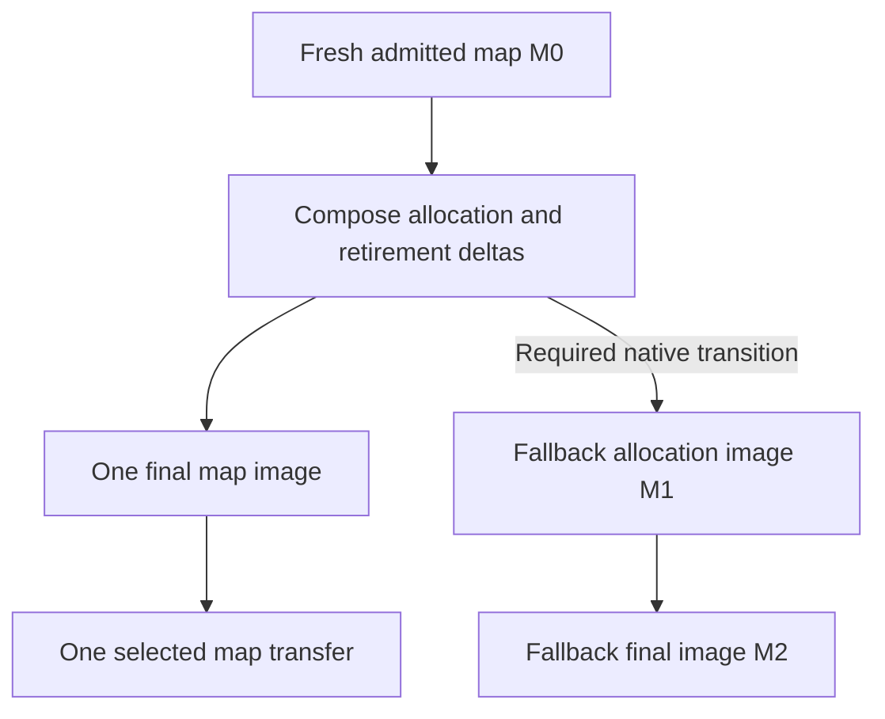
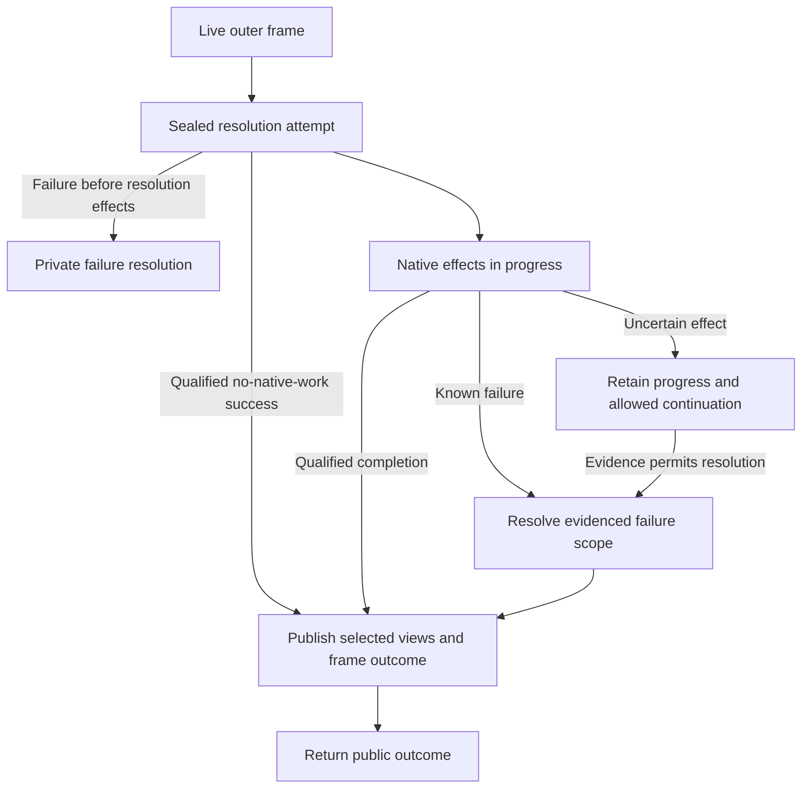
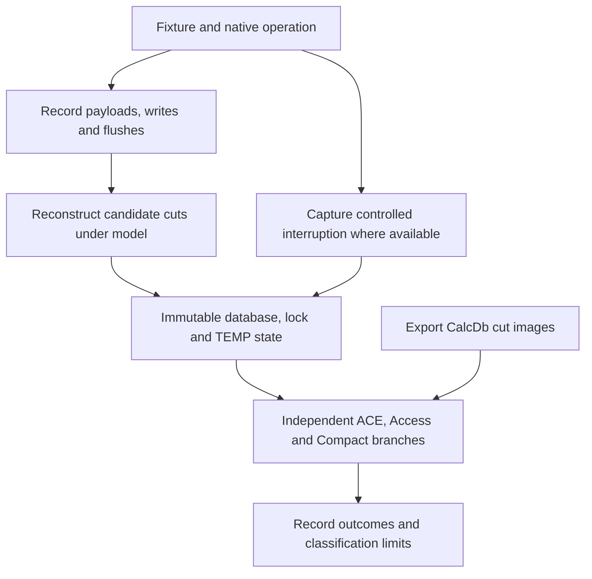

# II-08. Transactions, write ordering and crash recovery

Book **v1.1** · 2026-11-16 · [Release record](00-book-release.md).

**Requirement trace:** Primary RQ-STORE-01, RQ-STORE-02, RQ-STORE-04 and RQ-STORE-05. Shared obligations: RQ-PROD-04, RQ-FMT-03, RQ-SQL-05, RQ-SQL-06, RQ-SEM-03, RQ-DAO-01, RQ-DAO-04, RQ-ADO-01, RQ-LOCK-01, RQ-LOCK-03, RQ-LOCK-04, RQ-LATE-04, RQ-ISAM-01, RQ-CONC-02, RQ-SIM-02, RQ-CALL-04, RQ-ORACLE-02, RQ-ORACLE-03, RQ-ORACLE-05, RQ-PERF-01 and RQ-PERF-02. I-16 owns the complete scope map. II-03 supplies effect receipts and page-image ownership; II-04/05/06 supply native row/map/tree/catalog builders; II-07 supplies accepted semantic mutations and cursor outcomes. This chapter owns the resolution that connects them. II-09 deepens locking and visibility.

Implement one coordinator for each logical transaction owner, backed by identity-keyed native file participants. It retains explicit and operation scopes, compiles immutable native phase images, resolves logical and persistent outcomes separately, and preserves the same attempt through failure. D-TXN-1 and D-WRITE-1 remain Provisional with named branch experiments. D-UNDO-1 is the user's Decided ACE-first baseline and conditional whole-file image predicate. D-UNDO-2 is Retired: optional undo is an unplanned idea, with no codec, state machine or construction slice in this design.

**Evidence boundary.** Microsoft documentation constrains public and operating-system behavior; it does not provide an execution trace of the selected ACE build. Exact reference-source facts remain pinned to Jackcess commit `be0a2139b087a227d14cafd4ea231306a5a3a862`, without assigning it an unsupported release identity. The cleared supplied reports contribute labelled concepts only. Constructed pages, state traces and simulation examples below have independent arithmetic checks; none is an ACE capture. No ACE, Windows backend or reference Java encoder execution occurred here. The initial oracle remains the user-reported ACEDAO.DLL 16.0.20527.20016, subject to actual environment capture. Figures are rendered by the PDF build. The platform Automation VARIANT/BSTR contract remains unchanged.[^authority]

## 1. The Workspace owns logical transaction scope

**Requirement trace:** RQ-STORE-01, RQ-STORE-02, RQ-DAO-01, RQ-DAO-04, RQ-ISAM-01 and RQ-CALL-04. **D-TXN-1 remains Provisional.** Implement one coordinator per logical transaction owner, with the native file coordinators beneath it. DAO's owner is the Workspace; ADO's connection-facing owner has its own adapter and capability policy. A Database object, an ISAM cursor and an action executor enlist work; none independently commits the Workspace.

Microsoft documents Workspace-wide transaction scope, current-level nesting resolution and separate Workspaces for overlapping non-nested transactions. An inner commit remains reversible by its enclosing transaction. DBEngine transaction methods route to the default Workspace. These statements support the frame mechanism below; they do not specify a cross-file durable commit protocol. [^txn-begin][^txn-guide]

Represent membership at two levels. `DatabaseBinding` records a public open handle, its Workspace, permissions, schema context and verified file identity. `FileParticipant` is keyed by `(LockerId, FileIdentity, file incarnation)`: it retains that locker's base, private overlay and resolution progress. Two handles in the same locker can share it while retaining separate public object state. Different lockers share the underlying `FileSession`, not this overlay-bearing participant. Paths are diagnostic labels, not participant keys. A second Workspace or ADO Connection is a separate `LockerId` over the same file coordinator. Several lockers can retain accepted private change sets at once. None gains access to another owner's uncommitted overlay merely because both run on one thread. The local lock manager grants compatible page/record footprints and handles conflicts with the native retry settings and eventual error, not an indefinite wait for a file-wide transaction owner. R-TXN-1/TXN-LOCAL defines the observed granularity, retries and visibility.

Read registration and write enlistment are distinct. Opening a read cursor records its ownership and visibility policy without eagerly making every open database a write participant. Prefer write enlistment at the first accepted mutation; the participant then owns the required file lease, base view, private images and rollback obligations until the measured resolution policy releases them. A Database opened after BeginTrans still joins the active Workspace scope when its work requires enlistment. Capturing the read view at BeginTrans, first access or each statement remains the visibility decision of R-TXN-1/TXN-VIEW and II-09; lazy physical enlistment cannot accidentally choose that decision.

The core structures are original CalcDb structures, not an ACE log format:

```text
WorkspaceCoordinator {
    owner_incarnation, surface_policy, operation_serial
    state: Open | Resolving | Closing | FailedResolution | Closed
    explicit_frames: contiguous stack<ExplicitFrame>
    active_operations: owned operation frames and suspended continuations
    participants: FileIdentity -> FileParticipant
    engine_option_generation, resolution_receipt_slot
}
ExplicitFrame {
    frame_id, parent_id?, logical_begin_serial
    first_change_directory: PageKey -> ScopeBefore
    logical_delta_tail, allocation_ticket_tail, effect_receipt_tail
    participant_membership_delta, required_resolution_capabilities
    nested_force_requests, scope_budget
}
FileParticipant {
    verified_identity + open_incarnation, owned_native_handle
    required_lease, locker_id, local_grants, admitted_base_view, private_overlay
    schema/row/index generation dependencies
    native_effect_progress, unresolved_durability_intents
}
```

`PageKey` includes file identity/incarnation and native page number. `ScopeBefore` owns a complete immutable image, a spill locator, or an explicit ABSENT state. The directories contain handles to images; they do not copy 4,096 bytes into every frame entry. Typed logical deltas additionally retain catalog/object state, root-identity transitions, generated-value disposition and public observations that a page image alone cannot restore.

A BeginTrans with no mutation is consequently small: validate the live owner, options/context and current nesting limit; reserve one frame entry and its minimum error/cleanup state; then push the frame. It does not clone the database, enumerate its pages, flush an existing ordinary commit or allocate a native marker merely because a nesting level began. R-TXN-1/TXN-NEST confirms those public transitions and selects the actual accepted depth and error. Do not bake an unverified numeric nesting limit into the file format or coordinator.

Transaction support is a capability, not the presence of a frame. Database.Transactions reports an object's support, while Recordset.Transactions is documented False for snapshots and forward-only recordsets and True for native table/dynaset contexts. A read cursor reporting False must not cancel a Workspace transaction that also owns writable native tables. Its value does not establish the visibility policy of its reads. [^txn-db-support][^txn-rst-support]

Use a participant capability descriptor with separately represented native transaction support, nested support, operation classes, provider enlistment and required error/ignore behavior. The DAO references say unsupported ISAM objects can ignore the transaction methods without an error, while the methods are called on a Workspace that can contain more than one source. Probe that mixed-source boundary rather than generalizing an all-or-nothing Workspace Boolean. The later ODBC route also has a documented nesting restriction. Keep those branches visible in the adapter; do not make a nontransactional external write look reversible by placing an empty CalcDb frame around it. [^txn-begin]

## 2. Nested frames retain the earliest required image

The private overlay stores the newest image visible to its owning transaction. Each active rollback scope retains the earliest image it needs for pages first changed in that scope. The retained before-image and the newest image must be different immutable revisions once another owner needs both. II-03 supplies the image handles, uniqueness test and spill backing; this chapter supplies scope ownership.

**Figure F-54 — constructed two-file nesting trace.** Values are deliberate witness values, not captured ACE outcomes. Page numbers identify already validated data pages in distinct files. The table describes the preferred current-level policy, with no native writes yet issued.

| Call or mutation | Explicit depth | File A page 17 value | File B page 21 value | Required scope-before ownership |
| --- | --- | --- | --- | --- |
| Initial | 0 | 7 | 100 | None |
| Begin outer; A: 7→9 | 1 | 9 | 100 | Outer owns A17=7 |
| Begin inner; A: 9→11; B: 100→101 | 2 | 11 | 101 | Inner owns A17=9 and B21=100 |
| Commit inner | 1 | 11 | 101 | Outer keeps A17=7 and adopts B21=100 |
| Rollback outer | 0 | 7 | 100 | Resolved scope releases its ownership after dependent views settle |

The inner commit must not replace the outer A17 before-image with 9. If the outer frame did not already own B21, adopting the inner B21 before-image is correct: it is the value before the enclosing transaction's first change to that page. Rollback of the inner frame instead would restore A17=9 and B21=100 while preserving the outer frame and its A17=7 obligation. Microsoft's Rollback reference describes restoration to the current transaction's starting state; R-TXN-1/TXN-NEST tests this exact distinction, including a third level and an empty level. [^txn-rollback]

The merge prepares all metadata capacity before changing the stack. It transfers ownership of handles and receipts rather than copying page bodies:

```text
CommitInner(ws, supplied_options) -> PublicOutcome:
    require live owner, admitted call, and explicit depth > 1
    child = top frame; parent = previous frame
    policy = resolve options/context and nested-force disposition
    plan = reserve parent directory capacity and receipt links
    # reservation failure has not changed either frame or native bytes
    for (page, before) in child.first_change_directory:
        if parent has no scope-before for page:
            plan.adopt(page, before)
        else:
            plan.release_child_ownership_after_merge(before)
    plan.adopt logical deltas, allocation dispositions and effect receipts
    plan.combine qualified force intent and membership obligations
    install prepared merge; remove child frame
    retain latest private-overlay images without publishing to other owners
    return the native-selected success and remaining scope state
```

With a hash directory this costs expected O(k) metadata work for k child-touched pages and O(k) added handles in the worst case; page payload copy cost is zero for the merge itself. A sorted vector can provide deterministic merge walks when that representation fits the workload. The chosen structure must not introduce an allocation per repeated edit to a page already represented in the scope. Directory growth, effect records and simultaneous image versions remain budgeted costs.

A scope-before page is a restoration input, not an instruction to overwrite the entire current page blindly. A generated counter or other accepted effect can have a native disposition that survives logical rollback. Its surviving field changes must be reapplied to the rollback target image where necessary. Likewise, catalog handles, cursor identities, counts and lock state need typed resolution. If the native policy permits unrelated surviving changes to the same physical page, compose the target from the selected logical state; a stale whole-page before-image cannot erase them. This is one reason to keep logical deltas and complete physical images together.

This qualification starts with two local lockers in phase 1. Suppose A accepts row 7→9 while B accepts a neighboring row 100→101 under a record-locking case admitted by ACE. If A commits and B then rolls back, the file must retain `(9,100)`; B cannot restore the whole old `(7,100)` page. If B instead commits, its accepted delta is rebuilt over A's new base to produce `(9,101)`. A page-locking case may conflict before both edits are accepted; TXN-LOCAL decides it. A private rollback ordinarily removes or reconstructs only B's overlay. If B's selected early-write policy already produced native effects, its exact receipt and current protected base select the live restoration program. Later R-LOCK-4/TXN-RANGE adds external actors and native roles; it does not introduce the local rule for the first time.

Private rollback first builds a resolution plan over the affected scope: choose the images to restore, preserve any effects that survive, settle allocation tickets and object generations, and determine public cursor transitions. Only after its required metadata/resources are secured does it install the selected private view. Scope-owned readers and held values are not destroyed merely because the latest overlay changes; their policy either retains the older backing or explicitly invalidates their public generation. Reclamation waits for remaining owners.

When any covered native effect has occurred, rollback additionally executes the qualified native restoration program. A discarded overlay cannot undo a completed map or index write. The same progress receipt must survive rollback failure: a Rollback call can itself become a known failure or an uncertain persistent outcome. Do not pop the frame and then discover that its only before-image has been freed.

## 3. Operation frames are separate from explicit nesting

An `Edit` buffer, an ISAM Update operation, an action-query statement and an explicit BeginTrans level have different lifetimes. Represent them separately even when an implementation can share retained image handles. The pending edit in II-07 has not necessarily changed any database image; a statement can contain many accepted row operations; an explicit level can contain many statements and non-query edits.

```text
OperationFrame {
    operation_id, owning_explicit_frame?, surface_call_kind
    source/evaluation boundary and candidate continuation
    policy: row unit / statement unit / qualified partial-progress units
    operation_before_directory and logical delta sequence
    accepted-input and generated-value receipts
    candidate failure policy, settled-skip and terminal-failure receipts
    selected_failure_scope, affected-count observation, error collection
    publication_units and their definite/possible effects
}
```

Outside an explicit transaction, prefer an internal operation owner whose successful resolution publishes according to that operation's native policy. Call it an automatic operation frame; do not claim that it is an ACE implicit SQL transaction. A noncascading DAO Update can be a single semantic unit. An action may have a statement-wide reversible scope, or ordered units that leave a native permitted prefix or subset on failure. Inside an explicit transaction, successful operation work merges into the current user frame, preserving the user frame's earlier obligations.

The public flag does not define every failure class. Database.Execute's option table says dbFailOnError does not roll back, whereas its remarks describe rollback of successful changes when affected records are locked. QueryDef.Execute gives the positive rollback wording. The same documents discuss implicit-transaction changes in earlier Jet versions. Retain that conflict and use the preferred statement-undo rule where dbFailOnError is admitted, with R-TXN-1/TXN-STMT and R-SQL-2 selecting exact behavior by operation and failure. [^txn-dexecute][^txn-qexecute]

**Figure F-55 — preferred operation ownership matrix.** This is a design matrix pending native classification, not a promise that every failure rolls back the same scope.

| Explicit user frame | Statement policy | Success | Failure resolution to test |
| --- | --- | --- | --- |
| Absent | One-row DAO mutation | Publish its admitted native operation | Selected row/cascade effects and edit continuation |
| Present | One-row DAO mutation | Merge the operation into the current user frame | Keep, reverse or retain the qualified part of this operation; earlier user work remains represented |
| Absent | Action with admitted dbFailOnError | Resolve the statement owner | Prefer reversal of this statement's successful row work; classify counters, callbacks and physical failure separately |
| Present | Action with admitted dbFailOnError | Merge statement changes into the user frame | Prefer statement-only reversal while preserving earlier user work and the user's remaining depth |
| Either | No-flag action with a native-classified skippable candidate | Settle the candidate, continue later candidates, then resolve the accepted units | SkipCandidate retains generated/effect receipts, adds no successful mutation for the skip itself and publishes no skipped error; all-skipped success is an explicit case |
| Either | No-flag action with a stopping failure | Resolve only the native-permitted successful units | StopAction preserves the observed surviving set, count/error and remaining scope; no universal action atomicity |
| Either | DDL/catalog/QueryDef mutation | Use the operation's qualified catalog schedule | Capture metadata, schema-generation, cursor and persistent consequences for that exact operation |

II-11 §30 owns the `SkipCandidate`/`StopAction` action loop; this coordinator supplies the candidate settlement. A skip is allowed only for the exact native-classified failure context after candidate-local work has a resolved permitted disposition. It can reverse the candidate's row/index/cascade changes without reversing earlier statement work, or retain native-permitted surviving units with explicit receipts. A failed or uncertain settlement cannot be hidden as a skipped row. Retain whether each generated ticket was not reached, reserved/consumed or accepted and how its counter settles; neither candidate disposal nor a later rollback authorizes regeneration. Foreign effects remain recorded even where database work is reversed.

Source, qualification, target selection, accepted mutation, cascade and settled-skip events have separate counts. A skip advances only events actually reached and its one skip event; it does not itself add a successful target. Preserve earlier accepted/reversed receipts, and project the public count from the native surface policy. Do not publish the skipped failure into the public error channels. Prior error state follows the successful-call policy. Retire candidate values outside latches and revalidate the action/next continuation after cleanup. If cleanup invalidates the owner or fails, stop without repeating the already settled candidate.

For a discriminating fixture, perform change A successfully, then action B with success–blocked–success candidates, then change C if allowed. The no-flag branch can complete B successfully while skipping its middle row; the flagged branch tests statement reversal. SQL-CONTINUE also tests all blocked rows, first/last failures and separate lock, conversion, validation, uniqueness, cascade and generator classes. Observe A, every B candidate, C, explicit depth through later resolution calls, each Execute object's RecordsAffected, prior/final error collections, generated counters and held objects. Repeat through Database and QueryDef, flag absent/present and no/one/two explicit levels. Add injected settlement, cleanup and unresolved-write failures to prove that a completed skip is never replayed and an unresolved candidate never advances. A failed syntax bind and a late I/O failure do not inherit the blocked-row continuation.

A statement undo frame must capture its first-change image even if the enclosing user frame already has an earlier one. Suppose A has changed page 17 from 7 to 9, then B changes it from 9 to 11 before failing. Statement-only reversal restores 9; restoring the user frame's image 7 would erase A. On a successful B, transfer only the obligations not already owned by the user frame and retain accepted effect receipts. On a partial B, preserve the exact surviving logical units before updating the public count.

The executor does not re-run a statement to discover its successful set. It retains candidate occurrences, accepted values, generated tickets and effect observations as work proceeds. Statement reversal can restore database state, but cannot unsend a callback or make an external UDF effect never have happened. Native evaluation count and ordering remain observable. The failure receipt records those effects even when the statement's row images are reversed.

DDL follows the same framework with catalog-specific inputs: TableDef and catalog-row images, index/usage maps, schema and object incarnations, dependent held descriptors and any generated object IDs. Prefer keeping reversible native catalog changes within the explicit frame when the tested operation supports it; R-CAT-1 and TXN-DDL decide CREATE, ALTER, DROP, index and relationship changes separately. An external linked-table creation or provider command can have different capabilities. Its presence does not authorize an invisible commit of earlier local work or a fictitious rollback of external effects.

## 4. Resolution plans include all enlisted files

Build one `ResolutionPlan` for the selected scope before starting its required native work. It names every participant, target logical view, required phase program, durability intent, rollback disposition and public observation. The plan is immutable once persistent publication begins; progress is appended to reserved receipt slots. A topology change or newly discovered participant before publication requires revalidation and an amended plan. After publication begins it requires the measured continuation, not an unnoticed restart of the call.

For multiple native files, prefer preparation and resource reservation across the known participant set, then publication under a stable participant order where that does not change observable behavior. The order uses verified identities and is stable within the process; it is not a database filename sort masquerading as a durable protocol. Do not release an earlier participant's lock and silently replay its semantic changes just because a later file cannot be admitted. Late enlistment while other leases are held needs the lock manager's explicit contention/deadlock policy; never wait while holding a pager metadata latch. II-09 selects the externally compatible lock timing.

A successful Workspace resolution installs the resulting in-process views as one coordinator event. Readers receive an admissible view vector, not half of the new vector because one cache entry happened to publish first. This does not require every reader to use a global snapshot: the view vector only encodes the participants and visibility promise of that particular owner/operation. Other cursor policies can refresh later according to II-07/II-09.

**Figure F-56 — constructed multi-file effect receipt.** The offsets illustrate native file work; they do not establish an ACE cross-file ordering.

| Participant | Native step | Definite result before the next error | What must remain represented |
| --- | --- | --- | --- |
| A | Data page 17 at byte offset 69,632 | Complete image write | New A bytes may already be visible through the file |
| A | Index page 40 at byte offset 163,840 | Complete image write | A's structural closure may have advanced farther than B's |
| B | Data page 21 at byte offset 86,016 | Write attempted; completion uncertain | Old and intended B images are retained, neither is asserted to be the actual file |
| A and B | Required final force-flush sequence | Not completed | No successful forced-commit receipt exists |

The logical fact that all work belonged to one Workspace does not convert this receipt into either “nothing committed” or “everything committed.” The resolution policy may retain a usable transaction, require qualified restoration, expose a surviving subset, or end in a state requiring close/reopen. R-TXN-1/TXN-MULTI and R-CRASH-1 select those outcomes. Do not create a two-phase-commit side file to supply a stronger promise. Nor may the coordinator return an invented success simply because one participant was definitely written.

Reserve enough progress storage before each native submission that an out-of-memory error cannot erase the last step's definite or possible effects. Per-participant progress includes phase/image identity, completion/uncertainty, logical resolution state, flush requests and completions, and permitted next actions. The public error mapper consumes this receipt; it does not decide the durable state by looking only at the last Win32 error code.

## 5. Ordinary commit, nested force requests and engine options

Use distinct logical and durability fields in a `CommitReceipt`. An inner logical commit merges obligations into its parent; an outer logical commit can finish while its ordinary updates remain subject to the declared cache/device survival class. `dbForceOSFlush` is documented as flushing updates instead of leaving them temporarily cached, while ordinary CommitTrans can return before the updates reach disk. This is a public durability-intent distinction, not the byte schedule for implementing it. [^txn-commit]

For an outer commit, the preferred initial policy remains I-08's: complete the required native writes, then complete the supported forced-flush sequence when the call requests it; ordinary commit does not add an unconditional forced flush. The native stage compiler and backend receipts determine which completions satisfy that intent. Failures after writes, during flush or before returning remain different from failures before publication. A caller can lose the success acknowledgement after its commit has crossed a native survival frontier; a receipt cannot infer “uncommitted” from the missing acknowledgement.

An inner `CommitTrans(dbForceOSFlush)` is particularly discriminating. The public references do not settle whether it flushes rollback-capable native changes immediately, propagates a force requirement to the outer level, or has some narrower effect. Prefer recording the request on the inner resolution receipt and provisionally propagating its effective intent to the parent, without declaring the inner changes independently committed. TXN-FLUSH-LIVE compares inner forced commit followed by outer rollback, outer ordinary commit and outer forced commit, with paired R-CRASH-1 interruptions after each boundary. If ACE flushes still-reversible changes earlier, the implementation needs the evidenced early-write and restoration program; if it ignores or confines the request, remove the propagated effective intent while retaining the trace of the original call. Until classified, that branch cannot borrow the outer-forced case's acceptance evidence.

Record the effective engine configuration with every capture. DBEngine.SetOption documents runtime overrides including UserCommitSync, ImplicitCommitSync, shared/exclusive asynchronous delays and FlushTransactionTimeout, plus memory/lock-related limits. The article's example registry path is Office 12.0; it does not identify the active path or defaults of the supplied Office 16 build. The oracle records supported option queries, explicit overrides and any unresolved provenance instead of installing guessed registry values. [^txn-options]

The coordinator retains an engine-option generation and the options relevant to each accepted operation. A runtime change is a public event: capture whether it affects existing pending work, only later operations, or an explicit drain. Do not let an implementation thread read whichever option happens to be current halfway through a program. A policy can intentionally rebind an option at a measured boundary; that boundary and its failure behavior are then part of the program.

DBEngine.Idle is another explicit event. Its documentation describes pending engine work, cache refresh and release of read locks; it also discusses pending writes. Route it through the engine scheduler and the affected coordinator/view policies. It is not synonymous with Workspace.CommitTrans or proof that a force-flush durability barrier completed. An uncommitted overlay cannot be written merely to empty the cache unless the native policy and crash analysis authorize that phase. [^txn-idle]

## 6. TEMP exhaustion is a transaction state, not a generic allocation error

The DAO transaction references describe a workstation TEMP transaction log, a runtime error when its storage is exhausted, potentially indeterminate partial commitment if CommitTrans then follows, and rollback as a distinct resolution. This is documentary evidence for an exceptional state to reproduce. It neither supplies the file format of ACE's TEMP log nor authorizes CalcDb to require an authoritative private journal before ACE can reopen the database. [^txn-commit][^txn-rollback]

CalcDb's preferred normal path keeps uncommitted page revisions privately and may spill them into owned temporary storage. Live transaction staging/before-images and retained reader history have distinct ownership and budgets even if one allocator supplies both. Their accidental survival on disk does not make them recovery authority. D-UNDO-2 adds no planned store or opening protocol.

Budget admission for a scope includes its worst simultaneous preservation requirement: the old page revision, the modified revision, image-directory growth, allocation/constraint receipts, the native program's sealed images, and enough reserved outcome/cleanup metadata to settle a fault. Copying or spilling one image can temporarily need both the source frame and the encoded output buffer. Count that overlap. A large user transaction can contain a small resident index of images and immutable spill blocks; it must not flush uncommitted database pages simply because the RAM budget has been reached.

Use a narrow, checked spill record with workspace/frame/image identity, kind, declared length, integrity check and owned payload. This is an internal live-storage format. Writes and reads are bounded; a damaged or missing record is a resource/storage failure, not a valid before-image. A partial spill write never replaces the sole retained copy until completion has been verified. When spilling a before-image is required to admit a new mutation, failure occurs before granting that mutation access to the editable page.

An exhausted TEMP-like store does not always have the same consequences as an ordinary pre-admission resource rejection. Model `ResourceFailureDisposition` in the operation/Workspace receipt: no accepted changes; accepted private changes with valid rollback; known native effects; or uncertain native effects. Its fields also name the still-supported public operations. They are internal classifications and do not invent a new public DAO error. The selected native error collection and subsequent CommitTrans/Rollback/Close behavior come from TXN-TEMP/FAIL-OWNER and R-CRASH-1/CRASH-FAILURE.

Prefer refusing additional mutation after exhausted staging while preserving the already owned rollback data and a reserved resolution path. That is the implementation starting direction, not permission to promise stronger behavior than the measured target. If ACE's exhaustion branch can commit an accepted subset or loses part of its logical rollback facility, capture its actual surviving set and implement that qualified continuation through explicit progress units. Never choose a random subset merely to imitate the word “indeterminate.” Unknown native behavior remains unknown; it does not justify returning success or replaying the failed action.

The capture must distinguish a full TEMP volume, a denied TEMP creation, a short TEMP write, a failed TEMP flush, a missing spill file, a full database volume and memory pressure. Put TEMP and the database on separately controlled volumes for the first discriminator, then test the shared-volume case. Freeze the files before opening the database with another engine. Log the successful A/B/C operation sequence and probe the next generated value; row counts alone cannot identify the accepted and lost work. The relative failure point is a public/semantic and persistent milestone, not equality of ACE's and CalcDb's temporary byte consumption.

## 7. Close, clone and Requery settle the owning scope explicitly

A public Close is a lifecycle operation with an outcome, not just the last decrement of a file pointer. Workspace.Close is documented to roll back unresolved transactions through the transaction-method references, and calling Close on an already closed Workspace or Database is separately documented as an error. The underlying coordinator can remain owned long enough to complete or report required cleanup, while held COM child objects retain their identity and later expose the qualified closed-object errors. [^txn-begin][^txn-wclose][^txn-dclose]

Prefer Workspace.Close to select resolution of all pending levels, settle accepted operation continuations and native requests, then detach public children and release file obligations. It must not invoke one current-level rollback and forget deeper frames. If restoration fails, preserve the precise unresolved file/progress state and expose the measured Close outcome. The return path cannot claim a clean rollback merely because the public Workspace is now unusable.

Clone.Close is a different input. The Clone reference says closing either cursor leaves the other cursor open, yet closing a clone during a pending transaction invokes implicit Rollback. The preferred starting policy routes the clone-close event to the coordinator's current-level rollback policy and only then releases that cursor's ownership; TXN-CLOSE determines whether the actual target unwinds more levels, when the remaining cursor is refreshed/invalidated, and how a failed rollback changes the close result. Resource-open lifetime and transactional effects remain separate. [^txn-clone]

Database.Close has no comparable scope detail in its short reference. Prefer detaching that public binding while the Workspace retains any enlisted native handle and rollback obligations needed to resolve its transaction. TXN-CLOSE compares close of one of two participating databases, close of the last binding to one file, duplicate handles for one file and subsequent CommitTrans/Rollback. If ACE closes or resolves a wider scope, change the explicit policy and lock-release boundary; do not hide the result in an object destructor. Final COM Release and explicit Close are also separate capture cases because their error delivery differs.

Requery belongs to cursor recreation and population. Its documentation describes re-execution/repopulation and parameter handling; it does not define a general transaction commit. Prefer creating the new result under its Workspace's admitted current view, with II-07's explicit pending-edit and family-incarnation policy. Requery after a commit or rollback may expose different rows, but cannot repair an uncertain persistent transaction by silently rerunning its writes. Capture failure of Requery separately from failure of the transaction that preceded it. [^txn-requery]

These events can arrive during callback reentry. Before calling the host, retain the owning frame/operation incarnation and its continuation, release internal metadata latches, and record that the call can be invalidated by a nested lifecycle transition. On return, revalidate the receipt and owner; do not continue publishing into a frame that a callback rolled back or closed. If the target forbids a particular reentrant transition, its native error is a policy result, not a reason to leave a lock held across host code.

## 8. The ADO adapter uses the coordinator without importing DAO policy

The initial adapter here serves admitted ACE database connections. Other/default/omitted database providers receive II-12's named, counted provider refusal. The supported connectionless Recordset/Stream persistence route, including MSPersist, does not itself enlist a native database transaction. Later provider machinery is a separate capability, not system-ADO passthrough. ADO transaction methods are connection-scoped. Its BeginTrans can return the nesting level, support depends on the provider, and connection Attributes can request an automatically started successor transaction after commit or rollback. Unsupported-provider calls and resolution without an active transaction are documented errors. These are surface inputs to the same coordinator machinery, not proof that an ADO connection has DAO Workspace membership or identical clone/Close rules. [^txn-ado]

Retain an adapter-selected `ResolutionSuccessor`: no new scope, or a fresh transaction scope under the qualified retaining policy. Prefer reserving the next frame's local metadata before resolving the old one, while keeping their identities separate. If an external provider can fail beginning the successor after the prior commit succeeded, the result must retain that committed outcome and report the failed successor creation. It cannot undo the successful commit to make the call look atomic. Retaining must not resurrect old before-images, bookmarks or consumed generated tickets as though the old transaction never ended.

The connection capability descriptor also retains provider transaction/DDL declarations, isolation negotiation, accepted nesting and affected command/cursor routes. II-12/R-ADO-1 owns the complete public inventory and event order; this chapter provides the operation and resolution substrate. DAO and ADO work can therefore begin alongside each other while their public policies remain independently captured. Later ODBC/OLE DB adapters may enlist remote participants; no distributed durable atomicity follows merely from reusing the local coordinator types.

## 9. Compile a native operation into a persistence program

**Requirement trace:** RQ-STORE-01, RQ-STORE-02, RQ-STORE-04, RQ-STORE-05, RQ-PROD-04, RQ-FMT-03, RQ-ISAM-01, RQ-SQL-05 and RQ-CALL-04.

**D-WRITE-1 remains Provisional.** Start with one final stored image per physical page per publication unit. Prepare accepted local work, acquire the file's resolution gate and rebuild it over the newest committed base. The preferred submission order is: initialize new targets; write changed existing data pages; write final indexes; publish catalog references; write final existing ownership/usage maps after affected old references have gone; then permitted tail truncation, native/logical resolution and the selected flush/acknowledgement. A new map page is initialized with other new targets. An actual native marking transition is reproduced only if evidenced; a required repeated header or map image selects the general fallback compiler.

This candidate deliberately leaves ordering questions visible. A composed map may allocate new storage and retire old storage in one image. Map-before can offer still-referenced old storage as free; map-after can expose new references before their ownership bits. Exclusion prevents an external live writer during initial publication, but does not answer what a first opener sees after a crash. R-FMT-2 and R-CRASH-1 compare named MAP-BEFORE and MAP-AFTER variants; MAP-AFTER is the starting candidate. No claim that every interrupted graph is complete is used to select the starting order.

II-07's `PreparedMutation` supplies accepted row values, generated-value receipts, constraint results and performed effects. II-04/05/06 supply the row/LV/map, tree and catalog changes. II-09's `PreparePublicationProgram` uses those effect-free deltas on a fresh committed base in Local mode, and adds native role/source protection in later External mode. Repacking, splitting or changing an allocation cannot replay a callback, default, generated ticket or already accepted cascade.

Keep three dependency meanings explicit. A **build dependency** orders private construction. A **transfer dependency** requires a native request to settle before another is submitted. A **persistence dependency** constrains which effects may survive under a declared fault model. The first two do not establish the third. Windows buffered completions alone give no general rule that page A must survive before later page B after power loss.[^w-caching]

Attach the actual barrier or backend property to each proposed persistence dependency, retaining unresolved assumptions. Do not add forced flushes at every arrow merely to simplify a model. R-CRASH-1 preferably records payloads and flushes, reconstructs states and compares independent opener outcomes. The exact relation, pass conditions and treatment of classes that cannot be established are implementation work under PRD-07; this chapter does not turn a missing crash class into a pre-decided shipping or refusal rule.

The complete final graph remains necessary: correct rows, entries, ownership and descriptors, with protected bytes preserved. The crash goal is separately no worse than the corresponding ACE operation, with the same ordinary/forced commit survivors. There is no invented repair bit or universal on-disk commit word. A source-named write stamp alone establishes neither role.

## 10. Page revisions, reservations and typed effects

The following are original in-memory structures. None is a new native file format. Store variable-size lists in owned contiguous arenas, identify objects by stable handles, and reserve the minimal progress record before the first native effect.

```text
PublicationUnit {
    semantic_receipts, operation_policy, qualified_profile
    participants[], input_view_certificates[]
    native_role_receipts[], protected_source_certificates[]
    reservation_plan, page_revision_chains[]
    native_effects[], dependency_edges[]
    selected_visibility_transition, public_outcome_continuation
    rollback_obligations, progress_record
}
PageRevision {
    file_incarnation, page_number, allocation_incarnation
    revision_id, previous_revision_id
    decoded_image, immutable_stored_image
    native_role, changed_ranges, referenced_targets
    preserved_unknown_ranges, source_obligations, protected_base_certificate
}
Reservation {
    file_incarnation, page_number, native_owner
    origin: ExistingFree | Append
    before_extent_and_image, private_allocation_generation
    native_reservation_or_allocator_ownership?
    required_owner_maps[], required_global_map_revision
    disposition: Reserved | Installed | Retired | Released
}
NativeEffect = ResizeExtent | TransferSpan | FlushHandle
TransferSpan {
    step_id, page_revision_id, stored_image_range, file_range
    purpose, predecessor_transfers[], persistence_requirements[]
}
ProgressRecord {
    current_step, next_effect, execution_state, settled_steps
    proven_prefix, possible_effect_range, pending_cancel_id, deferred_boundary
    last_native_cause, extent_outcome, completed_flushes
    native_state_class, allowed_continuations
}
```

A newly allocated page is not necessarily an absent page. If page 80 was a free page within the original file, its old bytes and extent already existed; `ExistingFree` retains that fact. Only newly exposed ranges beyond the original EOF have an absent before-state. This distinction matters to rollback, preserving historical images and allocation failure. A map bit is not proof that the bytes were absent.

Reservations from row growth, index splits and map self-expansion share one namespace per enlisted file. II-04's finite allocation closure assigns a required bitmap page once, adds that page's own ownership effects, and repeats until every reference can be encoded. There is no separate index allocator that can hand out a page already reserved for an LVAL chain. Existing free holes remain distinct from append capacity; map expansion does not authorize discarding holes that the reference writer happens to lose.

That namespace prevents conflicting CalcDb reservations; it does not reserve storage against ACE. A shared-mode candidate becomes externally exclusive only under the qualified allocator ownership or an evidenced native reservation. If a still-private candidate is lost, physical preparation may choose another location without regenerating accepted AutoNumbers or callbacks. Existing edit/transaction obligations remain owned. R-LOCK-4/WRITE-ALLOC selects the native reservation and release transitions.

The physical key for composing edits is `(file incarnation, page number, allocation incarnation)`. A TableDef patch, two map rows and a catalog row can resolve to one page. Start from one fresh admitted base and compose all of the publication unit's final patches into one final image. The fallback can expand `M0 → M1 → M2` when the selected native transition needs two stored revisions. M2 then derives from M1, never independently from M0; otherwise the later image can erase an earlier bit or another locker's committed change.

For local publication, refresh the admitted base under II-09's resolution gate and local grants; External mode additionally holds the native publication footprint. Reapply retained effect-free deltas after checking originals, identity, schema and constraints; preserve unrelated committed rows, entries, map bits and counters. A private candidate page is not automatically a current native base. Each sealed revision retains its source certificate and the native role intervals needed through transfer completion and any unresolved continuation. A logical edit owner does not by itself supply this physical protection. A release/refresh between M1 and M2 requires the profile's explicit recomposition transition; a presealed stale M2 cannot cross that gap unchanged.

**Figure F-57 — compose one final physical map image, with a repeated-image fallback.** This is a CalcDb construction choice, not an observed ACE schedule.



The starting program stores the final image once. If the fallback stores both M1 and M2, their complete source images and dependency edges remain owned. Before selecting preservation work, §19 closes fresh admission of the affected current view. Before overwrite, the pager freezes native sources and preserves every required old image, including a reader whose load has not yet acquired it, independent targets and pending loads. Physical image ownership does not promise DAO snapshot isolation. External-mode preservation also needs native protection; a local freeze cannot exclude ACE. Stored-byte receipts cover encoded bytes, including any header masking.

## 11. Finalize and check the phase graph

The planner first settles the complete *logical* allocation/reference closure, then expands the chosen native transition protocol into revisions and effects. This order avoids treating a partially discovered index split as a finished publication plan. It also exposes cycles: an object-map declaration can share a page with another structure, and initializing a new map can require allocating that map itself.

```text
CompileNativeProgram(prepared, scope, profile, budget) -> Program | Failure:
    require accepted semantic receipts and scope are still owned
    reserve minimal effect/outcome storage and preservation workspace
    require latest committed bases and local grants under each file resolution gate
    require additional native roles/source protection for External mode
    close shared row/LV/tree/catalog allocation reservations under budget
    bind every descriptor, reference and actual physical page incarnation
    validate final native object graphs and preservation masks
    select one-final-image template and named order/timing branch
    compose all final patches by physical page into complete final revisions
    expand repeated-image transitions only where the selected fallback requires them
    bind each source/transfer to its qualified native ownership interval
    connect any fallback successive revisions of the same physical page
    expand extents, initialized targets, map publication and reference edges
    expand all operation-required catalog and native-state transitions
    bind composed-map placement and retirement/truncation to the selected template
    attach qualified barriers and separate acknowledgement conditions
    if a dependency cycle remains:
        require an evidenced intermediate/native transition that breaks it
        otherwise return unsupported-transition evidence, without writing
    encode each sealed revision into owned stored bytes
    choose the qualified complete-page or span transfer plan
    validate every predecessor, range, owner, extent and progress slot
    return immutable program plus rollback and visibility continuations
```

The cycle result identifies the operation and missing transition; it is not a blanket prerequisite for all writer construction. Researchers can run the candidate in the deterministic VFS and compare its cuts with native controls without enabling that candidate as accepted file output.

Checking the final graph includes actual index maxima and peer rules, row-root versus body addresses, column-specific LVAL ownership, global free membership, TableDef counts/descriptors and catalog references. Native fields whose semantics remain opaque are preserved. A row update is not permission to rewrite every TableDef counter, and an index's source-named `uniqueEntryCount` is not substituted for current cardinality. A generated-value counter or prescribed native bookkeeping update stays in the closure even when the visible row count is unchanged.

After expansion, each physical revision has a unique immediate predecessor. Every transfer lies inside its exact image and native extent; every final target reference names initialized storage with its required final ownership. Intermediate map/reference order is recorded separately and is not checked as if every cut were a complete final graph. A retirement includes the proved referents being removed and any retained-view obligations. The validator also checks program metadata: no emitted effect lacks a progress slot, no barrier depends on a future step, and no callback can be demanded after the first write by an allegedly pure encoding stage.

Use a deterministic topological traversal with the policy's stable tie order. It costs O(V+E) for V effects and E edges after the byte-level builders finish. Complete-image validation costs O(total inspected image bytes), with bounded key/chain work from the supplying layers. A tie may use file/page locality only when the qualified policy allows both orders and their error/crash traces. Initially execute one effect at a time; enabling several in-flight writes adds combinations of partial completion and survival to the experiment, even when their final byte ranges do not overlap.

## 12. Worked indexed-key update: two final transfers, four order candidates

**Figure F-58 — isolated 42→43 before, final and fallback images.** These are constructed native-layout witnesses, not ACE-created pages or observed write sequences. They use II-05's same leaf and row coordinates.

Index root leaf `0x90`, owned by TableDef `0x20`, starts with Long 42 at `(17,0)` and Long 50 at `(18,2)`. Data page 17 has the seven-byte row `01 00 2A 00 00 00 01` at offset `0x0FF9`; its one slot remains at that offset and its free count is 4073.

| Revision | Complete entries or row bytes | Prefix, payload and directory facts |
| --- | --- | --- |
| `I90.0` — before | `7F8000002A00001100`, `7F8000003200001202` | Prefix 4; packed payload 14; ends 9/14; mask byte 1=`42`; free bytes `12 0E`. |
| `D17.1` — final | `01 00 2B 00 00 00 01` | Key byte at page `0x0FFB`, file `0x00011FFB`; slot/root unchanged. |
| `I90.2` — final | `7F8000002B00001100`, `7F8000003200001202` | Prefix 4; packed payload 14; the before/final leaf differs at page `0x01E4`, file `0x000901E4`, where `2A→2B`. |
| `I90.1` — remove-first fallback only | `7F8000003200001202` | Prefix 0; payload 9; end 9; mask byte 1=`02`; free bytes `17 0E`. |
| `I90.both` — add-first fallback only | Entries 42 and 43 at `(17,0)`, then 50 at `(18,2)` | Prefix 4; packed bytes `7F8000002A00001100 2B00001100 3200001202`; payload 19; ends 9/14/19; mask byte 1=`42`, byte 2=`08`; free bytes `0D 0E`. |

All rows/pages are already allocated in this isolated fixture. The actual operation may also change evidenced counters or descriptors. Build every fallback leaf independently from its full entry set, including prefix, boundaries and free count; it is not a scalar patch into another representation.[^w-index]

| Named R-CRASH-1 branch | Transfer order for this isolated pair | Design selected if native evidence requires it |
| --- | --- | --- |
| **CRASH-ORDER-DATA** — preferred | `D17.1 → I90.2` | One final image per page; row precedes final index. |
| **CRASH-ORDER-INDEX** | `I90.2 → D17.1` | One final image per page; final index precedes row. |
| **CRASH-ORDER-REPEAT-REMOVE** | `I90.1 → D17.1 → I90.2` | Repeated-image fallback with obsolete reference removed first. |
| **CRASH-ORDER-REPEAT-ADD** | `I90.both → D17.1 → I90.2` | Repeated-image fallback retaining both keys across the row change. |

The starting two-page program transfers **8192 bytes** at full-page granularity. Either displayed fallback transfers **12,288 bytes**. These are constructed costs, excluding any additional native bookkeeping. The one-byte before/final leaf difference does not itself authorize a one-byte physical transfer.

Data-first temporarily leaves the new row with the old key; index-first temporarily leaves the new key with the old row. Remove-first exposes a missing key; add-first exposes both keys for one root. These are concrete questions for native captures and opener comparison, not pre-approved ACE crash states. Repeated images enter the implementation when the investigation selects them, rather than because an arrow named “remove” sounds safer.

Timing is separate from page order. **TXN-FLUSH-COMMIT** observes explicit outer-commit publication and any early reversible writes; **TXN-FLUSH-OP** observes writes completed by each implicit operation's end; **TXN-FLUSH-BEHIND** observes implicit return before owned pending writes drain. TXN-FLUSH-LIVE records ordinary/forced options, actual write/flush payloads, Idle/Close and subsequent calls. R-CRASH-1 pairs each timing case with reconstructed/interrupted images and independent openers. Commit-time explicit and operation-end implicit publication are the initial construction choices; an observed write-behind policy retains its pending-image ownership and changes acknowledgement/drain behavior.

Run these deciding branches before broad writer construction, meaning **beyond the first same-width mutation slice**. That slice provides the concrete driver and candidate whose expensive alternative is being decided. Exact crash coverage and final pass conditions remain implementation work under PRD-07.

Partial writes produce actual mixed bytes inside every complete-page transfer. A new mask/header with an old entry stream is not any complete revision in the table. Preserve and decode/classify it under the declared storage model; never replace a 4096-byte transfer with an assumed atomic swap.

## 13. Long-value replacement and opposite map meanings

Use II-04's external-value grammars to replace a 100-byte value on LVAL page 70 with a 4,080-byte chain on pages 80 and 81. Assume pages 80 and 81 are validated free pages already inside the file, and the old value is the only live row on page 70. The reservation records therefore contain real prior bytes for 80/81. No extent growth occurs in this particular fixture. If page 70 contains another live LV row, its whole-page release steps below are absent and the applicable row retirement/availability changes replace them.

The old definition is `64 00 00 40 00 46 00 00 00 00 00 00`. The intended definition is `F0 0F 00 00 00 50 00 00 00 00 00 00`. Page 80 has a 4,076-byte row beginning at `0x0014`: a four-byte next locator `00 51 00 00` plus 4,072 payload bytes. Page 81 has a twelve-byte row at `0x0FF4`: a terminal locator and eight payload bytes. The free counts are 4 and 4,068, respectively. The declared 4,080-byte length excludes both next locators. These are the same source-backed hypotheses and constructed dimensions used in II-04. [^w-long]

Suppose the validated global declaration row begins at page-1 offset `0x0FBB`, is inline type 00 with base zero, and the owning column's LVAL map uses bitmap page 40. This choice of owner must come through the column-map metadata; TableDef ownership does not automatically put LVAL pages in the ordinary table-data map.

**Figure F-59 — one final image for each LV, data, index and map page.** Preferred provisional submission order; actual map-before/reference-before alternatives and their crash states are experiment inputs.

| Step | Target revision / effect | Final contents and order question |
| --- | --- | --- |
| L1 | `L81.final` | Complete terminal row in reserved page 81. |
| L2 | `L80.final` | Complete first row pointing to initialized 81. |
| D1 | `D.final` | New external definition and accepted scalar changes. |
| K1 | Final index/ancestor pages, if affected | Starting CRASH-ORDER-DATA order; CRASH-ORDER-INDEX reverses row/index placement. |
| C1 | Final TableDef/catalog pages, if affected | Required descriptors/references, with all aliases composed. |
| M1 | `M40.final` | Set ownership of 80/81 and clear ownership of 70 in one image. |
| G1 | `G1.final` | Clear free bits for 80/81 and set the free bit for 70 in one image. |
| N1 | Native/logical resolution and selected flush | Keep visibility, native state, survival and acknowledgement distinct. |

The final maps follow removal of the old row/reference in the MAP-AFTER starting candidate. New references can therefore precede map ownership. Moving the same final maps earlier instead exposes retirement of page 70 before its old reference disappears. Neither order establishes ACE crash parity by inspection. Compare both with payload traces and independent openers. If the native result requires separate allocation and retirement images, CRASH-ORDER-REPEAT expands `M40.allocate80_81 → M40.release70` and `G1.allocate80_81 → G1.free70`, with data/index/catalog references between their selected phases. Initialize the new LV tail first as the starting chain direction, while retaining owner-map discovery as an independent native path.

The exact bit coordinates are:

| Page membership | Global free declaration | Column-owner bitmap |
| --- | --- | --- |
| Page 80 | Offset `0x0FCA`, mask `01`; allocate by clearing | Offset `0x0E`, mask `01`; own by setting |
| Page 81 | Offset `0x0FCA`, mask `02`; allocate by clearing | Offset `0x0E`, mask `02`; own by setting |
| Page 70 | Offset `0x0FC8`, mask `40`; free by setting | Offset `0x0C`, mask `40`; release by clearing |

Compute the global coordinate as `0x0FBB + 5 + floor(page/8)` and the bitmap coordinate as `4 + floor(page/8)`. Preserve the other six bits in the page-80/81 byte and every unrelated map byte. The starting final G1/M40 images combine the new memberships with retirement of 70. If repeated revisions are selected, derive retirement from allocation so it retains those memberships. [^w-maps]

The example does not require erasing page 70 before it becomes free. The inspected PageChannel reference invalidates a short header prefix during deallocation, but that is its policy. CalcDb includes such a write only when the selected native rule requires it, retaining the old bytes for every remaining rollback/visibility obligation. Reuse of a freed physical page starts a new allocation incarnation even if the later contents happen to match old bytes.

The displayed final-map candidate places reuse after reference withdrawal, subject to the native investigation. Shared LV retirement may additionally depend on native participant/retention conditions. II-09 and R-LOCK-4/WRITE-LV select those conditions and the corresponding native map state; withholding a page only in a private list cannot stop ACE allocating a page already marked free. Native reuse eligibility is separate from retaining an immutable old image for a CalcDb reader.

If the same operation instead appends pages, the graph includes explicit extent effects before any transfer to newly exposed bytes. A successful extent increase is not initialized native storage: Windows documents undefined contents in the newly extended range. A resize failure also has a separate outcome from a zero-byte transfer failure. The model includes the extent at its reported or uncertain length before native reopen. [^w-eof]

## 14. Index split and stable-root publication

The byte-balanced split from II-05 turns the old 602-entry leaf containing Long 0…601 into a 259-entry left leaf containing −1 and 0…257, and a 344-entry right leaf containing 258…601. The recomputed payloads are 2,073 and 2,067 bytes. The new high fence is the complete entry for 257 at row root `(0x2101,5)`, not merely the scalar 257. Entry payload and child-pointer byte order use the index grammar described in II-05. [^w-index]

**Figure F-60 — stable root changes role after its children are prepared.** Constructed isolated subtree; no ACE trace or atomic-root-write claim.

| Physical page | Before | Intended image |
| --- | --- | --- |
| Root `0x0100` | Kind 04 leaf holding the old entries | Kind 03 interior, level 1, one explicit fence to `0x0120`, header tail `0x0121`. |
| New left `0x0120` | Validated free storage, or absent append range as separately recorded | Kind 04; 259 entries; prefix 1; payload 2,073; next leaf `0x0121`. |
| New right `0x0121` | Its own recorded prior allocation/extent state | Kind 04; 344 entries; prefix 3; payload 2,067; previous leaf `0x0120`. |
| Physical index descriptor | Root page `0x0100` | Root page remains `0x0100`; actual counts/maps still change. |

The new root's explicit entry is `7F 80 00 01 01 00 21 01 05 00 00 01 20`; its header tail is `21 01 00 00`. The child pointer in the entry is big-endian, while the header tail is little-endian. A singleton uncompressed root payload occupies thirteen bytes, marks boundary bit 13 and leaves 3,603 payload-area bytes free. The constructed left/right images have reciprocal leaf links. Data pages containing the referenced row roots and the TableDef/maps are outside this isolated fixture.

The MAP-AFTER starting root-growth program initializes both children with their final links, any required new row payload and any new map page before the references that admit those targets. It then transfers the new root image and required non-map bookkeeping, followed by the final existing allocation and ownership maps. The public root address remains stable, reducing descriptor changes. The root transfer still crosses sectors and can tear; its before/final kind change does not supply atomicity. Complete-child preparation avoids uninitialized targets, but an interruption during root replacement can still require the native repair class. The experiment compares that class, child discoverability at the selected map/reference cuts and subsequent opening behavior.

A nonroot split makes the ordering problem even clearer. Suppose existing right leaf R retains 258…601, a new left leaf L holds −1…257, parent P currently selects R for the whole old range, and Q is R's previous leaf if present. The MAP-AFTER starting candidate initializes L and any other new targets, including a new map page, before the references that admit them; installs R's reduced entries and new previous link; connects Q to L when needed; publishes P's added high fence and any affected ancestors; then writes the final existing allocation and ownership maps. All images preserve the chosen leaf peer rules. This sequence intentionally prioritizes fully formed targets before parent publication, but its interrupted search gap is an experiment subject. MAP-BEFORE and repeated-map programs remain experimental alternatives to these starting split programs, as §9 specifies.

There is no purely syntactic ordering that keeps every old and new traversal simultaneously complete. If R loses 0…257 before P selects L, an old parent descent can miss them. If P selects L first while R still holds all old entries, the right child's interval and leaf traversal can expose duplicates or inconsistent fences. Updating sibling links adds its own asymmetric cuts. A safe candidate cannot be justified by choosing a pleasing arrow order or by claiming “new pages are unreachable”: an ownership scan or a sibling link may already expose them.

The phase compiler records that conflict explicitly. R-CRASH-1 investigates missing/duplicate/repair outcomes, any real native marking transition, and whether spans or repeated images are required. Exact classification and acceptance are settled during implementation. If the selected native policy needs more than the final-image candidate, expand it into additional immutable revisions. Do not invent an index generation bit, reinterpret an opaque stamp, or add a shadow root hidden from ACE. This is a bounded implementation problem with concrete witness states, not a reason to stop implementing all splits until every native trace is complete.

## 15. Catalog publication and deletion use the same physical machinery

A catalog operation can change data rows in MSysObjects, property/LV storage, MSysQueries rows, relationship endpoints, physical/logical index descriptors, catalog index paths and ownership maps. Its phase graph is compiled from the native closure already bound by II-06. A created table's new data/index/definition targets, and any new map page, must be initialized before the references that admit them. Under §9's MAP-AFTER starting candidate, write final existing allocation and ownership maps after the catalog-reference changes. MAP-BEFORE and repeated-map programs remain experimental alternatives; target initialization and ownership-map publication are separate dependencies. The order of catalog row versus catalog index updates remains part of that operation's concrete native template; “catalog last” does not make the catalog's internal writes atomic.

For deletion, withdraw the relevant logical references before making their storage reusable. In particular, a drop with relationship endpoints cannot free a TableDef while a surviving endpoint names it, and deletion of a property LV cannot reclaim a packed page containing an unrelated live row. A shared physical index remains owned while another logical descriptor uses it. The compiler treats protected opaque references as retention obligations until the applicable capability can interpret them; absence from the modelled SQL graph is not proof of absence from the native file.

DDL starts with one composed final image per affected system-table page. The repeated-image fallback remains available if its native transition requires it. Preserving an old catalog row in RAM helps held readers; it does not make the on-disk catalog coherent during a partially completed change. Actual native marks, counts, discovery paths and post-crash repair behavior remain explicit. The operation's Workspace participation and failure scope are supplied by the transaction policy, not by the catalog helper's choice to call a writer.

Tail truncation is last only after the actual reference/ownership closure proves that no surviving native object needs those pages. Retained readers must have alternate image backing and all overlapping loads/transfers must settle before the extent is shortened. A temporary lack of live table rows is insufficient if an index, bitmap, continuation page, native auxiliary structure or opaque object still occupies the tail. The preferred initial allocator can defer a valid truncation to avoid another risky transition; it must change that policy if native-visible length, allocation or failure semantics require the truncation in the operation under test.

## 16. Coalescing private work and compiling persisted rollback

Repeated updates in a private outer transaction can avoid retaining a complete page copy for every scalar assignment. A scope needs the earliest before-image required for its own rollback, plus images still owned by nested frames, public views or pending physical phases. Its mutable final overlay can absorb later accepted changes. The starting publication unit composes one final image per page. Memory coalescing and a later evidence-selected repeated native program remain separate choices.

Consider accepted updates 42→43 and then 43→44 to the same indexed row. If neither crossed the selected native persistence/publication frontier, the physical planner may derive the final row/key pair directly while retaining the two calls' counts, generated values, constraint/error observations and frame undo obligations. It may omit the intermediate stored 43 only when the operation/transaction profile permits the resulting crash classes. Native counters can record additions even when final row values cancel out; a 42→43→42 transaction is not automatically a physical no-op. A child commit also does not erase the parent's earlier rollback image.

Within the starting physical program, compose one final image of page G before native submission. The LV example makes its map placement a named question: map-before can retire old storage early, while map-after can expose new references before ownership. The key example directly compares two final-image orders with remove-first and add-first fallback programs. If a repeated program is later selected, further coalescing must preserve the observed dependencies and outcomes; final-byte equality alone is insufficient. Measure each alternative's request/byte cost rather than making the most expensive one the baseline.

Rollback before any relevant database effect can release private revisions and reservations after restoring the selected scope's logical view. Once effects reached the native file, rollback is a new native program from the known physical progress to the required rollback target. It is not a reverse loop that writes every saved before-image in reverse submission order. Restoring maps can publish a free page too early, an old row can point to storage whose header was invalidated, and several logical undo records can alias one physical page.

For the LV example, suppose the new definition and final index have been installed but page 70 has not yet been reclaimed. Build final restoration images for the selected scope over the current base: the old row definition, corresponding final index and required map changes. The row/index and map-order alternatives remain explicit. A required repeated-image rollback can remove the new index reference, restore the row, restore the old index entry and then retire new storage, but that is a fallback to investigate, not an automatic extra pair of leaf writes. If page 70 was already retired, establish its original target bytes before restoring its reference. Place the final existing allocation and ownership-map writes after the restored references under MAP-AFTER, or at the position required by the selected MAP-BEFORE or repeated-map alternative. A partial page-17 overwrite retains its possible-effect classification; merely owning D17's before-image does not prove restoration.

In Local mode, preserve other lockers' committed changes under the resolution gate and local grants. In External mode, additionally refresh and revalidate the restoration closure under its native roles. Apply only the selected scope's reversal where other actors' changes must survive; a retired page number cannot identify an unrelated later occupant as rollback storage. The resulting program retains its own ownership intervals, before/current targets and progress through failure. The exclusive witnesses do not establish that a whole saved page remains a valid shared restoration target after a native protection gap.

Both rollback success and rollback failure retain the native policy's counts, generated-counter disposition, remaining Workspace state and admissible next actions. Restoration transfers themselves have crash cuts and errors. A rollback program must meet the same ACE-first baseline as a commit program; an emergency private repair or assumed successful buffer release cannot replace it. This is required live rollback. D-UNDO-2 is unplanned, and live spill or progress data becomes no private recovery authority after process death.

## 17. Execute from reserved receipts and stop on uncertainty

Keep effect execution small and deterministic. II-03 owns exact transfer settlement; this executor owns which settled result permits the next native effect. The initial serial schedule makes each possible-effect range attributable to one current step. Immutable images and their source descriptors stay owned until the associated native request is fully settled.

```text
RunNativeProgram(program, coordinator) -> NativeOutcome:
    require frozen program, held admission and reserved progress storage
    require an executable continuation permit for progress.next_effect
    require no unresolved native request is being silently restarted
    detach/preserve every source before its first native overwrite
    while program.progress.next_effect is not End:
        effect = selected effect at program.progress.next_effect
        require predecessor completion and selected profile prerequisites
        if a new cancellation or its deferred checkpoint is due:
            action = coordinator.classify_cancel(program, program.progress)
            match action:
                ContinueSameProgram:
                    record the handled request and its required public disposition
                DeferUntil(boundary):
                    retain the request and boundary in reserved progress state
                    fall through to submission of this exact effect
                StopAtQualifiedBoundary(resolution):
                    require resolution covers this settled native phase
                    mark progress HandedOff; transfer program and all obligations
                    return coordinator.take_owned_continuation(resolution)
        mark effect Started in its preallocated receipt
        result = execute_and_settle_exact_effect(effect)
        record proven bytes, possible effects, extent and native cause
        if result contains uncertainty:
            quarantine affected native source bindings
            mark progress NeedsResolution
            return coordinator.resolve_uncertain(program.progress)
        if result is failure:
            mark progress NeedsResolution
            return coordinator.resolve_known_failure(program.progress)
        record settled completion; advance only the justified frontier
        advance progress.next_effect to the exact selected successor
    return coordinator.resolve_completed_program(program.progress)
```

“Started” is process-local progress bookkeeping, not a new on-disk transaction record. A process crash loses it; the native file must already satisfy the selected first-opener baseline. A detailed simulator/trace stream can spill, but the current step's minimal outcome receipt must remain writable even if tracing or ordinary allocation fails.

For a successful short transfer, II-03 continues only the exact authorized suffix of the same immutable image. For a failed or uncertain transfer, the program stops and retains the already proved prefix and possible-effect range; it does not restart from byte zero, continue to the next map write or regenerate the row. Windows requires buffers and asynchronous request structures to remain valid through completion, and a pending return is not a completed write. Its write API also does not promise atomicity for an ordinary multi-sector page transfer. [^w-writefile]

Before every callback or wait that may reenter higher layers, retain the scope and the exact continuation. User cancellation after a native effect has begun cannot be implemented by simply dropping the future/request. The native operation must settle; the policy then chooses rollback, a retained uncertain state, or another evidenced outcome. No callback required for semantic evaluation is introduced into the supposedly frozen physical loop.

The cancellation classification is exhaustive. `ContinueSameProgram` records a request that does not stop this phase, including a surface that does not admit cancellation there; it does not repeatedly rediscover that same request in a busy loop. `DeferUntil` retains the request while finishing the exact remaining effects up to the named qualified boundary, which may be completion of the required native resolution; it falls through to the next recorded submission rather than looping back to classification. `StopAtQualifiedBoundary` hands ownership to the coordinator, which resolves the admitted scope or compiles a distinct rollback/continuation program from the recorded progress. It never restarts the original program's first effect. If a native failure arrives before a deferred boundary, the failure resolver receives the retained cancellation and selects the observed error/state precedence. The completion resolver also settles a request deferred to End. A cancellation after required commit survival cannot authorize reversing that surviving commit.

An error while writing a new page is not automatically harmless. The file can already be extended; global/owner maps may have changed; the storage may contain a partial native header; and a later native opener can inspect it. Conversely, a definite pre-submission resource failure must not be reported as an uncertain database mutation. The receipt distinguishes those cases, while the public error mapping and remaining Workspace usability follow the native surface policy.

Do not use a successful reread alone to erase a previously uncertain durability result. It can establish current visible bytes under the held protocol, but does not establish which buffered effects will survive a different fault. A fresh admitted continuation can use that new evidence only through a coordinator transition that states what was learned and which guarantees remain unknown.

## 18. Flush, Close and reference mechanisms

Ordinary completion, native commit survival, forced-flush completion, in-process publication and acknowledgement remain separate frontiers. The initial Windows forced-flush implementation drains the program's required writes and calls `FlushFileBuffers` on each participant's relevant writable database handle in the qualified sequence. It records the result of each call. The API flushes buffered information for the specified file; it does not establish a complete ACE protocol or a cross-file commit point. [^w-flush]

A failed flush does not mean that no data reached storage, and successful later work cannot retroactively change which commit-survival facts were already established. The ordinary path does not add an unconditional flush. Nor is closing a handle an implicit replacement for the selected forced-flush action: Microsoft's buffered-I/O guidance explicitly leaves unforced buffered data to the caching policy when a file is closed. Exact native Close semantics remain a surface experiment, separate from this OS fact. [^w-close]

Keep buffered I/O as the initial adapter. `FILE_FLAG_NO_BUFFERING` has alignment constraints tied to device geometry; a 4,096-byte Jet/ACE page alone does not satisfy every requirement. Hardware caching remains outside the full control described by that flag. A switch to unbuffered or write-through operation is therefore a backend/profile change requiring its own survival and cost evidence, rather than a flag added to simplify the write graph. [^w-buffering]

The exact pinned Jackcess `PageChannel` contributes a useful contrast at the mechanism level. Its nested `startWrite`/`finishWrite` calls maintain a counter and optionally force on completion of the outermost logical write. Its ordinary writes operate directly on the file channel; allocation extends the file and updates the global free map; deallocation writes an invalid-header prefix; `flush` calls `force(true)` and Close calls flush. Those facts do not supply Workspace rollback, an ACE commit marker or native crash ordering. The full file and Apache-2.0 header were read for this chapter. CalcDb's program structures and algorithms above are original; none of those reference write or flush choices is adopted as an ACE requirement. [^w-channel]


The chapter's cost model and R-CRASH-1 specifications below carry the workload measurements, independent reopeners and bounded evidence path for these concrete programs.

## 19. Resolve an outer frame through an owned publication attempt

**Requirement trace:** RQ-STORE-01, RQ-STORE-02, RQ-STORE-04, RQ-STORE-05, RQ-ISAM-01, RQ-CONC-02 and RQ-CALL-04. D-TXN-1 and D-WRITE-1 remain Provisional; the data structures here implement their selected direction without making a native survival claim.

An outer commit joins three already concrete objects: the Workspace frame's accepted semantic work, the native phase program compiled from its page revisions, and an outcome receipt that remains meaningful if the operation cannot finish. Keep one owner for that join. The pager owns individual I/O request lifetimes; it must not decide that a completed page write commits a transaction. The cursor owns a pending edit; it must not discard a completed mutation because marshalling the public return subsequently fails.

Use a compact `ResolutionAttempt` allocated or reserved before the first native effect. Its handle contains a Workspace incarnation and resolution serial so a delayed completion cannot settle a newer attempt. It retains all participating file identities, the top frame's logical generation, an admitted program version, image/backing owners, the required native lease references and the already accepted effect receipts. Each participant has its own progress state. The enclosing attempt owns the policy that interprets the participant vector.

```text
ResolutionAttempt {
    workspace_incarnation, frame_id, resolution_serial
    logical_policy_id, environment_id, requested_force_intent
    retained_semantic_receipts, frame_retention_owner
    participant[] { file_identity, file_incarnation, lease,
                    native_role_receipts, view_admission_hold,
                    program_id, effects_progress, source_state,
                    native_resolution_evidence, flush_evidence }
    publication_recipe, completed_logical_nodes, reserved_public_outcome_storage
    cancellation_requested, required_next_action
}

ResolutionReceipt {
    logical_scope_outcome                 # selected frames remain/merge/unwind
    participants[]                       # exact file-specific effect outcomes
    published_view_ids, retained_old_views
    native_survival_evidence              # not inferred from return status
    force_outcome, return_prepared, adapter_handoff?, caller_observed_return?
    completed_counts_and_generation_receipts
    primary_error, ordered_secondary_errors, permitted_continuation
}
```

`native_survival_evidence` is a typed record of the established phase and fault model. It can say that a required flush completed under a named adapter contract; it cannot say that a native transaction is durable merely because the file currently contains its intended bytes. Return evidence names its observer: the engine records preparation and handoff to its adapter, while a caller or external controller can record an actually observed return. Leave that last fact unknown when it is not observed. A host or marshalling failure can prevent delivery after a native operation has crossed a survival frontier; none of these return fields substitutes for that frontier.

Before selecting the preservation set or allowing a native effect to invalidate its sources, acquire II-09's logical `ViewAdmissionHold` for each affected view domain. It closes fresh registration at the old current publication while already registered readers retain their owned sources. The attempt first retains the preparation view/private-read context it needs; it cannot request fresh admission behind its own hold. Claim the hold and snapshot registered-view obligations under short visibility synchronization, then reserve and preserve outside latches, including independent targets and pending loads. A new reader cannot register the old publication between this snapshot and overwrite. The hold may span I/O; it is not the short publication permit and does not replace external native protection.

At the qualified logical or failure outcome, apply the selected publication and release or convert each hold. A partial participant outcome can leave only the unresolved domains restricted. A private failure settles its hold according to the unchanged public state; uncertainty may retain restricted admission and the same resolution owner. No destructor or unconditional cleanup path reopens admission. The policy determines the relation to required flushes, so the hold is neither automatically released after the last write nor automatically retained until every force operation finishes.

The publication recipe is prepared before persistence: which image/view bindings, catalog generations, cursor invalidations, counts and logical frame transitions must change together. Reserve its bounded metadata, deferred-release queue and the minimal error/progress record then. Publication performs no disk reads, user callbacks or unbounded allocation. Detach obsolete VARIANT/interface-backed owners into that queue; on success, first publish the selected result and release the ViewAdmissionHold, resolution gate and publication latches, then drain it while the attempt still owns its continuation. Destruction can reenter the host and open a fresh view; it must not meet a hold that exists only because cleanup was ordered too early. A failure path retains the admission restrictions required by its actual unresolved outcome rather than claiming successful publication. Detailed diagnostics may use separately fallible storage; losing those diagnostics cannot lose the minimum record of what was attempted. Do not use an error-string allocation failure as a reason to erase a completed native operation.

**Figure F-61 — one resolution attempt with separate persistent and logical outcomes.** This is CalcDb's proposed internal state machine; it does not assign an ACE on-disk commit state.



The edge from known failure to publication can publish a surviving prefix or a failed rollback outcome. It does not mean that every failure is recoverable automatically. The continuation can require an explicit caller operation or an independent reopen, selected by R-TXN-1/FAIL-OWNER and R-CRASH-1/CRASH-FAILURE. The private-failure edge is available only before any nonrepeatable logical/publication/frame transition or possible native database effect. An empty commit can take the no-native-work success edge; a later error must retain its resolved frame even though no page was written.

```text
ResolveOutermost(workspace, requested_intent, budget) -> ResolutionReceipt:
    attempt = reserve minimal attempt, participant and outcome storage
    require matching live Workspace/frame incarnation and owner
    claim the resolution slot, retain Workspace/frame ownership and arm its guard atomically
    try:
        bind the selected transaction, failure and native profile policies
        retain the preparation input view/private-read context
        freeze accepted effects, generated values and candidate private revisions
        discover the full currently known participant/mutation closure
        reserve known resources and bounded view-admission ownership
        select Local mode, or External mode with additional native roles
        preflight local claims for all known participants using finite native policy
        if mode is External:
            preflight known native roles for all participants in admitted order
        for participant in admitted stable identity order:
            prepared = PreparePublicationProgram(participant.accepted_delta,
                         selected_scope, mode, participant.profile, budget)
            if prepared is Failure:
                # settle earlier still-private gates through the same retained attempt
                return resolve_known_failure_by_native_policy(attempt,
                           prepared.captured_conflict_or_error)
            if prepared is ReplanPhysicalPreparation:
                release this attempt's still-private publication gates
                retain transaction grants, accepted effects and owner receipts
                return drive_owned_physical_replan(attempt, finite_policy)
            retain prepared.program, current-base certificate, gate and claims
            # PreparedParticipant remains owned by this ResolutionAttempt
        # each helper alone enters its gate; it never waits for a new conflict
        # while this attempt holds another participant's publication gate
        if the complete footprint differs from the sealed participant set:
            release this attempt's still-private publication gates
            return drive_owned_physical_replan(attempt, finite_policy)
        claim logical fresh-view admission holds in the admitted participant order
        snapshot registered views plus independent preservation obligations
        reserve remaining history/program/rollback capacity outside latches
        verify sealed operation programs and bind their legal resolution boundaries
        prepare allocation-free in-process publication recipe
        confirm all semantic dependencies without replaying completed effects
        revalidate claimed owner/frame/operation generations after callbacks/waits
        if cancellation can settle before nonrepeatable resolution effects:
            return settle_private_attempt_by_policy(attempt)
        bind every possible native effect to the already owned attempt
        result = execute_resolution_program(attempt,
                    on_publication_node = publish_and_settle_admission_by_policy,
                    on_frame_node = resolve_selected_logical_frames)
        if result is HandedOff to a qualified owned continuation:
            return settle_or_transfer_owned_continuation(attempt, result)
        if result contains uncertain persistent effects:
            return retain_uncertain_attempt_and_map_continuation(attempt, result)
        if result is a known failure:
            return resolve_known_failure_by_native_policy(attempt, result)
        require every required effect, force, publication and frame node resolved
        record final participant evidence and return the selected public outcome
    on error before any nonrepeatable logical/publication/frame transition
                    and before any possible native database effect:
        settle only this locker's private scope and retain its required failure receipt
        release only resources whose obligations have resolved
        return the retained primary error and frame continuation
    on any other error:
        retain or hand off this same attempt, outstanding requests and receipts
        classify known/uncertain effects and all completed logical nodes
        preserve the already selected frame transitions, including an empty commit
        map only the evidenced error and permitted continuation
```

The resolution program combines the native effect graph with typed `PublishViews`, `ResolveFrames` and requested-flush nodes. Its selected policy determines whether a flush belongs before a logical publication, after it, or at a distinct native transition. The publication recipe and release/conversion of admission can run only at their admitted logical/failure nodes; a failure continuation can retain restricted admission. A flush failure after a logically resolved native commit must retain that fact. This represents different native orders without hiding them in unconditional cleanup code.

A qualified stop can hand the attempt to a native rollback or another explicit resolution continuation. `HandedOff` is distinct from completion of the original program: transfer its receipts and ownership once, without asserting that the abandoned suffix completed or executing resolution twice. The receiving handler drives call-owned work to its permitted boundary before the blocking call returns. Only state that the captured public policy allows to remain with a named transaction/file owner can outlive the call; a handoff is not permission for unowned background work.

The resolution gate is not retained for an entire open transaction. Another compatible local locker can already hold private changes. Its later publication reconstructs those accepted changes on the newly committed base. Releasing this attempt's private state or rollback scopes cannot erase those other private changes or their grants. Reentrant resolution of the same owner still follows its active-attempt policy.

The resolution claim is protected immediately, including policy-binding failure. Every exit after a successful claim releases a still-private claim or transfers the same attempt to its retained continuation. Every callback, wait and deferred destruction that can change ownership ends with an incarnation/generation check before work continues; the displayed check before submission is the final one, not the only one. A nested Close or rollback can invalidate the preparation, but cannot free an image or effect receipt still owned by this attempt. After effects begin, the executor preferably returns total typed outcomes. Record each completed logical node alongside native progress, including when an empty commit has no native program. Unexpected errors in publication, flush, result construction or error mapping use the same retained-attempt path, never an unwinding destructor that implies successful rollback or revives an already resolved frame.

For multiple files, the result is a vector, not one Boolean. If file A's writes completed, file B's write is uncertain and file C was never touched, retain those three facts. A forced flush of A does not flush B by implication. Stable participant ordering reduces avoidable deadlocks and gives repeatable traces, but supplies no cross-file power-loss atomicity. When late participant discovery changes the resource order, settle or replan only work that is still repeatable; never rerun an accepted callback or silently commit one participant to escape the ordering problem. The exact native partial-failure disposition remains TXN-MULTI/FAIL-OWNER and R-CRASH-1/CRASH-FAILURE evidence.

Within one process, acquire a short publication permit for the required set of file/view generations at the selected transition. The earlier admission holds have already closed the preservation race. Readers admitted to an older view keep its backing; readers that require the newly published state cannot combine an old index with a new data page by separately observing page writes. II-03 detaches old native backing before overwrite, so pending loads and retained snapshots do not reread historical bytes from an already changed file. This ownership rule is independent of the DAO visibility policy: it does not force all cursors onto the same snapshot. Shared-mode reloads require II-09's still-valid source certificate or independently owned immutable inputs; local serials and in-process multi-file ordering do not establish external freshness or atomicity.

On uncertainty, mark the affected native sources and participant state unresolved. Prefer suspending new mutations and fresh reads that depend on the uncertain effect's dependency closure until the qualified continuation settles it; that closure can include catalog descriptors, maps, index paths and reachable rows beyond the directly uncertain byte ranges. Existing retained views may remain usable if their backing and public lifetime policy permit it. Do not invent a universal public "poisoned database" error or automatically make every unrelated Database in the Workspace unusable. The native error and follow-up-call trace determines which operations remain admissible; the internal receipt represents more detail than the public error number.

## 20. Cancellation and teardown preserve the same attempt

Cancellation is an input to the current attempt, not a replacement for its result. Before nonrepeatable resolution transitions or native database effects, a private preparation can be abandoned according to statement/transaction scope while retaining the required failure/cleanup receipt. An already completed logical transition remains completed even when no native write was needed. After a native request has been submitted, the file handle, immutable source bytes, request state and effect receipt must remain owned until completion is known or the adapter has retained the uncertainty in a surviving owner. II-03 supplies that request-lifetime mechanism. The Workspace coordinator decides which logical obligations remain afterwards.

The supplied asupersync report parts contribute two concepts here: explicit obligations that survive a cancellation request, and a drain/finalize sequence before an owner closes. CalcDb adopts their purpose through its existing blocking call and file-session design. It does not import a runtime, require actors for DAO objects, or interpret runtime task cancellation as database rollback. The supplied report's trace-loss lesson also applies: a truncated diagnostic trace cannot silently count as a complete replay. [^r-obligations]

| Point where cancellation or Close arrives | Owned state and preferred handling | Required native question |
| --- | --- | --- |
| Before accepted semantic work | Release tentative resources; retain the applicable public call/error state. | Whether this public surface admits cancellation at that point. |
| After defaults, generated values or callbacks, before native writes | Preserve completed effects and generation tickets while resolving the selected private scope. | Which effects/counters survive cancellation or failed posting. |
| During a native write or flush | Record the request; settle request ownership and collect progress before classifying the attempt. | Whether native effects completed, failed or remain uncertain. |
| After native survival, before public return | Preserve the surviving commit and its outcome receipt. | Actual return/error/lifetime behavior; no cancellation-induced reversal of required survival. |
| During live rollback | Treat the rollback writes as their own program with progress and crash cuts. | Allowed interruption, remaining state and next-opener behavior. |

No metadata latch is held while waiting for I/O, running a callback or invoking a release path that can reenter user code. Before native submission, reentry can invalidate descriptors or dependencies; the continuation must use retained accepted work, a qualified stable view or a captured failure. After submission, a reentrant attempt to mutate or resolve the same owner must pass the active-attempt policy. It cannot take a second writer role while the first attempt's progress remains unresolved. R-TXN-1/TXN-CLOSE and the cursor/host reentry experiments determine the public behavior; internal serialization must not expose an accidental deadlock.

A Close-triggered rollback is an explicit coordinator event with a cause and affected object/frame identities. Final interface release is a separate event. Destructors release only resources they still own; they cannot perform an unrecorded best-effort rollback and then hide its failure. During process destruction, there may be no caller to receive a failure. The file state still has to meet the native crash baseline, and retained live spill is not treated as crash recovery authority. No clean-shutdown path is used as evidence for the process-kill case.

The first implementation should keep cancellation checkpoints outside small, nonallocating publication transitions and preserve native-request ownership across every wait. This is a bounded critical section, not a promise that the surrounding commit is uninterruptible. Whether work runs on the caller thread or on a host-scheduled worker changes who waits, not the file and transaction obligations. A WASM backend exposes its own completed/uncertain effect contract through the same attempt; it cannot report Windows force-flush semantics merely because a JavaScript storage promise resolved.

## 21. Crash comparison: the goal, preferred evidence and implementation boundary

**Requirement trace:** RQ-STORE-04, RQ-STORE-05, RQ-SIM-02, RQ-ORACLE-02, RQ-ORACLE-05 and RQ-CALL-04. **D-UNDO-1 remains Decided.** R-CRASH-1 investigates native crash behavior; D-WRITE-1 is the Provisional writer direction. PRD-07 keeps the goal and leaves the exact method and pass condition to implementation.

The goal is that the next ACE, Access or CalcDb opener finds a state no worse than the corresponding ACE crash, with the same commit-survival rules, including `dbForceOSFlush`. Prefer recording ACE's writes, extent changes and flushes with their contents, rebuilding candidate crash images offline, and classifying them through independent ACE, Access and Compact & Repair branches. Export CalcDb's distinct modeled cut images to those same openers. Capturing native input artifacts and merely inspecting CalcDb internally would leave one side of the comparison missing.

Each case names its operation, preceding transaction history, file profile, loaded engine/Access/provider/client identities, options and storage/fault model. ACEDAO.DLL 16.0.20527.20016 remains the original user report; PRD-02's Office C2R 16.0.20527.20150 report is separate. Future runs capture actual components rather than substituting either report for a loaded identity. Framework 4.8-family and .NET 10 retain distinct client receipts.

Distinguish process death, OS/VM loss and declared torn/reordered storage faults. A live injected I/O or allocation failure retains the coordinator and has subsequent-call behavior; it is not a crash. Process death retains the OS/cache and can allow pending I/O completion or cancellation. A trace's write-submission order therefore does not by itself define every possible process-crash image, and a successful API completion is not a power-loss persistence receipt.

Use collected observations to develop the comparison relation. Useful fields include ordinary-open result and ordered errors; repair requested/result; required, allowed and forbidden commit survivors; typed rows and schema; and content lost or changed after repair. Native state bytes, raw structural findings, lock-file changes and TEMP artifacts support interpretation. They are not silently promoted into a fixed class identity merely because the record can capture them.

```text
CrashCase {
    fixture_id, operation_script_id, environment_id, transaction_history
    accepted_effect_inputs, public_acknowledgements, timing_and_order_branch
    observation_boundary, fault_model, requested_and_observed_cut
    payload_trace_coverage, frozen_database_set, lock_and_temp_evidence
}
ReopenObservation {
    opener_identity_and_options, starting_image_identity
    open_result_and_ordered_errors, repair_request_and_result
    surviving_changes, typed_rows_and_schema, generated_state
    structural_findings, changed_native_ranges, lock_file_changes
}
```

“No worse” is not a single clean/repair/unreadable ranking. A clean file that loses a required surviving commit does not meet the goal. A repaired file with data loss is not equivalent to ordinary-open success. Conversely, an evidenced needs-repair state after an interruption is not automatically a failed completed-write test: normal completion and crash comparison have different conditions.

Exact crash classification is ambitious and may not be fully achievable. Implementation fixes the observation boundary, attainable coverage, class relation, precise pass conditions and what follows for writes whose classes cannot be established. The book neither declares that unknown classes are safe nor pre-decides a universal refusal policy for them. Preserve every missing/contradictory observation and reduce the next experiment. A sample is an observation, not an exhaustive bound; a modeled enumeration is complete only for its stated model.

T-COMPACT-1 addresses completed output separately. Its preferred write/structure/observer mapping is in II-15 §15, with the closed per-write list completed during implementation under PRD-08. Successful repair never retroactively supplies ordinary-open success for a completed write.

The tests in §31 distinguish the evidence mechanism from the native conclusion. A complete exported cut proves which bytes that model produced; it does not prove that ACE can leave the corresponding state. A recorded request with owned payloads can still lack a safe controllable cut. CRASH-OBS/CONTROL retain both facts, while CRASH-RELATION carries the native histories, opener observations and unresolved correspondence. The implementation's later comparison records its relation version without changing the original captures.

## 22. Observe writes without confusing observation with control

W-PROBE first records payload-bearing writes and flushes for the smallest fixed-row update/commit and a second fixture that changes allocation or an index shape. Record open, extent, lock and cleanup/close observations against verified identities too, covering the database, native lock file and relevant TEMP files. Retain payloads and completion/uncertainty so candidate images can be reconstructed offline. Filtering only the original process is insufficient: the declared observation boundary must account for the relevant operations that reach the target files.

Use the isolated, owned-process oracle environment. PRD-07 permits building and using low-level observation/control tooling, including a kernel driver, where it helps capture the required effects; proprietary binaries must not be decompiled. The observation capability is an external input listed in II-16, with its final method settled during implementation. This does not authorize changing Office Trust Center or macro-security settings as part of a case. Terminate only the harness-owned process instance identified by its retained handle and creation identity.

Microsoft's minifilter interfaces allow separate preoperation and postoperation callbacks and allow cached or paging I/O to be skipped. Read/write requests also have both IRP and fast-I/O forms. The probe must retain these distinctions and must not configure away a relevant class while advertising complete write coverage. [^r-filter-register][^r-filter-fast]

A passive event stores a stable event ID, its pre/post relationship, operation/range, target identity, request flags, thread/process context, return status and reported progress, together with owned payload bytes or a stated payload-capture limitation. Capture buffers at a legal boundary and retain their ownership; a raw pointer to a caller's write buffer is not a durable trace. Pre/post callback order is an observed partial order, not proof of the order in which sectors reached stable storage. One original call can generate several lower operations, while caching can combine effects. Preserve the relationships that can be established instead of forcing them into one alleged ACE page-write sequence.

The trace manifest includes operation classes requested and seen, filter position/configuration, payload coverage, buffer-capacity limits, sequence gaps, dropped-event counters and the terminal outstanding-request set. Native operation acknowledgements are captured outside the process being killed. A saturated trace fails the completeness claim explicitly. Logging uses independent ownership and preferably separate transport/storage from the test database; observer timing and any perturbation from instrumentation are measured with control runs.

An observed callback is not necessarily a place where the experiment can pause safely. Microsoft permits `FLT_PREOP_PENDING` only for IRP-based operations; its documented deferred-work route excludes paging I/O and other unsafe contexts. Therefore, establish a separate controllable-cut capability for each request class. Do not turn fast I/O into another path or force flushes simply to make it easier to stop, without recording that intervention as a different environment. [^r-filter-pend]

Filter placement is another coverage limit: I/O generated by a minifilter can be directed below a particular instance and is then visible only below that point. This public mechanism is a reason to calibrate the probe's observation boundary, not evidence that ACE uses such an unobserved path. [^r-filter-generated] A test driver exercises each claimed request class and checks which observations arrive. Trace completeness is established relative to that tested boundary; it is not inferred from a large event count.

**Figure F-62 — recorded/reconstructed images and independent first openers.** Each branch receives an immutable candidate state, preserving whether it was captured or reconstructed.



Offline reconstruction starts from the exact fixture and replays only effects permitted by the recorded boundary and selected fault model. Submission prefixes are candidate constructions, not an assertion that they exhaust process-death states; pending completion/cancellation, repeated/overlapping writes, extents and subsequent cache behavior still matter. Power-loss candidates apply the declared persistence constraints between observed flushes. Retain each reconstruction recipe and its supporting coverage; a dropped payload cannot be replaced with guessed bytes. The method for establishing model completeness remains implementation work.

For process death, record both the termination request and process termination. `TerminateProcess` initiated by another process is asynchronous and requests cancellation of pending I/O; termination waits for pending I/O to complete or cancel. A controller must therefore distinguish the trigger from the later observed cut. Holding an I/O indefinitely while waiting for process termination can prevent that termination from completing; the probe needs a bounded, documented request-release/cancellation protocol. [^r-terminate]

After death, capture the continuing file/cache effects at the declared process-crash boundary before any ordinary opener. Do not take an uncontrolled byte-by-byte copy while writes are still changing the source and call it one crash image. Use a consistent capture mechanism appropriate to the model, record any drain interval and retain the post-termination trace. An identity-preserving VM/volume snapshot is required where file identity is part of the case. For power-loss testing, a capture procedure that flushes the database first destroys the condition under test. The snapshot/fault adapter must define what volatile state it drops and demonstrate that it has not strengthened durability merely to obtain a readable file.

A native lock file is evidence, not a substitute for the kernel's live lock state. Capture its bytes and existence before interruption, after the modeled fault and after each independent opener. Never delete a supposedly stale lock file to make a branch pass. Lock release and delayed cleanup can explain an opening failure; retain those events alongside the error instead of treating every failed open as database corruption.

The full experiment matrix covers insert/update/delete, same-width and relocating rows, short and chained LV replacement, usage-map transitions, index split/root/empty-page changes, generated counters, compound cascades, table/index/relationship/property/QueryDef mutations, nested/statement/multi-file resolution, ordinary and forced commit, and live rollback. CRASH-NEW adds creation from an absent destination through initial-image publication, preserving no-file, empty, partial and completed-image outcomes. Start with the small fixtures; add the format-specific classes as their byte interpretation becomes available. The external ACE probe does not depend on a completed CalcDb writer or a complete SQL implementation.

## 23. Enumerate and export cuts for the selected final-image or fallback program

The deterministic VFS runs the actual coordinator, page compiler and pager. It keeps application-visible bytes, cached effects, stable bytes, extents, completion and loss/tearing rules separate. Its parameters are declared assumptions to calibrate against adapters and native captures. Neither a complete page nor a completed write is assumed atomic/stable.

Use §12's one-final-image indexed update. `I0/D0` is the original pair, `I2/D1` the intended pair. Under an **illustrative whole-image model** that lets the latest stable version of each page advance independently, the final-image program has `{I0,I2} × {D0,D1}`. The remove-first fallback adds `I1`, the leaf lacking the old entry. This simple model deliberately omits tearing and makes no native storage guarantee.

**Figure F-63 — four final-image pairs and two extra remove-first fallback pairs.** Constructed model states, not observed ACE outcomes.

| Index/data pair | Final-image candidate | Question exposed |
| --- | --- | --- |
| `I0 / D0` | Original state for either order | No visible final change at this boundary. |
| `I0 / D1` | Data-first application prefix; also a possible independent stable pair | New row with old index. |
| `I2 / D0` | Index-first application prefix; also a possible independent stable pair | New index with old row. |
| `I2 / D1` | Complete final pair | Intended row/index state. |
| `I1 / D0` | Remove-first fallback only | Old row with missing old entry. |
| `I1 / D1` | Remove-first fallback only | New row with missing new entry. |

Add-first has its own `Iboth/D0` and `Iboth/D1` states. These do not appear in the one-final-image program. Model the selected program rather than imposing fallback images on every edit or omitting them when that fallback is exercised. A terminal flush narrows a model only according to its declared contract. Additional tears, overlaps and extent operations create additional actual byte images; do not add arbitrary phase flushes merely to reduce the count.

```text
ExploreCuts(fixture, program, storage_model, comparison_policy):
    frontier = one state containing coordinator, pager and model snapshots
    while frontier has unexplored state:
        s = remove one state
        validate ownership and this phase's declared local graph obligations
        for event in enabled completions, persistence events, faults and calls:
            next = execute the real component transition under event
            record event, effects and any public acknowledgement
            if event is a selected crash:
                for frozen in storage_model.allowed_post_trigger_closure(next):
                    retain exact bytes/extents and reconstruction recipe
                    export each distinct database set and lock/TEMP input state
                    run independent ACE, Access and Compact & Repair branches
                    retain raw opener outcomes and model/invariant results separately
                    compare under the implementation's current policy, or record unresolved
            else:
                enqueue if its relevant state/evidence key is new
```

Deduplicate exported byte-identical images only while retaining every operation/history/model link that gives them different survival obligations. The simulator state key also includes pending effects, program node, logical lockers/frames, accepted semantic effects, publication generations and force/acknowledgement evidence. Equal file hashes do not make pending flushes or already acknowledged commits equivalent. Partial-order reduction can commute only genuinely independent future observations and effects; two allocations sharing one map byte are not independent.

Assertions are phase-specific. A fallback leaf lacking one entry can remain a validly decoded page without satisfying final row/index completeness. Its native acceptability is the crash investigation's question. Process-death closure accounts for pending-I/O settlement and subsequent cache effects; OS/device loss drops the declared volatile state. A live I/O error instead follows the coordinator's failure continuation.

Retain exact inputs, model/build versions, events, source images and opener results for reduction. A reduced case must preserve the fault family and defining discrepancy. The cleared reports contribute deterministic replay/reduction concepts, not an ACE crash model.[^r-replay]

If full ACE capture is unavailable, continue this CalcDb exploration alongside smaller recorded native runs, public-operation milestones and independent openers. Preserve coverage limits rather than calling timed kills exhaustive. As §21 states, implementation settles the precise comparison, pass condition and treatment of unresolved classes. The native writer remains the architecture and product goal.

## 24. Native opening and the conditional optional-undo constraints

**Requirement trace:** RQ-STORE-01, RQ-STORE-02, RQ-STORE-04, RQ-STORE-05, RQ-LOCK-01, RQ-LATE-04 and RQ-SIM-02. **D-UNDO-1 remains Decided. D-UNDO-2 is Retired.** Normal and post-crash opening follow native state recognition and the ACE-first goal. No private undo file is required for ACE, Access or CalcDb to open. A needs-repair result is reproduced where appropriate; opening does not silently clear a guessed marker or run the later CalcDb repair engine.

Optional undo remains only a recorded idea, to reconsider if real write programs show a useful recovery window. There is no planned codec, state machine, arming/disarming protocol or recovery writer. Live rollback still uses the owning coordinator's accepted-effect and native-progress receipts. Surviving temporary spill does not acquire that authority after process death.

If the idea is reconsidered, D-UNDO-1's agreed constraints still apply. Record the same file identity and every page in the union of the before/intended physical extents, including page 0, maps, catalog, indexes, data/LV and physically free pages. Uncovered pages have their baseline fingerprint; covered pages have complete before and intended alternatives, with presence and exact length. At recovery, acquire exclusion and read the whole current file: **every uncovered page must be unchanged and every covered page must equal either its complete before-image or its complete intended new image; otherwise discard without applying it.** Identity mismatch, an unrecorded extent, or a torn/third page image cannot be accepted. Equality is the selected external-change test, not proof of continuous history.

A future enhancement must also preserve native commit survivors, including forced commits, and ACE-first safety without requiring CalcDb to recover first. The idea does not supply a stronger atomicity promise or solve an unresolved native crash class. These are conditional requirements, not active recovery work or acceptance families.

## 25. Retired optional-undo material

Retired under PRD-09; this section number is retained for reference stability. The conditional constraints are in §24. No protocol or construction task remains here.

## 26. Retired optional-undo material

Retired under PRD-09; this section number is retained for reference stability. The conditional constraints are in §24. No protocol or construction task remains here.

## 27. Retired optional-undo material

Retired under PRD-09; this section number is retained for reference stability. The conditional constraints are in §24. No protocol or construction task remains here.

## 28. Retired optional-undo material

Retired under PRD-09; this section number is retained for reference stability. The conditional constraints are in §24. No protocol or construction task remains here.

## 29. Retired optional-undo material

Retired under PRD-09; this section number is retained for reference stability. The conditional constraints are in §24. No protocol or construction task remains here.

**Retired identities:** F-64 (private manifest entry), F-65 (optional-record lifecycle) and F-66 (whole-file recovery witness) remain reserved and are not reused. T-TXN-43–52 and R-CRASH-2 are likewise retired from planned work.

## 30. Costs and implementation slices

The priority remains DAO row edits, then bulk actions, then constrained browser execution. For an ordinary row update, count the pages copied on first modification in each active rollback scope, immutable intermediate images, distinct and repeated page transfers, preserved LV/history bytes, key encoding work, effect/publication records and actual flushes. A 21-byte scalar row can still require a 4,096-byte source-preserving page image and a separate final index page; an evidence-selected fallback can add repeated transfers. Report those costs rather than advertising the scalar payload size as the write cost.

Let `P` be the format page size, `V` the simultaneously retained distinct page-image revisions, `E` the native effect count, `S` the transferred byte total and `F` the number of force operations actually issued. The main image charge is approximately `P × V`, with explicit metadata, temporary indexes and codec output added; the persistent byte cost is `S`, not merely `P` times the count of final dirty pages. Build/validation cost is linear in the represented program graph and page validation work, apart from the indexes used for lookup. Graph scheduling uses a bounded ready structure and stable identifiers; it does not repeatedly scan every dirty page to find a runnable step.

Scope-local first-before retention and merging permit repeated edits to reuse a private mutable image when II-03's ownership rules allow it. They do not remove an intermediate native image that is required by the qualified persistence program. Live spill remains independently budgeted, including locator metadata and the temporary peak where both resident and spilled copies are retained.

Measure at least: repeated updates to one page versus dispersed pages; no-index and one/many-index rows; a key-preserving edit versus a key change; inline versus chained long values; each nesting depth; successful and failing action prefixes; ordinary versus forced outer and inner resolution; one versus several files; cold and resident before-images; private-spill pressure and failed spill; late flush failure and uncertain writes. Record allocation counts, copied/transferred bytes, native requests, force completions, wait time and retained/spilled capacity. Compare public results and effects before comparing performance.

W-PROBE starts with payload-bearing external observation, offline reconstruction and any useful cut control independently of W-03's full implementation. W-03 supplies effect receipts, retained backing and deterministic fault seams. W-05 builds private frames and operation scopes, with W-05/local-lockers-rebase supplying the initial local grant and fresh-base machinery. Same-width row programs then expand into allocation/LV/index programs, live persisted rollback and force/failure handling as their evidence becomes available. W-03/private-images-coherence supplies old-source preservation before the first overwrite, including readers whose load has not yet acquired the page. W-07 adds action/DDL-specific composition and partial outcomes. Native fixtures exercise the mutation coordinator without requiring the whole SQL executor. D-UNDO-2 has no implementation slice. TXN-TEMP/FAIL-OWNER and R-CRASH-1/CRASH-FAILURE retain the ordinary failure, live rollback and interrupted-output work formerly mixed with that card.

## 31. Acceptance witnesses for transaction and crash behavior

**Deciding branches.** Qualified and established behavior use the [common terminology](book-record.md#terminology). The following map identifies the native evidence for the resolution policies used above; it does not prescribe a completed crash classification.

| Chapter rule | Deciding branch in A-02 |
| --- | --- |
| §§1–4: scope, nesting, partial operation outcomes and participants | R-TXN-1/TXN-NEST, TXN-STMT, TXN-MULTI and TXN-LOCAL; R-SQL-2/SQL-CONTINUE for continued action failures. |
| §§5 and 18: force intent, write timing and flush sequence | R-TXN-1/TXN-FLUSH-LIVE with TXN-FLUSH-COMMIT, TXN-FLUSH-OP and TXN-FLUSH-BEHIND; interrupted survival uses R-CRASH-1/CRASH-RELATION/CRASH-CAPTURE. |
| §6 and live failure continuations | R-TXN-1/TXN-TEMP/FAIL-OWNER and R-CRASH-1/CRASH-FAILURE. |
| §§7, 19–20: Close, publication, cancellation and retained owners | R-TXN-1/TXN-CLOSE/TXN-VIEW/TXN-LOCAL/FAIL-OWNER; R-DAO-1/DAO-CLOSE-OWN and R-CURSOR-1/CUR-LIFE. |
| §8: ADO retaining and transaction policy | R-ADO-1/ADO-TXN/ADO-VIEW and R-TXN-1/TXN-SUPPORT. |
| §§9–17: phase grammar, spans, marking and rollback program | R-CRASH-1/CRASH-PROGRAM, CRASH-ORDER-DATA, CRASH-ORDER-INDEX, CRASH-ORDER-REPEAT and CRASH-PARTIAL; R-CAT-1/CAT-X for catalog writes. Later external ownership uses R-LOCK-4/WRITE-ALLOC/WRITE-REBASE/WRITE-FAIL. |
| §§21–23: observation, control, model cuts and opener correspondence | R-CRASH-1/CRASH-OBS, CRASH-CONTROL, CRASH-MODEL, CRASH-TRACE, CRASH-MILESTONE, CRASH-RELATION and CRASH-CAPTURE. |
| Completed outputs in §31 | R-ORACLE-1/OR-REPAIR, including R-CAT-1/CAT-NEW and R-DAO-1/DAO-CREATE where the write creates a file. |

CRASH-PARTIAL and CRASH-MODEL test model receipts and cut states. They do not establish actual backend transfer guarantees or ACE crash behavior. PRD-07/08 leave the exact class relation, per-write check list, precise pass conditions and treatment of unresolved classes to implementation. Calling a context qualified records that bounded implementation decision; it does not settle those questions in this manuscript.

**Requirement trace:** RQ-STORE-01, RQ-STORE-02, RQ-STORE-04, RQ-STORE-05, RQ-DAO-04, RQ-ISAM-01, RQ-SIM-02, RQ-ORACLE-02, RQ-ORACLE-03, RQ-ORACLE-05, RQ-PERF-01 and RQ-PERF-02. These are designed acceptance cases, not reported ACE test results. The 54 IDs include ten retired optional-undo families, leaving 44 active families. The constructed byte/state checks establish arithmetic and interpretation only. Each native case retains the complete input/environment, result/error/effect trace and a subsequent-call or independent-reopen observation. A missing, refused or inconclusive case remains visible.

| Case | Required witness |
| --- | --- |
| T-TXN-01 | Database aliases resolve to one physical participant; Workspaces/Connections remain separate lockers. TXN-LOCAL exercises one/two threads, DAO/ADO, same row/page/index leaf/different tables, finite native retries and both commit/rollback orders without a transaction-lifetime writer gate. |
| T-TXN-02 | Empty and nonempty BeginTrans levels, actual depth limits, unsupported contexts and CommitTrans/Rollback without a level reproduce the full native errors and subsequent usable depth. |
| T-TXN-03 | The two-file 7→9→11 / 100→101 witness preserves the outer A17=7 before-image and adopts B21=100 on inner commit; inner versus outer rollback restores the selected level. |
| T-TXN-04 | A failed statement B restores its own page-17 value 9 while preserving earlier successful change A and the user frame's value-7 obligation; it cannot use the wrong before directory. |
| T-TXN-05 | Generated counters, object/root identities, catalog generations, counts and cursor state follow their native rollback disposition, including effects that survive a logical rollback. |
| T-TXN-06 | Failure reserving an inner-merge directory or receipt leaves both frames and their owners intact; successful merge transfers image handles without copying page bodies or losing retained views. |
| T-TXN-07 | SQL-CONTINUE/TXN-STMT run Database/QueryDef Execute with/without dbFailOnError, no/explicit/nested frames, success–blocked–success, all-blocked and first/last failures. Native class/phase selects SkipCandidate or StopAction. Candidate work and generated-ticket disposition settle before continuation; counts are recorded once and no skipped error is published. Failed cleanup/settlement or unresolved I/O stops without replay, preserving earlier transaction work. |
| T-TXN-08 | CREATE/ALTER/DROP, index/relationship/property/QueryDef changes and held objects resolve through the qualified catalog scope, including a later error and outer rollback. |
| T-TXN-09 | Late enlistment, alias handles and opposite multi-file acquisition order retain one exact participant vector; failure on B cannot erase completed A effects or imply unsupported cross-file durability. |
| T-TXN-10 | Table/dynaset/snapshot/forward readers before/after begin, mutation and resolution select the observed membership/value view; Recordset.Transactions=False does not determine another participant's transaction support. |
| T-TXN-11 | Clone Close at several depths selects the observed unwind target and surviving parent/clone cursor state; independent cursor lifetime is not confused with transactional consequences. |
| T-TXN-12 | Workspace Close resolves every policy-selected level, and failed restoration retains its error/progress; Database Close and final Release separately test retained participant ownership and remaining calls. |
| T-TXN-13 | Requery and callback reentry cannot publish into a rolled-back/closed frame or repeat prior writes; frame/operation incarnation validation determines the continuation. |
| T-TXN-14 | ADO support/nesting/retaining policy creates a distinct successor scope; failed successor creation retains a prior successful commit and does not resurrect old tickets or before-images. |
| T-TXN-15 | Outer ordinary versus dbForceOSFlush resolution retains separate write, logical, flush and return evidence under the captured engine/storage options. |
| T-TXN-16 | Inner forced commit followed independently by outer rollback, ordinary commit and forced commit selects immediate reversible writes, propagated intent or confined/ignored force behavior. |
| T-TXN-17 | SetOption and Idle are explicit events with captured effective scope and option generation; neither an old registry example nor cache refresh establishes an unobserved force barrier. |
| T-TXN-18 | TEMP creation/space/write/flush/read faults, database-volume exhaustion and memory pressure remain distinct; accepted work, error collections and subsequent CommitTrans/Rollback/Close select the actual surviving set. |
| T-TXN-19 | A failed or partial live-spill record never replaces the only authoritative image; missing/corrupt spill and resolution-budget failure retain owned before data and permitted continuations. |
| T-TXN-20 | Row/LV/index/map allocations share one namespace, distinguish ExistingFree from Append, and preserve required allocation incarnations and scope-before bytes; shared reservations additionally require qualified native allocator ownership or native reservation. |
| T-TXN-21 | Build, settled-transfer and persistence dependencies remain distinct; every claimed persistence edge names its actual barrier/backend property or stays an explicit hypothesis. |
| T-TXN-22 | Final map/catalog/descriptor edits compose from one latest committed base. A later local locker rebuilds accepted deltas over an earlier commit without replaying effects; External mode additionally refreshes under native protection. Repeated revisions are a named fallback, not automatic. |
| T-TXN-23 | The indexed 42→43 witness decodes before/final and both fallback leaves, exact prefix/mask/free-count bytes, 8192 final-image transfer bytes and 12,288 bytes for each three-transfer fallback. All four named order branches retain their own cut images. |
| T-TXN-24 | Partial/header-only/torn versions retain their actual mixed bytes and independent opener observations under the declared model; a transfer of 4,096 bytes is not treated as an atomic image swap or a predefined ACE crash class. |
| T-TXN-25 | The 100→4080-byte LV witness decodes both links and payload length; final global/owner maps combine opposite-sense allocation and retirement. Map-before/map-after cuts and separate-revision fallback remain distinct native questions. |
| T-TXN-26 | Existing-free allocation preserves real prior bytes; append, failed resize, unknown extended contents and partial-tail outcomes retain distinct extents and effects. |
| T-TXN-27 | Stable-root leaf-to-interior growth preserves root address, exact high-fence and tail encodings, child occupancy and reciprocal links; all root-transfer cuts remain in the crash comparison. |
| T-TXN-28 | A nonroot split exposes parent/child discoverability gaps, duplicate ranges and sibling asymmetry as separate candidate outcomes. Retain native opener observations and missing correspondence; final tree validity cannot supply the implementation-defined crash relation. |
| T-TXN-29 | Catalog publication and retirement account for logical/physical index sharing, relationship endpoints, packed LV pages, opaque references and tail occupants before any storage becomes reusable. |
| T-TXN-30 | Coalescing 42→43→44 or 42→43→42 preserves call effects, counters, rollback levels and the cut/evidence obligations attached to the selected program; equality of final bytes alone never establishes crash equivalence. |
| T-TXN-31 | Private rollback removes only its locker's changes and preserves other committed/private owners. When its own program already has native effects, live rollback uses the exact progress and current protected base, preserving other survivors; rollback failure retains its own receipt. |
| T-TXN-32 | Successful short writes continue only their authorized suffix; failure/uncertainty stops successors and preserves source buffers, native request ownership and possible-effect ranges. |
| T-TXN-33 | A failed flush retains any already established native survival and participant outcome; rereading intended bytes cannot manufacture a durability receipt. |
| T-TXN-34 | Cancellation chooses ContinueSameProgram, DeferUntil or a qualified stop without restarting or repeating effects. HandedOff transfers one owned continuation, respects the blocking boundary and cannot assert completion of the original suffix or resolve twice. |
| T-TXN-35 | The attempt protects its claim immediately, including policy-binding failure, and retains its Workspace/frame before reentrant preparation; generation checks follow callbacks, waits and fresh-base preparation, and every exceptional exit settles or transfers the same owner. |
| T-TXN-36 | Fresh-view admission closes before old-source preservation. On successful publication, release the view hold, resolution gate and metadata latches before draining deferred interface/VARIANT owners; a reentrant destructor can obtain the new view. Failure retains only the restrictions its actual outcome needs. |
| T-TXN-37 | Return preparation, adapter handoff and externally observed acknowledgement remain distinct; an unobserved return never becomes an undo frontier. Failure after an empty commit's ResolveFrames node preserves the completed logical transition and subsequent native depth. |
| T-TXN-38 | The one-final-image whole-page model has four index/data pairs; remove-first adds two distinct pairs and add-first adds its own two. Each constructed model states its flush and omitted-tearing assumptions without claiming an ACE outcome. |
| T-TXN-39 | Simulator state retains pending effects, logical lockers, force/return evidence and source ownership even when file hashes match. Export every distinct relevant CalcDb cut image and run the same independent native first-opener branches; successful export does not turn a modeled cut into an observed ACE outcome. |
| T-TXN-40 | Trace coverage includes declared cached/fast/paging classes and pre/post relationships. Payload/event loss and filter-position limits invalidate affected completeness claims. Record controllable cuts separately: an observed request that cannot safely be paused retains its observation while limiting the interruption claim. |
| T-TXN-41 | Process termination records trigger, pending-I/O settlement and actual observed death; its post-trigger cache effects differ explicitly from OS/device loss and live I/O-error continuation. |
| T-TXN-42 | ACE, Access, Compact & Repair and CalcDb reopen independent frozen branches, preserving database, lock/TEMP existence and bytes; no preparatory opener, lock-file deletion or capture-induced flush alters the tested state. |
| T-TXN-43 | **Retired under PRD-09.** Optional-undo-only family; ID reserved and excluded from active coverage. |
| T-TXN-44 | **Retired under PRD-09.** Optional-undo-only family; ID reserved and excluded from active coverage. |
| T-TXN-45 | **Retired under PRD-09.** Optional-undo-only family; ID reserved and excluded from active coverage. |
| T-TXN-46 | **Retired under PRD-09.** Optional-undo-only family; ID reserved and excluded from active coverage. |
| T-TXN-47 | **Retired under PRD-09.** Optional-undo-only family; ID reserved and excluded from active coverage. |
| T-TXN-48 | **Retired under PRD-09.** Optional-undo-only family; ID reserved and excluded from active coverage. |
| T-TXN-49 | **Retired under PRD-09.** Optional-undo-only family; ID reserved and excluded from active coverage. |
| T-TXN-50 | **Retired under PRD-09.** Optional-undo-only family; ID reserved and excluded from active coverage. |
| T-TXN-51 | **Retired under PRD-09.** Optional-undo-only family; ID reserved and excluded from active coverage. |
| T-TXN-52 | **Retired under PRD-09.** Optional-undo-only family; ID reserved and excluded from active coverage. |
| T-TXN-53 | Completed output, including a new database image, retains T-COMPACT-1's applicable write/structure/control/observer list and verdict version; missing checks remain explicit. Interrupted output follows the ACE-first goal and commit survivors through separate branches. Exact per-write acceptance and crash classification are implementation work; a repaired destination cannot replace ordinary-open evidence. |
| T-TXN-54 | Cost/replay reports distinguish final images, fallback revisions, unique pages, transferred bytes and real force operations. Missing native evidence remains explicit; implementation settles precise crash pass conditions and treatment of unresolved classes. |

R-TXN-1's independently executable branches select the logical policies. R-CRASH-1 selects native ordering, marking, survival and independent opener outcomes. R-TXN-1/TXN-TEMP/FAIL-OWNER and R-CRASH-1/CRASH-FAILURE retain exhaustion, uncertainty and live-resolution failure coverage. R-CRASH-2 is retired. Their full cards are in A-02; I-08 retains short summaries and the preferred design. Native acceptance remains unexecuted.

## Sources and evidence notes

Exact material, read extents, hashes, permitted use and citation locations are recorded in [A-01-sources.md](A-01-sources.md). Full experiment cards are in [A-02-experiments.md](A-02-experiments.md).

[^authority]: [B-SCOPE-11, C, A, B, U-PRD-01-09, U-PRW-01-58, U-OWNER-ACE, U-OWNER-NET, U-OWNER-RECOVERY] [Scope and context](00-scope.md), §§S2–S6, final owner decisions and the closed work list govern local ACE semantics, ADO scope, crash/completed-write direction and undo retirement. A-01 records the initial ACEDAO.DLL report, managed-client targets and unchanged D-UNDO-1 whole-file predicate as owner inputs. PRD-02 supplies the separate Office registration report. The shared value is the current platform Automation VARIANT and real BSTR.

[^txn-begin]: [S-MS-DAO-BEGINTRANS] Microsoft, [Workspace.BeginTrans](https://learn.microsoft.com/en-us/office/client-developer/access/desktop-database-reference/workspace-begintrans-method-dao), updated 2022-03-02; Syntax and Remarks inspected 2026-11-13, especially Workspace membership, nesting, unsupported ISAM and Close. Documentary constraints and experiment inputs, not execution of the supplied ACE build.

[^txn-guide]: [S-MS-TXN-GUIDE] Microsoft, [Use transactions in a DAO Recordset](https://learn.microsoft.com/en-us/office/vba/access/concepts/data-access-objects/use-transactions-in-a-dao-recordset), updated 2021-09-13; conceptual text, Workspace scope, DBEngine default-Workspace routing and file-server caveat inspected 2026-11-13; sample not reused.

[^txn-db-support]: [S-MS-DATABASE-TRANSACTIONS] Microsoft, [Database.Transactions](https://learn.microsoft.com/en-us/office/client-developer/access/desktop-database-reference/database-transactions-property-dao), updated 2021-09-14; property signature and meaning inspected 2026-11-13.

[^txn-rst-support]: [S-MS-DAO-RST-TRANSACTIONS] Microsoft, [Recordset.Transactions](https://learn.microsoft.com/en-us/office/client-developer/access/desktop-database-reference/recordset-transactions-property-dao), updated 2021-09-14; property and Remarks inspected 2026-11-13, including snapshot/forward-only False and source support distinction.

[^txn-rollback]: [S-MS-ROLLBACK] Microsoft, [Workspace.Rollback](https://learn.microsoft.com/en-us/office/client-developer/access/desktop-database-reference/workspace-rollback-method-dao), updated 2021-09-14; current-level restoration, nesting, no-active-scope errors and TEMP failure continuation inspected 2026-11-13.

[^txn-dexecute]: [S-MS-DEXEC] Microsoft, [Database.Execute](https://learn.microsoft.com/en-us/office/client-developer/access/desktop-database-reference/database-execute-method-dao), updated 2022-03-18; Parameters, options and Remarks re-inspected 2026-11-16; no-flag continuation and the contradictory dbFailOnError table versus remarks remain experiment inputs. Samples not reused.

[^txn-qexecute]: [S-MS-QEXEC] Microsoft, [QueryDef.Execute](https://learn.microsoft.com/en-us/office/client-developer/access/desktop-database-reference/querydef-execute-method-dao), updated 2022-03-18; Parameters, options and Remarks re-inspected 2026-11-16, including no-flag continuation, statement rollback and RecordsAffected; samples not reused.

[^txn-commit]: [S-MS-TXN] Microsoft, [Workspace.CommitTrans](https://learn.microsoft.com/en-us/office/client-developer/access/desktop-database-reference/workspace-committrans-method-dao), updated 2022-03-18; force-flush option, current-level nesting and TEMP exhaustion remarks inspected 2026-11-13; no target-build execution.

[^txn-options]: [S-MS-DAO-SETOPTION] Microsoft, [DBEngine.SetOption](https://learn.microsoft.com/en-us/office/client-developer/access/desktop-database-reference/dbengine-setoption-method-dao), updated 2022-03-18; option names, runtime lifetime and historical registry example inspected 2026-11-13; target-build effective defaults remain capture inputs.

[^txn-idle]: [S-MS-DAO-IDLE] Microsoft, [DBEngine.Idle](https://learn.microsoft.com/en-us/office/client-developer/access/desktop-database-reference/dbengine-idle-method-dao), updated 2021-09-14; purpose, dbRefreshCache and pending-work/lock/write remarks inspected 2026-11-13, not a force-flush guarantee.

[^txn-wclose]: [S-MS-DAO-WS-CLOSE] Microsoft, [Workspace.Close](https://learn.microsoft.com/en-us/office/client-developer/access/desktop-database-reference/workspace-close-method-dao), updated 2021-09-14; signature and already-closed error inspected 2026-11-13.

[^txn-dclose]: [S-MS-DAO-DB-CLOSE] Microsoft, [Database.Close](https://learn.microsoft.com/en-us/office/client-developer/access/desktop-database-reference/database-close-method-dao), updated 2021-09-14; signature and already-closed error inspected 2026-11-13; no transaction-wide resolution inferred from its short Remarks.

[^txn-clone]: [S-MS-CLONE] Microsoft, [Recordset.Clone](https://learn.microsoft.com/en-us/office/client-developer/access/desktop-database-reference/recordset-clone-method-dao), updated 2022-03-02; independent closure and implicit rollback note inspected 2026-11-13.

[^txn-requery]: [S-MS-REQUERY] Microsoft, [Recordset.Requery](https://learn.microsoft.com/en-us/office/client-developer/access/desktop-database-reference/recordset-requery-method-dao), updated 2022-03-21; repopulation, parameter and Restartable remarks inspected 2026-11-13.

[^txn-ado]: [S-MS-ADO-TRANSACTIONS] Microsoft, [BeginTrans, CommitTrans, and RollbackTrans](https://learn.microsoft.com/en-us/office/client-developer/access/desktop-database-reference/begintrans-committrans-and-rollbacktrans-methods-ado), updated 2021-09-14; connection scope, support, return level, nesting and retaining Attributes inspected 2026-11-13; provider outcomes require R-ADO-1.

[^w-caching]: [S-MS-FILE-CACHING] Microsoft, [File Caching](https://learn.microsoft.com/en-us/windows/win32/fileio/file-caching), updated 2021-01-07, read 2026-11-13; system cache, lazy writes, data/metadata and write-through remarks. Documentary API context, not an observed ACE page order.

[^w-index]: [S-JACK-INDEX-PIN], [S-JACK-IDXCACHE-PIN], [S-JACK-FMT] The exact pinned source evidence recorded in II-05 supplies the native entry envelope, prefix/boundary geometry, child/root mechanics and source counter behavior. This chapter constructs new independent phase witnesses from those recorded facts; it does not import reference write ordering.

[^w-long]: [S-JACK-LONG], [S-JACK-FMT] The exact pinned source evidence recorded in II-04 supplies twelve-byte external definitions, LVAL row/chain geometry and length accounting. The phase order and reclamation conditions here are CalcDb proposals requiring native comparison.

[^w-maps]: [S-JACK-MAP], [S-JACK-CHANNEL] II-03/II-04's exact pinned map evidence supplies inline/bitmap coordinates and the global-free versus owner-membership distinction; map transition order is not a transferred reference policy.

[^w-eof]: [S-MS-SET-EOF] Microsoft, [SetEndOfFile](https://learn.microsoft.com/en-us/windows/win32/api/fileapi/nf-fileapi-setendoffile), updated 2024-02-22, read 2026-11-13; extent change, undefined extended contents and mapped-view restrictions. No sample/code reuse.

[^w-writefile]: [S-MS-WRITEFILE] Microsoft, [WriteFile](https://learn.microsoft.com/en-us/windows/win32/api/fileapi/nf-fileapi-writefile), current reference read 2026-11-13; output/request lifetime, pending completion, explicit offsets and multi-sector remarks. No general native-page atomicity inferred; no sample/code reuse.

[^w-flush]: [S-MS-FLUSH] Microsoft, [FlushFileBuffers](https://learn.microsoft.com/en-us/windows/win32/api/fileapi/nf-fileapi-flushfilebuffers), updated 2021-10-13, read 2026-11-13; writable-handle requirement, per-file buffering/flush and result. No universal hardware or cross-file durability claim.

[^w-close]: [S-MS-BUFFERED-CLOSE] Microsoft, [Flushing System-Buffered I/O Data to Disk](https://learn.microsoft.com/en-us/windows/win32/fileio/flushing-system-buffered-i-o-data-to-disk), updated 2021-01-07, read 2026-11-13; buffered writes, explicit flushing and Close behavior. Documentary OS fact, not native DAO Close policy.

[^w-buffering]: [S-MS-BUFFERING] Microsoft, [File Buffering](https://learn.microsoft.com/en-us/windows/win32/fileio/file-buffering), updated 2025-05-31, read 2026-11-13; unbuffered alignment and hardware-cache limits. No sample/code reuse.

[^w-channel]: [S-JACK-CHANNEL] Jackcess `PageChannel.java`, exact commit `be0a2139b087a227d14cafd4ea231306a5a3a862`, full file and exact Apache-2.0 header read 2026-11-13; 14,275 bytes, SHA-256 `73505d3cf7649f6a077ac5854e72a676c0872530a0cb02b27b2356a3b0fc5fe9`. [Pinned source](https://github.com/jahlborn/jackcess/blob/be0a2139b087a227d14cafd4ea231306a5a3a862/src/main/java/com/healthmarketscience/jackcess/impl/PageChannel.java). Factual mechanism analysis only; no source-code or algorithm port/adaptation; no ACE or Java encoder execution.

[^r-obligations]: [L-ASYNC-4], [L-ASYNC-5] Supplied `asupersync-report.stage1-part4.md` §§3,6–8 and `asupersync-report.stage1-part5.md` §§3,6,8. Cleared concept input: obligation ownership, cancellation settlement and replay coverage. No repository, source extract, runtime requirement or transferred performance claim.

[^r-replay]: [L-FRANK-3], [L-ASYNC-4] Supplied `frankensqlite-report.stage1-part3.md` §§8,11 and `asupersync-report.stage1-part4.md` §8. Cleared concepts for retained failure evidence and deterministic reduction, not native transaction or file-format authority.

[^r-filter-register]: [S-MS-FILTER] Microsoft, [Registering preoperation and postoperation callback routines](https://learn.microsoft.com/en-us/windows-hardware/drivers/ifs/registering-preoperation-and-postoperation-callback-routines), read 2026-11-13; registration flags and callback coverage. Documentary mechanism only; no actual ACE trace.

[^r-filter-fast]: [S-MS-FILTER-FASTIO] Microsoft, [Operations that can be IRP-based or fast I/O](https://learn.microsoft.com/en-us/windows-hardware/drivers/ifs/operations-that-can-be-irp-based-or-fast-i-o), updated 2021-12-15, read 2026-11-13; operation classes and cached-I/O skip flag.

[^r-filter-pend]: [S-MS-FILTER-PEND] Microsoft, [Pending an I/O operation in a preoperation callback routine](https://learn.microsoft.com/en-us/windows-hardware/drivers/ifs/pending-an-i-o-operation-in-a-preoperation-callback-routine), updated 2021-12-15, read 2026-11-13; IRP-only pending and deferred-work limitations. No code/sample reuse.

[^r-filter-generated]: [S-MS-FILTER-GENERATED] Microsoft, [I/O requests generated by the minifilter driver](https://learn.microsoft.com/en-us/windows-hardware/drivers/ifs/i-o-requests-generated-by-the-minifilter-driver), updated 2021-12-15, read 2026-11-13; below-instance visibility of generated requests. Coverage implication is a CalcDb research-design inference.

[^r-terminate]: [S-MS-TERMINATE] Microsoft, [TerminateProcess](https://learn.microsoft.com/en-us/windows/win32/api/processthreadsapi/nf-processthreadsapi-terminateprocess), updated 2025-12-30, read 2026-11-13; asynchronous external termination and pending-I/O completion/cancellation. This documents the harness mechanism, not ACE survival.


