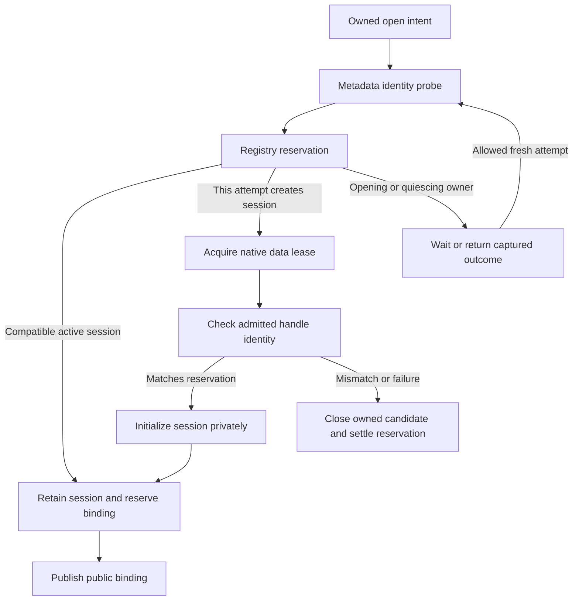
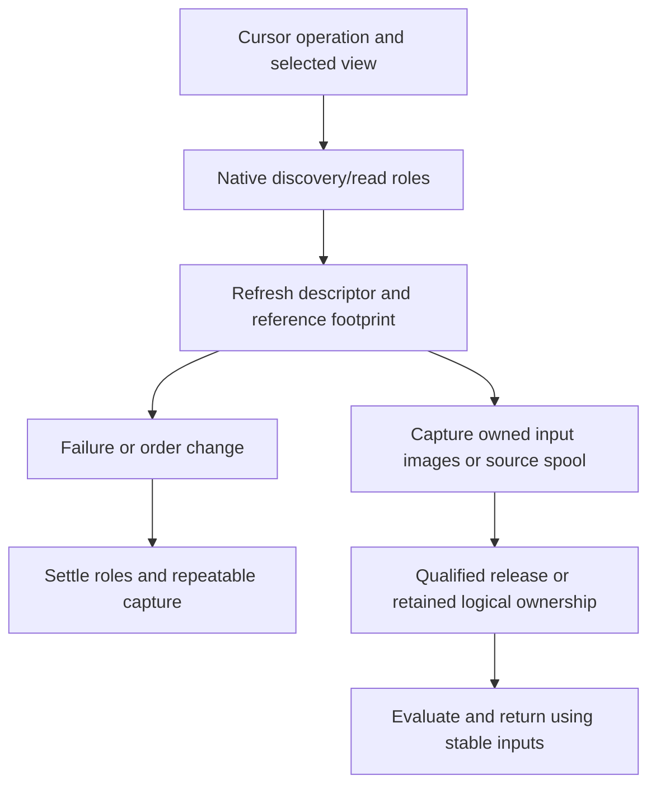
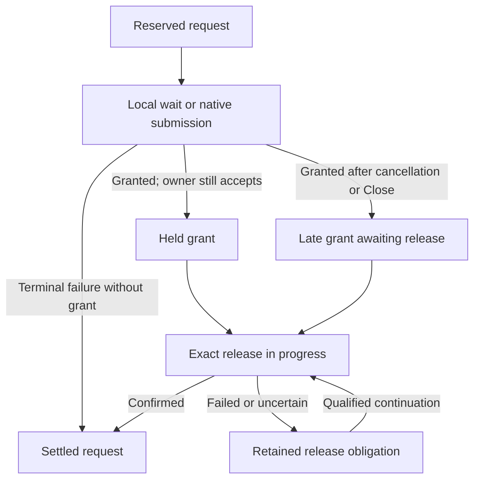

# II-09. Locking, snapshots and owned work

Revision 1 · Stage 2, response 8 · 2026-11-13

**Requirement trace:** Primary RQ-LOCK-01, RQ-LOCK-02, RQ-LOCK-03, RQ-LOCK-04, RQ-CONC-01, RQ-CONC-02 and RQ-CALL-04. Supporting RQ-STORE-02, RQ-ISAM-01, RQ-DAO-01, RQ-DAO-04, RQ-CALL-01, RQ-CALL-02, RQ-CALL-03, RQ-ORACLE-02, RQ-ORACLE-05, RQ-SIM-02, RQ-PERF-01 and RQ-PERF-02. I-16 owns the full scope map. II-03 supplies exact image/request ownership, II-04/05/06 native row/map/tree/catalog grammar, II-07 cursor/edit/identity policy, and II-08 native resolution/crash programs. This chapter supplies the admission, source protection, version retention and work lifetimes that connect them, refining K-LOCK/K-WORK without changing public scope.

Prefer a held native file lease for the first two sharing steps, a captured native read/publication profile for later coexistence with ACE, and one initially admitted CalcDb writer per file. Close fresh-view admission before selecting old images to preserve. Shared writes reapply accepted effect-free deltas to protected fresh physical pages. Every request, retained image and asynchronous helper keeps a named owner through cancellation and Close; public calls remain blocking.

**D-LOCK-1 — Decided scope; provisional protocol.** Exclusion, reader-only coexistence, reading beside ACE and shared writing remain the four required steps. **D-SNAPSHOT-1 — Provisional:** immutable histories and retained input capture reproduce the selected cursor/transaction visibility, with the admission mechanism below. **D-CALL-1 — Decided:** call work settles before return; explicitly retained work has stable ownership and settles before its resource owner closes. Native ranges, freshness transitions, public wait/error rules and host dispatch remain experiment-qualified mechanisms. No change is made to D-UNDO-1's exact predicate, D-UNDO-2's optional one-shot protocol or ACE-first crash parity.

**Evidence boundary.** Official Microsoft references establish documented API/public behavior, including historical Jet context explicitly labelled as such. They do not supply an executed lock trace or current ACE byte-lock map. Native page facts reuse exact-pinned Jackcess commit `be0a2139b087a227d14cafd4ea231306a5a3a862`; examples below are original constructed byte/state witnesses. Cleared supplied reports contribute concepts only. No ACE, Windows backend, network or reference Java encoder execution occurred here. The initial oracle remains the user-reported ACEDAO.DLL 16.0.20527.20016; actual loaded identities still require capture. .NET Framework 4.8-family and .NET 10 LTS remain separate caller lanes. Real platform Automation VARIANT/BSTR, including 24-byte Windows x64 VARIANT, is unchanged. Figures are emitted Markdown tables/Mermaid source, not render-verified.[^authority]

## 1. Give each permission and obligation a concrete owner

**Requirement trace:** RQ-LOCK-01, RQ-LOCK-02, RQ-LOCK-03, RQ-LOCK-04, RQ-CONC-01, RQ-CONC-02 and RQ-CALL-04. The four external steps remain D-LOCK-1's Decided scope with provisional native protocols. Initial exclusion and reader-only admission are distinct supported goals; the two ACE-coexistence steps remain later scope.

Use the same logical lock interface in each step, but select a protocol implementation when the FileSession is admitted. The protocol identity includes the native file profile, backend environment and captured admission/lock recipe. An exclusive local handle can discharge many later external resource requests through a retained proof of exclusion. It does not make two independent in-process Workspace writers the same logical owner. Reader-only mode rejects mutation before constructing a dirty native program. A later mixed protocol translates each resource role to its captured native operations.

Keep owner identity separate from OS-thread identity. A call can use workers, an outstanding request can settle on another thread, and a logical edit can survive several calls. Conversely, two calls on the same thread need not be one transaction. Use stable owner records with incarnation-qualified handles, and require each transfer of responsibility to name its recipient. Raw pointers, thread IDs and the current stack depth cannot serve as durable in-process ownership identities.

| Object | Identity and retained state | Ends when |
| --- | --- | --- |
| Public binding | Database/cursor incarnation, requested mode and public lifecycle state | The surface's qualified Close/Release transition; child references may remain callable as closed objects. |
| FileSession | Opened-file identity/incarnation, native handle family, protocol/environment and active obligations | All public/internal bindings, native requests, source owners and resolution obligations allow final release. |
| Logical owner | Workspace/frame or call/cursor work identity; cause and parent call link | The selected transaction, operation or retained-work scope settles. |
| Native grant | Exact handle incarnation, file role, offset/length/mode, acquisition receipt and release disposition | The exact native release or confirmed handle-level cleanup settles. |
| Read view / image owner | View selection, per-page image identity, allocation incarnation and valid backing | Its last qualified observer or pending request releases it. |

The public object tree and resource graph are therefore different. A cursor can close while another cursor still retains the same immutable image; a Database binding can detach while its Workspace's resolution attempt retains the native participant. Such retention is explicit in the file/session owner, never a hidden global cache reference that accidentally prevents unlocking.

A `ResourceKey` identifies a semantic need: an edit owner for a row root, a structural index operation, an allocator region, a catalog namespace or a physical read/publication protection window. Native recipe expansion can map several keys to overlapping ranges, or one key to several operations. Conflict lookup must compare the expanded native resources as well as the logical owners. Hashing only row IDs would miss two rows on one page, two indexes sharing physical metadata, or unrelated operations using the same allocation bitmap.

The resource key carries the original root/descriptor identity and allocation incarnation. It does not substitute a current row-body page for the stable root. In the constructed relocation witness, key 43 continues to identify root `(17,0)` while its body occupies page 60. Any lock mapping that depends on body location must be refreshed under the protection that makes that location valid. The mapping is a captured profile rule, not an assumed `lock_offset = page_number × 4096` formula.

## 2. Admission binds a public open to a held native file object

**Requirement trace:** RQ-LOCK-01, RQ-LOCK-02, RQ-CONC-01, RQ-CONC-02 and RQ-CALL-04. D-LOCK-1 remains **Decided scope; provisional protocol**. The first two external protocols start with a Windows share lease, not a page-lock emulation. R-LOCK-1/2 decide whether the proposed leases admit every required compatible native client while excluding every incompatible one.

Represent the requested public open separately from the physical FileSession. DAO's `Options` and `ReadOnly` arguments describe distinct choices. The public reference documents shared versus exclusive opening and read-only versus read/write access; the Database object reference also permits duplicate opens of the same source. Neither establishes the exact native handle requests or every same-process exclusive-open transition. The broad OpenDatabase remark about another user's existing open must be interpreted in context and tested, not used to erase the documented shared mode. [^a-dao-open][^a-dao-db]

Use the following internal objects. Their fields describe CalcDb ownership; they are not records to write into MDB, ACCDB or the native lock file.

```text
PublicOpenIntent {
    surface, parent_workspace_incarnation, binding_serial
    requested_access, requested_exclusivity, connection_context
    requested_authority_context, authority_generation
    display_path, selected_external_protocol, cancellation_context
}
FileSession {
    verified_file_identity, session_incarnation, native_handle_owner
    actual_access, actual_share_mask, protocol_profile, admission_generation
    admitted_security_connection_authority, authority_generation
    state: Opening | Active | Quiescing | Closing | Closed | Unresolved
    logical_bindings, native_requests, native_grants, retained_native_obligations
}
BindingPermit {
    file_session_incarnation, public_binding_id, admitted_surface_rights
    workspace_identity, admitted_authority_context, authority_generation
    open_policy_generation, close_disposition
}
```

A read-only binding to a writable FileSession still receives only read permission through its BindingPermit. A writable native handle is not authority for every object sharing the session to mutate. Conversely, making the public Database object read-only does not establish that its underlying provider opened the database without write access. Record actual native access and public intent independently.

The preferred logical admission rule is to join ordinary duplicate opens only within a compatible public sharing domain; a new exclusive request cannot coexist with another independent binding, and a request cannot acquire rights absent from the physical lease. An already exclusive public binding excludes an additional independent open until a native discriminator establishes an allowed exception. Clones and held child objects retain their existing binding rather than performing another open. R-LOCK-1's same-Workspace, different-Workspace, duplicate-path and exclusive-option cases confirm or change this logical table. Physical handle reuse never turns a rejected public combination into an accepted one.

A join also requires the same admitted security and connection authority, represented by a stable context identity and generation rather than the current thread ID or a mutable ambient credential pointer. An identity probe establishes which file is named; it does not authorize data access by another impersonation, credential or connection context. Prefer supporting only the qualified process-default authority initially, and refusing an unqualified context change. Matching authority remains necessary rather than sufficient: public credential checks and any required fresh authorization still occur. If a changed permission or connection condition cannot be authorized without breaking the held lease, preserve the selected denied/unsupported outcome; do not borrow an existing writable handle to make that request succeed. R-LOCK-1 separates same-authority reuse, changed authority, changed connection credentials and permissions changed after the first open. This does not introduce impersonation support.

One engine maintains one registry entry and one mutation/cache authority for a native file identity in the supported initial modes. This prevents alias paths from creating independent writable caches. It does not merge the transaction scopes of different Workspaces. A successful registry lookup must retain the session and reserve a logical binding while checking its state; otherwise Close can race the lookup and return a permit to a session that is already releasing its last lease.

## 3. The share test is symmetric and uses actual access categories

For the initial Windows backend, Step 1 uses `OPEN_EXISTING` with `GENERIC_READ`, or `GENERIC_READ | GENERIC_WRITE` for writable use, and share mask zero. Step 2 uses `GENERIC_READ` with `FILE_SHARE_READ`. Handles are noninheritable. New-file creation uses `CREATE_NEW` under the corresponding exclusive lease rather than a potentially destructive open disposition. These are proposed CalcDb calls, not reported ACE flags. [^a-create]

For a small explanatory model, normalize the sharing-relevant access categories to bits R=1, W=2 and D=4; these are **model bits**, not the numeric values of `GENERIC_READ`, `GENERIC_WRITE` or `DELETE`. If an existing handle has access A and share allowance S, and a candidate has access a and share allowance s, the pair is compatible only when both tests hold:

```text
(a & ~S) == 0        # existing owner permits candidate's access
(A & ~s) == 0        # candidate permits existing owner's access
```

Apply the tests against every existing relevant open. The rule is symmetric in the two handles. The operating system remains the authority; this small predicate explains and tests CalcDb's intended requests, rather than replacing the actual open. Microsoft supplies an order-independent two-open compatibility table. [^a-share]

**Figure F-67 — constructed access/share combinations.** R/W/D are the normalized categories above. Each row assumes the file exists, permissions permit the request, and no additional mapping or filesystem restriction intervenes.

| Existing access / shares | Candidate access / shares | Pair result | Decisive condition |
| --- | --- | --- | --- |
| RW / none | R / RWD | Deny | Existing owner permits no candidate data access. |
| R / R | R / R | Admit | Both permit the other's read access. |
| R / R | RW / RW | Deny | Existing reader withholds W. |
| RW / RW | R / R | Deny | Candidate withholds W from the existing writer. |
| R / R | D / RWD | Deny | Existing reader withholds D. |
| R / R | R / none | Deny | Candidate withholds R from the existing reader. |
| R / R | no data/delete access / RWD | Potentially admit | Metadata-only access is outside this data-sharing model. |

The second denial direction matters in a reader-first implementation. A writer already open with a permissive share mask does not make a subsequent `GENERIC_READ`/share-read request safe to accept: the incoming share mask must permit that existing writer's access, and it does not. Conversely, an existing reader lease prevents a late write-access request. This is why Step 2 can establish a continuous no-writer interval while its qualified reader handles overlap.

Do not describe share-zero as preventing every conceivable handle to the object. `CreateFileW` explicitly distinguishes attribute/extended-attribute access, and a zero desired-access request can obtain certain metadata. It also documents write-access mappings in the share-write check, and treats delete access as relevant to rename as well as deletion. The initial profile therefore records mappings, delete/rename requests and metadata probes separately. [^a-create]

The two coarse leases remain separate from a native page-lock protocol. Opening with permissive share flags and then locking the current database extent is not an equivalent implementation: it introduces an admission interval, omits future extent and logical lock coordinates, and does not stop mapped access. A safe rejection of an ACE reader that requests write access is a failed coexistence case, not success for the required reader-only mode. R-LOCK-2 either confirms the coarse request pair or selects an evidenced native reader-admission protocol before any relaxation of the share mask.

## 4. Alias-safe opening requires a reservation and a final identity check

Use the opened object's identity, not a normalized pathname, for the session registry. The preferred supported Windows identity combines volume identity and the returned 128-bit file identifier. `FileIdInfo` is retrieved through the opened handle; actual support and identity lifetime remain backend facts to capture. An inode-like number copied from a stale path cache does not establish that the current open names the same object. [^a-fileid][^a-info]

An identity probe can help join an existing exclusive FileSession without attempting a conflicting second data handle. Prefer a noninheritable metadata-only probe, with all R/W/D sharing allowed, on filesystems where R-LOCK-1 establishes that it returns the required identity. The probe grants no database read or write permission. Keep it alive through the decision. If there is already an admitted FileSession for that identity, retain that session atomically with logical and authority-context admission; the final binding uses its original data handle. A different or unverified authority cannot join by matching the file identifier alone. If there is no session, a native open of the requested path must obtain the actual data lease and repeat the identity check. The probe alone never authorizes a later unrelated handle.

**Figure F-68 — one opening attempt retains its identity and reservation.** This proposed state machine shows public binding publication after ownership has been established. No registry latch spans an OS call or wait.



The reservation carries a unique attempt serial. A loser in a concurrent open race cannot clear another attempt's slot. A session state change increments its admission generation; a delayed logical binding publication rechecks it. Prefer a small registry with one short synchronization boundary per identity lookup/admission change; expected lookup is O(1), while operating-system opening and identity resolution are externally bounded work. No such lookup is required for each already admitted scalar field access.

```text
OpenBinding(intent, budget) -> BindingPermit | OpenFailure:
    own intent, provisional handle slots and bounded error storage
    arm attempt cleanup before the first native operation
    probe = OpenQualifiedMetadataProbe(intent.path)
    identity = QuerySupportedIdentity(probe)
    reservation = RegistryReserveAndArmOwnerGuard(identity, intent)  # short latch only
    if reservation denotes a retained compatible session:
        require public policy, surface rights and exact authority context admitted
        finish reserved binding against that retained incarnation
        settle probe cleanup; return binding with retained cleanup disposition
    if reservation denotes another opening/quiescing attempt:
        settle or explicitly retain probe cleanup
        wait or fail by selected public policy, without a registry latch
        retry only the still-repeatable opening attempt if permitted
    try:
        candidate = OpenNativeWithExactLease(intent)
        if QuerySupportedIdentity(candidate) != identity:
            return PathChangedAfterProbe through owned cleanup
        initialize bounded session state without publishing a Database object
        validate intent owner and reservation generation after waits/callbacks
        atomically install candidate session and its reserved first binding
        transfer candidate ownership to FileSession
        settle probe cleanup; return binding with retained cleanup disposition
    on failure:
        close or retain every owned candidate/probe with its exact outcome
        settle only this attempt's reservation; wake its waiters
        return primary error plus cleanup/remaining-ownership disposition
```

`RegistryReserveAndArmOwnerGuard` installs ownership protection atomically with the reservation, including policy rejection and allocation failure on the join path. The condensed pseudocode's failure settlement applies to those exits as well as session creation. The public collection insertion and Database wrapper publication use reserved storage and retained parents; a failure after a binding is installed explicitly removes or retains that binding by policy. It does not release a session that another concurrent opener has already joined.

If the probe cannot supply a reliable supported identity, the backend may still open a fresh native data lease and establish identity from that handle. It cannot use an unverified alias match to join an exclusive session, weaken sharing to make the probe work, or fall back to two writable caches. The unsupported probe/alias combination remains an explicit R-LOCK-1 result. Do not impose metadata probing as an unmeasured requirement on every remote or portable backend.

Path replacement between probe and data open is a distinct case. The candidate may be a valid database, but it is not the reserved object. Before any database mutation or accepted host effect, close the candidate, settle the reservation, and use a bounded fresh-opening continuation only where the public policy permits it. Do not retarget the old identity's cache to the new bytes. Once the data lease is held, its no-delete-sharing property contributes to protection against ordinary rename/delete opens, but that does not replace identity verification or define every filesystem/reparse behavior.

Hard links, alternate accepted path spellings, directory links and replaced filenames need separate controls. A name cache may accelerate finding a candidate session; it is never sufficient evidence to reuse it. Reopening after the native lease has ended creates a new session incarnation even if the same path and file identifier recur. Optional recovery identity rules in II-08 remain independent and unchanged.

## 5. Reader-only sharing is a lifetime protocol

The reader-only mode begins when a qualified data handle is successfully acquired, not when a `ReadOnly=True` argument is parsed. It ends only when the last relevant held lease and its owned native work are settled. Prefer maintaining one physical read-only FileSession per engine/file identity, with explicit logical binding owners, rather than opening a new native handle for every Database or cursor. Other processes still acquire their own reader leases.

A constructed timeline exposes the critical interval: reader A opens; reader B opens; A begins closing; writer W tries to open; A's final handle closes; W tries again; B remains active. Both W attempts must be denied. Closing A cannot release B's protection. If A and B are logical bindings in one process, detaching A must not close their shared FileSession. If they are different processes, one process cannot release the other's native handle. The final release is measured separately from the public Close request because retained transaction, I/O or shutdown obligations can still own the lease.

There is no in-place promotion from a Step 2 lease to a writable lease. `DuplicateHandle` refers to the same object, and a read-only file handle cannot be duplicated into a read/write file handle. Initial CalcDb therefore keeps requests needing additional rights on the explicit reopen path. [^a-duplicate]

For that path, require all owners that depend on the old reader admission to have settled under the public policy. Closing a read handle and opening a write handle introduces a real admission gap. Another process may acquire a lease or modify the database during it. On reacquisition, establish a new session incarnation and validate the new native state; prior extent, cache-source validity and catalog bindings cannot silently survive the gap. If the requested operation promises uninterrupted ownership, this close-and-reopen path cannot implement it without an evidenced native transition. R-LOCK-2 tests the public request/failure outcome rather than treating promotion as a hidden optimization.

Late-reader admission and writer fairness are separate questions. The coarse Step 2 design provides writer exclusion; it does not create a queue that reserves the next native open for a waiting writer. Do not derive a starvation or fairness guarantee from the flags. A later native protocol may require writer-announcement or admission coordination, but its actual resource and lifetime must come from R-LOCK-3/4. Initial errors, waits and retries use the public policy selected by R-LOCK-1/2, not an arbitrary application-wide timeout.

A nominally read-only Access session may need writable lock-file access without needing database write access, or may request database write access for reasons the experiment must identify. Observe the database and lock file independently. Vary database attributes/ACLs, folder create/write/delete permissions, existing lock-file permissions and simultaneous readers. Preserve exact native failures rather than treating every access-denied or sharing-violation result as evidence for the same cause. A read-only database in a writable folder is an important distinct fixture, not a contradiction.

## 6. Native owner records are evidence, not live lock authority

Microsoft documents companion `.ldb` and `.laccdb` files for shared MDB and ACCDB use, including owner names and extended byte-range locks. It gives a 64-byte entry containing two 32-byte name fields, says departed users' entries can remain and be reused, and describes conditions under which the file survives last close. Its exclusive-open discussion also differs from shared lock-file creation. These are useful native facts, but not a complete current ACE lock protocol. [^a-lockfile]

**Figure F-69 — documented entry widths and a constructed slot witness.** Field widths come from the public article. ASCII bytes, zero filling and a zero-based contiguous slot region are choices of this arithmetic witness, pending the actual native encoding/placement captures.

| Relative entry range | Length | Documented role | Constructed slot-5 bytes/range |
| --- | --- | --- | --- |
| `+00..+1F` | 32 | Computer name | At `0x140..0x15F`: `4C 41 42 2D 41 00`, then 26 zero bytes (`LAB-A`). |
| `+20..+3F` | 32 | Security name | At `0x160..0x17F`: `41 64 6D 69 6E 00`, then 26 zero bytes (`Admin`). |

The example's base-zero slot 5 occupies `[5×64,6×64) = [0x140,0x180)`. Under that same constructed layout, 255 entries occupy 16,320 bytes, below 16 KiB. A byte range beyond that small file's EOF can still be a valid Windows lock coordinate; an apparent gap or large offset is not automatically a malformed database-page address. It must be interpreted in the resource namespace in which it was observed.

For the first two sharing steps, prefer **no synthetic owner record and no additional guessed byte lock** when the held database lease establishes the required behavior. Read existing owner bytes only for captured diagnostics or native-protocol observation. If the required public behavior includes a bookkeeping action, capture its name encoding, slot selection, ownership protection, write ordering and removal rule before implementing that action. Do not fill a plausible 64-byte record and assume ACE now recognizes the process correctly.

The parser keeps raw bytes and bounded decoded display text. Empty names, leftover bytes, duplicate names or apparently departed users cannot authorize slot reclamation, file deletion or a write lease. A lock-conflict diagnostic needs the native lock result and its corresponding ownership rule before an owner name can be attributed. A stale string is not a process identity, and a current process name is not proof that it owns a particular locked resource.

Deletion is the final action of an evidenced lock-file lifetime, not an opportunistic cleanup on open. Preserve the original file and existence state in crash experiments. In particular, a file left because a native database was marked damaged is part of the interrupted-state evidence; removing it before the next ACE/Access branch would change the question. Read-only admission must not perform a repair or clear a native marker merely to remove a companion file.

## 7. Byte-range acquisitions retain exact native request identity

The later native protocol needs a concrete Win32 primitive even though Steps 1–2 do not initially need guessed ranges. Introduce a `NativeRangeRequest` and an owned `NativeGrant`; neither contains a page pointer that can move while the request is pending.

```text
NativeRangeRequest {
    request_id, generation, logical_owner_id, parent_attempt
    file_session_incarnation, target_handle_owner, resource_namespace
    offset_u64, length_u64, shared_or_exclusive, wait_intent
    owned_overlapped, owned_event, cancellation_requested
    outcome: Reserved | Submitted | Pending | Granted | Failed | Aborted
}
NativeGrant {
    grant_id, original_request_id, target_handle_owner
    exact_offset, exact_length, exact_native_mode, acquisition_sequence
    logical_borrowers, release_state, retained_error_context
}
```

A lock coordinate belongs to the database file or companion file selected by the native profile. It need not be the physical byte range of the page it protects. The same offset in two different files is two resources. Use checked unsigned offset/length arithmetic, explicit high/low word conversion, and the backend's admitted lock-coordinate domain. The data-file extent bound is not a substitute for the lock-coordinate bound.

`LockFileEx` distinguishes shared and exclusive range requests and immediate-failure versus waiting requests. Its shared lock blocks writes even by the locking process; access through a separate handle and through a mapped view have different rules. Store those native distinctions instead of representing every request as a process-wide mutex. [^a-lock]

**Figure F-70 — constructed 64-bit range and exact-release witnesses.** These are adapter arithmetic cases, not discovered Jet/ACE lock offsets or admitted database extents.

| Constructed request | Encoded start / length | Required treatment |
| --- | --- | --- |
| Start `0x00000000FFFFFFF0`, length `0x30` | OffsetHigh=0, Offset=`FFFFFFF0`; lengthHigh=0, lengthLow=`30` | End is `0x0000000100000020`; low-word wrap must not truncate the interval. |
| Start `0x0000000100000020`, length `0x10` | OffsetHigh=1, Offset=`20`; lengthHigh=0, lengthLow=`10` | Beyond a small file's EOF can be valid for locking; it is not a data-page read. |
| Separate locks `[0x100,0x120)` and `[0x120,0x140)` | Two successful original requests | Retain two release records; do not release one fabricated `[0x100,0x140)` interval. |
| Two overlapping grants recorded by an evidenced same-handle protocol | Each acquisition retains its own native mode and sequence | Release the actual acquisitions in the required order; overlap does not imply one grant. |

`UnlockFileEx` requires an interval matching an acquired lock; adjacent acquisitions cannot be merged into one unlock. Its documentation also describes release before completed CloseHandle processing. The LockFileEx termination discussion warns about delayed availability when process cleanup has not finished. Keep normal close completion and observed process-death release as distinct trace points. [^a-unlock]

The initial range manager should avoid using the documented same-handle shared/exclusive overlap exception as a generic lock upgrade. Exclusive overlapping acquisition is not a universal reentrant operation, and overlapping shared/exclusive grants have special access and release behavior. Only an evidenced native mapping may require that pattern. For ordinary internal nested ownership, a logical borrower can retain an existing adequate grant through the manager without inventing a second kernel acquisition; its logical compatibility must still be checked.

## 8. Pending acquisition and cancellation settle the original request

Use the event-based overlapped request ownership already selected in II-03. A waiting LockFileEx operation can return `ERROR_IO_PENDING`; the event signals completion, after which the actual result must be collected. A fail-immediately request follows its immediate outcome. An event wake is not interchangeable with the public decision to keep a grant. [^a-lock]

```text
AcquireNativeRange(intent, parent_attempt)
        -> Granted | Failed | Cancelled | RetainedContinuation:
    reserve request, event, grant record and minimal failure storage
    arm request cleanup before validation or native submission can fail
    retain target handle and parent attempt before native submission
    validate file incarnation, range and current logical admission
    submit the exact request, with no internal metadata latch held
    if submission reports pending:
        while native completion is unresolved:
            wait on the owned completion/cancellation controls
            if cancellation requested and not yet sent:
                request cancellation for this exact native operation
            collect the original operation's terminal result when available
    if terminal result is a grant:
        record the grant before any fallible public-result construction
        if current policy no longer admits keeping it:
            settle exact release or transfer the grant to its retained owner
            return the selected cancellation/error outcome with release receipt
        transfer grant ownership and return Granted
    record terminal failure/abort and settle request ownership
    return the selected public outcome
```

The cancellation request itself is not terminal completion. `CancelIoEx` can race a normal completion, and its result does not authorize reuse of the pending request's OVERLAPPED storage. If cancellation arrives after the lock was granted, record and release that grant or retain it under an explicit continuation; never return a fictitious never-acquired result while a kernel lock remains held. [^a-cancel]

Every failure after submission is owned by the request until a terminal result is known or the established adapter has retained the unresolved native obligation. The grant record is reserved before submission so a successful acquisition cannot be lost through an allocation failure immediately afterwards. Error mapping, event cleanup and wakeup failure preserve the original operation and its primary error. A cancellation flag attached to a reused request slot cannot cancel a later acquisition: identity includes the request generation and owning FileSession incarnation.

`RetainedContinuation` includes an unresolved acquisition or release, its primary outcome and the named surviving owner; it is not a claim that the native grant is absent. The primitive does not decide transaction rollback, public lock timeout or retry fairness. Those are policies of the logical owner and native profile. It returns the exact acquisition/release facts needed to make that decision. Calls still block through their required work boundary; an internal handoff cannot expose unowned pending work after return.

## 9. Releasing a binding does not necessarily release the lease

Prefer a two-step session shutdown. First mark the relevant public binding/session as closing and stop new admissions that depend on it. Then settle its work and native obligations outside registry and metadata latches. Detach a single binding only after its transaction/cursor policy is resolved; the physical lease may remain owned by other bindings, an enlisted Workspace participant, pending I/O, a native grant or II-08's retained recovery obligation.

The final native handle owner closes only after all operations whose source bytes or permissions depend on it are settled or transferred to an explicitly surviving owner. A failed unlock retains the exact grant and its release obligation. If the qualified continuation proceeds to final handle close, record that distinct release event instead of claiming the failed unlock succeeded. A public Close error does not erase the remaining owner, and a timeout does not prove the native operation stopped.

Keep database handles private to the adapter. Do not make them inheritable or casually duplicate them into helper processes. A duplicate refers to the same underlying object and can prolong its lifetime; it is not a fresh admission decision. Use independently opened handles in controlled tests when the experiment is meant to exercise share compatibility. Inheritance/duplication tests are separate because their lifetime and byte-lock access semantics differ. [^a-duplicate][^a-lock]

The initial backend uses positioned reads/writes and no mapped database I/O. Native test clients may use mappings, so the exclusion experiment includes mappings established before the candidate lease and attempts to acquire them afterwards. Windows' mapping documentation explains that mapped views hold their own references and must be unmapped as part of teardown. Do not equate closing one ordinary file handle with removal of every mapped view or every reference held elsewhere. [^a-mapping]

Finally, the lock-file owner names, the caller's last COM Release, and the FileSession's reference count are three different observations. They cannot substitute for an explicit record of which native handles, range grants, pending requests and logical participants remain. R-LOCK-1/2 capture release behavior from a second process, while TXN-CLOSE and the cursor lifetime experiments determine when the public object is allowed to stop owning those resources.

## 10. Select a visibility policy before selecting page versions

**Requirement trace:** RQ-CONC-01, RQ-CONC-02, RQ-STORE-02, RQ-CALL-04, RQ-LOCK-03 and RQ-LOCK-04. **D-SNAPSHOT-1 — Provisional:** initially admit one writer per file and preserve immutable inputs for the views that the cursor and transaction policies actually require. R-CURSOR-1/CUR-POP/ID/LIFE and R-TXN-1/TXN-VIEW select those public boundaries; R-LOCK-3 supplies the later external-writer protection.

A view is an input to a read operation. It is not a new isolation level exposed to the caller. II-07 already distinguishes a dynaset's candidate membership from the values refreshed for an admitted row, a snapshot's produced values from its unfinished producer, and a table cursor's current row from the position used to continue scanning. Preserve those distinctions when choosing versions. A page resolver cannot decide that all three should advance merely because another commit occurred.

Prefer two internal forms. A `RetainedReadView` owns a selected file publication and its schema/identity interpretation for as long as a producer needs them. An `OperationReadView` owns the policy-selected publication for one bounded operation, including its dependent index, map, row and LV reads. A cursor may retain the first across calls; it may acquire the second at a documented refresh boundary. Both forms register ownership. Neither forces the public transaction to provide repeatable reads beyond the observed contract.

A current-row guard retains its actual images independently. Reading several fixed fields from that already admitted row needs no new global view registration or per-field atomic reference increment. If native policy requires a particular getter to refresh, it is an explicit new operation boundary and pays that cost. Keeping a pin memory-safe cannot justify suppressing a required refresh, nor does a newer global generation invalidate an unchanged field span by itself.

For a snapshot created over its owner's uncommitted changes, a live pointer to the mutable transaction overlay is insufficient. The preferred snapshot preparation captures a bounded immutable overlay cut over the retained base view: copy the changed-binding directory together with its effective extent and catalog/identity bindings, and retain/freeze the referenced private images with the real metadata charge. Its base dependency graph must also be retained under the qualified external source context or already have complete independent backing. Later edits use II-03's copy-on-write rule. Initially this costs O(d) binding work for d private changed pages at that creation boundary; it does not copy the whole database.

An ordinary read-your-writes operation instead uses the coordinator's current private-read permit and retains each resolved target. If its public policy refreshes unaffected data after an external protection gap, compose the retained effect-free own deltas over a freshly protected native base; an old whole private page is not automatically that operation's current base. In the constructed two-row case, CalcDb's accepted row0 change from 7 to 9 must coexist with ACE's surviving row1 change from 100 to 101. A retained snapshot may legitimately retain its earlier `(9,100)` cut, while a refreshing operation needs the qualified `(9,101)` composition without rerunning accepted expressions or callbacks. R-TXN-1/TXN-VIEW and CUR-POP decide those boundaries. Do not charge an O(d) overlay snapshot to every scalar getter.

The cleared report's page histories and short publication interval are useful concepts. Its first-committer-wins conflict errors, transaction-wide snapshot semantics, SSI machinery, WAL and shared-memory index are not selected CalcDb behavior. In particular, page-version differences trigger the revalidation appropriate to an edit; they do not by themselves produce a public optimistic-concurrency conflict. II-07's retained logical originals and native comparison policy still decide that result.[^v-concepts]

## 11. A sparse history resolves pages, allocation lifetimes and absence

Keep II-03's `ImageId` and frame directory. Add a visibility resolver above them; do not key every unchanged cached page by the database's current publication number. A new publication changes only the bindings that actually changed. Page 18 can retain the same image through ten commits that modify page 17.

Use monotonic local publication serials with checked exhaustion. They are process metadata, not native fields or globally comparable transaction timestamps. Assign a new serial at a qualified publication transition, including a required partial/failure transition. Inner transaction resolution that merely merges private obligations need not publish a new file view. Never wrap a serial into a value that an old owner can still hold.

```text
FileViewState {
    file_incarnation
    published: { local_serial, extent, catalog_binding, identity_root }
    fresh_admission: Available | Resolving(attempt) | Restricted(receipt) | Closing
    active_views: OrderedMap<local_serial, owner_count>
    page_history: SparseMap<PageNumber, History>
    default_binding_domain                 # unchanged admitted native pages
    retention_accounts, retirement_cursor
}

ReadView {
    owner_and_incarnation, file_incarnation, selected_serial
    extent, catalog_binding, identity_root
    private_source: None | RetainedCut(cut, base_context)
                         | CurrentOwnDeltas(private_read_permit)
    external_coherence_context?            # required only by the selected mode
}

HistoryEntry {
    visible_interval: [begin, end)
    binding: Allocated(PageObject, ImageId) | Free(physical_image?) | Absent
    independent_target_owners
}
```

An interval covers local publication serials. Its end is exclusive; the current interval has an open end. A history is created on the first transition that needs it, and supplies the prior binding as well as the new one. The default unchanged domain can supply the initial binding for a page that has never changed. It is valid only while the FileSession and its source-protection assumptions hold. Resolution must either select independently owned immutable backing or retain the still-valid native source certificate covering the required descriptor, identity and reference transition. A sparse page resolver is not permission to reconstruct an overwritten initial image from current native bytes.

A fresh external read window receives a distinct coherence context. The public policy decides whether its bindings form a new local publication, an operation-owned input bundle or an explicitly retained snapshot source. An already admitted row/input bundle continues using its owned immutable images without a new context for every scalar getter. The local active-view serial registry supplies preservation obligations; it is not a cross-engine commit log.

`Free` and `Absent` differ. An allocated page can become logically free while its physical bytes remain in the file. A page beyond a view's retained extent is physically absent for that view. The allocation service returns a fresh allocation incarnation for a later object using the same page number, even if its bytes happen to match. Historical resolution chooses the incarnation within the selected interval. Live rollback resolves recorded allocation/identity changes according to II-08; it cannot simply restart the current incarnation counter.

Ordinary ISAM reads require an allocated binding of the expected role. An old view that sees page 60 as free must not follow a newly introduced reference to it. A raw inspector that explicitly requests physical free-page bytes has a different retention requirement and must acquire that image while it is still available. Do not impose that raw-byte requirement on every public snapshot. Rollback before-images and optional whole-file undo have their own owners and may retain those bytes independently.

Prefer a compact ordered history per changed page, with an inline current binding and a small vector or segmented directory for older intervals. Lookup is O(log h) for h retained intervals, plus expected O(1) sparse page lookup. A current, unchanged page needs only the fast binding. The representation can change after measurement, but each history entry must remain independently chargeable; moving bytes to spill does not remove its index cost.

```text
ResolveImage(view, page_number, purpose) -> OwnedTarget | Free | Absent | Failure:
    validate view/file/owner incarnation and checked page arithmetic
    if page_number outside view.effective_extent_including_private_cut: return Absent
    if view.private_source is RetainedCut and that cut supplies this page:
        validate the explicitly retained cut's purpose and owned base dependencies
        retain its immutable binding and the required private/source owners
        return that binding under the selected purpose
    if view.private_source is CurrentOwnDeltas:
        resolve the policy-selected private target outside metadata latches
            refreshing/rebasing its native base first when the policy requires
        if that operation supplies this page: return its owned target
    with visibility metadata latch:
        require the view is still registered or owned by a valid retained cut
        locate the interval containing view.selected_serial
            or the still-valid unchanged default binding
        validate allocation role and view-qualified descriptor identity
        require independently owned immutable backing, or a still-valid
            native source certificate covering this view's descriptor,
            identity and reference transition
        retain the exact image target and required source-role obligation
            before releasing metadata protection
    return target                         # PinPage obtains its source separately
```

A native role acquisition or refresh/rebase occurs outside metadata latches; the resolver checks and retains an already established certificate. A refresh-selected operation carries its newly admitted base bindings even for pages with no own delta; fallback resolves that base, not its earlier snapshot. The later source-permit acquisition still revalidates that exact source transition. A locally stored serial or current-binding entry cannot silently authorize loading replacement ACE bytes through an expired context.

A retained target outlives removal of a history lookup entry. A valid generation number alone is not such ownership. After Close, an unowned integer copied from an old view cannot register itself again and resurrect reclaimed history. Clones or child producers retain an existing view through an atomic owner transfer while its source owner is still valid.

## 12. Close fresh-view admission before choosing preservation work

A publication latch alone does not close the read/overwrite race. Suppose no old snapshot exists when the writer calculates its preservation set. If a new reader can register the old current generation after that calculation but before native overwrite, that reader may require an image the writer did not preserve. A later generation check detects the mistake after the historical source has gone.

Prefer a logical `ViewAdmissionHold` for the initial one-writer implementation. Acquire it before selecting the preservation set and before any native effect that can invalidate an image source. It prevents fresh selection of the current file view, while readers already registered at that serial continue using retained sources. A clone extending a valid registered view is not a new selection of an arbitrary historical serial. The hold can span I/O; no metadata latch does. Its duration is measured, not described as inherently short.

Fresh readers first reserve their bounded ticket/registration storage, then select and register under the same short visibility synchronization used to install the hold and to publish. If admission is resolving, retain a wait dependency on the exact attempt and release the latch. Cancellation removes only this waiter. The caller/callback wait graph must reject self-wait through the selected public continuation rather than block behind its own ancestor. If admission is restricted after uncertainty, the transaction outcome policy decides which operation may continue; no generic retry or novel error number follows from this enum.

```text
SelectAndRegisterReadView(owner, policy, budget) -> ReadView | Failure:
    reserve view ticket and possible first registry entry
    repeat:
        with visibility metadata latch:
            validate owner/session admission and incarnation
            if fresh_admission is Available for this requested domain:
                selected = published binding tuple
                increment active_views[selected.local_serial]
                install the owner-qualified ticket without fallible allocation
                return ticket retaining that tuple
            dependency = retain exact resolving/restricted admission owner
        outcome = wait_or_resolve_dependency_outside_latch(dependency, owner)
        if not allowed to retry selection: settle reservation; return outcome
```

The writer retains the input view/private-read context needed by its own preparation, then reserves the metadata needed to claim its hold and the resources whose requirement is already known. It does not call fresh-view admission against its own hold. It then claims the hold, snapshots the registered view obligations, and reserves any additional preservation capacity outside latches. Failure before source detachment/effects settles the private attempt and releases or converts its hold according to the unchanged public state. If resource release can reenter, defer it to an owner-safe boundary or apply the existing same-attempt reentry policy; do not wait for the current call to unblock itself.

After preservation capacity is admitted, freeze affected native sources, drain active source reads and establish complete alternative backing for every required old image. Only then detach the old native source and submit the qualified program. The preservation set includes registered views, rollback scopes, pinned/borrowed images, pending targets and image-load handoffs. One owner can cover the same image for several purposes; charging counts unique backing plus actual owner metadata rather than multiplying page bytes by the number of reasons to keep them.

This algorithm coordinates CalcDb's writer with CalcDb readers. In shared mode, the preservation read also needs its qualified native source role; the local admission hold cannot stop ACE changing those bytes. Preserve required old external inputs before releasing the native protection on which they depend, or retain a qualified native retention role. An owned historical target is an obligation to keep its source, not a means of recovering that source after it has been lost.

This hold is different from the short `PublicationPermit` that changes in-memory bindings. At II-08's selected logical/failure node, publish the permitted tuple and release or convert admission. A failure can retain restricted admission and the same resolution attempt. There is no unconditional reopening during cleanup, and no hardcoded rule that the hold ends only after every flush: the qualified resolution program chooses the relationship among logical publication, force and persistent outcomes.

The refinement belongs at II-03's preservation step and II-08's publication step. R-TXN-1/TXN-VIEW and R-CURSOR-1 measure the resulting read waits and visible boundaries; if that bounded serialization is unacceptable under the native policy or cost evidence, the replacement must admit new readers only with preservation capacity for the images they can still select. Merely deleting the hold is not a safe optimization.

## 13. Constructed relocation and allocation-reuse witness

**Figure F-71 — local view bindings across relocation, deletion and page reuse.** These are constructed state transitions over the previously described Jet 4/ACE page grammar. They are not ACE captures or a complete database fixture. All omitted native map/catalog/counter changes still belong to the real mutation closure.

Start at publication 10 with table layout `T9.L0`, a row rooted at `(17,0)` with key 42, index leaf 44, and an ownership bitmap page 40 covering native page numbers from zero. Page 60 is physically present but free. A qualified update at publication 11 changes the key to 43 and grows the row body into page 60 while keeping the original root. Publication 12 deletes that row and releases its now-unreferenced body storage; publication 13 reuses page 60 for an index leaf belonging to a different object.

| Binding | View 10 | View 11 | View 12 | View 13 |
| --- | --- | --- | --- | --- |
| Root `(17,0)` | Row incarnation `r7`, ordinary body, key42 | Same `r7`, overflow root, key43 | `r7` retired; retained historical token only | Still retired; no rebinding by matching bytes |
| Data page17 | `D17.a` | `D17.b` | `D17.c` | `D17.c` if no later page change |
| Index page44 | `I44.a`, entry42→root | `I44.b`, entry43→same root | `I44.c`, row entry removed | `I44.c` if unchanged |
| Owner bitmap40 | `M40.a`, page60 not owned | `M40.b`, page60 owned | `M40.c`, page60 not owned | Same `M40.c` for this owner |
| Page60 allocation binding | Free, with real physical bytes | Data object allocation `a5`, image `D60.a` | Free | Index object allocation `a6`, image `I60.a` |
| Unchanged page18 | `D18.a` | `D18.a` | `D18.a` | `D18.a` |

The selected native locators use different byte orders. The root's overflow locator to slot0/page60 is **`00 3C 00 00`**: one slot byte followed by a little-endian 24-bit page number. If that root extent begins at `0x0FF0`, its overflow-marked directory entry is **`F0 4F`**. The source-derived single-Long entry for key43 still ends in **`00 00 11 00`**, the big-endian page17 plus slot0 root locator; it does not point at the new body page. The complete constructed key entry is **`7F 80 00 00 2B 00 00 11 00`**.[^v-layout]

Page60's owner-map bit is at bitmap offset `4 + floor(60/8) = 0x0B`, mask `1 << (60 mod 8) = 0x10`. Setting it in `M40.b` and clearing it in `M40.c` changes membership, not the interpretation of page60 in an older view. Native page60 begins at file offset `0x0003C000`; its later kind byte `04` identifies an index leaf in the new allocation, whereas the retained `D60.a` begins with data kind `01`. The old view must never fetch current native bytes and then accept or reject its historical row merely from this new kind.[^v-layout]

A view11 `RowBinding` therefore retains or can resolve `(D17.b, D60.a, T9.L0, r7)`. A view10 binding resolves its older ordinary row and need not follow page60 at all. A current view13 lookup of `r7` reports the policy-selected retired/deleted state. Preserving `D60.a` for view11 does not make `r7` live again in view13. Conversely, current retirement cannot invalidate the legitimately retained historical row.

Table layout `T9.L0` can remain unchanged even while a physical TableDef page changes row counts or other bookkeeping. Keep descriptor/layout validity separate from the image identity of the page that supplied it. A schema publication that changes column interpretation must supply its matching retained descriptor to old views and the new descriptor to new views; it cannot decode an old row with whichever catalog descriptor happens to be current.


A point miss and a range result also depend on a coherent access path. In an independent insertion control, view10's index contains keys42 and50, while a later view also contains45. An opening-view range over `[40,50]` must traverse the old root, boundaries and any old leaves it reaches later; retaining only the rows already returned does not preserve the unvisited range. The same issue occurs with an owned-map scan after a new page is allocated. A view-qualified negative point result says that the selected traversal found no qualifying row in that view. It does not create a native key-gap lock, predicate lock or first-committer-wins conflict rule.

When the public policy permits the next operation to refresh, the new operation may discover45. When an opening dynaset membership policy retains the old candidates but refreshes their values, the member store must not admit45 merely because it refreshed an existing row. Conversely, preserving membership does not require stale values for already admitted rows. R-CURSOR-1/CUR-POP and TXN-VIEW compare unread candidates, visited rows, duplicate ranges, inserts and predicate-changing updates to select those boundaries. Page histories implement the selected behavior; they are not evidence that a whole user transaction excludes phantoms.

## 14. A pending load needs a source even before it has a read permit

**Figure F-72 — constructed pending-load/overwrite schedule.** The arrows in this table are ownership transfers and ordered events. They assert no native crash-order guarantee.

| Event | Reader A, registered view10 | Writer | Fresh reader B |
| --- | --- | --- | --- |
| 1 | Resolves and owns target `D17.a`; load token exists, no native-read permit yet | Private preparation | Not admitted |
| 2 | Token still owns old target | Claims admission hold; freezes page17 source | Cannot select view10 after the hold |
| 3 | Waits on its source transition outside latches | Drains active reads; preserves `D17.a`; rebinds its source to retained storage | Owns a dependency on this exact resolution attempt |
| 4 | Can load `D17.a` from retained backing | Submits native page17 phase effects | Still waits or receives the qualified continuation |
| 5 | Keeps view10 and its result | Publishes the allowed view11 tuple; settles admission under the selected policy | Selects/registers view11 after admission becomes available |

Counting active native reads would miss A at event2. Its target and load token already carry a historical-image obligation. The writer cannot wait for A's load to finish if A is itself waiting for the writer to make the frozen source readable. Instead, the preservation transition must either adopt an already completed image or perform its own admitted preservation read while new ordinary source reads remain excluded, then redirect the target. That special preservation role is owned by the writer attempt; it is not an unrestricted bypass of exclusion. Beside an external writer it includes the native role protecting the source throughout the required capture, not just local permission to bypass the frozen-page queue.

The source transition and cache eviction share synchronization. Until the retained source is installed, the last resident `D17.a` cannot be evicted on the promise that the native page still backs it. Once installed, existing pins retain their bytes, pending target loads use the retained source, and no new old-image load can slip onto the mutable native page. Failed preservation before effects leaves the old native source authoritative and settles the writer's hold; failed or uncertain effects leave the exact II-08 receipt and restrictions.

Reader cancellation does not remove another owner's obligation. If A cancels while its shared load still serves another waiter, the loader remains owned. If every waiter leaves, an already submitted native read still settles before its destination and lease are recycled. Close releases the view registration only when its owned producer/continuation has either settled or transferred its separate target ownership to an allowed surviving owner. In shared mode that transfer also retains any still-required native source/retention role unless all required bytes already have independent backing. This includes unread LV dependencies and pending native loads; closing a public child cannot release another valid owner's protection.

## 15. Publish a tuple, and preserve participant-specific outcomes

The unit of in-process publication is the selected binding tuple: local serial, extent, relevant catalog/identity roots and changed page bindings. Preparing that tuple can allocate, read or reserve storage before the critical transition. Applying it uses pre-reserved metadata and cannot demand a callback or spill operation. Readers selecting the new tuple cannot combine `I44.b` with `D17.a` accidentally. Readers already registered at view10 continue selecting the old tuple.

A view serial does not mean that all physical native bytes are already final or durable. II-08's typed resolution nodes determine which logical state is published at which program point, including qualified failure states. Phase images that were only physical intermediates do not become public histories unless the selected outcome actually exposes a corresponding logical view. Retain those images as attempt/rollback evidence where needed; do not multiply every private revision into a public snapshot generation.

For an operation requiring a coordinated multi-file read, use a retained vector of file views chosen under the appropriate publication/admission coordination. Initial acquisition uses stable file-owner order and has an explicit release/retry policy before any nonrepeatable work. That ordering coordinates local participants; a claimed coherent multi-file source view beside ACE also needs qualified native/profile evidence for the selected protection intervals. Once accepted callbacks or row effects exist, a changed participant set does not authorize rerunning them. A public operation whose policy permits separately timed per-file reads need not acquire an invented global database snapshot.

Likewise, a partial native failure can produce file A's selected new publication, file B's unresolved native sources and unchanged file C. The receipt and admission vector preserve those distinctions. Updating one global Workspace generation and declaring all files equally committed or equally rolled back would erase information. Old views with complete retained backing may remain memory-safe and readable only where the captured public continuation permits them; memory safety alone does not promise a successful DAO call after that failure.

## 16. Reclaim intervals only after their last real owner leaves

Retirement makes a historical binding eligible for collection; it does not reclaim its bytes. Keep view registrations in an ordered generation/count map and retain the image's independent target, pin, I/O, load-handoff, rollback and private-cut owners. A cursor's COM reference count is not the page-history reference count. Issued public bookmark bytes also do not notify CalcDb when copied; II-07's family owns the required ticket/tombstone evidence, while a historical value producer owns its actual backing.

**Figure F-73 — constructed interval and independent-owner checks.** Assume active views are `{10:1, 12:2}` and no view11 remains.

| Image interval | Registered view needs it? | Independent owner | Collection outcome |
| --- | --- | --- | --- |
| `M40.a`, `[10,11)` | Yes, view10 | None | Retain its binding and a reloadable image. |
| `M40.b`, `[11,12)` | No | Pending load target | Remove no required source; keep target backing until it settles. |
| `M40.b`, `[11,12)` after that target settles | No | None | Remove historical binding and reclaim when frame/source cleanup permits. |
| `M40.c`, `[12,∞)` | Yes; also current | None | Retain current binding; an unpinned frame may be evicted only while its source-protection assumptions still permit reload. |

An oldest-reader threshold is a useful conservative shortcut but can retain unnecessary middle versions. Prefer an exact ordered-set overlap test when retiring a historical interval: find the first active serial not less than `begin`; it requires the interval only if it is less than `end`. That is O(log r) for r distinct active serials. The current binding is retained independently; its metadata supplies native reloadability only while the source-protection assumptions remain valid. Do not infer reclamation solely from the age of the last pin.

```text
TryRetireHistory(file, page, entry, budget) -> Progress:
    with visibility metadata latch:
        validate exact page/history-entry identity
        if entry is current: return Keep
        first = active_views.lower_bound(entry.begin)
        if first exists and first.serial < entry.end: return Keep
        if view-owned private cuts or other lookup obligations need entry: return Keep
        unlink this exact historical lookup binding
        transfer its image/source cleanup reference to the bounded retirement queue
    outside metadata latches:
        if image still has targets, pins, requests, handoffs or rollback owners:
            keep owned deferred cleanup; return Deferred
        release its backing/source and metadata under the matching owner rules
        return Reclaimed
```

The queue is reserved and bounded; inability to enqueue cannot silently leak ownership or free the image synchronously through a reentrant release under the latch. Prefer bounded inline reclamation at safe call/owner boundaries first. If a later worker handles larger batches, it has a FileSession owner, stable context and budget and must settle before that owner's final close. A resumable page/history cursor prevents restarting every scan at page0; charge inspected entries, including entries that cannot be reclaimed.

Removing a binding can precede final backing reclamation because every already resolved target owns the exact image independently. It cannot precede the last registered view's need to resolve that binding in the future. These two tests prevent opposite bugs: premature freeing of pending work, and retention of an obsolete lookup entry forever merely because one completed read still holds a pin.

Historical retention supplies a read source, not permission to write a before-image back during shared rollback. It also does not decide when the current native allocator may reuse a retired page or LV object. Removing live references is necessary; any additional native participant/reuse conditions remain part of the qualified R-LOCK-4/WRITE-LV profile. Historical backing reclamation, native reuse eligibility and scope-specific compensation have separate owners and checks.

## 17. Bound history without changing evaluation timing or native errors

Reserve the peak overlap required by a transition: old native image preservation, new private/phase images, request-owned source bytes, metadata, and any spill transfer buffers. A historical image's clean flag does not make it evictable when its native backing is gone. II-03's spill protocol installs an immutable, verified source before releasing the last resident copy. Partial or uncertain spill failure retains the previous authoritative source and its charge.

Use separate budgets for current cache, private work, reader history, rollback images, image/interval metadata, result spools and temporary bytes. Shared backing is charged once, with the real owner bookkeeping charged separately. For page size P and retained distinct historical images H, the page-body component is `P×H`; it is not `P×number_of_readers×number_of_pages`. Different readers selecting the same image share its backing. A slow reader can nevertheless force one retained version for each relevant changed page, and readers at different serials can require several versions of one page.

In the constructed three-image map history, P=4,096 and three resident bodies cost 12,288 bytes. After the unneeded middle version has no independent owner, two bodies cost 8,192 bytes; metadata and any concurrent transfers are additional. The example's three changed logical map states need not be three permanently resident frames: an old one can use spill while the current one remains native-reloadable under still-valid source-protection assumptions. These are arithmetic charges, not measured memory footprints.

Prefer preserving the required view and spilling immutable inputs when a long reader exceeds its resident history allowance. Copying already produced values into a smaller spool can release their page dependency where that change preserves ownership and observation timing. Eagerly producing unrequested rows to free history can invoke a UDF, sample a value or expose an error earlier; it therefore requires the separate expression/cursor policy. Never silently advance an old snapshot or shorten a live bookmark family's validity to relieve pressure.

When capacity cannot be admitted, settle the requesting preparation according to its scope and native resource policy. Do not wait while the same caller or callback ancestor owns the only resources whose release would satisfy the request. An optional prefetch may be cancelled and drained first; already required result/history state cannot be discarded as though it were speculative. Resource failure after native effects belongs to the retained resolution attempt, not to a cache eviction fallback.

The report concepts support bounded retention and measured deferred cleanup, but their reported latency percentages and particular epoch machinery supply no CalcDb performance target. Compare the initial explicit-owner design with any later epoch optimization using actual DAO loops, long readers and reentrant Close. An optimization must retain source safety, public visibility and failure timing as well as reduce its counted cost.[^v-cost-concepts]

## 18. An external source epoch records a protection context, not proof of freshness

Under true exclusion or admitted reader-only sharing, the FileSession's native source assumptions are stable except for CalcDb's own coordinated transitions. Later reading beside ACE needs a different source context. Bind any native reload permission to the actual coherent-read protection and validated descriptor/allocation context selected by R-LOCK-3. A local `source_epoch` merely identifies that context; incrementing it does not discover what ACE changed.

When that external protection ends or its freshness assumptions are invalidated, old cached bytes can remain owned immutable bytes. Their status as the latest native image is no longer established. An old page's index pointer cannot authorize loading its target from a later, unprotected native epoch. Reacquire and validate a coherent dependency set only where the selected public policy permits a new source view, or where the native protocol proves the retained source view remains available. Otherwise the retained operation must already own the complete inputs it still needs, captured while protection held. A coherent later graph cannot reconstruct an opening snapshot's overwritten unread inputs. If view10 never read page18 before its protection ended and ACE replaced that page, a later coherent index/page18 pair is still not view10. The external-sharing section defines the qualified alternatives. A matching mtime, a data-page generation number or two equal page reads cannot supply the missing protected relation.

This boundary also covers schema and allocation reuse. A locally tracked `a5` for page60 cannot detect a free/reallocate cycle performed entirely by ACE while CalcDb held no protection. R-LOCK-3/4 must establish how retained logical identities are validated or invalidated across that interval. Until then, the initial exclusion-mode incarnation scheme must not be advertised as a shared-writer ABA detector.

## 19. Version witnesses and implementation counters

The deterministic cases should exercise the real resolver, admission state and source-transition machinery. At minimum, vary reader registration immediately before/after the hold, target acquisition before source permission, cancellation of one versus all load waiters, failed preservation, old-view page reuse, history lookup retirement with an outstanding target, clone transfer during Close, a required schema change, spill failure, and partial multi-file resolution. The constructed arithmetic witness checks offsets, interval selection and resource totals; it cannot establish native visibility or lock compatibility.

Count view selections per public operation, registered distinct serials, history lookups and interval probes, unique retained bytes, peak preservation overlap, spill bytes, admission wait time, source-freeze waits and reclaimed/deferred entries. Report pinned same-row scalar access separately from fresh-view acquisition, and current unchanged-page resolution separately from historical lookup. RQ-CONC-01's aim is that in-process snapshots do not add mandatory global registration or atomic ownership changes to every scalar call. Any finer concurrency implementation must improve the measured workload without weakening the reader-registration and pre-overwrite invariants.

## 20. A native sharing profile describes roles, ranges and observable timing

**Requirement trace:** RQ-LOCK-03, RQ-LOCK-04, RQ-CONC-01, RQ-CONC-02, RQ-STORE-02, RQ-CALL-03 and RQ-CALL-04. The four sharing steps remain D-LOCK-1's Decided scope; the mechanisms in this section are Provisional under R-LOCK-3/4. Native readers and writers are later capabilities. They do not replace the initial exclusion and reader-only protocols.

The later adapter must answer two different questions: whether a logical operation is allowed to proceed, and whether the exact native bytes being inspected or overwritten remain protected for that physical action. DAO's LockEdits documentation explicitly permits readers to read a page held for pessimistic editing. Its public Edit/Update timing therefore cannot be implemented by assuming that every edit owns an exclusive kernel byte lock over the database page for the whole edit lifetime. The native mechanism must distinguish edit ownership from physical transfer/read coordination, whether through different ranges, modes or transitions. R-LOCK-4 captures that distinction. [^x-lockedits]

Use one `NativeSharingProfile` selected for the actual engine/file/environment context. A profile is executable protocol data, not a collection of guessed lock offsets. Each lock recipe identifies its database or lock-file handle role, 64-bit offset/length calculation, shared/exclusive mode, acquisition prerequisites, completion and release rules, required native bookkeeping, and the logical/physical resource it protects. The evidence entry states which observed conflicting operation the range prevented. A matching file byte pattern does not establish that a corresponding range is a lock.

```text
NativeSharingProfile {
    engine_and_file_context, active_open_mode, profile_generation
    resource_recipes[] {
        role, native_handle_role, offset_and_length_rule, mode
        acquisition_preconditions, order_constraints, retained_owner_kind
        protected_change_classes, required_bookkeeping, release_transition
        supporting_capture_ids, qualified_environment
    }
    read_window_recipe, source_refresh_recipe, identity_recipe
    edit_and_update_recipes, structural_and_allocation_recipes
    publication_and_rollback_recipes, failure_and_close_policy
}
NativeReadCertificate {
    file_identity, session_incarnation, profile_generation
    native_lease_receipts, schema_and_topology_evidence
    admitted_read_boundary, captured_page_image_ids, protected_reference_set
    retained_identity_evidence, valid_until_transition
}
```

The words `ReadTopology`, `EditOwner`, `PagePublication`, `Allocator`, `IndexStructure` and `CatalogChange` name CalcDb intents. They are not asserted native lock classes. One captured native range may protect several intents, or one intent may require several native ranges and bookkeeping steps. The adapter canonicalizes such aliases so two logical requests do not independently unlock a shared native acquisition. It never adds a private lock namespace and assumes ACE participates in it.

An observed range may lie beyond EOF and need not equal the physical page's byte interval. Do not convert the physical range `[4096p,4096(p+1))` into a native lock formula by convenience. Discover formulas with deliberately chosen page numbers, multiple row slots, distinct table/index owners and boundary values; a handful of neighboring pages cannot distinguish a linear mapping from an aliasing namespace. Actual offset arithmetic uses checked unsigned widths, but its constants enter an accepted profile only with discriminating traces and interference tests.

There is useful public evidence about the context dimensions, but it is not the complete modern protocol. The historical Microsoft Jet OLE DB provider reference documents first-opener selection of a database locking mode, a per-table locking-granularity property and a page-to-table promotion threshold. Capture those concepts explicitly when testing their ACE counterparts; do not transfer Jet 4 provider defaults or assume that a later opener can change the active file's mode. The documentation is for `Microsoft.Jet.OLEDB.4.0`, not an execution of the selected ACE 16 build. [^x-jet-provider]

Keep three labels distinct in a profile: requested public setting, effective observed setting, and inferred internal recipe. An Access form's default No Locks setting differs from the DAO LockEdits page's documented default, and a form can recreate its underlying recordset when its RecordLocks setting changes. A form trace is therefore a separate host scenario, not an unlabelled replacement for a DAO call sequence. [^x-form]

## 21. Coherent reads own the complete reference footprint

**Preferred provisional direction for step 3:** enter a qualified native read window, refresh and capture the complete input footprint needed by the current operation, then return owned bytes or values. Hold native protection only as the selected policy requires. If a cursor must retain a stable view after the window, it owns the required source images or a source/result spool. A page pin alone supplies neither external freshness nor protection against an ACE writer.

Start a narrow row read with a native topology/schema role whose measured coverage makes discovery safe. Then acquire the profile's required data/index/map roles in its prescribed order. The complete footprint can include TableDef continuations, the relevant allocation map, an index path, a stable row root, its relocated body and each requested LV chunk. The fingerprint or token attached to one data page does not cover the path that selected that page. A valid data-page header also cannot prove that an index entry still refers to the same logical record.

**Figure F-74 — constructed relocated-row footprint.** Native byte grammars reuse II-04/05/07's source-backed hypotheses. Page numbers and changes are an original witness, not an ACE trace or proposed lock offsets. [^x-layout]

| Object in the read | Before relocation | After relocation / possible reuse | Required relationship |
| --- | --- | --- | --- |
| Index entry for Long 42 | Full entry `7F 80 00 00 2A 00 00 11 00` names root `(17,0)` | Root suffix can remain `00 00 11 00` | Index position and row-root resolution belong to one admitted read boundary. |
| Root `(17,0)` | Overflow target bytes `02 1F 00 00` name body `(31,2)` | New target `04 24 00 00` names body `(36,4)` | The root-to-body link must remain valid while the chosen body is captured. |
| Physical page 31 | Body of the requested row | Can later contain another valid row of the same table | Owner/type validity alone does not preserve row identity across reuse. |
| Physical page 36 | Unrelated or reserved storage | New body of the requested row | A saved page number is not a retained version. |
| Referenced external value | Definition identifies its admitted LV chain | Replaced, retired or later reused chain | Copy requested payload or retain its protected immutable source before losing the defining view. |

For P=4096, page 17 occupies `[0x11000,0x12000)`, page 31 `[0x1F000,0x20000)`, and page 36 `[0x24000,0x25000)`. The index suffix stores page then slot, while the overflow target stores slot then the little-endian three-byte page number. Both identify the same kind of logical address but are different encodings. A harness that treats every four-byte locator as one little-endian integer will attribute locks to the wrong row.

Consider an unsafe read that copies root 17, drops its protection, and then loads body 31. ACE may relocate the row to 36 and reuse 31 before the load. The second page can pass every ordinary format bound and owner check while containing the wrong logical row. A second identical read of page 31 does not repair that mistake. The correct witness is uninterrupted native coverage of the reference transition, or a qualified native validation/retry protocol covering the whole link, followed by ownership of the captured bytes.

```text
CaptureNativeInput(request, session, profile, budget) -> OwnedInput | Failure:
    attempt = reserve bounded owner, page references and failure receipt
    retain session, request incarnation and selected profile
    window = acquire profile's qualified discovery/read roles
    try:
        invalidate unprotected native cache bindings for this read boundary
        descriptor = read_and_validate_native_descriptor(window)
        pending = initial reference footprint(request, descriptor)
        while pending is not empty:
            role, target = next required reference in profile order
            if acquiring role would violate the retained native order:
                abandon only the repeatable capture; release by profile
                return ReplanCapture with no public effect executed
            acquire or retain the required native role
            image = load native bytes under the current source permit
            validate bounds, kind, owner and expected reference relationship
            retain image or copy the requested stable input into owned storage
            add newly required root/body/map/index/LV references with bounds
        require the profile covers a coherent publication boundary for this footprint
        validate retained identity and schema/topology evidence
        seal owned input and its exact read certificate
        release or transfer native roles at their qualified lifetime boundary
        return owned input
    on failure:
        retain pending request and lock outcomes until their ownership settles
        release only settled roles; discard incomplete public input
        return the selected failure and any retained session obligation
```

The discovery role is substantive: if the captured protocol cannot prevent a destructive topology change while discovering dependent resources, the adapter needs its evidenced retry/validation mechanism. It cannot fill that hole with a local mutex or an assumption that DDL is rare. Replanning the capture is allowed only before it has executed an effectful expression or exposed part of the result. It rereads the reference path rather than retaining its old target list. Resource failure produces no partly assembled public row.

This algorithm reserves bounded ownership, not all possible database bytes. It may stream a large LV into admitted spill storage while the required native role remains owned. Space exhaustion then has a defined failure path; it cannot release protection halfway and resume from a mutable native chain later. Cycle, reference-count and length bounds come from the shared format reader. For N pages and E followed references, copying/validation costs O(NP+E) plus the specific index/key work, with O(number of retained page handles and reference metadata) RAM and owned spill for larger payloads.

A sealed input can be used outside a transient read window. VBA callbacks receive stable owned values, never a pointer whose native source can change after a lock release. Reentry still validates cursor/session/plan generations before publication, and does not repeat a completed callback. Some evidenced logical read or edit ownership may deliberately span a callback or multiple calls; it remains with its named owner. That lifetime does not justify holding an internal memory latch across foreign code.

## 22. Cache refresh, cursor identity and materialization use different policies

A local cache generation tells CalcDb about changes it has observed. It does not tell CalcDb that ACE has not changed a page. Bind a native cache source to the admitted read certificate or to the lifetime of native protection that guarantees it. Prefer invalidating unprotected native-backed bindings when beginning a new external read window. Reuse a cached image only when the native profile proves its freshness; do not make a timestamp, unchanged file size or sampled header hash a substitute.

The invalidation domain includes decoded TableDefs, column mappings, index roots, map pages and derived query bindings as well as row data. A leaf loaded under an old root cannot be silently combined with a newly loaded descriptor. Invalidating a cache binding retires its use for new native reads; it does not revoke an immutable owned image already retained by a valid snapshot.

DBEngine.Idle is an observable policy event. Its documentation describes release of unneeded read locks, dynaset refresh and `dbRefreshCache`; those operations must be captured when measuring retained-read behavior. They do not provide a documented native coherence sequence that CalcDb can synthesize merely by clearing its cache, nor do they turn a refresh into a force-flush proof. [^x-idle]

Between protected windows, resume index navigation from the qualified full-entry anchor and row identity, not only a saved leaf number/slot. A split can move the next logical entry to another page, and an empty-page unlink can invalidate a sibling pointer. Reacquire the path needed by the selected cursor policy and verify the boundary. That does not promise to include new rows in an already populated dynaset: membership and current row values remain II-07's separate policy dimensions.

External deletion/reuse adds an identity limit. CalcDb's in-process allocation incarnation detects its own reuse, but it is not a native counter that another engine updates. Repeated equal bytes cannot prove that an external delete/reinsert did not occur. The profile must supply the qualified native identity/retention rule, retain the requisite input under protection, or report the affected identity-preserving operation as unqualified. It must not manufacture an external incarnation from mtime or treat a primary-key value as a permanent row identity. R-LOCK-3/READ-ID crosses native bookmarks, root reuse, identical reinsertion and retained clones to settle the observable boundary.

For a snapshot whose remaining inputs must survive external mutation, prefer a bounded source spool captured under native protection. Capture enough native row inputs and metadata to execute the remaining producer without later rereading mutable pages. Do not evaluate a user predicate, default or UDF early merely to shorten the protected interval. If building membership itself has observable effects, keep their native order and errors; choose the source capture boundary through R-CURSOR-1/TXN-VIEW rather than imposing eager evaluation on all snapshots.

**Figure F-75 — native protection ends only after stable input ownership is established.** The diagram is a proposed internal protocol; each native acquisition/release edge still requires the corresponding profile evidence.



A source spool is not an implicit Requery. DAO describes Requery as executing the source again and repopulating its recordset. Use that public transition only when requested or when the captured native behavior requires it; refreshing current values does not license resetting membership, position, parameters or bookmark family. [^x-requery]

## 23. Shared publication refreshes physical pages after acquiring ownership

Step 4 extends II-08's native persistence compiler with externally mutable sources. A complete page image prepared before current native publication ownership can overwrite another writer's unrelated change. Even if two logical edits affect different rows, they can share a data page, index leaf, map byte or TableDef counter. The first implementation keeps one admitted CalcDb writer per file, while recognizing that the external ACE writer is outside that in-process serialization.

**Preferred provisional direction:** retain accepted logical/structural deltas and semantic receipts, acquire the qualified native publication footprint, refresh current physical images, revalidate affected logical conditions, and rebuild the complete phase images from those fresh bases. Preserve all unrelated current bytes and references. Once a phase image is sealed, its native protection remains valid through the associated transfer and any required resolution transition. A row-level edit permission alone does not prove that a complete-page transfer cannot race ACE's own cache/writeback.

**Figure F-76 — two logical rows sharing a constructed 4096-byte data page.** This isolated page follows the earlier row grammar; it is not a complete ACE-created database. Header owner is `0x20`, slot count is 2, directory slots name offsets `0x0FF9` and `0x0FF2`, and free space is 4064 (`E0 0F`). Each seven-byte row contains one non-null Long.

| State | Root `(17,0)`, row at `0x0FF9` | Root `(17,1)`, row at `0x0FF2` | Meaning |
| --- | --- | --- | --- |
| P0 | `01 00 07 00 00 00 01` | `01 00 64 00 00 00 01` | Both writers initially read values 7 and 100. |
| CalcDb's private candidate | `01 00 09 00 00 00 01` | `01 00 64 00 00 00 01` | Accepted change is only row 0: 7→9. |
| Fresh native page after ACE update | `01 00 07 00 00 00 01` | `01 00 65 00 00 00 01` | ACE changed row 1: 100→101. |
| Correct refreshed CalcDb image | `01 00 09 00 00 00 01` | `01 00 65 00 00 00 01` | Reapply only the owned delta to the protected current page. |
| Qualified later rollback of CalcDb row 0 | `01 00 07 00 00 00 01` | `01 00 65 00 00 00 01` | Restore CalcDb's scope without undoing ACE's row 1. |

The data bytes are at file offsets `0x11FFB` and `0x11FF4`. Comparing the whole page with P0 would falsely classify the unrelated row-1 change as a row-0 conflict. Writing CalcDb's old private page would lose row 1's accepted update. The whole-row comparison policy from II-07 answers whether row 0 conflicts; the fresh-page builder separately preserves row 1.

The same rule applies to maps. In a constructed global declaration at row offset `0x0FBB`, pages 80 and 81 use masks `01` and `02` in byte `0x0FCA`. If both were free, the byte can start at `FF`. ACE allocating 81 changes it to `FD`; CalcDb subsequently allocating 80 must derive `FC`, not its stale `FE`. For a shared owner bitmap starting at zero, ACE's `02` becomes `03`, not `01`. Reversing only CalcDb's allocation restores global `FD` and owner `02`, subject to the actual native reuse policy. Changing one bit still requires ownership of the physical update that carries the other bits.

An index delta similarly applies to the fresh physical tree. Recompute search paths, separator maxima, compressed occupancy and any split closure under qualified ownership. Preserve another writer's entries, and perform the required uniqueness/relationship check while the relevant native protection makes it meaningful. A new conflicting entry is a semantic conflict to resolve under the captured policy; it is not permission to replay the caller's assignment or generated-value allocation.

## 24. Lock planning follows the full mutation and rollback closure

Build the logical mutation through II-07, including cascades, native row roots, old/new keys, generated-value tickets and accepted callback results. Derive a candidate physical footprint and its native intents before making persistent effects. `Row(17,0)` may require data/body ownership, an LV allocator and chain, two physical indexes, shared usage maps and a descriptor/counter page. The physical compiler must return this closure to the sharing adapter rather than acquiring extra native locks invisibly during a late page write.

```text
PrepareSharedProgram(accepted_delta, scope, profile, budget):
    retain the existing attempt and accepted semantic receipts
    footprint = derive provisional native resources from retained dependencies
    ownership = acquire qualified edit/publication/structural roles
    fresh = refresh the complete physical source closure under ownership
    compare originals and revalidate required schema/key/constraint conditions
    if validation requires a new semantic decision:
        settle through the captured conflict/failure continuation
        return without replaying prior effects
    revised = apply effect-free owned deltas to fresh images
    expand row/LV/index/map/catalog allocation and reference closure
    if the closure requires incompatible acquisition order or stronger coverage:
        if no effect from this newly prepared program was submitted:
            release only roles allowed by the public lifetime policy
            preserve accepted receipts and return ReplanPhysicalPreparation
        return retained resolution obligation; never restart the mutation
    program = compile native phases plus their required ownership intervals
    reserve transfer, rollback, history and failure receipts
    seal program and source certificates
    return the same owned attempt with program and native role receipts
```

The acquisition planner distinguishes a private allocation candidate from an externally effective reservation. Reading a free bit and keeping a local reservation does not stop ACE from allocating that page. Retain the qualified allocator ownership or publish the evidenced native reservation before relying on exclusivity. If the candidate is lost while still private, choose another physical location without regenerating a semantic AutoNumber or repeating a user callback. If native effects occurred, use the recorded resolution path instead of silently replanning them away.

The order of distinct roles is a profile constraint, not a universal sort by page number. Pessimistic edit ownership may already be retained when additional index/allocator resources are discovered. Releasing it to obtain a tidier order can change public conflict behavior. Prefer collecting compatible higher-order intents before the retained edit ownership where the native protocol permits that, or using its nonblocking acquisition/retry sequence. If the observed protocol instead requires a specific wait or error, preserve it. Do not add a global cross-process writer lock whose extra serialization ACE does not recognize.

Attach every native role to an interval of the actual phase program. Some resources can be released after a coherent copied read; others remain through Update, transaction resolution, rollback or an outstanding native request. An uncertain write keeps the protection and owner obligations that prevent another actor from treating the affected source as settled. Release timing follows the native policy and II-08's progress classification, not scope exit in a convenient destructor.

**Figure F-77 — native role ownership is independent of a memory latch.** The release points below are preferred categories pending profile evidence, not claims that all native resources share these lifetimes.

| Role intent | Principal owner | Lifetime question |
| --- | --- | --- |
| Read discovery and transient physical capture | Current input-capture attempt | Which native event permits references/images to be used after release? |
| Retained logical read | Cursor or transaction policy owner | Does Idle, movement, Requery or transaction resolution release it? |
| Pessimistic edit | Edit state, then transferred resolution attempt | Does successful/failed Update, CancelUpdate or Close release or retain it? |
| Publication/data/index/map protection | Prepared program and persistent receipt | Which completion/visibility/native-resolution boundary makes release safe? |
| Structural/schema ownership | DDL or structural mutation scope | Which readers and held descriptors may coexist, and when are their native sources invalidated? |
| Uncertain acquisition, transfer or release | File-session continuation | Which terminal evidence or independent reopen settles it without duplicate unlock or replay? |

Public `dbDenyWrite` and table-only `dbDenyRead` requests also enter the logical resource plan. They are documented admission effects, not merely hints to CalcDb cursors. Their concrete native implementation, interactions with existing readers/editors and lifetime across held COM children belong to R-LOCK-4. A raw read-only request is distinct from denying other actors' writes. [^x-options]

## 25. Shared rollback restores the scope without overwriting another writer

II-08's before-images remain essential for reconstruction and comparison. Under the initial exclusive lease, a complete before-page can also be a candidate restoration target. Under shared operation, its suitability depends on whether native ownership prevented intervening changes to every byte that would be restored. A before-page is not blanket permission to erase unrelated changes accepted after it was captured.

For the two-row witness, if ACE's row 1 changed after CalcDb captured P0 and that change is required to survive, rolling back CalcDb row 0 produces `(7,101)`, not `(7,100)`. Compile the restoration from scope-specific logical/structural obligations onto freshly protected current pages, preserving other actors' state. If the native transaction retained page ownership so the intervening change could not happen, the simpler whole-page restoration may remain applicable. R-LOCK-4/TXN-RANGE distinguishes those cases at each nesting and edit-lock setting.

Restoration must include indexes, ownership and any generated/counter policy selected by the native scope. Removing an inserted row does not authorize removing a later independent index entry or returning a shared bitmap byte to its old value. A relocation rollback restores the required root/body relationship under the same discoverability and reuse protection used on the forward path. An unrelated later occupant cannot be moved merely because its page number appears in an old before-image.

Shared rollback is another native phase program with its own protected intervals, progress receipts and crash cuts. It can fail. Persistent uncertainty cannot be hidden by releasing locks and reporting a logical rollback success; nor can CalcDb retain an unbounded invisible lock forever and call the public operation complete. The captured error and next-call/reopen behavior chooses the continuation, while the session retains the unresolved native obligations.

D-UNDO-2's initial optional complete-before recovery remains disabled for unqualified shared profiles. Its whole-file predicate may reject an external change, but it does not supply the live shared rollback algorithm. A successful predicate still requires exclusion and the independently qualified one-shot recovery schedule. The native ACE-first baseline must hold with the private record absent, including crashes while another process is active.

## 26. Native reuse, escalation and errors constrain the resource policy

Do not reduce lock-count pressure by silently committing, releasing required transaction ownership or splitting one action into new visible transactions. The official MaxLocksPerFile troubleshooting article documents transaction failure when the configured limit is exceeded. CalcDb's native-lock budget and its internal memory budget are different resources, each with an owned failure path. Use controlled SetOption variations in an isolated DBEngine session when the target admits them; the experiment makes no HKLM or security change. The documented example/default is not an observed value for the selected installation. [^x-maxlocks][^x-setoption]

Page-to-table promotion is not an internal latch optimization. A broader native lock can change whether another process reads or writes a distinct row. Retain the individual native acquisitions until the evidenced promotion succeeds and the protocol permits their release. Failed or uncertain promotion does not erase them. The exact threshold, event order, existing-reader behavior and failure policy are R-LOCK-4/WRITE-PROMOTE outcomes, tied to the active profile rather than a universal constant.

Long-value retirement also has native sharing conditions. Microsoft's historical Jet session-property reference describes a recycle setting under which retired LV pages become reusable only after a single-user condition and a later LV addition; its other setting delays reuse until the last user closes. Those historical conditions are not adopted as proven ACE 16 behavior. They justify explicit participant/reuse cases and a profile-controlled retired-page disposition, rather than automatically making every unreferenced LV page immediately allocatable in shared mode. [^x-session-props]

**Preferred provisional policy:** keep a retired page unavailable for allocation until the applicable native profile establishes reuse eligibility, and preserve the corresponding native map/owner state. Merely putting the page on a private "do not reuse" list while marking it free for ACE would fail. If ACE requires earlier or differently represented reuse, change the native transition program and its crash analysis. This is distinct from retaining an old copied image for an in-process reader: one protects native allocation, the other preserves owned historical bytes.

The same caution applies to errors. Two failures with the same public number can occur at different ownership states: no lock acquired, edit held but publication refused, physical effects completed, or a release still uncertain. Retain the typed internal cause and progress while mapping the captured DAO/ADO/Access surface. `dbSeeChanges` does not disable all conflict checks when absent, and a subsequent explicit Update is a new public continuation; no silent force-overwrite follows the first conflict. [^x-edit][^x-update][^x-options]

## 27. Evidence establishes interference, not merely lock-shaped activity

R-LOCK-3/4 must correlate public operation boundaries with actual handle, lock, byte and outcome traces. Capture native acquisition/release ranges and status alongside data/index/map/catalog reads and writes, but prove a role by interference: hold or pause the relevant native owner in a disposable fixture and show exactly which competing action waits, succeeds or errors. Repeat with different rows on one page, different pages, different physical indexes and shared map/descriptor pages. A range observed near Edit may serve owner bookkeeping rather than the assumed row exclusion.

Controlled page layouts let the experiment distinguish resource granularity. Put roots `(17,0)` and `(17,1)` on one data page, a third on 18, and indexed keys in one leaf versus distinct leaves. Add LV chains whose row roots are independent but share an allocator/map. The operation pair determines the actual coverage: reading while another user merely edits, reading during Update/publication, two edits on one page, two key changes sharing a leaf, allocation while another process retains an LV value, and DDL while a row or descriptor remains held. Keep existing and late participants separate.

Read validation must include adversarial pauses after each reference discovery. Pause between index and root, root and relocated body, definition and LV chunk, map and row scan, or descriptor and field decode. Move, delete/reinsert, split, retire/reuse and alter/drop/recreate from the other owned process. Test minimally observed runs as well as fully inspected runs, because diagnostics such as Idle, field access, Move 0 and Requery can change population or locks. The outcome is a typed public trace and a valid native input graph, not just two equal page hashes.

First qualify one narrow local operation with complete coverage, then extend the same profile. Inconclusive native offset or freshness evidence leaves that operation/profile combination unavailable; it does not change the initial exclusion/readers-only scope or stop internal version/ownership work. The late capabilities remain required work. Network environments add their own handle/reconnect and failure evidence rather than inheriting local results.

## 28. Resolve local contention and native acquisition through one request record

The local manager coordinates CalcDb owners even when their native requests share a physical handle. Use per-FileSession resource directories and compact request/grant arenas. The uncontended exclusive path retains one admitted exclusion proof and one local logical-owner token; it does not allocate an OS lock request per field or per page. A mixed protocol performs the native recipe only when that recipe requires another acquisition.

```text
LockRequest {
    request_id, slot_generation, owner_handle, owner_incarnation
    file_session_incarnation, protocol_id, semantic_resource_set
    expanded_native_plan, plan_generation, selected_wait_policy
    state, cancellation_requested, completion_generation
    local_blockers, native_request_owners[], acquired_grant_owners[]
    primary_outcome, secondary_release_outcome
}
HeldGrantSet {
    logical_owner, plan_generation, exact_native_grant_handles[]
    qualified_borrow_receipts[], remaining_release_obligations[]
}
```

Reserve the request, result slot and possible late-grant cleanup capacity before entering the manager's short metadata latch. A native callback or immediate completion must find a registered owner. A cancellation flag can accompany any pending state; it does not by itself remove a request or prove that a grant was never acquired.

The set retains or borrows the admission layer's exact `NativeGrant` records; it does not create a coalesced native release identity. Before entering the manager, acquire an owner-admission token that Close already counts as live. Transfer that token to the registered request exactly once, or settle it through the pre-registration attempt guard. An incarnation check rejects a stale owner but cannot replace this lifetime handoff.

Every returned reservation is immediately scope-owned. Its provisional guard covers partially retained inputs, admission tokens and candidate handles; registration transfers those obligations exactly once to the registered owner. This convention also applies to work submission and Close below. Cleanup runs outside metadata latches, including failure before registration.

**Figure F-78 — a late native grant remains owned after cancellation.** This is the proposed CalcDb request lifecycle; the native adapter supplies actual acquisition/release evidence.



Prefer a deterministic local queue with no bypass of an earlier incompatible waiter, while allowing nonconflicting resources to proceed. This prevents avoidable writer starvation inside CalcDb. It is an internal scheduling choice, not a claim that ACE or Windows uses FIFO ordering. R-LOCK-4 measures cases where waiting order affects public errors or completion; change the local policy when compatibility requires it. Native waits retain their captured timeout/retry policy and are not replaced by aggressive user-space polling.

```text
AcquireResources(owner, resource_plan, wait_policy, budget):
    request = reserve owned request, result and cleanup capacity
    arm provisional reservation guard
    admission = retain owner admission token under its lifecycle authority
    attach admission to that guard
    with manager_latch:
        require owner/session incarnations still admitted
        register request; transfer its admission token and owner obligation
        expand/validate only already prepared resource metadata
        if conflicting local holders or earlier incompatible requests exist:
            queue request and record current local blockers
        else:
            mark request Submitting; retain its native handle/context
    perform selected local wait or native plan outside every metadata latch
    if a queued local request cancels before native submission:
        under manager latch, test ownership and detach only if still locally owned
        if detached as locally owned:
            settle outside latch; return captured cancellation outcome
        otherwise follow its submitting owner's registered handoff
    on each native-plan outcome:
        with manager_latch:
            validate exact request/handle incarnations
            record all completed acquisitions and still-owned pending requests
            attach every exact grant and still-owned pending request
            if PlanProgress and this attempt may continue:
                retain partial grants and select next permitted native-plan action
            elif PlanSucceeded and owner still accepts and cancellation policy permits:
                transfer the complete HeldGrantSet to the named logical holder
            elif PlanFailedOrCancelled or this attempt may no longer continue:
                stop unsubmitted acquisitions; select allowed cancel/release actions
                retain partial/late grants, pending requests and cleanup obligations
            else:                         # PlanUnresolved
                retain the exact continuation and resource claims
            settle only obligations proved not to own native resources
            prepare wake list and next eligible requests
        advance the plan, cancel/release exact owners, and signal outside the latch
        continue progress or return held set, terminal outcome, or retained continuation
```

Submitting requests retain their incompatible-resource claims. Partial acquisitions, possible late grants and unresolved releases stay indexed as blockers until their exact ownership settles or transfers to another indexed owner. Preparing a wake list does not remove those claims. This matters when two logical owners reuse a native handle: the OS cannot replace the manager's missing ownership interval.

Every exceptional exit after registration reaches this same owner. Submission failure, a lost result allocation, a stale public binding or a cancellation race cannot erase a possible native grant. The code is deliberately silent about a numeric public error; the surface mapper uses the captured cause/context and remaining object state. An internal `LocalConflict`, `ExternalWait`, `ReleaseUncertain` or `SelfDependentWait` is evidence for that mapping, not a new DAO error code.

A semantic resource plan can contain several native acquisitions. If the second fails after the first succeeds, the result contains both facts; it is neither a successful whole-plan grant nor a failure with no cleanup. Settling a local queue wait and settling a submitted native request are different paths, joined by a generation-qualified ownership transfer. A cancellation racing that transfer follows whichever owner actually accepted it.

Coalescing native acquisitions is permitted only when the profile allows the same native owner and exact acquisition to represent the logical holders. Prefer retaining each acquisition's exact release range even when the directory uses interval summaries for conflict lookup. Adjacent locks can be indexed together, but must not silently become one unlock. An upgrade is a distinct protocol transition: releasing a shared grant and reacquiring exclusive ownership introduces a gap and requires revalidation. It is not an atomic conversion unless the selected native recipe establishes that property.

For a mutation with multiple resources, reserve and order the known plan before entering native waits. Late discovery of a lower-ranked allocator/catalog/index dependency either expands a still-private plan or follows a captured native acquisition transition. It never authorizes dropping a transaction-held edit lock, replaying a callback, or committing a participant early. If a restart is permitted, it restarts effect-free physical preparation from retained semantic receipts. II-08's current resolution attempt continues to own the operation.

## 29. Use short latch regions and a separately owned wait graph

Prefer three main metadata regions: owner/admission state, file view/catalog publication state, and cache/request directories. Keep ordinary transitions within one region. A retained handle or reserved transition record bridges regions so that another region can be entered after the first latch is released. This is easier to audit than holding an owner mutex while waiting for cache space, native locks, worker completion or a callback.

Within each directory, establish a stable shard order. Cross-file publication can require several file-publication latches; acquire the selected set by ordered nonblocking attempts, release the partial set on contention, and retry only the metadata acquisition outside all latches. The prepared publication recipe remains owned and contains no user effects to replay. Once all required latches are held, validate the prepared generations, publish the selected bounded metadata transition, and release them before signalling or destruction. Do not infer cross-file persistent atomicity from that in-process update.

| Operation | May hold a short metadata latch? | Must retain outside it |
| --- | --- | --- |
| Register view/request, change a state or move an arena handle | Yes, with reserved capacity and bounded work | Owner/incarnation and successor obligation. |
| Native read/write/lock/unlock/flush | No | Handle, exact request, stable buffers and result receipt. |
| Wait for a worker, grant, budget or publication boundary | No | Wait node, cancellation state and predicate owner. |
| Enter VBA, dispatch permitted host work, or release an interface that can reenter | No | Stable argument values, active call/attempt and revalidation recipe. |
| Hash/encode a large page set or stream spill data | No | Immutable image owners and a bounded workspace. |

The wait graph covers known local owners and dependencies. It is distinct from the native lock table: an external ACE process may be a blocker whose internal waits CalcDb cannot inspect. Do not report exhaustive deadlock detection from a graph containing only CalcDb nodes. Use the native wait/error policy for the external part, with exact recorded timeout and cancellation events.

A local edge is qualified by the waiting request generation and the blocker obligation generation. Remove or replace it when either side settles. A deferred completion for request slot 7 from an earlier incarnation must not remove a new request's edge. Cycle search on insertion can initially be O(V+E) over the bounded local wait graph; optimize only after contention measurements show it matters. The common exclusive row loop performs no graph traversal.

Include dependencies imposed by queue precedence and reservations. If A holds shared X, B waits for exclusive X, and a callback under A requests shared X behind B, the nested wait can depend on its own ancestor through B. Resolve a qualified borrow of A's retained grant before entering a new wait; otherwise include the queue edge in the ancestry/cycle check. Detecting a cycle feeds the captured public resolution policy. It does not authorize revoking another owner's transaction grants, choosing a new rollback victim or replaying user effects.

Self-dependency needs an explicit check before sleeping. Suppose an outer DAO call owns a publication/admission reservation, calls VBA, and the callback reenters CalcDb seeking a fresh view that waits for that outer call. The thread cannot complete the outer call while it waits inside the callback. Recognize the active caller/ancestor ownership chain. A compatible nested operation uses its qualified retained view or native reentry rule; an incompatible one takes the selected public failure transition. It never waits on its own ancestor and never rolls back another owner merely to break the cycle. R-UDF-1, R-DAO-1 and TXN-CLOSE determine the public outcomes.

The same rule applies to Close invoked from the current callback stack. Internal serialization is not permission to create a deadlock that ACE does not have. The default preparation path releases internal latches before external entry and revalidates owner, binding, view and plan dependencies on return. Revalidation may reject or reprepare a pure physical plan; it cannot repeat completed host effects. A native logical lock may legitimately span that call if the captured protocol requires it.

## 30. Admit work by retained bytes and semantic authority

**Requirement trace:** RQ-CALL-01, RQ-CALL-02, RQ-CALL-03, RQ-CALL-04, RQ-CONC-01, RQ-CONC-02, RQ-PERF-01 and RQ-PERF-02. D-CALL-1 stays Decided: public calls block, call-owned work settles before return, and explicitly retained work has a stable named owner that settles it before that owner closes.

Use the engine's existing scheduler only where a measured path benefits. A cursor's ordinary MoveNext/Fields loop does not require a task object, mailbox or worker handoff. Parallel decoding or query work obtains a `WorkPermit` before a queue entry becomes visible. Charge retained input images, captured context, result capacity, queue/request records and possible cleanup metadata—not only the small closure stored inline.

The supplied asupersync notes motivate bounded admission, explicit obligations and request/drain/finalize cancellation. CalcDb adopts those mechanisms through a blocking engine interface. It does not adopt the runtime, work-stealing policy, reported performance gains or a requirement that every DAO object become a task region. The reports are cleared concept input, not ACE evidence.[^r-work-concepts]

```text
WorkPermit {
    work_id, owner_incarnation, operation_generation, result_ordinal
    retained_input_owners, immutable_context_id, allowed_effect_class
    byte_reservation, result_slot, cleanup_reservation
    cancel_requested, state                 # Reserved/Submitting/Queued/Running/Ready/Settled
}
WorkOwner {
    owner_id, incarnation, lifecycle
    admitted_work, retained_results, outstanding_native_obligations
    memory_and_spill_accounts, stable_cancel_state
    close_attempt?, active_call_ancestry
}
```

An admitted task's buffers and context survive queueing and completion. It captures no borrowed stack argument, unretained `PagePin`, live mutable parameter array or caller-owned scratch pointer. A worker may retain immutable row bytes with a pin and return a bounded typed result. It cannot use an apartment-bound COM interface merely because its pointer fits in a VARIANT. Keep interface-valued inputs and any destruction requiring the caller context on that context; worker authority comes from the shared value/thread contract, not from a generic “move Variant” operation.

Initially restrict helpers to pure native byte work, cache loads or operators whose serial-equivalent behavior has been qualified. VBA callbacks, caller-bound interface calls, generated-value acceptance and observable mutation ordering remain on their designated owner. A supposedly pure expression can still raise an ordered error; parallel execution must not report an error for a row the serial query would never visit. II-10/11 and R-PAR-1 select those operator boundaries.

```text
SubmitOwnedWork(owner, operation, immutable_inputs, result_ordinal, budget):
    reserve input retention, queue node, result slot and cleanup allowance
    arm provisional guard for reservations and partially retained inputs
    retain every input/context before it can escape this call
    with owner_metadata_latch:
        require lifecycle admits this operation generation
        attach the permit; increment admitted-work accounting
        mark Submitting; retain exactly one scheduler-submission token
        transfer provisional obligations to the registered submission guard
    receipt = submit outside latch; classify every return/exception as
              Rejected | Accepted | Uncertain without guessing acceptance
    if Rejected:
        settle the registered permit and reserved result without executing it
        return the selected submission failure
    if Uncertain:
        retain submission receipt/guard and its settlement continuation
        return owned pending disposition
    transfer submission obligation exactly once; retain any advanced worker state
    return the registered owned work handle

RunOwnedWork(scheduler_owned_permit):        # separate worker path
    worker claims Queued -> Running exactly once
    worker observes cancellation and performs only its authorized effects
    worker publishes Ready(result or typed failure) into the reserved slot

ConsumeOwnedResult(owner, permit):          # designated consumer context
    consumer validates owner/operation generation and selected result ordinal
    consume or discard; settle permit, retention and accounting exactly once
```

The scheduler API must make submission ownership explicit. After it accepts the token, only the scheduler/worker terminal path may settle it; an apparent timeout does not authorize the caller to free the same task. Before acceptance, the submitter owns failure cleanup. If acceptance itself can be uncertain, retain a submission receipt rather than guessing which side should release the permit.

Close counts a Submitting permit as live even if no worker can see it yet. A concurrent cancellation sets its request state; it cannot free the token while submission may still succeed. The scheduler publishes Queued before making the task claimable. Recording its acceptance receipt afterwards does not overwrite a task that already advanced to Running or Ready. This prevents the submit/Close race from manufacturing an unowned task or losing a fast completion.

Bound out-of-order results. If result ordinal 0 is slow while 1–7 complete, those seven result owners count against the reservation. Do not keep scheduling later batches merely because workers are available. Publish in the serially required order and preserve Double fold order unless a separately accepted equivalence permits something else. The worker mechanism changes placement of pure computation; it does not silently change the query's observable execution contract.

Explicitly retained prefetch is a separate cursor/session task. It obtains its own stable context and budget before the public call returns. Failure of speculative work is retained until the foreground path actually requires that result, or the work is discarded; it must not raise an error for an unvisited page. Prefetch also cannot introduce extra native read locks or hold them longer than the qualified public behavior permits. Start it under exclusive ownership or within an already protected read window, then qualify external-sharing variants through R-LOCK-3/4.

## 31. Cancellation and Close settle obligations rather than erase them

Cancellation is a monotone request carried beside the task/request state. A queued task may be removed without execution only while the scheduler confirms that it still owns the queued token. A running CPU task observes a cooperative checkpoint. A submitted native request keeps its handle, event and buffers until its terminal outcome is known or an explicitly supported backend continuation owns the unresolved obligation. Neither a timeout nor a cancel request supplies that evidence.

Windows documents `CancelIoEx` as a request that does not wait for completion; a targeted operation can still complete normally, complete cancelled or fail otherwise. `ERROR_NOT_FOUND` reports that the cancellation call found no matching outstanding request, not the semantic outcome of an earlier database operation. The completion record remains authoritative.[^r-cancel]

**Figure F-79 — constructed cancellation and publication races.** These rows are implementation witnesses, not ACE observations.

| Race | Required retained ownership | Forbidden shortcut |
| --- | --- | --- |
| Cancellation arrives before a queued worker claims the permit | One scheduler/submitter settlement owner; no user effects executed | Both queue removal and late worker completion release the same reservation. |
| Native lock succeeds just after cancellation was requested | Exact grant receipt and release owner until release settles | Drop the request because the caller no longer wants the lock. |
| Cursor Close occurs while a shared cache load serves two cursors | Remaining waiter/loader ownership; closing cursor detaches only its share | Cancel the shared request and free the destination while another cursor still needs it. |
| Ready prefetch result belongs to an old Requery generation | The result is discarded through its recorded owner | Publish it into the new cursor solely because the slot number matches. |
| Commit resolves logically, then cancellation arrives before return | II-08's completed logical/native receipts | Recreate the old frame or run rollback simply because no success was delivered. |

A cleanup allowance is reserved independently of ordinary work capacity. Running out of a query's byte or step budget cannot make its native grant, pending request or before-image disappear. Cleanup can itself encounter an I/O failure; retain the minimum progress/error receipt and the file-state restriction. Do not promise a finite Close duration when an external I/O path or host callback has no demonstrated finite completion bound.

Close uses a retained `CloseAttempt` with the exact cause and object incarnation. Prefer stopping new owner admissions first, then cancelling dispensable queued/speculative work, resolving the applicable edit/transaction state while its required locks and before-images remain owned, draining active requests/results, and releasing native grants and file bindings at the selected native boundary. Do not close the file handle to make a pending rollback impossible and then call that rollback completed.

```text
CloseOwner(owner, cause, caller_context):
    reserve candidate CloseAttempt and minimum outcome/cleanup storage
    arm provisional guard before lifecycle validation or retention
    with owner_metadata_latch:
        validate owner incarnation
        if an attempt already owns Close:
            retain its policy-selected join/immediate disposition; do not replace it
        else:
            claim exactly one attempt; record prior admission/public state
            stop ordinary admissions; transfer to claimed attempt's failure guard
        snapshot retained child/active-operation handles
    if joining an existing attempt:
        follow its selected non-self-wait disposition; settle unused reservation
        return its qualified public outcome or retained continuation
    if current caller is inside an operation this Close would wait for:
        apply selected immediate/deferred/failure transition using retained ancestry
        restore only this attempt's admission change if policy leaves object open
        return selected outcome with every continuing obligation still owned
    request cancellation only for work whose policy permits it
    acquire or receive close-resolution authority from the owning coordinator
    settle or hand off conflicting active semantic work at its qualified boundary
    continue any existing ResolutionAttempt; never start a rival rollback
    run required close/edit/transaction work through this attempt's reserved authority
    drain task/result/native-request obligations outside metadata latches
    if conflicting native effects remain unresolved:
        retain selected continuation; return without claiming clean native teardown
    receipts = perform exact native release and view/source retirement in qualified order
    retain every failed/uncertain release under its exact successor owner
    publish policy-selected public state separately from backend cleanup completion
    perform deferred interface cleanup outside latches at an owner-safe boundary
    settle or retain that cleanup's receipts under the same attempt guard
    return the captured public Close outcome and ordered errors
```

Stopping ordinary admission does not stop already admitted Update or result-consumer work. Close obtains a qualified handoff before resolving their state, and its named cleanup/resolution authority remains allowed to use pre-reserved I/O and work capacity. It does not wait indiscriminately for an operation that itself needs the Close continuation. A failed Close that leaves the object open restores only its own admission transition after checking that no later lifecycle change superseded it. A public object may be closed while a separate backend cleanup owner remains if the captured policy permits that outcome; this is not a claim that native teardown succeeded.

The displayed order is the preferred implementation skeleton. TXN-CLOSE and R-DAO-1 select differences between Workspace, Database, cursor, clone and final Release. Closing a public binding and releasing a COM reference are distinct events. Held interfaces can survive resource closure and must subsequently produce the captured closed-object behavior.

A reentrant Close cannot synchronously wait for its own suspended ancestor. Preserve the active call's independent ownership and apply the captured immediate/deferred/failure transition. Until that combination is qualified, do not invent a successful close or a deadlocking wait. Deferred destruction is likewise performed only where the same-attempt reentry policy is defined. If uncertain native effects keep fresh-view admission restricted, releasing that restriction merely to make a destructor callback progress would violate the file-state obligation.

For file-session teardown, public bindings, registered views, pending image loads, native grants, resolution attempts and private spill owners are counted separately. Closing the last visible Database is not evidence that these counts are zero. Conversely, a cache's convenience retention cannot keep a native lock alive after its last required owner settles. Make final handle closure a consequence of the owned graph reaching its permitted terminal state, not of whichever destructor happens to run first.

## 32. Blocking Windows callers still need an explicit wait and reentry policy

The host adapter supplies `WaitForOwnedEvent(context, deadline, cancellation)`. The core supplies the predicate, stable request owner and allowed continuation; it does not choose an apartment policy from a generic wait primitive. The native Windows, .NET Framework 4.8-family, .NET 10 and portable CalcVBA lanes remain separately captured.

For a Windows STA caller, prefer an apartment-aware wait using `CoWaitForMultipleHandles` with the narrow host-approved default dispatch policy, followed by predicate/generation revalidation. In an MTA or a portable environment without Windows apartments, use the corresponding owned event/rendezvous wait. Do not install a new message filter over the host's existing policy. R-UDF-1/I-HOST-1 and the object-lifetime cases confirm the actual permitted reentry and error behavior before changing dispatch flags.

The API documentation distinguishes an STA COM modal wait from the MTA wait path. Its flags also distinguish default marshaling-related dispatch from additional window/call dispatch and alertable wakeups. A wake is therefore not always proof that the intended request became terminal. Recheck the owned completion predicate and the remaining deadline; never reuse an OVERLAPPED structure merely because the wait returned.[^r-cowait]

This is an adapter choice, not a requirement to expose asynchronous DAO methods. The public call remains blocking. The engine must not use a worker's completion as an excuse to invoke VBA on that worker, nor hide broad UI message pumping in a cache helper. The caller-context policy belongs at the host boundary where reentry can be tested. On return from any permitted dispatch, validate the active operation, public binding and file/view generations before publication.

A stale generation stops stale semantic publication. It does not settle an outstanding I/O request: if dispatch reenters Close or Requery while the event remains pending, the exact request still drains or transfers through its supported continuation with all buffers and grants retained.

## 33. Network loss changes the evidence for a grant

Network sharing belongs to the later modes. The early interfaces nevertheless retain a backend session/handle incarnation so that a grant obtained before a disconnect cannot be reused blindly after a convenience reopen. Use the Windows redirector through the VFS on the first SMB implementation; CalcDb does not implement a new SMB client inside the pager.

Microsoft's SMB2 specification associates byte-range locks with an open handle. It also requires exact range correspondence for unlocks. Its transport-loss rules distinguish opens preserved for reconnect from opens closed after loss. These facts explain why a path, persistent file identity or a successful reconnect alone cannot prove that a particular outstanding request or lock has its former state.[^r-smb]

Represent a network interruption as loss of currently established evidence, not immediate proof that every server grant vanished. Retain the old native request/grant identities, freeze fresh operations that depend on them, and let the backend classify confirmed continuation, confirmed failure or unresolved progress. The OS redirector may transparently preserve a handle within a supported configuration; an application-level reopen creates a new handle incarnation and cannot inherit the old grant receipt.

| Event | Required interpretation |
| --- | --- |
| One channel fails while the connection/session remains usable | Use the backend's actual request result; do not infer total file-session death. |
| A durable/resilient open is retained by the server | Keep an unresolved old-open obligation until the adapter establishes continuation or failure. |
| Handle is closed or replaced | Invalidate its grants, pending source permissions and freshness evidence according to confirmed outcomes; never transfer by pathname. |
| Write/flush outcome is uncertain | Continue II-08's participant uncertainty; reconnect is not permission to replay the DAO mutation. |
| Reacquisition succeeds after a genuine gap | Revalidate current file/catalog/row and allocation state before new work; retained local old images remain usable only under their separate view policy. |

The test environment records client and server OS/build, negotiated dialect, filesystem, share configuration, lease/durable-handle capabilities and failure injection boundary. No library-wide switch disables opportunistic locking, antivirus, security settings or registry policies to make a test pass. The charter's owned-process and machine-policy constraints remain in force. Distinguish a managed test capability from a change made by the test itself.

R-LOCK-4's network branch interrupts acquisition, grant notification, publication, flush, unlock and Close separately, with another independently controlled ACE participant. Compare successful reacquisition, stale reads, accepted conflicting writes, errors, delayed release and crash reopening. A passing local NTFS result is not recorded as SMB compatibility; an SMB result is qualified to its captured configuration.

## 34. Measure coordination at the native operation boundary

Use the established workload priority: DAO row loops, bulk SQL, then WASM when requirements compete. For the first family, count external acquisitions, local owner lookups, wait-node creation, view selection and image-pin work per MoveNext/Seek/Edit/Update and per already pinned Fields.Value. The exclusive steady path should require no new native range lock, worker task or historical-view registration for every scalar field read. That is a design target to verify by counters, not a measured timing claim.

For a mutation, report semantic rows, distinct changed native pages, intermediate revisions, actual request count, protected read/rebase bytes, history copied/spilled, retained lock duration and synchronization crossings. Two disjoint row changes can still share page 17, its index ancestors, usage maps or a catalog count. Attribute contention to those concrete resources; a row-level logical API does not establish row-independent physical work.

For a long reader, charge retained image bytes and metadata separately from cache residency. If a required old page is already resident, retaining it can avoid a copy but still prevents reclamation; that charge belongs to the reader/operation budget. Spill I/O is not free memory. Record the number of registered views, visible intervals, pending loads and result owners that kept each image alive. Measure both a slow reader and repeated generations with no reader to distinguish necessary retention from a leak.

The simulator drives the actual admission, request, version, work and resolution state machines. Inject controlled events at registration versus queue publication, native grant versus cancellation, preservation versus new view registration, completed load versus Close, and publication versus deferred destruction. Replay uses explicit clock/scheduling/I/O inputs. Trace loss or a missing native owner event invalidates completeness; it does not disappear from the compatibility denominator. The supplied reports contribute this evidence discipline without transferring their runtime-specific benchmarks or proofs.[^r-work-concepts]

Implementation remains incremental. W-PROBE and R-LOCK-1 establish initial admission; W-03 carries exact handle/request ownership. W-10 adds qualified reader-only admission and in-process version retention as separate slices. W-11 adds protected external reads and freshness; W-12 adds shared mutation/rebase and network cases. Work admission, cancellation and Close ownership are needed throughout, while extra parallelism follows R-PAR-1 and measured benefit. Full shared writing does not become a prerequisite for a correct exclusive DAO read loop.

## 35. Implementation acceptance and the first discriminating runs

These are designed acceptance cases for the actual admission, version, lock, work and resolution machinery. They are not passing ACE results. Use deterministic scheduling and fault injection in the implementation, then compare native-facing policies with the independently identified ACE oracle. Byte/arithmetic witnesses validate only their stated constructions. The full branch conditions, captures and outcomes live in A-02; this chapter supplies their concrete implementation targets.

| Test | Controlled case | Required observation / experiment |
| --- | --- | --- |
| T-LOCK-01 | Cross every normalized access/share pair, then actual native flags in both process orders | Symmetric access-versus-share decision; metadata exception separately represented; R-LOCK-1/EX-OPEN. |
| T-LOCK-02 | Required ACE reader requests database W despite public ReadOnly | Safe denial remains a coexistence failure; no silent share-write relaxation; RO-ACTUAL. |
| T-LOCK-03 | Readers A/B overlap while A closes and writer W arrives | No admission gap while B's required protection remains; RO-LATE. |
| T-LOCK-04 | Path aliases versus distinct files with equal content | One authority per admitted identity, distinct public binding/Workspace rights; EX-ALIAS. |
| T-LOCK-05 | Path replacement after metadata probe, before data-handle identity check | Owned candidate and reservation settle; wrong incarnation never enters cache; EX-RACE. |
| T-LOCK-06 | Concurrent first opens, failed initialization and a waiter cancelled during reservation | One winning session; generation-qualified transfer/removal; no orphan handle; EX-RACE. |
| T-LOCK-07 | Same-file binding under changed authority/credentials or newly denied permissions | Identity probe supplies no data authorization; qualified public admission selects join/refusal; EX-AUTH. |
| T-LOCK-08 | Public exclusive binding and a duplicate ordinary binding in both orders | Physical reuse cannot bypass public exclusive rules; EX-PUBLIC. |
| T-LOCK-09 | Reader-only session followed by writable request and genuine close/reopen gap | No hidden promotion; new incarnation and native revalidation after gap; RO-REOPEN. |
| T-LOCK-10 | Existing mapping, duplicate/inherited handle and original wrapper Close | Actual surviving resource protection measured independently; names/wrapper count do not prove release; EX-MAP/LIFE. |
| T-LOCK-11 | Nonempty stale lock-file slot, slot reuse and unavailable folder permissions | Exact native policy/errors; no lock-file deletion or fabricated owner acquisition from names; EX-PERM. |
| T-LOCK-12 | Adjacent and crossing-32-bit native ranges, same/independent handles | Checked arithmetic; exact acquired intervals/handle incarnations retained for release; EX-RANGE. |
| T-LOCK-13 | Native lock succeeds immediately, pends, fails, or grants just after cancellation | One registered request before submission; late grant retained until exact release; EX-RANGE. |
| T-LOCK-14 | Partial multi-range acquisition followed by normal progress or second-acquisition failure | Progress continues; failure retains all acquired/pending owners and does not publish a complete grant; WRITE-FAIL. |
| T-LOCK-15 | Conflicting request arrives while earlier request is Submitting or release is uncertain | Pending/partial/unresolved claims remain in conflict lookup; no same-handle ownership hole. |
| T-LOCK-16 | Shared A, queued exclusive B, then a nested shared request under A | Qualified borrow or detected ancestor dependency including queue-precedence edge; no self-wait. |
| T-LOCK-17 | Local multi-owner cycle plus external ACE blocker | Exact local edges/current generations; no claim to observe external graph, revoke another owner or invent retry policy. |
| T-LOCK-18 | Late completion for reused request arena slot | Old generation cannot remove a new edge, grant or result; exact owner conservation. |
| T-LOCK-19 | Reader registers just before and just after writer claims admission hold | Before reader is included in preservation; after reader waits or follows qualified restricted continuation. |
| T-LOCK-20 | No reader at preservation selection, then fresh view request before native overwrite | No unpreserved old view admitted; this must fail the implementation with the hold deliberately omitted. |
| T-LOCK-21 | Clone/child retains an existing registered view while fresh admission is held | Valid owner transfer remains possible without arbitrary historical registration; Close races conserve references. |
| T-LOCK-22 | Target resolved before freeze but native-read permit not yet acquired | Writer preserves/rebinds pending target; no reader/writer source-transition deadlock. |
| T-LOCK-23 | Last old resident frame selected for eviction during preservation handoff | Native source never detached before alternative backing; target remains reloadable. |
| T-LOCK-24 | Preservation admission or read fails before any native effect | Private preparation settles according to unchanged public state; no partial old-source detachment. |
| T-LOCK-25 | Native effect becomes uncertain after hold acquisition | Same receipt and restricted admission remain; destructor does not reopen unsafe fresh views. |
| T-LOCK-26 | Relocate root `(17,0)` to body60, delete, then reuse60 as index leaf | Historical view selects correct image/allocation interval; current row stays retired; constructed F-71. |
| T-LOCK-27 | Sparse changed page histories with an unchanged page across many publications | No per-commit remapping of unchanged page; selected exact source remains valid. |
| T-LOCK-28 | Active serials10/12 with middle interval11 and pending target | Exact interval need and independent target need tested separately; bytes reclaimed only after both permit it. |
| T-LOCK-29 | Opening-view range with later insertion45 between42/50; new allocation during scan | Old path/map dependencies preserve selected membership or policy permits explicit refresh; no invented predicate locks. |
| T-LOCK-30 | Schema changes while old row bytes and descriptor are retained | Matching historical layout decodes old image; current catalog does not reinterpret it. |
| T-LOCK-31 | Snapshot over private overlay, then later edits and policy-selected current refresh | Immutable cut stays fixed; current read-your-writes composes fresh permitted base with accepted deltas. |
| T-LOCK-32 | Spill failure, slow reader, many serials and bounded retirement batches | Correct peak charge and old source retention; no eager UDFs, silent snapshot advance or unbounded cleanup queue. |
| T-LOCK-33 | Partial multi-file publication/resolution | Per-participant views and restrictions preserved; global Workspace serial cannot erase partial outcomes. |
| T-LOCK-34 | Pessimistic Edit with concurrent read versus read during physical Update | Edit permission separated from physical coherence role; READ-ROLE/WRITE-TIMING. |
| T-LOCK-35 | Pause index→root→body while ACE relocates and reuses old body | Complete protected input footprint or qualified native validation; no structurally valid wrong row; READ-PATH. |
| T-LOCK-36 | Pause LV-definition→chunk or map→row while ACE retires/reallocates | Required input source captured before release; exhausted capture returns no partial public row. |
| T-LOCK-37 | Cached pages/descriptor reused after external protection ends | Freshness requires live native certificate; equal mtime/hash/local epoch is insufficient; READ-REFRESH. |
| T-LOCK-38 | Unread old snapshot input overwritten externally before reacquisition | New coherent graph cannot recover old input; retain original protected backing or qualify different public policy. |
| T-LOCK-39 | Delete/reinsert equal row at same root with retained bookmark/clone | External identity/expiry follows native evidence; no local incarnation or primary-key substitute; READ-ID. |
| T-LOCK-40 | Idle, Move0, field inspection and Requery versus minimally observed control | Membership/value/lock/timing effects remain distinct and explicit; READ-REFRESH/SNAPSHOT. |
| T-LOCK-41 | Capture stable input, release transient protection, then callback edits/closes/requeries | Callback sees owned values; continuation revalidates without repeating effects or holding memory latches. |
| T-LOCK-42 | ACE changes row1 from100→101 after CalcDb prepares row0 from7→9 | Refreshed page publishes `(9,101)`; whole-page false conflict and stale overwrite both rejected; WRITE-REBASE. |
| T-LOCK-43 | ACE allocates81 in shared byte before CalcDb allocates80 | Global `FD→FC`, owner `02→03`; preserved unrelated bit and actual native reservation; WRITE-ALLOC. |
| T-LOCK-44 | Another writer changes shared leaf/parent or inserts duplicate key | Fresh path, structural closure and uniqueness interval; no replay of accepted assignment/generated value; WRITE-TREE. |
| T-LOCK-45 | Late resource discovery conflicts with retained edit lock order | Replan only effect-free physical preparation or take captured native continuation; no dropped transaction ownership. |
| T-LOCK-46 | Rollback own row0 while admitted external row1 change must survive | `(7,101)` and matching keys/maps; whole-before allowed only under proved uninterrupted exclusion; TXN-RANGE. |
| T-LOCK-47 | LV retirement/reuse and page-to-table promotion with active participants | Native map/reuse and promotion lifetimes preserved; no private-only quarantine or early commit; WRITE-LV/PROMOTE. |
| T-LOCK-48 | Native shared crash at each newly qualified phase and rollback cut | ACE-first baseline independently holds with private undo absent; R-CRASH-1/2 and WRITE-FAIL. |
| T-LOCK-49 | Work rejected before acceptance; exception during uncertain/confirmed acceptance | Total submission receipt, no rejected worker execution, exact one-time retention release. |
| T-LOCK-50 | Worker Ready before Submit returns; cancellation/Close during Submitting | Acceptance receipt never regresses state; Close counts registered live work before queue visibility. |
| T-LOCK-51 | Ordinal0 slow, later results ready; unvisited speculative page fails | Bounded result ownership and serial first-error/order; no speculative error leakage; R-PAR-1. |
| T-LOCK-52 | Two consumers share load; one closes or cancels | Detach only that consumer; pending request/buffer and surviving target remain owned. |
| T-LOCK-53 | Old prefetch Ready result after Requery or cursor incarnation reuse | Discard through original owner; never publish into reused result slot/generation. |
| T-LOCK-54 | Concurrent Close, callback Close and final Release | One claimed CloseAttempt, captured join/reentry policy and no double native release; R-DAO-1/TXN-CLOSE. |
| T-LOCK-55 | Close selected to fail before effects and leave owner usable | Restore only its own admission change; later qualified work proceeds; no stuck quiescing state. |
| T-LOCK-56 | Close races accepted Update or submitted write; rollback needs cleanup I/O | Coordinator hands off one resolution attempt; ordinary admission closed, reserved cleanup admitted; no rival rollback. |
| T-LOCK-57 | Unlock/handle/spill/interface cleanup fails or remains uncertain | Public closed state separated from retained backend obligations; no fabricated clean teardown. |
| T-LOCK-58 | STA wait dispatch reenters Close/Requery; wake occurs without target completion | Predicate/deadline rechecked; stale publication stops, exact pending request still drains; I-HOST-1. |
| T-LOCK-59 | SMB channel loss, preserved open, confirmed close and application reopen | Classify actual handle/request evidence; new handle never inherits old grants; R-LOCK-4/WRITE-NET. |
| T-LOCK-60 | Exclusive pinned-row loop versus long readers and contended shared mutation | Count acquisitions/views/tasks/retained bytes separately; no obligatory per-field coordination; R-PERF-1/R-PAR-1. |

Start native qualification with three small independent runs: both-order share admission, a read during retained pessimistic Edit versus during Update, and a same-page unrelated update between physical preparation and protected publication. In parallel, implement the internal registration-before-overwrite and submit-before-Close schedules in the actual state machines. Those runs settle the most consequential provisional mechanisms without waiting for full SQL, ADO or network sharing.

The chapter's four sharing modes remain required, with one admitted CalcDb writer initially. Unknown modern ACE byte-lock mappings are still explicit research work. Their absence does not authorize guessed ranges, a private cooperative lock namespace, a stronger crash promise or weakening reader-only writer exclusion. Complete initial exclusion/reader ownership and the internal visibility/work machinery while the later native profiles are being established.

## Sources and evidence notes

Exact material, read extents, hashes, permitted use and citation locations are recorded in [A-01-sources.md](A-01-sources.md). Full experiment cards are in [A-02-experiments.md](A-02-experiments.md).

[^authority]: [N], [C], [U], [A], [B] Authoritative scope and compatible charter, approved assignment and current record, subject to the user's crash answer and Part I review. Four sharing steps, blocking caller semantics, native-first reopening, nonprescriptive length/order and corrected platform Automation ABI govern this chapter.

[^a-create]: [S-MS-CREATEFILE] Microsoft, [CreateFileW](https://learn.microsoft.com/en-us/windows/win32/api/fileapi/nf-fileapi-createfilew), updated 2023-02-09, read 2026-11-13; desired access, sharing categories, metadata exception, mapping check, creation disposition and noninheritable-handle parameters. Documentary API constraints; no ACE flags observed.

[^a-share]: [S-MS-OPEN-SHARE] Microsoft, [Creating and opening files](https://learn.microsoft.com/en-us/windows/win32/fileio/creating-and-opening-files), updated 2026-07-17, read 2026-11-13; sharing discussion and order-independent two-open table. The normalized predicate and witnesses are original arithmetic derived from those public rules.

[^a-fileid]: [S-MS-FILEID128] Microsoft, [FILE_ID_INFO](https://learn.microsoft.com/en-us/windows/win32/api/winbase/ns-winbase-file_id_info), updated 2024-02-22, read 2026-11-13; supported opened-handle identity tuple. Backend support/incarnation limitations remain explicit.

[^a-info]: [S-MS-GETFILEINFOEX] Microsoft, [GetFileInformationByHandleEx](https://learn.microsoft.com/en-us/windows/win32/api/winbase/nf-winbase-getfileinformationbyhandleex), updated 2024-02-22, read 2026-11-13; parameters, result, FileIdInfo class and driver/release variability. The metadata-probe protocol is proposed and requires R-LOCK-1.

[^a-dao-open]: [S-MS-DAO-OPENDB] Microsoft, [DBEngine.OpenDatabase](https://learn.microsoft.com/en-us/office/client-developer/access/desktop-database-reference/dbengine-opendatabase-method-dao), updated 2022-03-18, read 2026-11-13; Options/ReadOnly and already-open wording. Context conflict is retained as a native experiment.

[^a-dao-db]: [S-MS-DAO-DATABASE] Microsoft, [Database object](https://learn.microsoft.com/en-us/office/client-developer/access/desktop-database-reference/database-object-dao), updated 2022-02-08, read 2026-11-13; duplicate source opens and separate Workspace ownership; no sample code used.

[^a-duplicate]: [S-MS-DUPHANDLE] Microsoft, [DuplicateHandle](https://learn.microsoft.com/en-us/windows/win32/api/handleapi/nf-handleapi-duplicatehandle), updated 2022-08-23, read 2026-11-13; same underlying object, inheritance flag and file-rights limitation; no example reuse.

[^a-lockfile]: [S-MS-LOCKFILE] Microsoft, [Introduction to lock files](https://learn.microsoft.com/en-us/previous-versions/troubleshoot/microsoft-365/microsoft-365-apps/access/lock-files-introduction), updated 2025-05-26, read 2026-11-13; companion files, 64-byte owner entry, stale entries, privileges and deletion/exclusive-open conditions. Partial public description, not a native range-offset specification.

[^a-lock]: [S-MS-LOCKAPI] Microsoft, [LockFileEx](https://learn.microsoft.com/en-us/windows/win32/api/fileapi/nf-fileapi-lockfileex), updated 2021-10-13, read 2026-11-13; shared/exclusive/immediate/pending outcomes, handle-specific access, mapping bypass, beyond-EOF ranges, overlap and termination remarks. No native ACE mapping inferred.

[^a-unlock]: [S-MS-UNLOCKAPI] Microsoft, [UnlockFileEx](https://learn.microsoft.com/en-us/windows/win32/api/fileapi/nf-fileapi-unlockfileex), updated 2024-02-22, read 2026-11-13; exact acquisition-range release and close-completion remark.

[^a-cancel]: [S-MS-CANCELIOEX] Microsoft, [CancelIoEx](https://learn.microsoft.com/en-us/windows/win32/api/ioapiset/nf-ioapiset-cancelioex), updated 2021-10-13, rechecked 2026-11-13; request/completion distinction and OVERLAPPED lifetime. II-03 owns the implementation contract.

[^a-mapping]: [S-MS-MAPPING-CLOSE] Microsoft, [Closing a file mapping object](https://learn.microsoft.com/en-us/windows/win32/memory/closing-a-file-mapping-object), updated 2021-01-07, read 2026-11-13; mapped-view and handle cleanup are distinct. No mapped CalcDb backend is proposed.

[^v-concepts]: [L-FRANK-2] Supplied `frankensqlite-report.stage1-part2.md` §§3–4 and 6–7, inspected again for page histories, prepare/publication separation, ownership and performance cautions. Cleared concept input only; no original repository/source, FCW/SSI policy, WAL protocol or performance result transferred.

[^v-layout]: [S-JACK-FMT], [S-JACK-TYPES], [S-JACK-TABLE], [S-JACK-MAP], [S-JACK-INDEX-PIN] Jackcess pinned at `be0a2139b087a227d14cafd4ea231306a5a3a862`: [JetFormat.java](https://github.com/jahlborn/jackcess/blob/be0a2139b087a227d14cafd4ea231306a5a3a862/src/main/java/com/healthmarketscience/jackcess/impl/JetFormat.java), [PageTypes.java](https://github.com/jahlborn/jackcess/blob/be0a2139b087a227d14cafd4ea231306a5a3a862/src/main/java/com/healthmarketscience/jackcess/impl/PageTypes.java), [TableImpl.java](https://github.com/jahlborn/jackcess/blob/be0a2139b087a227d14cafd4ea231306a5a3a862/src/main/java/com/healthmarketscience/jackcess/impl/TableImpl.java) and [UsageMap.java](https://github.com/jahlborn/jackcess/blob/be0a2139b087a227d14cafd4ea231306a5a3a862/src/main/java/com/healthmarketscience/jackcess/impl/UsageMap.java). Exact headers and selected geometry/kind/overflow/map passages checked; previously inspected index-entry facts are reused from II-05/07. Original constructed witness, no source/algorithm port or ACE/Java execution; full extents/hashes in A-01.

[^v-cost-concepts]: [L-FRANK-2], [L-ASYNC-5] Supplied `frankensqlite-report.stage1-part2.md` §7 and `asupersync-report.stage1-part5.md` §7. Bounded ownership, deferred cleanup, allocation and contention measurement are concept inputs; reported benchmark magnitudes are not CalcDb estimates or requirements.

[^x-lockedits]: [S-MS-LOCKEDITS] Microsoft, [Recordset.LockEdits](https://learn.microsoft.com/en-us/office/client-developer/access/desktop-database-reference/recordset-lockedits-property-dao), updated 2022-03-21, read 2026-11-13; main property/Remarks, including edit timing and reads from edit-locked pages. Public documentary behavior, not native range captures; sample code not reused.

[^x-jet-provider]: [S-MS-JET-PROVIDER] Microsoft, [Microsoft OLE DB Provider for Microsoft Jet](https://learn.microsoft.com/en-us/office/client-developer/access/desktop-database-reference/microsoft-ole-db-provider-for-microsoft-jet), updated 2022-03-18, read 2026-11-13; provider identity and locking-mode/granularity/promotion/timeout property descriptions. Historical Jet provider context, not selected ACE defaults or a byte-lock specification.

[^x-form]: [S-MS-FORM-RECORDLOCKS] Microsoft, [Form.RecordLocks](https://learn.microsoft.com/en-us/office/vba/api/access.form.recordlocks), updated 2022-01-22, read 2026-11-13; setting table, applicability and recordset recreation. Access host behavior is kept separate from DAO method policy.

[^x-layout]: [S-JACK-TABLE], [S-JACK-MAP], [S-JACK-INDEX-PIN] Existing exact-pinned Jackcess source analysis in II-04/05/07, commit be0a2139b087a227d14cafd4ea231306a5a3a862. These sections reuse the already inspected row-root/body, map-bit and index-suffix facts for new original constructed witnesses; no additional source inspection, code adaptation or reference execution is claimed.

[^x-idle]: [S-MS-DAO-IDLE] Microsoft, [DBEngine.Idle](https://learn.microsoft.com/en-us/office/client-developer/access/desktop-database-reference/dbengine-idle-method-dao), updated 2021-09-14, read 2026-11-13; description/Remarks concerning read-lock release, dynaset refresh and dbRefreshCache.

[^x-requery]: [S-MS-REQUERY] Microsoft, [Recordset.Requery](https://learn.microsoft.com/en-us/office/client-developer/access/desktop-database-reference/recordset-requery-method-dao), updated 2022-03-21, read 2026-11-13; main description/Remarks concerning re-execution, repopulation and position, without sample reuse.

[^x-options]: [S-MS-RSTOPTIONS] Microsoft, [RecordsetOptionEnum](https://learn.microsoft.com/en-us/office/client-developer/access/desktop-database-reference/recordsetoptionenum-enumeration-dao), updated 2022-03-21, read 2026-11-13; dbDenyRead/dbDenyWrite/dbReadOnly/dbSeeChanges table entries. Context and documentary tension with Edit are retained as experiment inputs.

[^x-maxlocks]: [S-MS-MAXLOCKS] Microsoft, [File sharing lock count exceeded during large transaction processing](https://learn.microsoft.com/en-us/troubleshoot/microsoft-365-apps/access/file-sharing-lock-count-exceeded), updated 2026-04-23, read 2026-11-13; symptom/cause and temporary SetOption method. Registry instructions were inspected as context only and are not part of the proposed harness.

[^x-setoption]: [S-MS-DAO-SETOPTION] Microsoft, [DBEngine.SetOption](https://learn.microsoft.com/en-us/office/client-developer/access/desktop-database-reference/dbengine-setoption-method-dao), updated 2022-03-18, read 2026-11-13; option list and override lifetime. Effective target values still require capture.

[^x-session-props]: [S-MS-JET-SESSION-PROPS] Microsoft, [Provider-Defined Properties in DBPROPSET_JETOLEDB_SESSION](https://learn.microsoft.com/en-us/previous-versions/windows/desktop/ms719649%28v%3Dvs.85%29), updated 2017-05-03, read 2026-11-13; historical typed session-property definitions, especially LV recycling and lock/timeout settings. No current ACE support/default or proprietary protocol is inferred.

[^x-edit]: [S-MS-EDIT] Microsoft, [Recordset.Edit](https://learn.microsoft.com/en-us/office/client-developer/access/desktop-database-reference/recordset-edit-method-dao), updated 2021-09-21, read 2026-11-13; main syntax/Remarks/error conditions and dbSeeChanges wording. No sample code reused.

[^x-update]: [S-MS-UPDATE] Microsoft, [Recordset.Update](https://learn.microsoft.com/en-us/office/client-developer/access/desktop-database-reference/recordset-update-method-dao), updated 2022-03-21, read 2026-11-13; native edit/update comparison and explicit subsequent-call wording; ODBCDirect parameters are not transferred to the native local context.

[^r-work-concepts]: [L-ASYNC-2], [L-ASYNC-5], [L-ASYNC-6] Supplied `asupersync-report.stage1-part2.md` §§2 and 6, `asupersync-report.stage1-part5.md` §§2, 3 and 6, and `asupersync-report.stage1-part6.md` §6. Cleared concepts: bounded submission, owned obligations, cancellation/drain/finalize and injected scheduling. No runtime source, policy, measured result or proof is transferred.

[^r-cancel]: [S-MS-CANCELIOEX] Microsoft, [CancelIoEx](https://learn.microsoft.com/en-us/windows/win32/api/ioapiset/nf-ioapiset-cancelioex), updated 2021-10-13, read 2026-11-13; request/completion distinction, request-specific cancellation and possible normal/cancelled/error outcomes. Documentary constraints, not selected ACE observations.

[^r-cowait]: [S-MS-COWAIT], [S-MS-COWAIT-FLAGS] Microsoft, [CoWaitForMultipleHandles](https://learn.microsoft.com/en-us/windows/win32/api/combaseapi/nf-combaseapi-cowaitformultiplehandles), updated 2021-10-13, and [COWAIT_FLAGS](https://learn.microsoft.com/en-us/windows/win32/api/combaseapi/ne-combaseapi-cowait_flags), updated 2022-01-31, read 2026-11-13. Inspected parameters, returns, apartment remarks and flag semantics; no sample reuse or implication that ACE uses the proposed wait adapter.

[^r-smb]: [S-MS-SMB2-LOCK], [S-MS-SMB2-LOCKELEMENT], [S-MS-SMB2-DISCONNECT] Microsoft Open Specifications [MS-SMB2] [§2.2.26 SMB2 LOCK Request](https://learn.microsoft.com/en-us/openspecs/windows_protocols/ms-smb2/6178b960-48b6-4999-b589-669f88e9017d), updated 2024-11-20; [§2.2.26.1 SMB2_LOCK_ELEMENT](https://learn.microsoft.com/en-us/openspecs/windows_protocols/ms-smb2/73e941c7-9b07-42f6-8b0f-31c1a2cbf0b2), updated 2022-04-27; [§3.3.7.1 Handling Loss of a Connection](https://learn.microsoft.com/en-us/openspecs/windows_protocols/ms-smb2/eb5bfe99-47fe-4e87-8e87-08a084dcefb6), updated 2025-07-28; read 2026-11-13. Handle association, exact unlock and preserved/closed-open cases only; no SMB source or wire implementation reused, and no ACE network behavior inferred.
