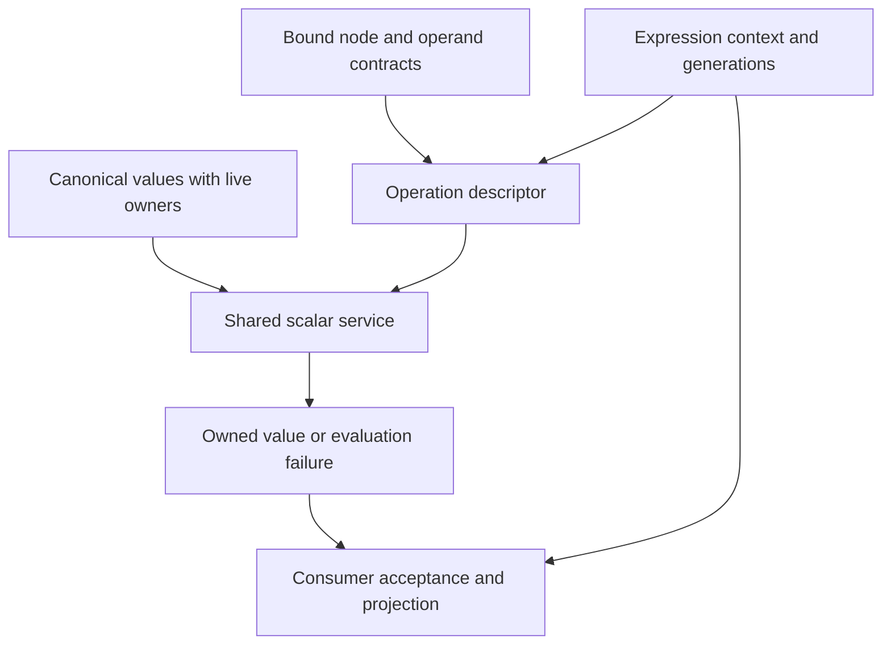
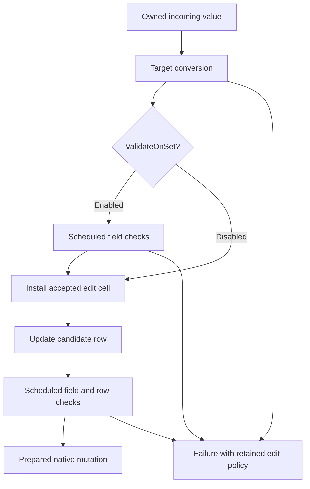
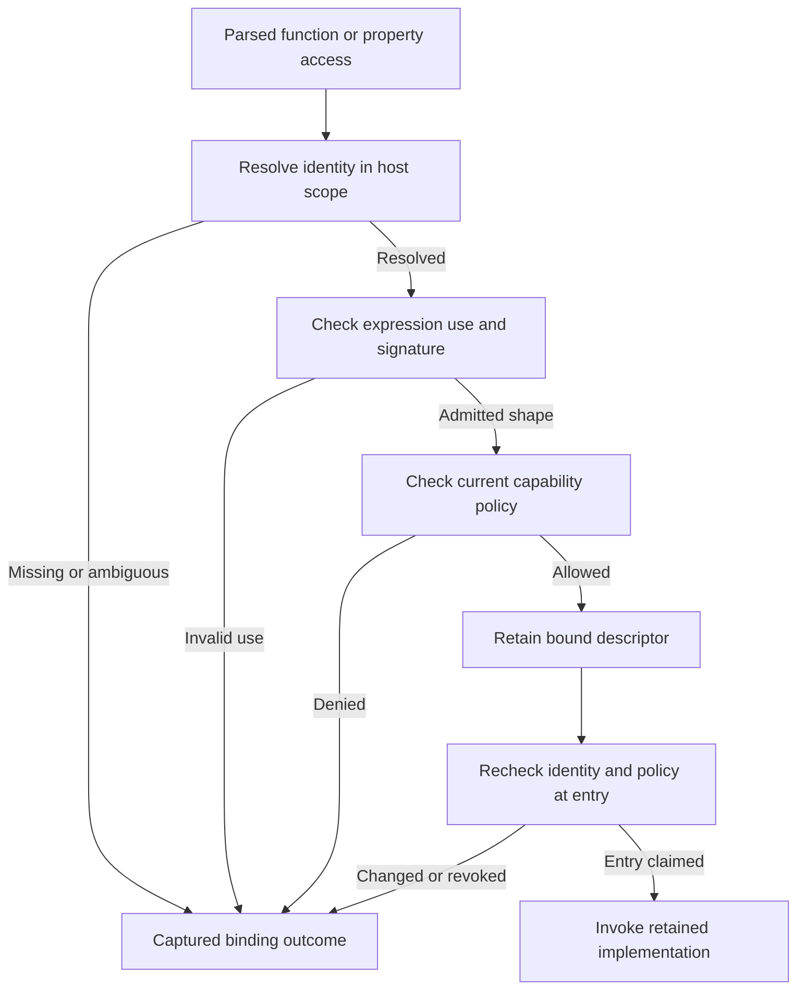
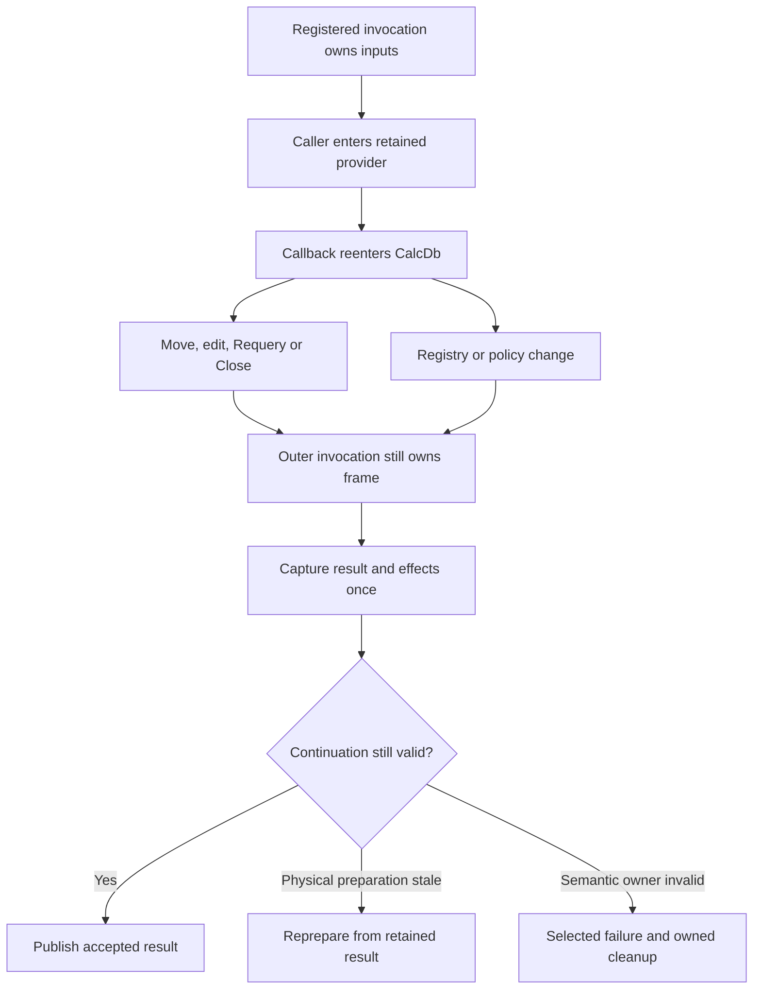

# II-10. Expressions, sandbox and CalcVBA functions

Revision 2 · Reconciled with Stage 2, response 10 · 2026-11-13

**Requirement trace:** Primary RQ-SQL-07, RQ-SEM-01, RQ-VAL-02, RQ-EXPR-01, RQ-EXPR-02, RQ-EXPR-03 and RQ-CALL-03. Supporting RQ-SQL-01, RQ-SEM-02, RQ-SEM-03, RQ-VAL-01, RQ-VAL-03, RQ-TYPE-01, RQ-SIM-01, RQ-CALL-02, RQ-HOST-01, RQ-ORACLE-02, RQ-ORACLE-05, RQ-PERF-01 and RQ-PERF-02. I-16 owns the full scope map. II-02 supplies canonical values/ownership; II-04/05 native field/key mechanics; II-06 parameter/catalog identity; II-07/08 accepted edits and native persistence; II-09 protected inputs and work/reentry ownership. This chapter connects them through K-EXPR, K-VALUE, K-STRING, K-THREAD, K-ERROR, K-ADMISSION and K-PLAN.

Prefer compact typed nodes and a resumable scalar policy over the shared semantic foundation. Preserve declared operand origins, runtime value tags and exact native field descriptors separately. Compile wildcard patterns with their diagnostic and comparison state; qualify any index range independently. Resolve host functions to owned identities and register each invocation before reentrant work. These mechanisms refine **D-EXPR-1 — Recommended** and **D-UDF-1 — Provisional**, without adding a second arithmetic engine or inventing existing CalcVBA exports.

**Evidence boundary.** Microsoft references below establish documentary VBA, Access, Automation and NLS contracts, each within its stated scope. They do not provide an executed ACE expression trace. Native row/key examples reuse II-04/05's exact-pinned source-derived hypotheses at Jackcess commit `be0a2139b087a227d14cafd4ea231306a5a3a862`; all new byte/arithmetic/state witnesses are constructed. Cleared reports contribute concepts only. No Windows, ACE, CalcVBA, native ABI or reference encoder execution occurred. The initial oracle remains the user-reported ACEDAO.DLL **16.0.20527.20016**, with actual loaded identities to capture; .NET Framework 4.8-family and .NET 10 LTS remain separate client lanes. The assumed corrected shared value is the real platform Automation VARIANT/BSTR, **24-byte VARIANT on Windows x64**. Figures are emitted Markdown tables/Mermaid source, not render-verified.[^authority]

## 1. Preferred evaluator and the boundary it owns

**D-EXPR-1 — Recommended.** Bind an expression into compact typed nodes with stable IDs and explicit evaluation policies; execute those nodes with a small iterative scalar engine over the shared CalcVBA value/function foundation. SQL, DAO Find, assignment, defaults and validation call this engine through context adapters. The dependency is the interpreter-independent foundation and qualified host services, not CalcVBA's bytecode interpreter or JIT. A later register program may replace node dispatch after measured equivalence; it cannot replace the semantic rules. The representation decision remains D-VALUE-1: actual platform VARIANT and BSTR, including the 24-byte Windows x64 VARIANT. Metadata below surrounds those values and never changes their ABI.

The first implementation should make the ordinary DAO path inexpensive: bind field ordinals once, read an already protected native row, execute a short expression without a heap allocation per node, and construct owned BSTRs only when a value must outlive its input or cross a retaining/foreign boundary. A mandatory second VM, JIT compilation for every Find call, and converting every row field before evaluating one predicate would add fixed costs before measurements justify them. Conversely, specializing `Long + Long` does not authorize substituting the implementation language's overflow behavior for the common semantic service.

The evaluator owns syntax and binding for scalar subexpressions, operator/function selection, evaluation occurrences, scalar result ownership, context-specific acceptance and the effect/error obligations given to the SQL planner. II-11 owns relational operators, grouping, subquery placement and action candidate selection. An aggregate node in a SELECT is bound to II-11's aggregate state; it is not a scalar function accidentally called for every row. Domain functions and dynamic expression evaluation use explicit bridges described later in this chapter. II-07 owns the edit buffer and accepted mutation values; II-08 owns publication and failure disposition. Evaluation never writes a data page directly.

| Engine structure | Required contents | Owner and lifetime |
| --- | --- | --- |
| `ExpressionSource` | Exact text/code units, use, origin in QueryDef/property/criteria, source spans and grammar profile. | Definition or prepared call; preserve raw native property/query text separately. |
| `BoundExpression` | Node/edge vectors, immutable constants, typed bindings, effects, schedules, acceptance adapter and dependency token. | Prepared expression/plan; no borrowed caller arguments. |
| `ExecutionInputs` | Accepted definition/parameter version, row-source bindings, host context and visibility certificate. | Execution or edit attempt; parameter and row generations are distinct. |
| `EvaluationFrame` | Explicit continuation stack, initialized value slots, checked budget, current occurrence and progress receipts. | One logical evaluation; nested calls get child frames. |
| `ExpressionOutcome` | Owned canonical result or typed failure with phase/source/occurrence and any completed-effect evidence. | Caller consumes/transfers it; later COM error projection is surface-specific. |

These are proposed structures, not declarations claimed to exist in CalcVBA. Their separation lets the implementation replace a parse cache or node packing without rewriting arithmetic, COM ownership or native mutation policy. The cleared `frankensqlite-report.stage1-part2.md` contributes explicit-stack parsing, compact execution and registry/cache concepts. Its SQLite short-circuiting, coercions, aggregate choices and VM schedule do not transfer. Cleared asupersync reports contribute ownership, generation and progress accounting, without imposing an asynchronous runtime.[^r-concepts]

## 2. Parsing and binding retain the information that affects semantics

Keep the original expression string and parsed tree separate. A saved QueryDef's native rows and public SQL serialization already have distinct ownership in II-06. An expression parser must not normalize that source back over the catalog, trim an embedded U+0000 by C-string rules, or change a bracketed name while preparing an execution. It may retain code-unit spans into an immutable source buffer and intern names in an execution-owned name table. Token recognition, identifier comparison, string comparison and wildcard matching are separate policies.

Prefer an iterative precedence parser with explicit operator and operand stacks. Use the Access grammar for each admitted entry point; this is not a generic SQL grammar with VBA-looking function names added. `Is Null`, `Between`, `In`, `Like`, arithmetic, concatenation and logical operators need their own precedence/typing rules. A field validation expression can have an implied field operand; a SELECT expression has an explicit source environment; a domain criterion has a newly bound domain scope. The exact shorthand grammar and diagnostics are R-EXPR-1 observations. Do not implement implied operands by uncontrolled string insertion around quoted strings or nested expressions.

Tokenization records the spelling of numeric/date literals before converting them through the selected literal grammar. Locale-sensitive conversion of a BSTR value is not identical to parsing an Access SQL literal. Microsoft's FindFirst reference specifies US date/decimal conventions for criteria strings, while PARAMETERS provides a typed route that does not require formatting an argument into text. Preserve that distinction in the lexer and binder, with corpus cases for ambiguous dates and non-US decimal settings. A successfully bound typed parameter does not need to be rendered and reparsed to enter a comparison.[^r-find][^r-parameters]

The parser is bounded by admitted source units, tokens, nodes and nesting; every stack growth uses checked capacity. Report malformed/truncated input through a typed parse failure, not a native stack overflow. Keep literal-pattern compilation separate from expression-syntax validation: the `Like` section explains why a malformed wildcard suffix may need a deferred diagnostic even when the surrounding expression has parsed successfully. A binder may prepare a diagnostic node for an execution-time failure, but it must not move that failure to prepare/open time without an observed timing rule.

Binding resolves a name to an identity and origin, not merely an ordinal:

```text
BoundName = Field(source_slot, table_incarnation, physical_column, descriptor)
          | Parameter(origin_declaration, exposure_path, execution_slot)
          | Function(stable_identity, registry_generation, signature)
          | HostMember(host_scope, qualified_resolution_recipe)
          | ContextualUnresolved(name, use_specific_resolution_policy)

ExpressionContextKey =
    grammar_profile, expression_use, host_surface, database_identity
    declaration/schema/incarnation dependencies, namespace dependencies
    comparison/sort descriptor, wildcard_mode, conversion_locale/calendar
    function_registry_generation, sandbox_policy_generation
    semantic_foundation_version, extension_admission
```

The key includes only dimensions that the expression actually depends on, but every omitted dimension needs a dependency analysis explaining why it is irrelevant. Text hashes need an exact-text equality check. A cached result for one bound expression cannot be reused under a different database collation because both files happen to contain a table with the same name. Namespace-generation dependencies are needed for names that were absent as well as names that resolved; otherwise creation of a formerly missing function or field leaves an obsolete result cached forever.

`Forms!Orders!Cutoff`, a declared parameter whose bracketed name contains spaces, and an unresolved field-looking identifier are not three spellings of the same slot. II-06's binder preserves declaration origin through nested saved queries. Access-host resolution may use a qualified host adapter; standalone engine execution must follow its own missing-name/parameter policy. CalcDb does not show an interactive parameter dialog merely because the Access UI can do so. R-CAT-1/R-SQL-3 settle the exposure and name-merging rules; R-EXPR-1/R-UDF-1 settle expression/host scope.

The parameter-value hot path changes an owned execution cell without reparsing unchanged syntax. Explicit declaration types are retained even though all scalar values use canonical VARIANT storage. An unassigned slot remains distinct internally from assigned Empty, Null or an omitted optional function argument. `.SQL` replacement changes the declaration incarnation under II-06's provisional policy. Existing recordsets keep their accepted value binding until a qualified Requery transition selects another one; a parameter assignment cannot silently modify an already executing frame.

## 3. Compact nodes carry types, effects and logical occurrences

Prefer contiguous node and edge vectors, with variable-size data in side tables. A possible 32-byte node header has two 16-bit fields for operation/flags and seven 32-bit fields for auxiliary identity, first edge, edge count, type descriptor, source span, evaluation schedule and policy. This is a CalcDb memory-layout candidate, not a persisted format or published ABI. Bounds determine whether a particular build can use 32-bit indices; reject an unrepresentable expression before truncation. Do not bake 32 into VARIANT stride calculations.

The type descriptor retains the expression's declared/bound category, possible runtime tags, nullability information, precision/scale where relevant, and origin needed for overload selection. Microsoft's VBA comparison rules distinguish declared numeric/String expressions from Variant expressions with similar values; throwing away declaration information before dispatch is therefore unsound for that documented profile. ACE's binding of fields, parameters and literals is independently qualified. A typed Long field and a Variant parameter currently containing a Long need not select every mixed-type operation identically.[^r-comparison]

Effects are a structured summary, not one `pure` bit: possible scalar error, allocation, object/default-member invocation, host code, database reads, clock/random state, policy-sensitive admission, and dependence on row/parameter/host generations. Store a conservative summary on every node and propagate it through expressions. Distinguish a function that is deterministic for its inputs from one safe to evaluate before an earlier failing expression. Function metadata is a compiler contract supplied by trusted builtins or a qualified host adapter; a user-supplied name is not evidence of purity.

**Figure F-80 — a seven-node expression bound to native fields and a parameter.** Original memory design; illustrative node IDs, not ACE bytecode or native storage.

For `([Id] + [p]) > 43 And [Flag]`, with `[p]` declared Long:

| Node | Operation / children | Binding or constant | Illustrative safe-fixture result |
| --- | --- | --- | --- |
| N0 | LoadField | source0, physical column0, native Long descriptor | Long42 |
| N1 | LoadParameter | declarationP, accepted execution slot0 | Long2 |
| N2 | Add N0,N1 | qualified Long/Long operation policy | Long44 |
| N3 | Constant | exact bound integer43 | Bound integer43 |
| N4 | Greater N2,N3 | qualified numeric comparison policy | BooleanTrue |
| N5 | LoadField | source0, physical column2, ordinary Boolean mask descriptor | BooleanTrue |
| N6 | And N4,N5 | qualified logical operation policy | BooleanTrue |

This header proposal costs `7 × 32 = 224` bytes plus `6 × 4 = 24` edge bytes for the shown tree, before descriptors, constants, source storage and allocator overhead. It is an accounting example, not a benchmark or a final node ABI. An execution stack needs only its scheduled live values; it need not allocate seven resource-bearing results or clone an unchanged BSTR for every edge. Measure the actual chosen structures, including their padding and arena slack.

Stable node IDs identify syntax/plan locations for diagnostics. They do not identify every execution of that node. Use an evaluation occurrence such as `(execution, expression_use, result_occurrence, correlation_iteration, invocation_ordinal)` plus node ID for effect receipts. Two syntactic calls to `F()` get two logical occurrences even if their source text is equal; the same node called on the next row gets another occurrence. Completed-effect receipts prevent replay of the *same* accepted operation after physical replan. They do not grant common-subexpression elimination or memoization of separate calls.

## 4. A native row reaches the evaluator without a second value system

Reuse II-04's complete Row A fixture: four physical columns, Long Id42 at fixed offset0, uncompressed Text Name=`Hi` at variable slot0, ordinary Boolean Flag=True in mask bit2, and Notes=Null at variable slot1. Its nineteen bytes are shown below. This remains a source-derived constructed row body; it is not an ACE capture or a complete page.[^r-row]

```text
04 00 2A 00 00 00 48 00 69 00 0A 00 0A 00 06 00 02 00 07
```

The cursor has already checked the data-page/row-slot envelope and produced a source permit, row incarnation and schema descriptor. The evaluator receives that handle, not a raw unbounded page pointer. Binding N0 uses physical column0 and fixed offset0; the native load reads row bytes2–5 only after checking the applicable mask and width. Binding N5 uses column2's ordinary Boolean rule: mask bit2 directly represents the value. It does not interpret that bit as ordinary presence and then search for a two-byte Boolean payload. N1 reads the accepted parameter cell, not a QueryDef object's subsequently reassigned live slot.

**Figure F-81 — physical inputs, semantic values and acceptance.** Source-derived row hypothesis plus original execution design; canonical layout follows II-02.

| Input/action | Exact checked evidence | Result or obligation |
| --- | --- | --- |
| Native Id load | Mask byte18=`07`, bit0 set; bytes2–5=`2A 00 00 00`. | Construct Long42 in the actual canonical scalar arm; on Windows x64 `VT_I4` is at byte0 and its active scalar at byte8. |
| Native Flag load | Ordinary Boolean descriptor, mask bit2 set. | Construct canonical True; never copy the native bit into a presumed Boolean payload. |
| Bound parameter | DeclarationP's accepted Long2 cell and execution version. | Borrow a stable scalar for this evaluation or use an initialized local scalar slot. |
| N2→N4→N6 | Shared arithmetic/comparison/logical operations on admitted values. | For this no-error fixture:44, True, True; predicate adapter retains the row. |
| Change mask07→03 | Flag bit becomes0; all fixed/variable bytes unchanged. | False Flag; the shown logical result is False. |
| Change mask07→06 | Id bit becomes0; its four stored bytes remain42. | Ordinary field load yields Null, never42; shared Null rules decide the expression result. |
| Separate Notes projection | Notes bit3 clear, even though its variable slice is empty. | Database Null; changing mask07→0F makes the same empty slice a non-Null empty Text under this schema. |

The Windows VARIANT inactive payload bytes/padding are not part of semantic equality. Only the active tag/arm, exact string/array contents and relevant object identity are captured. A later Name projection decodes the checked native slice `[6,10)` and, if it must return owned text, allocates a real BSTR with byte-length4 and UTF-16LE payload `48 00 69 00` plus its terminator. It cannot return `row+6` as a BSTR: no compatible allocation/prefix/ownership exists there. The predicate above does not need to decode Name or Notes at all.

Currency, Decimal and extended temporal fields use II-04's exact native descriptors and II-02's shared projection rules. Retaining a fixed-width encoded scalar until the selected semantic operation is legitimate; converting all Currency values through Double is not. A borrowed long-value locator is likewise not a scalar string: a consumer requiring its text obtains checked source spans through the pager/LV service, with that operation's ownership, visibility and error point. Field loads can perform I/O or fail; their movement across another expression therefore needs the same proof as moving an arithmetic error.

The lazy row cache is keyed by source identity, row/edit generation, descriptor generation and relevant decode/projection context. It can remember checked offsets and effect-free decoded values; it cannot keep a stale BSTR view across scratch reuse or treat an old edit candidate as the new current row. Small scalar slots need no per-field heap owner. A retained external result owns its value, while an internal encoded/text borrow retains its backing and expiry contract.

## 5. The scalar operation needs a typed context, not another value representation

The preferred implementation of **D-EXPR-1 — Recommended** is a small evaluator whose bound nodes call the shared CalcVBA conversion and function service. This develops **RQ-VAL-02**, **RQ-SEM-01**, **RQ-TYPE-01** and **RQ-SIM-01**. Every materialized semantic value remains a real platform Automation VARIANT, with real BSTR ownership. Windows x64 uses the corrected 24-byte layout from II-02. A node's source category, expected result shape and error site are metadata surrounding that value; they do not add a CalcDb tag or change a VARIANT's stride.

The distinction matters because a runtime tag does not describe the entire expression. VBA's documented comparison rules distinguish a declared numeric operand from a numeric value held in a Variant. Two Variant operands, one numeric and one textual, have a documented category ordering; a declared numeric operand paired with a convertible textual Variant instead selects a numeric comparison. These are different operations over potentially identical payloads.[^sc-compare] The query binder therefore supplies an **operand contract**: field/parameter/literal/function-result origin, declared database or language type where known, possible runtime tags, Null possibility and conversion context. R-EXPR-1 decides the corresponding Access query contract rather than assuming that every SQL field behaves like a VBA Variant variable.

Store an immutable operation descriptor with the bound node. Its key consists of operator/function identity, operand contracts, expression use, semantic-service generation and relevant locale/comparison settings. A descriptor can select a fixed scalar operation when types are established, a bounded runtime-tag dispatch when they are not, or an explicit unsupported case. It must not inspect only the left operand or choose one permanent result tag from the first row. Heterogeneous Variant parameters and conditional results make that shortcut observable.

**Figure F-82 — Binding metadata selects one shared semantic operation.** Proposed topology; arrows are responsibilities, not an invented CalcVBA ABI.



A concrete descriptor for addition records that `+` can concatenate or add and that its result rules differ from multiplication. It does not reduce both operators to `promote_to_widest_number`. Microsoft's addition and multiplication documentation put Currency and Double in different precedence positions, and both identify a Single/Long combination as a special case.[^sc-plus][^sc-multiply] Those facts justify a table of operator-specific dispatch entries in the shared foundation, with tests attached to each entry. They do not justify independently implementing that table in the SQL executor.

Binding metadata is also the place to distinguish a typed constant's construction from a conversion expression. A captured `VT_CY` constant already has its Currency value. `CCur(text_parameter)` is a potentially failing, locale-sensitive operation at an evaluation site. Preconverting both while binding changes when an invalid parameter fails and whether a parameter replacement is seen. Bind immutable literal bytes only through the documented literal grammar and the correct context; keep user conversions as nodes unless their movement has been established equivalent.

## 6. Null, Empty, omission and Error travel differently

Use two outcomes internally: **a value produced successfully** and **evaluation failed**. The former may contain `VT_NULL`, `VT_EMPTY` or `VT_ERROR`. The latter owns a diagnostic with node identity, expression use, phase and the underlying failure. An error-valued result is not automatically a failed call. VBA explicitly permits a Variant Error value to be handled as data, and `CVErr` constructs one; implicit coercion of such a value is restricted while explicit conversion has its own documented behavior.[^sc-variant-type][^sc-cverr]

| Input or outcome | Meaning retained by the evaluator | What must not happen implicitly |
| --- | --- | --- |
| `VT_NULL` | A semantic Null value, with operation-specific propagation. | Replacing it with zero, false or empty text during field loading. |
| `VT_EMPTY` | An uninitialized Variant value; later context can interpret it numerically or textually. | Treating it as database Null or as an omitted argument. |
| Present empty BSTR | A present string with zero payload length. | Losing the distinction from Null, Empty or an absent optional parameter. |
| Omitted optional argument | Absence under the called signature's optional-argument rule. | Inventing a new VARTYPE or globally treating every Error value as omission. |
| `VT_ERROR` with ordinary error code | A successful Error-valued result until a consumer applies its rule. | Raising that code solely because the active tag is Error. |
| Evaluation failure | An operation did not produce its specified value. | Fabricating `CVErr`, Null or an empty string to keep execution moving. |

Automation's optional-argument marker uses `VT_ERROR` with `DISP_E_PARAMNOTFOUND`; a default-valued parameter has a different documented substitution rule.[^sc-optional] The adapter recognizes omission under the exact method/function signature and argument position. The resulting argument-presence information belongs to the call frame, outside the VARIANT. If the same bit pattern arrives where no optional parameter exists, the boundary must apply that call's actual acceptance/error behavior, not erase it globally. VBA `IsMissing` concerns optional Variant arguments and is not a generic Null test.[^sc-ismissing]

A proposed `ScalarOutcome` is consequently a control wrapper around an owned canonical value or an owned failure. It is not exported over COM and does not replace `VT_ERROR`. The public adapter maps failures to its established HRESULT, EXCEPINFO, DAO/ADO errors or contextual expression display behavior. A form displaying an error token and a DAO method failing are not interchangeable observations. Capture both the value branch and the failure branch before applying a display formatter; a screenshot alone cannot settle the semantics.

Null propagation must be attached to the operator, not implemented as a universal prepass. `+` has different Null behavior from concatenating with `&`; the latter treats a single Null operand as empty text but preserves Null when both operands are Null.[^sc-ampersand] Likewise, Null in Boolean conjunction is not always the result. An eager child that fails is also different from a child that successfully returns Null. Evaluate the admitted child schedule, retaining failures, before applying the operation's Null rule; do not scan child tags and silently skip error-producing subexpressions.

For a constructed witness, compare four independent expressions over a field `T`: `T + "x"`, `T & "x"`, `IsNull(T)` and `Nz(T)`. Provide rows/parameters with Null, empty BSTR and ordinary text, plus a separate direct-call Empty argument. These are proposed fixtures, not measured outputs. They expose loading, operator selection and Access-context replacement separately. A database field's legal stored values need not include every Automation input form, so the harness records which boundary supplied each value rather than claiming that Empty was stored in an ordinary text column.

## 7. Numeric results carry exact types and exact loss points

Arithmetic correctness includes the result tag, the stage at which rounding occurs and the operation that reports overflow. Returning the same formatted digits does not suffice. The shared service must make an explicit distinction between an arithmetic result, a requested conversion and the later assignment of that result to a field or typed caller variable. Each can have a different permitted widening or failure.

The following compact matrix describes documentary starting points and discriminating fixtures. It is not an asserted ACE result matrix.

| Operation family | Documentary fact used for the initial implementation | Probe that prevents a misleading simplification |
| --- | --- | --- |
| Variant integer arithmetic | VBA describes widening Byte to Integer, Integer to Long, and Long/Single to Double when those Variant results overflow their initial ranges. Currency, Decimal and Double overflow remain errors.[^sc-variant-type] | Compare typed locals, Variant operands, declared QueryDef parameters and typed fields around every boundary. Capture pre-assignment result tags. |
| Addition and multiplication | Operator-specific result precedence and exceptional pairs exist.[^sc-plus][^sc-multiply] | Pair Currency/Double and Single/Long in both operand orders; record value and subtype. |
| `/` | The documentation gives Double as the usual result but identifies Single and Decimal cases.[^sc-divide] | Byte/Integer/Single combinations, mixed Decimal, zero divisor, overflow, Null and Empty. |
| `\` and `Mod` | Floating inputs undergo integer rounding before the operation; integer division then discards the quotient's fractional part.[^sc-intdivide][^sc-mod] | Values just below/at/above halves, negative inputs and a divisor that rounds to zero. |
| Explicit integer conversion | `CInt`/`CLng` round exact halves to even; overflow is a conversion failure.[^sc-convert] | Positive/negative halves at interior and range-edge values, represented separately as Double, Currency, Decimal and text. |

Do not widen every intermediate to an unbounded mathematical integer and narrow only at the end. Such an implementation can make an intermediate overflow disappear. Conversely, eagerly narrowing a Variant result can create an error where the language permits promotion. The operation descriptor selects the shared rule first; its implementation may use a wider scratch integer solely to detect overflow or carry exact intermediate products before the specified rounding. Scratch width is an implementation mechanism, not a visible promotion rule.

Currency has an eight-byte integer magnitude scaled by 10,000.[^sc-currency] Thus a constructed value `12.3456` has scaled payload `123456`, whose little-endian eight bytes are `40 E2 01 00 00 00 00 00`. This is a derived arithmetic witness, not an ACE page dump. When adding Currency values, a wide scratch sum can test the permitted signed range exactly. When multiplying or dividing them, the descriptor must determine result kind and rounding before choosing the fixed-point algorithm. Dividing a scaled integer by 10,000 through Double merely for convenience can discard distinctions near Currency's upper range.

Decimal's 96-bit magnitude and scale permit a stronger witness. In the following constructed native-layout prefix, the high magnitude word, sign and nonzero scale all matter. The sign/scale equation follows from Microsoft's DECIMAL definition; the tag and field overlap follow from native VARIANT, not from copying an RPC representation into process memory.[^sc-decimal][^sc-oaut-decimal][^sc-variant][^sc-varenum]

**Figure F-83 — Constructed Decimal prefix inside a Windows x64 VARIANT.** The complete object is 24 bytes. Bytes 16–23 are not part of this active Decimal payload and are not semantic equality data. This is a source-derived layout hypothesis for I-FOUNDATION-1, not native execution.

| Offset | Bytes, little endian | Active interpretation |
| --- | --- | --- |
| 0–1 | `0E 00` | Native VARIANT tag `VT_DECIMAL`. |
| 2 | `04` | Decimal scale 4. |
| 3 | `80` | Negative sign. |
| 4–7 | `01 00 00 00` | High 32 magnitude bits = 1. |
| 8–15 | `05 00 00 00 00 00 00 00` | Low 64 magnitude bits = 5. |
| 16–23 | Not compared | Inactive storage in this active arm. |

Its mathematical value is `−(2^64 + 5)/10^4 = −1844674407370955.1621`. Reading only the low word produces a completely different number; passing through Double can lose the final decimal detail; zeroing the apparent ordinary reserved header words destroys the scale, sign and high magnitude. A standalone DECIMAL's reserved word and an overlaid native VARIANT's tag are different construction situations. The shared constructor must honor its actual declaration rather than combining incompatible initialization recipes.

For result capture, retain Decimal sign, scale and all 96 magnitude bits, alongside its mathematical interpretation. Two equal Decimal values can have different scales; whether a particular public operation preserves or normalizes scale is itself observable and needs a probe. Numeric comparison, string formatting, DAO field storage and ADO metadata each consume this information differently. The first implementation should not normalize every value immediately on ingress merely to simplify hashing.

Single and Double also need active payload capture. Record their exact binary payloads with result tags, including signed zero or nonfinite inputs when the boundary admits them. The fixture decides acceptance; a host's ability to construct an Automation value is not evidence that ACE stores or accepts it. Numeric text conversion must carry the recorded locale. The documented conversion functions are locale aware, whereas using a generic parsing helper changes separators, accepted syntax and error behavior.[^sc-convert] Keep arithmetic over already typed values independent of accidental process-locale changes during parsing.

## 8. Date is a semantic type, not an unlabelled Double

An ordinary Automation DATE uses an eight-byte floating value with a date component and an absolute fractional time component. Around the epoch, `−0.25` and `+0.25` both describe 30 December 1899 at 06:00; negative-day values expose the discontinuity between the numeric encoding and chronological order.[^sc-date] A constructed pair `−1.25`, `−1.5` consequently denotes two times on the previous day, with payload order opposite their time-of-day order. These witnesses are particularly valuable because positive modern dates conceal the distinction.

This representation fact does **not** settle how ACE evaluates `dateA < dateB`, date subtraction, a comparison against Double, or an index seek over those payloads. Microsoft's MFC DATE explanation warns about chronological comparison, while VBA's operator tables classify Date among numeric operands. The proposed design keeps both facts in scope: preserve the `VT_DATE` tag and original payload, call the operation-specific shared rule, and make the negative-epoch cases an explicit R-EXPR-1 branch. Do not “repair” ACE parity by substituting a chronologically nicer comparison without evidence.

Likewise, no implicit timezone conversion belongs in a scalar load. A DATE value is not a UTC timestamp with an embedded zone. Its textual conversion depends on the applicable context, and formatting is not the identity of the stored value. Time-only values, fractional days, leap days, two-digit year parsing and ambiguous day/month text need separate cases. Compare typed DATE inputs before comparing date-like strings, so literal parsing, locale conversion and temporal arithmetic can be attributed individually.

Date/Time Extended remains a distinct required native type under II-02/II-04. This chapter does not narrow it to ordinary DATE to obtain a convenient function call. Until the shared foundation's exact extended projection and operations are established, preserve supported native data and expose the semantic gap. A value conversion used by a specific API can be narrower only when that API's evidence requires it; it must not become the universal storage or comparison representation.

## 9. Boolean operators precede predicate acceptance

Canonical `VT_BOOL` uses `0x0000` for false and `0xFFFF` for true. VBA converts numeric zero to false and nonzero values to true, and converts true back to numeric −1.[^sc-variant][^sc-boolean] That conversion rule must not be applied to both operands before every `And` or `Or`: these operators also perform bitwise operations on numeric operands.[^sc-and][^sc-or]

**Figure F-84 — Boolean/Null results and a separate numeric witness.** Documentary Boolean table, with original integer witness below. This table describes successful values, not expression-evaluation order.

| Left | Right | `And` | `Or` |
| --- | --- | --- | --- |
| False | False | False | False |
| False | True | False | True |
| False | Null | False | Null |
| True | False | False | True |
| True | True | True | True |
| True | Null | Null | True |
| Null | False | False | Null |
| Null | True | Null | True |
| Null | Null | Null | Null |

For integer inputs 6 and 3, the proposed witness's bitwise results are 2 for `And` and 7 for `Or`. Converting each input to Boolean first instead yields Boolean true in both cases. That is a different value and type, even where a subsequent predicate would accept either nonzero result. Probe mixed Boolean/numeric operands, widths, rounded floating operands and Null combinations separately; a truth table over only `True`, `False` and Null cannot establish those coercions.

The expression evaluator returns its canonical result to a consumer adapter. A selection predicate then decides whether that result admits a row. A default expression supplies a value for later field conversion. A field/table validation expression applies its own acceptance and diagnostic rule; Required and AllowZeroLength are additional constraints, not substitutes for the validation result. The recommended arrangement is one typed scalar result with distinct, named consumer policies, confirmed by the context arm of R-EXPR-1.

This split also prevents a query optimizer from confusing value equivalence with acceptance equivalence. Replacing a numeric expression by Boolean true may preserve a single WHERE outcome while changing a projected column, a function argument or a validation failure. A bound node's use cannot be inferred from the operator token alone. Share an expression's computed result between consumers only if they refer to the same evaluation occurrence and visibility/context; syntactically identical text is insufficient where timing, errors or callbacks differ.

## 10. Selection functions need schedules and result rules

The documentation establishes useful starting points, but “returns one argument” does not mean “evaluates one argument.” Both VBA and Access describe `IIf` as evaluating both result arms and exposing an error in an unselected arm.[^sc-iif][^sc-iif-access] VBA documents `Choose` as evaluating every choice, rounding a nonintegral index, and returning Null for an out-of-range index.[^sc-choose] `Switch` documents left-to-right condition examination, selection of the first true condition, Null when no condition succeeds and evaluation of all expressions.[^sc-switch] These descriptions are enough to reject a blanket lazy conditional implementation.

They do not provide a complete ACE query scheduling specification. A literal failure can occur during expression preparation; a row-dependent failure cannot be attributed to preparation in the same way. A function may construct an object reference eagerly but defer its default-member coercion. Selection of one arm and conversion of the selected result are separate events. Nor does an API's reversed Automation argument array establish the expression engine's source evaluation order. R-EXPR-1 records these as separate phases and does not infer one from the other.

**Preferred provisional choice:** represent `IIf`, `Switch`, `Choose` and `Nz` as dedicated function descriptors with a child schedule, selection rule and result-coercion rule. Use the documented eager behavior for the first three as the starting schedule; use source order as an explicitly provisional tie-break where the documentation is incomplete. A surfaced child failure terminates that evaluation attempt according to its error policy; “eager” does not instruct the engine to continue executing additional side effects after an error has already escaped. Constant folding must not move an observable failure into an earlier public phase without evidence.

For `Nz`, preserve presence of the second argument. Access documents an omitted replacement as Empty in the VBA-facing case and as zero-length text for Null-valued query fields.[^sc-nz] That is a context adapter, not an arithmetic special case. The same page does not establish that an explicitly supplied replacement expression is lazy. Until observed, use the ordinary admitted argument schedule and test `Nz(nonNull, failingExpression)` as carefully as `Nz(Null, replacement)`. Do not implement it as generic SQL COALESCE and assume equivalence.

Result typing deserves its own capture. A selection function might return the selected canonical value, coerce arms to a bound result domain, or expose a query field projection that differs from the inner value. The chosen design keeps the inner scalar result and the public projection distinct. Probe mixed Currency/Decimal, numeric/text, Null/text and Empty/numeric arms; capture DAO `Field.Type`, returned VARIANT subtype and value separately. A query displaying “7” cannot establish whether the engine returned a number or a string.

**Figure F-85 — Evaluation phases that a conditional-expression trace must distinguish.** Proposed trace vocabulary; not a claim about observed ACE phase boundaries.

| Event | Example evidence | Why it matters |
| --- | --- | --- |
| Bind/admit | Name or arity rejected before row traversal. | A dead-looking branch can still require a legal name and signature. |
| Evaluate child | Literal, field load or host call produces a value/failure. | Establishes which arms execute and their order. |
| Coerce argument | A produced value is converted for a function parameter or condition. | Can fail or invoke a default member after child construction. |
| Select result | A condition/index chooses the returned arm. | Does not itself imply discarded arms were unevaluated. |
| Coerce/project result | Selected value becomes a query field or assignment input. | Explains type or failure differences after successful selection. |

An early discriminator uses an original disposable table with `Id`, `Denominator` and `TextValue`. Compare a constant unselected division by zero, an unselected `1/[Denominator]`, an unselected `CInt([TextValue])`, and admitted host markers once routing exists. Run each with zero, one and several rows, and with a filter that selects no rows. Record the exact API call on which the result or error appears: prepare/open, first field access, movement, full materialization, Update or Execute. Zero rows do not imply zero expression preparation, and a successful open does not imply every projected field has been evaluated.

## 11. Iterative evaluation with explicit error and effect progress

**Inputs:** a bound expression, accepted execution inputs, one logical occurrence, budget and cancellation owner. **Output:** an owned canonical value or typed failure. **State:** explicit continuation stack, initialized scalar/value slots, bounded borrow owners, completed-effect receipts and diagnostic phase. **Invariants:** schedule-selected order; no implicit retry of accepted effects; no resource-bearing slot without a cleanup owner; no internal latch across foreign code, wait or destruction; no stale source reused after a generation failure. **Complexity:** O(visited nodes/edges plus semantic operation cost); stack/value capacity is O(maximum admitted live continuation/value set), excluding separately accounted text/arrays/pins.

```text
evaluate(bound, inputs, occurrence, owner, budget) -> owned_value | failure
    register an evaluation frame with owner before fallible preparation
    validate bound dependencies at the qualified public-call phase
    reserve checked continuation/value capacity; initialize resource slots
    push Enter(bound.root, occurrence)
    while continuation stack is not empty:
        step := pop next continuation
        check cancellation at a policy-permitted observation point
        if step is Enter(node, logical_occurrence):
            if a leaf:
                load it through its stable binding at this scheduled point
                install the complete result in an initialized owned/borrowed slot
            else:
                push ResumePolicy(node, new policy state, logical_occurrence)
        else if step is ResumePolicy(node, state, logical_occurrence):
            action := node.policy.next(state, completed child/step outcomes)
            if action is EvaluateChild(child):
                save the policy continuation; push Enter(child, its occurrence)
            else if action is Coerce, Select, ApplyPrimitive or Invoke:
                stabilize only inputs demanded by this action
                use the shared semantic primitive or owned foreign-attempt route
                retain its result/completion receipt; resume this policy
            else if action is RetireValue:
                settle that owner at the policy-selected cleanup point
                resume this policy with any cleanup outcome
            else if action is Complete:
                move the result to the parent/root prospective-result owner
        after every foreign execution, writeback preparation or cleanup:
            revalidate before the next dependent semantic action/publication
    settle required cleanup with root result still owned by this frame
    select final value/failure using cleanup and continuation outcomes
    transfer an accepted root result once; settle remaining frame obligations

    any failure from reservation, validation, loading, action or finalization:
        retain the primary failure and completed-effect evidence
        stop later ordinary actions; run only owned required cleanup
        return the selected failure after settling or transferring obligations
```

The resumable policy can interleave child evaluation, argument coercion, selection and invocation. It can therefore expose a failed first-argument coercion before a later effectful child when that is the qualified schedule, rather than forcing all coercions to follow all children. A verified eager schedule may use a faster reversed push of known children, but only when their intervening coercion/cleanup obligations permit it. The selected order is initially a conservative left-to-right scalar schedule where no stronger rule exists, then changes if native evidence requires another order. This is not a claim that ACE executes every SQL operand left-to-right. An error normally prevents later ordinary evaluation; `IIf` eagerness does not mean continuing arbitrary user code after an earlier argument has already failed. Native cases distinguish value eagerness, error precedence, preparation and demand timing.

An implementation can borrow effect-free local scalars in slots, provided `Apply` cannot outlive those inputs. Before any callback capable of moving/closing its source, promote still-live borrowed results to stable ownership or retain an already valid immutable source. This is not permission to evaluate future children early. For a Memo needed *after* a callback, either its existing view/certificate permits the later read, or the continuation uses the measured invalidation policy. Fetching and decoding that Memo before the callback could move an I/O or conversion error and is a different schedule.

Value destruction itself can be foreign code. Moving a result out of a frame and clearing arguments must therefore preserve the same operation guard and continuation dependencies until cleanup has settled. A callback result may be a valid owned value even when reentry invalidates the outer cursor; the invalidation policy decides whether it is published, but ownership remains tracked until it is returned or cleared. On cleanup failure preserve the primary expression failure and record secondary cleanup context under K-ERROR. Do not publish a partially constructed result because the engine has already allocated its BSTR.

The reference scalar form uses tree occurrences; structural interning can share immutable descriptions without sharing evaluation results. A register program should lower the same scheduled occurrences and error/effect points, retaining source/node IDs for differential traces. Neither a node cache nor a register optimizer may infer that repeated deterministic-looking calls can be merged without the transformation proof below.

## 12. A scalar kernel with owned inputs and failures

The following pseudocode is a proposed service contract, not an existing CalcVBA API. It applies to one local policy segment after binding has selected an admitted descriptor and its scheduled operands have valid owners. Argument coercions that precede a later child are separate actions in the evaluator's resumable policy; this kernel never forces all child values to be produced before all coercions. Its descriptor records already-completed conversions and performs only the remaining local steps. Public ByRef/writeback behavior remains the method adapter's responsibility; the scalar kernel cannot remove aliases merely to simplify its implementation. Foreign object coercion or host calls leave this pure kernel and use the caller-thread continuation path.

**Inputs:** descriptor, stable canonical operand borrows, immutable context and an operation budget. **Output:** one owned canonical value or one owned evaluation failure. **State:** initialized temporary owners and bounded conversion scratch. **Failures:** unsupported conversion, overflow, allocation failure, stale context or an evidenced language failure; no partially initialized result escapes. **Cost:** constant dispatch and fixed-width work for ordinary scalar operations, plus actual text/array/conversion cost; no per-node heap allocation is required for successful fixed-width values.

```text
apply_scalar(descriptor, operands, context, budget) -> ScalarOutcome
  validate descriptor generation and operand contracts
  require each borrowed operand remains stable through this operation
  require descriptor is admitted in context.expression_use
  require no foreign invocation is hidden inside this pure-kernel route
  rule := descriptor.select_for_runtime_tags(operands)
  if no supported rule: return failure_at(descriptor.node, "unsupported")
  temporaries := initialized empty owners in operation frame
  result := initialized empty canonical owner
  for step in rule.conversion_and_operation_schedule:
      perform step through shared semantic service
      reserve admitted allocation before constructing owned payload
      on failure:
          retain primary failure with node, operand and phase
          settle all initialized temporaries and result
          retain any secondary cleanup failure without replacing primary
          return primary failure
  validate result satisfies this rule's produced-value contract
  move result to outcome; settle remaining temporary owners
  return successful owned canonical value
```

Null tests and identity moves are entries in that rule schedule. A successful Error-valued result remains in the value branch. An implementation should normally emit bounded diagnostic metadata only on failure; instrumentation can record every step in research builds without imposing string formatting on the hot DAO loop. Do not capture error text by converting the failing value through the same operation that failed: that can trigger another error or foreign default member.

The evaluator above the kernel owns child evaluation. It uses an explicit frame stack bounded by expression size, avoiding dependence on the language runtime's machine-stack depth. Each frame records its node, next scheduled child, live result slots and whether a foreign effect has already completed. Moving a value into a selected-result slot transfers its cleanup obligation; unselected owned values still need cleanup. Destruction can itself cross a foreign reference boundary, so a failed or cancelled evaluation must not settle such owners while holding an internal engine latch.

For a tree with N visited nodes and total materialized string length U, the initial interpreter targets O(N + U) local work plus the costs of called services; its live frame and temporary storage follows actual expression depth and retained operands. A function with many eager choices may retain many results. Use descriptor-specific retirement of an unneeded value only when doing so preserves observable destruction/error order. A bounded arena reduces allocation overhead but does not grant permission to call Release earlier than the evidenced language would.

No common-subexpression elimination follows merely from equal node text. A repeated erroring conversion, a clock/random call or a database-aware function has observable occurrence semantics. Initially preserve occurrences. Later optimization can share a proven pure, total result within the same context and visibility interval, but its proof must include result type and failure behavior. Compile the same operation descriptors only after scalar equivalence is established; otherwise two engines will disagree precisely at the boundaries where compatibility matters.

## 13. A function inventory becomes executable descriptors

The required function surface must become a checked manifest, not a collection of names copied into a switch statement. Start from the official Access category index, sandbox tables, individual function references and supplied CalcVBA foundation inventory, then qualify each engine/host context. The category index deliberately spans scalar, aggregate, domain, UI, file and object functions; inclusion there alone does not authorize invocation in a standalone query or a field default. The separate developer page titled “Visual Basic for Applications functions” explicitly lists functions for data-shaping CALC expressions; it does not establish the standalone ACE SQL surface.[^sc-calc-scope] Preserve a row for an unavailable required function with its next implementation/probe task instead of silently dropping it.[^r-function-list]

Each manifest row carries exact public spellings, identity/signature family, allowed arities and omitted positions, declared and runtime type rules, Null/Empty/Error policy, evaluation/coercion schedule, locale/calendar/comparison inputs, result ownership, effects, context admission, sandbox capability and evidence IDs. A descriptor is generated from that reviewed row. The manifest also records implemented/qualified context combinations and unresolved discrepancies; it is separate from the book's compact decision record and is an implementation output of W-05/W-06/I-FOUNDATION-1.

**Figure F-86 — representative function families and the service they require.** This is an implementation coverage map with original probe choices, not an exhaustive or already-qualified ACE whitelist.

| Family / representative names | Shared mechanism | Required discriminators |
| --- | --- | --- |
| Conversion/inspection: CCur, CDec, CDate, CStr, IsNull, IsNumeric, VarType | Typed operation descriptors and explicit locale/type origin. | Null versus Error, overflow, declared versus Variant result, numeric/date text and assignment projection. |
| Text: Mid/Left/Right, Len, InStr, Replace, StrComp, case/trim functions | Counted BSTR or stable decoded view, operation-specific comparison/position rules. | Empty/Null, embedded NUL, surrogates, byte variants, boundaries and allocation/result type. |
| Date/time: DateAdd, DateDiff, DatePart, DateSerial, Weekday | Shared calendar/literal/conversion service; separate sampling for current-time functions. | Month ends, leap days, interval boundaries, week/year settings, negatives and omitted options. |
| Numeric/financial: Abs, Int/Fix, Round, Sqr, Pmt, Rate, IRR | Per-function numeric/result policy; bounded iterative work where the algorithm requires it. | Half rounding, domain errors, overflow, zero/extreme rates, convergence/failure and exact typed output. |
| Selection/error data: IIf, Choose, Switch, Nz, CVErr | Explicit child/coercion/result schedules. | Eager-but-failing arms, optional replacement, result metadata and Error-valued success. |
| Domain/SQL aggregates: DCount/DSum, DFirst/DLast, Sum/Avg/Count | Qualified child query or II-11 aggregate state; no scalar-loop shortcut. | Empty/all-Null input, order, visibility, subtype and serial numerical accumulation. |
| Access/object/environment families | Qualified host/member adapter and policy capability. | Actual availability, ownership, implicit default-member invocation, sandbox denial and reentry. |

Do not alias every spelling to the same descriptor before qualification. Microsoft distinguishes Variant-returning string functions from `$` String-returning forms; their handling of Null and declared result types matters even though CalcDb's materialized semantic values still use canonical VARIANT storage. `Mid` and `MidB` also use different positional units. These are signature/operation distinctions, not an excuse to invent two BSTR implementations. A context that rejects one spelling must not have it accepted merely because the library contains the other.[^r-string-forms][^r-mid]

A concrete text-kernel fixture uses the BSTR payload `41 00 00 00 42 00` (`A`, U+0000, `B`). Under a qualified code-unit positional profile, a three-unit character slice retains all six bytes; a byte-oriented slice uses its own start/length policy and may produce a payload that is not ordinary well-formed text. This is a proposed discriminator, not an asserted ACE MidB output. The consumer must preserve exact returned BSTR bytes and apply any later text conversion separately. A built-in implementation should allocate the final owned result once where its length is known, or return a bounded internal view only under an explicit nonretaining call contract.

Financial and transcendental functions need the shared foundation's actual algorithms and failure criteria. “Uses Double” is not enough to establish numerical parity or convergence. Record input/output active bits, accepted tolerance only where the compatibility contract expressly permits one, iterations and the selected error on nonconvergence. Replacing a serial accumulation with compensated or parallel summation can improve mathematics while changing required output; II-11 owns that decision under RQ-CALL-02. The foundation audit identifies missing operations before a query implementation writes local substitutes.

For every descriptor, generate a small contract-driven fixture family: minimum/maximum arity, each omitted/default position, one ordinary input per admitted type, Null/Empty/Error cases, boundary and invalid cases, and permitted/denied contexts. Add function-specific adversarial cases where the generic matrix cannot distinguish mechanisms. The harness reports the executed function×context×type cells and native identity. A passing test of `Mid("abc",1,1)` cannot stand in for string-function completeness, and a missing host capability is recorded as unavailable evidence rather than a successful denial test.

## 14. Comparison context is an input, not a process setting

**Requirement trace:** This section supplies RQ-SQL-07's two wildcard modes, the text portion of RQ-SEM-01/RQ-VAL-02, and the expression side of RQ-SEM-02. Error timing also belongs to RQ-SEM-03. The original structures and algorithms below are **recommended within D-EXPR-1**, with profile choices provisional pending R-EXPR-1. They extend D-SORT-1 without changing II-05's native encoder or II-02's value ownership.

An expression comparing two strings needs their exact contents and its comparison context. A database index additionally needs the physical field descriptors and encoding profile. Keep those inputs distinct. A single `case_insensitive` flag cannot describe database comparison, VBA `Option Compare`, wildcard syntax, punctuation, character expansions, or an index whose composite key has been shortened.

Microsoft documents `Option Compare` as a module setting: Binary is the default, Text uses the system locale, and Access's Database form uses the database's locale ID. `StrComp` can select a comparison explicitly, uses the module setting when omitted, returns a Variant containing an Integer for an ordinary comparison, and returns Null for a Null string operand; a Null comparison selector is an error.[^pat-compare][^pat-strcomp] Those facts do not make the calling VBA module's setting the SQL engine's implicit setting. Capture the SQL, Find, validation and VBA paths independently and bind their resolved context.

Prefer a retained `TextContext` containing expression use, resolved comparison family, exact database sort descriptor where relevant, admitted locale/table identity and version, wildcard grammar, error-order policy, and semantic generation. The caller supplies it when an expression is bound; a retained plan verifies its dependencies before reuse. The explicit `StrComp` selector overrides the appropriate comparison field, not unrelated SQL settings. Missing, Null, invalid numeric and supported selectors reach the scalar service as distinct values. SQL's acceptance of a comparison result remains outside the text routine.

The service exposes three different operations. `CompareText` returns the semantic comparison and its typed error. `MatchPattern` returns the context's True/False/Null or error outcome. `EncodeNativeKey` remains II-05's exact physical operation. A fourth optional operation, `ProvePatternCandidates`, may derive a safe index candidate interval. It cannot manufacture proof by calling one of the other operations on a few examples.

Windows NLS documentation describes locale-dependent multi-character sorting elements, expansions, different word/string sorts, and versioned sorting weights.[^pat-nls] Consequently, calling the current machine's generic comparator is not automatically an implementation of a file-visible Jet/ACE sort profile. An NLS adapter is admissible only for a qualified semantic profile with recorded flags and version dependencies. Its sort-key bytes do not become native Access index keys. A portable implementation can share qualified tables and semantic routines with CalcVBA, but must not replace missing behavior with host-culture casing or normalization.

## 15. Counted text and retained source boundaries

II-02 provides either an owned real BSTR or a bounded decoded view with a live owner and generation. BSTR contains a byte count and permits embedded NUL; a terminator is not the logical end of its payload.[^pat-bstr] The matcher receives an explicit length. Its source cursor keeps offsets into the original UTF-16 units and preserves the information needed to distinguish original characters from any comparison expansion. It neither rewrites stored text nor normalizes a cache key.

**Figure F-87 — original counted-text fixtures and the distinctions they preserve.** Constructed payloads; no ACE result is claimed. Hex bytes are UTF-16LE payload bytes, excluding the BSTR prefix and terminator.

| Payload | Byte length | Exact bytes | Required distinction |
| --- | ---: | --- | --- |
| `A` | 2 | `41 00` | Baseline text. |
| `A` followed by U+0000 | 4 | `41 00 00 00` | Counted trailing NUL differs physically from the baseline. |
| `A`, U+0000, `B` | 6 | `41 00 00 00 42 00` | Reading until NUL loses the final character. |
| `A` followed by U+0020 | 4 | `41 00 20 00` | Trailing-space handling is operation-specific. |
| `æ` | 2 | `E6 00` | One original unit can participate in a comparison expansion. |
| `ae` | 4 | `61 00 65 00` | An equivalent comparison need not imply equal source length. |
| Units D83D, DE00 | 4 | `3D D8 00 DE` | A pair is preserved; wildcard cardinality is separately measured. |
| Lone unit D800 | 2 | `00 D8` | Preserve the unit; do not silently replace it while matching. |

For example, the cache keys for `A\u0000B` and `A\u0000C` must differ even if a comparison profile ignores the embedded NUL. The source byte counts are both six, and the final code units differ. A hash accelerates lookup but does not replace exact payload equality. Database Null is a separate VARIANT state; neither an empty string nor a null BSTR pointer is automatically an expression Null.

An odd-length binary BSTR also remains subject to II-02's boundary-preservation rule. A text matcher cannot divide its byte length by two and discard the final byte. The context's evidenced coercion or rejection happens before entry to a text-only cursor. The codec's ability to retain an isolated surrogate similarly does not prove that every ACE assignment or pattern path admits it.

Do not copy II-05's source-derived removal of trailing U+0020 or its 255-unit key prefix into this service. Native key preparation, semantic `=`, `StrComp`, `Like`, `Len`, storage and display answer different questions. R-EXPR-1 records their outcomes for the same stored values; R-SORT-3 records the related native keys. Equal keys alone cannot erase those distinctions.

## 16. Two grammars, one explicitly selected program

The parser first handles SQL or VBA string-literal quoting. The pattern compiler then sees the resulting counted text; quotes belonging to SQL syntax are no longer pattern characters. A parameter supplies the same kind of pattern value without a second SQL parse. This separation avoids treating an apostrophe inside a parameter as an instruction to alter the query.

**Figure F-88 — provisional token selection for the two Access wildcard modes.** The table describes grammar selection, not a universal promise about Unicode cardinality or every provider's extensions.

| Meaning | ANSI-89 baseline | ANSI-92 baseline |
| --- | --- | --- |
| Variable-length wildcard | `*` | `%` |
| One-character wildcard | `?` | `_` |
| Bracket membership | `[ac]` | `[ac]` |
| Bracket exclusion | `[!ac]` | `[^ac]` |
| Ordered range | `[a-c]` | `[a-c]` |
| Digit shorthand | `#` | No separate shorthand in the current ANSI-92 reference; probe `#` and `[0-9]` independently. |
| Inactive variable-length marker | `%` is an ordinary literal in the baseline. | `*` is an ordinary literal in the baseline. |
| Inactive one-character marker | `_` is an ordinary literal in the baseline. | `?` is an ordinary literal in the baseline. |

Current Access documentation lists both sets and an ANSI-92 database option affecting queries. Older developer documentation describes Access/DAO and OLE DB defaults and says the two wildcard sets are mutually exclusive.[^pat-modes][^pat-api-modes] Use one resolved grammar per expression. Do not guess the mode by looking for `%` or accept both `*` and `%` as wildcards. For constructed pattern `Q*%`, the ANSI-89 baseline means `Q`, then a wildcard, then a literal percent; the ANSI-92 baseline means `Q`, then a literal asterisk, then a wildcard. R-EXPR-1 tests those meanings through each entry route and records option/provider precedence.

Bracket contents are an ordered syntax sequence, not immediately a mathematical set. Preserve members, ranges, negation and source spans. The VBA documentation gives special rules for a literal opening bracket, a closing bracket outside a class, endpoint hyphens, reversed ranges and the empty bracket sequence.[^pat-like-vba] A single pass can emit `Literal`, `AnyOne`, `Digit`, `Class`, `Star`, `Empty` and `Fault` instructions. Each instruction retains its source offset; a class retains its member order. Do not sort members, merge locale ranges or fold adjacent classes merely because an ASCII bitset would have the same membership.

There are documentary inconsistencies to resolve rather than conceal. The current wildcard reference describes `?`/`_` as alphabetic, while the Access SQL Like page includes a digit matched by `?`. The same SQL page's literal-pattern example is inconsistent with whole-pattern matching. Prefer any actual character and whole-pattern matching provisionally; compare digit, punctuation, empty, prefix-only and suffix-only witnesses on ACE.[^pat-like-sql] The baseline table above does not settle whether every bracket/digit extension survives every ANSI-92 route. A grammar profile records observed extensions; lack of evidence is not permission to merge both dialects.

## 17. Compilation must preserve when an invalid pattern becomes an error

The VBA specification supplies a decisive complication: a malformed suffix can remain unvisited after an earlier mismatch; reaching a variable-length wildcard checks the remaining structural grammar. It also specifies partial-character text matching and ordered selection within a character list. Compound range endpoints have undefined behavior in that specification.[^pat-vbal-like] These are documentary VBA rules, not observations of ACE SQL. They rule out using a conventional eager regex compiler as the shared semantic definition.

Prefer **non-throwing semantic compilation**. It scans the complete pattern once and records both instructions and discovered diagnostic facts. A structural error creates a fault at its original pattern offset; suffix summaries tell each wildcard whether the remainder contains a structural fault. A reversed range is a distinct collation-dependent diagnostic attached to its class. Discovering either condition during preparation does not itself publish an expression error. The runtime consults the context's diagnostic policy at the point matching reaches the instruction or validates a suffix. Pattern resource exhaustion is separately identified and must obey the enclosing expression's preparation/failure policy.

The distinction can be tested with original patterns `q[` and `q*[`, using a subject that fails at the first literal and another that reaches the bracket or wildcard. The proposed VBA-profile diagnostic events differ even though all patterns can be fully inspected in advance. Also test malformed patterns against Null and zero-length subjects: compiler eagerness must not silently replace their observed result or error order. The error catalog preserves the VBA error-93 documentary identity while the ACE boundary records its actual HRESULT, DAO/ADO collection, message and timing.[^pat-pattern-error]

Cache a compiled fault as data, not as a previously thrown exception. Otherwise one row that reaches an invalid suffix can make a later row fail too early merely because it reused the cache. Invoke pattern preparation only after the scalar wrapper reaches the context's required operand-evaluation, Null and conversion point. A constant pattern can be prepared at bind time only when that preparation does not expose a new user-visible semantic failure or move a required resource failure. Early error publication is a separately qualified optimization.

## 18. A bounded matcher with semantic positions

**Recommended original design.** Execute a memoized scalar state graph over the compiled pattern and a qualified text-matching profile. The profile defines semantic transitions with source-origin information. It is not the native index encoder and is not merely `CompareText` applied to one code unit at a time.

Use a cursor whose identity includes the original input-unit boundary, any partially consumed expansion/contraction segment, and the profile's bounded continuation state. A position inside a comparison expansion is an internal position; it is never exposed as a new string or a DAO character offset. A literal token can likewise retain a partially consumed comparison segment. This accommodates a pattern character matched against several original input characters and several pattern characters matched against one original input character. The terminal predicate verifies that the original subject and any partial segments have been consumed under the selected profile.

**Figure F-89 — why original offsets alone cannot identify every matching state.** This is a constructed two-part expansion model for a qualified locale profile, not a new claim about all `æ` comparisons.

| State | Original input | Internal progress | Available action in the proposed model |
| --- | --- | --- | --- |
| `u0` | Before the original `æ` unit | No comparison part consumed | A literal transition can begin the profile's first part. |
| `u0:a` | Still within the original `æ` unit | First comparison part consumed | A second literal can consume the remaining part; `AnyOne` uses the profile's finish-current-character action. |
| `u1` | After the original `æ` unit | Both comparison parts consumed | End-of-input checks now succeed if the program is also complete. |
| `v1` | Between original `a` and `e` units | One complete original character consumed | A one-character action sees a fresh original character, although comparison prefixes may coincide with `u0:a`. |

The original-boundary tags prevent collapsing `u0:a` into `v1`. The model also retains original boundaries through a contraction: one comparison element spanning several source units does not imply that a single wildcard consumes those units together. That is a measured profile rule. Paired surrogates, isolated units, combining sequences, ligatures and locale contractions all exercise this distinction. Calling everything a Unicode scalar or everything a UTF-16 code unit before those tests would bake in an unproved cardinality rule.

The profile supplies the following small transition interface; these are required internal services, not claims about an existing CalcVBA ABI:

| Operation | Required result |
| --- | --- |
| `literal_step` | Matching continuation(s), including any unconsumed part of the literal or original input segment. |
| `one_step` | The next position after one actual character, or its remaining part, as defined by this operation/profile. |
| `digit_step` | Matching position under the qualified digit rule; generic Unicode decimal classification is not silently substituted for the documented `0..9` baseline. |
| `class_step` | Membership/range result with required member priority and advancement; negation follows the qualified consumption rule. |
| `star_step` | Zero consumption or a strictly progressing admissible semantic position, including admitted partial positions. |
| `terminal_step` | End-of-subject and end-of-program outcome, including the context's error/exhaustion precedence. |

For a positive class in the documented ordered VBA profile, select the first matching member before continuing; if that continuation later fails, do not retry a later member as though the class were regex alternation. Negated classes need their own captured rule for partial matches and consumption. Their membership test cannot be implemented by complementing a flat set of UTF-16 values when the positive relation consumes variable spans. Range validation invokes the appropriate comparison profile and keeps reversed-range errors distinct from absent members.

A compact instruction carries kind, source span, successor and an index into literal/class storage. A matching state carries instruction position, partial-literal position if any, input semantic position, and any control state needed to make future outcome independent of the path already taken. Two states can share a memo entry only when those identities and the text-context generation agree. A star has zero-consumption and progressing continuations; `Empty` advances the instruction without consuming input. No transition may leave both program progress and semantic input progress unchanged indefinitely.

```text
match_counted_text(program, stable_subject, text_context, owner, budget):
    positions := prepare_or_borrow_semantic_positions(stable_subject,
                                                      text_context, budget)
    initial := state(program.start, positions.start, no_partial_literal)
    reserve bounded memo and continuation work under owner
    push initial continuation
    while continuation stack is not empty:
        s := current continuation's state
        if memo contains s:
            deliver memo[s] to its waiting parent continuation
            continue
        action := next_semantic_action(program, positions, s, text_context)
        if action is terminal result or encountered diagnostic:
            memo[s] := action.outcome
            deliver action.outcome
        else if action is one successor:
            retain continuation and evaluate successor if not memoized
        else:
            evaluate only action's admitted ordered successors
            combine outcomes using the profile's explicit rule
            memoize the combined outcome when complete
    return completed initial outcome
```

This is an iterative evaluator with an explicit continuation stack, not recursive backtracking on the machine stack. The ordinary fully validated star branch may combine successful alternatives by existence. A class with committed first-member behavior does not. A diagnostic-bearing branch uses the profile's result/error precedence; it must not become an unordered Boolean union. Where the profile cannot establish that a future result depends only on the memo identity, enlarge that identity or withhold that specialization. The initial scalar implementation can make those distinctions visible without code generation.

Let `P` be the number of executable pattern positions, including partial literal positions, `T` the number of admitted input semantic positions, and `C` the finite profile-control multiplicity. At most `V = P×T×C` distinct memo states exist. Charge the actual outgoing transition count `E` and semantic comparison work `W`; the design costs `O(V + E + W)` time and `O(V)` memo/continuation capacity in the general form. It is not honestly `O(pattern length × subject length)` unless the selected profile proves bounded expansion, bounded transition degree and bounded local matching cost. If a fallback examines all candidate end positions, include that extra factor in `E` or `W`.

A qualified bounded local profile can use a smaller frontier or bitset implementation after equivalence checking. The first implementation retains full memo identities to prevent exponential revisiting of patterns such as repeated wildcard/literal pairs followed by a failing suffix. Reserve checked products before allocation, grow only within the operation budget, and report actual resource failure without returning False or a partially matched answer. Long values may require retained chunks or decoded scratch under II-02; arbitrary backtracking cannot revisit a released page borrow. Cancellation and failure release all positions, memo capacity and pins through the owning operation.

**Limits still to establish:** this design has not yet demonstrated a finite local continuation schema for every required native sort family, nor ACE's choice order when partial matches, negative classes and invalid ranges interact. The structural-versus-range diagnostic split at a star is also provisional. R-EXPR-1 must identify the needed cursor/control state and diagnostic precedence; an implementation may not assert the `P×T×C` bound while omitting history on which its outcome depends. Until a profile is resolved, retain its visible implementation task and avoid its unproved memo/range specialization. That is an outstanding compatibility obligation, not permission to narrow the supported text repertoire.

## 19. Index bounds require a candidate-completeness proof

The planner asks a more restrictive question than the matcher: can every matching row be found inside a proposed physical interval? For context `C`, pattern `P`, qualified encoder `K`, and candidate set of intervals `R`, require:

`MatchPattern(value, P, C) = True  ⇒  K(value) belongs to R`.

This is one-way inclusion. A residual match can remove false positives. It cannot recover a matching row omitted by an unsafe lower/upper bound. Separately require that candidate selection does not suppress an error or observable evaluation that the relevant execution policy requires. A row-dependent invalid pattern, coercion failure or host-computed operand is not made harmless by an index proving that some different predicate is selective.

**Figure F-90 — complete text keys are not string-prefix bounds.** Original arithmetic using II-05's already documented source-derived General encoding. It remains a reference-profile witness, not an ACE observation.

| Value | Complete ascending General text-field bytes | Consequence for a proposed `A*` prefix |
| --- | --- | --- |
| `A` | `7F 0E 02 01 00` | The end-primary and terminator bytes complete a value. |
| `AA` | `7F 0E 02 0E 02 01 00` | It does not begin with the complete key for `A`. |
| `Aé` | `7F 0E 02 0E 21 01 02 0E 00` | Later primary and secondary material occupy different sections. |
| `A` plus NUL or trailing space | Same illustrated key as `A` in this source profile | Physical equality does not establish wildcard cardinality. |

A byte-prefix range using the complete `A` key would omit the illustrated `AA` key. Stripping its final bytes by guess is still insufficient: contractions, expansions, ignored characters, later weight levels, mixed column directions and long-key shortening can change the candidate relation. II-05's `FieldPrefixLow/High` bound denotes whole indexed fields, not the first few characters of a text field.

Prefer a conservative `ProvePatternCandidates` result containing descriptor identity, grammar/semantic identity, exact interval constructors, admissible value domain, residual requirement and evidence references. Initially derive text ranges only for specifically qualified pattern/profile classes. Literal prefix plus terminal star is an optimization opportunity, not sufficient proof. A prefix ending inside an expansion or crossing a context-sensitive contraction needs a wider proved interval, a proved finite union, or a scan. Ascending and descending cases require their own bound construction; reversing a Unicode string or complementing an arbitrary endpoint is not a substitute.

The same rule applies to a pattern containing no wildcard. A semantic literal match is not automatically physical encoded equality, and `Like` is not automatically replaceable by `=`. If both operations and the native encoding have a proved equality implication for the admitted domain, an equal-key candidate scan followed by the original residual is useful. Otherwise retain the semantic operation and a complete scan. A shortened compound key can lose information about a later field; a range on that field must not be claimed merely because the index lists the field in its definition.

R-SORT-3 supplies native key/profile evidence and counterexamples at the shortening boundaries. R-EXPR-1 supplies the matching and error relation. Their joint branch compares indexed and scan plans on identical values, including ligature/spelling pairs, control units, trailing spaces, mixed directions and long keys. A finite test set validates an implementation against witnesses; it does not mathematically prove all prefixes. The candidate derivation must also state the structural inclusion argument for its admitted grammar and encoder.

## 20. Costs, cache identity and the first implementation slice

Cache the compiled pattern by exact counted payload, wildcard grammar, comparison/locale profile identity, diagnostic policy and semantic generation. Include the original binary-BSTR/coercion distinction if caching before conversion; after conversion, key the exact resulting text plus the resolved context. Bound both successful programs and diagnostic programs with the query/engine cache budget. Eviction changes cost, never results. Do not retain a parameter's borrowed BSTR, mutable row scratch or current module pointer as a cache key.

For a constant pattern over `N` rows, the intended cost is one semantic compilation plus the sum of actual matching work and required decoding over those rows. Record compiled units, cache hits, semantic positions, transitions, class-member tests, decoded units, BSTR allocations, peak memo bytes and residual rows. Compare the resident DAO Find loop and bulk SQL separately; avoiding one compilation per row can matter more initially than a more elaborate state machine. No performance figure or native compatibility result is claimed here.

The first slice implements the counted subject, two grammar compilers, exact fault locations and an explicitly limited binary/ASCII witness profile for testing the machinery. That witness profile is a development fixture, not the product's definition of supported Access text. Full required profiles remain scheduled work. Add qualified text transitions and observed error policies next; enable index ranges only with their separate evidence. Shared CalcVBA functions use the same services with their own explicit context, preserving the project's one-semantic-foundation direction.

## 21. Defaults and validation are concrete adapters over the same engine

Bind persistent defaults and rules when compiling II-07's `MutationSemantics`, using the native property descriptor/incarnation from II-06. Keep the original property text unchanged. A default has no permission to read another field simply because the general evaluator can resolve that name; field validation has its own implicit candidate-field binding; table validation sees the proposed row through stable base-column identities. Later calculated columns get a separate context and dependency-order descriptor, without enabling unsupported recalculation merely because the stored wrapper is understood.

| Expression use | Initial admitted environment | Result consumer |
| --- | --- | --- |
| Query/Find scalar | Qualified source fields, parameters, builtin/host capabilities and row/correlation state. | Projection or predicate adapter at its qualified demand point. |
| Field default | Restricted builtin environment; no arbitrary row/host lookup. | Accepted new-field value and a completed default receipt. |
| Field validation | The candidate field as implicit/explicit operand; restricted functions. | A field-validation verdict and public error context. |
| Table validation | Candidate values of this row; restricted functions. | A row-validation verdict before native publication. |
| Assignment conversion | Incoming canonical value, target native type/precision/scale and assignment phase. | Fresh accepted edit cell, or unchanged prior cell on qualified failure. |

The default and validation admission restrictions follow the DAO references: defaults exclude UDF/aggregate/query/form/other-field use; field rules are field-local; table rules can use multiple fields in their row. The broader Access validation reference further identifies domain aggregates, `Eval` and certain host references as unsuitable for field/record rules. These restrictions are context policies, not global removal of those functions from the engine. The current documentation is not an exhaustive ACE whitelist, so R-EXPR-1 enumerates admitted and rejected forms on the selected target.[^r-default][^r-validation][^r-table-validation][^r-validation-access]

Prefer applying a new field's default once at the observable AddNew/default stage established in II-07, storing its result in the edit buffer with an occurrence receipt. An explicit later Null assignment replaces that result; Update does not confuse Null with an omitted input and regenerate it. SQL INSERT carries a supplied-column bitmap and its own observed per-row default point. Clock/random/default generators belong to the accepted semantic attempt; native-page rebase, row resizing or index-split planning uses their accepted values. A failed explicit public retry may have a different native policy, and is not conflated with invisible internal replanning.

**Preferred provisional validation adapter:** coerce/evaluate the rule under the appropriate shared predicate-value policy, then require True for field validation. False rejects; a rule result of Null rejects under the initial field policy, motivated by Access's instruction to include an explicit Null alternative when permitted. For table validation, use the same initial acceptance choice as an implementation hypothesis, with a separately selectable table policy; the field documentation alone does not establish its result. R-EXPR-1's Null/Empty/error matrix confirms or changes each adapter independently. Required and AllowZeroLength remain independent checks; `Required=False` does not answer what a rule itself does with Null. Do not import another database's CHECK-accepts-unknown convention.[^r-validation-access]

These adapters describe DAO field/table validation properties. II-11 separately binds SQL CHECK, whose admitted expression scope, truth/error policy and native persistence are R-SQL-2/R-CAT-1 questions. Reusing the scalar service does not make CHECK text interchangeable with TableDef.ValidationRule or impose this property's initial Null policy on it.

This does not assert that all predicate-like uses are interchangeable. SQL selection normally retains only a true predicate; a validation rejection additionally selects ValidationText/errors and a mutation continuation, and its handling of a non-Boolean scalar, Null or evaluation failure is separately captured. A missing rule has no rule evaluation at all; it is not equivalent to a present rule that yields Null. Rule syntax/admission errors also have their own property-set/open/assignment/Update timing.

**Figure F-91 — proposed assignment and Update schedule, with native-selectable error order.** Original design. `stage_policy` is captured per operation/context; its order is not inferred from column names.



Conversion takes place into a temporary owned value; only the qualified success path replaces the previous edit cell. With ValidateOnSet enabled, execute the measured field checks before acceptance. With it disabled, defer the corresponding semantic rule checks until Update; Update retains required integrity checking. This preference follows the immediate-versus-Update description. The Field.ValidationRule page also says a disabled ValidateOnSet causes the rule to be ignored, a documentary conflict already retained in II-07. The experiment must test actual persistence, not just whether the assignment setter returned successfully.[^r-validate-on-set][^r-validation]

```text
evaluate_mutation_stage(edit, stage_policy, frame)
    candidate_overlay := owned provisional values over the accepted edit
    for stage in stage_policy in its accepted native order:
        obtain this stage's inputs from the qualified candidate/accepted version
        if stage is a conversion/default/rule:
            evaluate and adapt through its bound expression context
            retain produced values provisionally and record consumed effects
        else if stage is AcceptCell or AcceptRowValues:
            install the specified complete candidates at this acceptance boundary
        if rejected or failed:
            apply II-07's qualified assignment/Update failure disposition
            settle unaccepted candidates without replacing the prior accepted cell
            return failure with stage, field/rule identity, source span and receipts
    return the accepted candidate plus dependency/occurrence evidence
```

Producing a converted value is not an acceptance transition. In particular, a ValidateOnSet rule evaluates the provisional candidate before AcceptCell; rejection preserves the old cell. Update starts with cells already accepted by prior setter calls, and its failure disposition remains II-07's captured policy. Cross-field rules see the qualified proposed-row version, not a mixture chosen by whichever field happened to be decoded first. Relationship cascades invoke this same mechanism through II-07's ordered mutation graph; whether a particular generated/cascaded row runs a given rule, and when, is a native schedule question. Resource preparation may be repeated with accepted values, but it must not rerun a default merely because a cascade or later index update needs more memory. No change is made to the native write/crash protocol.

## 22. Resolve a function to an owned identity before granting permission

**D-UDF-1 remains Provisional.** Prefer an explicit, versioned host resolver and invocation adapter. Application.Eval demonstrates that an Access Application can evaluate expressions naming user functions and form controls; it does not document an arbitrary standalone ACE process locating every loaded VBA project. R-UDF-1 therefore compares those hosts before choosing any discovery mechanism. If native evidence requires discovery, replace the resolver behind the boundary below; keep its identity, ownership and invocation requirements. CalcDb does not execute the preserved modules in an Access front end. [^h-eval]

The supplied integration note establishes a single-threaded CalcVBA runtime, a shared value/conversion/function library, caller-thread execution of VBA and a proposed portable COM layer. It supplies no runtime entrypoint, JIT calling convention or private function-object layout. The records and operations in this section are **proposed integration requirements**, not declarations of existing CalcVBA exports. The user's correction and II-02 apply throughout: values use the exact platform Automation VARIANT and real BSTR; Windows x64 VARIANT is 24 bytes. There is no private 16-byte semantic value in this design. [^h-integration]

A bound function node needs more than an interned name and an address. Prefer the following immutable metadata, owned by a registry generation:

```text
FunctionDescriptor {
    function_identity               # never reused within the registry incarnation
    provider_identity, provider_incarnation
    definition_generation, signature_generation
    semantic_family                 # builtin, database, Access-host, opt-in DNA host
    public_names_and_qualification_rules
    admitted_expression_uses
    argument_contracts[], result_contract
    effects                         # errors, database reads/writes, reentry,
                                    # clock, random state, external/unknown effects
    policy_capability_identity
    resolver_provenance, portability_requirement
    retained_invoker_owner, retained_type_metadata
}
BoundFunction {
    descriptor_owner, expression_node_id
    binding_scope_identity, binding_scope_generation
    registry_incarnation, binding_generation
    admitted_policy_generation, argument_recipe
}
```

Function identity is stable across aliases, not across replacement with a different implementation. The same name can denote different providers in different host scopes. A descriptor's definition generation changes when its implementation or effects change; its signature generation changes when parameter/default/result rules change. Name-resolution precedence among fields, builtins, project functions and qualified names belongs to the captured binding profile. A name missing from the function registry must not silently become a SQL parameter simply because the parser accepts an identifier in another position.

The invoker owner retains the provider's executable code and runtime state. Retaining a descriptor through local ownership must not call a foreign AddRef under the registry latch. Prepare the foreign owner outside that latch, then install a locally retainable registry entry. Unregistration removes future resolution authority while active calls keep the exact entry they acquired. Reloading a project under the same display name cannot retarget a suspended call to new code.

Effect metadata is conservative authority for the optimizer, not a claim that a host can make arbitrary code pure by ticking a box. Initially admit opaque host callbacks as possibly erroring, reentrant and externally effectful. Narrower declarations need a documented adapter contract and differential coverage. Database-reading functions also carry the visibility/context dependencies discussed below. An operator using the same arguments twice has two evaluation occurrences unless the native evaluation model establishes reuse. **RQ-EXPR-02**, **RQ-EXPR-03** and **RQ-HOST-01** are satisfied by this resolver boundary, explicit portability metadata and use of the existing database services.

## 23. Represent sandbox policy as a context-specific admission decision

Microsoft documents four sandbox settings: 0 disables sandboxing in both host categories; 1 applies it to Access; 2 applies it to non-Access programs; 3 applies it to both. Trust and sandbox restrictions are distinct. The reference includes Now and Rnd among permitted functions, while Randomize and CreateObject appear among functions causing errors in sandboxed engine expressions. It separately identifies blocked Access functions and object properties. These are documentary inputs, not observations of the selected ACE installation. [^h-sandbox]

For **RQ-EXPR-01**, represent that distinction without changing machine configuration. An OracleContext records the actual engine identity, host kind, expression entry route, database trust/content state as observable, sandbox state as observable, locale and connection options. A CalcDb SandboxPolicy is an immutable value supplied through the approved host/configuration boundary. It identifies the compatibility profile and policy generation; it is not a request to edit HKLM, Trust Center or macro settings. Native experiments use already configured environments and record a missing environment as missing evidence.

**Figure F-92 — four separate checks determine whether a named function may run.** The branches are the proposed CalcDb binding/admission model.



Check the resolved member's capability identity. Comparing a lowercase source token with a forbidden-name set would let qualification, aliases or a default-member access bypass the intended rule. A host object property access can invoke code too; binding it includes the member invocation kind and target host scope. Unknown capability metadata fails admission through the selected public error mapping, rather than granting all methods on a discovered object.

Separate three questions: is the function implemented; is it meaningful in this expression context; and is it permitted here? A missing Access form namespace in a standalone process is a host capability gap. A forbidden function in an otherwise supported context is a policy denial. A malformed argument list is a binding/type failure. Keep these internal causes distinct even if ACE exposes the same number for two cases.

Compilation records policy and registry dependencies but does not permanently authorize execution. Before each effectful entry, compare the bound descriptor's identity/signature and current policy. Prefer an atomic entry-permit operation that serializes policy publication with invocation admission. A revocation that wins first denies entry. If entry was already claimed, the invocation retains its code and values; a later policy change cannot safely unwind arbitrary VBA. Future nested calls still acquire fresh permission. R-UDF-1 confirms public denial/error timing, including whether a running statement may continue after a callback changes the policy.

Policy and optimizer validity also differ. Permission to call Now says nothing about whether it may be folded. Conversely, a mathematically pure function might be unavailable in a particular sandbox context. Keep the effect descriptor and policy decision separate so neither cache accidentally supplies the other.

## 24. Build the call frame from signature metadata, including omission and aliases

An argument contract records its declared type, coercion rule, direction, optional/default rule, alias policy and cleanup ownership. A result contract records permitted tags and how the caller acquires a stable value. Obtaining those facts is part of I-HOST-1. For a COM route, ITypeInfo provides member/parameter identifiers and function descriptions; descriptors obtained through its methods have matching release operations. FUNCDESC distinguishes invocation kind, calling convention, parameter counts and return metadata. Do not replace that information with a name-to-address dictionary. [^h-typeinfo][^h-funcdesc]

Optional does not mean Null. PARAMDESC flags identify direction and optional/default information, while PARAMDESCEX carries a default VARIANT. FUNCDESC also documents the missing optional Variant representation and its variable-argument convention. Translate the actual imported metadata into a prepared argument recipe; preserve missing, explicit Empty, explicit Null and an explicitly supplied error value as distinct cases. The invocation adapter, rather than a string parser, constructs any required argument array. [^h-paramdesc][^h-paramdescex][^h-paramflags][^h-funcdesc]

For dispatch, keep logical source argument positions separate from DISPPARAMS storage positions. Invoke receives positional arguments in reverse order and reports an erroneous argument by its index in that array; named arguments and invocation flags also matter. The adapter retains a mapping back to the original expression node and parameter. A reported mismatch in rgvarg[0] must not be attributed to the first written argument without that mapping. [^h-invoke]

**Figure F-93 — argument preparation preserves the semantic distinctions that a raw VARIANT array would lose.** These are original call-frame examples; acceptance by a particular query/UDF route remains an experiment.

| Source situation | Owned frame representation | Continuation obligation |
| --- | --- | --- |
| Required scalar value | Exact admitted Automation subtype, or the signature's ordered coercion result | Preserve coercion failure before any later argument effect. |
| Omitted optional Variant | Missing marker or documented imported default, according to the signature | Do not substitute Empty or Null. |
| ByRef parameter fed by an expression temporary | An owned temporary cell with the evidenced declared type | Observe allowed callee changes to the temporary; do not invent a table update. |
| Two references to the same writable host variable | One retained cell/alias group and two references to it | Preserve alias behavior and qualified writeback order. |
| Text read from a page | An admitted BSTR snapshot or a retained immutable source until BSTR materialization | The callback must survive Move, Requery, page eviction and Close. |
| Array or object argument | Owned shape/elements or retained interface and caller context | Cleanup and any foreign Release remain outside internal latches. |

A field reference in a query is not automatically a writable ByRef reference to its disk bytes. Even if the UDF declaration says ByRef, the query binder must establish whether ACE supplies a temporary, permits writeback to an expression variable, rejects the call or uses another evidenced rule. A genuine writable target requires an explicit retained lvalue owner and writeback receipt. Preserve alias groups when the call path exposes them. Copying each argument independently can change the result of a function that modifies one alias before reading another.

VariantCopy makes owned BSTR/array copies and retains by-value interface pointers; its ByRef behavior is different. VariantCopyInd can obtain an indirect value snapshot, but that is not permission to erase required writeback. Both operations can fail. The foundation boundary must preflight or budget the copy, retain partially constructed values through their cleanup path and perform foreign reference operations in the caller context. [^h-copy][^h-copyind]

The default query path uses independently owned input values for host calls. That is intentionally different from the fast builtin path, where a bounded encoded field view may remain pinned until a pure scalar conversion completes. The engine guarantees argument lifetime for the declared invocation interval. A callee needing a value afterwards must clone or retain it through the published contract; keeping an arbitrary raw argument pointer is not such a transfer. A callback can change the current row or close its source, so a live page pointer is unsuitable unless the adapter explicitly limits borrowing and the engine retains the source throughout that interval.

A returned ByRef value likewise cannot escape merely because its 24-byte wrapper was copied. Either the result contract transfers a separately retained referent owner or the adapter snapshots the legal referent before releasing the call frame. Result conversion, object default-member access, required writeback and reference cleanup may themselves call foreign code. Each is an explicit ordered operation with an owned receipt. After each possible reentry, revalidate the dependencies of the next semantic publication or writeback before performing it; one check at the end of the entire conversion sequence is insufficient.

## 25. Register an InvocationAttempt before any callback can reenter

Prefer a caller-owned InvocationAttempt for each **logical evaluation occurrence** that may enter external code. Its identity is operation incarnation, expression node, input occurrence and nested-call ordinal. The input occurrence is allocated by the evaluator; a bookmark alone is insufficient because the same row can legitimately be visited again. This identity prevents accidental replay during physical preparation. It does not promise one native UDF call per result row.

```text
InvocationAttempt {
    invocation_id, operation_owner, operation_incarnation
    ancestor_invocation, caller_thread_and_runtime_owner
    bound_function_owner, descriptor_generation, policy_entry_receipt
    stable_input_owners[], argument_cells[], alias_groups[]
    result_owner, immediate_error_owner, writeback_receipts[]
    semantic_dependency_snapshot, continuation_dependency_snapshot
    state, external_entry_count, accepted_effect_receipt
    pending_cleanup_owners[], primary_outcome
}
```

Reserve the attempt, empty result/error slots and minimum cleanup capacity before the first fallible retention. Arm its local guard immediately. Retain the active operation's admission and transfer the complete owned attempt into the operation registry exactly once. Close must count it before any resolver, conversion, AddRef or provider entry capable of reentry. A partly built frame is still work with an owner.

Preparation retains the input cut and source owners already admitted at this evaluation point. Materialize each argument only at its position in the native demand/evaluation order, under the II-09 source certificate. Do not fetch a later argument's LV chain, evaluate a future child or expose its I/O/conversion error early merely to make a callback frame convenient. Retain an existing source/view owner for a later demand when qualified; if that future demand cannot survive reentry, apply the selected continuation failure rather than replaying an earlier effect. Release every internal latch before foreign entry. Release transient native read protection only when the selected native profile permits it; a logical edit grant may retain its independently required lifetime. “No internal latch across VBA” is not permission to discard a transaction's native lock.

The following is an implementation skeleton. All named adapter operations are requirements to implement, not existing CalcVBA APIs:

```text
EvaluateHostCall(bound, input_occurrence, operation):
    attempt = reserve scope-owned invocation and cleanup capacity
    retain operation admission; register attempt before possible foreign entry
    retain already admitted source/input owners without demanding future children
    prepare each argument/default only at its selected evaluation point
    after each possible preparation reentry, revalidate before the next semantic step
    outside all engine latches:
        prepare retained invoker/runtime owner and initialized output storage
    with short policy/lifecycle metadata synchronization:
        validate operation, descriptor, scope and current admission
        claim exactly one entry permit for this attempt, or record denial
    if denied:
        settle owned preparation outside latches; return mapped outcome
    outside all engine latches, on the recorded caller thread:
        enter provider once using the retained descriptor and stable call frame
        capture raw returned ownership and immediate error state
    mark external entry completed; retain its result/error/effect receipt
    for each selected result-conversion or writeback step:
        validate that step's target and continuation dependencies
        execute with its own retained owner and exact completion receipt
        after possible reentry, revalidate before further writeback/publication
    inspect continuation dependencies without repeating completed effects
    if only effect-free physical preparation is stale:
        reprepare that part from retained semantic results
    else if the selected public continuation is invalid:
        dispose or retain the result through its owner; return captured failure
    else:
        transfer the accepted value once to its consumer
    settle deferred foreign cleanup outside latches
    after cleanup reentry, revalidate any still-pending semantic publication
```

A failed preparation can release an interface that reenters. A failed result copy can leave an array or object needing cleanup. A provider can return an error after performing an external effect. These paths all stay attached to the registered attempt until their obligations settle. None becomes an unowned local variable after a generation check fails.

Cancellation before external entry may skip that entry if the adapter can prove it has not happened. Cancellation after entry requests a public continuation decision; it does not turn a completed effect into “not called.” Do not promise to interrupt arbitrary VBA or to make its effects transactional. A provider fault must cross the published ABI through an owned failure boundary; no Rust unwind may cross a COM or host interface.

## 26. Reentry may invalidate publication without invalidating memory ownership

**Figure F-94 — a callback survives reentry while its continuation is decided.** This is the proposed ownership graph; the native surface outcome is selected by R-UDF-1 and the II-09 Close/transaction experiments.



Consider an original fixture: an expression at node 41 reads Amount from root (17,0), then calls AuditAndReturn(Amount). The host appends one entry to a harness-owned in-memory trace and returns Amount+1. During the call it requeries the outer cursor. The cursor's new incarnation can point at another root, but the invocation still owns the original Amount and returned value. The old continuation must not publish into the new cursor and must not call AuditAndReturn again. If the evidenced public behavior is an error, report that outcome after preserving the single external effect and settling the returned value.

A narrower fixture changes an unrelated physical page or invalidates a prepared index insertion without changing accepted row meaning. The existing II-07/08 coordinator can rebuild the effect-free page/index work from the accepted expression receipt. This is the boundary for a permitted retry. Retrying the whole AST would repeat the trace append, advance Rnd again or resample time.

Revalidate the relevant owner/cursor incarnation, bound field and catalog identities, transaction continuation, function descriptor, namespace, policy and retained plan dependencies. Do not require every unrelated catalog change to fail a call. The dependency set should explain what the continuation still needs. A new function registration does not retroactively change the value already returned by the old retained function. It can invalidate future occurrences or make the prepared semantic continuation unusable.

Close uses II-09's single claimed CloseAttempt. A callback closing its own Database cannot wait synchronously for this InvocationAttempt, because the invocation is suspended inside that callback. Apply the captured immediate, deferred or failure transition while preserving the active attempt. No rival rollback begins to make the callback finish. A failed Close that leaves the object open restores only its own admission change through the existing lifecycle protocol.

The ancestor check includes more than the directly called object. An outer invocation may own fresh-view admission, an edit grant, a protected transaction resolution or a queue-precedence dependency. A nested domain read can depend on that ancestor indirectly through a waiting writer. Try only a qualified retained-view/grant borrow; otherwise return the selected incompatible-operation outcome. Never sleep on the suspended ancestor, release its native grants opportunistically or bypass uncertainty restrictions merely to let a destructor run.

Foreign error capture precedes cleanup that can overwrite it. For a COM provider, keep HRESULT, argument-error index, EXCEPINFO, IErrorInfo and the eventual DAO/ADO/VBA projection distinct. GetErrorInfo transfers the current logical thread's error object and clears that slot; capture it promptly before other COM calls. A deferred EXCEPINFO fill callback, when required, executes outside latches with retained provider lifetime. Preserve the original failure if later cleanup fails. [^h-errors][^h-excep]

## 27. Domain functions are child query operations over the same native storage

DLookup and DSum name a table or a query without required parameters. Their expression/criteria arguments are separately interpreted expression text. The documentation specifies Null for an empty domain or no match, and also describes Null when a criteria field is absent from the domain. DLookup's multiple-match description does not define an order stable across indexes or file rewrites; omitted criteria is not a promise to call Rnd. These details require an adapter, rather than a blanket rewrite to a scalar SQL subquery. [^h-dlookup][^h-dsum]

Prefer a DomainCallPlan containing the resolved database/Workspace context, table or QueryDef identity, catalog generation, projection expression, criteria expression, result policy and dependencies. Resolve the domain name through the existing catalog services. Parse expression and criteria as separate fragments, without manufacturing an SQL string by concatenating identifiers and values. Reuse the ordinary binder, collation, coercion, ISAM access paths and query operators; carry this call's policy and budget into those nested fragments.

A domain's “current database” must be an explicit capability of its entry context. It could be the executing database or an Access-host-selected database according to the observed route. Do not open an unrelated default database to make an unresolved name succeed. A Forms reference requires the published host namespace; a standalone DAO connection does not acquire one from a process-global search.

```text
DomainCallPlan {
    domain_function_identity, domain_scope_owner
    database_binding, workspace_owner, catalog_object_identity
    projection_program, criteria_program, imported_query_dependencies
    visibility_recipe, aggregate_or_lookup_recipe
    function_dependencies, host_namespace_dependencies
    portability_requirements, budget_parent
}
```

Execution opens a child operation under the relevant logical owner and the **qualified visibility recipe**. Reuse of services does not imply that every domain call sees the outer cursor's original snapshot. R-EXPR-1/DOMAIN measures saved versus buffered edits, current versus other Workspace updates, transaction boundaries, external writes, repeated calls and reentry. II-08/09 then supply the appropriate retained view or protected fresh source. An old buffered DAO Edit value must not enter a domain result solely because the outer expression happens to know it.

**Figure F-95 — a constructed domain lookup reaches the ordinary index and row resolver.** The values and locators are examples, not native observations.

| Stage | Concrete constructed input | Reused owner/mechanism |
| --- | --- | --- |
| Caller | DLookup("[Rate]", "Rates", "[Code]=7") | Current host/database context plus owned argument BSTRs. |
| Binding | Rates has Long Code and Currency Rate; Code is unique | Catalog object identity and compiled criteria/projection. |
| Access path | Exact key 7 resolves to root (17,0) | II-05 key encoder/cursor and current index source permit. |
| Record read | Root (17,0) resolves to a valid current body | II-04 slot/relocation decoder and II-09 retained input graph. |
| Scalar decode | Rate has a constructed Currency scaled integer 125000 | Shared value service yields the exact Currency value 12.5000. |
| Return | Owned Variant/Currency, or the qualified empty/error outcome | Invocation/child-operation receipt; no detached database scan. |

The table deliberately keeps row/root identity in the path. A standalone hash map of domain rows would lose the native index membership, relocated-body ownership, transaction overlay and deletion/reuse behavior already specified in earlier chapters.

For DLookup, preserve the selected scan/order semantics where multiple matches matter; an arbitrary convenient index may change the returned value. For DSum, use the shared aggregate accumulator with its subtype, Null and overflow rules, but retain the domain call's timing relative to the outer query. Microsoft distinguishes its evaluation from the outer totals query's grouping. That does not justify moving a domain call across a host effect or replacing it with an outer Sum without an equivalence proof. [^h-dsum]

Separate at least these outcomes: no rows; rows whose selected value is Null; a documented absent criteria field; an unresolved domain; malformed criteria; required QueryDef parameters; an illegal nested aggregate; numeric overflow; and a UDF error while scanning. Do not map all child binding failures to Null. The missing-field documentary case receives an explicit fixture because a generic SQL binder would normally produce its own binding outcome.

A child expression can call an admitted UDF, so domain operations inherit its full effects and reentry obligations. A host callback changing Rates halfway through a DSum scan must produce the native visibility/error behavior, not a mixture caused by releasing and reacquiring arbitrary page pins. Cache a compiled DomainCallPlan by its full dependencies. Initially do not memoize its value across evaluation occurrences: database writes, runtime state and visibility can change even when its three text arguments are identical.

## 28. Dynamic Eval recursively binds without renewing authority

Application.Eval is documented as an Access expression evaluator with a Variant string/numeric result and an Access-host namespace, including UDF calls. Keep that callable surface distinct from the internal primitive for compiling an expression fragment. Whether an unqualified Eval call is admitted from a particular engine-query route belongs to R-EXPR-1/R-UDF-1. A documented Application method does not establish availability in every standalone connection. [^h-eval]

For an admitted dynamic Eval, first evaluate its text argument in the ordinary ordered evaluator. Retain the exact BSTR bytes/code units permitted by the string contract; an embedded null is not an instruction to truncate input at a C-string boundary. Reserve parse/program memory from the parent's budget before binding. Parse an expression in the appropriate grammar/context, not arbitrary SQL statements or VBA source.

The child binder inherits the host scope and current database context through explicit handles. It obtains fresh function and policy admissions; the parent's allowed capabilities set is an upper bound, not a way to reinstate capabilities revoked since the parent compiled. A nested expression must not regain an omitted capability simply because its name occurs inside a string. The same applies to dynamic domain expressions and default-member/property access found during binding.

Prefer a recursion record containing parent invocation, depth, total parsed code units, AST nodes, evaluation steps, retained bytes and nested database operations. Each child charges the same operation account. It cannot reset the allowance by calling Eval again or opening another domain operation. Preserve separate cleanup capacity so an exhausted budget cannot strand owned values, a child cursor or a native grant. Portable resource-limit outcomes remain explicit implementation limits with tested surface mapping; they are not invented ACE error numbers.

Caching dynamic code is useful when many rows supply the same text. A cache key includes exact expression text, grammar/use, locale/collation/wildcard profile, binding-scope incarnation, catalog/query dependencies, function signatures and policy generation. Retained provider and namespace owners keep a cache entry structurally safe; they do not make it currently executable. Revalidate admission at execution just as for a statically bound expression.

Dynamic text prevents a static optimizer from knowing every eventual effect. Treat Eval as conservatively effectful unless a specific constant fragment has been completely bound and its behavior qualified. Even then, preserving native error timing is part of the proof. A denied function inside a row-dependent string must not be speculatively bound or executed for a row the native evaluator would never reach.

## 29. Clock and random functions use explicit state owners

VBA's Now returns a Date-valued Variant from system date/time. Rnd returns Single; omitted/positive, zero and negative arguments have different sequence behavior. These documents define the function behavior, not how often a particular ACE query evaluates an occurrence or which runtime instance owns its random state. [^h-now][^h-rnd]

Use injected runtime services with explicit context and state ownership. Their implementation belongs to the shared CalcVBA function foundation. An injected clock supplies samples at the selected semantic points; it does not mean one timestamp per statement. An injected random-state owner supplies the matching sequence; it does not mean resetting a generator for each query or using a convenient host-language random function.

Capture direct VBA calls interleaved with query calls, repeated row occurrences, rejected rows, repeated execution of a prepared query and nested callbacks. Determine whether those routes share state, how their errors affect consumption and where evaluation is cached. The initial evaluator records ordered service calls. An accepted sample/result stays with its semantic receipt through physical replanning, while a new logical evaluation occurrence follows the measured sampling policy.

This matters to ordinary record writes. A default using a clock function or a validation expression using Rnd participates in II-07's ordered row transition. A page split, catalog refresh or recovered native lock cannot silently create a different generated value by evaluating the expression again. Conversely, retaining a value for one accepted mutation does not authorize reusing it for a later AddNew.

## 30. Implement the smallest host slice that can falsify the design

The first I-HOST-1 slice should register one function with owned scalar/BSTR arguments, return one owned value, raise one structured error and reenter one database call. It needs an actual CalcVBA caller, signature metadata, exact value ABI, provider lifetime and runtime-thread ownership. It does not need complete DAO or a query optimizer. A thin test evaluator invokes the same BoundFunction and InvocationAttempt mechanisms later used by SELECT and other admitted host-function contexts. Defaults and field/table validation retain their restricted scalar admission; this prototype does not authorize a UDF there.

Next add optional/default arguments, ByRef temporaries and genuine aliases, arrays, object-valued ownership and cleanup reentry. Keep Windows COM invocation, a host-supplied direct adapter and the future portable stand-in as separately measured routes. The direct adapter may avoid dispatch overhead only through a published calling/ownership contract; it must not guess a Cranelift entrypoint or cast a private runtime object to a COM interface.

Measure cold resolution/type-info work separately from warm calls. Warm metrics include descriptor/policy checks, argument coercions, copied BSTR/array bytes, reference operations, external entries, child-query reads and cleanup. A cached imported signature should eliminate repeated metadata queries; it must not eliminate the current-policy check. A builtin scalar function remains a shared-library call without an interpreter, host message or InvocationAttempt when its actual effects and ownership allow that simpler path.

The decisive experiment is not merely that the returned number is correct. It must also establish the number and order of foreign entries, argument/result ownership after reentry, exact typed errors, absence of internal latches, caller-thread identity and valid surviving objects. Those results confirm or change **D-UDF-1** and **D-HOST-1**. They leave database operations on the same COM object model and shared native engine.

## 31. Rewrites need a proof about demand, errors and multiplicity

The first evaluator should perform binding, effect-free representation specialization and constant preparation only where their observational equivalence is established. Broader SQL rewrites belong to II-11 and R-SQL-1. The proof obligation is larger than equal final values: preserve active result tags, exact relevant bits/units, public result metadata, selected error and phase, function/clock/random/database effects, call counts/order, and visible cursor/transaction state. An expression that never produces an error for one fixture is not proven error-free for its whole admitted input domain.

**Figure F-96 — transformation eligibility.** Original design rules; native qualification supplies contextual premises.

| Candidate optimization | Required proof | Initial choice if proof is missing |
| --- | --- | --- |
| Fold a constant subtree | Inputs/context invariant; admission unchanged; result and failure timing preserved; no relevant effect. | Keep its scheduled evaluation; a prepared diagnostic may remain deferred. |
| Merge two equal-looking calls | Same semantic occurrence or proven removable multiplicity, same error order and state dependencies. | Separate occurrences and receipts. |
| Replace IIf with a branch | Qualified profile permits the changed argument evaluation and coercion schedule. | Preserve the selected eager policy. |
| Reorder `And`/`Or` children | Shared logical/bitwise types, Nulls, effects and first-error/demand behavior all preserved. | Keep the accepted scalar schedule. |
| Move a predicate before a join or another filter | Same row/null-extension/correlation domain and same failures/effects for rows no longer visited. | Leave at the existing operator boundary. |
| Turn Like prefix into an index interval | Inclusion and diagnostic-demand proofs under exact mode/collation/key loss; residual retained when needed. | Scan the required domain with residual evaluation. |
| Vectorize or use workers | Exact serial row/evaluation/error order, Double operations and caller-thread effects; bounded owned inputs. | Scalar caller execution. |

Constant folding deserves separate success and error paths. `1 / 0` has no changing inputs, but evaluating it during preparation may expose an error even when no row would demand it under the selected native plan. A compiler can record the potential operation and its source span without executing it early. Conversely, some malformed expression or rejected capability may be an immediate bind-time error even with an empty table. Native captures distinguish syntax/admission failures from demanded evaluation failures; “defer everything” is no more universally correct than “fold everything.”

An equality such as `x * 0 = 0` is not an algebraic license over all admitted values: Null propagation, conversion failures, arithmetic overflow rules, active types and effectful production of x remain relevant. Likewise, an `IIf` predicate cannot make an erroring other argument harmless merely because only one result is returned. The scalar and host sections supply the actual declared-type/eagerness rules and the experiment matrix; the optimizer consumes those policies instead of inferring them from surface syntax.

Default-member access, comparison coercion and even release of a resource-bearing argument can call foreign code. Mark those paths before allowing field/predicate movement. A seemingly scalar registry function that opens a domain query also has database-view and correlation dependencies. A cache keyed only by the explicit argument bytes can return stale results or erase a required database read. Time/random services are injected for reproducible fixtures but sampled at the qualified logical occurrences; injection does not authorize one timestamp or random draw per whole query.

A physical replan after accepted input changes only the storage/execution work that has been proven effect-free. If a callback invalidates the semantic plan, stop or use an explicitly qualified continuation; do not restart the expression to reconstruct its values. In diagnostics retain both the logical expression/node IDs and the actual specialized physical execution path. A faster path that was never reached must not receive performance credit. Cleared report advice about exact dispatch counters is useful here; its reported improvements are not CalcDb measurements.[^r-concepts]

## 32. Cost model and implementation sequence

Measure preparation and repeated evaluation separately. For an expression with source length L, N bound nodes, E edges and V visited nodes per occurrence, parsing/binding is approximately O(L+N+E) plus catalog/function lookup and scope resolution; wildcard compilation adds its own bounded work. Evaluation costs V dispatches plus loads, semantic conversions, comparisons, allocation/copy bytes, I/O and any host/domain work. Runtime values and their payload sizes dominate some expressions, so node count alone is not a useful cost estimate.

Record `tokens`, `bound_nodes`, `edges`, `bind_lookups`, dependency validations, executed nodes by opcode, field-offset hits, scalar/text decodes, decoded units, coercions by source/target/context, BSTR allocations/bytes, owned copies, peak live slots, pinned bytes, pattern states/transitions, domain rows/probes, foreign invocations and their wall time. Record callbacks/default-member calls and foreign cleanup separately from pure primitives. Count parser/cache preparation on the actual public call that pays it. A warmed micro-loop may expose dispatch cost, but it cannot stand in for VBA `FindFirst` or managed DAO/ADO calls.

| Workload | Preferred first path | Measurement that could change it |
| --- | --- | --- |
| Short repeated DAO Find | Cache a context-bound expression; cached field coordinates; scalar residual over admitted cursor inputs. | Parse/cache lookup cost versus reuse; actual rows/index probes/decoded fields and native-equivalent positioning. |
| Assignment/default/validation | Bound mutation descriptor; owned candidate cell; one receipt per accepted effect. | Incremental checks versus complete row checks, preserving observed failure order and phase. |
| Bulk expression projection/filter | Reuse scalar frame/arena; decode only demanded fields; qualified constant patterns. | Dispatch share after decode/compare/BSTR cost; specialized/register or batch path with exact trace equivalence. |
| CalcVBA callback | Bound stable handle, owned arguments, caller-thread attempt; no repeated discovery each row. | Boundary/copy costs and actual reentry behavior; no invented ABI or worker routing. |
| WASM | Same scalar semantics and bounded stacks/caches; explicit lengths and checked capacity. | Memory amplification, browser-storage demand and callback costs in the actual portable caller. |

Do not retain one arena's maximum allocation forever after one enormous expression. Use budgeted capacity classes or release exceptional capacity at the owner boundary; measured shallow-expression scratch may be retained with a fixed cap. Constant-pattern and prepared-expression caches are byte-budgeted, including source strings, descriptors and diagnostic tables. In-flight executions retain immutable entries independently of cache eviction. A hash miss or eviction can trigger effect-free recompilation, never silently repeat a completed function invocation.

The implementation order is concrete. First publish the shared foundation's typed/coercion and ownership interfaces through I-FOUNDATION-1. Build syntax/binding, the iterative scalar frame and the native Row A path, then qualify scalar/context behavior with R-EXPR-1. W-05 takes the restricted default/validation slice needed by mutation; it does not wait for the complete SELECT executor. W-06 adds read-only relational consumers and inspectable expression plans. In parallel, I-HOST-1 and a minimal R-UDF-1 prototype settle the actual host route before general host-function execution, then feed the host-effect extension of R-EXPR-1. This keeps the scalar-baseline→host-instrumentation→effect-test dependency acyclic.

Register lowering, fused operations, specialized text comparisons and bounded batches are later implementation choices within these work items, not new product phases or preconditions for shipping the first correct scalar path. Accept a change only when the relevant native differential and semantic trace remain equal and its measured total cost improves for the priority workload. Keep a scalar negative control to detect an optimization that is unused, changes demand, or moves work outside the measured call. II-11 will use these obligations to choose actual SQL operators.

## 33. Acceptance follows typed outcomes, demand order and owned continuations

The following **72 designed case families** define implementation acceptance for II-10. **D** requires a native differential capture in the relevant engine/host/context, followed by comparison with CalcDb. **C** is a constructed mechanism or fault-injection invariant. **D+C** requires both. These labels describe the evidence still to obtain; they are not pass marks or counts of executed tests. One row can expand into several function×type×context cases.

A differential record includes the loaded native identities, exact input tags/payloads, binding/parameter origin, expression use, locale/comparison/wildcard profile, public call phase, selected error channels, ordered effects and surviving object state. Compare active values and required metadata, not formatted display text or inactive VARIANT padding. Preserve separate Windows x64 native/CalcVBA, installed .NET Framework 4.8-family and .NET 10 caller records where the boundary applies; portable execution needs its own actual-runtime evidence. A missing native route or unqualified profile remains an explicit unfinished cell.

**Binding, native input and execution context**

| Case | Evidence | Fixture | Required observation or invariant |
| --- | --- | --- | --- |
| T-EXPR-01 | C | Evaluate the seven-node Id/parameter/Flag expression over constructed Row A with Id42, accepted Long2 and Flag=True. | Produce the specified scalar sequence and accepted predicate; counters show no Name/Notes decoding, LV read or BSTR allocation for this predicate. |
| T-EXPR-02 | C | Change Row A mask07 to03,06 and0F independently while retaining its payload bytes. | Ordinary Boolean false, absent Id and Notes Null/empty distinctions follow their descriptors; stale stored42 does not escape as a present field. |
| T-EXPR-03 | C | Project Row A Name, then reuse cursor scratch, evict its source and close the cursor while retaining the result. | The returned real BSTR owns its complete four-byte payload and terminator; it is not row+6. Canonical Windows x64 value stride remains24. |
| T-EXPR-04 | D | Find criteria use ambiguous dates/non-US decimal settings; repeat with typed PARAMETERS and with BSTR conversion functions. | Attribute differences to literal grammar versus value conversion; typed parameters are never formatted and reparsed to enter the operation. |
| T-EXPR-05 | D+C | Bind a field, declared bracketed parameter, qualified host name and absent function; then create a formerly absent name. | Preserve binding origin and native precedence/error behavior. The absent-name dependency invalidates the obsolete binding; no automatic function-to-parameter substitution occurs. |
| T-EXPR-06 | D+C | Assign a QueryDef parameter and replace SQL while an execution retains an accepted parameter/declaration version; then Requery. | Existing execution keeps its qualified binding until the captured transition; later execution uses the new incarnation without reading a mutable live parameter cell. |
| T-EXPR-07 | C | Reuse identical expression text across changed database, declaration, wildcard, comparison, locale, foundation and policy dependencies. | Every relevant change invalidates or selects a distinct bound entry; unrelated dimensions may be omitted only through recorded dependency analysis. Hash collisions require exact-text checking. |
| T-EXPR-08 | D+C | Deep nesting, capacity boundaries, truncated syntax, bracketed names and embedded-NUL source text. | Checked explicit stacks prevent machine-stack exhaustion; parse/admission errors retain source phase/span. Preparation never rewrites the original native expression/property text. |

**Scalar values, operator dispatch and function results**

| Case | Evidence | Fixture | Required observation or invariant |
| --- | --- | --- | --- |
| T-EXPR-09 | D+C | Supply Null, Empty, present empty BSTR, omitted optional input and ordinary Error-valued input through legal boundaries. | Keep all five distinguishable through binding and call preparation; capture the consumer-specific result or failure without inventing storage support for every Automation tag. |
| T-EXPR-10 | D | Produce CVErr data, pass it to an inspection function, then attempt explicit and implicit conversions. | Successful Error-valued output remains a value until the selected consumer rejects/converts it; a failed operation does not manufacture CVErr or Null. |
| T-EXPR-11 | D | Compare T+"x", T&"x", Null&Null, IsNull(T) and Nz(T) with Null, Empty and empty/ordinary text inputs. | Match per-operator propagation, result tag and failure phase; no universal Null prepass skips required child evaluation. |
| T-EXPR-12 | D | Compare a declared numeric value with textual Variant, then two Variants carrying the same numeric/text payloads; repeat through typed fields/parameters. | Preserve declared origin in dispatch and capture ACE's corresponding query rule; runtime tag equality does not force one comparison policy. |
| T-EXPR-13 | D | Apply addition and multiplication to Currency/Double and Single/Long pairs in both operand orders. | Record exact result subtype and active payload for each operator; one shared widest-type rule cannot conceal distinct dispatch. |
| T-EXPR-14 | D | Cross Byte/Integer/Long arithmetic boundaries, Currency/Decimal limits and a failing intermediate whose final mathematical value would fit. | Distinguish permitted promotion, intermediate failure and later assignment narrowing; wide scratch arithmetic neither suppresses nor creates a visible overflow. |
| T-EXPR-15 | D | Exercise /, integer division and Mod with positive/negative halves, small divisors and a divisor rounded to zero. | Capture operand rounding, quotient/remainder rules, result type and first failure separately; do not substitute host-language integer operators. |
| T-EXPR-16 | D | CInt/CLng inputs immediately below/at/above positive and negative halves, including range edges, supplied as Double/Currency/Decimal/text. | Match conversion result or error and its phase; locale-sensitive text conversion stays distinct from arithmetic and literal construction. |
| T-EXPR-17 | D+C | Construct Currency12.3456 with scaled payload123456, then operate near the exact signed range boundary. | Preserve the eight-byte fixed-point payload and required rounding; no convenience Double conversion loses distinctions. Native operations establish result/promotion policy. |
| T-EXPR-18 | D+C | Construct the negative Decimal witness with high magnitude1, low magnitude5 and scale4; compare equal mathematical values with different scales. | Preserve tag overlay, sign, all96 magnitude bits and observed scale behavior; ordinary-header clearing and low-word-only conversion fail the invariant. |
| T-EXPR-19 | D | Supply Single/Double boundary values and signed zero; attempt nonfinite values only at independently admitted boundaries. | Compare active binary payloads and result tags; separately record rejection. A value constructible by the host is not assumed storable or accepted by ACE. |
| T-EXPR-20 | D+C | DATE ±0.25, −1.25 and−1.5; mixed DATE/Double comparison/arithmetic; ordinary and Extended native temporal fields. | Preserve original tags/payloads and qualify operation-specific ordering; no timezone insertion or universal narrowing of Date/Time Extended. |
| T-EXPR-21 | D+C | Boolean/Null And/Or matrix, numeric6 and3, and mixed Boolean/numeric widths. | Keep canonical Boolean values and bitwise2/7 distinct from Boolean conversion; predicate acceptance is a subsequent context decision. |
| T-EXPR-22 | D | Parameterized function inventory: month-end DateAdd/DateSerial, interval-boundary DateDiff, Round halves, zero-rate Pmt and a nonconvergent financial case. | Match exact admitted subtype, value/error and failure criteria through the shared foundation; identify an unavailable function/context explicitly instead of substituting a local algorithm. |

**Resumable evaluation, failures and cleanup**

| Case | Evidence | Fixture | Required observation or invariant |
| --- | --- | --- | --- |
| T-EXPR-23 | D | IIf with an unselected constant failure, row-dependent division failure and admitted marker calls; use zero/one/many rows and a filter rejecting every row. | Capture prepare/open/access/movement/Execute phase, demanded arms, coercions and first failure; eager selection is not implemented as an unconditional lazy branch. |
| T-EXPR-24 | D | Choose with fractional/out-of-range index; Switch with multiple/no true conditions; mixed-type result arms and erroring unselected expressions. | Match child/coercion/selection trace, inner result and public Field.Type separately. An escaped child failure does not trigger gratuitous later effects. |
| T-EXPR-25 | D | Nz in VBA-facing and query contexts, omitted versus supplied replacement, and a non-Null first argument with failing replacement expression. | Preserve argument presence and contextual result type; qualify replacement demand rather than importing COALESCE laziness. |
| T-EXPR-26 | D+C | First function argument is produced successfully but its required coercion fails; a later child would increment a trace counter. | The resumable policy can fail before demanding that later child when native order requires it. No all-children-first lowering changes the counter or error. |
| T-EXPR-27 | D+C | An early callback precedes a not-yet-demanded Memo/LV or conversion that can fail; callback moves/requeries/closes its source. | No early read/conversion exposes the later failure. Retain a qualified existing source or take the captured continuation outcome without repeating the callback. |
| T-EXPR-28 | C | Inject failure in frame registration/reservation, dependency validation, field load, primitive, conversion, output allocation and finalization. | Every path owns partial values and completed effects, stops later ordinary actions and settles/transfers cleanup; no partially initialized result or unregistered obligation escapes. |
| T-EXPR-29 | C | Reenter from argument/result default-member conversion, each required writeback and foreign Release; invalidate the next target each time. | Revalidate after every boundary before the next dependent action. A single final generation check cannot permit an earlier stale writeback/publication. |
| T-EXPR-30 | D+C | Raise a primary expression error, then fail or reenter while destroying an unselected value or clearing a result. | Retain primary and secondary outcomes separately, preserve qualified destruction order and avoid internal latches; root success remains provisional until required cleanup permits publication. |
| T-EXPR-31 | D+C | Compare the scalar trace with constant folding, common-subexpression elimination, operand movement or register lowering on erroring/effectful expressions. | A substitution must preserve tags, demand/error phase, effects, multiplicity and public state. Equal final display values alone do not satisfy equivalence. |

**Defaults, candidate acceptance and validation**

| Case | Evidence | Fixture | Required observation or invariant |
| --- | --- | --- | --- |
| T-EXPR-32 | D | Put a builtin, another field, UDF, domain function, Eval and host reference into default, field-rule and table-rule contexts. | Capture each context's admission and public failure phase. General evaluator availability does not enlarge the property's allowed environment. |
| T-EXPR-33 | D+C | AddNew and multirow INSERT omit a defaulted field; then explicitly assign Null; force row resize/index-split reprepare after a sampled default. | Match native default timing and supplied-column distinction; accepted defaults are not regenerated by Update or invisible physical preparation. |
| T-EXPR-34 | D+C | Enable/disable ValidateOnSet; submit a convertible candidate rejected by a field rule, then attempt Update and reopen. | Separate produced candidate from AcceptCell. Immediate rejection preserves the prior accepted cell; deferred-check persistence/error behavior follows the native result. |
| T-EXPR-35 | D | Field and table rules return True, False, Null, Empty, non-Boolean scalar or error; cross Required and AllowZeroLength settings. | Qualify field and table acceptance independently, including explicit Null alternatives and no-rule controls; provisional choices are not recorded as observed outcomes. |
| T-EXPR-36 | D+C | A two-field row rule examines a provisional changed value with an already accepted sibling; fail conversion/rule at each stage. | The rule sees the selected candidate version. Setter failure and later Update failure preserve their separately qualified edit-buffer states. |
| T-EXPR-37 | D+C | Cascaded/generated row work runs defaults/rules, then discovers extra physical resources or fails a later integrity step. | Capture native stage/field/error order; retained generated values and consumed effects survive permitted physical reprepare without premature acceptance or repetition. |

**Counted text, Like semantics and native index candidates**

| Case | Evidence | Fixture | Required observation or invariant |
| --- | --- | --- | --- |
| T-EXPR-38 | D+C | BSTR payloads A, A+NUL, A+NUL+B/C, trailing space, lone surrogate and odd-byte binary input; exercise Len/Mid/MidB and String/$ forms. | Preserve exact lengths/bytes and distinct cache keys; capture text coercion/admission, positional units and result tags without truncation, normalization or forced even length. |
| T-EXPR-39 | D | Compare Binary/Text/Database contexts and explicit/omitted/Null/invalid StrComp selectors through VBA, SQL, Find and validation. | Match typed comparison/error results and resolved context; module Option Compare, current NLS policy and physical key equality are not silently interchangeable. |
| T-EXPR-40 | D | Pattern Q*% through ANSI-89/92 routes, database/provider option changes and literal versus parameter spelling. | One resolved grammar determines active markers; the two wildcard sets are not simultaneously enabled, and parameter text is not reparsed as SQL quoting. |
| T-EXPR-41 | D | Literal brackets, closing bracket, endpoint hyphens, empty class, reversed range, negated class and # versus [0-9]. | Capture the admitted grammar extensions, ordered class/range semantics and diagnostic position separately for each wildcard/profile route. |
| T-EXPR-42 | D | One-character wildcard against digit, punctuation, empty text and multi-character subject; literal pattern against prefix/suffix-only subjects. | Resolve documentary ambiguities with native whole-pattern/cardinality outcomes; retain the selected provisional policy until measured. |
| T-EXPR-43 | D+C | æ/ae expansion model, contraction, combining sequence, surrogate pair and isolated unit with literals, one-character and star transitions. | Preserve original-unit boundaries and partial semantic positions. The constructed u0:a state cannot merge with the boundary between original a/e units. |
| T-EXPR-44 | D+C | A class has two matching members whose continuations differ; add a negated class consuming a partial match. | Follow the qualified member priority/consumption rule; a failed continuation does not automatically retry a later member as regex alternation. |
| T-EXPR-45 | D | Match q[ and q*[ against an early-mismatch subject, a subject reaching the fault, Null and empty text. | Compare structural/range diagnosis and public error timing; complete compilation does not itself force every discovered fault to surface immediately. |
| T-EXPR-46 | C | Reuse one diagnostic-bearing pattern first on a fault-reaching row and then on an early mismatch; change diagnostic-policy generation. | Cache instructions/fault facts, never a globally pre-thrown exception. Each occurrence follows its profile and current dependency identity. |
| T-EXPR-47 | C | Repeated star/literal pairs ending in failure, plus paths with equal source offsets but unequal partial-literal/control state. | Memoize complete state identity, prove progress and count distinct states/transitions/comparison work; no exponential revisiting or unsupported P×T×C bound. |
| T-EXPR-48 | C | Exhaust checked pattern-state products, memo/position capacity or cancellation allowance while long-value sources remain retained. | Return the owned resource/cancellation outcome, never False or a partial match; settle all pins/positions/continuations with cleanup capacity preserved. |
| T-EXPR-49 | D+C | A* candidate bounds over constructed complete A/AA/Aé keys; extend to mixed direction, ignored units, expansion/contraction and shortened compound keys. | Every matching row remains a candidate. Complete A-key byte-prefix bounds fail the counterexample; only proved constructors enable ranges, with residual matching where required. |
| T-EXPR-50 | D+C | Indexed and scan plans see a row-dependent malformed pattern, erroring operand or host-computed pattern outside a tempting candidate range. | Candidate pruning preserves required diagnostic/effect demand as well as matching-row inclusion. Residuals cannot recover omitted matches or suppressed required errors. |

**Host routing, policy, reentry and database-aware functions**

| Case | Evidence | Fixture | Required observation or invariant |
| --- | --- | --- | --- |
| T-EXPR-51 | D | Call the same declared function/control expression through Application.Eval, Access-hosted DAO, standalone DAO and admitted ADO routes. | Record actual resolution/availability; Access success is not treated as standalone runtime discovery. Missing host context remains visible. |
| T-EXPR-52 | C | Remove/reload a provider under the same name, replace signature/defaults and resolve aliases while a bound call retains the old descriptor. | Future binding uses correct identities/generations; an active call retains the exact implementation and metadata, with no foreign AddRef under a registry latch. |
| T-EXPR-53 | D+C | Omitted/default/Empty/Null/Error arguments, named parameters and a failing positional argument through the real metadata/dispatch route. | Preserve signature-driven presence and defaults; map reverse DISPPARAMS error index back to its actual source argument rather than assuming source order. |
| T-EXPR-54 | D+C | Pass a query-field temporary and genuine shared lvalue ByRef, including the same variable twice; return an indirect value. | Match temporary/alias/writeback semantics without direct page mutation. Returned referents remain explicitly retained or are snapshotted before frame expiry. |
| T-EXPR-55 | C | Callback moves/closes the cursor and cache-evicts inputs; retain an argument beyond return through the published clone/retain operation. | Invocation arguments stay valid for their declared interval; longer lifetime requires ownership transfer. Raw argument pointers do not gain indefinite validity. |
| T-EXPR-56 | D+C | Trace-and-return completes before a physical replan; contrast two identical syntactic calls, repeated rows and a later explicit public retry. | Do not replay one accepted occurrence or memoize distinct occurrences. Capture native multiplicity instead of imposing one callback per result row. |
| T-EXPR-57 | D+C | Revoke policy before cached execution, race revocation against entry claim, and revoke during a callback before its nested call. | New entry follows current admission; the atomic winning disposition is explicit. An active call retains ownership and is not unsafely unwound; nested calls acquire fresh permission. |
| T-EXPR-58 | D+C | Reentrant Move, Requery, edit, transaction change and Close invalidate an outer invocation while its result remains owned. | Distinguish memory validity from continuation validity; no publication into a new incarnation, duplicate effect or competing Close/rollback attempt. |
| T-EXPR-59 | D+C | Ancestor owns view admission/edit grant/resolution; another owner queues exclusive X before a nested shared request under its holder. | Include queue-precedence ancestry. Use only a qualified borrow or captured failure; never sleep on the suspended ancestor or reopen unsafe admission. |
| T-EXPR-60 | D+C | Provider fails before/after a trace effect; result conversion and deferred EXCEPINFO fill also fail/reenter. | Promptly retain distinct HRESULT, argument index, EXCEPINFO/IErrorInfo and public error projections; later foreign cleanup does not erase the primary outcome or accepted effect. |
| T-EXPR-61 | D | DLookup over zero rows, unique/multiple matches, missing criteria field, unresolved domain, malformed text and parameter-free/parameterized QueryDefs. | Distinguish documented Null candidates from other binding failures; capture actual row selection and route availability without assuming stable key order. |
| T-EXPR-62 | D+C | Repeat identical domain text before/after buffered Edit, Update, current/other Workspace change, external commit and rollback. | Use the qualified child visibility/database context through shared services; no stale value memoization or silent fallback database connection. |
| T-EXPR-63 | D | DSum over no rows, all-Null rows, mixed numeric subtypes, overflow, failing UDF and placement in an outer totals query. | Match subtype, error and evaluation/grouping timing; child scans retain the correct view and nested-function effects. Illegal aggregate nesting is distinguished from empty input. |
| T-EXPR-64 | D+C | Nested Eval names a domain/UDF or denied capability; vary row-dependent text and exhaust accumulated parse/depth/byte/step budgets. | Child binding inherits scope and current authority without replenishing budget; unsupported entry routes remain explicit, and failure settles child values/cursors/grants. |
| T-EXPR-65 | D+C | Interleave direct VBA and query/default/validation Now/Rnd calls, including omitted/zero/positive/negative Rnd arguments and errors between occurrences. | Determine actual state sharing and sampling counts. Accepted samples survive physical replan; new logical occurrences follow native sampling rather than one-per-query assumptions. |
| T-EXPR-66 | D+C | Real CalcVBA callback with internal workers active; repeat through the applicable Windows/.NET and portable adapter lanes. | Entry, required conversion and foreign cleanup use the designated caller/runtime thread without internal latches. Actual ABI/version ownership is exercised; no guessed JIT/private export supplies success. |

**Costs, bounded caches and evidence completeness**

| Case | Evidence | Fixture | Required observation or invariant |
| --- | --- | --- | --- |
| T-EXPR-67 | C | Repeated fixed-width Row A predicate versus projection of its text/LV fields. | Attribute visited nodes, loads, decodes, conversions, live slots and payload copies to demanded work; the ordinary scalar path adds no mandatory per-node heap allocation or interpreter entry. |
| T-EXPR-68 | C | One constant pattern over N rows; repeat with changed pattern/context and diagnostic-bearing programs. | Intended qualified reuse compiles once per reusable entry, with counted cache hits and real matching work; exact context changes cause appropriate recompilation without changing outcomes. |
| T-EXPR-69 | C | A huge expression/pattern followed by many shallow operations; evict prepared entries during active evaluation. | Byte budgets include sources/descriptors/diagnostics; exceptional arena capacity is released/capped, while active owners survive eviction and cleanup remains possible. |
| T-EXPR-70 | D+C | Cold and warm DAO Find, mutation validation, managed row loops and host calls measured at their actual public boundaries. | Report total work and parse/bind/copy/callback costs separately; no work shifted outside the measured call, unused fast path or warm-only loop receives unsupported performance credit. |
| T-EXPR-71 | D+C | Scalar negative control versus register, vector, fused or worker candidate on adversarial numeric/text/error/effect fixtures. | Enable the candidate only with identical required typed/ordered traces and demonstrated total-cost improvement for its admitted workload; foreign code stays on its caller. |
| T-EXPR-72 | C | Generate cases from every implemented function manifest row: arities, omitted positions, admitted types, boundaries and context/policy cells. | Report exactly which cells and native identities executed, which differ and which are unavailable. This matrix's row count and a passing ordinary-input example never stand in for function completeness. |

Implementation completion for a required expression/context profile requires implemented descriptors, typed operations, demand/error schedules and ownership transitions, agreement on its applicable native differential and constructed cases, and semantic/cost evidence for enabled specializations. An unresolved mismatch or missing required native evidence leaves that profile's work open; wider function and sort-profile coverage is established by executed manifest cells, not inferred from these representative cases.

**Current status:** this chapter supplies designs, documentary constraints and constructed witnesses. No ACE, Access, Windows COM, CalcVBA runtime or production CalcDb expression execution was performed for this chapter, and none of the 72 case families is claimed here as passed. Any separately reported constructed-witness execution establishes only its stated arithmetic/structural properties.

## Sources and evidence notes

Exact versions, read extents, permitted use and citation locations are in [A-01-sources.md](A-01-sources.md). Full R-EXPR-1/R-UDF-1 cards and the R-SORT-3/I-FOUNDATION-1/I-HOST-1 extensions are in [A-02-experiments.md](A-02-experiments.md). Designed acceptance families are not executed compatibility coverage.

[^authority]: [N], [C], [V], [U], [A], [B] Authoritative supplied scope/integration material, approved assignment, user corrections and current record. Exact platform values, shared semantics, caller-thread callbacks, ACE-first crash parity and workload priority remain governing requirements.

[^r-concepts]: [L-FRANK-2, L-ASYNC-2, L-ASYNC-4, L-ASYNC-6] User-cleared `frankensqlite-report.stage1-part2.md` §5 and registry/cache/dispatch-counter lessons; `asupersync-report.stage1-part2.md`, `asupersync-report.stage1-part4.md`, `asupersync-report.stage1-part6.md` ownership/generation/evidence lessons. Concept input only, not requirements or source adaptation; no excluded repository/source accessed.

[^r-find]: [S-MS-DAO-FINDFIRST] Microsoft, [Recordset.FindFirst](https://learn.microsoft.com/en-us/office/client-developer/access/desktop-database-reference/recordset-findfirst-method-dao), Parameters/Remarks, updated2022-03-21; inspected2026-11-13. Criteria, date/decimal syntax and suggested indexed shapes; no sample reused or target execution claimed.

[^r-parameters]: [S-MS-PARAMETERS] Microsoft, [PARAMETERS declaration](https://learn.microsoft.com/en-us/office/client-developer/access/desktop-database-reference/parameters-declaration-microsoft-access-sql), syntax/remarks, updated2022-06-14; inspected2026-11-13. Typed declarations and statement position, not complete inference/error timing.

[^r-comparison]: [S-MS-VBAL-RELATIONAL] Microsoft, [MS-VBAL §5.6.9.5 Relational Operators](https://learn.microsoft.com/en-us/openspecs/microsoft_general_purpose_programming_languages/ms-vbal/f8acd631-55c1-4199-bc1e-022aaab6d9c8), declared-type/Variant exception and effective type tables, updated2026-08-18; inspected2026-11-13. Documentary VBA profile; ACE SQL binding remains qualified separately.

[^r-row]: [S-JACK-FMT, S-JACK-TABLE, S-JACK-COL, S-JACK-NULLMASK] Reuses II-04 §§2–4's pinned-source row grammar and original Row A witness, with II-02's canonical projection. Exact Jackcess pin/read extents/hashes/licences remain in A-01; no new reference code or native execution is claimed.

[^r-default]: [S-MS-DEFAULT] Microsoft, [Field.DefaultValue](https://learn.microsoft.com/en-us/office/client-developer/access/desktop-database-reference/field-defaultvalue-property-dao), Remarks, updated2022-03-18; inspected2026-11-13. Context restrictions and new-field application; full target timing remains R-EXPR/R-CURSOR.

[^r-validation]: [S-MS-VALIDATION] Microsoft, [Field.ValidationRule](https://learn.microsoft.com/en-us/office/client-developer/access/desktop-database-reference/field-validationrule-property-dao), Remarks, updated2022-03-18; inspected2026-11-13. Admission, implied operand and error text; disabled-rule wording conflicts with the immediate-versus-Update guidance.

[^r-table-validation]: [S-MS-TABLE-VALIDATION] Microsoft, [TableDef.ValidationRule](https://learn.microsoft.com/en-us/office/client-developer/access/desktop-database-reference/tabledef-validationrule-property-dao), Remarks, updated2021-09-14; inspected2026-11-13. Row-local multi-field references; not a proof of Null-result acceptance.

[^r-validation-access]: [S-MS-ACCESS-VALIDATION] Microsoft, [TextBox.ValidationRule](https://learn.microsoft.com/en-us/office/vba/api/access.textbox.validationrule), field/record restrictions and Null guidance within Remarks, updated2022-03-30; inspected2026-11-13. Access UI/control and DAO contexts remain distinct; field policy motivates, but does not execute, the provisional native probe.

[^r-validate-on-set]: [S-MS-VALIDATEONSET] Microsoft, [Field.ValidateOnSet](https://learn.microsoft.com/en-us/office/client-developer/access/desktop-database-reference/field-validateonset-property-dao), Remarks, updated2021-09-14; inspected2026-11-13. Immediate validation versus Update; examples read for error capture, no sample reused.

[^r-function-list]: [S-MS-ACCESS-FUNCTION-CATEGORIES] Microsoft, [Functions (category list)](https://learn.microsoft.com/en-us/office/vba/access/concepts/criteria-expressions/functions-category-list), complete categorized index, updated2021-09-13; inspected2026-11-13. Used for inventory seeds and category boundaries, not standalone engine availability or algorithm semantics.

[^r-string-forms]: [S-MS-VBA-STRING-FORMS] Microsoft, [Returning strings from functions](https://learn.microsoft.com/en-gb/office/vba/language/concepts/getting-started/returning-strings-from-functions), type/Null distinction and spelling list, updated2021-09-13; inspected2026-11-13. No performance claim imported; context admission still requires evidence.

[^r-mid]: [S-MS-VBA-MID] Microsoft, [Mid function](https://learn.microsoft.com/en-us/office/vba/language/reference/user-interface-help/mid-function), argument/return and MidB positional-unit remarks, updated2022-03-30; inspected2026-11-13. No sample reuse; native Unicode/byte boundaries remain probes.

[^sc-compare]: Microsoft, [Comparison operators](https://learn.microsoft.com/en-us/office/vba/language/reference/user-interface-help/comparison-operators), **S-MS-VBA-COMPARE**. VBA declaration/Variant and comparison conversion rules; query mapping remains experimental.

[^sc-plus]: Microsoft, [+ operator](https://learn.microsoft.com/en-us/office/vba/language/reference/user-interface-help/plus-operator), **S-MS-VBA-PLUS**. VBA dispatch and result precedence.

[^sc-multiply]: Microsoft, [* operator](https://learn.microsoft.com/en-us/office/vba/language/reference/user-interface-help/operator), **S-MS-VBA-MULTIPLY**. Multiplication's separate result precedence.

[^sc-variant-type]: Microsoft, [Variant data type](https://learn.microsoft.com/en-us/office/vba/language/reference/user-interface-help/variant-data-type), **S-MS-VBA-VARIANT-TYPE**. Special values and documented promotions; older size summaries are not the governing native x64 ABI.

[^sc-cverr]: Microsoft, [CVErr](https://learn.microsoft.com/en-us/office/vba/language/reference/user-interface-help/cverr-function), **S-MS-VBA-CVERR**. Error-valued return and explicit/implicit conversion distinction.

[^sc-optional]: Microsoft, [MS-OAUT §3.1.4.4.3, Handling Default Value and Optional Arguments](https://learn.microsoft.com/en-us/openspecs/windows_protocols/ms-oaut/be6e35f6-9327-4164-9bde-ffcd0fa0e07d), **S-MS-OAUT-OPTIONAL**. Automation argument marker/default distinction; no protocol code is adopted.

[^sc-ismissing]: Microsoft, [IsMissing](https://learn.microsoft.com/en-us/office/vba/language/reference/user-interface-help/ismissing-function), **S-MS-VBA-ISMISSING**. Optional Variant argument semantics.

[^sc-ampersand]: Microsoft, [& operator](https://learn.microsoft.com/en-us/office/vba/language/reference/user-interface-help/ampersand-operator), **S-MS-VBA-AMPERSAND**. VBA Null/Empty concatenation behavior.

[^sc-divide]: Microsoft, [/ operator](https://learn.microsoft.com/en-us/office/vba/language/reference/user-interface-help/forwardslash-operator), **S-MS-VBA-DIVIDE**. Documented result-type exceptions.

[^sc-intdivide]: Microsoft, [Integer division operator](https://learn.microsoft.com/en-us/office/vba/language/reference/user-interface-help/backslash-operator), **S-MS-VBA-INTDIVIDE**. Operand rounding and quotient truncation.

[^sc-mod]: Microsoft, [Mod operator](https://learn.microsoft.com/en-us/office/vba/language/reference/user-interface-help/mod-operator), **S-MS-VBA-MOD**. Integer rounding before remainder.

[^sc-convert]: Microsoft, [Type conversion functions](https://learn.microsoft.com/en-us/office/vba/language/concepts/getting-started/type-conversion-functions), **S-MS-VBA-CONVERSIONS**. Selected conversion, rounding, locale and return-type facts; no sample copied.

[^sc-currency]: Microsoft, [Currency data type](https://learn.microsoft.com/en-us/office/vba/language/reference/user-interface-help/currency-data-type), **S-MS-VBA-CURRENCY**. Scaled-integer representation; the payload witness is derived.

[^sc-decimal]: Microsoft, [DECIMAL structure](https://learn.microsoft.com/en-us/windows/win32/api/wtypes/ns-wtypes-decimal-r1), **S-MS-DECIMAL**. Native structure and magnitude/scale.

[^sc-oaut-decimal]: Microsoft, [MS-OAUT §2.2.26, DECIMAL](https://learn.microsoft.com/en-us/openspecs/windows_protocols/ms-oaut/b5493025-e447-4109-93a8-ac29c48d018d), **S-MS-OAUT-DECIMAL**. Magnitude/sign/scale facts only; its standalone reserved-word rule is not substituted for the native VARIANT overlay.

[^sc-variant]: Microsoft, [VARIANT structure](https://learn.microsoft.com/en-us/windows/win32/api/oaidl/ns-oaidl-variant), **S-MS-VARIANT**. Native union and Boolean values; II-02 owns the x64 size derivation and ABI experiment.

[^sc-varenum]: Microsoft, [VARENUM](https://learn.microsoft.com/en-us/windows/win32/api/wtypes/ne-wtypes-varenum), **S-MS-VARENUM**. Numeric values of the specific canonical tags used in the witness; the article's broad historical applicability table is not used to reject required modern integer support.

[^sc-date]: Microsoft, [DATE Type](https://learn.microsoft.com/en-us/cpp/atl-mfc-shared/date-type?view=msvc-170), **S-MS-DATE-TYPE**. Automation encoding and aliases; MFC explanatory scope does not decide ACE comparison/arithmetic.

[^sc-boolean]: Microsoft, [Boolean data type](https://learn.microsoft.com/en-us/office/vba/language/reference/user-interface-help/boolean-data-type), **S-MS-VBA-BOOLEAN**. VBA numeric/Boolean conversion.

[^sc-and]: Microsoft, [And operator](https://learn.microsoft.com/en-us/office/vba/language/reference/user-interface-help/and-operator), **S-MS-AND**. Logical Null table and bitwise role.

[^sc-or]: Microsoft, [Or operator](https://learn.microsoft.com/en-us/office/vba/language/reference/user-interface-help/or-operator), **S-MS-OR**. Logical Null table and bitwise role.

[^sc-iif]: Microsoft, [IIf function](https://learn.microsoft.com/en-us/office/vba/language/reference/user-interface-help/iif-function), **S-MS-IIF**. VBA eager-arm documentation.

[^sc-iif-access]: Microsoft, [IIf Function](https://support.microsoft.com/en-gb/access/functions/iif-function), **S-MS-IIF-ACCESS**. Access eager-arm documentation; context-dependent phase/order remains a probe.

[^sc-choose]: Microsoft, [Choose function](https://learn.microsoft.com/en-us/office/vba/language/reference/user-interface-help/choose-function), **S-MS-VBA-CHOOSE**. Selection/eagerness and index behavior.

[^sc-switch]: Microsoft, [Switch function](https://learn.microsoft.com/en-us/office/vba/language/reference/user-interface-help/switch-function), **S-MS-VBA-SWITCH**. Selection/eagerness description; precise condition/value evaluation and coercion trace remains experimental.

[^sc-nz]: Microsoft, [Application.Nz](https://learn.microsoft.com/en-us/office/vba/api/access.application.nz), **S-MS-NZ**. Omitted replacement's explicit context difference; does not prove lazy evaluation of a supplied replacement expression.

[^sc-calc-scope]: Microsoft, [Visual Basic for Applications functions](https://learn.microsoft.com/en-us/office/client-developer/access/desktop-database-reference/visual-basic-for-applications-functions), **S-MS-CALC-FUNCTION-SCOPE**. Used only to identify the data-shaping CALC scope and prevent conflation with ACE SQL.

[^pat-compare]: S-MS-OPTION-COMPARE — Microsoft, [Option Compare statement](https://learn.microsoft.com/en-us/office/vba/language/reference/user-interface-help/option-compare-statement), updated 2021-09-13; syntax/remarks read 2026-11-13. Module comparison selection, not ACE SQL behavior.

[^pat-strcomp]: S-MS-STRCOMP — Microsoft, [StrComp function](https://learn.microsoft.com/en-us/office/vba/language/reference/user-interface-help/strcomp-function), updated 2022-03-30; arguments/settings/return table read 2026-11-13. Documentary type, selector and Null behavior; argument/error priority remains contextual evidence.

[^pat-nls]: S-MS-NLS-SORT-HANDLING — Microsoft, [Handling Sorting in Your Applications](https://learn.microsoft.com/en-us/windows/win32/intl/handling-sorting-in-your-applications), updated 2021-01-07; Sorting Functions, linguistic/ordinal distinctions, Create Sort Keys and Use Sort Versioning read 2026-11-13. Windows NLS facts only; not a Jet/ACE encoder specification.

[^pat-bstr]: S-MS-BSTR — Microsoft, [BSTR](https://learn.microsoft.com/en-us/previous-versions/windows/desktop/automat/bstr), updated 2018-05-31; counted representation and embedded-null remarks reread 2026-11-13. II-02 owns allocation and odd-byte boundary handling.

[^pat-modes]: S-MS-WILDCARD — Microsoft, [Access wildcard character reference](https://support.microsoft.com/en-us/access/access-wildcard-character-reference), live Access 2016–2024/Microsoft 365 support article; supported sets, database ANSI option and both wildcard tables read 2026-11-13. The alphabetic-only wording conflicts with the SQL examples; provider precedence and extensions remain measured.

[^pat-api-modes]: S-MS-ACCESS-ANSI-COMPARE — Microsoft, [Comparison of Microsoft Access SQL and ANSI SQL](https://learn.microsoft.com/en-us/office/client-developer/access/desktop-database-reference/comparison-of-microsoft-access-sql-and-ansi-sql), updated 2022-06-14, Access/Office 2013 applicability; wildcard/API remarks read 2026-11-13. Older default/route description; not proof that current database-option overrides are absent.

[^pat-like-vba]: S-MS-VBA-LIKE — Microsoft, [Like operator](https://learn.microsoft.com/en-us/office/vba/language/reference/user-interface-help/like-operator), updated 2022-03-30; syntax, remarks, class/range/empty-pattern rules and locale expansion discussion read 2026-11-13. Documentary VBA grammar and examples, no source/sample reuse.

[^pat-like-sql]: S-MS-ACCESS-SQL-LIKE — Microsoft, [Like operator (Microsoft Access SQL)](https://learn.microsoft.com/en-us/office/vba/access/concepts/structured-query-language/like-operator-microsoft-access-sql), updated 2026-04-25, Access 2013/2016 applicability; syntax/remarks/example table read 2026-11-13. The literal-pattern table row is recorded as inconsistent rather than adopted as substring semantics.

[^pat-vbal-like]: S-MS-VBAL-LIKE — Microsoft Open Specifications, [MS-VBAL §5.6.9.6 Like Operator](https://learn.microsoft.com/en-us/openspecs/microsoft_general_purpose_programming_languages/ms-vbal/792d4f80-72c1-49da-98a7-37d5783a8615), displayed update 2021-02-16; complete section read 2026-11-13. Documentary VBA control/partial-character semantics, not native ACE results. The memoized matcher is an original design.

[^pat-pattern-error]: S-MS-PATTERN-ERROR93 — Microsoft, [Invalid pattern string (Error 93)](https://learn.microsoft.com/en-us/office/vba/language/reference/user-interface-help/invalid-pattern-string-error-93), updated 2022-02-08; complete error description read 2026-11-13. Missing closing bracket is the documented example; ACE boundary projection remains an experiment.

[^h-integration]: [V] Supplied calcvba-integration-note.md, 2026-11-12, tied to CalcVBA commit 8115aa781; read in full. The user's Part I review correction supersedes its 16-byte VARIANT statement. No CalcVBA implementation source or private ABI was inspected.

[^h-sandbox]: [S-MS-SANDBOX] Microsoft, [Functions and properties in Access blocked by sandbox mode](https://support.microsoft.com/en-us/access/functions-and-properties-in-access-blocked-by-sandbox-mode), live reference accessed 2026-11-13; selected trust/mode descriptions and allowed/blocked tables. No policy-change procedure is adopted.

[^h-eval]: [S-MS-EVAL] Microsoft, [Application.Eval](https://learn.microsoft.com/en-us/office/vba/api/access.application.eval), updated 2022-03-30; signature, result/context remarks and UDF/control examples. Access-host support only; no standalone discovery mechanism documented.

[^h-typeinfo]: [S-MS-ITYPEINFO] Microsoft, [ITypeInfo](https://learn.microsoft.com/en-us/windows/win32/api/oaidl/nn-oaidl-itypeinfo), updated 2022-07-27; metadata methods, descriptor releases and compiler-use remarks.

[^h-funcdesc]: [S-MS-FUNCDESC] Microsoft, [FUNCDESC](https://learn.microsoft.com/en-us/windows/win32/api/oaidl/ns-oaidl-funcdesc), updated 2024-02-22; parameter, invocation, return and optional-argument descriptions. Metadata contract, not a claim about any particular imported CalcVBA function.

[^h-paramdesc]: [S-MS-PARAMDESC] Microsoft, [PARAMDESC](https://learn.microsoft.com/en-us/windows/win32/api/oaidl/ns-oaidl-paramdesc), updated 2024-02-22; parameter flags and default metadata.

[^h-paramdescex]: [S-MS-PARAMDESCEX] Microsoft, [PARAMDESCEX](https://learn.microsoft.com/en-us/windows/win32/api/oaidl/ns-oaidl-paramdescex), updated 2024-02-22; default VARIANT representation.

[^h-paramflags]: [S-MS-PARAMFLAGS] Microsoft, [PARAMFLAG Constants](https://learn.microsoft.com/en-us/previous-versions/windows/desktop/automat/paramflags), updated 2018-05-31; input/output/optional/default/return flags.

[^h-invoke]: [S-MS-IDISPATCH] Microsoft, [IDispatch::Invoke](https://learn.microsoft.com/en-us/windows/win32/api/oaidl/nf-oaidl-idispatch-invoke), updated 2021-10-13; parameters, argument ordering, named arguments, invocation flags and argument-error index.

[^h-copy]: [S-MS-VARIANTCOPY] Microsoft, [VariantCopy](https://learn.microsoft.com/en-us/windows/win32/api/oleauto/nf-oleauto-variantcopy), updated 2021-10-13; initialized destination, owned copy/reference behavior, errors and concurrency remark.

[^h-copyind]: [S-MS-VARIANTCOPYIND] Microsoft, [VariantCopyInd](https://learn.microsoft.com/en-us/windows/win32/api/oleauto/nf-oleauto-variantcopyind), updated 2024-02-22; legal indirect-copy behavior and failures.

[^h-errors]: [S-MS-GETERRORINFO] Microsoft, [GetErrorInfo](https://learn.microsoft.com/en-us/windows/win32/api/oleauto/nf-oleauto-geterrorinfo), updated 2024-02-22; logical-thread error-object ownership and prompt retrieval.

[^h-excep]: [S-MS-EXCEPINFO] Microsoft, [EXCEPINFO](https://learn.microsoft.com/en-us/windows/win32/api/oaidl/ns-oaidl-excepinfo), updated 2024-02-22; distinct error/BSTR members and deferred fill-in.

[^h-dlookup]: [S-MS-DLOOKUP] Microsoft, [Application.DLookup](https://learn.microsoft.com/en-us/office/vba/api/access.application.dlookup), updated 2022-03-30; domain/criteria/expression restrictions, Null cases and multiple-match remarks. No exact native ordering, visibility or error-number claim.

[^h-dsum]: [S-MS-DSUM] Microsoft, [Application.DSum](https://learn.microsoft.com/en-us/office/vba/api/access.application.dsum), updated 2022-03-30; parameters, empty/no-match outcomes, nested aggregate restriction and outer-grouping distinction. Accumulator subtype/overflow and transaction visibility remain native experiments.

[^h-rnd]: [S-MS-RND] Microsoft, [Rnd](https://learn.microsoft.com/en-us/office/vba/language/reference/user-interface-help/rnd-function), updated 2022-03-30; result subtype and argument/sequence behavior. No ACE per-row/per-statement evaluation or state-sharing claim.

[^h-now]: [S-MS-NOW] Microsoft, [Now](https://learn.microsoft.com/en-us/office/vba/language/reference/user-interface-help/now-function), updated 2021-09-13; Date result and system-clock basis. No query sampling-frequency claim.
