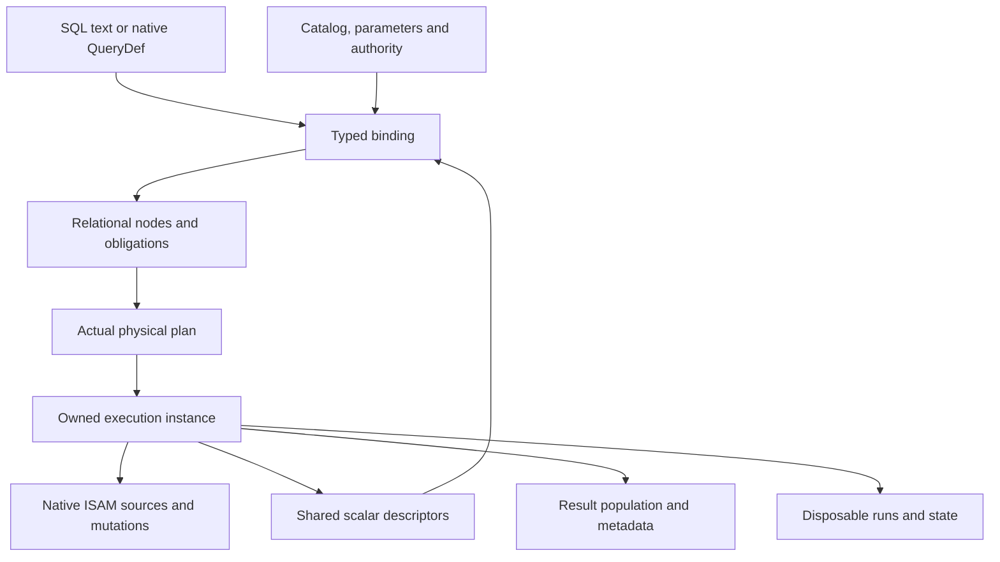
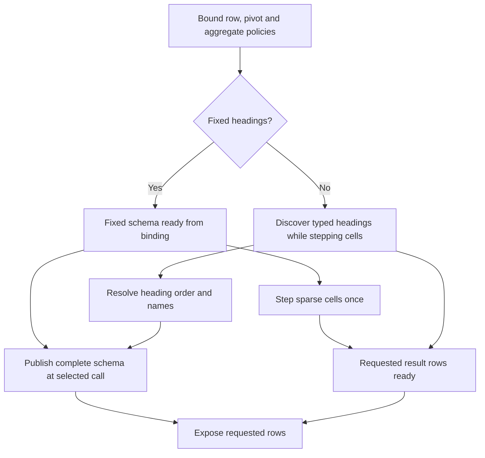

# II-11. Access SQL and execution

Revision 1 · Stage 2, response 10 · 2026-11-13

**Requirement trace:** Primary RQ-SQL-01, RQ-SQL-02, RQ-SQL-03, RQ-SQL-04, RQ-SQL-05, RQ-SQL-06 and RQ-PLAN-01. Supporting RQ-SQL-07, RQ-SQL-08, RQ-SEM-01, RQ-SEM-02, RQ-SEM-03, RQ-ISAM-01, RQ-VAL-02, RQ-CALL-02, RQ-CALL-03, RQ-EXPR-03, RQ-OUT-02, RQ-PORT-01, RQ-ORACLE-02, RQ-PERF-01 and RQ-PERF-02. I-16 retains the complete scope/phase map. II-04/05 supply native record/key mechanics, II-06 native catalog and parameter identities, II-07 the common cursor/mutation service, II-08 native persistence and failure disposition, II-09 protected inputs and owned work, and II-10 the shared scalar evaluator. This chapter composes those mechanisms through K-PLAN, K-PAR, K-CURSOR, K-EXPR, K-ADMISSION and K-WORK.

Prefer one Access parser/binder and a scalar-demand physical operator graph, with qualified bounded batches as optional implementations. The worked read follows a typed parameter through native index bounds to a data-page overflow root; the worked action changes native row/index bytes through the existing mutation path. Full-row DISTINCTROW comparison, exact aggregate-state continuation, separate crosstab schema readiness and protected lazy action enumeration are concrete starting choices with deciding experiments. **D-SQL-1 remains Recommended; D-ACTION-1 remains Provisional; D-PAR-1 remains Decided.**

**Evidence boundary.** Microsoft references establish documentary syntax and public behaviors within their stated scope. They do not establish target-build execution order, physical plans, exact aggregate state or failure timing. Native byte witnesses reuse the exact-pinned source-derived hypotheses from II-04/05/07 at Jackcess commit `be0a2139b087a227d14cafd4ea231306a5a3a862`; this chapter performs no new source/header inspection. New relation, temporary-record and continuation examples are original constructed witnesses. Cleared reports and the identified papers/documentation contribute concepts only. No Windows, ACE, CalcVBA, native ABI or reference encoder execution occurred. The initial oracle remains user-reported ACEDAO.DLL **16.0.20527.20016**, with actual loaded identities to capture; **.NET Framework 4.8-family** and **.NET 10 LTS** remain separate client lanes. The corrected shared value is the real platform Automation VARIANT/BSTR, **24-byte VARIANT on Windows x64**. Figures are emitted Markdown tables/Mermaid source, not render-verified.[^authority]

## 1. SQL is a client of native storage and the shared scalar service

**D-SQL-1 — Recommended.** Use a bounded Access parser and typed binder, a small relational plan representation, and physical operators over the existing ISAM and evaluator. The first useful executor needs scans, qualified index ranges, projection/filter, nested loops, ordered result handling and the aggregate/crosstab/action machinery described below. It does not need another storage engine, a SQL translation layer, a second arithmetic implementation or compulsory compilation to machine code. This develops **RQ-SQL-01, RQ-SQL-02, RQ-SQL-03, RQ-SQL-04, RQ-SQL-05 and RQ-SQL-06**, **RQ-PLAN-01** and their storage/expression dependencies.

The SQL layer owns the meaning of a row set: scope and result columns, source participation, joins, grouping, duplicates, ordering, limits, nested queries and action targets. II-10 owns each scalar operation and its demand/coercion/cleanup policy. II-07 owns native navigation, public cursor policies and semantic mutations. II-08/09 own visibility, participants, native effects and admitted work. A SELECT plan may have several physical access paths without introducing several definitions of a field value. An action plan can produce a candidate and accepted assignments without acquiring authority to write database pages itself.

Keep four owned objects separate. `ParsedStatement` preserves source and syntax; `BoundStatement` records identities, metadata and semantic obligations; `PhysicalPlan` chooses actual operators under those obligations; `ExecutionInstance` owns parameters, accepted input views, continuations, temporary work and result population. None is an alternative persisted form of a QueryDef. Native query rows and their raw preservation remain II-06's responsibility. The executor consumes an accepted definition incarnation, whether the statement arrived as text or through a saved query.

**Figure F-97 — where semantic information becomes an executable plan.** Original proposed topology; this is not a diagram of ACE internals.



This boundary preserves the priority DAO path. A small parameterized read should reuse binding and an inexpensive scalar iterator; it should not construct a columnar copy of the whole table, move to a worker or populate every result before its recordset policy requires it. Bulk SQL may use bounded batches and temporary work when the same public behavior is preserved. WASM uses the same plan/operator definitions with the storage, budget and scheduling services supplied by its host. These are execution choices, not separate SQL dialects.

The preferred initial operator set is deliberately explicit. It covers table and index reads, input projection, filter, nested-loop and qualified indexed joins, outer extension, correlation, group state, duplicate handling, sort, TOP, UNION, crosstab shaping and the shared mutation sink. Later specializations must explain which operation they replace and why they preserve the accepted semantic schedule. An unsupported required case remains visible in the compatibility work list; the small initial set is an implementation sequence, not a reduction of all-Access-SQL scope.

## 2. Parse the actual statement family and bind names in their real scope

The parser accepts the Access statement family selected by the calling surface and semantic mode. Preserve exact counted source, token spans and the spelling of literals/names. The grammar includes the leading PARAMETERS declaration, SELECT variants, nested query forms, UNION, TRANSFORM/PIVOT, action statements, DDL and documented declaration/security clauses. It must distinguish `IN` as a value/subquery operator, a pivot-heading list and an external-database clause. A global token substitution for wildcard characters is insufficient. Microsoft's reserved-word guidance explicitly distinguishes engine modes and host-related name sets; its broad reserved-word list is not evidence that every listed word introduces a supported SQL construct.[^r-reserved][^r-select]

Use an explicit parse stack or another checked nesting mechanism. Source-unit, token, node, edge and recursion limits are admitted before growth; malformed nesting cannot exhaust the native call stack. Each statement branch produces syntax with source spans, not an eagerly executed expression. Parse-time literal recognition and II-10's runtime conversion remain different operations. In particular, Microsoft's WHERE guidance distinguishes SQL date literal notation from locale-aware function conversion; typed parameters avoid rendering a runtime value into SQL text.[^r-where][^r-params]

Do not turn approximate product specifications into unchecked implementation constants. For example, the current specifications list approximately 64,000 SQL characters and 99 AND operators, while the WHERE reference describes 40 linked expressions. These are different statements with potentially different scopes, not a licence to choose the smaller number and call every larger query incompatible. R-SQL-1's limit branch records entry point, exact token/character counts and native failure phase; checked internal capacities remain independently necessary.[^r-limits]

An initial syntax representation can use statement/relational nodes and side vectors:

```text
QuerySyntax {
    exact_source, mode_identity, parameter_declarations
    body: Select | SetOperation | Crosstab | Action | Definition
    source_spans, declaration_options, ownership_clause
}
SelectSyntax {
    source_tree, output_expressions, selection_predicate
    grouping, group_filter, ordering, result_predicate
}
SourceSyntax = NamedTable | SavedQuery | JoinedSources
             | QualifiedNestedQuery | QualifiedExternalSource
```

These are design categories rather than a replacement published grammar. `QualifiedNestedQuery` is admitted only where the actual Access syntax accepts that position; a generic SQL parser must not accidentally introduce a FROM subquery, common-table expression or window syntax that the selected native surface rejects. Conversely, a restricted tutorial grammar must not omit accepted Access forms. The grammar matrix records accepted and rejected nesting, parenthesization, alias scope, quoting, terminators and compound-statement shapes. Official examples are documentary input; an example that disagrees with a syntax table becomes a discriminating fixture rather than an invented parser exception.

Bind each FROM source occurrence to a separate source slot, even when two aliases refer to the same table. A source slot retains file/table/definition incarnation, active and physical column coordinates, alias visibility, its selected row view and a source capability. Resolve column references against that scope before output aliases are applied. Result aliases, an underlying column with the same name, outer references, saved-query parameters and host-qualified names stay distinguishable until R-SQL-1/3 selects their exact precedence. A missing name is not automatically a new free parameter in every clause or surface.

Expand `*` against the accepted source definition and public field order at the native-selected binding/refresh phase. Preserve the resulting column identities, including duplicate display names, rather than re-enumerating a mutable catalog for every row. QueryDef replacement, schema changes and Requery can select a new definition/metadata generation under II-06/07. A held execution cannot silently add a field halfway through enumeration because another object refreshed its TableDefs collection. Result names and metadata must also be available at the evidenced phase when no data row is returned.

Explicit parameter declarations precede binding of the statement body. The binder keeps declaration origin, inferred uses, exposed Parameter objects and execution cells separate. A nested saved query can refer to an outer exposed declaration without losing its original type or origin; equally spelled independent declarations are not merged by string equality alone. R-CAT-1/R-SQL-3 settle coalescing, order and error behavior. At execution admission, obtain the qualified parameter-value version. Repeated reads of a mutable live Parameter object are not an execution snapshot. Neither a plan cache hit nor an explicit parameter declaration authorizes converting an argument before the native-selected failure point.[^r-params]

Security and source scope participate in binding. `WITH OWNERACCESS OPTION` names a documented workgroup/query-owner context and requires the associated system database in that context; it is not permission for CalcDb to elevate through an unrelated host token. Carry an explicit authority dependency and select the actual file/surface behavior. The user/group and permission statement inventory below uses the same capability boundary.[^r-owner]

The external `IN` clause can name another native database as well as external formats.[^r-in] An external Jet 4/ACE source is bound to the ordinary native database service and that file's identity, admission and visibility rules; it does not become a persistent linked table merely because the query names a path. II-08's multi-file participant and failure limits continue to apply. Non-native/linked provider capabilities retain the existing later-phase seams. Preserve their syntax and native catalog representation while implementation status is explicit; do not substitute an empty local table for an unavailable source. Query preparation cannot open a path with stronger authority than the accepted caller/source context.

## 3. Bound properties constrain physical choice before costing

A bound relational node carries more than a list of result types. Prefer contiguous node/edge/column vectors with explicit references to scalar expressions and side descriptors. Retain source participation and obligations even when the displayed projection is small. They support DISTINCTROW, field-level updateability, action targets, correlation and diagnostics without reopening the parser's text during execution.

**Figure F-98 — semantic requirements and physical promises.** Proposed property records; none is a persisted ACE structure.

| Property | Bound requirement | Physical promise that must satisfy it |
| --- | --- | --- |
| Result schema | Column identities, names, declared types, precision/scale, nullability and metadata phase. | Correct result cells and schema generation, including empty results. |
| Provenance | Contributing source occurrences, retained roots/values and allowed target mappings. | Stable source handles or owned retained information through advancement/spill. |
| Equality | Operation-specific comparison/coercion/Null policy. | A comparator, grouping key or hash relation proved consistent with that policy. |
| Ordering | SQL sort keys/directions and any qualified serial occurrence obligations. | Native order with a proof, or explicit ordering work; physical tie tokens remain separate. |
| Demand | Required expression occurrences, phases, errors and foreign effects. | The operator's actual schedule preserves them through blocking, batching and spill. |
| Visibility | Accepted source cuts/current-own-write rules and correlation bindings. | Source tickets that survive every permitted read and continuation. |
| Population | What Open, movement, metadata access and value access may force. | Incremental or blocking state with the correct public exposure and failure point. |
| Mutation capability | Field/source targets and admissible key-preserving behavior. | A target mapping into the shared edit/mutation path, not a query-wide Boolean guess. |

Logical sorting and equality require different descriptors. An implementation may append an occurrence token to make a physical merge deterministic; that token must not change DISTINCT equality, group membership or a TOP tie. A native leaf entry orders equal encoded keys by its root locator, but that locator is not automatically a language-visible tie breaker. A lossy text index may supply candidates without supplying exact projected text, grouping equivalence or the complete requested semantic order.

The ORDER BY reference gives field precedence and direction, and documents restrictions on Memo/OLE sort fields.[^r-order] Apply admission to the actual bound expression/type and selected context; projecting a supported scalar expression from a long-text field is a different case from ordering directly by that field. The target experiments separate acceptance, conversion, semantic order, tied-row behavior and metadata. An internal sorter having a comparator for a value does not establish that Access admits it in every SQL clause.

Effects also constrain plan search. Constant folding can eliminate a required invocation or move a conversion failure to Open. Projection pruning can remove an expression with observable behavior. Pulling a predicate into a join input can change which values are demanded and whether an outer row is extended. The preferred optimizer first classifies the allowed transformation for the bound context, then estimates cost among admissible plans. A low estimate never supplies a missing semantic premise.

Parameter-sensitive access paths are useful but do not require reparsing. A bound range constructor can consume an accepted typed parameter cell at the qualified phase and return native bounds plus a residual. A new execution may choose a different qualified physical alternative before any accepted effects. An execution already in progress cannot restart a plan because a selectivity estimate changed. Replan or resource fallback must continue from retained accepted inputs/results and occurrence progress, or return the selected failure. It cannot repeat callbacks, defaults or mutation steps.

For the first planner, enumerate scans and eligible indexes per source, then retain a bounded set of alternatives distinguished by useful order and other required properties. Join search stays inside proven reorderable inner-join regions; outer boundaries, correlation and demand-sensitive operations delimit those regions. Use checked source sets and an explicit search-work budget. Small regions can use subset dynamic programming; larger ones use deterministic bounded search while retaining a complete fallback. A search budget limits optimization effort, not SQL correctness or the number of admitted sources. The physical contribution below defines counters and cost terms without pretending persisted native counters are exact statistics.

Plan validity is a dependency test, separate from whether statistics are fresh. A changed column descriptor, source incarnation or relevant semantic/policy generation invalidates binding. A stale estimate can leave a plan slow while still valid. Statistics refresh must not invoke user expressions, rewrite native metadata or force source scans during every short query. A result cache is a further feature with stricter visibility/effect requirements; it does not follow from a prepared-plan cache.

## 4. One operator interface serves incremental calls and bounded batches

**D-SQL-1 — Recommended; RQ-SQL-01, RQ-ISAM-01, RQ-VAL-02, RQ-PLAN-01.** Use one installed operator graph with a scalar demand interface and optional bounded batch implementations of the same transitions. A DAO caller moving one row should not allocate a task, cross a worker boundary or materialize the whole result merely because bulk SQL benefits from batching. Microsoft documents that a dynaset/snapshot RecordCount can reflect records accessed before full population; this makes population progress an observable part of the adapter, not merely an executor performance detail. The exact query/open/movement boundaries remain R-CURSOR-1/R-SQL-3 captures.[^p-count]

Represent each installed operator with immutable metadata and a separate execution state. The metadata contains operator ID, child IDs, schema, expression IDs, key descriptors, source and result provenance rules, output-order properties, demand/effect policy, resource needs and dependency token. Execution state contains cursor positions, accepted expression occurrences, partially completed input/output transitions, retained row owners, spill handles and counters. A cached description can be shared; mutable execution cells and accepted occurrences cannot be shared between independent recordsets.

```text
OperatorDefinition {
    operator_id, kind, children[], schema_id, binding_dependencies
    expressions[], key_descriptors[], provenance_recipe
    required_order, delivered_order, population_and_demand_policy
    effect_and_failure_summary, resource_plan, implementation_id
}
OperatorState {
    execution_id, operator_generation, lifecycle, current_continuation
    input_positions[], next_occurrence, accepted_progress
    live_row_owners[], temporary_owners[], optional_work_owners[]
    terminal_or_pending_failure, counters
}
PullOutcome = Row(RowLease) | End | Failure(OwnedFailure)
MetadataOutcome = Ready(SchemaLease) | Failure(OwnedFailure)
PopulationOutcome = Reached(frontier) | End | Failure(OwnedFailure)
```

Scalar `pull_one` requests one visible row. The population driver for `ThroughOrdinal(n)` or `Exhaust` consumes its row outcomes, retaining/transferring leases under the recordset policy; it never discards them to rerun the child. A satisfied ordinal returns `Reached` immediately; exhaustion returns `End`. `ensure_metadata(policy)` returns `Ready(SchemaLease)` or a failure, including when schema is already ready. It is not permission to fetch all rows. Dynamic discovery advances the same owned execution at the native-qualified boundary, retaining accepted effects and results needed later. `End` is distinct from ready metadata or incomplete population. An allocation/spill failure cannot become empty input and manufacture a successful aggregate.

A `RowLease` names an immutable source or owned value block, its schema and generation, a result-occurrence token, source provenance and per-cell availability. A cell may be an already accepted canonical value, a checked native-field reference, or a deferred expression occurrence. The form is explicit. Retaining a row does not evaluate its deferred cells, and evaluating a cell does not silently replace the row's source identity. Provenance carries the source root/incarnation and selected update mapping; it is not the row's position in a temporary run.

The scalar contract expires ordinary borrows at the next declared advance/close of that operator. A consumer retaining data across advance transfers or clones ownership, or retains the immutable source under II-09's view rules. A join can consequently keep one outer row while advancing its inner child without relying on child scratch. Native page pins, decoded text buffers and canonical BSTR owners remain distinguishable in the lease, so retention costs are visible.

The optional batch result contains a bounded vector of leases or homogeneous cells, an ordered selection vector and a completion frontier. It preserves logical input occurrences even when a filter removes rows. A batch containing rows 10–17 is not evidence that row 17's expression was demanded. Preserve any prepared but undemanded native bytes separately from accepted semantic values. If evaluating row 12 fails, later semantic evaluation follows the selected error policy rather than the physical width of a vector instruction.

The X100 paper by Boncz, Zukowski and Nes (2005) supplies the concept of processing bounded vectors through a pipeline, using selection positions to avoid whole-column intermediate materialization. Its analytical workload results and operator semantics do not predict CalcDb's DAO costs or justify evaluating additional rows. CalcDb initially adds batch loops inside eligible pure operators while retaining one ownership/demand interface.[^p-x100] The supplied `frankensqlite-report.stage1-part2.md` contributes compact execution, lazy decode and measured specialization ideas; its separate analytical engine, register VM and SQLite arithmetic are not required here.[^p-concepts]

## 5. Execution progress is more precise than a row count

An operator continuation records what has actually happened: source acquired, candidate predicate accepted, projection occurrence completed, aggregate step accepted, output retained, output exposed. A single `rows_processed` counter cannot represent these states. An output row may still contain deferred fields; conversely, a blocking operator may have accepted many semantic contributions before exposing its first row. The public adapter maps these internal facts to the captured BOF/EOF, RecordCount, field access and failure behavior.

Prefer `AdvanceAttempt` ownership around each fallible transition. Its temporary values and current input lease are registered before evaluation or I/O that could reenter, wait or fail. When an accepted result moves into the operator's retained state, its cleanup obligation moves with it. A failed attempt stops later ordinary actions, preserves completed-effect information and settles/transfers every initialized owner. It cannot restart its child from the beginning merely because the desired output buffer was too small.

```text
pull_one(operator, caller, budget):
    register owned AdvanceAttempt before acquiring input or capacity
    resume the installed operator's accepted continuation
    loop until one Row, End or Failure outcome is selected:
        select its next required transition
        obtain stable inputs and reserve required result/cleanup ownership
        perform that transition through ISAM, evaluator or temporary store
        record accepted value/effect/progress before retiring predecessor state
        after foreign work or cleanup, validate the next dependent continuation
        if a visible row is ready:
            retain the prospective RowLease under this attempt
            retain the accepted resume position and settle required other owners
            revalidate publication and continuation dependencies after cleanup
            transfer the RowLease and return Row as one nonfallible publication
        if the installed policy establishes exhaustion:
            settle required cleanup; revalidate exhaustion/publication dependencies
            record the terminal continuation and return End
    on any failure:
        preserve primary failure, accepted progress and completed effects
        stop later demand; settle or transfer every outstanding obligation
        return the policy-selected failure
```

The prospective row stays owned until all required cleanup and dependent revalidation succeed. Cleanup can enter foreign code or fail; either outcome therefore occurs before transfer to the consumer. If publication is invalidated or fails, the common failure path still owns the row and its accepted occurrence. The final transfer/publication does not allocate, invoke foreign code or perform another fallible check. Exhaustion follows the same settlement boundary and returns an explicit `End` only after that boundary succeeds.

The loop is an implementation skeleton, not a universal ACE schedule. Each operator determines whether its next required transition advances a child, evaluates a scalar node, restores aggregate state or publishes a row. Complexity is the actual visited input/operator transitions plus called service costs; an indexed probe and a full scan have deliberately different work counts. Stack growth follows the admitted graph/continuation depth, not the number of returned rows.

Avoid implicit rewind. A rescan is allowed only if the child advertises a valid replay contract for the chosen view, parameter version and effect class. Correlated execution can legitimately create a new invocation; replaying one completed invocation to reconstruct a discarded buffer is different. For nonrepeatable inputs, retain the required source or accepted result at the qualified materialization boundary. A source spool can preserve native inputs without executing later scalar work, while a value spool retains already accepted semantic results. Mixing the two loses the point at which errors and effects happened.

Where a query recordset is updatable, materialization also retains the precise update provenance chosen by the binder and ISAM policy. A unique temporary row number is not an update target. Duplicated join occurrences can refer to the same source root, and a DISTINCTROW representative can carry several contributing facts. II-07 decides which source cell can be edited, which old image participates in conflict detection and whether refresh changes values or membership. The temporary executor cannot infer those rules from its output schema.

## 6. A complete read path from typed parameter to overflow row

Reuse II-07's constructed page 17, owned by TableDef page 9. It has three slots but two logical roots. Slot 0 is an overflow root pointing to slot 2; slot 1 contains the ordinary Row A body. The body at slot 2 is not independently enumerated. This is a source-derived page witness, not an ACE-created database. The shape and byte-order rules are inherited from the already-inspected exact Jackcess pin documented in II-04/05/07.[^r-native]

The original query is:

```sql
PARAMETERS p Long;
SELECT T.Id, T.Name
FROM T
WHERE T.Id >= [p] AND T.Flag
ORDER BY T.Id;
```

Assume the qualified no-error fixture, a single-column ascending Long Id index, and parameter `p = 42`. The two bodies have Id 42/43, Name `Hi`, Flag True and Notes Null. The scalar and projection policies are II-10's, with explicit row demand rather than compulsory conversion of every field.

**Figure F-99 — native bytes used by the two read plans.** Constructed evidence inherited from earlier chapters; SQL plan choices are original proposals.

| Native item | Bytes / extent | Consequence |
| --- | --- | --- |
| Page-17 header | `01 01 B6 0F 09 00 00 00 00 00 00 00 03 00` | 4096-byte data page, free count 4022, owner 9, three slots. |
| Slot words 0/1/2 | `F0 4F`, `DD 0F`, `CA 8F` | Overflow root at `0FF0`, ordinary root at `0FDD`, referenced body at `0FCA`. |
| Root 0's pointer | `02 11 00 00` | Ordinary locator means slot 2, page 17. |
| Id42 body | `04 00 2A 00 00 00 48 00 69 00 0A 00 0A 00 06 00 02 00 07` | Id 42, Name `Hi`, Flag True, Notes Null. |
| Id43 body | Same body with `2B` at row byte 2. | Id 43; all other shown values equal. |
| Ascending entry 0 | `7F 80 00 00 2A 00 00 11 01` | Key 42, root page 17 slot 1. |
| Ascending entry 1 | `7F 80 00 00 2B 00 00 11 00` | Key 43, root page 17 slot 0, not body slot 2. |

An optional constructed leaf page 0x90 stores those two entries with common prefix length 4. The payload is `7F 80 00 00 2A 00 00 11 01 2B 00 00 11 00`, fourteen bytes. Entry ends are 9 and 14, so boundary-mask byte 1 is `42`; the free count is `3616−14=3602`, stored `12 0E`. Its owner is TableDef page 9. These are entry-envelope arithmetic facts, not a claim that ACE chooses this compression or that these two pages form a complete file.

The bound parameter creates `K42 = 7F 80 00 00 2A`. The ascending range begins at `KeyLow(K42)`, retaining every duplicate locator, and ends at `AfterAll`. It does not fabricate a minimum row locator or append bytes to a full key. The exact Long range and native ordering proof can satisfy Id's selection/order obligations for this profile; the Flag residual and requested value loads remain. Initially retain the complete safe scalar residual unless a separately qualified elimination avoids duplicate work without changing any demanded failure.

The physical alternatives are concrete:

| Plan | Native enumeration | Extra work | Qualified visible rows |
| --- | --- | --- | --- |
| Owned-map scan → filter → sort → projection | Roots 17:0 then 17:1, whose Ids are 43 then 42. | Semantic ordering must restore Id order. | `(42,"Hi")`, `(43,"Hi")`. |
| Id range → root resolution → filter → projection | Index entries point to 17:1 then 17:0. | No sort if the full required order is proved. | `(42,"Hi")`, `(43,"Hi")`. |

The second lookup does not manufacture a third row from slot 2. With the page still resident, resolving the root uses its same protected image; it is a second slot resolution, not inherently another device read. Page 17 begins at file offset `0x11000`; the Id42 scalar begins at `0x11FDF`, and root 0's overflow pointer at `0x11FF0` resolves the Id43 scalar at `0x11FCC`. An actual implementation accounts cache misses and slot/body work separately.

For `p = 43`, the range starts at `KeyLow(7F 80 00 00 2B)` and finds root 17:0 directly. It still resolves that root under the accepted view before projecting Name. A Name value that must cross the public boundary receives a real owned BSTR; a surviving page pin alone does not turn the four native payload bytes into that allocation. For a consumer that never asks for Name, its value-demand/population policy determines whether it is decoded at all. Required metadata is available independently.

For `p = Null`, the ordinary comparison's result does not justify a universal shortcut to an empty result. It can justify one for this admitted pure fixture if the whole predicate's required demand is preserved. Replacing Flag with a host call or an erroring conversion introduces a separate question: does native execution demand that operation despite the Null comparison, and at what phase? The plan's empty-range optimization must state that premise. The parameter's declared Long origin also remains present when its current canonical value is Null.

An index-only projection is likewise a proof, not a column-name test. Long key bytes may be exactly reversible under a qualified descriptor, but a text key can lose case, ignored units or suffix material. Returning a BSTR reconstructed from such a key would invent data. Index completeness, ignored-Null behavior, visibility and required row checks must be established before omitting the base-row resolution. The first implementation can retain that resolution and still gain bounded navigation and ordering.

## 7. Access bounds carry inclusion, ordering and demand proofs

Use one `AccessPathProof` per admitted lowering. It identifies the scalar predicate/use, physical index and descriptor, parameter contracts, native interval constructors, residual, row coverage, ordering contribution and the evidence/structural argument. An index's existence is not proof that its full traversal includes every SQL row: ignored Null keys and other native rules can matter. A semantically useful key equality is also not proof that equal encoded bytes imply equal projected values.

**Figure F-100 — typed bound constructors for an admitted ascending complete-key comparison.** These are CalcDb internal objects, not encoded artificial rows; null/coercion and context admission occur first.

| Predicate class | Candidate interval | Additional obligation |
| --- | --- | --- |
| `x = v` | `[KeyLow(Kv), KeyHigh(Kv))` | Semantic residual where key equality is lossy. |
| `x > v` | `[KeyHigh(Kv), AfterAll)` | Native key order must match this semantic inequality over the admitted domain. |
| `x >= v` | `[KeyLow(Kv), AfterAll)` | Same requirement; include every locator at equality. |
| `x < v` | `[BeforeAll, KeyLow(Kv))` | Covered rows/Null policy and direction must be qualified. |
| `x <= v` | `[BeforeAll, KeyHigh(Kv))` | Same requirement. |
| Fixed leading indexed fields | `FieldPrefixLow/High(complete fields)` | Prefix ends at an admitted field boundary, with shortening/mixed-direction rules accounted. |

Descending and compound descriptors require their own relation-to-bound mapping; applying the table unchanged to descending encoded bytes reverses the wrong relation. A comparison of unlike types can require a conversion on one side that changes the candidate implication or fails. A conversion can be moved to a one-time range constructor only when its occurrence and phase permit it. If a field-side expression cannot be safely inverted, preserve it as a residual or scan.

For example, rewriting `Id + 1 > p` as a shifted range must address Long overflow and the declared operation/result type; algebra over unbounded mathematical integers is not enough. Rewriting text equality or LIKE must use II-05/10's actual comparison/encoding relation. Shortened compound keys and collation expansions can invalidate a familiar database optimization without making the native index unusable for other predicates.

Conjunctions and disjunctions also need occurrence accounting. A union of several index intervals can encounter the same root more than once. Deduplicate only the traversal duplicates required by that access path, while preserving separate joined/result occurrences and any semantically required expression calls. Keep the admitted serial consumption order, or explicitly prove that another order is acceptable. An OR rewrite that rescans a host expression per interval can change both effects and errors even if the final distinct row identities agree.

Do not use a residual as an excuse for incomplete candidates. The required implication is semantic match ⇒ native candidate membership; the residual removes false positives only. Separately check demanded errors/effects, as II-10 established for patterns. Initial range admission should favor simple typed field/parameter predicates and their well-understood index forms. Qualification grows per descriptor and expression class, without replacing native key generation with host string sorting.

## 8. Nested loops preserve match state, outer extension and row ownership

Prefer an indexed nested loop when an admitted inner bound is useful, otherwise a bounded ordinary nested loop. The outer row remains owned or backed by a retained immutable source while the inner cursor advances. Each source occurrence has its own binding and cursor state. A self-join cannot reuse one mutable table cursor for both aliases, and an inner lookup cannot overwrite the outer scratch values on which its correlation depends.

Microsoft's join references document relational ON comparisons, type restrictions, and restrictions on nesting inner and outer joins. Those are parser/binder fixtures, not proof that every internally equivalent tree is legal surface syntax. In particular, the documented Single/Double restriction prevents treating all numeric join columns as one permissive family. Bind the legal operation before selecting a hash, merge or native range comparison.[^r-inner][^r-outer]

The initial left-outer-loop state contains `outer_owner`, `outer_occurrence`, `inner_instance`, `on_matched`, `extension_pending` and accepted scalar-progress records. `on_matched` is set when an ON comparison accepts a pair, before a later WHERE filter examines that pair. Failure in ON is a failure, not absence of a match. When the inner source reaches its qualified end with no ON match, produce exactly one Null-extended right binding. This is a synthetic source state; it does not allocate a fake data row or pretend Null came from a real Boolean mask.

**Figure F-101 — ON match and post-join filtering are different events.** Original small witness, with ordinary non-Null integer equality and predicates.

| Source | Rows |
| --- | --- |
| Left `L(Id)` | 1; 2; 3 |
| Right `R(Rid,Lid,Qty)` | `(10,1,0)`; `(11,1,5)`; `(12,2,0)` |
| `LEFT JOIN ... ON L.Id=R.Lid` | Pairs for left 1 twice, left 2 once, left 3 once with a Null right side. |
| Then `WHERE R.Qty>0` | Only `(L.Id=1, R.Rid=11)`. |
| Incorrectly moving that filter into ON and removing WHERE | Also emits Null-extended left 2 and 3. |

Left 2 had an ON match even though its pair failed WHERE. An implementation that records only emitted pairs will incorrectly extend it later. A retained WHERE test can make some right-side prefilters safe, but that is a particular rewrite proof, not a reason to conflate the stages. `IS NULL`, conversions and host predicates give further discriminating cases.

```text
next_left_join(instance, demand, owner, budget) -> Pair | End | Failure
    register instance and all prospective resources before fallible work
    loop under the accepted continuation/dependency policy:
        if no current outer:
            outer := demand next outer occurrence
            if End: settle and return End
            retain outer's required values/source owners
            prepare admitted inner bindings at their scheduled phase
            open inner instance; inner_phase := Active
            on_matched := false; extension_delivered := false
        if inner_phase is Active:
            inner := demand next inner occurrence
            if inner is a row:
                result := evaluate ON through the shared scalar policy
                if result accepts:
                    on_matched := true
                    yield owned/retained Pair(outer, inner, new result occurrence)
                else retire inner under the required cleanup policy
                continue from the retained inner continuation
            else if inner is End:
                inner_phase := Exhausted
                settle inner without holding an internal latch
        if inner_phase is Exhausted:
            if not on_matched and extension not yet delivered:
                mark extension delivered before yielding
                yield Pair(outer, synthetic-null-right, new result occurrence)
            else:
                settle and clear current outer owner/occurrence
                retire/reset the exhausted inner instance and its phase
                continue with no current outer
        on any failure:
            preserve failure phase and accepted effects; settle owned work
            return the qualified outcome, with no repeated ON invocation
```

The pseudocode's yields retain a continuation: the next call resumes the same inner position. Public advancement does not release values still borrowed by a parent; the physical interface below defines lease transfer/retirement. Every callback, foreign conversion or destruction revalidates dependent state before subsequent work, using II-10's owned invocation route. An invalidated join cannot fix itself by restarting its outer row and replaying earlier ON or projection calls.

An ordinary nested loop costs up to O(L×R) candidate comparisons, plus real field/semantic work. An indexed loop costs approximately the outer traversal plus one admitted inner descent/range walk per demanded outer occurrence, including duplicates. Bounds may be cached only where the accepted outer value and semantic context are stable; caching match results is stricter because inner visibility or effects may differ. Reusing a prepared bound constructor is not memoizing a correlated query.

A block nested loop can amortize inner reads, but a naive inner-major schedule changes outer-major result and expression order. Preserve each outer row's ordered results with bounded owned storage, or qualify the changed schedule before use. There is no requirement to force block execution for short DAO calls. A RIGHT JOIN can reuse a preserved-side mechanism with explicit source-slot remapping only when its output/schema and serial order obligations survive; textual operand swapping is not sufficient by itself.

Merge join needs correctly grouped semantic equality classes, duplicate cross-products and qualified order; equality-class storage may spill. Hash join needs a congruent hash and collision comparisons, and its build/probe phases must preserve allowed demand and failure timing. The physical discussion supplies those additional obligations. These algorithms remain useful without being unconditional substitutions for the first nested-loop plan.

## 9. Subqueries preserve correlation, three-valued outcomes and demand

**Requirement trace:** RQ-SQL-01, RQ-SEM-01, RQ-SEM-02, RQ-SEM-03, RQ-EXPR-03 and RQ-CALL-03. Microsoft's reference documents scalar-expression placements, correlated outer aliases, ANY/SOME, ALL, IN and EXISTS, and a narrower subquery placement in crosstabs.[^rel-subquery] Bind each subquery to a child plan plus explicit outer slots, occurrence ownership, result cardinality contract and dependency/view context. A correlated name is not a new implicit parameter merely because the child is prepared independently.

Prefer a scalar correlated Apply operator first. For each admitted outer occurrence, capture the required stable correlation values and invoke the child at the enclosing expression's scheduled point. The child uses the accepted parent database/Workspace/view context. Do not memoize by equal correlation values until the proof includes host calls, clock/random state, visibility, error demand, result order and logical occurrence multiplicity. A captured stable value frame is not authority to reuse a prior child result indefinitely.

The provisional scalar-subquery cardinality adapter returns Null for zero rows, the owned value for one row, and a typed cardinality error upon discovering a second row. The precise error number, timing and permitted column count are R-SQL-1 observations. A global aggregate subquery may itself produce one row on empty input, so its result is not equivalent to an empty ordinary child. Retain this distinction instead of implementing scalar subqueries as an unconditional `First`.

For quantified comparison, the preferred value model is a three-valued fold with a separate failure channel. ANY/SOME folds toward True; ALL folds toward False; absent a decisive result, a seen unknown yields Null. Empty input initializes ANY=False and ALL=True. IN uses the equality fold and NOT IN applies the shared logical negation to that outcome. These are explicit starting policies for R-SQL-1; Microsoft's summary syntax alone is not treated as proof of every Null/empty edge.

**Figure F-102 — original truth-fold witnesses under the provisional quantified policy.** `U` denotes successful Null/unknown, not an evaluation failure.

| Outer x | Child values | `x IN child` | `x NOT IN child` | Mechanism checked |
| --- | --- | --- | --- | --- |
| 7 | empty | False | True | Empty identity. |
| 7 | 8 | False | True | Definite nonmatch. |
| 7 | Null, 8 | U | U | An unknown is retained when no match exists. |
| 7 | Null, 7 | True | False | A definite match dominates unknown. |
| Null | 7 | U | U | Unknown comparison is not a successful anti-match. |
| Null | empty | False | True | Empty child does not perform an unknown comparison. |

A plain anti-semijoin that returns every unmatched outer row would incorrectly accept the third/fifth witnesses under this policy. A specialized membership structure needs empty/nonempty state, possible unknown contributions and the qualified comparison/conversion domain, in addition to its positive match lookup. ANY/ALL order comparisons can sometimes use extrema, but only when types, Nulls, empty input and required argument errors/effects prove equivalent.

EXISTS initially requests row existence rather than a projected scalar value. A child membership plan can omit output projection only where the native demand policy allows that omission; grouping, HAVING, TOP and duplicate-sensitive nodes can still require values to determine membership. Cases such as an unused erroring SELECT expression distinguish that from eagerly executing the entire child. Logical decisiveness does not by itself authorize early termination past required effects: `stop_allowed` belongs to the qualified child/expression policy.

```text
quantified_apply(outer_value, child, quantifier_policy, owner):
    result := policy.empty_identity
    seen_unknown := false
    while another child occurrence is required by the active policy:
        row := advance child at the scheduled demand point
        on end: return policy.finish(result, seen_unknown)
        comparison := shared typed comparison of owned/stable operands
        on evaluation failure: settle child; return phased failure
        record comparison outcome and any completed effects
        if comparison is unknown: seen_unknown := true
        else update result through the policy's value fold
        if value is decisive and policy permits stopping: finish child and return
    settle child and return policy.finish(result, seen_unknown)
```

The state is O(1) beyond owned operand/child state for the scalar fold; work is proportional to demanded child occurrences and comparison cost. Reentry can invalidate continuation after any demanded host boundary. A semijoin, anti-semijoin or decorrelated grouping is an optimization only after it preserves these outcomes and their required occurrence/error behavior.

## 10. SQL equality, physical order and hash routing are separate descriptors

Use an explicit key descriptor for every sort, group, deduplication and join operation. It identifies the bound types, Null policy, comparison profile, directions, conversion/demand policy and semantic generation. Group equality, DISTINCT equality and join matching are distinct relations even when they happen to share an implementation for a particular pair of non-Null Long values. Ordinary scalar `=` may return Null; a grouping relation still needs a precise decision about whether two admitted keys share a group.

A hashing specialization requires the implication `Equivalent(a,b) => Hash(a)=Hash(b)` over its entire admitted domain. Collisions in the opposite direction are harmless only because full semantic comparison follows. Hashing raw VARIANT storage fails as a general recipe: inactive bytes are irrelevant, pointers are not payload identity, and different accepted numeric representations can require the same semantic group. Text normalization and native index bytes are not automatically an equality hash. II-05's encoded-key collisions require residual comparison, while its key descriptor and the SQL equality descriptor may differ.

An ordered dictionary requires a corresponding order whose zero class matches its equivalence relation. Sorting by one relation and grouping adjacent rows by another can split equal groups or combine unequal ones. Prove these properties for concrete typed domains and descriptor versions. For a qualified numeric profile, a semantic hash may normalize equality-equivalent signed zero or numeric tags while preserving each original value for output; the permitted normalization follows that profile, never a blanket rule about every Double or Decimal. NaN, mixed-type, invalid-value and object-coercion cases remain explicit native and shared-foundation questions.

The sorting algorithm should normally receive already accepted keys with a pure, total comparator for the admitted domain. Key expression evaluation and any fallible conversion occur at their qualified semantic points, outside the comparator's arbitrary call pattern. This is a specialization condition, not permission to coerce all rows early. If the required comparison can itself fail or enter foreign code, retain an explicit serial comparison policy and qualify its error/demand behavior before changing algorithms or run boundaries. An ordinary library sort requiring a strict weak order cannot safely be handed an unqualified, stateful or nontransitive relation.

Distinguish SQL tie equality from an internal deterministic tie breaker. A run may order equal SQL keys by an accepted input-order token. That extra token does not enter TOP's cutoff equality, grouping or DISTINCT. Nor does it establish that ACE promises stable ordering among unspecified ties: R-SQL-1/3 chooses the serial plan's observable ordering, and the executor preserves that selected order across memory sizes and worker placements.

Hash joins add another condition beyond equality congruence. Bucket chains retain duplicate build occurrences and their selected order; a bucket is not a set. To reproduce a qualified outer-major nested-loop order, probe in that outer order and traverse matching build occurrences in the corresponding inner order. Build-side evaluation, partitioning and filtering still need demand/error/effect equivalence; merely sorting the final pairs by `(outer ordinal, inner ordinal)` cannot undo an early callback. Prefer the indexed or block nested-loop baseline until those conditions and a measured cost advantage admit a hash plan.

## 11. Duplicate elimination uses a bound equality domain

**Requirement trace:** RQ-SQL-01, RQ-SQL-04, RQ-SEM-01, RQ-SEM-02, RQ-SEM-03, RQ-VAL-02 and RQ-PLAN-01. **D-SQL-1 remains Recommended.** Every duplicate-removing operator binds the values it compares, a semantic equality domain, its representative-selection rule and its output-order obligation. These are execution properties, not a command to compare the bytes of a VARIANT or of a persisted index key. A full 24-byte Windows VARIANT contains inactive bytes; native text keys can intentionally omit distinctions; equal textual values need not have identical BSTR payloads under the selected comparison profile.

Prefer a `RelationalEqualityDomain` descriptor with the admitted operand types, selected conversions, Null-equivalence policy, text profile, equality operation and optional congruent hash/order implementations. A hash specialization must establish `equal(a,b) implies hash(a)=hash(b)`; residual equality checks inside a collision bucket establish the reverse decision. A sorted specialization needs an ordering whose zero/equivalence classes agree with this domain. Neither a convenient byte hash nor scalar `=` is automatically that service. SQL scalar comparison can return Null while grouping must recognize a Null key as a group member. A shared semantic foundation supplies the underlying comparisons with an explicit relational adapter.

For `DISTINCT`, the key consists of the bound output expressions after their qualified projection/conversion policy. Microsoft's predicate reference defines duplicates over selected fields and describes DISTINCT results as nonupdatable and insulated from subsequent users' changes. Those statements do not determine eager population timing or exact comparison rules for every type.[^rel-predicates] II-07 therefore retains separate population, visibility and updateability policies. The preferred first implementation retains the first accepted representative in the selected serial input order, using a bounded semantic set or sort as the plan permits. R-SQL-1/3 can change representative selection without changing the equality descriptor.

`DISTINCTROW` needs a different key. **Preferred provisional rule:** determine which source row families contribute projected values, then compare the complete logical rows of those contributing families using their descriptors. Repeated join matches that differ only on an unprojected family collapse. Keep source identities separately for updates, diagnostics and the native discrimination experiment. Microsoft's UniqueRecords reference explicitly describes uniqueness through underlying field values, supporting this full-row-value hypothesis; it does not supply the detailed equal-heap-row, alias or computed-projection cases.[^rel-unique]

**Figure F-103 — three possible duplicate keys on the same constructed join.** The rows and predicted counts are original discriminating fixtures, not ACE captures.

| Source occurrence | Complete logical A row `(JoinKey, Label, Hidden)` | Matching B rows | Projected A.Label |
| --- | --- | --- | --- |
| A:a1 | `(7, "oak", 10)` | b1, b2 | oak, oak |
| A:a2 | `(7, "oak", 10)` | b1, b2 | oak, oak |
| A:a3 | `(7, "oak", 11)` | b1, b2 | oak, oak |

All six joined occurrences have the same displayed value. Projected-value DISTINCT yields one representative. Provenance-only elimination of repeated A identities yields three. The preferred full-A-row DISTINCTROW hypothesis yields two, because a1/a2 have identical complete logical values while a3 differs in an unprojected field. A native result of three selects the identity-based policy for that context; a result of one requires discovering another comparison/projection rule. A fixture containing a hidden unique key would not distinguish the first two hypotheses and is insufficient by itself.

The binder records a participation set of source-family identities, not textual table names. Two aliases of one table are separate source families; a projected expression can depend on several families, on none, or on an aggregate boundary. Initial participation follows the bound dependencies of output expressions, but R-SQL-3 must settle calculated expressions, constants, saved-query boundaries and outer joins. In particular, null extension is represented separately from an actual base row containing all Null values. The equality adapter may later equate them only if native evidence requires that result.

If a full-row equality class collapses physical a1/a2, retain the class's mutation provenance or an owned recoverable membership recipe under the accepted source view. Keeping only the first display representative's root would lose the other possible update targets. Display selection and update mapping are independent policies. Do not eagerly discover future class members merely to complete that provenance: an edit before full population waits, expands the retained recipe or fails according to II-07's native-qualified mapping/population rule. A recipe cannot reread a newer unprotected view and call those rows the original class.

The documented single-source and all-sources-projected cases bypass DISTINCTROW elimination; do not run an expensive full-row comparer merely because the keyword appeared.[^rel-predicates] A whole-row key compares modeled logical values and their qualified metadata, not padding, deleted payload bytes or private root locators. Full-row materialization can touch an unprojected long value and move an I/O/error point; the native qualification must decide whether such a value participates, is rejected, or is compared through a qualified representation. Retaining both provenance and field-access recipes allows that decision without copying every field at join construction.

An optimizer may replace a DISTINCTROW parent/child pattern with a semijoin only after proving the chosen full-row/identity policy, output representative, order, update provenance and evaluation multiplicity. The ordinary primary-key example does not prove the rule for heaps. Deduplication of action targets is another operation: its key is the target identity required by the action policy, not automatically DISTINCTROW's query-result key.

## 12. TOP has a semantic cutoff distinct from a physical tie breaker

**Requirement trace:** RQ-SQL-01, RQ-SEM-02, RQ-CALL-02 and RQ-PLAN-01. Bind a `TopPolicy` containing count/percentage syntax, the qualified count rule, semantic ORDER BY comparator, tie inclusion and stopping/demand policy. The Access reference requires inclusion of cutoff ties, allows an arbitrary selected set when no ORDER BY is present, and specifies an unsigned Integer argument. It does not establish the percentage-rounding formula or all zero/boundary cases.[^rel-predicates]

Prefer full semantic sorting followed by a cutoff iterator as the first general implementation. An already ordered index path is eligible only when II-05's order proof covers the entire ORDER BY tuple, including residual distinctions and direction. A hidden input ordinal may stabilize the actual merge order, but the cutoff equality test excludes that ordinal. Otherwise a stable sort would accidentally turn two SQL ties into unequal keys.

**Figure F-104 — cutoff equality in an original two-key fixture.** These are consequences of the proposed comparator, subject to native order/type qualification.

| Input ordinal | Score | Region | `TOP 2 ORDER BY Score DESC` | `TOP 2 ORDER BY Score DESC, Region ASC` |
| --- | --- | --- | --- | --- |
| 0 | 90 | A | Included | Included |
| 1 | 80 | A | Included at cutoff | Included at cutoff |
| 2 | 80 | B | Included as a Score tie | Excluded; complete ORDER BY tuple differs |
| 3 | 70 | A | Excluded | Excluded |

For ordered input the iterator counts emitted rows, captures the complete semantic key at the nominal cutoff, and continues while subsequent keys compare equal. Its state owns that cutoff key; it cannot borrow a key buffer that the child reuses on advancement. A child row beyond the tie boundary may be needed to detect completion. Whether obtaining it is allowed to evaluate a later projection or callback is a plan demand question; keys, membership and final projection are separate demands. TOP cannot be implemented as a generic iterator limit placed arbitrarily above eager projection.

A bounded heap optimization must retain every row tied with its current boundary or own a spill representation for those ties. The tie set can be the whole input, so `O(k)` storage is not a valid unconditional claim. As a better boundary arrives, previously retained rows can be discarded only after their required effects have occurred and their owners are safely retired. The baseline sort avoids this more complex moving-tie state; measured work can later justify it.

For TOP PERCENT, prefer a single accepted input evaluation into an owned ordered spool with an exact count. The **provisional** nominal count is the ceiling of `N*p/100`, evaluated with checked integer arithmetic; R-SQL-3 decides rounding, admissible percentages, zero, empty input and where N is measured relative to other accepted operators. This formula is a stated starting hypothesis, not imported SQL Server behavior. For N=7 and p=30 the hypothesis selects 3 nominal rows before tie expansion. A second query execution to count rows could repeat callbacks or observe another view and is not equivalent.

Without ORDER BY, the initial operator takes the requested prefix of its selected serial child stream, with no tie expansion based on an empty key. That is a deterministic CalcDb plan choice within the documented selection freedom, not a promised ACE physical order. Workers still have to reproduce that serial choice; whichever worker finishes first cannot choose the subset. R-SQL-3 compares plan-specific order observations separately from the semantic set requirement.

## 13. Grouping separates membership, contribution order and output order

**Requirement trace:** RQ-SQL-01, RQ-SEM-01, RQ-SEM-02, RQ-SEM-03, RQ-CALL-02 and RQ-VAL-02. A group is identified by a tuple in the bound relational equality domain. It owns representative grouping values, aggregate states, first/last contribution ordinals, and progress recording which semantic steps have been accepted. Its output ordering is a separate plan property. A hash-table iteration order is not a SQL group-order rule.

The GROUP BY reference establishes that Null grouping fields participate in groups, WHERE filters precede grouping, and projected fields must satisfy grouping/aggregate rules. Its Memo/OLE restrictions and ten-field limit are documentary profile constraints to probe against the selected ACE build. HAVING selects after grouping and has its own documented expression limit.[^rel-group][^rel-having] Do not infer that a HAVING predicate may always be pushed before aggregate processing merely because it mentions a grouping field: that rewrite can suppress a contribution error or alter a required expression occurrence.

**Figure F-105 — an aggregate group owns state and progress, not a bag of untracked VARIANTs.** Original proposed structure.

| Field | Contents and reason |
| --- | --- |
| `group_id / key` | Execution-local identity plus owned canonical grouping values or a qualified retained encoding. |
| `equality_domain` | Type/conversion/Null/text rules used consistently by lookup, spill and final ordering. |
| `aggregate_slots` | Descriptor-versioned state for each distinct semantic aggregate occurrence. |
| `contribution_progress` | Last accepted input occurrence and within-row aggregate stage; prevents replay after state I/O. |
| `representatives` | Qualified grouping display values and any retained source/provenance requirements. |
| `state_owner` | Live arena or exact temporary-state record, accounted to the execution owner. |

The initial general grouping path consumes the selected serial input schedule and applies aggregate steps at their qualified points. When a group state is evicted, write an exact state record through the bounded temporary store and restore it before that group's next step. The group directory must also be bounded; a million groups cannot leave a million unaccounted pointers merely because their values were spilled. The physical temporary-state mechanism supplies owned sorted runs, bounded buffers and newest-state lookup.

Partitioning all input rows first and folding each partition later is **not** automatically equivalent. An early Sum overflow could originally precede a later row's UDF. Delaying the fold would run that later UDF before discovering the overflow, even if every group's final contribution order is preserved. A partition-then-fold plan requires an additional proof that the moved operations are total and effect-compatible, or a mechanism that preserves the same semantic frontier. The same issue applies to sorting all grouping keys before evaluating any fallible aggregate step.

```text
group_consume(input, bound_group_policy, state_store, owner):
    establish the selected serial contribution schedule
    for each admitted input occurrence:
        evaluate demanded grouping values through II-10
        resolve the semantic group in the bounded state store
        own the group's exact current state before advancing its progress
        resume the row's aggregate policy:
            demand one argument/conversion/step at a time as selected
            complete each accepted step and record its occurrence/stage
            retain errors and completed effects on failure; do not replay
        checkpoint or retain the group under the owner's memory budget
    finalize groups in the selected output schedule
    apply HAVING and output projection through their bound policies
```

Inputs are one accepted execution view and the bound aggregate descriptors; output is owned group rows or a phased failure. Initialized state and temporary records remain owned through cancellation and cleanup. Lookup cost depends on the chosen congruent hash or semantic ordered store; semantic work is one accepted step per demanded contribution plus comparison/conversion cost. Spill I/O is charged separately. An aggregate containing nonserializable foreign state cannot be written as pointer bytes; it retains a budgeted live owner or reaches the qualified resource-failure path.

For a scalar aggregate query with no GROUP BY, the preferred provisional adapter creates one implicit group even on empty input. Count finishes at zero, while the other initial empty policies return Null unless their descriptor says otherwise. Explicit grouping over empty input produces no groups. HAVING can then remove the implicit group's result. R-SQL-1 tests these cases individually, including metadata before the first fetch; no seed row is manufactured in the relational input itself.

## 14. Aggregate descriptors preserve exact types and failure phases

The documented aggregate inventory contains Avg, Count, First/Last, Min/Max, StDev/StDevP, Sum and Var/VarP.[^rel-aggregate-list] Implement these as descriptor-driven state machines over the shared scalar service. Bind the admitted argument contract, accumulator representation, conversion schedule, result Field metadata, final value conversion, Null policy, empty/singleton rule and serialization version. Scalar arithmetic rules are inputs to the descriptor; they do not alone determine an aggregate's accumulator or public result type.

**Figure F-106 — preferred initial aggregate state, with native-selectable rules.** State choices are CalcDb design; documentary behavior and unresolved fields are distinguished.

| Aggregate family | Preferred state and transition | Qualification obligation |
| --- | --- | --- |
| Count(*) | Checked record counter with no scalar argument demand. | Public type and overflow phase; do not infer table metadata row count equals qualified input cardinality. |
| Count(expr) | Counter after the expression's accepted non-Null result. | Argument effects/conversions occur even though its numeric magnitude is irrelevant. |
| Sum | `seen_nonnull` plus exact descriptor-selected accumulator, stepped in accepted contribution order. | Input promotion, accumulator width, overflow point, result subtype and all-Null finalization. |
| Avg | Count plus ordered sum state, then descriptor-selected division/final conversion. | Intermediate precision and result type; do not replace with a reassociated or running-mean algorithm without equivalence. |
| Min/Max | Owned selected value and its contribution ordinal, compared through the bound domain. | Equal-value representative, conversion/error demand and retained value type. |
| First/Last | Seen flag, selected owned value and selected occurrence. | Whether Null is selected/skipped and which contribution stream supplies order. |
| Var/VarP/StDev/StDevP | Count and an algorithm-versioned ordered numerical state. | Native recurrence/precision, cancellation cases, empty/singleton distinctions and final rounding. |

Count's reference distinguishes record counting with `*` from expression counting that excludes Null; Sum and Avg document omission of Null inputs.[^rel-count][^rel-sum][^rel-avg] These rules do not permit `Count(expr)` to discard evaluation of an erroring or effectful expr. The Count page's quoted multi-field example is not used as evidence for a special parser operation: a literal string and an actual concatenation are discriminating test cases.

Aggregate result metadata must be stable at the qualified discovery boundary. Do not inspect the first non-Null row, choose its tag as the result type, and silently change later rows. Initial prototypes use explicit candidate descriptors for each admitted argument type; R-SQL-1 supplies the native result Field.Type/Size/precision/scale and raw value tags that confirm or change them. Count starts with a checked Long-result candidate; fixed-point Sum starts with an exact fixed-point candidate; Avg and statistical families retain an explicit final conversion. None of those candidate type mappings is reported as an ACE observation. A wider private counter or accumulator is allowed only if it reproduces any required earlier overflow and result conversion.

For a constructed group with accepted numeric contributions `10, Null, 20`, the simple descriptor yields Count(*)=3, Count(expr)=2, Sum=30 and Avg=15. This fixture checks the distinct counters and Null path; it does not determine native subtypes. A second fixture with Double values `[2^53, 1, -2^53]` has serial left-fold result zero under ordinary binary64 addition, while `[2^53, -2^53, 1]` yields one. The project requires preserving the selected serial result, so deterministic worker partial sums are insufficient. Native aggregate evaluation itself remains to be captured; an implementation must not substitute compensated summation solely because it is more accurate.

First/Last are documented as selecting values from the first/last query record, with arbitrary selection absent a relevant order.[^rel-firstlast] Prefer row-selection state, initially allowing the selected value to be Null, and test that against the GROUP BY page's broad Null statement. Do not turn First into Min, Last into Max, or assume final ORDER BY on grouped output sorts the rows that fed the aggregates. An ORDER BY in a nested query, an index change and explicit final ordering are three different fixtures. Min/Max compare the input values under the selected aggregate domain; equal values can still have different owned representations and require a qualified representative rule.[^rel-minmax]

The statistical references contain a real edge discrepancy: StDevP's text assigns Null to zero records while StDev requires at least two; VarP and Var are both described as returning Null below two.[^rel-stdev][^rel-var] Keep four independent singleton rules. In the initial descriptor set, follow each page literally—StDevP over one numeric value starts with zero; VarP over one starts with Null—then let `SQL-AGG-SINGLE` replace the candidate if native evidence differs. Do not implement StDevP as an unquestioned square root of the public VarP result. Also distinguish total input records from non-Null contributing values in the test; the documents' record wording does not settle that boundary.

For the first deterministic statistical implementation, prefer a sequential `(n, mean, M2)` recurrence over qualified Double operations: `n1=n+1; delta=x-mean; mean1=mean+delta/n1; delta2=x-mean1; M2_1=M2+delta*delta2`, with those operations performed in that order and no implicit fused multiply-add. Sample/population finalization divides M2 by the descriptor-selected denominator before any square root and final conversion, subject to each function's special cases. This is a proposed starting implementation, not a claim about ACE internals. R-SQL-1 compares exact bits on cancellation-heavy, large-offset, constant, singleton and all-Null sets; differing native rounding changes the numerical descriptor, not the whole grouping engine. State spill preserves every recurrence field and its contribution ordinal exactly. A merge formula for independent statistical states needs the same exact-serial proof as a merge of Sum states.

Repeated textual aggregates are separate semantic occurrences until the binder proves they may share work. `SELECT Sum(F(x)) ... HAVING Sum(F(x)) > 0` must not gain an arbitrary call count from expression interning. The native trace selects reuse across SELECT/HAVING/ORDER BY. An effect-free total argument can later share state under a documented plan proof, while the occurrence metadata remains available for diagnostics.

## 15. UNION binds output shape before duplicate elimination

**Requirement trace:** RQ-SQL-01, RQ-SQL-03, RQ-SEM-01, RQ-SEM-02, RQ-SEM-03 and RQ-PLAN-01. A bound union owns an ordered vector/tree of arm bindings, one output-column contract per ordinal, arm-to-output conversion policies, duplicate semantics and final ordering. The Microsoft reference permits different input sizes/types with equal arity, derives aliases from the first SELECT, admits TABLE/stored-query arms and places overall ordering at the end.[^rel-union] These facts do not specify the full type-resolution lattice or exact conversion timing.

Prefer arity and metadata binding across all arms before opening the row stream, without executing arm expressions to discover a type. Preserve an unresolved/Null-literal contribution to type inference rather than prematurely assigning it a universal String or Double type. The selected union descriptor records whether a value is converted before comparison, before return, or at another native-qualified phase. `Currency` plus `Decimal`, a typed empty arm, a first-arm Null literal, mixed text/numeric values and long text all need explicit metadata and value cases.

UNION ALL initially concatenates accepted arm streams in the chosen serial arm order, retaining every occurrence. UNION adds a semantic duplicate-removing operator over its resolved output domain. Do not deduplicate raw arm encodings before the qualified conversions: distinct raw values can become equal after projection, and a conversion can fail. Final ORDER BY compares the bound union output fields under the selected order policy, with the first arm's naming rules.

Retain each UNION/ALL token and its syntactic association in the parsed form. A three-arm mixed query must not be flattened into one global boolean `distinct` flag unless the native grammar and catalog representation establish that interpretation. A constructed candidate `A UNION B UNION ALL C`, with each arm producing one `1`, would yield two occurrences under left-associated set-then-bag semantics; the reversed operator combination would yield one. R-SQL-1 tests whether each form is admitted and selects its actual association, result multiplicity and native saved-query serialization. That fixture is a discriminator, not a declaration that ACE accepts mixed forms.

The execution owner retains each arm's accepted parameter frame and namespace dependencies. An effectful earlier arm cannot be reexecuted to recover a lost duplicate set or to count rows for TOP. On failure, retain the arm/row/conversion phase and completed effects, then settle all arm cursors and temporary owners. Query-level updateability and population are supplied by the qualified object policy; preserving provenance internally does not make a union editable.

## 16. Crosstabs discover schema without replaying accepted expressions

**Requirement trace:** RQ-SQL-02, RQ-SQL-03, RQ-SEM-01, RQ-SEM-02, RQ-SEM-03, RQ-EXPR-03, RQ-VAL-02 and RQ-PLAN-01. A crosstab is a grouping operation whose pivot domain also produces output metadata. The TRANSFORM reference permits expression-derived headings, a fixed IN list and explicit headings with no data; its sample has PARAMETERS before TRANSFORM despite the prose describing TRANSFORM as first.[^rel-transform] The parser keeps the declaration prefix and crosstab body as separate grammar roles.

Prefer a `BoundCrosstab` containing row-group expressions and equality domain, typed pivot expression/domain, one aggregate descriptor, row-heading/output expressions, fixed or dynamic heading policy, missing-cell policy, and schema-publication boundary. A `PivotEntry` contains an execution-local typed key, selected display value, rendered field name and final field ordinal. Those are four different facts. Rendering a Long `1` and a Text `"1"` into the same name cannot silently decide whether they are one pivot bucket.

For an explicit IN list, bind its values once, establish their comparison and output-name rules, and start with list order as the **provisional** output order. Validate repeated/equivalent keys and rendered-name collisions under the native policy. Fixed headings can usually establish the structural shape before row evaluation; R-SQL-3 records exactly when QueryDef.Fields and Recordset.Fields become available and which types need further binding or execution. A fixed list also needs a policy for records whose pivot value is outside it and for a row group containing only those records.

For dynamic headings, prefer one accepted input pass. Each input occurrence demands row key, pivot value and aggregate argument in the captured order, interns the pivot through semantic equality, and updates the appropriate sparse cell state. It can record owned contributions when a later schema stage requires them, but it does not run the expressions a second time to populate output. After discovery, order the admitted typed headings and resolve all names before publishing a complete result schema. The initial candidate uses the qualified ascending pivot order; input-first order, numeric versus rendered lexical order, and collisions are discriminating cases.

**Figure F-107 — sparse cells retain absence separately from all-Null contributions.** Original fixed-heading fixture for `PIVOT Quarter IN (1,2,3)` with a Sum descriptor.

| Row group | Quarter 1 input | Quarter 2 input | Quarter 3 input | Proposed cell-state distinction |
| --- | --- | --- | --- | --- |
| West | 3, Null | 7 | No occurrences | Q1: seen with one numeric contribution; Q2: seen with one; Q3: absent. |
| East | 2 | Null | No occurrences | Q1: numeric; Q2: seen but no numeric contribution; Q3: absent. |

The initial displayed Sum candidates are West `(3,7,Null)` and East `(2,Null,Null)`, but East Q2 and Q3 remain distinct internally. A Count crosstab can have a separate missing-cell rule; do not assume that the scalar Count empty-group result determines an absent pivot cell. Preserving that distinction makes a native difference a descriptor correction instead of an unrecoverable loss of state.

**Figure F-108 — schema readiness and result-row readiness are separate crosstab dependencies.** Proposed internal flow; public call timing remains an experiment. Mermaid source only, not render-verified.



The arrows express dependencies, not one compulsory timeline. A fixed-heading crosstab with fully bound field metadata can publish its complete schema at the qualified metadata boundary before stepping any cells. Dynamic headings require their discovery and name-resolution work first. The execution separately records schema readiness, public schema publication, cell progress and result-row readiness; a row is exposed only when its required schema and values are ready. A metadata request can own a discovery execution if native behavior requires one; subsequent opening/requery uses the captured native lifetime rule. No speculative user call is permitted merely to guess a type, and no partial Fields collection leaks before an invalid final heading is diagnosed.

Use a sparse map from `(row_group_id, pivot_id)` to descriptor-versioned aggregate state. The pivot dictionary is bounded by the admitted result-field count and name capacity; the row-group dictionary and cell store use bounded temporary-state storage. Output construction can reuse one owned row buffer of row-heading fields plus H pivot cells, loading present states and applying missing-cell policies. Dense allocation of G×H variants is unnecessary when cells are sparse, and every checked product includes descriptor/owner overhead. If output fields exceed the native-qualified limit, fail at the qualified discovery point; never truncate headings.

Within each cell, contribution order follows the same semantic rule as ordinary grouping. Sorting headings does not reorder contributions; spilling cell states does not rerun pivot/aggregate expressions. Retain row summary aggregate states separately if the SELECT portion requires them; do not sum displayed cells to reconstruct a row total when exclusions, Null policy, overflow or Double order can differ.

R-SQL-3 must settle Null pivot values, empty input, no discovered headings, all-Null columns, fixed absent headings, outside-list-only groups, heading-name collisions, formatted dates/numbers, duplicate list items, selected parameter values and schema lifetime across Requery. The chosen structures support those outcomes explicitly. Required crosstab support remains a scheduled implementation result even where a specific native policy is still unresolved.

## 17. Temporary records encode active values and explicit owners

Query runs, source spools and aggregate-state files are disposable operation resources. They are not authoritative database contents, a CalcDb commit log or an alternate catalog. After a process crash the query does not resume from them; native recovery continues to obey II-08. SQLite's temporary-file documentation provides a useful concept distinction between materialized subqueries and transient indices used by relational operators. Its particular transient B-trees, SQL rewrites and lifetime details are not adopted as ACE facts.[^p-temp]

Prefer one bounded temporary-record codec with registered variants for accepted values, retained native source records and descriptor-specific aggregate state. A run header names execution/owner incarnation, schema, codec version, comparison descriptor and fixed block framing. Its manifest holds exact valid extents and record counts. A partially written extent never becomes a readable run simply because the file grew. Readers check frame lengths, counts and descriptor identity before allocation or interpretation.

**Figure F-109 — a constructed 58-byte value-spool record.** This is a proposed disposable codec, not a Jet/ACE layout, a native capture or a memory image of two VARIANTs. All displayed integers are little-endian.

| Offset / bytes | Field | Constructed value |
| --- | --- | --- |
| 0 / 4 | Total record byte length, including header | 58: `3A 00 00 00` |
| 4 / 2; 6 / 2 | Codec version; cell count | 1; 2: `01 00 02 00` |
| 8 / 8 | Accepted input-order token | 5: `05 00 00 00 00 00 00 00` |
| 16 / 4; 20 / 4 | Provenance handle; key-descriptor ID | 9; 3: `09 00 00 00 03 00 00 00` |
| 24 / 4; 28 / 4 | Record flags; reserved zero | Eight zero bytes |
| 32 / 8 | Cell 0 tag, payload-kind flags, payload byte length | Long, inline, 4: `03 00 00 00 04 00 00 00` |
| 40 / 4 | Cell 0 active payload | 42: `2A 00 00 00` |
| 44 / 8 | Cell 1 tag, payload-kind flags, payload byte length | BSTR, inline, 6: `08 00 00 00 06 00 00 00` |
| 52 / 6 | Cell 1 exact BSTR payload | `A`, NUL, `B`: `41 00 00 00 42 00` |

The six-byte string remains six bytes. Its trailing BSTR terminator is reconstructed by the matching allocator and is not counted as payload. Null and Empty have separate tags with zero payload. Fixed-width integer, Currency and floating fields encode their active bits in fixed endian order. Decimal stores its scale, sign and full magnitude, with an explicit codec definition; it does not copy the VARIANT reserved-word view. The corrected 24-byte x64 VARIANT is constructed on decode by the shared foundation. No platform pointer or inactive padding becomes part of a comparison or integrity identity.

The codec retains an exact binary BSTR byte count, including an odd count when such a value has reached an admitted nontext route. Whether the query operation accepts that value as text is an earlier or later semantic decision, not a codec truncation. Arrays require explicit bounds, element contracts and checked aggregate lengths if the operation admits an inline array codec. Do not claim a generic byte dump can serialize every Automation value graph.

For an interface-valued result or other nonspillable payload, a record may carry an **execution-local owner-table handle**. The table retains the real object on its required context, charges its lifetime/capacity and validates the handle generation on lookup. This does not make the object spillable or reduce its resident memory cost. A disk record containing such a handle is usable only while that exact owner table lives. Reaching its budget requires a qualified alternative materialization path or a resource failure; never serialize a raw interface address and later reconstruct a purported object.

Large text/binary values may be stored in owned chunk extents with checked byte lengths and a stable descriptor. The consuming operation chooses whether it can compare/decode incrementally or requires a complete BSTR. Chunking cannot change comparison semantics or hide the cost of eventually materializing the full value. Source-spool locators likewise refer to retained immutable bytes or a qualified source certificate, never an unprotected main-file page that can be reused underneath the query.

Provenance and owner tables themselves must be bounded or stored through the same checked temporary machinery. A small record header is not evidence of bounded memory when each record has an uncharged heap object or resident map entry. Values move between producer, run buffer, spill request and reader with one clear owner at each transfer. Release that can invoke foreign code runs on the caller context outside latches.

## 18. External sorting preserves accepted values and the selected tie order

Prefer stable run generation and a bounded multiway merge for the initial general sort. Build each run from already accepted key/value records under the operator's evaluation policy. Maintain an owned vector of record handles plus separately charged payload bytes. Reserve the incoming lease and required encoding/cleanup staging alongside that resident allowance: the record that triggers a flush still has an owner while the previous run is written. An unknown or oversized backing length needs a qualified incremental path or an explicit allocation failure, not an uncharged staging object. When the resident reservation would be exceeded, sort its handles, encode a complete run through the temporary VFS, and publish its readable descriptor only after all required transfers and framing checks complete. Do not reevaluate the key expression when a run fills.

**Inputs:** accepted records with a qualified total key comparator and order tokens. **Output:** records in key order, with the selected tie ordering. **State:** owned resident records, readable run descriptors, bounded read buffers and a merge frontier. **Failure:** no partial run consumed; all input/value/I/O owners settle or transfer; accepted expressions are not replayed. **Cost:** comparison work follows actual key lengths; for fixed-size keys and N records, comparison work is O(N log N). With B spill bytes and r merge passes, full run/merge traffic is approximately `2B(1+r)` when every intermediate and final stream is materialized, less when the final merge streams directly to its consumer. This is an accounting formula, not a performance prediction.

```text
sort_stream(child, descriptor, owner, budget):
    register SortAttempt and its cleanup allowance
    reserve resident records, encoding buffer and run-directory capacity
    while child has a next required accepted record:
        retain that record under the attempt before advancing the child
        if resident is nonempty and its reservation cannot contain it:
            finish_and_publish_run(resident_records, descriptor, owner)
            retire only records now owned by the readable run/owner table
        if this single record still exceeds admitted resident capacity:
            use its qualified streamed/large-record path or return resource failure
        else append the retained record; account its complete backing capacity
    finish the final nonempty run, or retain its in-memory sorted form
    choose fan-in from actual reader/frontier/output reservations
    while more runs exist than the admitted final fan-in:
        merge an admitted group into a new private output run
        publish the complete output descriptor before retiring input runs
    return an owned final merge cursor
    on any failure, use the common attempt settlement path
```

`finish_and_publish_run` retains its write buffers until the VFS settles each request. A short write advances the recorded extent only by the reported progress. A failed or uncertain write retains the request and file owner through its terminal cleanup; it does not publish the intended length. Since the file is disposable, a failed run can be abandoned after ownership settles. Abandonment does not justify releasing buffers still referenced by pending I/O.

The merge cursor holds one current record per admitted input and a compact winner tree or heap. It compares SQL keys first and the selected tie token second. Refill retires only the consumed record's owned payload and obtains the next checked record. An oversized current key counts against the same budget as an oversized run-generation key. Fan-in includes reader buffers, frontier entries, current payloads and output buffering; it is not simply the maximum number of open handles. If two-way merging cannot fit, report the selected resource failure without an uncontrolled allocation.

**Figure F-110 — run boundaries do not redefine SQL tie equality.** Original example; input ordinals are chosen by an already qualified serial producer.

| Run | Accepted records `(SQL key, input ordinal)` | Required local order |
| --- | --- | --- |
| R0 | `(2,0), (1,1), (2,2)` | `(1,1), (2,0), (2,2)` |
| R1 | `(1,3), (2,4)` | `(1,3), (2,4)` |
| Final merge | R0 and R1 | `(1,1), (1,3), (2,0), (2,2), (2,4)` |
| TOP cutoff within key 2 | Internal ordinals differ | All qualified key-2 ties remain ties; ordinal is not another SQL ORDER BY term. |

A bounded run directory can merge early or store run metadata in checked directory blocks instead of keeping one resident allocation per tiny run. Compaction publishes a replacement directory entry before retiring predecessor files, under one temporary-store owner. Peak space includes both old and replacement runs during that interval. Final output may stream to a caller, but the native population/error policy can still require earlier exhaustion; the adapter determines that boundary.

## 19. Aggregate spilling stores state at the semantic frontier

Keeping contributions in per-group order is necessary for an order-sensitive aggregate, but it is not always sufficient. Suppose a contribution to group A overflows at input occurrence 4, while occurrence 5 invokes a host function for group B. Collecting every row into partitions and folding afterward can execute the later host call before discovering the earlier failure. Sorting the contributions within A does not repair that effect trace.

Prefer the following initial design for a qualified input-order aggregate: obtain the next required input and group key, load or initialize that group's exact state, perform the scheduled semantic aggregate steps, and retain the accepted state before requesting the next input. The state records descriptor version, exact accumulator fields, accepted contribution frontier and any retained result owners. Eviction serializes that state; reload resumes it without replaying contributions. If one row updates several aggregate cells, the continuation records which cells accepted their step before a later cell failed. The native error and visibility policy determines the operation outcome; a partial state is not silently presented as a successful result.

**Figure F-111 — state eviction preserves global demand order.** Constructed failure witness; the error is injected to expose the scheduling distinction.

| Input occurrence | Required semantic transition | Correct frontier consequence |
| --- | --- | --- |
| 3 | Step group A successfully | State A records contribution 3; it may now be evicted. |
| 4 | Restore A; its next step fails | Return the selected failure after cleanup; no later ordinary row evaluation. |
| 5 | A host expression would contribute to B | It remains undemanded on this trace. |
| Partition-all-rows alternative | Evaluate occurrence 5 before restoring/folding A | Incorrect for this selected schedule despite preserving A's local contribution order. |

A bounded state store must bound its directory as well as its values. For an admitted grouping order, prefer a resident dirty map plus immutable sorted state runs. Lookup checks the dirty map and relevant run blocks, choosing the greatest accepted state version for a group; sparse indexes and directory blocks are themselves budgeted or read from the temporary store. A flush writes the latest dirty states into a run. Bounded merge/compaction keeps the number of candidate levels controlled and removes superseded states only after the replacement is readable. This reuses the run codec, comparator and ownership machinery; it does not add a native catalog or a second database transaction engine.

The store's state version identifies accepted aggregate progress; it is not a transaction commit sequence. The state codec is registered by the aggregate descriptor, so its accumulator precision, counters, first/last values and flags survive eviction exactly. Compaction moves these values and may compare qualified group keys, but never invokes `Step`, `Finalize`, a host function or a default member. Finalization occurs at the selected semantic point and records its own result/cleanup outcome. Keeping only a rounded display value is not an adequate state codec.

For G groups and L admitted sorted runs, a straightforward lookup can cost up to L key searches plus payload access. Compaction trades that lookup traffic for sequential writes. Start with a bounded deterministic policy and measure the dirty-map hit rate, state reads/writes and bytes moved; do not claim expected O(1) grouping once the state spills. A qualified congruent hash can select partitions and reduce lookup work. Extreme skew and one enormous state still require the owned large-value/nonspillable policy.

An ordered store requires the group-order/equality compatibility described above. An unqualified key domain does not become qualified merely by spilling. A bounded sequential representative store is a possible conservative comparison mechanism when its native order and equality policy are established, at potentially O(NG) comparison cost. Keep missing key-profile support visible instead of silently grouping by bytes. Deferred partition-and-fold remains a later specialization requiring proof that its error/effect demand is equivalent, or an explicit continuation that advances the same semantic frontier. Exact Double results alone do not discharge that proof.

## 20. Hash specialization needs bounded buckets and preserved occurrences

For admitted fixed-type/equality domains, use a compact bucket directory and contiguous entry arena, with payload handles into owned storage. Each bucket retains a full key or sufficient source/value owner for the semantic residual. Distinct and grouping entries additionally retain the selected representative occurrence; join entries retain every duplicate occurrence required by the bag semantics. A hash match never becomes a SQL match without the qualified equality decision.

Capacity accounting includes bucket slack, entry headers, variable key payloads, retained provenance, duplicate chains and any owner-table entries. Rehashing temporarily needs both old and new directories unless an explicitly bounded in-place algorithm is chosen. Reserve that peak before accepting another row. Choose deterministic hash-seed injection for simulation and record it in the execution context; changing the seed may change work, but must not change the selected row/effect/error order.

A hash plan reaching its budget cannot simply restart with a sort plan over its original input. It may have already evaluated functions, accepted aggregate steps or exposed rows. Prefer an installed spill continuation that transfers accepted state and retained inputs into the qualified temporary store. A plan allowed to partition unevaluated source inputs retains their deferred occurrences. A plan with accepted values partitions those values without recreating them. These are different continuation forms and appear separately in diagnostics.

A partitioned hash join must retain enough order/progress information to restore the selected serial output and predicate demand. Processing bucket 0 to completion before bucket 1 often changes outer-row order. Restoring order afterward is sufficient only when all reordered intermediate operations have the necessary equivalence proof. Otherwise retain the outer-demand loop and use a temporary searchable build representation, or keep the nested-loop plan. Skew overflow follows the same rule: repeated repartitioning cannot be an unbounded loop, and a single huge equality class needs a bounded duplicate-run path.

The implementation can initially reject hash specialization without rejecting SQL: the scan/nested-loop and qualified ordered-store paths remain the general plans. R-SQL-1 tests collisions, mixed values, Null grouping, lossy text keys, duplicate chains and skew; R-PAR-1 varies partition/completion order. Measured comparison, payload and spill costs decide whether the admitted specialization is useful. A lower estimated cost cannot waive its semantic premises.

## 21. Memory and temporary I/O belong to the same execution owner

Each query reserves and reports separate accounts for operator state, row/value owners, native pins/history, comparison scratch, temporary records, resident state directories, worker inputs/results and cleanup. These are components of one execution budget. Per-operator budgets cannot each assume they own the entire query allowance while their live intervals overlap. The planner describes expected blocking overlaps; runtime admission accounts actual retained capacities, including arena slack and large-value backing.

Temporary storage uses the same injected VFS interface as other owned work, through a disposable-file role. A `TempFileOwner` tracks exact handle incarnation, readable extent, pending transfers, run references and cleanup disposition. Register it before creating or submitting I/O. Failed creation has an owned outcome; a successful creation followed by failure still has a close/delete obligation. The file's disappearance is not evidence that a pending request has finished using its buffer.

Spill readers validate record size before allocating, then cell counts and payload sums within that frame. Checked arithmetic covers `offset + length`, `count × stride` and aggregate chunk extents. A record is decoded into initialized owners; malformed input or allocation failure clears only initialized values and retains any foreign cleanup on the caller. Temporary corruption is reported as a query-work failure with original cause/progress, not misclassified as corruption of the main MDB/ACCDB.

Optional compression is a later cost choice after exact decoded equality and bounded expansion are demonstrated. The initial codec benefits from sequential writes and compact active payloads without introducing decompressor state. Checksums can detect truncated or corrupted temporary blocks; they do not make a partially accepted semantic operation replayable. No flush requirement for main-file commit is inferred from a temporary write, and disposable-run completion does not claim durable query continuation after process loss.

On cancellation, stop future semantic demand, request cancellation of dispensable work, and drain or transfer accepted native requests under II-09. Settling the query waits for the required owners, not for every conceivable future producer task. The cleanup allowance stays available after the ordinary work budget is exhausted. Temporary deletion can be deferred to a named owner if the backend requires it; the query cannot claim a completed clean teardown while its native request is unresolved.

The cleared asupersync reports motivate registration before escape, bounded queues and cancellation followed by settlement. Their runtime, network protocols, WALs and proposed process apparatus do not transfer. In particular, a blocking DAO entry remains a direct call, and abandoning a query spill file does not supply the database's crash protocol.[^p-ownership-concepts]

## 22. An action plan binds target provenance and an execution schedule

**D-ACTION-1 — Provisional.** Prefer a statement-owned action sink over the same relational operators, II-10 evaluator and II-07 mutation service used elsewhere. Bind target routes and their dependencies before choosing a candidate-stability mechanism. Use a spillable ordered identity spool only where the native selection/evaluation boundary permits its population; otherwise prefer a lazy protected enumeration walk that survives the action's own physical changes. R-SQL-2 confirms the membership, value and effect boundaries independently. This develops **RQ-SQL-05**, **RQ-SQL-06**, **RQ-SQL-08**, **RQ-ISAM-01**, **RQ-SEM-03** and **RQ-PLAN-01**; it introduces no second constraint checker or transaction coordinator.

An action is not a SELECT whose output tuples are handed to an arbitrary table writer. Its bound result includes a target route for each assignment, a supplied-column bitmap for inserts, the source occurrences needed by expressions, and a mutation policy for each public surface. Direct assignments identify physical columns through II-07's `UpdateMap`. An output alias, a primary-key value or an equal projected tuple is not a substitute for a retained source row token. A joined query can expose one target more than once, and several aliases can address one physical field.

```text
ActionPlan:
    source_plan, target_routes, assignment/default descriptors
    occurrence_policy, target_coalescing_phase, assignment_value_view
    membership_and_order_policy, qualification_value_view
    dependency_set, native_statement_policy, public_count_policy

ActionAttempt:
    operation_frame, accepted execution/parameter binding
    source walk or spool, current source/target occurrences
    owned candidate values, completed expression/generator receipts
    target-consumption records, prepared mutation/progress receipts
    count components, first/secondary failures, resolution continuation
```

The structures deliberately distinguish a relational occurrence, a target record, an accepted mutation and a reported affected count. The target-consumption table is scoped to the target policy: it prevents an accidental repeat of one admitted target action, but it cannot erase multiple effects which native semantics associate with distinct source occurrences. Likewise, the candidate's expression occurrence survives a physical rebase; the next row gets a different occurrence even when its values are equal.

The binder records at least source and target table incarnations, physical column identities, relevant defaults/validation/relationships, the chosen access descriptors, and the execution's function and permission context. The source can require fewer fields than the target mutation: an UPDATE selecting only a key can still depend on a table rule or relationship which reads another column. Those hidden semantic dependencies belong in the plan. A later catalog change invalidates the affected route even if the visible SELECT schema has not changed.

Microsoft documents separate INSERT, UPDATE, DELETE and make-table statements; UPDATE can change several fields and does not return a result set. The useful consequence for CalcDb is a distinct action sink and public outcome adapter. The documentation's user-facing statements about being unable to undo an action are not a substitute for the Workspace transaction/failure policy in II-08.[^ac-update]

Register the `ActionAttempt` under the blocking call before fallible preparation, including capacity reservation or host metadata resolution. Its lifetime includes source iterators, candidate values, retained versions, mutation receipts and resolution. No callback runs under an internal latch. Close and cancellation join this owning attempt; they do not launch a competing cleanup or rollback which forgets already submitted work.

## 23. Preserve the enumeration walk without reading future expressions

Consider an index with original entries for amounts 10, 20 and 30. An action adds 100 to each qualifying amount. A live increasing index walk can visit 10, then encounter the new 110 entry and visit that same row again. Moving keys in the opposite direction can skip candidates. A remembered full-key anchor repairs a physical cursor position, but it does not establish the intended candidate set. A visited-root set also fails when slots are deleted and reused, and neither mechanism determines whether a later predicate should see original or newly changed values.

**Preferred initial membership policy:** retain an enumeration cut at the native-qualified point, preserving its structural order, then demand qualification and assignments only as execution reaches their occurrences. An `EnumerationTicket` names file and table incarnations, the source view/cut, index descriptor or usage-map walk, bounds, traversal stack/anchor, and consumed structural position. Source `RowToken`s include the incarnation that prevents a reused root from becoming the original target. The cut is an internal execution owner, not an on-disk epoch field.

For an index walk, retain the root and child-page images of the admitted tree as needed; child links are interpreted in that same source cut. For a table walk, retain the admitted owned-page map and the corresponding root-slot interpretation. New root entries or map bits created by the action are absent from that enumeration. Deleted/relocated original roots remain identifiable in its retained source, while actual mutation resolves them through the separately selected target-value/conflict policy. A key change, leaf split or growing row body therefore cannot silently change which original structural occurrence comes next.

This works lazily only because II-09 registers the retained source before the first relevant overwrite. Every write which would destroy a still-eligible old source must preserve its complete required image or other qualified reconstructible backing first, even if the enumeration has not acquired that page yet. An old child-page number is useless if a later read simply fetches its overwritten bytes from disk. Shared-reader and later external-writer modes require their actual protected source acquisition; exclusive ownership does not magically make a historical disk read possible. Memory pressure can spill retained images through the existing owned temporary mechanism, with checked capacity and cleanup.

**Figure F-112 — enumeration, value demand and mutation are separate timelines.** Original action design. The first column is the retained traversal, not a claim that every ACE action uses a statement snapshot.

| Retained enumeration | Scheduled semantic work | Current mutation state |
| --- | --- | --- |
| Original entry `10 → R1` | Load the qualified R1 values; evaluate predicate and assignment once. | Publish accepted R1 key110 through II-07/08. |
| Original entry `20 → R2` | Load R2 at this demand point; a callback may now occur. | Revalidate continuation after each foreign boundary. |
| Original entry `30 → R3` | Continue only if the prior outcome permits it. | Current tree may already contain110 and120; neither is a new enumeration occurrence. |
| End of retained walk | No future predicate or assignment is invented. | Resolve the action frame and its public count. |

Membership/order and value visibility are separate policies. A retained index entry can name R2 while a qualified predicate reads R2's current accepted values, or while another native policy requires its source-cut values. In the latter case the retained backing must also cover the row/LV values required later. A callback that changes R2 makes this distinction observable. Reusing the old index key as the current value without the appropriate rule is incorrect; so is fetching every row value early to simplify callback handling.

An identity spool is still useful when a legal boundary permits completing candidate discovery before mutations. Its record contains source ordinal, source and target tokens, dependency/version evidence, and any already-consumed semantic result or continuation. It does not discard a completed UDF receipt and later invoke the UDF again to reconstruct an assignment. It also does not include arbitrary undemanded BSTR/LV values. Populate the spool according to the selected demand policy, seal it against further candidate additions, then consume its records once in the preserved order. Spilling changes storage, not the selection boundary.

The lazy protected walk is the preferred alternative when eager discovery would move a predicate, I/O error or callback ahead of an earlier mutation. It stabilizes only the necessary structure. Its cost is retained overwritten source images plus active traversal state, rather than mandatory O(all rows) eager identity collection. A small action changing many index pages can nevertheless retain substantial history; the cost model must count those page images and spill bytes. Direct DAO edits and ordinary scans do not acquire this extra state merely because an Edit method exists.

A native result which admits new rows or changed membership after execution starts would overturn the fixed-cut membership policy. That branch needs a separately specified mutation-aware enumerator, including how newly inserted, removed, moved and reused rows enter or leave the remaining sequence. The implementation must not claim that the fixed cut implements such a result, or switch to a live tree plus a visited set. R-SQL-2's callbacks and controlled concurrent-change cases distinguish membership from current value visibility before an expensive action path is accepted.

## 24. UPDATE reaches the existing row and index mutation service

Use II-07's constructed row with Long OrderID42, Long Qty7, Text Note=`Hi` and Boolean Active=True. The expression `Qty + 2`, under the admitted Long operation, produces an owned candidate9. Assignment conversion and validation use II-10's provisional candidate overlay. Only an explicit acceptance transition makes that candidate an input to `PreparedMutation`; a successful conversion alone cannot overwrite the accepted edit state.

**Figure F-113 — one SQL assignment reaches native row and complete index entries.** Reuses II-07's source-derived hypothesis at the recorded Jackcess pin; these are constructed bytes, not ACE output.[^ac-native]

| Item | Before | Intended after |
| --- | --- | --- |
| Row Qty, offsets6–9 | `07 00 00 00` | `09 00 00 00` |
| Root identity | page`0x00012A`, slot3, retained incarnation | Same root/incarnation for this same-width case. |
| Qty user-key bytes | `7F 80 00 00 07` | `7F 80 00 00 09` |
| Complete leaf entry | `7F 80 00 00 07 00 01 2A 03` | `7F 80 00 00 09 00 01 2A 03` |
| Unchanged row bytes | OrderID, Note slice, variable offsets/count and mask | Preserved by the admitted patch recipe. |

The action sink requests one semantic update; the mutation service identifies affected physical trees, native row/LV changes, constraints, maps and counts. SQL does not patch the data page and then separately ask an index operator to repair it. II-08 compiles the qualified native phases and records partial/uncertain effects. Replanning a split or rebasing a page uses the accepted Qty9 and its receipt, without evaluating `Qty + 2` again against a now-changed row.

Multiple SET clauses need a target-row value view and an assignment schedule. The initial preference is that right-hand expressions refer to the accepted original target row, while produced values accumulate in a separate candidate overlay; qualifier, coercion, validation and acceptance phases remain resumable. The fixture `SET A=B, B=A` distinguishes original-row evaluation from sequential overwrite. Competing conversion and validation failures distinguish expression, conversion and acceptance order. This preference is provisional under R-SQL-2, not an inference from the textual order of a field list.

For joined actions, retain the whole source occurrence needed by qualification and assignment. Suppose parent token P7 joins child tokens C10 and C11, producing candidate values5 and9 for `P7.Credit`. That is one physical target with two possible assignment-producing occurrences. Prefer a target-coalescing policy which selects the first admitted qualifying occurrence for an ordinary duplicate target; retain alternatives as a native-selected policy, because the general UPDATE reference does not settle first/last/error behavior for conflicting join matches. Put coalescing at a named phase, initially after qualification and before assignment. Do not infer that a later duplicate occurrence's predicate effects can be suppressed just because its target has been seen.

Use a target key containing table incarnation, root incarnation and target role; a projected key is insufficient. Distinct source occurrences can still execute distinct predicates while mapping to one target mutation. Multiple target tables, aliases assigning the same physical column, nullable outer-join sides and missing targets have separate route policies. The source's DISTINCTROW equivalence group cannot silently choose a mutation target: retain its contributing target provenance until the qualified update policy decides which physical records participate. Equality of complete source-row values and equality of target identity answer different questions.

The initial implementation can cover direct and unambiguous joins first while keeping conflicting-match, multi-target and outer-side forms as explicit implementation tasks. Those forms are part of the required Access SQL scope. An unresolved native choice is not a justification for declaring every joined action unsupported. R-SQL-2 records native accepted/refused combinations and their effects, and the binder's capability result expresses those actual rules.

## 25. INSERT distinguishes supplied fields, defaults and the source walk

INSERT binds an ordered source-to-target map and a supplied-column bitmap. An omitted target field is distinct from an explicitly supplied Null, Empty or empty Text. Microsoft documents defaults/Null for omitted columns and distinguishes AutoNumber omission from an explicit supplied value.[^ac-insert] Each target row therefore enters the same AddNew/default/generated-value and validation machinery as II-07, through a SQL-specific schedule selected by the native observations.

For `INSERT INTO T (Name) SELECT Name FROM S`, the source projection need not materialize every field of S. On each admitted source occurrence, the action owns the demanded Name value, runs the target's qualified default/generation/assignment stages, and hands accepted values to the mutation service. A generated identity receipt belongs to that insertion attempt. Retrying allocation or re-encoding a row cannot consume another identity. Native failure may still consume a generated value; R-SQL-2 compares the next successful insert as well as surviving rows.

For `INSERT INTO T (Qty) SELECT Qty FROM T`, an unbounded live table scan could consume its own new rows. Prefer the same lazy protected source enumeration described above. A table source walks the admitted map and original root slots; an index source walks the admitted index. New roots are mutation outputs, not additional source occurrences. Source columns are demanded at their qualified times, so this mechanism does not require an eager value spool or a second evaluation of volatile expressions.

The explicit target list is part of the bound route. Without that list, do not assume another engine's position/name mapping rule: the Access reference has distinct VALUES and SELECT descriptions, including a name-matching statement in its example. R-SQL-2 tests differing source aliases/order, hidden or newly added target fields, defaults and generated columns. Bind the accepted mapping once; later schema changes invalidate it rather than redirecting an ordinal to a different field.

An append target can itself be a query under the documented syntax. Use II-07's insert route, which can differ from the edit/delete route. An absent outer-join source is not an allocated child record; the native route determines whether insertion into that side succeeds and what required keys are needed. A multi-table append, where admitted, is one scheduled semantic operation with its actual failure scope rather than independent commits performed by each field-origin owner.

Native `IN` targets in another Jet/ACE file use an explicitly bound file/database participant in the Workspace and action frame. That local multi-file case is not automatically deferred with linked-table transport. Source and target file identities, access authority, lock order and resolution outcomes are retained. External ISAM/provider and pass-through routes remain distinct capabilities under the existing later-phase scope; no SQL path invents an independent default connection to make a failed route work.

## 26. DELETE, cascades and counts report the accepted native outcome

A DELETE target is a bound base-row route. The source operator may read many joined occurrences, but the mutation service retires each selected physical target according to the qualified target policy. Microsoft distinguishes DELETE, which removes records while retaining the table definition, from DROP; its documented relationship example propagates deletion only when cascade delete is configured.[^ac-delete] The sink does not substitute a table truncation or discard constraint traversal merely because the predicate is absent.

A selected delete invokes II-07's root/index/LV retirement and ordered constraint/cascade graph. If another earlier cascade has already removed a target, resolve that target's incarnation and follow the measured skip/error/count policy. Do not delete a new row which reused its slot. A retained source root may still support enumeration after current deletion; its historical presence is not proof that a writable current target exists.

Use distinct internal counters for discovered source occurrences, qualifying occurrences, selected target operations, definitely accepted row operations and cascade operations. Keep publication/rollback disposition separately. Public `RecordsAffected` is projected from the operation's qualified policy, not whichever counter is easiest to increment. The official Database and QueryDef properties report the most recent Execute result for their respective object; their descriptions do not settle unchanged assignments, cascaded counts, failed statements or reentrant calls.[^ac-counts]

For example, two matching join occurrences might select one parent; its delete might retire that parent and three children; a later candidate might fail; statement-only reversal might then restore every database row. The five quantities are not interchangeable. A final public count of0,1,4, a retained previous count or another native outcome must be established for the actual surface/failure combination. Capture each affected object separately when an action is executed through a QueryDef rather than assigning a single engine-global count.

Public flags enter II-08's `OperationFrame`. The preferred admitted `dbFailOnError` policy reverses the failed statement's successful database work while preserving earlier explicit-transaction work. The Database.Execute option table contradicts its own rollback remarks and QueryDef.Execute's wording; this conflict remains explicit. No flag is generalized into a promise of rollback after every failure class. An action without that policy can retain the native-qualified successful subset or prefix, and the count/error adapter follows that disposition.[^ac-execute]

UDF effects and generated tickets remain recorded even when database images are reversed. A rollback does not justify invoking a predicate again to reconstruct what happened. Allocation failure before any mutation, a middle-row constraint failure, failure during a later physical write and unresolved persistent I/O have different progress records. The action sink returns the coordinator's actual continuation; it cannot convert uncertainty into a fabricated successful rollback or restart the entire action.

## 27. Make-table queries combine schema construction and insertion

Treat SELECT INTO as a `MakeTablePlan` containing a bound result schema, native creation recipe, insertion source and catalog visibility/failure policy. Microsoft documents an existing-target error and transfer of source field type/size without general copying of other field/table properties.[^ac-selectinto] That constrains the initial schema derivation; it does not establish every expression result width, AutoNumber case, alias collision or empty-result rule.

Prefer deriving fixed result metadata through binding, then preparing a native table definition and its required properties/maps/index closure through II-06. Do not obtain a schema by running the first row twice, and do not copy a source TableDef wholesale. Direct fields and calculated expressions use their respective result-type descriptors. If the result shape genuinely requires discovery, such as an admitted dynamic crosstab source, retain its discovered schema and demanded results under one execution; replaying source effects to populate the new table is prohibited.

The initial operation has named stages: validate target namespace/capability, obtain result metadata, prepare native table creation, insert selected rows, and resolve publication. Their visibility and rollback boundaries remain provisional. An empty result may still create a table; a failure before the first row may leave no table, an empty table or another evidenced state depending on its phase. R-SQL-2 distinguishes these cases. CalcDb must not publish an empty table early solely because that is convenient for an insertion API, or promise atomic invisibility solely because a private descriptor exists.

Creation and row population share the same action owner and Workspace coordinator. The resulting native closure includes TableDef pages, usage maps, system-table rows and indexes, properties/ownership metadata, inserted row/LV pages and generated counts. A late failure selects the native make-table disposition for both metadata and data. An external native-file destination enlists that file explicitly; a current-file transaction is not evidence of a stronger distributed guarantee.

The completed-result test independently reopens the created table through ACE and Access and applies T-COMPACT-1. It compares schema as well as rows: field types/sizes/attributes, properties, names/order, indexes, generated-value behavior and saved catalog state. The crash branches compare the interrupted creation/population cuts with their ACE counterparts. A private temporary table or filesystem rename does not replace the required native make-table protocol.

## 28. DDL lowers to native catalog and constraint work

**RQ-SQL-06** includes the Access DDL family, not only a table parser. The preferred binder produces typed requests over II-06's catalog mutation service, with explicit operation/surface/file capabilities. The Microsoft reference family includes table/index changes, constraints, views/procedures and security statements.[^ac-ddl] These forms remain implementation obligations under all-Access-SQL; a required form is not moved to a later phase simply because its native recipe is unresolved.

**Figure F-114 — DDL request families and the native work they require.** Original mapping; syntax/capability evidence is qualified by R-SQL-2/R-CAT-1.

| Request family | Bound request | Native participants and additional work |
| --- | --- | --- |
| CREATE TABLE, including qualified TEMPORARY forms | Field/type/size/default/compression/constraint descriptors; lifetime owner. | TableDef, maps, properties, catalog/ownership rows and required trees; session-lifetime semantics separately captured. |
| ALTER ADD/DROP/ALTER COLUMN | Old/new physical-column identity and conversion/preservation policy. | Descriptor/property edits, affected row layouts, indexes and dependent references; row conversion where required. |
| CREATE/DROP INDEX | Ordered typed fields, directions and qualified uniqueness/Null options. | Native tree build/retirement, logical descriptor and physical sharing, counts/maps and dependent plan invalidation. |
| Add/drop constraints | Named logical constraint and ordered field/relationship identities. | Existing-row validation, native relationship/index/property records, cascade/check-expression policy. |
| CREATE/DROP VIEW or PROCEDURE | Saved query family, declared outputs/parameters and exact SQL source. | II-06 native QueryDef role rows/properties/owner records and namespace dependencies. |
| ADD/CREATE/ALTER/DROP USER or GROUP; GRANT/REVOKE | Principal/workgroup/object identity and operation capability. | Actual workgroup/security integration and database permission records; never an invented in-memory-only success. |
| ALTER DATABASE PASSWORD | Password-change request with actual file/profile capability. | Native password/encryption mechanism and its existing phase/dependency requirements. |

CREATE TABLE binds at least one field and the profile's field/constraint options. The reference exposes TEMPORARY and compression syntax, but a public temporary table is not the executor's disposable spill file. Its named lookup, session visibility, lifetime, reopen and crash consequences need a native recipe. The documented scope of a session and the API routes admitting that syntax remain explicit tests.[^ac-create]

ALTER can change stored type/size or the logical field set. Bind old and new physical descriptors before writing; determine which existing native row variants remain readable and which require transformation. A field's ordinal can change without renumbering historical storage coordinates. A data conversion must use the same semantic service and native failure schedule as other conversions, with before-images and per-row progress if a scan is required. There is no permission to rebuild the entire table into a private format, and no unproved universal atomic conversion promise.[^ac-alter]

Creating an index first scans under the admitted view and generates exact native keys through II-05. A bulk builder may sort complete entries and pack pages privately if its uniqueness/error and visibility behavior is equivalent; otherwise the qualified incremental schedule applies. `PRIMARY`, `DISALLOW NULL` and `IGNORE NULL` are different bound options. The primary/unique rule is a semantic property of the logical index; physical full-entry root locators must not accidentally permit duplicate user keys. The CREATE INDEX documentation also identifies a linked-table pseudo-index form; its later provider integration is distinct from creating a native B-tree.[^ac-index]

Constraint requests keep field order, referenced identities, logical names and action flags. The reference includes primary/unique/NotNull and foreign-key forms, optional referenced primary fields, cascade/SetNull actions and `NO INDEX` syntax.[^ac-constraint] Exact native support and effects vary by profile/surface and are measured. A declared FK does not necessarily imply a newly created independent tree; II-06/07's shared physical-tree and relationship ownership rules remain authoritative. Existing-row validation, duplicate/Null detection and relationship errors are scheduled before or among publication units as native evidence requires.

SQL CHECK needs its own descriptor. Microsoft's SQL design guide describes forms, including subqueries, broader than DAO's row-local TableDef.ValidationRule context.[^ac-check] Therefore CHECK cannot be implemented by copying its text into that property and inheriting every rule of II-10's table-validation adapter. Bind its admitted environment, truth/Null/error policy, referenced objects and native persistence representation independently. The guide's syntax and length statements are probe seeds; DAO/ADO, wildcard mode, MDB/ACCDB and actual target-build behavior determine acceptance. This is an explicit integration task, not an invented unsupported result.

CREATE VIEW and CREATE PROCEDURE lower to the saved-query machinery. The documented view restrictions include a parameter-free SELECT and unique exposed field names when necessary; the procedure form has optional parameters and one SQL statement.[^ac-view][^ac-procedure] Neither creates an executable Access VBA module. Preserve the actual native QueryDef family/discriminator/role recipe, including source SQL, parameter order and any invalidated compiled records. DROP resolves its target incarnation and dependents, withdraws references before reclaiming unreferenced storage under the native phase program, and invalidates held bindings at the qualified visibility point.[^ac-drop]

Jet 4 user/workgroup security is a real capability issue. Microsoft distinguishes older MDB user-level security from ACCDB, which does not offer that feature.[^ac-security] Bind security DDL against the actual workgroup/principal/file context; reproduce refusal only where the native surface refuses. Successful supported forms require the real integration and persistent records. Reading/preserving ACL bytes alone does not implement account mutation or permission enforcement. R-SQL-2/R-CAT-1 therefore inventory this implementation gap explicitly, while the existing encryption/linked-provider phase labels remain intact. Test fixtures use dedicated temporary workgroup/database copies and process-local selection; they never change the user's default workgroup or machine security settings.

DDL prepares replacement catalog projections and exact invalidation sets beside its physical mutation, but publication is not a cache convenience. Schema generations change at the coordinator's qualified logical outcome; rollback can require a fresh current generation even when the restored schema equals older content. Held QueryDefs, field handles, cursors and executable plans retain their identities and follow their observed stale/refresh policy. No already-effectful DDL is silently retried after reentry or a changed descriptor.

## 29. QueryDef execution captures inputs without rewriting its definition

**Requirement trace:** RQ-SQL-03 and RQ-SQL-08, with RQ-PLAN-01 and RQ-SEM-03 for captured execution and failure. A permanent native QueryDef, its public SQL rendering, a reusable bound plan and one execution are distinct owners. Microsoft describes permanent and temporary QueryDefs separately, and supplied parameters persist for later executions until reset.[^ac-query][^ac-querysql] The plan therefore shares immutable parameter layout and bound structure, while each execution owns the accepted value version. Setting a parameter does not rewrite an MSysQueries role row or insert a literal into a cached SQL string.

At Execute, capture the definition incarnation, dependent native objects, current semantic/host context and the qualified parameter version. Reject/reconcile stale parameter handles through II-06's public policy before letting an old ordinal address a different new declaration. Nested saved queries retain their declaration origins and exposure paths; a separately opened inner QueryDef's values are not an unqualified global parameter store. Missing, Empty, Null and wrongly typed cells remain distinct internally until the appropriate public conversion/error point.

A cache hit validates the actual dependency certificate, including relevant defaults, checks and relationships for actions. Ordinary row changes usually require a new execution view, not reparsing the unchanged SQL. An index replacement can invalidate only the physical choice when semantic binding remains valid, but a replan must remain visible as the actual executed plan and preserve accepted occurrences. It cannot restart an action after it has already consumed an assignment or published a row.

Execution chooses the proper sink: a row-producing definition opens an owned result cursor under its accepted population policy; a row action drains into the action sink; catalog actions enter the DDL path; pass-through enters its explicitly configured provider path when that later capability is available. The public Execute method's allowed query types and wrong-method errors remain surface policies, rather than treating every SQL text as an interchangeable stream of rows.[^ac-execute]

Saving an edited definition uses II-06's native role/property/owner mutation closure. Parsing a stored SELECT INTO or UPDATE successfully proves neither correct serialization nor correct native reopening. R-CAT-1 checks the saved SQL, parameters and query design/native execution; R-SQL-2 checks its runtime action. A definition setter which the native accepts before resolving all dependencies must not be turned into an eager execution merely to populate plan metadata.

## 30. One owned action loop carries failures through resolution

**Inputs:** bound action, owned execution binding, coordinator policy and budget. **Output:** the public action outcome plus retained error/progress evidence. **State:** one registered attempt, a protected enumeration/spool, current occurrence, accepted values, target-consumption records and native progress. **Invariants:** scheduled demands occur once per logical occurrence; every retained resource has an owner; target incarnation is checked before mutation; no internal latch crosses foreign code or a wait; physical re-preparation never repeats accepted effects. **Cost:** candidate traversal plus actual scalar work and native mutation closure; spool/history/consumption storage is separately bounded and can be proportional to the selected source or changed pages.

```text
ExecuteAction(plan, accepted_binding, call_owner, budget):
    attempt := register ActionAttempt under call_owner
    begin coordinator operation with the surface's statement policy
    acquire plan dependencies and admitted source/target context
    establish protected enumeration or populate only an admitted spool stage
    while source policy has another demanded occurrence:
        occurrence := obtain next structural occurrence under its source owner
        resume qualification through II-10 at the scheduled demand points
        after every foreign boundary, validate the next dependent continuation
        if qualification rejects: settle this occurrence; continue
        derive target routes; apply the policy-selected coalescing phase
        resolve each target by file/table/root incarnation and value-view policy
        resume assignments/defaults/conversions/checks into provisional values
        accept values only at their explicit mutation acceptance transitions
        retain generated/effect receipts and the target's consumption state
        prepare native mutation through II-07; revalidate before publication
        submit to II-08; retain definite/possible effects and outcome
        update internal count components from that outcome
        advance source/target consumption only at the policy's accepted point
    resolve the operation; derive public count/errors and continuation
    settle required cleanup with the prospective outcome still owned
    publish the selected public outcome once; settle remaining obligations

    on failure from any step, including preparation, cleanup or resolution:
        preserve primary failure, accepted values and consumed effects
        stop future ordinary demands; settle only owned required work
        join the coordinator's selected reversal/partial/uncertain resolution
        project count/error/held-object state from the resulting native outcome
        return without restarting the action or reporting an invented rollback
```

The target-consumption state records at least selected, semantically prepared, submitted and resolved/uncertain stages. Marking a target simply visited before a failed allocation can suppress an operation which never ran; marking it only after a write can permit a repeated uncertain mutation. Resume logic uses the stored stage and coordinator receipt, never an unqualified Boolean. If native policy permits continuing after a particular row failure, that continuation is an explicit action-policy transition with the failed occurrence retained; the generic failure path is not assumed to describe every statement mode.

Cost comparisons include index entries visited, roots resolved, fields decoded, expression occurrences, accepted mutations, keys generated, native page images retained, spool/history bytes, constraints/cascade work and flush/write counts. A bounded identity spool can be cheaper than retaining many changing tree pages; a lazy protected walk can avoid an eager scan and earlier errors. Choose between eligible mechanisms using those costs. Neither wins by changing candidate membership, assignment timing, failure disposition or final native-file validity. W-07 builds the direct row-action slice over W-05, then joined/self-target and catalog families, with R-SQL-2 results selecting the expensive stability and publication mechanisms before those branches are completed.

## 31. Worker placement preserves the accepted serial execution

**D-PAR-1 — Decided; RQ-CALL-02, RQ-CALL-03, RQ-PERF-01, RQ-PERF-02.** Establish the serial operator implementation and native-qualified semantic schedule first. Workers receive only immutable retained inputs and an explicit effect class. Initial useful candidates are native-byte inspection, qualified decode/primitive loops and sorting already accepted keys. Caller-bound objects, VBA, default members, semantic mutation and foreign destruction remain on their required caller context.

A work item names execution ID, installed plan generation, operator ID, input interval/occurrence mapping, context generation, byte reservation, result slot and cleanup owner. II-09's submission receipt distinguishes rejection, acceptance and uncertainty. Close counts a submitting item as live. An immediate worker completion cannot be overwritten by a later submission-status update, and a rejected submission cannot be treated as though its inputs were consumed.

Bound the out-of-order completion window by retained bytes as well as item count. If interval 0 stalls, completed intervals 1–7 keep their owners and reservations; idle workers do not authorize unbounded later admission. The caller consumes results in the serially required order and validates their plan/operation generation. Old-generation results are discarded through their recorded owners rather than published into a reused slot.

**Figure F-115 — deterministic partial sums can differ from the selected serial fold.** Original binary64 arithmetic witness, not an observed ACE SUM result.

| Computation | Steps | Result |
| --- | --- | --- |
| Chosen serial fold of `[2^53, 1, -2^53]` | `2^53 + 1` rounds to `2^53`; adding `-2^53` follows | 0 |
| Two contiguous chunks `[2^53]`, `[1,-2^53]`, then chunk-order combination | Second partial is `-2^53 + 1`; add the first partial | 1 |
| Parallel preparation with serial steps | Workers retain the original three values; caller steps the selected accumulator in order | Same result as that serial accumulator |

Thus preserving chunk order and using a deterministic reduction tree is insufficient. The accepted aggregate's actual state transitions must be preserved, including result type, rounding and overflow points. Partial-state combination requires a separately established exact equivalence for that aggregate/domain; a mathematically associative operation over real numbers is not enough. Native ACE may select a different accumulator policy from this witness, which R-SQL-1 establishes before R-PAR-1 tests a worker alternative.

First error selection has an analogous rule. A worker can prepare a failure for a later input, but the caller publishes it only if the serial execution demands that input at that phase. If TOP or an earlier failure ends demand first, the later result is discarded with its resources. This permits deferring an owned pure failure; it does not permit speculative side effects and then hiding their errors. Resource admission and native read protection are also observable constraints: prefetch must not take extra locks or exhaust the caller's allowance in a way that changes a qualified foreground outcome.

Reentry creates an execution-continuation boundary. A callback can invalidate parameters, schema, view, cursor or plan. Already accepted semantic values remain owned; the next dependent action checks the relevant generations. Pure physical preparation may be replaced from those retained values when policy permits, but accepted calls and aggregate steps cannot replay. A nested call must not wait for a worker whose completion itself requires that suspended caller or a grant held by its ancestor. Use II-09's dependency and Close policy, including queued predecessors; spawning another helper is not a general deadlock solution.

## 32. The inspected plan is the installed graph and its actual continuations

**RQ-PLAN-01; K-PLAN.** Inspection reads the installed definitions and execution counters. It does not rerun optimization from SQL text and present the newly chosen candidate as the plan that already ran. SQLite's EXPLAIN QUERY PLAN demonstrates useful distinctions among scans, selective searches, covering access, nested loops, materialization and temporary sorting. Its unstable textual output is not CalcDb's diagnostic schema.[^p-plan]

Prefer a versioned diagnostic object with plan ID, binding/context identity, operator graph, chosen implementations, logical demand policy, delivered ordering, key descriptors, resource/spill capabilities and reasons for rejected rewrites. Each execution references that exact plan version and has counters attached to installed operator IDs. A topology shared as an immutable description still has distinct execution IDs and state.

Runtime decisions appear as named continuation events: run spilled, merge fan-in selected, hash state transferred, speculative preparation discarded, or a qualified physical segment replaced. Record the old/new segment identities, cause, accepted semantic frontier and retained-input receipt. A diagnostic collected before execution describes the installed graph and its permitted alternatives; after execution it also identifies which alternatives ran. The executor cannot silently substitute a scan for an advertised seek and still count the seek acceptance test as passed.

Useful counters include input/output occurrences, native page acquisitions, bytes decoded, scalar visits, comparison/hash probes, residual candidates, retained/peak owner bytes, temporary read/write bytes, run/partition counts, worker submission/consumption counts and accepted host calls. Keep predicted cardinality and actual counts in separate fields. SQLite's scan-status API explicitly separates predicted and measured information, while its statement counters distinguish scans, sorts and repreparation; these are diagnostic concepts only.[^p-scanstatus][^p-stmtstatus]

Record why a transformation was ineligible: unproved text range, incompatible ordering, effectful demand, uncertain equality/hash relation, nonspillable value, update provenance or dynamic schema. This is more useful than a cost number for an operation that was never semantically available. The diagnostics do not add EXPLAIN syntax or other private language to Access SQL; the host/test interface exposes them separately.

## 33. Costs select among admissible plans

Begin with a small explicit model whose coefficients are measured for the relevant backend/build and whose inputs retain uncertainty. A useful decomposition is `native page reads + bytes decoded/copied + scalar/comparison/hash work + temporary I/O + allocation/retention + synchronization/crossings`. Store the estimated counts separately from calibrated unit costs. Query constants, available native indexes and already known metadata can establish a simple seek without a general join search; preserve that short path for repeated DAO/QueryDef calls.

Statistics are disposable observations tied to file/session, table/descriptor incarnation and the relevant population generation. They never become an authoritative count used to terminate a scan or preallocate an unchecked buffer. An estimated distinct count does not prove uniqueness. Existing metadata or sampled native keys can inform estimates, but collecting statistics must obey source permissions, protected-read rules and resource limits, and cannot invoke user expressions merely to improve an estimate. Do not write private statistics into unmodelled native catalog fields.

Measure the three required workload families separately: direct DAO movement/field access and repeated prepared calls; bulk scans, joins, sorting/grouping with resident and spilled states; then constrained WASM. The relevant choice is net cost including plan construction, retained pins, result copies, temporary traffic and thread crossings. A batch specialization that wins a long scan can still be wrong for one MoveNext. A worker implementation is admitted only after exact serial-equivalence cases and a measured gain; the serial delivery path remains available independently.

Implementation order within this slice is operator ownership/scalar demand, exact temporary codec and bounded sort, descriptor-qualified state/dedup stores, then optional hash and worker specializations. The first two support the full scalar execution work; the later choices refine cost without changing the SQL surface. R-SQL-1 supplies key/order/demand/error evidence, R-SQL-3 supplies public population and special-operator boundaries, and R-PAR-1 supplies placement equivalence and cost. No execution of ACE, CalcDb's native encoder/evaluator or an implemented CalcDb sort/scheduler is claimed by this design contribution.

## 34. Transformation rules have explicit premises and bounded implementation work

The optimizer stores the reason a rewrite is permitted or withheld. Prefer small rules over a general search that loses the original expression occurrences. The relevant contract is not simply set equality: result schema, duplicates, source provenance, scalar types, accepted order, public population, failures and effects can all be observable. This implements **RQ-PLAN-01** alongside the exact-semantics requirements.

**Figure F-116 — initial optimizer rules and their proof obligations.** Original design; native qualification supplies context-dependent premises.

| Candidate rule | Required premise | Initial implementation direction |
| --- | --- | --- |
| Field/parameter comparison → index range | Typed comparison-to-key inclusion, row coverage and demand compatibility. | Enable qualified simple cases; retain residual where needed. |
| Native traversal → ORDER BY satisfaction | Full semantic order, directions, Nulls and ties under that descriptor. | Omit sort only with a recorded order proof. |
| Push filter below inner join | Correct scope, multiplicity and evaluation/error behavior. | Permit total effect-free cases; qualify others explicitly. |
| Push filter below outer join / reduce to inner | Null-extension and rejection proof plus demand/effect preservation. | Preserve original boundary until those premises are available. |
| Prune a displayed expression | No required effect, failure, metadata or later provenance use disappears. | Retain effectful/diagnostic obligations even when the value is unused. |
| Reorder inner joins | Equivalent duplicates, scalar conversions, result order/population and effects. | Search only an admitted region; maintain barriers elsewhere. |
| Decorrelate/memoize nested query | Correlation/visibility identities, cardinality/Null rules and occurrence equivalence. | Keep per-occurrence execution as the complete fallback. |
| Hash or partition work | Semantic equality/hash congruence and preserved demand/step frontier. | Collision-check; avoid deferred semantic folds without proof. |
| Batch or worker specialization | Same accepted serial rows, values, errors and effects; bounded ownership. | Retain caller-thread scalar path and measured admission. |

Even a mathematically total predicate can have an observable field-load failure or require source ownership. Qualification distinguishes ordinary admitted data from deliberately malformed input, and records the actual native plan-dependent observations instead of assuming every scan and index plan reports the same corruption at the same time. CalcDb's memory-safety checks remain unconditional; a missing row or malformed page cannot be treated as an ordinary false predicate to make an optimized path pass.

The implementation sequence starts with the binder and read operators needed to reproduce one complete native query, then extends result semantics and owned temporary work. Direct native catalog writers need only the parser/binder slices relevant to their native query representation; they do not wait for all joins and aggregates. W-06 read-query acceptance is independent of completing W-07's action and catalog writes. W-07 then joins accepted operator occurrences to the existing mutation coordinator. Optional worker paths follow a correct serial operator and never delay scalar delivery.

The full source and experiment collections remain in A-01/A-02. R-SQL-1 settles grammar, binding, typed relations, demand and operator equivalence; R-SQL-3 settles DISTINCTROW, TOP, parameter/schema and crosstab policy; R-SQL-2 settles action enumeration/value schedules, counts and failure disposition; R-PAR-1 decides which worker paths preserve serial behavior and pay for their costs. Constructed page/row/algorithm witnesses check the design's arithmetic and invariants. They do not establish native behavior, nor does a source-derived valid entry prove a complete Access file is acceptable.

## 35. Acceptance follows the installed plan and its observable transitions

**Requirement trace:** RQ-SQL-01, RQ-SQL-02, RQ-SQL-03, RQ-SQL-04, RQ-SQL-05, RQ-SQL-06, RQ-SQL-07, RQ-SQL-08, RQ-SEM-01, RQ-SEM-02, RQ-SEM-03, RQ-ISAM-01, RQ-VAL-02, RQ-CALL-02, RQ-CALL-03, RQ-PLAN-01, RQ-ORACLE-02, RQ-PERF-01 and RQ-PERF-02. The following are designed acceptance case families. **D** requires native differential captures; **C** checks a constructed algorithm/storage invariant or deterministic injected-failure schedule; **D+C** requires both. A C result cannot establish a native rule, and a documentary example cannot stand in for a D capture. Each family expands by the admitted type, file, surface and context profiles it names.

Use the R-ORACLE-1 identity/capture envelope and R-SQL-1/2/3/R-PAR-1 branches in A-02. Record exact input files, SQL and parameters, loaded engine/host/provider identities, caller/runtime, schema and relevant options. Compare Field metadata, ordered active values, multiplicities, public-call/error phases, effects and resulting file/catalog state as applicable. Preserve exact Double bits and fixed-point/Decimal components. A CalcDb run additionally records its actual installed plan, descriptor versions, accepted occurrence progress, resource accounting and any runtime continuation changes. Native order freedom remains explicitly classified; a worker or spill path still owes equivalence to its accepted serial plan.

### Grammar, binding, metadata and execution inputs

| Case | Kind | Discriminating fixture or operation | Required outcome |
| --- | --- | --- | --- |
| T-SQL-01 | D | Accepted and refused forms across PARAMETERS, SELECT, joins/nesting, set operations, TRANSFORM, actions and DDL; vary DAO/ADO and engine mode. | The grammar inventory reproduces actual admission and error phases; neither another engine's syntax nor a restricted tutorial defines the supported dialect. |
| T-SQL-02 | D+C | Counted source with bracketed/reserved names, quote escapes, dates/GUIDs, embedded control units and ambiguous uses of IN. | Exact source/spans survive; statement/source/predicate/pivot roles bind separately; literal parsing does not accidentally use a runtime locale conversion. |
| T-SQL-03 | D+C | Query lengths, token counts, AND/expression counts and nested parentheses around documented and internal boundaries. | Native limits remain context-specific; checked capacities prevent wraparound/stack exhaustion and report the qualified failure without silently truncating SQL. |
| T-SQL-04 | D | Name clashes among aliases, source columns, result names, outer references, implicit parameters and host-qualified members. | Each name resolves to the captured scope/identity; an unresolved identifier is not automatically made a parameter in every clause. |
| T-SQL-05 | D+C | SELECT * before/after definition edits; duplicate output names; an empty result; held Fields and Requery. | Expansion and result metadata use the accepted definition/generation; no mid-enumeration shape change or first-row guess supplies the schema. |
| T-SQL-06 | D+C | Declared parameters receive unassigned, Empty, Null and wrongly typed values; mutate them during an active execution. | Declaration origin and accepted execution cells remain distinct; conversion/error timing matches the surface and later assignment cannot mutate the captured frame accidentally. |
| T-SQL-07 | D | Nested saved QueryDefs reuse or shadow parameter names; independently opened inner QueryDef has different values. | Exposed order/coalescing and declaration types match captures; independent object values do not become an unqualified global parameter store. |
| T-SQL-08 | D+C | Change a referenced definition/index, previously missing name, function registry, semantic option or permission context. | Validate the actual dependency certificate; stale binding is rejected/reconciled before dependent work, while an unrelated property or stale cost estimate need not invalidate semantics. |
| T-SQL-09 | D+C | Bind native external IN sources/destinations with distinct file identities and authority; contrast unavailable provider routes. | Native files use explicit admission/view/participant ownership; no unrelated default connection, stronger permission or fictitious empty source hides an unavailable route. |
| T-SQL-10 | D+C | SQL setter/getter, parameter assignment, metadata access, prepare, execute and cache hit are observed separately. | The recorded public phase performs exactly its admitted work; metadata/cache lookup does not execute a function speculatively or rewrite native query rows just to supply values. |

### Native access paths, bounds and population

| Case | Kind | Discriminating fixture or operation | Required outcome |
| --- | --- | --- | --- |
| T-SQL-11 | C | The constructed page-17 header, three slots, overflow root0→body2 and ordinary root1, with both row bodies. | Enumerate two logical roots, resolve Id42/43 and exact offsets, and never emit body slot2 as a third row; malformed envelope variants fail safely. |
| T-SQL-12 | C | The constructed two-entry Long leaf, common prefix4, fourteen payload bytes, entry ends9/14, mask42 and free count3602. | Reconstruct complete keys and root locators exactly; distinguish this arithmetic witness from a complete database or an executed native encoder. |
| T-SQL-13 | D+C | Parameterized Id/Flag query through map-scan/filter/sort and qualified Id range, with p=42,43 and Null. | Admitted plans preserve typed results and required demand; root/body resolution and BSTR materialization are counted separately from physical page reads. |
| T-SQL-14 | D+C | Equality/inequality boundaries through duplicate keys, ascending/descending and mixed compound indexes. | KeyLow/KeyHigh and field-prefix constructors include the correct equality classes; no fabricated locator or wrongly reversed byte relation drops rows. |
| T-SQL-15 | D+C | Indexes omitting admitted Null keys or otherwise lacking full source coverage; SQL predicates need those rows. | Access-path completeness is proved for the predicate or a complete alternative is used; a residual cannot recover absent candidates. |
| T-SQL-16 | D+C | Lossy text keys, shortened compound keys, case/control/suffix distinctions and required ORDER BY ties. | Candidate, covering-value and ordering proofs remain separate; no text is reconstructed from irreversibly lossy key bytes. |
| T-SQL-17 | D+C | Field-side arithmetic/conversion near overflow and mixed-type comparisons considered for range inversion. | Index lowering preserves typed conversion and failure demand; unbounded-integer algebra does not suppress an admitted overflow. |
| T-SQL-18 | D+C | Overlapping OR ranges and repeated index intervals, with duplicate source values and joined occurrences. | Eliminate only traversal duplication required by the access path; retain true result multiplicity and required expression occurrence/order. |
| T-SQL-19 | D+C | Open, one MoveNext, Field.Value, MoveLast and Close on an incremental query; unrequested field has an expensive or failing load. | Population, metadata and value demand match their public boundaries; retaining a row does not force all deferred cells. |
| T-SQL-20 | D+C | A malformed or inaccessible required native source, tested with the actual scan/seek demand and partial population. | Mandatory safety checks hold; demanded failures retain their phase and are never converted to False, a missing row or successful End. |

### Joins, correlation and subquery outcomes

| Case | Kind | Discriminating fixture or operation | Required outcome |
| --- | --- | --- | --- |
| T-SQL-21 | D+C | Left join with zero, one and several inner matches; pull one pair at a time, resume after yields, and reach the next outer row. | Retain inner continuation and match state; emit exactly one qualified null extension when needed; reset/retire the exhausted outer and inner before acquiring another outer. |
| T-SQL-22 | D+C | The L1/L2/L3 and R Qty0/5 fixture, comparing a post-join Qty>0 predicate with its incorrect movement into ON. | ON acceptance is recorded before WHERE; a rejected matched pair does not make its outer row unmatched or create an extra null extension. |
| T-SQL-23 | D+C | Duplicate matching rows, a self-join and multiple aliases retaining a large outer value while inner cursors advance. | Produce the required bag cross-product; source slots/cursor scratch are independent and retained outer values remain valid. |
| T-SQL-24 | D | ON comparisons across admitted numeric/text types, Nulls and the documented join/nesting restrictions. | Native syntax/type admission and exact errors select the join descriptor; broad numeric compatibility or an internal tree rewrite does not invent legal surface syntax. |
| T-SQL-25 | D+C | Equivalent candidate nested-loop, block, hash and merge plans with duplicates, outer extension and traced/erroring predicates. | Each enabled plan preserves the accepted demand/order/type/provenance contract; sorting final pairs cannot conceal an earlier callback or failure. |
| T-SQL-26 | D+C | Equal-looking outer correlation values on distinct occurrences, nested saved queries and reentry changing a relevant view. | Each child receives owned/stable outer slots and accepted context; equality of correlation values alone does not authorize result memoization. |
| T-SQL-27 | D | Scalar child with zero/one/two rows, invalid arity, and an empty global-aggregate child. | Correct scalar cardinality/result/error adapter at the captured phase; a global aggregate's row is not confused with an empty ordinary child. |
| T-SQL-28 | D+C | IN/NOT IN and ANY/SOME/ALL over empty, all-Null, matching and mixed sets; Null outer values. | Qualified three-valued folds preserve unknown and empty identities; anti-membership is null-aware instead of returning every unmatched outer row. |
| T-SQL-29 | D | EXISTS with unused failing projection, required failing membership, TOP and grouped/HAVING children. | Existence demand and permitted early stopping match native behavior; projection pruning does not omit values needed to establish membership. |
| T-SQL-30 | D+C | A decisive comparison before a later error/effect, then candidate decorrelation, extrema lowering or memoization. | Exact occurrence and failure obligations decide eligibility; final truth equality alone does not establish a valid rewrite. |

### Duplicate handling, TOP, grouping and unions

| Case | Kind | Discriminating fixture or operation | Required outcome |
| --- | --- | --- | --- |
| T-SQL-31 | D+C | Nulls, equality-equivalent numeric representations, collation pairs and key collisions across duplicate/group/hash implementations. | Each relational domain supplies a consistent equality/order/hash relationship; full comparisons resolve collisions and raw VARIANT/native-key equality never substitutes unproved. |
| T-SQL-32 | D+C | DISTINCT on equal displayed tuples with different representations and reversed source order; force resident/spill paths. | Duplicate class and selected representative/type/order match the qualified policy; nonupdatability does not silently impose an unobserved population boundary. |
| T-SQL-33 | D+C | The six-occurrence DISTINCTROW fixture with two equal complete heap rows and a third hidden-field difference. | Distinguish one projected class, two whole-row classes and three identities; native result selects the policy while class provenance/owned recovery recipe survives display selection. |
| T-SQL-34 | D+C | DISTINCTROW with one/all/some families projected, aliases, computed projections, outer extension, long fields and an edit before full population. | Source participation, comparison demand and mutation mapping are independently qualified; no eager future discovery or loss of collapsed physical targets. |
| T-SQL-35 | D+C | TOP cutoff inside a large tie group; multiple ORDER BY columns and internal occurrence tokens; spill tied rows. | Complete semantic ties survive; hidden physical order tokens never break cutoff equality or justify an unconditional O(k) storage claim. |
| T-SQL-36 | D+C | TOP PERCENT on N=0..11, fractional/exact count boundaries and invalid/zero/100 arguments. | Native admission, count location and rounding confirm or replace the ceiling candidate; checked arithmetic and one accepted input evaluation avoid overflow or replay. |
| T-SQL-37 | D+C | Erroring/callback projection and prepared worker failure just inside, at and beyond a TOP boundary. | Key/membership/projection demand and stop policy are preserved; discarded later work has no speculative side effect. |
| T-SQL-38 | D | Null grouping keys, empty grouped/global inputs, all-Null arguments, Count(*)/Count(expr), WHERE and HAVING. | Exact group cardinality, acceptance, empty result and metadata policies; no manufactured input row or lost implicit aggregate group. |
| T-SQL-39 | D+C | Each admitted aggregate argument type near promotion, precision and overflow boundaries, including empty typed arms. | Bound Field metadata, accumulator and final conversion agree with native evidence; neither first-row type guessing nor generic widening changes failures. |
| T-SQL-40 | D | First/Last with Null first/middle/last, nested ordering, alternate indexes and final group ORDER BY. | The qualified contribution stream and selection policy determine the value; Min/Max and final-output sorting are not substituted. |
| T-SQL-41 | D+C | Var/VarP/StDev/StDevP on zero/one/two numeric contributors, Null variants, constant/large-offset/cancellation sets. | Resolve the documented singleton difference per function and match exact numerical/state/finalization rules; no assumed public VarP→StDevP identity. |
| T-SQL-42 | D+C | Repeated textual aggregates in SELECT/HAVING/ORDER BY; early step failure followed by a later callback; tiny state budget. | Captured state sharing and argument occurrences survive spill; local group order alone cannot authorize moving the later callback before failure. |
| T-SQL-43 | D+C | UNION/ALL arms with different types/sizes, first-arm Null, TABLE/saved-query forms, aliases and mixed three-arm tokens. | Preserve native arity/type/conversion/association and multiplicity; bind output shape without executing arms and deduplicate in the qualified output domain. |

### Crosstab cells and schema lifetime

| Case | Kind | Discriminating fixture or operation | Required outcome |
| --- | --- | --- | --- |
| T-SQL-44 | D+C | Fixed IN headings with fully bound metadata; request Fields before any result rows or cell work. | Schema readiness and public publication follow the captured boundary independently of cell execution; metadata access does not force unrelated data/host effects. |
| T-SQL-45 | D+C | Dynamic headings from a traceable row/pivot/argument stream, followed by metadata and row enumeration. | Discover headings and accepted cell contributions without replay; complete names/order precede public schema publication and required rows wait for both schema and values. |
| T-SQL-46 | D | Typed numeric/text pivots rendering identically, case/accent equivalents, dates/locales and duplicate IN entries. | Typed key equivalence, display representative, rendered name and ordinal remain separate decisions with captured collision behavior. |
| T-SQL-47 | D+C | Fixed missing headings versus present cells containing only Null, across Count, Sum, Avg and First/Last. | Preserve absent/seen state and apply the proper missing-cell policy; scalar empty-group behavior is not assumed for an absent cell. |
| T-SQL-48 | D | Empty input, Null pivots, no discovered headings, outside-list-only groups and changed parameter values. | Exact output schema/cardinality and pivot admission; no arbitrary field truncation, dropped row group or inherited stale schema. |
| T-SQL-49 | D+C | Large sparse group×pivot data, near-limit heading/name cardinality, spill and final-name/allocation failure. | Bound dictionaries, cell states and output-row capacity; report the qualified error without dense unchecked G×H allocation or partial Fields publication. |
| T-SQL-50 | D+C | QueryDef.Fields/Recordset.Fields across repeated access, Open, exhaustion, Requery, source changes and reentrant parameter/schema edits. | Schema/definition/execution lifetimes remain distinct; continuation follows native policy without repeating accepted pivot or aggregate effects. |

### Temporary representation, spilling and owned progress

| Case | Kind | Discriminating fixture or operation | Required outcome |
| --- | --- | --- | --- |
| T-SQL-51 | C | Retain RowLease values/native references/deferred cells across advancement, batch selection, callback and Close. | Correct owners preserve needed values and provenance; deferred cells remain undemanded, and expiration never exposes reused scratch. |
| T-SQL-52 | C | Inject failure/reentry during acquisition, scalar work, result construction and required cleanup immediately before Row or End publication. | The prospective outcome remains owned until cleanup and continuation validation select it; no partial lease, false End or repeated accepted transition escapes. |
| T-SQL-53 | C | The constructed 58-byte spool record, exact A–NUL–B payload, odd byte-count BSTR, Currency/Decimal and admitted array cases. | Round-trip only defined active data and explicit metadata; reconstruct real canonical values with matching allocators and never serialize inactive padding/pointers. |
| T-SQL-54 | C | Truncated/oversized frames, inconsistent cell counts/lengths, wrong codec/schema/generation and overflowed offsets. | Check before allocation/interpretation; release only initialized owners and classify temporary corruption separately from main-database damage. |
| T-SQL-55 | C | Interface/nonspillable values and large chunked payloads retained through temporary records, owner-table pressure and reentrant Release. | Valid generation-bound owners and complete accounting survive; handle serialization never pretends to make an object spillable or move its destruction context. |
| T-SQL-56 | D+C | Stable sort fixture under many run sizes, merge fan-ins and final streaming/materialized forms, with equal SQL keys. | Preserve accepted values, qualified comparison and selected tie order; TOP/group equality excludes the physical tie token. |
| T-SQL-57 | C | Short, failed, delayed and uncertain spill transfers; failure during replacement-run publication and input-run retirement. | Only complete valid extents become readable; exact request/buffer/file owners remain until settlement and no accepted expression is replayed to rebuild a run. |
| T-SQL-58 | C | Many tiny runs, many groups, large provenance sets and overlapping blocking operators under a small budget. | Bound directories and metadata as well as payloads; reserve peak old/new storage and cleanup capacity rather than hiding unbounded resident maps. |
| T-SQL-59 | D+C | Evict/reload/compact exact aggregate states after accepted contributions and between several aggregate cells for one row. | Preserve descriptor version, accumulator bits and per-cell progress; compaction invokes no Step/Finalize/default member and resumes no completed contribution twice. |
| T-SQL-60 | D+C | Congruent hash collisions, skew, enormous equality class, rehash pressure and an installed hash-to-spill continuation. | Preserve duplicates, representatives, demand and progress with bounded owners; no restart of nonrepeatable input or endless repartition loop. |
| T-SQL-61 | C | Cancel/Close while source, run read/write or foreign cleanup is pending, including simultaneous/reentrant Close. | One owned settlement retains primary/secondary errors and outstanding obligations; disappearance of a temporary file does not prove its buffers are free. |

### Actions, DDL and native saved definitions

| Case | Kind | Discriminating fixture or operation | Required outcome |
| --- | --- | --- | --- |
| T-SQL-62 | D+C | Key-moving UPDATE in both directions, leaf split/merge, deleted/reused roots and table-map growth during a self-target action. | The selected enumeration policy preserves intended structural membership/order with incarnation checks; a live anchor/visited-set shortcut does not repeat or skip targets. |
| T-SQL-63 | D+C | A callback changes a future candidate's values after an earlier mutation; compare admitted lazy walk and identity-spool boundaries. | Enumeration cut, qualification value view and assignment demand are independent; retaining structure does not eagerly read future expressions or invent a statement snapshot. |
| T-SQL-64 | C | Qty7→9 native row patch and complete key entry at root page0x12A slot3, with unaffected row bytes retained. | One accepted semantic mutation reaches II-07/08; exact changed bytes/entries and root identity agree with the constructed recipe, with no SQL-only page/index writer. |
| T-SQL-65 | D+C | Multiple SET clauses including A=B/B=A, competing conversion/validation failures and physical re-preparation. | The qualified original/current value view and resumable candidate acceptance govern results; conversion alone never installs a rejected candidate and accepted assignments do not replay. |
| T-SQL-66 | D+C | Joined duplicate targets with conflicting values, multiple target roles, alias collisions and absent outer sides. | Native coalescing phase, repeated predicate effects, assignment route and target-class provenance select the mutations; equal display values do not choose a root. |
| T-SQL-67 | D+C | INSERT omission versus explicit Null/Empty/empty Text, defaults/validation and generated identities, then an injected failure and next successful insert. | Supplied-column bitmap and native stage schedule govern values; generator/effect receipts survive retries and next-value consumption matches failure policy. |
| T-SQL-68 | D+C | INSERT SELECT against its own target; omitted target list with altered source aliases/order; query targets and external native targets. | Finite qualified source enumeration and captured field mapping; no consumption of accidental new rows or wrong-column reassignment after a schema change. |
| T-SQL-69 | D+C | DELETE with duplicate join candidates, configured cascades, prior cascade removal and root-slot reuse. | Correct target incarnation, shared constraint/retirement graph and native skip/error disposition; no table truncation substitute or deletion of a replacement row. |
| T-SQL-70 | D | Unchanged assignments, cascades, QueryDef versus Database Execute, nested/reentrant Execute and failed statements. | Public RecordsAffected derives from the captured per-object policy, distinct from occurrence, target, accepted mutation, cascade and rollback counters. |
| T-SQL-71 | D+C | First/middle/last action failures under flags and explicit/nested transactions; unresolved writes and resolution failure. | Statement reversal/partial/uncertain outcomes come from the common coordinator, preserving earlier transaction work and external effects; no invented universal rollback or retry. |
| T-SQL-72 | D+C | SELECT INTO with empty and computed output, existing/duplicate names, dynamic schema, late insertion failure and a native external destination. | Type/property derivation, creation visibility and metadata/data disposition match the surface; discover/evaluate once and preserve actual multi-file limits. |
| T-SQL-73 | D+C | CREATE/ALTER/DROP TABLE including admitted TEMPORARY forms, type/size conversion and held descriptors across rollback/refresh. | Native row/catalog closure and session lifetime are implemented; historical physical coordinates and public schema generations remain correct without a private-table substitute. |
| T-SQL-74 | D+C | CREATE/DROP INDEX with duplicates, primary/unique and distinct Null options; shared physical trees and existing-row errors. | Exact native keys, logical uniqueness and qualified build/publication schedule; physical locator suffixes cannot make duplicate user keys legal. |
| T-SQL-75 | D+C | Primary/foreign/NotNull constraints, cascade/SetNull/NO INDEX forms and SQL CHECK with admitted subqueries and Null/error outcomes. | Persist and enforce each qualified constraint context; CHECK is not silently reduced to DAO's row-local TableDef.ValidationRule. |
| T-SQL-76 | D+C | CREATE VIEW/PROCEDURE, named/temporary QueryDefs, parameter changes and SQL replacement followed by native save/get/reopen. | Native role/property/owner records, result names and declaration incarnations agree; execution does not rewrite definitions or run preserved VBA modules. |
| T-SQL-77 | D | Supported/refused workgroup/user/group/GRANT/REVOKE/owner-access and password forms by MDB/ACCDB and caller context. | Actual native capability and persistent integration decide success; unresolved implementation is visible, with existing phase boundaries and disposable process-local security fixtures retained. |

### Workers, reentry, plans, costs and file interoperability

| Case | Kind | Discriminating fixture or operation | Required outcome |
| --- | --- | --- | --- |
| T-SQL-78 | C | Worker submission rejected/accepted/uncertain, immediate/late completion, generation change and Close during Submitting. | Exact submission receipts and input/result owners survive; stale output cannot enter a reused slot and rejected work cannot be counted as consumed. |
| T-SQL-79 | D+C | Stall interval0 while later intervals complete; introduce a later pure failure, early TOP stop and constrained memory. | Bound out-of-order bytes and consume only serially demanded outcomes; speculative preparation neither creates effects nor changes foreground admission/locks improperly. |
| T-SQL-80 | D+C | Serial versus batched/worker/spilled joins and folds, including the binary64 0-versus-1 partial-sum witness. | Exact selected serial values, types, order, error phase and effects; deterministic chunk order alone is insufficient, and all host/default-member work stays on its required caller context. |
| T-SQL-81 | D+C | Reentry/Close during ON, projection, subquery, aggregate, action, conversion and foreign cleanup; include queued ancestor dependencies. | Revalidate before the next dependent publication/writeback; accepted values remain owned, effects never replay, and a nested call cannot wait on its suspended ancestor. |
| T-SQL-82 | C | Inspect before/after execution with spills, fan-in changes, discarded preparation and a qualified physical replacement. | Report the installed graph and actual continuation IDs/reasons/counters, keeping predictions separate; an advertised seek cannot be counted as executed after an unreported scan fallback. |
| T-SQL-83 | D+C | Direct DAO row loops/prepared calls, bulk resident/spilled SQL and constrained WASM, with controlled cold/warm and A/A runs. | Measured net cost includes planning, copies, retained pins, metadata, spill and crossings; optional batching/workers require demonstrated gain without delaying scalar correctness. |
| T-SQL-84 | D+C | Completed row actions, make-table, DDL and saved-query outputs sent independently to ACE, Access and calibrated Compact & Repair; interrupted cuts use matched crash fixtures. | Correct typed schema/results and protected native content survive independent first openers; clean-output repair acceptance and ACE-parity crash acceptance remain distinct. |

Completion requires an explicit compatibility entry for each applicable family and context, with reproducible native capture or constructed invariant evidence, the installed implementation/descriptor it qualifies, and any remaining mismatch. A refused or missing required case is not counted as a pass. Native admission differences determine the actual profile; implementation omissions remain work. Plan-shape expectations include specific admitted seek/scan, sort omission, spill and target-route properties, alongside results and resource bounds. Performance reports retain noise controls and unsuccessful alternatives instead of replacing semantic acceptance with timing.

The scalar read/action path must satisfy its families independently of optional hash, batch and worker specializations. Each enabled specialization additionally demonstrates equivalence through its failures, memory pressure and continuation paths. Native file-writing families also meet the existing format/preservation/crash requirements; a successful SQL return cannot compensate for an invalid Access file.

**Current status:** these 84 families are designed acceptance work. No ACE, Access, Windows COM, CalcVBA runtime or production CalcDb SQL/parser/operator execution is claimed here, and none of the 84 families is reported as passed. Separately executed constructed byte/arithmetic/state witnesses establish only their named properties. Mermaid source and tables are emitted; no rendered-figure verification follows from these cases.

## Constructed checks and evidence limits

Thirty-five original arithmetic, finite-relation and continuation checks passed for the displayed fixtures. They check page/row offsets, the two-entry compressed leaf, duplicate-run bounds, two logical roots and the overflow link, ON-versus-WHERE and exhausted-inner transitions, candidate duplicate counts, cutoff ties and the provisional percentage calculation, the 58-byte spool frame, selected run/state progress, failure-before-later-effect ordering and the binary64 serial/partial-sum counterexample. These checks execute neither the proposed CalcDb operators nor the native ACE engine; they do not mark any T-SQL acceptance family as passed. The finite frame checker is not a complete spool codec, and the constructed page/leaf fragments are not a complete database.

The original witness script is identified by SHA-256 `5ac890455f4b9ddd8052a95a6c524d8eecbdfc33bfccc49c4b38db5cd5c7cfb5`. Its exact result is 35 passed, zero failed, with native execution, ABI execution, general evaluator/matcher/encoder execution and benchmark flags all false. The tables, bytes, hypotheses and algorithms needed to understand those checks are included above; no unseen trace is offered as evidence of native parity.

## Sources and evidence notes

Exact versions, inspected extents, permitted use and citation locations are in [A-01-sources.md](A-01-sources.md). Full R-SQL-1/2/3/R-PAR-1 cards and related native catalog/cursor/host branches are in [A-02-experiments.md](A-02-experiments.md). Designed acceptance families remain unexecuted compatibility work.

[^authority]: [N], [C], [V], [U], [A], [B] Authoritative supplied scope/integration material, approved assignment, user corrections and current record. All Access SQL, one native storage/evaluator path, exact platform values, caller-thread host work, ACE-first crash parity, DAO priority and the compact current-state record remain governing requirements.

[^r-select]: [S-MS-SQL-SELECT] Microsoft, [SELECT statement](https://learn.microsoft.com/en-us/office/client-developer/access/desktop-database-reference/select-statement-microsoft-access-sql), updated 2022-03-22; syntax and remarks inspected 2026-11-13. Documentary structure/result-name baseline; examples are not a complete parser specification.

[^r-reserved]: [S-MS-SQL-RESERVED] Microsoft, [Access reserved words and symbols](https://support.microsoft.com/en-us/access/learn-about-access-reserved-words-and-symbols), introduction and engine-mode remarks inspected 2026-11-13. Reserved-word lists are not executable grammar inventories.

[^r-where]: [S-MS-SQL-WHERE] Microsoft, [WHERE clause](https://learn.microsoft.com/en-us/office/vba/access/concepts/structured-query-language/where-clause-microsoft-access-sql), updated 2026-04-25; syntax/remarks, date/GUID literals and limits inspected 2026-11-13. Native scope/error phase remains experimental.

[^r-params]: [S-MS-PARAMETERS] Microsoft, [PARAMETERS declaration](https://learn.microsoft.com/en-us/office/client-developer/access/desktop-database-reference/parameters-declaration-microsoft-access-sql), updated 2022-06-14; declaration order and typed syntax inspected 2026-11-13; II-06 supplies separate declaration/value lifetime design.

[^r-limits]: [S-MS-ACCESS-SPECS] Microsoft, [Access specifications](https://support.microsoft.com/en-us/access/access-specifications), Query table inspected 2026-11-13. Product guidance is not a target-build limit capture; differences from WHERE prose are retained in R-SQL-1.

[^r-owner]: [S-MS-SQL-OWNERACCESS] Microsoft, [WITH OWNERACCESS OPTION](https://learn.microsoft.com/en-us/office/client-developer/access/desktop-database-reference/with-owneraccess-option-declaration-microsoft-access-sql), updated 2021-09-14; syntax, workgroup context and system-database requirement inspected 2026-11-13.

[^r-in]: [S-MS-SQL-IN] Microsoft, [IN clause](https://learn.microsoft.com/en-us/office/vba/access/concepts/miscellaneous/in-clause-microsoft-access-sql), updated 2022-01-22; source/destination syntax and native/non-native examples inspected 2026-11-13. Other-provider implementation is not inferred from syntax support.

[^r-native]: [S-JACK-TABLE] [S-JACK-MAP] [S-JACK-INDEX-PIN] [S-JACK-IDXCODES-PIN] The exact-pinned Jackcess materials at commit `be0a2139b087a227d14cafd4ea231306a5a3a862`, previously inspected and recorded in A-01, support II-04/05/07's row, locator, map and index hypotheses. This chapter reuses those worked facts; it makes no new source/header inspection or reference-encoder execution claim. [Pinned IndexData.java](https://github.com/jahlborn/jackcess/blob/be0a2139b087a227d14cafd4ea231306a5a3a862/src/main/java/com/healthmarketscience/jackcess/impl/IndexData.java).

[^r-inner]: [S-MS-SQL-INNERJOIN] Microsoft, [INNER JOIN](https://learn.microsoft.com/en-us/office/client-developer/access/desktop-database-reference/inner-join-operation-microsoft-access-sql), updated 2022-08-17; type restrictions, relational comparisons and nesting remarks inspected 2026-11-13. No native join-order or error capture claimed.

[^r-outer]: [S-MS-SQL-OUTERJOIN] Microsoft, [LEFT JOIN, RIGHT JOIN](https://learn.microsoft.com/en-us/office/client-developer/access/desktop-database-reference/left-join-right-join-operations-microsoft-access-sql), updated 2022-08-17; preservation and nesting/type remarks inspected 2026-11-13. Algorithms and worked rows above are original design.

[^r-order]: [S-MS-SQL-ORDERBY] Microsoft, [ORDER BY clause](https://learn.microsoft.com/en-us/office/vba/access/concepts/structured-query-language/order-by-clause-microsoft-access-sql), updated 2026-10-28; field precedence/direction and type restrictions inspected 2026-11-13. It does not establish tied-row order or modern target-build acceptance for every expression type.

[^rel-predicates]: [S-MS-PREDICATES] Microsoft, [ALL, DISTINCT, DISTINCTROW, TOP](https://learn.microsoft.com/en-us/office/vba/access/concepts/structured-query-language/all-distinct-distinctrow-top-predicates-microsoft-access-sql), updated 2026-04-25; predicate descriptions inspected 2026-11-13. Documentary scope and ties; detailed comparison, counting and metadata require R-SQL-1/3.

[^rel-unique]: [S-MS-UNIQUE-RECORDS] Microsoft, [UniqueRecords property](https://learn.microsoft.com/en-us/office/vba/access/concepts/miscellaneous/uniquerecords-property), updated 2026-04-25; definition/Remarks inspected 2026-11-13. All-underlying-field wording motivates the provisional full-row key; no native equal-heap-row result claimed.

[^rel-group]: [S-MS-SQL-GROUPBY] Microsoft, [GROUP BY clause](https://learn.microsoft.com/en-us/office/vba/access/concepts/structured-query-language/group-by-clause-microsoft-access-sql), updated 2026-04-25; syntax/Remarks inspected 2026-11-13. Grouping/Null and documentary restrictions; aggregate-family exceptions remain separate.

[^rel-having]: [S-MS-SQL-HAVING] Microsoft, [HAVING clause](https://learn.microsoft.com/en-us/office/vba/access/concepts/structured-query-language/having-clause-microsoft-access-sql), updated 2026-04-25; syntax/Remarks inspected 2026-11-13. Post-group selection and documented limit; questionable example shorthand is not adopted.

[^rel-aggregate-list]: [S-MS-SQL-AGGREGATES] Microsoft, [SQL aggregate functions](https://learn.microsoft.com/en-us/office/client-developer/access/desktop-database-reference/sql-aggregate-functions-sql), updated 2022-06-14; inventory inspected 2026-11-13. Names/SQL-query usage, not numerical implementation.

[^rel-count]: [S-MS-SQL-COUNT] Microsoft, [Count function](https://learn.microsoft.com/en-us/office/vba/access/concepts/criteria-expressions/count-function-microsoft-access-sql), updated 2022-03-30; syntax/Remarks inspected 2026-11-13. Star/expression and Null distinction; no type/overflow inference from the reference example.

[^rel-sum]: [S-MS-SQL-SUM] Microsoft, [Sum function](https://learn.microsoft.com/en-us/office/vba/access/concepts/criteria-expressions/sum-function-microsoft-access-sql), updated 2026-04-25; syntax/Remarks inspected 2026-11-13. Sum/Null contract only; no accumulator ABI or exact native algorithm supplied.

[^rel-avg]: [S-MS-SQL-AVG] Microsoft, [Avg function](https://learn.microsoft.com/en-us/office/vba/access/concepts/criteria-expressions/avg-function-microsoft-access-sql), updated 2026-04-25; syntax/Remarks inspected 2026-11-13. Arithmetic-mean and Null contract; exact step/type remains empirical.

[^rel-firstlast]: [S-MS-SQL-FIRST-LAST] Microsoft, [First, Last functions](https://learn.microsoft.com/en-us/office/vba/access/concepts/miscellaneous/first-last-functions-microsoft-access-sql), updated 2026-04-25; syntax/Remarks and ordering example distinction inspected 2026-11-13. No ordered-group or Null-selection result inferred beyond the stated documentary scope.

[^rel-minmax]: [S-MS-SQL-MIN-MAX] Microsoft, [Min, Max functions](https://learn.microsoft.com/en-us/office/vba/access/concepts/criteria-expressions/min-max-functions-microsoft-access-sql), updated 2026-10-28; syntax/Remarks inspected 2026-11-13. Extrema contract; comparison and representation tie policy unobserved.

[^rel-stdev]: [S-MS-SQL-STDEV] Microsoft, [StDev, StDevP functions](https://learn.microsoft.com/en-us/office/vba/access/concepts/criteria-expressions/stdev-stdevp-functions-microsoft-access-sql), updated 2026-04-25; syntax/Remarks inspected 2026-11-13. Sample/population and stated record-count thresholds; not a recurrence specification.

[^rel-var]: [S-MS-SQL-VAR] Microsoft, [Var, VarP functions](https://learn.microsoft.com/en-us/office/vba/access/concepts/criteria-expressions/var-varp-functions-microsoft-access-sql), updated 2026-04-25; syntax/Remarks inspected 2026-11-13. Both-fewer-than-two statement retained independently of StDevP.

[^rel-union]: [S-MS-SQL-UNION] Microsoft, [UNION operation](https://learn.microsoft.com/en-us/office/client-developer/access/desktop-database-reference/union-operation-microsoft-access-sql), updated 2022-06-14; complete syntax/Remarks inspected 2026-11-13. Arity, aliases, ALL and ordering; no full common-type or mixed-token association specification.

[^rel-subquery]: [S-MS-SQL-SUBQUERIES] Microsoft, [SQL subqueries](https://learn.microsoft.com/en-us/office/client-developer/access/desktop-database-reference/sql-subqueries-microsoft-access-sql), updated 2022-06-14; syntax/Remarks inspected 2026-11-13. Quantifiers, placements and correlation; Null/empty, scalar cardinality and demand remain R-SQL-1 policies.

[^rel-transform]: [S-MS-TRANSFORM] Microsoft, [TRANSFORM statement](https://learn.microsoft.com/en-us/office/client-developer/access/desktop-database-reference/transform-statement-microsoft-access-sql), updated 2022-06-14; syntax/Remarks and parameterized example prefix inspected 2026-11-13. Fixed/dynamic heading role; exact heading metadata and publication unobserved.

[^p-count]: [S-MS-COUNT] Microsoft, [Recordset.RecordCount property (DAO)](https://learn.microsoft.com/en-us/office/client-developer/access/desktop-database-reference/recordset-recordcount-property-dao), remarks inspected 2026-11-13. Documentary population distinction; exact ACE query/call timing remains experimental.

[^p-x100]: [S-PAPER-X100] Peter Boncz, Marcin Zukowski and Niels Nes, [MonetDB/X100: Hyper-Pipelining Query Execution](https://ir.cwi.nl/pub/16497/16497B.pdf), CIDR 2005, pp. 225–237; abstract, introduction and §4.1–4.2 inspected 2026-11-13. Bounded vector/selection concept only; no implementation, performance claim or SQL behavior transferred. PDF copyright/permission notice inspected; no text or code adaptation.

[^p-concepts]: [L-FRANK-2] Supplied, cleared `frankensqlite-report.stage1-part2.md`, §§5–8; full report re-read for this contribution. Concepts only. No excluded repository, package or external source extract inspected.

[^p-temp]: [S-SQLITE-TEMP] SQLite, [Temporary Files Used By SQLite](https://sqlite.org/tempfiles.html), §§1,2.7–2.8 inspected 2026-11-13. Materialization/transient-index concepts only. [S-SQLITE-LIC] [SQLite copyright statement](https://sqlite.org/copyright.html) checked for documentation; public-domain dedication, with build-script caveat. No code reused.

[^p-ownership-concepts]: [L-ASYNC-4], [L-ASYNC-6] Supplied, cleared `asupersync-report.stage1-part4.md` and `asupersync-report.stage1-part6.md`, especially ownership, cancellation, I/O and performance sections; full supplied reports re-read. Concepts only; no runtime, WAL or external source inspected/adopted.

[^p-plan]: [S-SQLITE-PLAN] SQLite, [EXPLAIN QUERY PLAN](https://sqlite.org/eqp.html), updated 2025-05-31; §§1–1.4 re-inspected 2026-11-13. Access-path/temporary-work diagnostic concepts only; no output-format or semantic adoption.

[^p-scanstatus]: [S-SQLITE-SCANSTATUS] SQLite, [Prepared Statement Scan Status](https://sqlite.org/c3ref/stmt_scanstatus.html), full API documentation inspected 2026-11-13. Predicted/measured and plan-element correlation concept; no API reuse.

[^p-stmtstatus]: [S-SQLITE-STMTSTATUS] SQLite, [Status Parameters for prepared statements](https://sqlite.org/c3ref/c_stmtstatus_counter.html), counter descriptions inspected 2026-11-13. Scan/sort/reprepare counter distinction only; no numeric API or overflow policy adopted.

[^ac-update]: [S-MS-SQL-UPDATE] Microsoft, [UPDATE statement](https://learn.microsoft.com/en-us/office/client-developer/access/desktop-database-reference/update-statement-microsoft-access-sql), updated 2022-03-18, inspected 2026-11-13; syntax/remarks only for documentary behavior. No sample or native execution reused.

[^ac-native]: [S-JACK-TABLE] and [S-JACK-INDEX-PIN], already inspected at commit `be0a2139b087a227d14cafd4ea231306a5a3a862` and recorded in II-04/05/07. The row/key witness is reused from II-07 Figure F-51; no new source inspection or reference-encoder execution is claimed here.

[^ac-insert]: [S-MS-SQL-INSERT] Microsoft, [INSERT INTO statement](https://learn.microsoft.com/en-us/office/client-developer/access/desktop-database-reference/insert-into-statement-microsoft-access-sql), updated 2022-08-17, inspected 2026-11-13; syntactic routes, omission/AutoNumber and mapping wording. Native scheduling and ambiguous implicit mapping remain experiments.

[^ac-delete]: [S-MS-SQL-DELETE] Microsoft, [DELETE statement](https://learn.microsoft.com/en-us/office/client-developer/access/desktop-database-reference/delete-statement-microsoft-access-sql), updated 2022-06-14, inspected 2026-11-13; record deletion versus DROP and configured cascade concept.

[^ac-counts]: [S-MS-DATABASE-RECORDSAFFECTED] Microsoft, [Database.RecordsAffected](https://learn.microsoft.com/en-us/office/client-developer/access/desktop-database-reference/database-recordsaffected-property-dao), and [S-MS-QUERYDEF-RECORDSAFFECTED], [QueryDef.RecordsAffected](https://learn.microsoft.com/en-us/office/client-developer/access/desktop-database-reference/querydef-recordsaffected-property-dao), updated 2021-09-14, inspected 2026-11-13. Per-object most-recent Execute contract; failure/cascade details unobserved.

[^ac-execute]: [S-MS-DEXEC] Microsoft, [Database.Execute](https://learn.microsoft.com/en-us/office/client-developer/access/desktop-database-reference/database-execute-method-dao), updated 2022-03-18; [S-MS-QEXEC], [QueryDef.Execute](https://learn.microsoft.com/en-us/office/client-developer/access/desktop-database-reference/querydef-execute-method-dao), inspected 2026-11-13. Option/remarks contradiction retained, not resolved by choosing a convenient sentence.

[^ac-selectinto]: [S-MS-SQL-SELECTINTO] Microsoft, [SELECT…INTO statement](https://learn.microsoft.com/en-us/office/client-developer/access/desktop-database-reference/select-into-statement-microsoft-access-sql), updated 2022-03-22, inspected 2026-11-13; type/size inheritance, existing-name error and make-table role.

[^ac-ddl]: [S-MS-SQL-DDL] Microsoft, [Data definition language](https://learn.microsoft.com/en-us/office/client-developer/access/desktop-database-reference/data-definition-language), updated 2021-09-21; [S-MS-SQL-ALTER-PASSWORD], [ALTER USER or DATABASE](https://learn.microsoft.com/en-us/office/client-developer/access/desktop-database-reference/alter-user-or-database-statement-microsoft-access-sql), inspected 2026-11-13. Family inventory and password-change form; acceptance is qualified by native context.

[^ac-create]: [S-MS-SQL-CREATE-TABLE] Microsoft, [CREATE TABLE](https://learn.microsoft.com/en-us/office/client-developer/access/desktop-database-reference/create-table-statement-microsoft-access-sql), updated 2022-06-14, inspected 2026-11-13. Syntax, minimum field and TEMPORARY/compression clauses; historical example comments are not generalized to every current DAO type capability.

[^ac-alter]: [S-MS-SQL-ALTER-TABLE] Microsoft, [ALTER TABLE](https://learn.microsoft.com/en-us/office/client-developer/access/desktop-database-reference/alter-table-statement-microsoft-access-sql), updated 2022-03-18, inspected 2026-11-13; column and constraint operation families, not a native rewrite algorithm.

[^ac-index]: [S-MS-CREATE-INDEX] Microsoft, [CREATE INDEX](https://learn.microsoft.com/en-us/office/client-developer/access/desktop-database-reference/create-index-statement-microsoft-access-sql), updated 2022-03-18, inspected 2026-11-13; directions, primary/Null options and separate pseudo-index route.

[^ac-constraint]: [S-MS-SQL-CONSTRAINT] Microsoft, [CONSTRAINT clause](https://learn.microsoft.com/en-us/office/client-developer/access/desktop-database-reference/constraint-clause-microsoft-access-sql), updated 2022-03-18, inspected 2026-11-13; ordered fields and documented clauses; native support/errors independently captured.

[^ac-check]: [S-MS-SQL-MODIFY-DESIGN] Microsoft, [Modify a table's design using Access SQL](https://learn.microsoft.com/en-us/office/vba/access/concepts/structured-query-language/modify-a-table-s-design-using-access-sql), live article inspected 2026-11-13; CHECK/subquery context as a probe requirement, not evidence that DAO TableDef.ValidationRule has that scope.

[^ac-view]: [S-MS-SQL-CREATE-VIEW] Microsoft, [CREATE VIEW](https://learn.microsoft.com/en-us/office/client-developer/access/desktop-database-reference/create-view-statement-microsoft-access-sql), updated 2022-03-18, inspected 2026-11-13; documented SELECT/parameter/output-name restrictions.

[^ac-procedure]: [S-MS-SQL-CREATE-PROCEDURE] Microsoft, [CREATE PROCEDURE](https://learn.microsoft.com/en-us/office/client-developer/access/desktop-database-reference/create-procedure-statement-microsoft-access-sql), updated 2021-09-21, inspected 2026-11-13; optional parameters and one SQL statement; sample dialect differences remain native cases.

[^ac-drop]: [S-MS-SQL-DROP] Microsoft, [DROP](https://learn.microsoft.com/en-us/office/client-developer/access/desktop-database-reference/drop-statement-microsoft-access-sql), updated 2022-03-18, inspected 2026-11-13; table/index/view/procedure family and open-table restriction; actual held-object outcomes are captured.

[^ac-security]: [S-MS-USER-SECURITY] Microsoft, [What happened to user-level security?](https://support.microsoft.com/en-us/access/what-happened-to-user-level-security), live article inspected 2026-11-13; MDB versus ACCDB feature boundary. No change to machine/user security configuration is authorized.

[^ac-query]: [S-MS-QUERY] Microsoft, [QueryDef object](https://learn.microsoft.com/en-us/office/client-developer/access/desktop-database-reference/querydef-object-dao), Remarks inspected 2026-11-13; temporary/permanent and pass-through context. No performance numbers inferred from descriptive text.

[^ac-querysql]: [S-MS-QUERY-SQL] Microsoft, [QueryDef.SQL](https://learn.microsoft.com/en-us/office/client-developer/access/desktop-database-reference/querydef-sql-property-dao), Remarks inspected 2026-11-13; persistent parameter values and engine-specific dialect. Setter timing remains R-CAT-1/R-SQL-2.
