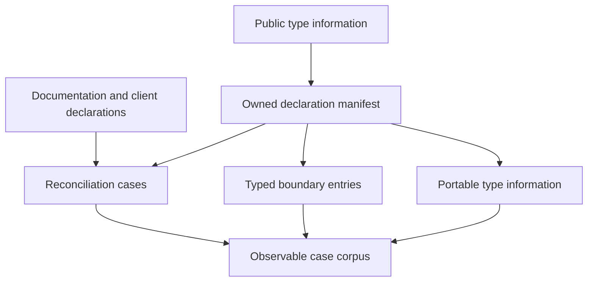
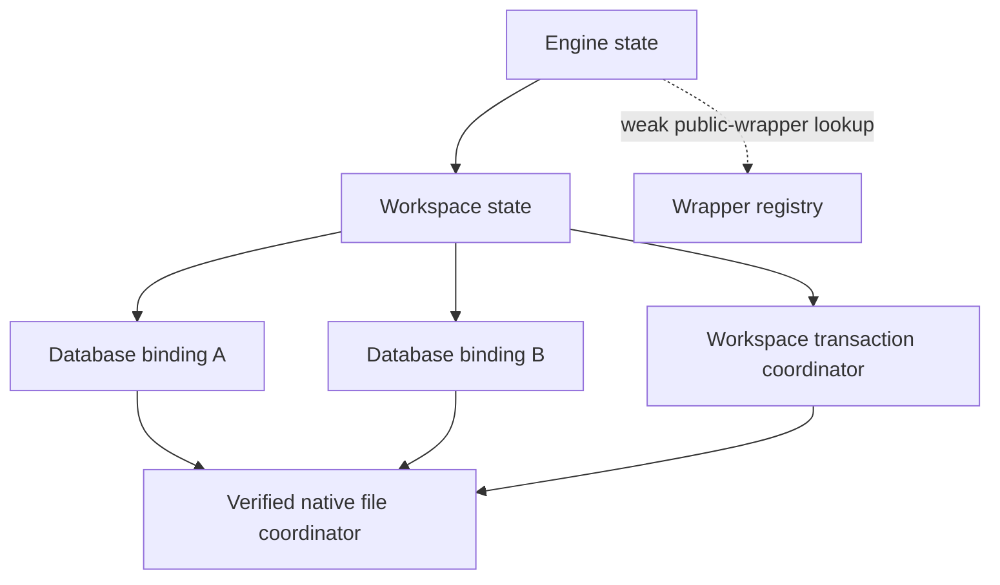
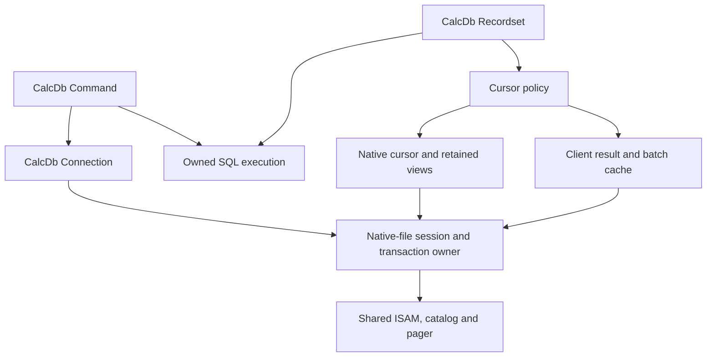
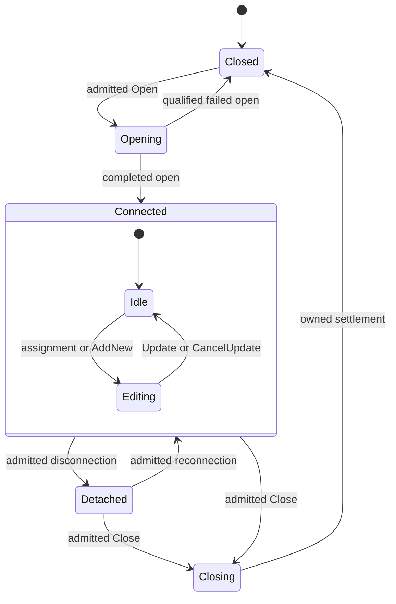
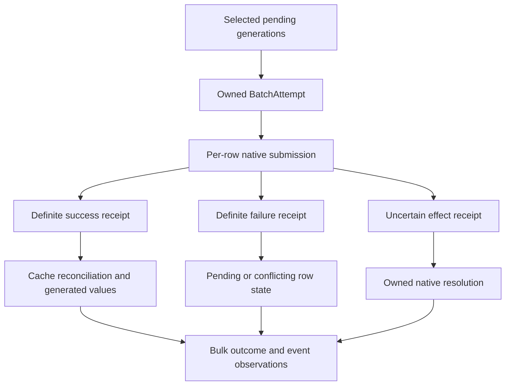
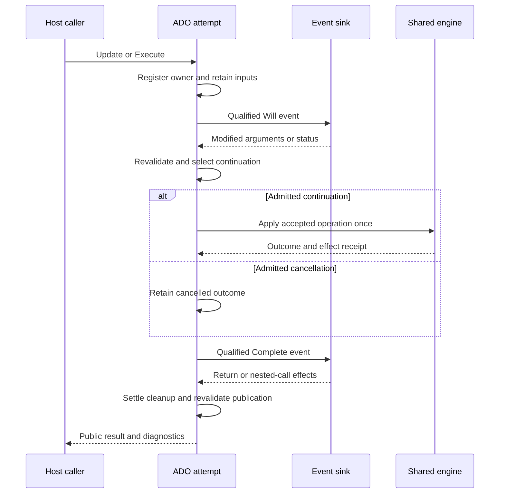
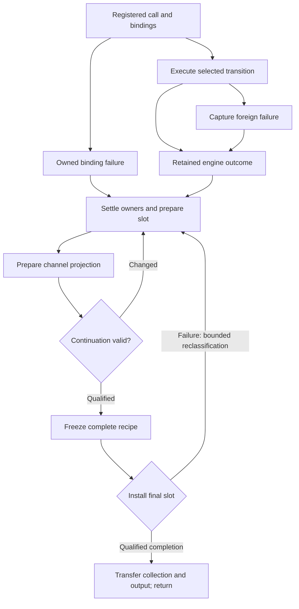

# II-12. DAO, ADO and observable object behavior

Revision 1 · Stage 2, response 11 · 2026-11-14

**Requirement trace:** Primary RQ-SEM-03, RQ-DAO-01, RQ-DAO-03, RQ-DAO-04, RQ-ADO-01 and RQ-ADO-02. Supporting RQ-PROD-02, RQ-PROD-05, RQ-SQL-03, RQ-SQL-08, RQ-DAO-02, RQ-COM-01, RQ-COM-02, RQ-COM-03, RQ-LATE-05, RQ-LATE-06, RQ-ORACLE-02, RQ-ISAM-01, RQ-VAL-03, RQ-EXPR-01, RQ-CALL-01, RQ-CALL-03, RQ-CALL-04, RQ-PORT-02, RQ-PORT-03, RQ-LEDGER-01, RQ-HOST-01, RQ-PERF-01 and RQ-PERF-02. I-16 retains the full phase/scope map. II-04/05 supply native row/index mechanics, II-06 catalog identities, II-07 cursor/edit state, II-08 mutation/resolution receipts, II-09 owned work and Close, and II-10/11 accepted expression/query execution. This chapter joins those mechanisms through concrete public objects using K-COM, K-ERROR, K-CURSOR, K-CATALOG, K-TXN, K-WORK, K-THREAD, K-VALUE and K-STRING. II-13 develops the exact declarations, activation and host integration.

Prefer generated genuine-interface entries and explicit family-specific state policies over the single native engine. The worked DAO path follows a retained Field from an index locator to page 17, an owned BSTR, an edit candidate and the shared mutation service. ADO adds requested/effective settings, independently retained original/proposed/source values, per-row batch receipts, event frames and interoperable persistence. The boundary retains accepted effects through diagnostic, cleanup and delivery failure. **D-OBJECT-1 remains Recommended; D-CALL-1 remains Decided. DAO retains priority, and ADO may start alongside it.**

**Evidence boundary.** Microsoft references establish documentary public contracts within their stated applicability; several descriptions conflict and are retained as discriminating probes. No target type-library inventory, actual native interface call, Windows/ACE, CalcVBA, managed-runtime or portable COM execution occurred. The starting oracle remains user-reported ACEDAO.DLL **16.0.20527.20016**; actual loaded DAO, ADO, provider and host identities require capture. Installed **.NET Framework 4.8-family** and **.NET 10 LTS** remain separate client lanes. The corrected shared representation is the real platform Automation VARIANT/BSTR, **24-byte VARIANT on Windows x64**. Page examples inherit earlier exact-pinned source-derived hypotheses and add original adapter witnesses; there is no new reference-implementation source inspection. The DAO and transaction page-17 examples are independent fixtures. Figures are emitted Markdown tables/Mermaid source, not render-verified.[^authority]

## 1. Make member coverage executable

**RQ-DAO-01, RQ-DAO-03, RQ-DAO-04, RQ-ADO-01, RQ-COM-01, RQ-SEM-03 and RQ-LEDGER-01. D-OBJECT-1 remains Recommended.** Implement DAO and ADO as two observable policies over the existing catalog, ISAM, expression, SQL and transaction mechanisms. A DAO Recordset and an ADO Recordset need not expose the same state transitions even when both ultimately position the same native table cursor. A public object is also more than its current data source: its interface identity, collection membership, pending definition, diagnostic state and retained children can survive changes to that source.

The implementation unit is a **member recipe**, keyed by captured interface identity, member identity and invocation kind. Each recipe describes argument handling, admitted object states, underlying operation, result ownership, diagnostic publication and resulting state. Method, property get, property put and property putref remain separate entries even when their names match. The recipe invokes a typed implementation entry; it is not an interpreter that reparses names or constructs a generic argument map on every early-bound row-loop call.

The coverage denominator comes from three independently retained inputs: the target's public type information, documented DAO/ADO members and the client declarations actually used by VBA, native add-ins and each managed-runtime lane. Reconcile omissions rather than treating any one web index as exhaustive. Include inherited interfaces, compatibility interfaces, default members, restricted and hidden members, enumeration constants, source interfaces and coclass relationships. Distinguish a type-library member from a provider-created property discovered only after a connection or recordset opens. A dynamic property contributes a separately identified capability case; it does not mutate the fixed interface declaration.

Each concrete case has the following key:

```text
MemberCaseKey {
  declaration_profile; interface_id; member_id; invocation_kind
  binding_route                         // vtable, IDispatch, VBA, either managed lane
  object_family; starting_state; parent_state
  format_profile; connection_or_workspace_profile
  argument_case; ownership_case; failure_or_reentry_case
}

MemberCaseResult {
  input_capture; actual_loaded_implementation
  return_hresult; active_result_value; byref_outputs
  ordered_diagnostics; ordered_events; exposed_state_after
  object_identity_edges; changed_native_regions; operation_receipt
  comparison_rule; observed_or_documentary_basis; disposition
}
```

This is a case schema, not a demand to enumerate an unbounded Cartesian product. The manifest selects meaningful state and argument partitions, then adds interaction cases where ownership, transaction scope or callbacks couple them. A numeric Field getter, for example, needs current-row, BOF/EOF, deleted-row, stale-definition, parent-closed and applicable edit-buffer cases; it need not repeat every unrelated DDL permutation. Shared implementations can share fixture generators while preserving per-member results.

Keep the dispositions explicit: matched native success, matched native refusal, mismatch, unimplemented initial scope, unobserved target behavior, or deliberately later capability. A matched native refusal is evidence only for that precise profile/state/argument case. It cannot count as implementation of a member that ACE accepts elsewhere. An unknown or omitted member stays visible in the initial-scope accounting. An actual later linked-table, encryption, complex-field, compact/repair, OLE DB or ODBC operation retains its existing phase; simply exposing the corresponding member is a separate ABI obligation.

## 2. Compile the public declarations without inspecting implementation code

**RQ-COM-01, RQ-COM-02, RQ-DAO-01 and RQ-ADO-01.** R-DAO-1 and R-ADO-1 begin with a permitted type-information capture. Record the actual loaded DAO/ADO implementation and the exact public type-library file or embedded resource, file hash, library identity/version/LCID, architecture and capture-tool version. Read public metadata through the documented type-library interfaces. `LoadTypeLibEx` with `REGKIND_NONE` allows the collector to inspect a specified library without registering it. This is interface discovery, with no decompilation or disassembly.[^r-typelib]

The collector walks each type, then its referenced base, implemented and event-source types, using a visited set keyed by library/type identity. Copy the descriptors into owned, bounded records before releasing the library-owned structures. Enumerate variables and constants as well as functions; preserve aliases and referenced-type identity instead of flattening everything to a string name. Preserve declaration order separately from the canonical order used for deterministic diffs.[^r-typeinfo]

**Figure F-117 — Public declaration capture and its three consumers.** This is the proposed build-time data flow; no target type library has been captured here.



| Captured record | Fields retained | Implementation consequence |
| --- | --- | --- |
| Library/type | Library and type identities, versions, LCID, kind, type flags, referenced types, alignment and vtable-size metadata | Choose an explicit declaration profile; do not infer the ABI from a type name |
| Function/property | Member identity, invocation kind, function kind, calling convention, vtable offset, return descriptor and function flags | Generate the correct typed entry and dispatch entry independently |
| Parameter | Declaration position, name when supplied, recursive type descriptor, direction/optional/default flags and owned default value | Build an argument recipe without losing omission, ByRef or default semantics |
| Enum/constant/alias | Exact typed value, aliases and source identity | Preserve public numeric constants and names rather than renumbering an internal enum |
| Coclass/source relationship | Implemented-interface flags, default/source distinctions and referenced interface identity | Inventory construction and connection-point requirements for II-13 |
| Documentation | Member/parameter names and recorded help metadata | Support type information and diagnose declaration conflicts without treating prose as ABI |

`TYPEATTR`, `FUNCDESC` and `PARAMDESC` supply the corresponding type, invocation and parameter metadata. A negative optional-parameter convention is not the same as a fixed count of trailing optional arguments; retain the original convention and normalize only into an explicit equivalent recipe. Hidden members can still be bindable, while restricted flags describe a different declaration property. Neither flag permits silently dropping the entry from the manifest.[^r-descriptors]

`GetNames` reports parameter names in declaration order; a property put's assigned right-hand value has no returned parameter name. The collector therefore binds names to parameter positions using the invocation descriptor, not by assuming every slot has one name. Keep missing-name status distinct from an empty BSTR. Returned strings and descriptors have their documented release paths; arbitrary process pointers never enter the durable capture.[^r-names]

The following is an **unresolved recipe example**, not a captured declaration or an invented DISPID:

```text
family: DAO.Recordset
member: MoveNext
declaration:
  interface_id: capture_required
  member_id: capture_required
  invocation_kind: capture_required
  vtable_offset: capture_required
implementation: dao_recordset_move_next
semantic_inputs: current CursorState, CursorPolicy, owner generation
semantic_outputs: accepted position or owned failure
cases: current_row, last_row, empty, already_eof, parent_closed,
       held_clone, active_edit, callback_close, demanded_expression_failure
evidence: R-DAO-1 + relevant R-CURSOR-1 branches
```

Compilation fails when a generated implementation profile lacks a required declaration or links a recipe to an incompatible signature. That check proves internal consistency only. The differential harness must separately show that the declaration matches the target and that the selected object is CalcDb. Do not fill unresolved GUIDs, offsets or member identifiers with plausible constants. R-ACT-1 proves activation and loaded implementation; II-13 specifies the concrete native/portable allocation and factory contract.

Type-library processing is a startup/build task, not a per-call dependency. Generate compact member-index tables and immutable type descriptors; cache any permitted dynamic name lookup by declaration profile and LCID. Preserve the native distinction between dispatch-member name resolution and collection-name lookup. A table's sort-order key generator is not automatically the comparer for DAO collection names, and a successful `GetIDsOfNames` lookup does not establish that a collection contains an item of that name.

## 3. Keep interface identity stable while object resources change

**RQ-COM-01, RQ-DAO-04, RQ-CALL-04 and RQ-HOST-01.** COM requires one controlling `IUnknown` identity for an object and a stable supported-interface set. Querying another interface can return a different pointer; compare controlling identities when the experiment asks whether two references denote the same object. Database closure or recordset movement therefore cannot remove an interface previously supported by that same object. A member called in the new state returns the evidenced result or error through the existing interface.[^r-identity]

The preferred wrapper layout keeps a small, immutable interface/header region next to a typed object-state handle. That handle identifies a slot and nonreused incarnation; it is not a naked pointer into a growable vector. An owner-held child can retain the wrapper and the minimal state needed for native closed-object behavior without retaining page pins, pending I/O or a database-file handle indefinitely. A resource-owning session or cursor keeps the existing II-09 work registry, while wrappers use the family-specific lifetime rules developed below.

Do not create a universal strong parent-to-child-to-parent COM cycle. The engine owner retains its resource records; a wrapper retains the required owner-state anchor; the wrapper cache uses weak entries or explicitly breakable ownership. A held child still has an unambiguous old incarnation after deletion or re-creation. An event subscription, external interface-valued property or retained enumerator is an additional named edge with its own release rule, not an excuse to make every wrapper immortal. Cross-language cycles require the actual native/managed/portable lifetime tests in II-13.

Identity caching and collection enumeration policies remain family-specific provisional choices under R-DAO-1/R-ADO-1. Prefer one live wrapper per evidenced object incarnation when repeated retrieval denotes one native object; use a new wrapper where the captured API creates another instance. The internal engine object can be shared in either case. Do not infer a public identity guarantee from a shared database path, a current collection ordinal or a reused table name.

Interface support, method capability and current-state validity are three separate checks. A fixed interface can expose `Seek` while the current recordset type cannot seek; an ADO `Supports` result can describe a capability while a particular operation still fails; a later feature can retain its signature while its implementation remains pending. The object header answers interface discovery without probing files or consuming a cursor. Member recipes apply capability and state rules in the observed order, so an early state error does not accidentally trigger catalog I/O or a host callback that native execution would not demand.

## 4. Binding errors retain the exact DISPPARAMS map

`Database.OpenRecordset` provides a concrete four-parameter example: required `Name`, followed by optional `Type`, `Options` and `LockEdit`.[^e-openrecordset] The following is a constructed raw Automation call, not a claim that a particular native invocation has succeeded. Obtain the member and parameter DISPIDs from the target's public type information/`GetIDsOfNames` capture. The symbols `dOpenRecordset`, `dType` and `dOptions` stand for those captured identifiers; they are not proposed numeric assignments.

For the source intent `OpenRecordset("T", Type := dbOpenDynaset, Options := dbReadOnly)`, one legal Automation packing has `cArgs=3`, `cNamedArgs=2`. Named values occupy the first `cNamedArgs` entries and pair with the corresponding entries of `rgdispidNamedArgs`; remaining positional values follow in reverse order.[^e-passing]

**Figure F-118 — original OpenRecordset argument packing and x64 offsets.** All VARIANTARG elements use the real 24-byte Windows x64 layout from II-02.

| `rgvarg` index | Offset from array base | Active argument | Named-ID slot, if present | Semantic destination |
| --- | --- | --- | --- | --- |
| 0 | `0x00` | `VT_I4`, value `dbReadOnly` | `rgdispidNamedArgs[0]=dOptions` | Options |
| 1 | `0x18` | `VT_I4`, value `dbOpenDynaset` | `rgdispidNamedArgs[1]=dType` | Type |
| 2 | `0x30` | `VT_BSTR`, real BSTR for `T` | None | Name |
| No supplied slot | — | Omitted LockEdit | None | Resolve through imported optional/default metadata |

Swapping the first two values **and** their named identifiers preserves the binding intent. Swapping just the values does not. The physical index, semantic parameter and source expression position therefore need three separate fields. `Invoke` documents `puArgErr` as an index into `rgvarg` for its specified parameter/type errors. In this array index zero identifies Options, not Name. Do not report an argument-error index for a return category that does not define it, and do not confuse `DISP_E_EXCEPTION` with a dispatch coercion error.[^e-invoke]

A second packing tests omission against explicit values. Supply four positional cells, so the array holds LockEdit, Options, Type, Name. For an omitted optional Type without a declared default, the type cell is `VT_ERROR` with `DISP_E_PARAMNOTFOUND`; a declared default instead follows the signature's default rule.[^e-optional] In a zero-initialized x64 harness cell, the missing marker has bytes `0A 00` at offsets 0–1 and `04 00 02 80` at offsets 8–11. The remaining bytes are zero in this constructed fixture. The constants come from the published VARENUM and COM error-code definitions; inactive bytes are not semantic equality evidence.[^e-varenum][^e-comcodes]

Replacing that cell with `VT_EMPTY` changes the tag bytes to `00 00`; explicit Null changes them to `01 00`. Neither is omission. An explicit `VT_ERROR` carrying a different code is also not the optional marker. Preserve the distinction until the member's actual conversion/default policy runs. An absent named optional argument, an explicit marker and an imported default can take different binding paths even when a particular member eventually supplies the same value. R-ERR-1 records those paths rather than requiring identical internal processing.

ByRef introduces another owner. If a raw caller supplies an Options cell as `VT_VARIANT|VT_BYREF`, its tag is `0x400C` and its active pointer names a separate live VARIANT; copying the 24-byte argument does not copy that referent. Keep its alias group and lifetime through any admitted conversion. A value-input parameter does not thereby become writable, and an `[in,out]` parameter does not lose writeback because the adapter found it easier to copy. The public declaration determines direction; II-02/10 determine canonical ownership and retained writeback receipts.[^e-variant]

Value assignment and reference assignment also remain different entry kinds. A put/putref call uses the standard `DISPID_PROPERTYPUT` named argument for the value; `DISPATCH_PROPERTYPUTREF` requests reference assignment where the property supports an object reference. Indexed property arguments retain their own positional mapping. Use the actual member descriptor to select the accepted forms, without turning every putref into a default-property read or every put into object retention.[^e-invoke] II-13 owns exact interface declarations, calling conventions, activation and the portable implementation of these Automation services. This chapter owns which object transition follows successful binding, and which diagnostics follow failed binding.

## 5. Engine, session and database objects have different publication boundaries

**Requirement trace:** RQ-DAO-01, RQ-DAO-04, RQ-PROD-02, RQ-SEM-03. **D-OBJECT-1 remains Recommended.** The following structures implement its DAO side; the particular native identity, collection and failure policies remain provisional under R-DAO-1. Nothing in this section is a report of executing ACE.

Start with three distinct owners. `EngineState` owns engine options, the default-session creation state, the public Workspaces collection and the DAO diagnostic domain. `WorkspaceState` owns a login/session identity, database bindings and II-08's transaction coordinator. `DatabaseState` owns one public open binding, its read/write capability, metadata collections and execution-local observations. Two Database objects can represent the same verified file while retaining separate public identities. Their Workspace association determines transaction ownership: two bindings in one Workspace share its coordinator scope; file identity alone determines neither that association nor public identity.

Microsoft describes DBEngine methods that open databases and control transactions through the default Workspace. Its default-user/password settings participate in default-session creation; changing DefaultType or IniPath affects subsequent Workspaces. Therefore, the implementation needs an explicit initialization transition: defaults cannot be read afresh by every operation on an established session. The statement that DBEngine is the top of the DAO hierarchy does not settle whether distinct external activation routes share one engine instance; I-13's activation capture determines that boundary.[^dao-engine]

A new Workspace illustrates why `Detached` cannot mean “unusable.” A Workspace created through `CreateWorkspace` can open databases and own transactions before it is appended to `DBEngine.Workspaces`; appending makes it discoverable in that collection. A new Database opened or created through a Workspace is automatically a member of `Workspace.Databases`. Closing it removes that live member, while its database file remains. The Databases collection can contain duplicate names when one source is opened twice.[^dao-workspace][^dao-databases]

**Figure F-119 — separate session, binding and physical-file owners.** Original in-memory design. Arrows mean retained ownership, except the explicitly labelled weak lookup; the two Database bindings have distinct public incarnations.



Use an engine-owned default-session slot with `Uninitialized`, `Creating(attempt)` and `Ready(workspace_incarnation)` states. Reserve a candidate session and its failure record before authentication or file access. Publish the first successful session once; a reentrant/default-session request joins or receives the measured immediate disposition without constructing a rival session. A failed initialization retains only the state that the native outcome permits. DAO-BOOT varies which property, collection lookup or open first initializes the default session, then changes defaults before and after that point. It also tests explicit closure of the default Workspace and the next `Workspaces(0)` access; do not decide recreation by whether an internal weak pointer happens to have expired.

An opened Database carries the exact opening arguments, actual capability outcome and its Workspace association. Requested read-only/exclusive options are not substituted for the capabilities established by II-09's admission receipt. `Database.Name`, `Version`, `Transactions`, `Updatable`, `Connect`, `QueryTimeout` and `RecordsAffected` are separate projections, with validity and writable-state rules recorded individually. DBEngine.Version describes the DAO version, whereas Database.Version describes the creating database-engine format; neither getter is automatically the loaded `ACEDAO.DLL` file version.[^dao-engine-members][^dao-database-members]

Access's `Application.CurrentDb` is a host method, not a missing DAO DBEngine member. Microsoft expressly distinguishes its new Database instance from `DBEngine(0)(0)`'s reference to the open copy. Include that route in Access-host comparison, preserving the host's ownership and transaction association. Do not globally intern every Database wrapper by pathname merely to reduce allocations.[^dao-currentdb]

## 6. Object identity is an owned relationship, not a dictionary key

**Requirement trace:** RQ-DAO-01, RQ-DAO-03, RQ-DAO-04, RQ-CALL-01, RQ-CALL-04, RQ-COM-01. The adapter must answer four independent questions: is this COM interface still memory-valid; is its public resource open; does its native object still exist in the applicable view; and is it presently a member of a particular collection? A positive answer to one supplies no shortcut for the others.

Build a public object shell over a retained state object. Collection membership stores checked identity tokens; a weak registry can recover an existing live shell. The session owns backend bindings, while those bindings retain nonowning parent identities rather than a strong reference back through a child shell. A child shell can retain the required owner state without making its parent own that shell in return. A shell retains the state necessary for its own calls, and children retain an owner-state handle. The registry and state do not keep an unconditional strong reference back to every shell. This permits live children and active calls to outlast the caller's parent variable without creating an immortal parent/child COM-reference cycle. Whether that retention also keeps a public parent open is a measured policy, not an automatic consequence of memory safety.

```text
DaoObjectState {
    public_instance_id, public_open_incarnation, family, context_kind
    engine_domain, owner_state_handle
    lifecycle, operation_serial
    association: Session | OpenBinding | Draft | NativeObject | Result | Diagnostic
    target_token: optional(file_incarnation, native_id, object_incarnation)
    definition_view: optional immutable descriptor + definition epoch
    public_local_state, collection_images, pending_close_attempt
}
FieldBinding =
    TableColumn(owner_token, physical_column_id)
  | QueryColumn(query_instance, declaration_or_output_id)
  | IndexComponent(index_incarnation, component_id)
  | RelationPair(relation_incarnation, pair_id)
  | CursorColumn(cursor_instance, result_schema_incarnation, output_id)
```

`FieldBinding` is deliberately a tagged union. Microsoft describes specification Fields on TableDef, QueryDef, Index and Relation, and current-record Fields on Recordset. A TableDef Field's `Value` cannot be implemented by opening the first record. A Relation Field's `ForeignName` identifies the other side of a pair; it is not a stored field value. A retained Recordset Field resolves through the cursor's current position or edit buffer at each Value call.[^dao-field]

**Preferred provisional wrapper policy:** reuse a still-live wrapper for the same object instance reached through the same owner collection, keyed by owner public incarnation, family and child identity. Keep independently opened Database bindings separate; keep the QueryDef parameter-value owner explicit. For a cursor Field, use output identity and result-schema incarnation, never the current row token. DAO-ID compares repeated ordinal/name lookups, `IUnknown` identity, VBA `Is`, aliasing of mutable state and final-release behavior. If a family returns fresh wrappers or shares values behind distinct wrappers, change that family's shell policy while retaining the underlying identity distinctions. COM pointer equality alone cannot establish parameter-value sharing.

A rename preserves the native object's lifetime where the catalog outcome does so, while changing lookup keys and possibly the observed Name. Delete/recreate establishes a new lifetime even if the file reuses the native ID, the TableDef page and the spelling. The old shell never silently acquires that new target. Rollback publishes the appropriate current descriptor and identity transition through II-06/08; it does not decrement a generation counter so that suspended operations appear current again.

Keep identity-comparison tests within one valid COM identity domain. Comparing two arbitrary interface addresses, two marshalled proxies or two managed runtime wrappers is not a replacement for canonical-IUnknown comparison. The native, dispatch, CalcVBA and two managed-runtime lanes retain their own observations. I-13 determines the actual interface inheritance and marshalling identities; this design does not invent GUIDs or vtable slots.

## 7. A retained DAO Field reads and edits the page-17 witness

**Requirement trace:** RQ-DAO-02, RQ-DAO-03, RQ-VAL-03, RQ-CALL-01, RQ-CALL-04, RQ-PERF-01, RQ-PERF-02. Reuse II-07/11's constructed 4,096-byte data page 17, owned by TableDef page 9. This is a byte-level integration witness, not an ACE-created database. Assume its admitted logical index `ixId` contains Long 42 at root `(17,1)` and Long 43 at root `(17,0)`. Root zero redirects to body `(17,2)`; slot two is not a third record.

The DAO spelling of the intended public scenario is:

```vb
Set rs = db.OpenRecordset("T", dbOpenTable)
rs.Index = "ixId"
rs.Seek "=", 42
Set nameField = rs.Fields("Name")
beforeValue = nameField.Value
ws.BeginTrans
rs.Edit
nameField.Value = "Ho"
rs.Update
ws.CommitTrans dbForceOSFlush
```

This example is original explanatory code. Its existence does not claim a successful native run, a particular Seek error code or a tested durability outcome. The last call selects II-08's forced-commit path, whose crash behavior still requires R-CRASH-1/2.

Opening binds one Database instance and its Workspace, resolves T's table incarnation and output schema, and creates a cursor/public-open instance. Seek uses II-07's selected table-index route. The complete key entry for 42 is `7F 80 00 00 2A 00 00 11 01`: the trailing index locator uses page 17 in three big-endian bytes and slot 1. It is not the overflow pointer format. The selected root's ordinary body begins at page offset `0x0FDD`, or file offset `0x11FDD`.

**Figure F-120 — page bytes, current-row binding and owned Automation result.** Inherited source-derived native witness plus original adapter design; inactive VARIANT union bytes are not a serialization format.

| Layer | Concrete content | Lifetime or interpretation |
| --- | --- | --- |
| Row body before edit | `04 00 2A 00 00 00 48 00 69 00 0A 00 0A 00 06 00 02 00 07` | Nineteen bytes at page 17 offset `0x0FDD`. |
| Id | Body bytes 2–5: `2A 00 00 00` | Long 42 through the admitted field codec. |
| Name | Body bytes 6–9: `48 00 69 00` | UTF-16LE `Hi`; file bytes begin at `0x11FE3`. |
| Flag and Notes | Mask byte 18 is `07` | Ordinary Boolean Flag is true; Notes is Null under this descriptor. |
| Held `nameField` | Cursor instance + result-schema incarnation + output column identity | Resolves the current row/edit cell; owns no borrowed pointer into `0x11FE3`. |
| Returned BSTR | Four-byte byte-length prefix, payload `48 00 69 00`, terminating `00 00` | Caller-owned Automation allocation; page pin can later be released. |
| Windows x64 VARIANT | `VT_BSTR` at offset 0; BSTR pointer at offset 8; total size 24 bytes | Exact platform layout. Unused union storage is not semantic data. |
| Candidate body after edit | `04 00 2A 00 00 00 48 00 6F 00 0A 00 0A 00 06 00 02 00 07` | Same-length uncompressed text witness; actual encoding/publication is the common writer's decision. |

The explicit expression `rs.Fields.Item("Name").Value` has three conceptual member transitions: obtain Fields, select Item, and read Value. Each can fail before the next starts. `Set nameField = rs.Fields("Name")` stops with an object result; `beforeValue = rs.Fields("Name")` additionally requests the Field's value through the language's default-member rules. Name lookup receives the exact string, not a SQL identifier fragment. I-13's captured metadata decides the actual early-bound/default-dispatch route; no numeric DISPID is inferred from this shorthand.[^dao-field]

Once retained, `nameField.Value` avoids a new name lookup and can reuse the cursor's descriptor and row decode. It still validates cursor/open/schema state and resolves the selected value source. The minimal semantic path is:

```text
ReadCursorField(field):
    retain owner cursor and field schema identity in the current call attempt
    validate allowed public state and field capability
    if an admitted edit supplies this column:
        select its owned accepted cell or retained original
    else:
        acquire current RowBinding under the cursor's admitted view
        select and decode the field through that binding
    prepare an independently owned platform Automation result
    settle temporary row/decode ownership and revalidate continuation
    transfer the prepared result at the common call-publication boundary
```

The returned `beforeValue` remains `Hi` after movement, Requery, edit or Close because it owns its Automation value. The Field object can later return a different row's Name without changing that earlier result. For a resident Long, Boolean or Null, the result needs no per-cell heap allocation; a returned string still needs the required BSTR ownership. Retaining a Field can eliminate wrapper/name-directory work, but cannot justify returning a pointer into page scratch or recycling a BSTR that the caller owns.

`Edit` retains the selected root token and original-value evidence in II-07's RowEdit. Assigning `"Ho"` copies or takes the permitted owned input, performs the checks due at assignment, and installs the accepted cell. It does not overwrite the page under the active read binding. `Update` supplies the same mutation service used by SQL. Here the changed text has the same four-byte payload, and the only stipulated index is on Id, so that index's 42 entry does not change. Validation, relationship, table-property and transaction consequences still follow the common descriptor; equal record length alone does not prove a one-byte native write.

The changed code unit is at file offset `0x11FE5`. A constructed byte comparison can verify the candidate transformation, but only native tracing can establish write extents, ordering, dirty/repair metadata and survival after a crash. Keep the page pin/decode scratch and edit owner costs separate from COM crossings, wrapper lookups and public BSTR copies. This witness exercises the intended short DAO path without reopening a table, reparsing SQL or enumerating all properties for each field.

## 8. Collections own membership images and enumeration positions

**Requirement trace:** RQ-DAO-01, RQ-DAO-03, RQ-DAO-04, RQ-SEM-03. A single container implementation can supply storage, but each DAO collection selects its own lookup, creation, Refresh and mutation policy. `Count`, `Item`, `_NewEnum`, `Append`, `Delete` and `Refresh` are independently inventoried members. Their existence does not imply applicability in every owner context.

Retain an ordered membership image plus a comparison-aware name directory. The ordinal sequence is observable and must not be the incidental order of a Rust hash map. Original UTF-16 names remain owned. A collection-specific qualified comparison profile determines lookup. It can reuse II-06's identifier comparison only where evidence establishes equivalent semantics; neither SQL/catalog name rules nor a host-language normalization or case-folding default proves the collection's behavior. Numeric Variant arguments and string arguments remain distinguishable until the selected Item-binding rule acts. A name bucket can contain several members, as the documented duplicate-Database-name case requires; a unique-key dictionary would lose a real object before lookup semantics were even tested.[^dao-databases]

```text
CollectionImage {
    owner_public_incarnation, collection_kind, membership_serial
    entries: ordered MemberToken[]
    names: NameLookup -> one_or_more_entry_ordinals
    source_view, comparison_descriptor, retained_bytes
}
EnumeratorState {
    collection_owner, enumeration_incarnation
    selected_image_or_live_policy, next_ordinal
    mutation_observation, outstanding_result_ownership
}
```

**Figure F-121 — a collection refresh does not retarget held children.** Constructed identities, with no corresponding on-disk serial fields.

| Event | Current collection image | Previously held child | Enumerator created before event |
| --- | --- | --- | --- |
| First lookup of T | Image 40 contains T/incarnation 700 | `t0` binds 700 | `e0` retains its selected membership policy. |
| Another binding drops T | Old image can remain publicly stale | 700 is retired in the new catalog view | No address may be reused as a different child. |
| Another T is created | New native entry has incarnation 701 | `t0` still binds 700 | Its next result depends on captured mutation policy. |
| `TableDefs.Refresh` succeeds | Candidate image 41 contains T/701 | Refresh does not rewrite `t0` to 701 | Preferred candidate retains image 40; native evidence may select another policy. |
| A new `Item("T")` succeeds | Lookup resolves image 41 | New returned target is 701 | New enumeration starts from image 41. |

Microsoft's TableDefs.Refresh documentation says initial collection population occurs on first reference, other users' changes need not appear automatically, and OrdinalPosition changes may require Refresh to affect collection order. It also warns that refresh has a cost. Therefore, catalog freshness and the adapter's publicly visible membership are separate states.[^dao-refresh]

**Preferred provisional membership policy:** persistent collections retain their published image until their own successful mutation or an applicable explicit Refresh changes it. A same-collection Append/Delete updates that collection at the observed successful publication point; indirectly affected collections may remain stale. Live collections such as Databases follow their admitted open/close transitions. DAO-COLL crosses changes through the same wrapper, a second Database in one Workspace, another Workspace and, when sharing permits it, another process. Any automatically visible change found by that experiment narrows the policy for that family.

For enumeration, prefer an owned membership image initially, with each returned child validated through its own state. This bounds both order and ownership without pinning every data page. DAO-ENUM decides snapshot versus live membership, invalidation, and whether already-removed elements can still be returned. It also records IEnumVARIANT `Next`, `Skip`, `Reset` and `Clone`, short fetches and errors after mutation. A failed `Next` must retain the exact number and ownership of results already transferred according to its ABI contract; an internal iterator exception is insufficient.

Refresh constructs a candidate image, resolves its source ownership and commits one membership swap. If it fails before any observable effect, prefer retaining the old image. An effectful/native refresh follows its actual receipt; no blanket atomicity claim is made. The QueryDefs.Refresh reference is internally inconclusive: its opening says unsupported, while its remarks single out nonpersistent collections including `Connection.QueryDefs`. Preserve that discrepancy. Database.QueryDefs, legacy Connection.QueryDefs and Parameters need separate probes, rather than one hard-coded unsupported result.[^dao-qrefresh]

## 9. Detached definitions become native objects through specific calls

**Requirement trace:** RQ-DAO-03, RQ-DAO-04, RQ-SQL-08, RQ-FMT-03. Schema construction has observable intermediate states. `CreateTableDef` constructs a definition; adding Fields to that draft changes a draft. Appending the TableDef to the Database's TableDefs performs native creation. Microsoft places duplicate-name and incomplete-definition errors at Append and requires at least one Field before a TableDef can be appended. Moving every check into CreateTableDef changes which call fails and which draft remains available for correction.[^dao-create-table]

Use a draft graph with stable local child identities. A Field appended to a detached TableDef becomes a member of that draft's Fields, not yet a persisted database column. An Index's component Fields likewise describe the key; they do not allocate duplicate columns. `Index.Required`, `IgnoreNulls`, `Unique`, `Primary`, component direction and any permitted name changes feed II-05's logical-index descriptor. The Index reference ties uniqueness failures in existing data to Indexes.Append and describes automatic foreign indexes for enforced relationships.[^dao-index]

**Figure F-122 — construction and publication differ by family.** The table states documented major boundaries; exact validation ordering and failure disposition remain experimental.

| Family and call | Object state after successful construction | Call that changes the relevant membership | Native mutation owner |
| --- | --- | --- | --- |
| `CreateWorkspace` | Usable hidden session | `Workspaces.Append` exposes it | Session coordinator; no new database file merely for collection membership. |
| `CreateTableDef` | Table draft with local child collections | `TableDefs.Append` | Catalog/table creation, maps and indexes under II-06/08. |
| `CreateIndex` / `CreateRelation` | Definition with component or field-pair drafts | `Indexes.Append` / `Relations.Append` | Index/catalog/relationship closure. |
| `CreateQueryDef("", sql)` | Executable temporary definition | Assign a valid name, then qualified `QueryDefs.Append` | Native query creation only when persisted. |
| `CreateQueryDef("Q", sql)` | Named permanent definition if successful | Creation automatically appends it | Catalog publication is inside this call. |
| `CreateProperty` | Detached Property candidate | Owner's `Properties.Append` | Object-specific property mutation, if persistent and applicable. |

Named QueryDef auto-append is particularly important. A generic factory that returns every new schema object as detached would miss a native write and a duplicate-name error inside `CreateQueryDef`. Conversely, preparing or executing a temporary QueryDef does not justify allocating native query rows. The documented rename/append route permits later persistence; its success and failure states are explicit DAO-DRAFT cases.[^dao-create-query]

Represent native publication as an operation over the owned draft:

```text
AppendDefinition(collection, draft):
    retain collection owner and exact draft incarnation
    bind the family's append policy and argument-presence rules
    reserve public attachment/outcome storage
    validate the checks due at this call in their selected order
    prepare native mutation from an owned immutable draft view
    revalidate owner, collection and draft dependencies
    receipt = run catalog mutation through the owning Workspace
    apply the receipt's native-object and collection transition
    attach the existing draft identity only if this outcome attaches it
    settle temporary ownership; publish the recorded public outcome
```

The preferred prepublication-failure state leaves a correctable detached draft. A failure after native effects can instead leave an attached, invalidated or unresolved object according to the measured receipt. It must not pretend that all bytes rolled back because the factory returned an error. Reserve wrapper attachment and membership storage before the first native effect so ordinary post-write allocation failure does not create an unnecessary uncertainty.

Relations need both sides of each pair: the Relation's Table and ForeignTable identities plus each Field's Name and ForeignName. Microsoft distinguishes enforced base-table relations from unenforced relations that may name queries or linked tables. Appending an enforced relationship can publish an associated foreign index; the public Relations and Indexes collections need independent visibility updates. Do not count the relationship as successfully exposed merely because one MSysRelationships row was written.[^dao-relation]

Attached property mutability is family-specific. Changing an allowed name uses catalog rename; changing field representation uses the existing schema-mutation machinery; changing a display property may affect only metadata dependencies. There is no universal “all setters forbidden after Append” or “all setters serialize a new TableDef” rule. DAO-DRAFT records each setter before parent attachment, after attachment, after failed Append and after rollback, including draft children retained throughout.

## 10. QueryDefs retain definition, parameter and execution identities separately

**Requirement trace:** RQ-DAO-03, RQ-SQL-03, RQ-SQL-08, RQ-SEM-03. II-06 already owns the native query rows and II-11 the executable plan. The DAO object adds a public definition instance, local options, a ParameterSet and an execution-result association. Changing one parameter value is an owned cell replacement; it does not rewrite SQL text or MSysQueries rows.

Parameters is a view over declarations that the definition exposes. Microsoft's DAO collection does not support directly appending or deleting Parameter objects. Creation/removal comes from definition changes and the native binding rules, including inferred parameters and declarations exposed by nested saved queries.[^dao-parameters] Keep a declaration identity and declaration incarnation in every held Parameter handle, in addition to its current name and ordinal. The latter two can be reused by a different parameter after an SQL edit.

Retain the II-06 starting policy: an accepted `.SQL` replacement establishes a new declaration incarnation; old Parameter handles become stale, and new cells start unassigned. This is provisional, not an ACE result. DAO-QUERY tests equivalent-text rewrites, reordered parameters, type changes, a rename, removal/reintroduction and failed SQL setters. If the native preserves values or held handles for some edit, implement that explicit declaration mapping. An old handle must never write a newly introduced ordinal merely because both occupy slot zero.

QueryDef setters do only the work their native phase requires. Syntax admission, name binding, Parameters discovery, Fields discovery and execution can fail at different calls. A saved definition that refers to a missing table need not execute merely to set SQL, and a getter of fixed output metadata must not populate all result rows. Fixed and dynamically discovered metadata use II-11's `MetadataOutcome` and the same retained execution where discovery is effectful. QueryDef.Fields and Recordset.Fields therefore retain distinct owner/result identities, even when their printed column names are identical.

**Figure F-123 — a parameter assignment does not rewrite an existing execution binding.** This constructed witness uses a query with one Long parameter `p`; the table selects bindings, not a previously measured ACE execution.

| Public action | QueryDef value owner | Existing Recordset R | Reason for retained separation |
| --- | --- | --- | --- |
| Set `p=42`; open R | Value version V1 contains 42 | Captures V1 and definition D1 | R owns the input it accepted. |
| Set `p=43` | V2 contains 43 | Still retains V1 | Mutable QueryDef storage is not R's borrowed parameter array. |
| `R.Requery` without argument | V2 unchanged | Documentary direction selects the original definition/parameters | Current table data may change independently. |
| `R.Requery q` with the QueryDef | V2 unchanged | Documentary direction selects q's current supplied values | A fresh result incarnation owns its accepted inputs. |
| Replace q.SQL | New declaration incarnation | Earlier accepted binding remains owned or is invalidated by measured policy | Reuse of parameter spelling cannot redirect old storage. |

The Requery reference explicitly distinguishes no-argument reuse from supplying the QueryDef's current parameters. Its parameter table describes a name-valued Variant, while its remarks and sample supply a QueryDef object. DAO-QUERY therefore captures the installed public metadata and tests omitted, name, object, Empty and Null forms independently; the prose discrepancy is not permission to guess an ABI.[^dao-requery]

Each execution retains the accepted definition/dependency token, parameter-value version and semantic/host context. Passing a QueryDef to Requery can select a new binding without mutating the old producer in place. Independently acquired QueryDef instances need explicit tests for shared definitions versus shared parameter cells. An inner saved query's separately held ParameterSet does not automatically become the value source for an outer query; II-06's origin/declaration/exposure-path mapping remains authoritative.

`Execute` and `OpenRecordset` retain separate method-family admission, options, result and RecordsAffected policies. `Connect`, `ReturnsRecords`, `ODBCTimeout`, `Prepare`, asynchronous execution/cancellation and provider-oriented options retain their context rows. Preserve stored pass-through metadata before provider execution is available; if ACE accepts the corresponding native-file operation and CalcDb does not, the case remains missing. Closing a QueryDef is an explicit lifecycle event and repeated Close is documented to fail; it neither means QueryDefs.Delete nor erases independently owned accepted results by destructor accident.[^dao-query-close]

## 11. Properties are executable views as well as persisted values

**Requirement trace:** RQ-DAO-04, RQ-DAO-03, RQ-PROD-05, RQ-SEM-03. A built-in Property can project a live cursor state, a draft member, a native descriptor or an owner-specific capability. Its getter can fail in the current context. Constructing or enumerating Properties must consequently enumerate descriptors, rather than eagerly evaluating every Value and failing on the first write-only property.

Use `PropertyBinding = Builtin(member_policy) | NativeUserProperty(owner_token, property_id) | DraftUserProperty(draft_id) | Inherited(source_descriptor, property_id)`. A built-in direct getter and its `Properties("name").Value` route enter the same semantic getter after the distinct lookup/default-member steps. The Property object has its own identity and Name, Type and Inherited metadata. Recordset Field properties can inherit from their underlying TableDef or QueryDef; an inherited wrapper is not automatically a new writable blob saved on the Recordset.[^dao-property]

The public reference identifies Database, Index, QueryDef, TableDef and their specified QueryDef/TableDef Fields as user-property owners, with an already-appended owner required. It does not license arbitrary user-property creation on every object that exposes Properties. Its wording that an unappended Property cannot be “referenced” must be distinguished from the same page's prescribed creation and initialization of a detached candidate. DAO-PROP captures access through the retained draft interface separately from lookup through the target collection.[^dao-property]

For a persistent owner, the semantic property belongs to that native object, not privately to every COM wrapper that happens to expose it. Different wrappers can hold different membership/descriptor snapshots, but saving through one must use II-06's actual property map and preserving editor. The phrase “specific instance” does not authorize losing a saved property when the wrapper is released. A user-defined property is also not a dynamically added DAO dispatch member: Microsoft requires the explicit Properties lookup syntax.[^dao-properties]

Keep type, value and persistence separate. A Property candidate holds an owned Automation value plus its declared DAO type and initialization flags. A candidate conversion can succeed before append-time duplicate-name, permissions or owner-context checks. An unsuccessful setter retains or replaces the old cell according to its measured transition. Append/delete/value assignment each receives its own catalog mutation recipe and error phase; deleting a built-in property remains an invalid operation rather than removing the descriptor from a map.[^dao-properties]

A useful discriminating sequence creates a text property `ReviewTag`, writes an empty BSTR, appends it, retains its Property interface, changes the value to Null where accepted, deletes it and appends another `ReviewTag`. Capture Type, Inherited, Value's exact Variant tag, collection order, the held interface's next result, second-binding visibility and independent reopen. Repeat with a duplicate built-in name, an unsupported type and a write-only built-in. The full native payload and unknown neighbouring records are checked by R-CAT-P; this chapter selects public transitions, without reimplementing its blob grammar.

Cache built-in descriptor lookup and native property directories separately from values. A Field.Value lookup in the hot row loop must not decode an entire LvProp blob. A caption/property edit should invalidate the dependency that uses it; a default or validation edit also invalidates mutation/expression state. Preserve exact unknown property bytes and their order until a qualified preserving mutation owns their rewrite. Returning a fabricated Empty value for an unknown or invalid property is an observable incompatibility.

## 12. Containers, Documents, Users and Groups keep their native context

**Requirement trace:** RQ-DAO-01, RQ-DAO-04, RQ-PROD-05, RQ-SEM-03. Container and Document objects project saved-object metadata. Microsoft's built-in `Tables` container includes saved tables **and queries**; it is not a second spelling of Database.TableDefs. Its `Databases` container is also distinct from Workspace.Databases, whose entries are open bindings. The documented Container/Document routes expose existing objects, without independent create/delete operations.[^dao-container][^dao-document]

Resolve a Document through `(database_incarnation, container_identity, native_object_incarnation)` and retain its catalog view. Name, DateCreated, LastUpdated, Owner, UserName and Permissions are individual policies. A saved-query change can alter its Document even when no TableDef changes. Deleting the underlying object changes Document membership through catalog publication; releasing a Document interface never deletes the represented table or query.

Applications can supply additional containers and stored object kinds. Capture names, order, member type and permissions for the actual fixture; do not hard-code the three engine container names as the entire universe. Access forms, reports, macros and modules remain preserved metadata/native objects. Returning their Document information does not run their saved code. Protected names, owner records and timestamps use II-06's preserving paths, including the possibility that a requested change cannot yet be performed safely.

Security needs its own explicit object family. The current online Workspace member index omits Users/Groups, while Microsoft's DAO/MFC technical note explicitly identifies DAO User(s) and Group(s) interfaces and demonstrates Workspace.Users and a user's password operation. The DBEngine overview also describes SystemDB although its current member index omits it. These discrepancies require reconciliation with the installed target type library; deleting the families from the manifest would turn documentation incompleteness into an implementation omission.[^dao-workspace-members][^dao-engine-members][^dao-security-interfaces]

Inventory the target's Workspace Users/Groups access, account factories, User/Group names and identity inputs, password-setting/change members, both membership directions and collection Append/Delete/Refresh. Preserve the exact exported names and invocation kinds from public metadata. In particular, the legacy DAO source's `NewPassword` must not be silently replaced by ADOX's `ChangePassword`. Those are different object models. Account creation and adding an existing account to a membership collection are also different native operations.

Microsoft distinguishes MDB user-level security from ACCDB, which does not provide that feature. That format distinction does not establish the error of each legacy DAO member in an ACCDB context, nor remove the secured-MDB cases from the compatibility accounting.[^dao-security-formats] For native-accepted secured Jet 4 operations in the selected scope, an unimplemented security path remains missing initial compatibility. Preserve security records without pretending that raw byte preservation implements authentication or permission checks.

Use a retained `SecurityContext` containing the workgroup file identity where applicable, authenticated principal, membership view and permission-policy version. A database Document's permission target is separate from the Workspace's authenticated principal. **Preferred provisional policy:** a `UserName` selector on a permission-bearing object selects the user/group whose permissions that wrapper examines or changes; it does not log the Workspace in as that principal. DAO-SEC compares two held wrappers, selector changes, Owner changes and subsequent operations to establish the actual sharing and persistence scope. Exact masks, inherited permissions and failure precedence are captured rather than inferred from Windows file ACLs.

Security mutations can affect a workgroup file as well as the database. Capture both immutable pre/post artifacts and their identities in isolated fixtures. Route any supported mutation through the appropriate native file coordinator and transaction/capability policy; a database rollback cannot claim to undo an account-store mutation merely because both calls happened through one Workspace. Password-related opening, encryption and format-version capabilities remain distinct rows, using their existing research owners.

## 13. Close retires a public instance through its existing owned attempt

**Requirement trace:** RQ-DAO-01, RQ-DAO-03, RQ-DAO-04, RQ-CALL-04, RQ-SEM-03. Database.Close, Workspace.Close and QueryDef.Close each document an error on a repeated call. Their short pages do not settle which metadata remains readable through held children, how failure changes membership, or whether final Release has the same public outcome.[^dao-db-close][^dao-ws-close][^dao-query-close] Use II-09's single `CloseAttempt`; do not implement a second adapter-owned teardown loop.

The DAO policy supplies that attempt with object-family inputs: whether it resolves pending edits, which Workspace scope owns transaction resolution, which live collection loses membership, which accepted execution bindings continue, and when public admission stops. It then projects the attempt's outcome to the caller. II-08's starting directions remain intact: Workspace.Close resolves all pending levels through the coordinator; Database.Close detaches the binding while preserving enlisted obligations; clone closure has its separately measured transaction effect. None is replaced by “drop the parent pointer.”

**Figure F-124 — preferred held-object starting policies and deciding cases.** All rows are provisional where the native reference is silent.

| Held object and event | Preferred implementation direction | Experiment that confirms or changes it |
| --- | --- | --- |
| Recordset Field; ordinary movement | Same Field identity resolves the owner's new current row/edit state | DAO-ID plus CUR-POS/EDIT. |
| Recordset Field; Requery changes output schema | Old schema token becomes stale; no ordinal rebinding | DAO-QUERY plus CUR-LIFE. |
| TableDef/Index/Relation; rename | Preserve target incarnation, update or retain exposed metadata per view policy | DAO-COLL/DRAFT plus CAT-V. |
| TableDef/Property; delete and recreate same name | Preserve old target identity; fail an inadmissible use rather than attach the replacement | DAO-ID/PROP plus CAT-I. |
| Child held after explicit Database.Close | Shell remains memory-valid; resource-dependent calls fail through selected closed-owner policy | DAO-LIFE with each getter and mutator. |
| Child held when only a parent variable is released | Preserve state ownership; apply the measured final-release/open-lifetime rule | DAO-LIFE in native, VBA and managed callers. |
| Any close during active/reentrant work | Join or hand off the existing attempt without self-wait or effect replay | DAO-CLOSE-OWN plus II-09's teardown cases. |

Begin with resource-dependent child calls requiring a live admitted owner. Retain immutable descriptive metadata safely, but do not automatically return it after Close: even a cached Name getter may need a native-compatible failure. DAO-LIFE determines readable survivors one member at a time. A cached value is an implementation opportunity, not proof that a getter is legal.

A collection holds a state identity for an open member; closing the member retires that public-open incarnation. Reacquiring a saved QueryDef or reopening a Database can therefore create a new open instance while the old closed shell still exists. Weak-cache keys and lookup admission must exclude closed instances when the native route opens a new one. Persistent native-object identity can remain the same across those public instances.

If a callback closes the owner, the outer operation retains safe inputs and its effect receipt, then revalidates before transferring a result. It cannot publish a Field that accidentally targets the callback's replacement schema, nor rerun an Update because its old result object was invalidated. A Close failure after native teardown effects is not repaired by reopening under the old public incarnation. Deferred cleanup keeps its own backend owner until grants, pending requests, retained views and temporary stores settle.

## 14. Concrete coverage grows by member family and state transition

**Requirement trace:** RQ-DAO-01, RQ-DAO-02, RQ-DAO-03 and RQ-DAO-04, RQ-SEM-03, RQ-ORACLE-02. The executable manifest elsewhere in this chapter owns exact members. This table assigns practical behavior slices so that less common methods remain visible when the first table loop works. The published member indexes are discovery inputs, not a substitute for captured target metadata.[^dao-engine-members][^dao-database-members][^dao-workspace-members]

| Family | Concrete behavior slices to implement and compare | Context that must remain separately reported |
| --- | --- | --- |
| DBEngine / Workspace | Default initialization; explicit/hidden sessions; open/create; options; transactions; Idle; live collections; Close | ODBC login/registration and cursor-driver settings; SystemDB/security; unsupported workspace types; compact/repair. |
| Database | Open binding and capabilities; TableDefs/QueryDefs/Relations/Containers; Execute/OpenRecordset; creation helpers; RecordsAffected | Password/format capabilities; replication methods and IDs; Connection/provider-only properties. |
| TableDef / Fields | Draft construction; local creation; field add/drop/rename; defaults and validation; metadata; OpenRecordset | Linked Connect/SourceTableName/RefreshLink; complex/calculated field operations and version-dependent attributes. |
| Index / Relation | Ordered components; directions; uniqueness/null rules; append/delete; stats; enforced/unenforced relationships; cascades | Native-invalid combinations, legacy attributes and qualified linked/query relation contexts. |
| QueryDef / Parameter | Temporary/permanent construction; SQL and declaration lifetime; prepared reuse; values; Fields; Execute/OpenRecordset; Close | Pass-through, output/direction/provider preparation and asynchronous contexts. |
| Recordset / Field | Every CUR-POS/POP/ID/SEEK/EDIT/PROV/BULK/LIFE case; retained Fields; mixed updateability; chunk operations | Dynamic/ODBCDirect; linked caches and batch conflicts; Field2/Recordset2 complex values and attachment methods. |
| Property / saved metadata | Built-in and custom values; draft/append/delete; inherited properties; Containers/Documents; dates and permissions | Unknown preserved property encodings and application-defined containers. |
| User / Group / legacy Connection | Actual target interfaces; account and membership contexts; collection and ownership behavior | Secured MDB versus ACCDB; unavailable ODBCDirect paths; later provider capabilities. |

The native target decides whether a context legitimately fails; CalcDb's lack of an implementation does not. Distinguish exposed-but-unimplemented, native-rejected-and-matched, deferred-by-approved-scope and inconclusive. A legacy or complex-data member remains discoverable even when its execution capability belongs to a later phase. Native-accepted ordinary table/query behavior cannot be relabelled as provider-only to remove it from the denominator.

R-DAO-1 starts with captured interface metadata, default-session construction and the thin table read. It adds schema mutation, prepared queries, transaction/lifecycle resolution and security artifacts only to branches that need them. The first discriminating sequence is: create a hidden Workspace; open the same file twice; compare duplicate-name and identity behavior; retain Fields and a QueryDef parameter; Refresh/rewrite/Close; then read each held object through the same caller route. This determines wrapper and collection policies before broad adapter scaffolding hardens the wrong lifetime assumptions.

Use both installed .NET Framework 4.8-family and .NET 10 LTS callers, alongside native COM, explicit IDispatch, Access/VBA and corrected-platform-Variant CalcVBA. Record the actual loaded engine and caller binaries for each run; the initial supplied oracle is ACE `16.0.20527.20016`, not an observation made here. ADO construction can progress in parallel as already decided, while the initial investment remains the direct DAO path. The full R-DAO-1 card retains the existing index, cursor and II-09 close-ownership branches and adds the phase/identity cases described here.

## 15. CalcDb owns the ADO objects and the native-file adapter

**Requirement trace:** RQ-ADO-01, RQ-ADO-02, RQ-ISAM-01, RQ-LATE-05, RQ-COM-01, RQ-VAL-03 and RQ-CALL-01. D-OBJECT-1 remains **Recommended**: DAO has implementation and performance priority; ADO construction, policy and read/write slices may proceed alongside it as their particular dependencies arrive.

The implementation consists of CalcDb Connection, Command, Recordset, Field, Parameter, Property, Error, Record and Stream objects. Their Windows interfaces and the portable COM stand-in use the actual platform Automation VARIANT and BSTR; a Windows x64 VARIANT occupies 24 bytes. Neither a compact internal tagged value nor a serialization record is that ABI. The common manifest and II-13 own interface identities, dispatch and activation. This section owns the behavior behind the ADO interfaces.

A string containing `Provider=Microsoft.ACE.OLEDB.12.0` selects CalcDb's internal Access-file adapter. It does not activate Microsoft ADODB, load Microsoft's cursor service, or traverse CalcDb's later OLE DB provider. The selected adapter supplies native format admission, catalog descriptors, ISAM cursors, SQL executions and mutation/transaction receipts. A client-cursor request selects CalcDb's own result-store and update policy above those services. Microsoft's cursor-service documentation is useful evidence about the observable behavior to reproduce, not an implementation dependency.[^ado-cursor-service]

**Figure F-125 — proposed ADO ownership and source selection.** Original design. The two cursor branches share the same native access and mutation services; a client result has additional owned data and change state.



Use a `NativeAdoProfile` that records the captured ADO/provider versions and the supported public configuration: database format, connection options, cursor location and call route. Version identities establish evidence provenance; they are not a hidden behavior selector. Runtime behavior is selected only by the admitted public configuration and its specified capability semantics, never an oracle-only DLL hash or knowledge that the caller is a test. The user-reported starting engine is ACE **16.0.20527.20016**, read from ACEDAO.DLL; it does not establish the ADO runtime version or the actual provider DLL loaded by the oracle. R-ADO-1 records those separately, including caller bitness and both .NET Framework 4.8-family and .NET 10 LTS lanes. Documentary statements below are hypotheses or general ADO contracts until those traces exist; no native ADO experiment was executed for this chapter.

The adapter interface is concrete: `open_session`, `describe_command`, `start_execution`, `open_table_cursor`, `read_schema_rows`, `read_current_source_values`, `apply_row_change`, and `resolve_transaction`. Each accepts an owner, immutable or owned inputs and the current qualified capability description. Returned rows retain II-11's `RowLease`; mutations return II-08's progress and survival receipt. ADO does not turn a row change into SQL text merely to reach an otherwise inaccessible writer. This avoids extra parsing and, more importantly, prevents divergent default, validation and index behavior.

Public object identity, connection association and physical file sharing are separate. Two Commands assigned the same connection **object** share its logical session; two Commands assigned equal connection **strings** create separate logical connections under the documented model. A common FileSession/cache may serve them without merging transaction scopes, errors, events, timeouts or Close effects.[^ado-command] Conversely, a disconnected result owns values independently of the source connection. Keeping an accidental strong connection reference in every Field would defeat that behavior.

## 16. Connection state, properties, transactions and Close

Represent the connection as follows; this is an internal design, not an asserted Microsoft layout:

```text
AdoConnection:
    object_identity, open_incarnation, public_state_projection
    requested_connection_text + parsed ordered key occurrences
    requested_properties, effective_properties, capability_profile
    session_binding?, logical_transaction_owner?
    dependent_command_directory, dependent_recordset_directory
    error_collection_owner, event_subscriptions
    active_attempt_directory, close_attempt?, resource_budget
```

The parsed connection text retains key spelling, decoded value, original order and originating argument/property. Do not split blindly on semicolons inside quoted values. The preferred initial parser applies the documented last-occurrence rule to duplicate arguments and lets an explicit Open argument replace the prior ConnectionString setting. It distinguishes ADO-level keys from native adapter keys and preserves separate requested and normalized returned strings. Accepted escaping, whitespace, empty values, aliases, credential visibility, property-versus-string precedence and error timing require ADO-CONN captures. Microsoft's general reference permits provider normalization after opening and prohibits combining Provider and File Name; it does not specify every ACE option.[^ado-connection-string]

Do not silently ignore an unknown option. Route it through the native profile's accepted, refused, deferred-context or unresolved entry. Classify non-native provider strings against their actual scope: CalcDb's later external OLE DB provider and ODBC interfaces are distinct from arbitrary third-party data providers or excluded server contexts. Implementing CalcDb's own provider does not automatically supply those other providers. A missing ACE-file option that the oracle accepts remains an initial-scope defect. Connection strings are not authority to load arbitrary native modules in the portable implementation.

ADO dynamic Properties differs from DAO Properties. Built-in properties are direct members and do not appear as Property objects in the collection. A dynamic property has Name, Type, Value and Attributes, with provider-specific availability. Neither kind is deletable through the documented ADO model.[^ado-property] Implement a `PropertyDescriptor` with exact public name/type/attributes, applicability, read/write phase, backing getter/setter and incarnation. Refresh enumerates the applicable dynamic descriptors; it cannot invent entries by reflecting every field of `AdoConnection`. A held Property wrapper must retain its original descriptor identity after Close or provider change, with the next operation following the captured lifetime rule. Recordset dynamic properties cease being available when that result closes.[^ado-properties]

Connection transactions use II-08's connection-facing coordinator adapter. Keep `BeginTrans`'s returned level, requested/effective isolation, accepted nesting, DDL participation and commit/abort-retaining attributes separately. A retaining commit first resolves the old frame and then creates a distinct successor; failure to create that successor cannot resurrect the already resolved frame. Never map ADO transactions onto an arbitrary default DAO Workspace. The general documentation describes connection scope and conditional nesting/retaining behavior, which ADO-TXN tests with the actual native-file profile.[^ado-transactions]

Close uses II-09's single `CloseAttempt`. The preferred explicit sequence is: admit the close policy; register the attempt; stop new dependent admissions; settle the permitted edit/transaction consequences; drain call-owned resources; detach Commands and invalidate their provider-derived state; close associated live Recordsets; publish the selected final state. The ordering of visible child closure, events and failure is provisional and captured, rather than inferred from the order of this implementation list. A callback cannot make Close wait on its own suspended ancestor.

The documented distinctions are substantive: explicit Connection.Close during an active transaction errors; final loss of scope rolls back. Connection.Close closes associated active Recordsets and detaches Commands; provider-defined parameters are removed. Explicit Recordset.Close during an immediate edit errors, whereas closing a batch result loses changes not submitted since the last UpdateBatch.[^ado-close] These rules cannot be implemented by an unconditional resource destructor. Retained COM objects remain memory-valid even when their resource incarnation is closed. Native failures during rollback or resource settlement preserve their II-08/09 receipts instead of manufacturing successful closure.

## 17. Commands and parameter bindings have separate generations

A Command owns its definition, associated connection, parameter collection and execution history. An execution owns a particular accepted binding. Keep those states separate:

```text
AdoCommand:
    identity, definition_generation, connection_association_generation
    text, command_type, requested_prepared, effective_prepared, timeout
    parameter_collection_generation, parameter_slots[]
    prepared_plan_certificate?, active_execution_directory
ParameterSlot:
    wrapper_identity, public_name, collection_ordinal
    origin = Manual | Discovered(profile, definition_generation)
    type, direction, size, precision, scale, attributes
    current_owned_value, value_generation
ExecutionBinding:
    command_generation, connection_incarnation, parameter_schema_certificate
    accepted_input_values[], occurrence_to_slot_map
    output_cells[], output_publication_phase, result_chain_continuation
```

`CreateParameter` constructs a detached object; Append validates and introduces collection membership. Variable-length parameters require Size, and Numeric/Decimal parameters require precision and scale metadata. That documented validation point is separate from value conversion at assignment or Execute.[^ado-createparam] Preserve manual/discovered provenance: changing ActiveConnection or detaching a Command clears provider-supplied parameters while manually created ones remain. A detached old Parameter wrapper does not become the replacement parameter merely because both have ordinal zero.[^ado-activeconnection]

Parameter discovery is an operation. An initially untouched Parameters collection may trigger Refresh; Refresh can consult the provider for a stored procedure or parameterized query. It may supply maximum variable sizes that the application subsequently changes. The Refresh method reference says Fields.Refresh has no visible effect; its separate collection reference needs reconciliation for closed-object population, as section 23 discusses. Neither is the equivalent of Parameters.Refresh.[^ado-refresh] For CalcDb, native saved QueryDef declarations and the SQL binder supply discovery inputs. No hidden execution of an action query is permitted merely to enumerate its parameters. The actual accepted CommandType and discovery timing for native saved queries remain ADO-PARAM branches.

**Preferred provisional binding:** retain collection ordinal as the authoritative candidate order for positional SQL placeholders; retain declared order for a named native saved-query adapter; keep a separate map from every parsed parameter occurrence to its accepted slot. R-ADO-1 must confirm or change each route. The distinction matters for `WHERE A=? OR B=?`: parameters named `B`, then `A`, do not justify reversing their ordinal binding. Repeated named references might share a slot; repeated positional placeholders might consume separate slots. Test reversed names, duplicate names, repeated occurrences, excess/missing inputs, explicit Null, omitted entries and typed zero-length strings independently.

Command.Execute's optional parameter array supplies a per-call overlay on stored values. It must preserve omitted entries rather than overwrite them with Empty, and preserve the caller's array bounds and enumeration order. Microsoft's method reference distinguishes this override from output parameters, which are not returned through that argument.[^ado-execute] Copy or retain each accepted value before a later callback can mutate the collection. The snapshot point is itself observable: ADO-PARAM changes values and collection membership from WillExecute, and determines which modifications feed the pending call. Capturing before every event would be as unjustified as reading mutable slots throughout execution.

CommandTimeout is owned by the object whose route executes the command. Microsoft documents a default of 30 seconds, zero meaning an indefinite wait, provider-dependent support, and no inheritance from Connection.CommandTimeout to Command.CommandTimeout.[^ado-timeout] Keep the accepted deadline in the execution owner; changing the Connection property cannot retroactively rewrite an unrelated Command's request. A timeout requests the applicable cancellation/resolution path and retains accepted native effects. ADO-CONN/RESULTS must determine which lock waits, fetches and execution phases the ACE-file route actually measures; a generic wall-clock interrupt is not assumed parity.

Prepared has both requested and effective state. A provider can reject preparation or ignore the request and report False; successful assignment is not proof that a compiled plan exists.[^ado-prepared] CalcDb can retain its own plan under an evidenced public Prepared value, provided reuse preserves errors and timing. Its certificate includes definition, parameter schema, catalog dependencies, expression environment and relevant cursor/source policy. Changing a parameter **value** need not rebind a stable schema; changing Type, Size, precision, connection or text may. Reentrant invalidation must fail or continue under the captured policy; it never restarts an already effectful execution.

Keep a result-chain owner for NextRecordset even when the native-file profile admits only one result. General ADO distinguishes an open empty row result, a closed non-row result and Nothing when the chain ends, and says output parameters require completion of all results. Command execution timing within a compound statement depends on the provider.[^ado-next] Therefore do not split every semicolon-separated string into independent CalcDb executions or run unseen tail statements on Close. Accepted native multi-result and output-parameter cases are initial obligations; native rejection is a matched context, and unsupported server-only examples are not evidence about ACE.

Outputs have explicit cells with `NotAvailable`, `Ready(value)` or the captured failure disposition. Publishing generated output, RecordsAffected, returned Recordset and ExecuteComplete parameters uses the same accepted execution receipt, while their publication phases remain individually recorded. A late failure cannot replace an already delivered output with a fabricated default. The shared error section owns the associated HRESULT, Error object and collection transitions.

## 18. Requested cursors, effective cursors and result ownership

**Requirement trace:** RQ-ADO-01, RQ-ISAM-01, RQ-CALL-01 and RQ-CALL-04. ADO's CursorType, CursorLocation and LockType are policy selectors over shared mechanics, not aliases for DAO enum values.

Maintain requested settings independently from the effective open profile. CursorType defaults to forward-only; the documented client location supports static cursors and can substitute for an unsupported request. While open, CursorType reports the actual type and is read-only; after Close it returns to the original request.[^ado-cursortype] LockType likewise permits provider substitution, and the documented client cursor does not support pessimistic locking.[^ado-locktype] Record the exact tuple and capabilities after success, failure, cancellation, Close and reopening. A single `cursor_type` field cannot represent that history.

| Open policy | Owned mechanism | Public observations to qualify |
| --- | --- | --- |
| Server forward-only | One execution continuation, current row lease and bounded transport state | Forward movement, unknown count, later expression/error timing, supported edits. |
| Server keyset/static | Shared occurrence directory and retained source/value views from II-07/09 | Membership versus refreshed values, bookmarks, exact count, edit and Resync support. |
| Client static | CalcDb result-store owner, occurrence directory, owned values/provenance and optional batch changes | Disconnection, Sort/Filter, clones, serialization, update criteria and dynamic properties. |
| Requested dynamic or other combination | Negotiated effective policy or exact refusal | Never assume an enum request proves actual dynamic membership. |
| Constructed result with appended Fields | Local schema and result-store owner, initially no native provenance | AddNew, values, batch/persistence behavior and faithful refusal of source-dependent operations. |

The preferred client store reuses II-11's spillable result representation and II-07's occurrence identities. It adds a base-value store, accepted local changes and provenance capable of finding the proper native target after reconnection. Ordinary table keys, result occurrence IDs and temporary new-row IDs are distinct. A client row cannot keep a native page pin or live connection as its only value source after successful disconnection. When disconnecting requires completion of outstanding population, perform it at the target-qualified phase and retain all accepted effects; failure cannot pretend to have produced an independent result.[^ado-disconnect]

**Figure F-126 — separate Recordset resource and edit states.** Original state projection. Arrows show preferred admitted transitions, not every error/event branch; edit state is orthogonal to whether the result is connected.



Internally also retain opening/closing failures, undefined current position and incomplete population. `State` is a public bitmask projection, not a convenient encoding of every internal stage. A nested event handler may observe a stage that ordinary post-call code never sees.

Opening first obtains metadata through `ensure_metadata`, then advances the same execution only as required by the ADO policy. `pull_one` returns one RowLease, End or Failure; population requests use the separate `Reached/End/Failure` driver and retain its leases. An already satisfied frontier does not pull again. A fixed crosstab schema does not require all result values to have been evaluated. The ADO client cache cannot force eager host expressions solely to simplify allocation or disconnection.

CacheSize controls a distinct fetch window, not the pager cache or the entire disconnected result store. Its reference describes a positive row count, a provider Maximum Open Rows bound, and changes taking effect on later fetches without replacing the current window.[^ado-cachesize] Retain `FetchWindow {occurrence_range, values, source_certificate, effective_fetch_count}` separately from full client-family storage. Window boundaries can determine when another user's edit or deletion becomes observable. ADO-CURSOR therefore varies CacheSize and fetch timing as well as CursorType; internal prefetch cannot silently advance that public observation boundary.

RecordCount has its own observation policy. ADO documents `-1` for an unknown or unsupported count and for forward-only results, while static/keyset cases have an actual count; obtaining a count can require retrieval.[^ado-recordcount] This differs from DAO's visited-population count. Prefer exact cached count where the qualified client/static policy establishes it, and demand the required population only at the observed ADO boundary. `Supports(adBookmark)` and `Supports(adApproxPosition)` must agree with the count profile. Returning all capabilities as True because CalcDb could theoretically emulate them would change both costs and observable errors.

## 19. Current edits, pending batches and source observations are three layers

ADO has an immediate editing layer even when updates are later batched. Assigning Field.Value or AddNew creates a current edit; Update accepts that edit either into the native mutation service or into the client batch cache. UpdateBatch later submits pending cache changes. Treating Update and UpdateBatch as interchangeable loses cancellation, original values and conflict behavior.

Microsoft documents automatic Update when movement leaves an edited row and when AddNew starts while another edit exists. AddNew without arrays opens an add buffer; its array form can immediately post an immediate-mode row or accept a batch-mode row into the cache. The newly added row becomes current and remains current after Update.[^ado-addnew][^ado-update] Implement those transitions explicitly; do not reuse DAO's abandonment-on-move policy.

```text
ClientRow:
    occurrence_id, temporary_or_source_identity, source_provenance
    base_image, accepted_local_image, changed_field_bitmap
    pending_kind = None | Insert | Update | Delete
    pending_generation, first_change_sequence
    source_observation? + source_view_certificate
    last_bulk_membership, public_status_bits, per_row_outcome
CurrentEdit:
    owner_recordset_incarnation, occurrence_or_new_row
    pre_edit_image, tentative_values, accepted_assignment_receipts
BatchAttempt:
    owner, selected_occurrences, selected_pending_generations
    submission_schedule, per_row_receipts[], continuation
    explicit_transaction_association?, prospective_public_outcome
```

The `base_image` is the candidate original for the pending batch epoch; `accepted_local_image` is the locally posted proposal; `CurrentEdit` can diverge further before Update. OriginalValue is documented relative to the last immediate Update or batch UpdateBatch boundary, while UnderlyingValue denotes current source data visible to the transaction.[^ado-original][^ado-underlying] This does not justify exposing UnderlyingValue everywhere: the Recordset overview explicitly says it is unavailable for a client cursor. Keep the internal source observation even where that getter must refuse; ADO-VALUES resolves the exact getter/Resync behavior rather than treating internal availability as public support.[^ado-recordset]

**Figure F-127 — a constructed Long-field conflict witness.** The hexadecimal column contains the four little-endian bytes for the field's integer payload, not a complete native row or VARIANT. Values are deliberately chosen examples, not captured ACE output.

| Moment for `Id=42, Qty` | Base/original candidate | Accepted local proposal | Current edit | New source observation | Integer bytes |
| --- | --- | --- | --- | --- | --- |
| Open | 100 | 100 | None | 100 | 100 = `64 00 00 00` |
| Assign 120, before Update | 100 | 100 | 120 | Not reread | 120 = `78 00 00 00` |
| Batch Update | 100 | 120 | None | Not reread | Local cache changed; no native write implied. |
| Another connection writes 110 | 100 | 120 | None | Not yet observed | 110 = `6E 00 00 00` in that new source state. |
| Qualified conflict detection | 100 | 120 | None | 110 | All three values remain representable. |
| User assigns 130 after failure | 100 until qualified resolution | 120 until next Update | 130 | 110 or later qualified observation | 130 = `82 00 00 00` |

For a public Long result, II-02 returns an owned real VARIANT with the active `VT_I4` payload; its unused bytes do not participate in equality, hashing or persistence. For Text, each necessary original/proposal/source value owns a BSTR or a safe value-store reference. Losing the original text allocation while retaining only its old pointer is not a compact cache.

**Preferred provisional batch policy:** accept local edits into an ordered change directory; select the submitted occurrence set at the native-qualified UpdateBatch boundary; process its native changes serially, recording each definite, failed or uncertain outcome. Begin with first-change order as an implementation candidate, but ADO-BATCH must decide the actual provider schedule using dependent inserts, key changes and deliberate conflicts. Microsoft explicitly leaves batch update order provider-dependent.[^ado-updatebatch] Do not sort by primary key or by insert/update/delete kind merely for convenience, and do not claim the provisional sequence as ACE behavior.

Submission selection and row-value capture are separate. A callback may change a row after it was selected. Retain the admitted pending generation and any accepted conversion/validation results; revalidate after each callback before consuming further mutable state. If native behavior admits new edits during submission, they become a separately represented successor generation rather than an in-place overwrite of a receipt for the row already submitted.

```text
submit_batch(recordset, affect_scope):
    register BatchAttempt before callbacks, conversion or I/O
    settle current edit by the qualified implicit-Update transition
    select and retain occurrence identities and pending generations
    for each scheduled change at its qualified boundary:
        retain accepted original/proposal/provenance
        deliver required before-events outside internal latches
        revalidate owner, connection, pending generation and target provenance
        resolve source identity and conflict comparison under native protection
        apply through the shared ISAM mutation owner exactly once
        retain its progress, generated values and surviving change set
        update this row's qualified cache/status continuation
        deliver required completion-events from the retained outcome
        continue or stop according to the captured failure policy
    settle owned work; publish the captured bulk outcome and errors
```

OriginalValue promotion is a per-row, phase-qualified transition. Do not replace every original at the start or end of UpdateBatch merely because that method was called; partial failure, successful rows, Resync and explicit rollback must select their captured baseline changes independently. A failed submission can leave some rows successful and others pending or conflicting. The cache records that set rather than one `batch_failed` Boolean. A second UpdateBatch cannot resend already accepted effects accidentally. A source operation whose I/O acceptance is uncertain retains its II-08 receipt and admissible-next-action restriction; cache rollback cannot turn it into a known failed insert. `Update Criteria`, where exposed, chooses which original fields participate in conflict checks. Native unique keys identify a candidate; they do not prove its non-key values unchanged, and Null comparisons cannot be compiled as ordinary `= Null`.[^ado-cursor-service]

**Figure F-128 — a batch receipt separates local and native progress.** Original design.



Current-edit CancelUpdate restores the pre-edit state. CancelBatch has a different scope and first cancels the current edit; immediate mode permits only the documented current-record case.[^ado-cancelbatch] Neither method undoes an already committed source operation. An explicit Connection.Rollback can undo native changes submitted within its transaction while leaving client cache consequences that need their own captured reconciliation. Never assume a batch submission is one transaction, or that a transaction rollback silently reconstructs every disconnected cache's originals. Test successes followed by rollback, partial failure, cancellation, generated keys, clone views and reconnection separately.

## 20. Filters, movement, clones and refresh are operations on result identity

Represent `Filter` as a tagged value: `None`, parsed criteria, owned bookmark array, or an exact FilterGroupEnum request. A criteria filter is not arbitrary Jet SQL: Microsoft's ADO reference specifies its own restricted clauses, operators and grouping, and even contains inconsistent LIKE wording. Prefer a dedicated ADO grammar producing shared comparison operations, with the disputed forms retained as probes; passing the entire string to the SQL WHERE parser would accept incorrect syntax.[^ado-filter]

The view owns visible occurrence membership, order and current position. Applying Filter moves to the first match and changes count/position observations under the documented model. `adFilterPendingRecords`, `adFilterAffectedRecords`, `adFilterConflictingRecords` and `adFilterFetchedRecords` require different evidence. Keep pending changes, last-bulk affected membership, last-batch conflicts and last fetch-cache membership separately; none can be reconstructed reliably from one dirty bit.[^ado-filtergroups] Status is a combination of record-status bits relevant to batch and bulk operations, including failed Resync or bookmark-array filtering.[^ado-status]

Sort builds an order index over occurrence IDs without physically rearranging row data. ADO documents it for client cursors and restoration of original order when Sort is cleared.[^ado-sort] Retain an immutable base-order token, a qualified comparison descriptor and update rules for changed sort keys. A private tie breaker must not enter public equality. Temporary index creation, invalid field names and sort-time conversions are part of the call's failure behavior, with budget charged before installation. Find uses its own single-column criteria, start bookmark, skip and direction rules; it does not become DAO FindFirst with renamed arguments.[^ado-find]

A clone shares eligible value/change backing while owning position, filter and permitted edit policy. ADO's documented new clone starts at the first row and does not inherit the original Filter; changes are shared, closing one does not close the others, and Requery separates the original from existing clones. Bookmark values are interchangeable within that clone family.[^ado-clone] These are visibly different from the DAO clone policy in II-07. Use the same family/occurrence mechanism with separate surface transitions, and retain the public bookmark representation established by ADO-BOOK rather than assuming DAO bytes.

Public bookmark copies do not retain engine references. The live family owns issued-ticket mappings and stale-identity evidence until the qualified expiry. A bookmark cannot name an arbitrary database page. Requery creates a new result incarnation according to its captured failure policy; Resync refreshes existing occurrence values without rerunning the original command or discovering newly inserted rows. Client Resync is documented only for writable results.[^ado-resync] `adResyncUnderlyingValues` preserves pending edits; `adResyncAllValues` overwrites data and cancels pending updates.[^ado-resyncenum] Shared row backing therefore needs explicit original/proposal/source-observation reconciliation, not a blanket replacement of the current Field cache.

Joined results retain II-11's provenance classes and II-07's field-level updateability. Dynamic `Unique Table`, `Resync Command` and `Update Resync` are meaningful adapter properties when the selected native/client profile exposes them; their effects go through the same binder and mutation services. A saved bookmark's existence does not make an aggregate, duplicate projection or arbitrary join writable.

GetRows uses one owned SAFEARRAY builder, with fields in the first dimension and rows in the second; ADO adds Start and field-selection arguments, and advances to the next unread row.[^ado-getrows] Reuse accepted RowLeases and demanded values, including a current edit when the profile says it participates. Preserve duplicate selected fields and caller array order until qualification. GetString is a separate BSTR result with delimiter/Null formatting and no recoverable schema; it is not a recordset persistence format.[^ado-getstring] Both need checked size arithmetic, owned partial builders and native-qualified error/position outcomes rather than repeated public getter calls with accidental event sequences.

## 21. Events retain the operation that caused them

**Requirement trace:** RQ-ADO-01, RQ-CALL-01, RQ-CALL-03, RQ-CALL-04 and RQ-PORT-03. Connection and Recordset provide ADO event families. Connection events cover opening, execution, transactions and information messages; Recordset events cover movement, field/record changes and result changes, with fetch events documented for client cursors.[^ado-event-summary] The portable COM layer must supply real connection points and sink identity. Events are executable public behavior, not optional trace messages.

The operation record owns its cause, invocation arguments, affected occurrence identities, provisional outcome, event phase, sink-delivery cursor and all object references exposed to a handler. Register it before obtaining or releasing foreign references. Snapshot or incrementally enumerate subscriptions according to a qualified policy; AddRef, QueryInterface, Invoke and Release can themselves reenter. No internal latch remains held across any of them. A nested call gets a distinct operation owner and error transition, while the outer outcome remains intact.

**Preferred provisional delivery policy:** deterministic registration order, operation-local retained delivery targets and an explicit suppression set keyed by event and reason. ADO-EVENT compares multiple sinks, Advise/Unadvise during delivery, cancellations from different sinks and sink exceptions. If the oracle uses a different delivery/suppression rule, change that policy rather than the mutation engine. Do not let an incidental hash-map order become the event contract.

Will events can inspect or alter pending arguments. WillConnect's ByRef strings/options may affect the pending open, while changes through its Connection object parameter are documented as ineffective for that open. WillExecute can change source/options; its CursorType and LockType changes apply specifically to Recordset.Open.[^ado-willconnect][^ado-willexecute] Retain accepted ByRef outputs before the handler frame disappears, then revalidate the connection/result incarnation, command definition and relevant parameter generations. A handler that closes the connection cannot leave the outer call using an unvalidated session pointer.

**Figure F-129 — preferred event and effect ownership.** Original schematic, not an assertion of every native event's ordering. All lanes execute on the caller; the mutation receipt survives nested handler activity.



`adStatusCancel` is meaningful only where cancellation is permitted; `adStatusCantDeny` is not permission to undo a completed operation. General ADO describes cancellation completion with `adStatusErrorsOccurred` and `adErrOperationCancelled`. `adStatusUnwantedEvent` suppresses further notifications with reason-specific handling for events that have multiple reasons.[^ado-event-parameters] Retain cancellation before the first dependent effect, then follow the qualified completion path. A completion handler cannot retroactively uncommit the engine receipt merely by assigning a status value.

Event object parameters differ by phase. WillExecute supplies no Command for Connection.Execute or Recordset.Open, whereas ExecuteComplete supplies an internally constructed Command even for those routes.[^ado-willexecute][^ado-executecomplete] CalcDb therefore retains a synthetic command **when required**, without exposing it too early. Its identity, properties, lifetime and retained parameters must be testable from a saved event reference. An ExecuteComplete Recordset reference remains memory-safe if the handler closes it; the outer publication must then follow the captured reentry disposition, not dereference a disposed cursor.

Clones make delivery more subtle: the documentation lists field/record change events that also fire in clones even when their current rows differ.[^ado-clone] The event records retain the actual affected occurrence separately from the Fields objects obtained through each clone's current position. Replacing the clone's position temporarily to make the event appear intuitive changes observable behavior. EndOfRecordset's possibility of further data, event-induced movement, callback Close and repeated cancellation all need bounded continuations, not recursive restart of MoveNext.

Publish event-visible diagnostics at their captured phase, which can precede the completion event; they are not all postponed until the final return. A later event may itself change the current collection, so the eventual keep/replace rule applies to that then-current version. The shared error section's `OwnedCallAttempt` publishes runtime versus provider channels. A Complete event receives the retained Error for **its** operation even if a nested handler operation has since changed Connection.Errors. Sink failure, foreign cleanup failure and late resource failure do not erase the accepted mutation. Their precedence and public publication are captured in ADO-EVENT/R-ERR-1, with no assumed rollback of already accepted user effects.

## 22. Async option recognition within the blocking-call scope

D-CALL-1 remains **Decided**: public object calls block their caller and settle call-owned work before returning. Internal workers do not execute VBA or sink callbacks. Recognize asynchronous flags and Cancel members in the manifest; recognition alone does not establish support.

The documentation gives distinct meanings to asynchronous execute, fetch and nonblocking fetch. It also specifies contexts where an option has no effect, such as nonblocking fetch when reopening a persisted Recordset from a Stream, and an invalid execute/table-direct combination.[^ado-async] Therefore one Boolean `async_requested` is inadequate. Preserve the original bitmask, source kind, call route and selected interpretation, with validation order captured before any work is submitted.

| Native-profile evidence for the exact option/context | Initial CalcDb disposition |
| --- | --- |
| Target rejects it | Reproduce that refusal, diagnostic channels and object state. |
| Target accepts but ignores it, completing synchronously | Complete synchronously with the same visible states, events, cancellation observations and returned values. |
| Target permits synchronous completion and the measured selected behavior matches | Use that evidenced blocking branch; do not generalize to other source sizes or circumstances. |
| Target demonstrably returns early with pending work | Record an unresolved initial-scope/architecture conflict against D-CALL-1. It is a visible gap requiring a decision, not an invented refusal or a later-provider deferral. |
| No conclusive target evidence | Keep the branch unresolved and include it in the coverage denominator. |

ADO-ASYNC uses deliberately delayed source work and observes State, event timestamps, caller-thread identity, returned counts and Cancel effects. An instant small query cannot prove that a flag is ignored. The Cancel documentation associates it with particular pending asynchronous calls on each object family.[^ado-cancel] CalcDb's general owner cancellation mechanism is useful internally, but does not automatically make every public Cancel meaningful during a synchronous call. Reentrant Cancel is a separate observed case.

A matched synchronous branch still may expose transient connecting/executing/fetching states to its callbacks. Do not flatten State to Open throughout the call. Conversely, no asynchronous completion event is fabricated after return merely to suggest an option was honored. This distinction preserves the decided architecture while keeping unobserved and incompatible option behavior explicit.

## 23. Schema results and Field metadata are typed results

OpenSchema returns a read-only static Recordset whose columns depend on SchemaEnum. Its optional criteria array constrains specified columns, and provider-specific schemas require a SchemaID. The general contract requires only a small standard subset from providers, so a generic list cannot establish which additional schemas ACE accepts.[^ado-openschema] ADO-SCHEMA inventories every enum and actual provider schema identity, then captures column name/order, ADO type, VARIANT subtype, length/precision/nullability, row order, restriction support and errors.

Implement a `SchemaRowsetDescriptor` per accepted schema: public column descriptors, ordered restriction positions, accepted value conversions, native catalog producer and row-order policy. `adSchemaTables`, `adSchemaColumns`, keys, indexes, relationships, procedures and provider types derive from II-06 descriptors where supported. They are not arbitrary `SELECT *` views over internal catalog rows. System/hidden objects, native type names and provider-specific metadata need their exact public projection. A restriction containing omitted/Empty/Null is not automatically an empty string or wildcard; retain those distinctions until the per-schema binder handles them.

The producer returns ordinary owned RowLeases under a schema-view certificate. Concurrent DDL invalidates or preserves that view according to the captured policy. Metadata getters should not run unrelated user expressions. Cache descriptors by source incarnation and relevant schema generation, but retain old descriptors for held Fields when their public lifetime requires them. An OpenSchema result and a query result may map the same native integer to different documented metadata types; normalizing every numeric VARIANT to signed Long loses evidence.

An ADO Field has a descriptor and an owner route, not a pointer to the most recently decoded page. Name, Type, DefinedSize, ActualSize, Precision, NumericScale, Attributes and dynamic Properties have separate sources. Value resolves through the current occurrence/edit state; long data uses the shared LV service while exposing ADO GetChunk/AppendChunk behavior.[^ado-field] Capture chunk cursor reset after other field access, Null versus zero-length data, repeated chunks, multibyte text and assignment failure. Do not count a Text field's declared capacity as its current BSTR byte length.

The Fields collection page says Refresh can populate fields before opening, whereas the Refresh method page says Fields.Refresh has no visible effect.[^ado-fields] Treat closed/open, constructed/command-derived and provider contexts as separate ADO-SCHEMA cases; neither broad sentence settles all of them.

Locally constructed Recordsets need Fields.Append/Delete and schema freezing at their admitted phases. A Record's Fields can stage schema/value changes with its own Update/Cancel/Resync behavior. These operations must not become a native table ALTER merely because both use objects named Field. The applicability certificate distinguishes local result schema, one Record's provider fields and native catalog DDL. Public collection behavior remains in the complete manifest, including ordinals, names, retained wrappers and enumeration after mutation.

## 24. Record, Stream and persisted Recordsets are real implementation work

Record is not removed from scope because many examples use web providers. The documented source choices include an existing Recordset, Record or Command, SQL text and a table, in addition to URLs; a multi-row result can supply its first row with a warning.[^ado-record-open] ADO-RECORD tests all applicable native-file forms. Its internal state retains the source owner/incarnation, selected occurrence or native row identity, field-schema incarnation, pending field changes, connection association and any source capability. The selected row remains identifiable when the source Recordset subsequently moves; whether its exposed values remain live is a separate native policy.

A Record's Source can lead back to its originating Recordset; URL-only properties have their contextual Null behavior for a native row. Its Fields.Update finalizes staged field changes, which is different from Recordset.Update. Record has no ADO event family in the documented object model.[^ado-record][^ado-update] GetChildren, CopyRecord, MoveRecord, DeleteRecord and URL-based access retain explicit context rows. A genuinely external namespace remains in the relevant later-provider phase; a native-accepted row operation cannot be reclassified there to avoid implementing it.

Stream also has source-independent work: constructing an unbound Stream, Open, binary/text operations, positioning, file loading/saving and use as a Recordset persistence destination. Microsoft explicitly documents an unbound Stream with no source association.[^ado-stream][^ado-stream-open] Implement these without Microsoft ADODB or a database connection:

```text
AdoStream:
    identity, open_incarnation, state, mode, source_binding?
    binary_or_text, charset_descriptor, line_separator
    owned_segment_store, byte_position, byte_length
    decoder_boundary_state, dirty_ranges, pending_io_owner?
    close_attempt?, memory_and_spill_budget
```

Use byte position and length even for text; ReadText's character count goes through the selected decoder. Type changes are documented as writable only at position zero, and Charset describes translation into the stream's encoding.[^ado-stream-type][^ado-charset][^ado-position] A portable encoding table must reproduce accepted aliases, BOM policy and conversion/error behavior from the chosen profile; using the platform's current locale by accident is insufficient. The text cannot be stored only as a BSTR while pretending Position measures UTF-16 units for every Charset.

**Figure F-130 — constructed binary Stream overwrite witness.** The starting bytes and edits are original examples illustrating documented overwrite-versus-truncate behavior; no native run is claimed.[^ado-write]

| Operation | Bytes in owned stream | Position | Size |
| --- | --- | --- | --- |
| Start with four bytes | `41 42 43 44` | 0 | 4 |
| Set Position to 1, Write `[58]` | `41 58 43 44` | 2 | 4 |
| SetEOS at that position | `41 58` | 2 | 2 |
| Position to 4 under the documented extension rule | `41 58 00 00` | 4 | 4 |

Read/Write binary values use the captured Automation byte-array shape; ReadText/WriteText use owned text values and the selected encoding. A Write that replaces a prefix does not truncate the suffix; CopyTo also preserves the destination suffix unless explicitly truncated, with type-dependent byte/character counting.[^ado-read][^ado-copyto] File loading replaces the current contents and resets position; SaveToFile's overwrite option truncates the old file tail and resets stream position while leaving its source association unchanged.[^ado-loadfile][^ado-savefile] Capture EOF, zero-length reads, byte-array bounds, invalid positions, partial codec sequences, sharing conflicts and failures partway through output. The ReadText page calls its return a String but describes EOF as a Variant Null: public type information and direct native capture must settle the exact return, not an inferred Empty value.[^ado-readtext]

Segmented storage and temporary spill keep large streams bounded. Reserve capacity before accepted changes; an overflowed length or allocation failure cannot wrap around and overwrite unrelated bytes. Foreign source/destination streams may reenter on Read, Write or Release, so CopyTo owns both positions and accepted transfer receipts. Do not claim that file replacement is atomic merely because a private temporary file would make implementation easier; reproduce the target's visible file and failure semantics. Database crash parity remains II-08's separate obligation.

Recordset.Save/Open is a typed persistence feature, not a dump of the private spill codec. ADO documents ADTG as the default binary format and XML as another format; persistence can retain schema, data and pending changes.[^ado-persist][^ado-persist-provider] Both accepted initial native-result routes need independent codecs and interoperability evidence. The XML format has schema followed by data and uses UTF-8; reproduce its relevant type, key, provenance, original/change and Null representations rather than substituting an arbitrary XML table.[^ado-xml] No public ADTG binary specification was established by this research. The preferred direction is clean-room fixtures produced and consumed by the oracle, differential byte analysis and a documented independent reader/writer. An unknown codec remains an initial compatibility task; it is not a license to return CalcDb-only bytes under `adPersistADTG`.

Save has result-state effects. Only criteria-string filters affect persisted membership; bookmark-array and FilterGroupEnum filters do not. Save moves current position to the first row. The documentation excludes certain object-valued fields from supported persistence and describes source/provider conditions for saved-result updateability.[^ado-save] Preserve those contextual dispositions, including pending changes and reconnect provenance. A data-only GetString export does not satisfy Save, and a successful CalcDb-to-CalcDb roundtrip does not establish native interoperability.

Persistence testing must cover native-save/CalcDb-open and CalcDb-save/native-open, including edits followed by reconnect and UpdateBatch, raw type metadata, empty results, Null/empty text, Decimal/Currency, long text/binary, Unicode, generated keys, filter kinds and conflicts. Compare format-required bytes and semantic contents separately; harmless producer metadata or ordering differences cannot excuse a lost original value. A restored result receives fresh process-local identities; it must never revive serialized pointers, page pins or a previous process's live transaction owner.

## 25. Implementation slices, costs and deciding witnesses

The first ADO slice implements construction, direct and late-bound member recognition, dynamic property inventory, connection-string parsing and genuine CalcDb activation. It does not require a finished SQL engine. Add native table reads and query results as their services become available; then immediate edit/transaction behavior; then the complete client-result, batch, schema, Record/Stream and persistence routes. This is a dependency order within the initial ADO obligation, not a reclassification of the later slices as optional. The full member manifest remains the completeness denominator.

Charge a live server cursor for its actual retained source/views and row buffers. Charge a client family once for shared base values, change images, occurrence directories, indexes, bookmark mappings and spill; charge each clone separately for its position, filters, edit and event state. Batch submission costs include source revalidation, conflict reads, native mutations and generated-value reconciliation. Sharing one value image across unchanged columns is useful; sharing one mutable status field across independent bulk attempts is incorrect.

No subscriber should mean a cheap event-presence check, not per-row heap allocation. When subscribers exist, event references and callback-visible arguments retain their full ownership. Likewise, a native server forward scan must not allocate client batch rows simply because another Recordset uses adUseClient. Measure scalar navigation, field reads, GetRows, client fill/spill, filter/sort construction, batch submission and persistence separately; report accepted effects and peak retained bytes alongside elapsed time.


The expanded R-ADO-1 card owns the exact runs, branch decisions and evidence artifacts; R-ERR-1 covers channel precedence, R-ACT-1 proves actual object activation, and R-CURSOR-1/R-TXN-1/R-SQL-1/2 supply their relevant source mechanics. All preferred policies above remain provisional where explicitly stated. A matching refusal requires the same native context; every accepted but missing behavior stays visible.

## 26. One owned outcome, several independently observable error channels

**Requirement trace:** RQ-SEM-03, RQ-DAO-04, RQ-ADO-01 and RQ-ADO-02; supporting RQ-VAL-03, RQ-COM-01, RQ-CALL-01, RQ-CALL-04 and RQ-PORT-02. The adapter's unit of work is an owned call attempt with a result, effects and diagnostic disposition. It is not a function that catches an arbitrary exception and puts its message into every error interface. **D-OBJECT-1 remains Recommended.** The structures and publication sequence below are the preferred implementation; R-ERR-1 selects the unresolved native policies.

Distinguish the ABI return, dispatch exception information, the logical thread's error object, the language runtime's error state and the engine/provider collection. `IErrorInfo` supplies contextual fields including interface GUID, description, source and help metadata; it does not itself expose an HRESULT property. Therefore capturing its text cannot recover the numeric return that preceded it.[^e-ierrorinfo] A DAO error number, an ADO `NativeError`, an HRESULT and an `EXCEPINFO.scode` remain separately recorded even when particular calls make some of them numerically related.

**Figure F-131 — proposed diagnostic ownership and projection record.** Fields are internal design, not a new public interface or native file structure.

| Owned record | Minimum retained content | Purpose |
| --- | --- | --- |
| `FailureCause` | Category, failing phase, source identity, typed arguments, native cause if available | Explain what failed before a public mapping is selected. |
| `BoundaryCapture` | Exact HRESULT; valid argument-error index; initialized EXCEPINFO owner; captured IErrorInfo owner; caller/interface identity | Preserve foreign evidence before another call can replace it. |
| `OperationOutcome` | Accepted semantic effects, `ResolutionReceipt`/`CloseAttempt` outcome, counts, logical state and permitted continuation | Prevent diagnostics from inventing rollback or replay. |
| `ErrorSnapshot` | Ordered entries; separately owned strings; raw signed numbers and bit patterns; help fields; SQLState/NativeError where applicable; provenance | Supply stable facts for public Error wrappers and diagnostic comparison. |
| `PublicationRecipe` | HRESULT/result/writeback; per-channel keep/replace/clear action; selected collection version; final thread-slot action | Describe what this call will expose, without assuming that every channel changes together. |

Do not flatten the ordered public entries into the internal causal chain. Native ACE can expose a smaller, differently ordered or differently described set. Internal cleanup failures remain attached to the attempt, but become public entries only where the target does so. Conversely, multiple native entries must not collapse into one friendly summary. Localized descriptions are retained exactly for the tested language; a normalized classification is an additional harness field, never a replacement for the original text.

Construction starts with an explicit diagnostic association: `None`, a retained DBEngine incarnation, or a retained ADO Connection incarnation. This association is not inferred from a global default engine after failure. Microsoft's DAO Error documentation describes failures before a newly constructed object has joined its engine's collection; VBA can report that failure without a corresponding new `DBEngine.Errors` entry.[^e-dao-error] ADO likewise needs a language/COM result when no valid Connection exists. A failed constructor must not attach its diagnostics to whichever unrelated connection happens to be open.

Keep the error snapshot independent of native resources. A diagnostic description containing a table name is an owned string, not a pointer into a freed catalog row. Holding an Error object may keep its diagnostic storage alive, but must not retain a page pin, lock or file handle merely to preserve that description. Whether the public wrapper itself remains readable, becomes invalid or follows a live owner after replacement is measured separately in section 28.

## 27. Capture foreign error information before inspecting it

The first operation after a failed foreign invocation is capture of its raw return evidence. `GetErrorInfo(0, …)` transfers the current logical thread's error object to the caller and empties that slot. A proxy/stub call can clear the slot before it is retrieved.[^e-geterror] Thus a helper must not call a friendly object-name getter, query another provider, format a diagnostic through COM or release foreign arguments before retaining the original error object. Logging uses the owned capture; it never fetches the live thread slot again to discover what the earlier failure meant.

Capturing is distinct from reading the object's properties. Store HRESULT and argument-index validity in fixed fields, receive EXCEPINFO into initialized ownership, and transfer any IErrorInfo pointer immediately. Then inspect that retained interface outside latches. Each getter can itself fail; preserve its status without replacing the original call's HRESULT. Copy returned BSTRs through the shared allocator/ownership service. A null description and a zero-length BSTR remain distinguishable in the raw capture if the surface exposes that distinction.

`ISupportErrorInfo` qualifies whether an interface supplies error information. Microsoft's retrieval guidance describes checking support before obtaining the error object; the `GetErrorInfo` remarks separately warn about intervening proxy calls.[^e-support] Prefer preparing the support fact for the retained interface during invoker setup. Where it is unknown, capture the transient pointer first, then validate whether it belongs to the interface before using its contents. This is a preservation mechanism, not permission to attribute stale thread information to a new failure. R-ERR-1 compares the unmodified native client route and the capture helper, including unsupported interfaces and seeded unrelated error information.

EXCEPINFO has its own lifetime. Keep its numeric fields separate from HRESULT, own each returned BSTR and retain the provider while a non-null deferred fill function can still execute. The published structure requires the code fields' selected form and reserves other fields; it describes deferred filling as an additional call.[^e-excep] Run that callback once, outside internal latches, with its own completion/error receipt. A failure while obtaining a fuller description must not cause the original member to execute again. Do not assume that ACE uses deferred filling merely because Automation permits it.

Publication has the reverse discipline: finish fallible construction and foreign cleanup before the final return projection. `SetErrorInfo` replaces the current logical-thread object and releases the previous object; cross-apartment calls and the COM modal loop can clear the slot.[^e-seterror] In particular, a generic `SetErrorInfo` is not automatically a harmless final store: releasing a foreign old object can reenter. Separate **slot preparation and retirement** from **final slot installation**. Preparation owns displaced objects and performs required foreign retirement outside latches. Only after that work, all other fallible preparation and the final dependent-state validation may the adapter freeze its complete publication recipe. Final installation requires an empty or demonstrably inert slot and a prepared CalcDb error wrapper with non-reentrant reference operations. An unqualified old-object release remains in preparation, never hidden inside final installation or the nonfallible result transfer.

The helper records installation failure separately and retains the primary operation outcome. It cannot change a completed native effect to “not executed.” An installation failure prevents collection/output handoff and returns to the bounded owned preparation path. That path accounts for the actual slot left behind, selects any permitted fallback, retires displaced information, validates pending output again and freezes a new recipe before another terminal installation. It never transfers a result with IErrorInfo left over from a superseded recipe. Bound extra diagnostic construction and retirement attempts with reserved work/storage; a failure while describing a failure does not recursively invoke the same formatter. A minimal-HRESULT/no-rich-info fallback is available only where the native policy permits it and absence of rich thread information has actually been established for that final recipe. Never claim a pristine slot merely because clearing was attempted. Unresolved releases remain attached to a named owner under an admitted continuation; a budget does not make them disappear. An external callback has no invented finite completion bound. R-ERR-1/ERR-SLOT-REENTRY determines the needed retirement/reentry order and fallback. No unconditional restoration of the caller's incoming thread error object is proposed: whether that slot survives a successful call is part of the selected boundary policy, independent of DAO/ADO collection preservation.

## 28. Errors collections need versioned contents and evidenced wrapper lifetimes

DAO documents a DBEngine-owned collection: a new DAO failure replaces its entries, successful DAO operations preserve it, and the final entry corresponds to VBA `Err`.[^e-dao-errors] The current preferred projection follows that specific reference. Microsoft's more general Access error-handling article instead says the first entry matches `Err`; preserve this disagreement in R-ERR-1/ERR-DAO-ORDER and measure a genuinely multi-entry case.[^e-runtime-conflict] Do not resolve it by choosing whichever collection entry happens to match a single-error fixture.

ADO's provider collection and runtime failures require separate branches. Its Error reference says OLE error info is cleared before a potentially provider-erroring call, whereas `Connection.Errors` changes when a new provider error is generated or the collection is explicitly cleared. ADO runtime errors use the language error mechanism.[^e-ado-error] Warnings can appear in the collection without stopping execution.[^e-ado-errors] Accordingly, the internal outcome has separate `return_disposition` and `diagnostic_disposition` fields. An empty new diagnostic vector does not automatically mean “clear the old collection.”

**Figure F-132 — preferred channel actions, with unresolved target details left visible.** “Keep” applies to collection membership; retained-wrapper behavior is a separate test.

| Call outcome/context | DBEngine.Errors action | Connection.Errors action | Return/language channel |
| --- | --- | --- | --- |
| Successful operation with no new applicable diagnostics | Keep | Keep | Successful return; thread-slot and language reset rules are separate. |
| Associated DAO failure | Replace with selected ordered DAO snapshot | No unrelated mutation | Qualified HRESULT/dispatch/VBA projection. |
| DAO construction failure before association | No new engine entry by documented case | No unrelated mutation | Construction failure remains reportable. |
| ADO provider failure | No unrelated mutation | Replace with selected provider snapshot | Qualified failing return. |
| ADO runtime failure without new provider diagnostics | No unrelated mutation | Prefer keep | Qualified runtime/COM failure; exact classifications require capture. |
| ADO warning with successful return | No unrelated mutation | Selected new warning snapshot | Preserve success; no manufactured failing HRESULT. |
| Explicit ADO Errors.Clear | No unrelated mutation | Replace membership with empty | Its own qualified return and transient-channel effects. |
| Diagnostic getter/enumerator fails | Apply that call's associated policy | Apply that call's associated policy | A new failure, never an invisible continuation of the original read. |

`Errors.Clear` removes ADO entries; it is not an implicit operation before every CalcDb call.[^e-clear] Similarly, `Err.Clear` is a language operation. VBA's Err reference specifies explicit reset and error-handler statement effects; those rules belong to the caller runtime, not a DBEngine collection destructor.[^e-err] CalcVBA receives the same boundary result expected by VBA, then applies its language rules. Native Access/VBA and CalcVBA captures must therefore include the surrounding `On Error`, `Resume` and exit sequence.

Prefer immutable internal entry records and a current collection version. A public Errors wrapper names its owner incarnation; an Error wrapper can name one retained entry or an evidenced live/invalidation policy. An enumerator additionally records its position and the collection version against which it was created. This permits implementing native behavior without letting all held Error objects accidentally point into one mutable scratch record. It does **not** decide that native enumeration is a snapshot.

The discriminating lifetime sequence is concrete. Cause failure A; retain the Errors wrapper, its first Error, its first Description BSTR and an enumerator after one `Next`; cause failure B; then inspect each retained object and a fresh collection retrieval. Repeat after successful calls, ADO Clear, DAO Refresh where exposed, parent Close and independent engine/connection failures. Capture values and controlling-IUnknown identity separately. If a native Error wrapper invalidates after replacement, CalcDb can keep its memory safe while returning that state; if it remains readable, its A record remains owned. An already returned BSTR follows its allocation lifetime regardless of collection replacement.

The observation harness itself can disturb evidence. Retrieving `Errors.Count`, then one Error property, then another COM object is a sequence of calls, not an atomic snapshot. Use repeated equivalent fixtures with different observation orders: immediate raw COM capture; immediate language Err/exception capture; immediate collection enumeration; retained-object examination. Save each step's own return and diagnostic state. A single aggressive “dump everything” helper cannot prove which channel originally held which error.

## 29. OwnedCallAttempt joins binding, effects, cleanup and final publication

Register the public attempt before argument retention or conversion can enter foreign code. Its identity includes caller context, owner incarnation, interface/member, invocation kind and nesting ancestry. It owns the bindings and prospective public result, and references the existing `OperationFrame`, `InvocationAttempt`, `ResolutionAttempt` or claimed `CloseAttempt` as those become applicable. It does not compete with them for native resolution authority.

```text
OwnedCallAttempt {
    call_id, ancestor_call, caller_context, owner_incarnation
    member_descriptor, binding_map, argument_owners, writeback_receipts
    diagnostic_association, entry_policy, continuation_dependencies
    operation_or_close_owner?, accepted_effect_receipts
    boundary_captures[], prospective_result, primary_failure
    secondary_failures[], error_snapshot?, publication_recipe?
    pending_cleanup, reserved_minimum_outcome, public_delivery_state
}
```

The minimum outcome storage is reserved before nonrepeatable work. Rich formatting can fail, but the record that an update was accepted or that a write remains uncertain must still be writable. Avoid building error strings by querying live Field/TableDef objects after failure. Capture the necessary names/identities while their owner is valid, or retain an explicit source for later bounded extraction. Failure while copying diagnostics has its own category and native-comparison case; it is not license to replace every prior native cause with a generic out-of-memory error.

**Figure F-133 — original call-outcome state machine.** Native logical/persistent publication may occur during engine resolution, before transport delivery.



The back edges mean classify a changed continuation or failed slot installation and settle the remaining obligations, never rerun the member. They consume the reserved diagnostic/retirement allowance and do not form an unbounded retry loop. A reentrant close, failed error-info getter or failed release can change which public result is possible while leaving the accepted native outcome unchanged. No fallback bypasses the new recipe's final validation and terminal-slot action.

```text
InvokeOwned(member, raw_arguments, caller):
    attempt := reserve and arm minimal OwnedCallAttempt
    register attempt under retained owner and caller ancestry
    initialize every output owner according to the actual declaration
    bind argument identities, directions, defaults and source/dispatch indexes
    retain/convert in the selected order; record every completed foreign effect
    after each foreign boundary, validate the next dependent continuation
    if binding/admission fails: retain that exact failure; skip member execution
    else:
        execute the selected member transition exactly once
        retain its result and operation/close/resolution receipt
        capture each foreign return's error information before other COM work

    stop future ordinary work when the selected outcome requires it
    settle or join existing coordinator work; never begin a rival rollback
    preserve accepted mutations, definite/possible writes and permitted continuation
    enter bounded publication preparation under this same attempt:
        classify each new failure once without restarting completed steps
        settle required owners and displaced-slot retirement outside latches
        keep prospective output owned through every preparation/reentry boundary
        prepare owned entries, strings, EXCEPINFO and IErrorInfo wrappers
        apply native-selected warning/failure/cleanup precedence
        if rich-diagnostic/retirement budget is exhausted:
            select the reserved minimal recipe only under its qualified policy
            retain unresolved obligations and the actual thread-slot disposition
        finish all required foreign cleanup and fallible output preparation
        validate pending output/writeback, owner and collection dependencies
        retain publication ownership that keeps those dependencies valid to handoff
        establish empty/inert slot and non-reentrant-wrapper preconditions
        freeze the complete recipe, including its exact terminal-slot action
        installation = perform that final slot action; record its actual outcome
        if installation fails:
            release only the unconsumed publication permission
            retain output and actual slot state; classify within the same bound
            if a qualified remaining terminal path exists:
                prepare, validate, freeze and install the selected recipe again
            otherwise retain the explicit failure/continuation and all obligations
            do not fall through with the failed or superseded recipe
        on qualified installation completion, with no further recipe change:
            install selected collection version; transfer valid output/writeback once
            record adapter handoff; return the frozen recipe's HRESULT
```

Final slot installation is not assumed infallible. Only its qualified completion permits the last transfer, which is bounded and does not allocate or invoke foreign code. Its collection-version swap retires only inert internal records or prepared local wrappers; any foreign interface cleanup has already settled or moved to a specifically permitted named continuation. Creating BSTRs, replacing interface-backed output, satisfying a deferred EXCEPINFO callback and retiring old error information occur earlier. If no qualified fallback can satisfy the required channels, this path remains a compatibility failure, not a claimed successful diagnostic publication. Public `[out]` initialization and `[in,out]` failure behavior follow the verified declaration; never clear uninitialized caller storage. A language runtime may still fail to deliver a returned value after the native adapter has handed it off. That later caller observation remains separate from both the engine receipt and adapter handoff.

For collection publication, keep/replace/clear is evaluated at the actual selected publication point, against the current owner version. A nested call may have legitimately published a newer collection meanwhile. Do not restore an entry-time collection snapshot merely to make the outer call look isolated. If the outer call fails, its native-qualified replacement can supersede the nested result; if it succeeds without diagnostics, keeping the then-current collection can preserve that nested failure. Event-visible intermediate publication belongs to the ADO event schedule and references the same owned outcome.

## 30. A failing return does not erase an accepted page mutation

Use II-08's original indexed-key witness. This is a separate fixture from the DAO section's II-07/11 two-root page 17 example; the two examples do not describe simultaneous states of one file. Here root `(17,0)` changes Long 42 to 43. The candidate native program removes the old entry on leaf `0x90`, writes data revision `D17.1`, then installs `I90.2`. The data byte at page offset `0x0FFB` changes from `2A` to `2B`; complete page images and any additional required bookkeeping still belong to the native program. The example is constructed and its ordering remains provisional, not an observed ACE crash sequence.

Suppose the member has accepted its semantic mutation and the coordinator has recorded a resolved logical outcome. A later output construction, event sink or required cleanup step fails. The adapter receives both facts: the earlier mutation receipt and the later failure. It must not call Update again, replace the accepted value with the old edit cell, or run Workspace.Rollback simply because the public HRESULT is failing. R-ERR-1/ERR-PARTIAL jointly with R-TXN-1 determines the public count, edit state, LastModified and permitted next operation for the exact failure phase.

Three cases need different receipts. Before any submission or nonrepeatable publication, a failed allocation can leave the old native row intact. After `D17.1` but before a settled final index effect, failure can leave definite and possible effects requiring the existing resolution owner. After a qualified logical commit, a failed force operation can leave that frame already resolved while survival evidence remains inadequate. Mapping all three to “the operation failed” discards information needed to preserve the file and correctly answer the next call.

For the last case, `ResolutionReceipt` already contains `logical_scope_outcome`, participant-specific effects, force evidence, primary/secondary errors and permitted continuation. The error adapter projects that receipt; it does not infer durability from success/failure bits or from a successful reread. The requested `dbForceOSFlush` policy and ACE-first crash parity remain II-08's authority. An optional private undo record cannot be invoked by an error handler to promise a stronger post-crash state.

The corresponding native experiment inserts failure observation around accepted semantic work, known write boundaries, resolution and return delivery, recording which interventions actually occurred. A synthetic CalcDb fault proves an ownership path, not that ACE exposes the same error at the same phase. If a comparable native fault cannot be induced, label that public mapping unqualified and retain the known persistent restrictions. Do not fabricate an ACE error number from a Windows I/O code.

## 31. Nested callbacks and Close preserve the primary cause without freezing global errors

Consider outer action A evaluating a host expression. The host causes DAO failure B, reads its Errors collection, then returns a value. A subsequently fails its native constraint check C. The three outcomes are distinct: B was a real nested public call; the host result was accepted once; C is the outer operation's failure. Each attempt retains its own evidence. Publishing C does not erase B's owned trace or returned Error references, and preserving B internally does not force `DBEngine.Errors` to display B after A returns.

If A succeeds after B, the successful-call collection policy is tested against the collection current at A's completion. Restoring the collection that existed before A would hide B. Conversely, a completion event may receive an Error object for A while its handler generates B on the same Connection. The event argument stays associated with A's outcome; subsequent `Connection.Errors` reads follow their own publication history. The ADO section specifies event ordering and cancellation; this section supplies the independent diagnostic owners.

Close adds a second dimension. A callback that closes its own Database or Connection enters II-09's claimed `CloseAttempt`; it cannot wait for its suspended ancestor or start another rollback. If Close fails, capture its diagnostics before any outer cleanup. If the outer continuation is then invalid, select the outer error from the retained cause and native lifecycle policy. Memory remaining valid does not authorize a stale Field or Recordset result to be published into the new closed/incarnation state.

Treat cleanup failure as a cause with a phase, not as an unconditional last-error-wins rule. A failed operation followed by failure releasing a locked SAFEARRAY keeps both receipts. A successful operation followed by required cleanup failure may need a failing public outcome. A cleanup failure after irrevocably accepted native work cannot revoke that work. Native precedence decides which cause becomes HRESULT and which public entries remain; the internal record always preserves the accepted effect and unresolved owner. II-02's initialized resource state is retained until clear actually succeeds.

Logging and diagnostics have a strict practical constraint: they consume snapshots, not live DBEngine, Connection or thread-error getters. A logger that invokes COM, calls an event sink or performs another database query can overwrite precisely the information it is meant to record. Capture first; enqueue an owned bounded trace record; perform optional expensive rendering after the call's required publication. If tracing storage fails, drop detail with an explicit counter while retaining the minimum outcome. It must not become the reason that the original operation appears successful, repeats, or loses its file-state restriction.

This does not prohibit a user from deliberately making another call inside an error handler. Such calls are observable and must exercise the normal object policy. The separation is between the user's nested operation and CalcDb's incidental effort to describe an earlier one. No hidden getter should create a new provider failure merely because a formatting helper wants a nicer name.

## 32. Test actual VBA and managed projections, not a substitute exception table

The native adapter implements the target interface's return policy. Managed exception conversion is a caller observation above that boundary. Microsoft documents ordinary HRESULT-to-exception transformation and `PreserveSig` as a way to retain the signature and explicit result code.[^e-preservesig] Its mapping reference also describes using IErrorInfo to populate managed exception fields and warns that mismatched thread error information can change the resulting exception.[^e-net-map] Consequently, an application seeing a `COMException`, a specialized exception or a binder error is not by itself evidence of which native DAO/ADO operation ran.

**Figure F-134 — required caller lanes for the same fixture and native target.** These are planned tests; no Windows caller was executed for this chapter.

| Caller lane | What it records before optional inspection | What the comparison distinguishes |
| --- | --- | --- |
| Native vtable client | Raw HRESULT, valid out values, immediate IErrorInfo capture | Member return policy without managed signature transformation. |
| Native IDispatch client | HRESULT, EXCEPINFO, argument index, exact DISPPARAMS tags/directions | Binding errors versus method errors and source/index projection. |
| Access/VBA early and late binding | Immediate Err fields, handler/Resume state, ordered collection fields | Runtime Err conversion and language clearing behavior. |
| CalcVBA early and late binding | Same source sequence and typed values, exact platform VARIANT/BSTR | Shared boundary compatibility after CalcVBA's layout correction. |
| Installed .NET Framework 4.8-family | Imported typed calls; late-bound calls; separate raw-preserved-signature helper | CLR/import/binder projection and returned ownership. |
| Installed .NET 10 LTS | Equivalent actual typed and late-bound clients with captured interop configuration | Runtime differences without changing native error policy. |

For each managed lane retain the full runtime/interop-assembly identity, process architecture, apartment, import signature, `PreserveSig` state and late-binding mechanism. A C# dynamic call, reflection invocation and an imported dual-interface call are distinct routes. A pre-call binder rejection means the native member was not entered; record that fact instead of comparing its exception with an engine constraint error. For reflection, preserve any outer exception and inner exception separately, without assuming which wrapping each runtime applies.

Capture exception type, HResult bit pattern, Message, Source, HelpLink and inner-exception chain immediately, then independently enumerate DAO/ADO diagnostics. Repeat equivalent fixtures for raw preservation and normal runtime translation. A normal runtime can already consume thread error information while constructing an exception; a later `GetErrorInfo` returning none must not be interpreted as proof that the COM callee supplied none.

For controlled helper experiments, `Marshal.GetExceptionForHR` has a documented overload that can use explicit error information, the current slot, or ignore the slot with `IntPtr(-1)`.[^e-net-getexception] These modes distinguish a numeric mapping from a rich-error projection. They are not interchangeable production policies. `Marshal.GetHRForException` itself sets the current thread's IErrorInfo; calling it merely to log an unrelated managed exception can contaminate a later conversion.[^e-net-gethr] Use captured fields in the ordinary logger and reserve that API for the intended boundary conversion test.

Run both managed families against the same verified native fixture and CalcDb result. Do not infer parity from a current documentation page, a successful C++ call, or a managed mock that bypasses real COM. The public .NET pages can display aggregated or preview material even when a version view was requested; the required installed-client runs determine behavior. No .NET 11 preview lane replaces the user-selected .NET 10 LTS baseline.

## 33. Implement the thin failure path before broadening the matrix

The first slice needs one construction failure, one successful read, one failing read, collection enumeration and both raw dispatch/vtable capture. It can exercise owned BSTR diagnostics and error persistence before a writer exists. Add constraint and lock failures with II-07/09; add accepted/uncertain mutation and Close cases with II-08; add callbacks/events with II-10 and this chapter's ADO schedule. This follows R-ERR-1's incremental dependencies while keeping all unimplemented branches visible.

Acceptance compares the complete observable transition: return channels, ordered entries, retained object behavior, subsequent usable operations and independently checked native file state. Exact number matching with changed error timing is a failure. Identical text with a lost accepted effect is a failure. A warning that was turned into an exception is a failure. A cleaner private diagnostic format does not compensate for any of them.

Reserve fixed call/receipt storage on the ordinary success path; allocate rich entry/string graphs only when policy needs them. Count copied BSTR bytes, wrapper allocations, retained diagnostic versions, nested depth and error-info/property calls separately. Externally retained Error objects can retain diagnostic memory, but they should not keep the transaction's native resources alive. Test low-memory failure during each construction/cleanup stage without making every scalar Field getter allocate an error vector.

All exact native mappings, retained-error behavior, terminal-slot reentry and managed projection results remain **Not observed**. The full R-ERR-1 card contains the caller/owner/observation-order matrix and decides the provisional policies against the user-reported ACE **16.0.20527.20016**, with actual loaded binaries verified per run.

## 34. Charge the public row loop for the work it actually performs

**RQ-PERF-01, RQ-PERF-02, RQ-VAL-03, RQ-COM-01 and RQ-DAO-02.** DAO/VBA row loops remain first priority. The principal implementation choice is a direct typed route from each hot member to the shared cursor or field accessor. Neither an actor mailbox, a generic SQL statement, nor a fresh object graph belongs on `MoveNext` or a cached Field getter. The general dispatch adapter resolves arguments once, then calls the same typed entry; it does not provide a second semantic implementation.

For the explicitly expanded expression `rs.Fields.Item("Name").Value`, an unhoisted execution performs three object-model calls: obtain the Fields collection, retrieve the Field and read Value. A client that retains the Field can make one Value call per row. Actual VBA default-member expansion, early binding, late binding and generated managed calls are separate measured routes; this count is for the stated expansion, not a claim about every compiler. CalcDb may remove internal lookup and allocation costs without assuming that the client rewrites its loop.

**Figure F-135 — Cost ledger for a warmed scalar loop.** Counts are design obligations or measured variables, not benchmark results. “Zero” entries apply only under the stated warm-path conditions.

| Public path | Boundary and lookup work | Value/object ownership | Page and synchronization work |
| --- | --- | --- | --- |
| MoveNext within an already available page, with no demanded expression/callback | One public call, direct cursor state transition; no name lookup | No new wrapper or row-wide Variant array required | Existing pin/image access; no disk read required; no worker handoff required |
| Fields.Item by ordinal | One public call; checked ordinal and descriptor-incarnation lookup | AddRef of a cached wrapper or one accounted wrapper allocation on a miss | No row materialization merely to return a Field object |
| Fields.Item by name | One public call plus evidenced collection comparison/hash lookup | Same wrapper rule; lookup key scratch bounded separately | Descriptor access; no index-key generation solely for object-name lookup |
| Held numeric Field.Value | One public call and current-row/field descriptor validation | One result VARIANT; no BSTR or container allocation required for an admitted scalar fast path | Decode only the demanded field; overflow fetch only if that value needs it |
| Held text Field.Value | One public call and demanded field access | Caller-owned BSTR allocation and exact output bytes; optional bounded decode cache does not replace output ownership | Native text decode may be fused into final BSTR; cache hit changes decode cost only |
| Edit, several Value puts, Update | Calls remain individually observable; puts update the owned edit candidate | Retain accepted values/default receipts; account copies and conversions once at their required boundaries | One common mutation/constraint path at the evidenced posting point; native row/index/map publication remains II-07/08 work |
| ADO client-row Value | One public call and cache-row incarnation check | Read pending/current/original observation according to the selected property | No database fetch unless that property/refresh operation demands one; cache memory remains owned and budgeted |

Let `b` be observed public boundary crossings, `n` name-comparison work, `a` allocations with total requested bytes `m`, `c` copied bytes, `d` decode/conversion work, `p` page accesses split into cache hits and backend reads, and `s` synchronization/worker transitions. Attribute each call to this vector, with separate setup, steady-state and teardown totals. Timing is measured against A/A noise controls; do not sum nominal instruction costs into a fabricated throughput claim. Count retained live bytes and peak working set as well as allocations so a wrapper cache cannot appear free by moving its cost to Open or Close.

The concrete field-value boundary illustrates the copy model. A Windows x64 VARIANT occupies 24 bytes under the corrected shared representation. Returning the integer 42 requires an owned result with the appropriate active type and payload; unused union/padding bytes are not value semantics and are not compared as a normalized 24-byte blob. Returning the three UTF-16 code units `A`, U+0000, `B` in a BSTR needs six payload bytes, a four-byte byte-length prefix and a two-byte terminator, before allocator overhead and alignment. The BSTR points at the payload; an embedded zero is data.[^r-bstr]

**Figure F-136 — Constructed BSTR allocation for three code units.** This is an Automation memory example, not an on-disk Jet text record or a measured allocator block.

| Relative to the returned BSTR pointer | Bytes, little endian on the selected Windows target | Meaning |
| --- | --- | --- |
| −4 through −1 | `06 00 00 00` | Six payload bytes |
| 0 through 1 | `41 00` | A |
| 2 through 3 | `00 00` | Embedded U+0000 |
| 4 through 5 | `42 00` | B |
| 6 through 7 | `00 00` | Terminator, outside the counted payload |

Allocate the final result with the agreed Automation allocator and its explicit length; do not hand the caller a pointer into a row pin, transient decode buffer or shared mutable BSTR cache. A length-based allocation can preserve embedded zeros. A repeated getter may reuse a decoded source or descriptor, but each independent owned result needs the native ownership semantics. A scalar Value read is not permission to fetch every memo/long-value column in the row.[^r-alloc]

Measure four linked fixtures: the same warmed native row through cached numeric/text Fields, the unhoisted collection/name path, an edit loop that changes an indexed key, and an ADO batch/disconnected loop retaining original values. Vary field count, text length, null frequency, overflow placement, duplicate key runs, named versus ordinal access, bookmark reuse and cache pressure. Include failure and Close traces so a faster loop cannot owe unbounded work to teardown. Compare native VBA, native vtable/dispatch, .NET Framework 4.8-family, .NET 10 LTS and actual portable callers separately. R-STRING-1 owns value/decode choices; R-DAO-1/R-ADO-1 verify that the measured path preserves the selected behavior.

## 35. Build the model in useful slices

**RQ-PROD-02, RQ-DAO-01, RQ-ADO-01, RQ-PORT-02 and RQ-COM-02.** W-08 starts with declaration capture, factories/activation prototypes, object construction, ownership and diagnostic publication. It then attaches the native read cursor and schema descriptors, adds edit/transaction publication through W-05, and completes saved-query/SQL/metadata behaviors through the relevant W-06/07 slices. Full member coverage is the result of these slices; it is not a prerequisite for beginning the first unchanged-client read loop.

W-09 may begin alongside that work with CalcDb ADO construction, connection-string parsing, requested/effective settings, parameters and event capture. Add native reads and query execution as their shared services exist, then writable/disconnected caches, batch reconciliation and the remaining native-admitted inventory. The client cursor and provider-property behavior belong to CalcDb ADO. The later external OLE DB provider remains a separate consumer of the engine; it does not sit underneath initial ADO as an unimplemented dependency.

Keep branch-specific prerequisites in the experiments. Metadata, name dispatch, construction and error-slot probes need no native writer. Held-object behavior after native catalog mutation needs the relevant R-CAT-1 branch. Posting and batch-conflict probes add R-CURSOR-1/R-TXN-1 only where their outcomes matter. Host reentry and actual managed activation add I-HOST-1/R-ACT-1; crash qualification remains R-CRASH-1/2. A missing native trace leaves that behavior provisional or uncovered without stopping unrelated construction and read work.

The first delivered vertical slice must show the actual selected CalcDb implementation executing an unchanged client call through the genuine interface to a native page and returning an owned platform value. A synthetic dispatch object, native ACE accidentally activated underneath the facade, a mock that bypasses CalcDb’s genuine ADO interface/native path or a managed-only mock does not establish that result. Portable validation must similarly use CalcVBA's actual stand-in services and a real portable client. II-13 develops those activation and ABI tests; this chapter supplies the object states and outcomes they must exercise.

## 36. Planned object-model acceptance witnesses

Every row below is a **designed, unexecuted case family**. No native ACE, Microsoft ADO, Windows COM, Access/VBA or managed-client observation is claimed. Instantiate the relevant cases against the verified target, then CalcDb, using R-ORACLE-1's immutable fixtures and typed ordered captures. Run only meaningful state/profile combinations; an unavailable route remains visible. The deciding card supplies detailed inputs, outcome branches and branch-specific dependencies.

Compare member binding, exact active values, object identity, events, diagnostics, subsequent usable operations and native effects together. A matched refusal applies only to the same profile, state and arguments. It cannot replace native-accepted behavior, erase an unimplemented initial case or convert an unobserved case into a match. Documentary expectations and constructed byte witnesses remain distinguishable from native evidence.

| Case | Designed stimulus | Observable comparison | Deciding card |
| --- | --- | --- | --- |
| T-OBJ-01 — Declaration reconciliation | Capture public type libraries, client declarations and reference inventories. | Inheritance, compatibility/default/hidden/restricted members, constants, source interfaces, optional conventions and unresolved discrepancies remain accounted for. | R-DAO-1/DAO-MANIFEST; R-ADO-1; I-FOUNDATION-1 |
| T-OBJ-02 — Actual implementation route | Execute the same unchanged client through native and CalcDb activation. | Loaded implementation, public identity, call entry and returned native-page value prove which engine handled the call. | R-ACT-1; R-DAO-1; R-ADO-1 |
| T-OBJ-03 — Scope accounting | Exercise accepted, refused, unavailable, missing and approved-later contexts for one exposed member. | Separate dispositions retain the complete denominator; exposing a signature does not count as implementing its accepted contexts. | R-DAO-1/DAO-MANIFEST; R-ADO-1 |
| T-OBJ-04 — Supported-interface stability | Query every supported interface before movement, Close and resource retirement. | One controlling identity and stable interface support remain distinct from later method-state failures. | R-DAO-1/DAO-ID; R-ADO-1; R-ACT-1 |
| T-OBJ-05 — Repeated retrieval | Retrieve one child by ordinal/name twice and through independent parent instances. | Compare controlling identity, mutable-state aliasing and allocation lifetime separately, including QueryDef parameter cells. | R-DAO-1/DAO-ID; R-ADO-1/ADO-PROPS/PARAM |
| T-OBJ-06 — Name and native-ID reuse | Retain a child, rename/drop/recreate its target, then Refresh and use both old/new references. | No accidental reattachment by spelling, ordinal, native ID or reused page; measured stale/retained behavior matches. | R-DAO-1/DAO-ID; R-CAT-1/CAT-I |
| T-OBJ-07 — Engine initialization | Vary first default-Workspace touch and change engine defaults before/after it. | Initialization point, accepted settings, subsequent sessions, failed creation and default-Workspace recreation/refusal agree. | R-DAO-1/DAO-BOOT |
| T-OBJ-08 — Hidden Workspace | Create and use a Workspace before Append; then append, rename or close it. | Session usability, collection membership, name mutability and transaction scope remain separate. | R-DAO-1/DAO-BOOT |
| T-OBJ-09 — Duplicate Database opens | Open one file twice by identical/alias paths within one Workspace and across Workspaces. | Duplicate-name lookup, public identity, capability, coordinator scope and close/removal behavior agree. | R-DAO-1/DAO-BOOT; R-TXN-1 |
| T-OBJ-10 — Access host current database | Compare repeated CurrentDb calls with DBEngine(0)(0) in Access. | New-instance versus existing-instance identity, held children and transaction association follow the host route. | R-DAO-1/DAO-BOOT; R-ACT-1 |
| T-OBJ-11 — Collection lookup | Vary numeric/string Variant keys, ambiguous names, case, accents, normalization and empty/missing entries. | Per-collection lookup rules, Count/order, exact failures and no premature value evaluation match. | R-DAO-1/DAO-COLL; R-ADO-1/ADO-PROPS/PARAM |
| T-OBJ-12 — Refresh visibility | Mutate through same/second bindings and an admitted external writer; Refresh affected and indirect collections. | Membership changes, OrdinalPosition order, held-child state and failed-Refresh disposition match without equating catalog freshness with collection freshness. | R-DAO-1/DAO-COLL; R-CAT-1 |
| T-OBJ-13 — Enumeration mutation | Retain and clone enumerators; Append/Delete/Refresh/Close between Next, Skip and Reset. | Order, position, short fetches, result ownership and snapshot/live/invalidation policy agree per family. | R-DAO-1/DAO-ENUM; R-ERR-1/ERR-SNAPSHOT |
| T-OBJ-14 — Detached schema graph | Create TableDef/Field/Index/Relation drafts and append children before the parent. | Local draft membership, constructor/setter/Append validation phase and held-child attachment behavior match. | R-DAO-1/DAO-DRAFT; R-CAT-1 |
| T-OBJ-15 — Failed native attachment | Cause duplicate/incomplete/invalid Append and publication faults before/after native effects. | Correctable draft versus attached/retired/unresolved state, collection membership and real native effects agree. | R-DAO-1/DAO-DRAFT; R-TXN-1; R-CRASH-1/2 |
| T-OBJ-16 — Index surface | Cross direction, Unique/Primary/Required/IgnoreNulls, prohibited field kinds and duplicate existing data. | Failure phase/precedence, field order, DistinctCount and refresh/reopen/rollback observations match; Seek arity stays separate from key-width limits. | R-DAO-1 II-05 slice; R-SORT-3 |
| T-OBJ-17 — Relationship publication | Append enforced/unenforced relationships, including field-name pairs and cascade attributes. | Relation and foreign-index membership, rejected contexts, preserved metadata and later constraint behavior agree. | R-DAO-1/DAO-DRAFT; R-CAT-1; R-CURSOR-1 |
| T-OBJ-18 — QueryDef creation | Compare empty, nonempty, omitted and duplicate names; later name/append a temporary definition. | Auto-append/native publication versus executable transient ownership and failed-create state match. | R-DAO-1/DAO-DRAFT; R-CAT-1/CAT-Q/V |
| T-OBJ-19 — Parameter declaration edits | Hold Parameters across equivalent SQL, reordered/renamed/removed/retyped declarations and failed setters. | Discovery phase, value survival, declaration order, stale handles and no ordinal rebinding match. | R-DAO-1/DAO-QUERY; R-CAT-1/CAT-V |
| T-OBJ-20 — Nested saved-query inputs | Expose repeated/conflicting inner parameters and mutate a separately opened inner QueryDef. | Origin/exposure mapping, supplied-value ownership, missing-input errors and definition invalidation agree. | R-DAO-1/DAO-QUERY; R-CAT-1; R-SQL-3 |
| T-OBJ-21 — DAO Requery binding | Change parameters after Open; use no argument, original/different QueryDef, name, Empty and Null. | Accepted parameter version, argument route, Restartable behavior, result incarnation and retained Fields/bookmarks agree. | R-DAO-1/DAO-QUERY; R-CURSOR-1/CUR-LIFE |
| T-OBJ-22 — Query metadata demand | Access Parameters/Fields before executing fixed and dynamically discovered results. | Failure phase and demanded expressions match; metadata discovery does not invisibly execute actions or replay accepted expressions. | R-DAO-1/DAO-QUERY; R-SQL-3 |
| T-OBJ-23 — Built-in Property views | Enumerate Properties, then compare direct getters with Property.Value, including wrong-context and write-only cases. | Descriptor enumeration, default-member steps, Inherited metadata and getter failure timing agree. | R-DAO-1/DAO-PROP; R-ERR-1 |
| T-OBJ-24 — Custom property lifecycle | Initialize, append, alter, delete and recreate a custom Property; retain old interfaces and reopen independently. | Eligible owner/phase, Type/value tags, duplicate/built-in rejection, native persistence and held-object behavior match. | R-DAO-1/DAO-PROP; R-CAT-1/CAT-P/X |
| T-OBJ-25 — Saved-object metadata | Compare Containers/Documents with live Databases and schema collections; mutate underlying saved objects. | Query membership, names/order, dates, ownership/permissions and preservation of application objects agree. | R-DAO-1/DAO-META; R-CAT-1; R-PRESERVE-1 |
| T-OBJ-26 — Account and membership context | Exercise target User/Group creation/membership/password surfaces on secured MDB and ACCDB controls. | Actual member names, format/context refusals, permission selectors, workgroup/data effects and missing initial cases remain explicit. | R-DAO-1/DAO-SEC |
| T-OBJ-27 — Held children after Close | Retain schema, Field, Parameter and collection objects across explicit Close, final release and reopening. | Memory ownership, readable metadata, resource-dependent failure and old/new public incarnations agree per member. | R-DAO-1/DAO-LIFE; R-TXN-1/TXN-CLOSE |
| T-OBJ-28 — Native row to Automation | Qualify the page-17/row-42 fixture; read explicit/default Field paths and retain returned strings. | Root/body distinction, demanded field, exact active Variant/BSTR content and result lifetime after movement/Close agree. | R-DAO-1 II-12 witness; R-STRING-1; R-CURSOR-1 |
| T-OBJ-29 — DAO edit transitions | Edit/AddNew, assign with both ValidateOnSet settings, fail Update, CancelUpdate and move. | Accepted cells, error phase, EditMode, position, generated receipts and correction/retry behavior agree. | R-DAO-1 II-07 inventory; R-CURSOR-1/CUR-EDIT; R-EXPR-1 |
| T-OBJ-30 — DAO cursor family | Exercise table/dynaset/snapshot/forward-only, Seek/Find, clones, bookmarks, Filter/Sort and bulk extraction. | All CUR state families remain covered, including Dynamic/legacy refusal, raw bookmark/array shapes and mixed updateability. | R-DAO-1 II-07 inventory; R-CURSOR-1 |
| T-OBJ-31 — ADO connection parsing | Vary quoting, duplicated/aliased keys, Open override, File Name, dynamic properties and unknown options. | Requested/returned text, precedence, normalization, failure timing and accepted-option completeness agree. | R-ADO-1/ADO-CONN |
| T-OBJ-32 — ADO session association | Assign one Connection object versus identical strings to several Commands/Recordsets. | Session, errors, transaction scope, timeouts, retained event references and Close effects share only where evidenced. | R-ADO-1/ADO-SESSION |
| T-OBJ-33 — Dynamic ADO Properties | Enumerate before provider choice, successful/failed Open, Refresh and Close; retain old Property objects. | Built-in/dynamic distinction, exact metadata, availability, incarnation and writable phase match. | R-ADO-1/ADO-PROPS |
| T-OBJ-34 — ADO parameter construction | Create/Append/Delete parameters; trigger discovery, Refresh, connection change and detach. | Size/precision validation and manual/discovered provenance determine membership and held-Parameter state correctly. | R-ADO-1/ADO-PARAM |
| T-OBJ-35 — ADO execution inputs | Reverse names/ordinals, repeat placeholders and use Execute arrays with gaps/nonzero bounds. | Occurrence-to-slot mapping, omission/Null/Empty, coercion phase, output direction and accepted values agree. | R-ADO-1/ADO-PARAM |
| T-OBJ-36 — Event-time input changes | Alter parameters, metadata, collection membership and CommandText during WillExecute. | The native-qualified snapshot boundary and continuation use one coherent accepted generation without replay. | R-ADO-1/ADO-PARAM-EVENT; R-ERR-1/ERR-NEST |
| T-OBJ-37 — Prepared state | Toggle Prepared and change values, schema, command text and connection association. | Requested/effective property, plan reuse, invalidation, refusal and failure timing agree without equating preparation with successful execution. | R-ADO-1/ADO-PARAM |
| T-OBJ-38 — Result chains | Execute row/empty/action/accepted compound commands and call NextRecordset or Close at each boundary. | Open-empty/closed-nonrow/Nothing, RecordsAffected, output availability and unseen-tail execution match. | R-ADO-1/ADO-RESULTS |
| T-OBJ-39 — Cursor negotiation | Cross requested CursorType/Location/LockType and source kind, including failed Open and reopen. | Effective tuple, Supports, State and post-Close restoration match without importing DAO enum behavior. | R-ADO-1/ADO-CURSOR |
| T-OBJ-40 — Count and demand | Read counts/position metadata on partly populated forward, static/keyset and client results. | Unknown/exact count, permitted retrieval, current row and expression/error timing agree with the same execution continuation. | R-ADO-1/ADO-CURSOR; R-SQL-1 |
| T-OBJ-41 — Disconnection | Disconnect a partly populated result, close the source, spill/read/edit, reconnect and submit. | Completed/failed detachment ownership, provenance, source identity and source-dependent refusal match. | R-ADO-1/ADO-DISCONNECT |
| T-OBJ-42 — ADO implicit posting | Assign then move; start AddNew during editing; use array and nonarray Update/AddNew forms. | Immediate versus batch local acceptance, automatic Update failures, new current row and Close disposition agree. | R-ADO-1/ADO-EDIT |
| T-OBJ-43 — Original and source values | Retain original/local/edit/source values across external change, UpdateBatch, Resync and rollback. | Value, OriginalValue, contextual UnderlyingValue support, Status and owned strings remain distinct. | R-ADO-1/ADO-VALUES |
| T-OBJ-44 — Partial batch schedule | Stage dependent inserts/key changes/deletes and induce first/middle/last conflict or I/O uncertainty. | Submission order, successful/pending/failed/uncertain sets and generated values match; resubmission does not repeat accepted effects. | R-ADO-1/ADO-BATCH; R-TXN-1 |
| T-OBJ-45 — Batch selection and generations | Vary affect scope/filter/current edit; mutate pending rows from callbacks and clones. | Selected occurrences and accepted value generations are captured at their respective native phases. | R-ADO-1/ADO-BATCH-SCOPE |
| T-OBJ-46 — Cancellation layers | Invoke CancelUpdate/CancelBatch with tentative edits, locally accepted changes and already submitted rows. | Restored local images, pending membership, allowed scope and committed source effects agree. | R-ADO-1/ADO-EDIT/VALUES/BATCH |
| T-OBJ-47 — ADO transaction policy | Exercise accepted nesting, isolation, retaining commits, successor failure, batch submission and rollback. | Connection scope, returned levels, resolved prior frames, cache reconciliation and Close/final-release consequences match. | R-ADO-1/ADO-TXN; R-TXN-1 |
| T-OBJ-48 — Filter membership | Apply criteria, bookmark-array and every relevant filter group with changing pending/conflict/fetched sets. | Grammar, visible occurrences, count/current position and affected/status distinctions agree. | R-ADO-1/ADO-VIEW |
| T-OBJ-49 — Sort and Find | Sort/clear sort; alter sort keys; Find with start/skip/direction and invalid criteria. | Base-order restoration, occurrence identity, tie policy, movement and exact syntax/failure behavior match. | R-ADO-1/ADO-VIEW |
| T-OBJ-50 — ADO clone/bookmark family | Clone a filtered/positioned result, interchange bookmarks, close a sibling and Requery. | Initial clone position/filter, shared backing, independent position and family expiry/recreation match. | R-ADO-1/ADO-BOOK |
| T-OBJ-51 — Resync boundaries | Externally update/delete/insert and use both Resync modes, affected scopes and Fields.Refresh. | Existing membership, original/proposed/source replacement and status/error sets differ correctly from Requery. | R-ADO-1/ADO-RESYNC |
| T-OBJ-52 — Bulk value ownership | GetRows/GetString with selected/duplicate fields, starts, Null/embedded NUL and conversion/LV failures. | SAFEARRAY rank/bounds/order, BSTR content, demand, partial-output disposition and final position agree. | R-ADO-1/ADO-BULK; R-ERR-1 |
| T-OBJ-53 — Event delivery membership | Use several sinks; Advise/Unadvise while delivering; vary cancellation and reason-specific suppression. | Delivery order/cursor, sink references, accepted cancellations and event suppression match without holding internal latches. | R-ADO-1/ADO-EVENT |
| T-OBJ-54 — Event argument writeback | Modify WillConnect/WillExecute ByRef arguments and invoke nested moves, edits, detach or Close. | Accepted arguments, State, revalidation, permitted continuation and absence of self-wait/replay agree. | R-ADO-1/ADO-EVENT/REENTRY; R-ERR-1 |
| T-OBJ-55 — Event object identity | Save Will/Complete Command, Recordset and Error references; create nested errors and clone changes. | Phase-specific synthetic Command, affected occurrence and operation-specific Error survive according to captured lifetimes. | R-ADO-1/ADO-EVENT; R-ERR-1/ERR-NEST |
| T-OBJ-56 — Async disposition | Use deliberately delayed execution/fetch/persisted-source cases with each async flag and Cancel. | Return timing, pending State, thread/events and refusal/synchronous behavior match; true early return remains an explicit architecture conflict. | R-ADO-1/ADO-ASYNC |
| T-OBJ-57 — Typed schema rowsets | Exercise each accepted SchemaEnum/provider schema and omitted/Empty/Null restrictions during DDL. | Column order/types/tags, restrictions, row order, system-object visibility and contextual refusal match. | R-ADO-1/ADO-SCHEMA; R-CAT-1 |
| T-OBJ-58 — Record and local schema | Open Record from applicable native sources; move/close source; edit local Record/Recordset Fields. | Selected row ownership, warning/empty behavior, schema-freezing/staging and source-specific methods match without accidental table DDL. | R-ADO-1/ADO-RECORD |
| T-OBJ-59 — Stream encoding and position | Read/write unbound binary/text Streams; vary Charset/Type, byte position, BOM, lines and invalid sequences. | Size/Position/EOS, exact arrays/text, overwrite/truncate, conversion and EOF return shape agree. | R-ADO-1/ADO-STREAM |
| T-OBJ-60 — Stream transfers and faults | CopyTo and load/save files with destination tails, overlap, sharing and partial failure/reentry. | Accepted transfer progress, both positions, source association, file effects and bounded ownership agree. | R-ADO-1/ADO-STREAM; R-ERR-1 |
| T-OBJ-61 — Persisted result interchange | Native-save/CalcDb-open and reverse ADTG/XML using files/Streams, filters and pending changes. | Schema, active types, originals/proposals, membership, current position and reconnect/UpdateBatch behavior interoperate; malformed inputs receive qualified refusal. | R-ADO-1/ADO-PERSIST |
| T-OBJ-62 — Diagnostic channel actions | Alternate failure/success/provider-warning/runtime-error and explicit ADO Errors.Clear across independent owners. | HRESULT/language result, transient slot and ordered collection keep/replace/clear actions remain independent. | R-ERR-1/ERR-BASE/ADO |
| T-OBJ-63 — DAO error order and association | Produce a real multi-entry DAO failure and a construction failure before engine association. | Exact entry order versus Err resolves the documentary conflict; unrelated engine errors are not manufactured. | R-ERR-1/ERR-DAO-ORDER/BASE |
| T-OBJ-64 — Retained diagnostics | Hold Errors, Error, Description BSTR and an enumerator across replacement, success, Clear and Close. | Membership version, wrapper identity, readable/stale disposition and independently owned strings agree. | R-ERR-1/ERR-SNAPSHOT |
| T-OBJ-65 — Immediate foreign capture | Seed unrelated IErrorInfo and compare immediate capture with interposed support/proxy/modal/helper calls. | Slot consumption, stale-info rejection, raw HRESULT and support attribution match; observation-order effects remain visible. | R-ERR-1/ERR-THREAD |
| T-OBJ-66 — Dispatch argument map | Reorder named arguments with/without their IDs; vary wrong counts/types and required omissions. | Semantic parameter, rgvarg index, puArgErr validity, binding failure and actual member entry agree. | R-ERR-1/ERR-BIND |
| T-OBJ-67 — Presence, ByRef and assignment kind | Compare omitted/default marker/Empty/Null/other error tags, aliased ByRef and put/putref. | Default/coercion order, dereference ownership, authorized writeback and object-versus-default-value behavior agree. | R-ERR-1/ERR-BIND; I-FOUNDATION-1 |
| T-OBJ-68 — EXCEPINFO ownership | Exercise dispatch failure and a controlled deferred-fill object, including failing/reentrant fill. | Numeric fields, BSTR ownership, single fill invocation and retained original failure match; helper behavior is distinguished from ACE evidence. | R-ERR-1/ERR-EXCEP |
| T-OBJ-69 — Terminal error-slot retirement | Reenter while an old error-info object is displaced; fail diagnostic preparation/installation. | Nested slot effects, primary outcome, bounded fallback and retained cleanup ownership agree without claiming attempted clearing succeeded. | R-ERR-1/ERR-SLOT-REENTRY/OOM |
| T-OBJ-70 — Nested diagnostic history | Outer call invokes a host/sink that fails, then outer succeeds/fails or is closed. | Per-operation Error ownership and current shared collection history agree; no restoration of stale entry-time state. | R-ERR-1/ERR-NEST/CLOSE; R-UDF-1 |
| T-OBJ-71 — Failure after accepted mutation | Induce comparable faults before submission, amid native effects and after logical resolution/force. | Surviving effects, counts/edit/frame state and permitted next actions remain precise; no retry or invented rollback follows a failing return. | R-ERR-1/ERR-PARTIAL; R-TXN-1; R-CRASH-1/2 |
| T-OBJ-72 — Concurrent/reentrant teardown | Duplicate/reenter Close, final-release during Close and fail unlock/handle/spill/interface cleanup. | One CloseAttempt, handoff authority, no self-wait, public state versus backend obligations and exact surviving owners agree. | R-DAO-1/DAO-CLOSE-OWN; R-ADO-1/ADO-REENTRY; R-ERR-1/ERR-CLOSE |
| T-OBJ-73 — Allocation and output faults | Fail diagnostic/result/wrapper allocations and required cleanup, including after accepted effects. | Minimum receipts, initialized outputs, single transfer, primary/secondary precedence and no recursive formatting or owner loss remain valid. | R-ERR-1/ERR-OOM; I-FOUNDATION-1 |
| T-OBJ-74 — Real caller projections | Run native/vtable/dispatch, Access/CalcVBA and both required .NET families through actual interop. | Native entry versus binder refusal, exceptions/Err, active VARIANT/BSTR/SAFEARRAY ownership and portable service behavior agree per lane. | R-ERR-1/ERR-MANAGED; R-ACT-1; I-FOUNDATION-1 |
| T-OBJ-75 — Scalar and retained-state cost | Compare warmed retained Fields with repeated name lookup, edit loops, client caches and teardown under pressure. | Crossings, probes, allocation/copy/decode work, page access and peak retained bytes improve without changing demand, effects or lifetime behavior. | R-STRING-1; R-DAO-1; R-ADO-1 |

Native fault comparability is itself recorded: a CalcDb-only injected failure demonstrates internal ownership handling but does not establish an ACE public mapping. Mutation cases retain II-08's ACE-first reopening and `dbForceOSFlush` survival baseline; metadata/persistence cases include their relevant independent native reopeners and preservation checks. These are proposed acceptance witnesses, with all native results still pending.

## Constructed checks and evidence limits

Twenty-five original consistency assertions passed for the displayed byte examples and small hypothetical traces. They check named/positional dispatch pairing and negative controls, the specified 24-byte fixture stride, omission/Empty/Null/ByRef distinctions, the counted BSTR with an embedded zero, the DAO Hi→Ho file offset and independent retained value, the separate II-08 key-update offset, ADO original/proposal/source/edit states, Stream overwrite/truncate/extension, and diagnostic collection/slot and accepted-effect ownership counterexamples. A negative control also shows why foreign cleanup after final error installation can overwrite the intended slot.

These checks construct Python bytes and explicit candidate-policy traces. They do not measure the SDK ABI, execute the proposed CalcDb state machines, capture a target type library, establish native Error/enumerator lifetime, or run any ACE, CalcVBA, COM, managed-client, file/crash, Compact & Repair or benchmark case. All **75 T-OBJ acceptance families remain planned and unexecuted**. The original witness script has SHA-256 `c4cc47ae27e6abd118c2476f9c75c49fb92841c5265370fa6d8c8568fbf39358`; its result is **25 passed, zero failed**, with native, ABI, CalcDb, managed and benchmark execution flags false and no acceptance cases run. The examples needed to understand the checks are present in the chapter.

## Sources and evidence notes

Exact source versions, inspected extents, permitted use and citation locations are in [A-01-sources.md](A-01-sources.md). Full R-DAO-1/R-ADO-1/R-ERR-1 cards are in [A-02-experiments.md](A-02-experiments.md), retaining the earlier index/cursor/Close branches and adding the concrete object, cache, event and diagnostic cases. Native-admitted initial behavior remains implementation work where it is unobserved or incomplete; a generic refusal is not coverage.

[^authority]: [N], [C], [V], [U], [A], [B] Supplied scope/integration material, approved assignment, user corrections and current record. Full applicable DAO/ADO, one native engine, exact platform values, caller-thread foreign work, ACE-first crash parity, DAO priority and the compact current-state record remain governing requirements. The reviewed reports remain concept input only.

[^r-typelib]: [S-MS-ITYPELIB] Microsoft, “ITypeLib interface,” and [S-MS-LOADTYPELIBEX] “LoadTypeLibEx function.” Public library discovery and REGKIND_NONE are documentary mechanisms; the target libraries and declarations remain uncaptured.

[^r-typeinfo]: [S-MS-ITYPEINFO] Microsoft, “ITypeInfo interface”; [S-MS-GETFUNCDESC] “ITypeInfo::GetFuncDesc.” Type/member/reference discovery and descriptor-release obligations. The collector, ownership records and comparison procedure are original proposed design.

[^r-descriptors]: [S-MS-TYPEATTR], [S-MS-FUNCDESC], [S-MS-PARAMDESC] and [S-MS-FUNCFLAGS] Microsoft structure/enumeration references. Retained metadata fields and flag/convention distinctions; no target DAO/ADO signature or IID inferred from these generic definitions.

[^r-names]: [S-MS-TYPEINFO-GETNAMES] Microsoft, “ITypeInfo::GetNames.” Declaration-order parameter names, the unnamed assigned property value, inherited-name lookup and returned-string ownership.

[^r-identity]: [S-MS-QUERYINTERFACE] Microsoft, “IUnknown::QueryInterface.” Controlling identity, stable interface support and reference ownership; it does not establish DAO/ADO repeated-retrieval identity or closed-object member behavior.

[^r-bstr]: [S-MS-BSTR] Microsoft, “BSTR.” Four-byte byte-length prefix, counted payload, embedded zeros, terminal WCHAR and pointer location. The example bytes and cost accounting are constructed here; the real platform VARIANT size is the corrected user requirement [U] and K-VALUE.

[^r-alloc]: [S-MS-SYSALLOCSTRINGLEN] Microsoft, “SysAllocStringLen function.” Explicit character count, copied content, terminator, embedded-zero support and allocator ownership. No allocator benchmark or native execution is claimed.

[^dao-engine]: [S-MS-DAO-ENGINE] Microsoft, [DBEngine object (DAO)](https://learn.microsoft.com/en-us/office/client-developer/access/desktop-database-reference/dbengine-object-dao), introduction and Remarks; default-session routing and option initialization, not an external activation identity specification.

[^dao-engine-members]: [S-MS-DAO-ENGINE-MEMBERS] Microsoft, [DBEngine members](https://learn.microsoft.com/en-us/office/client-developer/access/desktop-database-reference/dbengine-members-dao), complete displayed member tables; interface completeness requires reconciliation.

[^dao-workspace]: [S-MS-DAO-WORKSPACE] Microsoft, [Workspace object](https://learn.microsoft.com/en-us/office/client-developer/access/desktop-database-reference/workspace-object-dao), introduction and Remarks; usable unappended sessions and transaction ownership.

[^dao-workspace-members]: [S-MS-DAO-WORKSPACE-MEMBERS] Microsoft, [Workspace members](https://learn.microsoft.com/en-us/office/client-developer/access/desktop-database-reference/workspace-members-dao), complete displayed tables; omissions compared with the other public references.

[^dao-databases]: [S-MS-DAO-DATABASES] Microsoft, [Databases collection](https://learn.microsoft.com/en-us/office/client-developer/access/desktop-database-reference/databases-collection-dao), introduction and Remarks; automatic membership, closure and duplicate names.

[^dao-database-members]: [S-MS-DAO-DATABASE-MEMBERS] Microsoft, [Database members](https://learn.microsoft.com/en-us/office/client-developer/access/desktop-database-reference/database-members-dao), complete displayed tables; native-file, legacy and provider-context discovery.

[^dao-currentdb]: [S-MS-ACCESS-CURRENTDB] Microsoft, [Application.CurrentDb](https://learn.microsoft.com/en-us/office/vba/api/access.application.currentdb), Syntax, Return value and Remarks; Access-host identity comparison, not a new DAO member.

[^dao-field]: [S-MS-DAO-FIELD-OBJECT] Microsoft, [Field object](https://learn.microsoft.com/en-us/office/client-developer/access/desktop-database-reference/field-object-dao), introduction and Remarks; owner-context distinctions and object-versus-Value access.

[^dao-refresh]: [S-MS-TABLEDEFS-REFRESH] Microsoft, [TableDefs.Refresh](https://learn.microsoft.com/en-us/office/client-developer/access/desktop-database-reference/tabledefs-refresh-method-dao), full substantive text; initial population, indirect changes and ordinal refresh.

[^dao-qrefresh]: [S-MS-QUERYDEFS-REFRESH] Microsoft, [QueryDefs.Refresh](https://learn.microsoft.com/en-us/office/client-developer/access/desktop-database-reference/querydefs-refresh-method-dao), full substantive text; documented applicability discrepancy retained.

[^dao-create-table]: [S-MS-CREATE-TABLEDEF] Microsoft, [Database.CreateTableDef](https://learn.microsoft.com/en-us/office/client-developer/access/desktop-database-reference/database-createtabledef-method-dao), search-returned Syntax, Parameters, Return value and Remarks; construction versus append-time checking.

[^dao-index]: [S-MS-DAO-INDEX-OBJECT] Microsoft, [Index object](https://learn.microsoft.com/en-us/office/client-developer/access/desktop-database-reference/index-object-dao), introduction and complete Remarks; component construction, append-time data validation and relationship effects.

[^dao-relation]: [S-MS-RELATION] Microsoft, [Relation object](https://learn.microsoft.com/en-us/office/client-developer/access/desktop-database-reference/relation-object-dao), introduction and complete Remarks; field pairs and enforced versus unenforced context.

[^dao-create-query]: [S-MS-DAO-CREATEQUERYDEF] Microsoft, [Database.CreateQueryDef](https://learn.microsoft.com/en-us/office/client-developer/access/desktop-database-reference/database-createquerydef-method-dao), Syntax, Parameters, Return value and Remarks; automatic permanent creation and transient promotion.

[^dao-parameters]: [S-MS-DAO-PARAMETERS] Microsoft, [Parameters collection](https://learn.microsoft.com/en-us/office/client-developer/access/desktop-database-reference/parameters-collection-dao), introduction and Remarks; no direct Append/Delete.

[^dao-requery]: [S-MS-REQUERY] Microsoft, [Recordset.Requery](https://learn.microsoft.com/en-us/office/client-developer/access/desktop-database-reference/recordset-requery-method-dao), Syntax, parameter table and Remarks; accepted binding selection and argument-description discrepancy.

[^dao-query-close]: [S-MS-DAO-QUERY-CLOSE] Microsoft, [QueryDef.Close](https://learn.microsoft.com/en-us/office/client-developer/access/desktop-database-reference/querydef-close-method-dao), full substantive text; repeated-Close error, without held-child specification.

[^dao-property]: [S-MS-DAO-PROPERTY-OBJECT] Microsoft, [Property object](https://learn.microsoft.com/en-us/office/client-developer/access/desktop-database-reference/property-object-dao), introduction and complete Remarks; owner eligibility, context, metadata and inherited values.

[^dao-properties]: [S-MS-DAO-PROPERTIES] Microsoft, [Properties collection](https://learn.microsoft.com/en-us/office/client-developer/access/desktop-database-reference/properties-collection-dao), introduction and Remarks; membership, duplicate names, built-in deletion and explicit user-property access.

[^dao-container]: [S-MS-DAO-CONTAINER] Microsoft, [Container object](https://learn.microsoft.com/en-us/office/client-developer/access/desktop-database-reference/container-object-dao), introduction, built-in-container table and Remarks; saved namespaces and application-defined kinds.

[^dao-document]: [S-MS-DAO-DOCUMENT] Microsoft, [Document object](https://learn.microsoft.com/en-us/office/client-developer/access/desktop-database-reference/document-object-dao), introduction, mapping table and Remarks; saved-object metadata and permissions.

[^dao-security-interfaces]: [S-MS-DAO-SECURITY-INTERFACES] Microsoft, [TN054: Calling DAO Directly While Using MFC DAO Classes](https://learn.microsoft.com/en-us/cpp/mfc/tn054-calling-dao-directly-while-using-mfc-dao-classes?view=msvc-170), User(s)/Group(s) discussion and public interface calls in the security section; legacy interface evidence only. No sample code reused; its general legacy-version and ANSI-adapter statements are not adopted as ACE or Automation requirements.

[^dao-security-formats]: [S-MS-DAO-SECURITY-FORMATS] Microsoft, [Set or change Access 2003 user-level security in current Access versions](https://support.microsoft.com/en-us/access/set-or-change-access-2003-user-level-security-in-current-access-versions), search-returned applicability, format restrictions and workgroup overview; exact DAO member behavior remains experimental.

[^dao-db-close]: [S-MS-DAO-DB-CLOSE] Microsoft, [Database.Close](https://learn.microsoft.com/en-us/office/client-developer/access/desktop-database-reference/database-close-method-dao), full substantive text.

[^dao-ws-close]: [S-MS-DAO-WS-CLOSE] Microsoft, [Workspace.Close](https://learn.microsoft.com/en-us/office/client-developer/access/desktop-database-reference/workspace-close-method-dao), full substantive text.

[^ado-cursor-service]: [S-MS-ADO-CURSORSERVICE] Microsoft, [Microsoft Cursor Service for OLE DB](https://learn.microsoft.com/en-us/office/client-developer/access/desktop-database-reference/microsoft-cursor-service-for-ole-db-ado-service-component), updated 2022-03-18; dynamic properties and affected behavior inspected 2026-11-14. Evidence for the Microsoft route's surface only; no dependency or implementation reuse.

[^ado-command]: [S-MS-ADO-COMMAND] Microsoft, [Command object](https://learn.microsoft.com/en-us/office/client-developer/access/desktop-database-reference/command-object-ado), connection-object versus connection-string remarks inspected 2026-11-14.

[^ado-connection-string]: [S-MS-ADO-CONNECTIONSTRING] Microsoft, [ConnectionString](https://learn.microsoft.com/en-us/office/client-developer/access/desktop-database-reference/connectionstring-property-ado), updated 2022-03-18; arguments, duplicates, normalization and Open precedence inspected 2026-11-14. ACE-specific parsing remains a probe.

[^ado-property]: [S-MS-ADO-PROPERTY] Microsoft, [Property object](https://learn.microsoft.com/en-us/office/client-developer/access/desktop-database-reference/property-object-ado), updated 2021-09-14; built-in/dynamic distinction and property descriptors inspected 2026-11-14.

[^ado-properties]: [S-MS-ADO-PROPERTIES] Microsoft, [Properties collection](https://learn.microsoft.com/en-us/office/client-developer/access/desktop-database-reference/properties-collection-ado), updated 2021-09-14; dynamic-property lifetime inspected 2026-11-14.

[^ado-transactions]: [S-MS-ADO-TRANSACTIONS] Microsoft, [BeginTrans, CommitTrans and RollbackTrans](https://learn.microsoft.com/en-us/office/client-developer/access/desktop-database-reference/begintrans-committrans-and-rollbacktrans-methods-ado), updated 2021-09-14; connection scope, nesting and retaining policy, also discussed in II-08; inspected 2026-11-14.

[^ado-close]: [S-MS-ADO-CLOSE] Microsoft, [Close](https://learn.microsoft.com/en-us/office/client-developer/access/desktop-database-reference/close-method-ado), updated 2021-09-14; Connection/Recordset/Record/Stream and edit/transaction remarks inspected 2026-11-14.

[^ado-createparam]: [S-MS-ADO-CREATEPARAM] Microsoft, [CreateParameter](https://learn.microsoft.com/en-us/office/client-developer/access/desktop-database-reference/createparameter-method-ado), updated 2021-09-14; construction, Append validation and size/precision/scale inspected 2026-11-14.

[^ado-activeconnection]: [S-MS-ADO-ACTIVECONNECTION] Microsoft, [ActiveConnection](https://learn.microsoft.com/en-us/office/client-developer/access/desktop-database-reference/activeconnection-property-ado), updated 2022-06-03; command detach and parameter provenance, Recordset/Record association inspected 2026-11-14.

[^ado-refresh]: [S-MS-ADO-REFRESH] Microsoft, [Refresh](https://learn.microsoft.com/en-us/office/client-developer/access/desktop-database-reference/refresh-method-ado), updated 2022-08-17; Parameters, Fields and Properties branches inspected 2026-11-14.

[^ado-execute]: [S-MS-ADO-COMMANDEXECUTE] Microsoft, [Execute method (ADO command)](https://learn.microsoft.com/en-us/office/vba/access/concepts/miscellaneous/execute-method-ado-command), parameter-array, output and result remarks inspected 2026-11-14; generic provider contract.

[^ado-prepared]: [S-MS-ADO-PREPARED] Microsoft, [Prepared](https://learn.microsoft.com/en-us/office/client-developer/access/desktop-database-reference/prepared-property-ado), unsupported-preparation branches inspected 2026-11-14.

[^ado-next]: [S-MS-ADO-NEXTRECORDSET] Microsoft, [NextRecordset](https://learn.microsoft.com/en-us/office/client-developer/access/desktop-database-reference/nextrecordset-method-ado), updated 2022-08-17; result states, output timing and provider-dependent execution inspected 2026-11-14.

[^ado-cursortype]: [S-MS-ADO-CURSORTYPE] Microsoft, [CursorType](https://learn.microsoft.com/en-us/office/client-developer/access/desktop-database-reference/cursortype-property-ado), negotiation, open/read-only and Close restoration inspected 2026-11-14.

[^ado-locktype]: [S-MS-ADO-LOCKTYPE] Microsoft, [LockType](https://learn.microsoft.com/en-us/office/client-developer/access/desktop-database-reference/locktype-property-ado), updated 2021-09-14; substitution and client pessimistic-lock restrictions inspected 2026-11-14.

[^ado-disconnect]: [S-MS-ADO-DISCONNECT] Microsoft, [Disconnecting and reconnecting the Recordset](https://learn.microsoft.com/en-us/office/client-developer/access/desktop-database-reference/disconnecting-and-reconnecting-the-recordset), updated 2021-09-14; client result detach/reconnect model inspected 2026-11-14.

[^ado-recordcount]: [S-MS-ADO-RECORDCOUNT] Microsoft, [RecordCount](https://learn.microsoft.com/en-us/office/client-developer/access/desktop-database-reference/recordcount-property-ado), updated 2021-09-14; unknown/exact count and retrieval behavior inspected 2026-11-14.

[^ado-addnew]: [S-MS-ADO-ADDNEW] Microsoft, [AddNew](https://learn.microsoft.com/en-us/office/client-developer/access/desktop-database-reference/addnew-method-ado), updated 2021-09-14; array/no-array, immediate/batch and current-row transitions inspected 2026-11-14.

[^ado-update]: [S-MS-ADO-UPDATE] Microsoft, [Update](https://learn.microsoft.com/en-us/office/client-developer/access/desktop-database-reference/update-method-ado), updated 2021-09-14; movement/implicit update, Recordset and Record.Fields branches inspected 2026-11-14.

[^ado-original]: [S-MS-ADO-ORIGINALVALUE] Microsoft, [OriginalValue](https://learn.microsoft.com/en-us/office/client-developer/access/desktop-database-reference/originalvalue-property-ado), immediate/batch baseline remarks inspected 2026-11-14.

[^ado-underlying]: [S-MS-ADO-UNDERLYINGVALUE] Microsoft, [UnderlyingValue](https://learn.microsoft.com/en-us/office/client-developer/access/desktop-database-reference/underlyingvalue-property-ado), transaction-visible source value remarks inspected 2026-11-14.

[^ado-recordset]: [S-MS-ADO-RECORDSET] Microsoft, [Recordset object](https://learn.microsoft.com/en-us/office/client-developer/access/desktop-database-reference/recordset-object-ado), cursor and client UnderlyingValue caveat inspected 2026-11-14; exact support is unresolved.

[^ado-updatebatch]: [S-MS-ADO-UPDATEBATCH] Microsoft, [UpdateBatch](https://learn.microsoft.com/en-us/office/client-developer/access/desktop-database-reference/updatebatch-method-ado), implicit Update, conflict and provider-dependent ordering remarks inspected 2026-11-14.

[^ado-cancelbatch]: [S-MS-ADO-CANCELBATCH] Microsoft, [CancelBatch](https://learn.microsoft.com/en-us/office/client-developer/access/desktop-database-reference/cancelbatch-method-ado), updated 2021-09-14; scope and current edit/position effects inspected 2026-11-14.

[^ado-filter]: [S-MS-ADO-FILTER] Microsoft, [Filter](https://learn.microsoft.com/en-us/office/client-developer/access/desktop-database-reference/filter-property-ado), tagged forms, movement and criteria grammar inspected 2026-11-14; conflicting LIKE wording retained as a probe.

[^ado-filtergroups]: [S-MS-ADO-FILTERGROUPS] Microsoft, [FilterGroupEnum](https://learn.microsoft.com/en-us/office/client-developer/access/desktop-database-reference/filtergroupenum), updated 2022-03-18; each group meaning inspected 2026-11-14.

[^ado-status]: [S-MS-ADO-RECORDSTATUS] Microsoft, [Status (Recordset)](https://learn.microsoft.com/en-us/office/client-developer/access/desktop-database-reference/status-property-ado-recordset), updated 2021-09-14; combined status and bulk-operation applicability inspected 2026-11-14.

[^ado-sort]: [S-MS-ADO-SORT] Microsoft, [Sort](https://learn.microsoft.com/en-us/office/client-developer/access/desktop-database-reference/sort-property-ado), updated 2021-09-14; client index and order restoration inspected 2026-11-14.

[^ado-find]: [S-MS-ADO-FIND] Microsoft, [Find](https://learn.microsoft.com/en-us/office/client-developer/access/desktop-database-reference/find-method-ado), single-column criteria and start/direction/skip inspected 2026-11-14.

[^ado-clone]: [S-MS-ADO-CLONE] Microsoft, [Clone](https://learn.microsoft.com/en-us/office/client-developer/access/desktop-database-reference/clone-method-ado), updated 2022-03-18; filter, position, sharing, close/requery, bookmarks and clone event table inspected 2026-11-14.

[^ado-resync]: [S-MS-ADO-RESYNC] Microsoft, [Resync](https://learn.microsoft.com/en-us/office/client-developer/access/desktop-database-reference/resync-method-ado), updated 2021-09-14; membership, client support, conflicts and joined-result properties inspected 2026-11-14.

[^ado-resyncenum]: [S-MS-ADO-RESYNCENUM] Microsoft, [ResyncEnum](https://learn.microsoft.com/en-us/office/client-developer/access/desktop-database-reference/resyncenum), updated 2022-03-21; pending-update overwrite distinction inspected 2026-11-14.

[^ado-getrows]: [S-MS-ADO-GETROWS] Microsoft, [GetRows](https://learn.microsoft.com/en-us/office/client-developer/access/desktop-database-reference/getrows-method-ado), updated 2021-09-14; result dimensions, Start/Fields and position inspected 2026-11-14.

[^ado-getstring]: [S-MS-ADO-GETSTRING] Microsoft, [GetString](https://learn.microsoft.com/en-us/office/client-developer/access/desktop-database-reference/getstring-method-ado), updated 2021-09-14; BSTR, formatting and absence of schema inspected 2026-11-14.

[^ado-event-summary]: [S-MS-ADO-EVENTSUMMARY] Microsoft, [ADO event handler summary](https://learn.microsoft.com/en-us/office/client-developer/access/desktop-database-reference/ado-event-handler-summary), event families inspected 2026-11-14.

[^ado-willconnect]: [S-MS-ADO-WILLCONNECT] Microsoft, [WillConnect](https://learn.microsoft.com/en-us/office/client-developer/access/desktop-database-reference/willconnect-event-ado), updated 2021-09-14; mutable arguments, object-parameter caveat and cancellation inspected 2026-11-14.

[^ado-willexecute]: [S-MS-ADO-WILLEXECUTE] Microsoft, [WillExecute](https://learn.microsoft.com/en-us/office/client-developer/access/desktop-database-reference/willexecute-event-ado), updated 2022-08-17; source/options, cursor/lock scope and route-dependent objects inspected 2026-11-14.

[^ado-event-parameters]: [S-MS-ADO-EVENTPARAMETERS] Microsoft, [Event parameters](https://learn.microsoft.com/en-us/office/client-developer/access/desktop-database-reference/event-parameters), statuses, cancellation and reason-specific unwanted events inspected 2026-11-14.

[^ado-executecomplete]: [S-MS-ADO-EXECUTECOMPLETE] Microsoft, [ExecuteComplete](https://learn.microsoft.com/en-us/office/client-developer/access/desktop-database-reference/executecomplete-event-ado), synthetic Command and result-reference remarks inspected 2026-11-14.

[^ado-async]: [S-MS-ADO-EXECUTEOPTIONS] Microsoft, [ExecuteOptionEnum](https://learn.microsoft.com/en-us/office/client-developer/access/desktop-database-reference/executeoptionenum), async execute/fetch/nonblocking distinctions and ignored/invalid contexts inspected 2026-11-14.

[^ado-cancel]: [S-MS-ADO-CANCEL] Microsoft, [Cancel](https://learn.microsoft.com/en-us/office/client-developer/access/desktop-database-reference/cancel-method-ado), object-specific pending asynchronous calls inspected 2026-11-14.

[^ado-openschema]: [S-MS-ADO-OPENSCHEMA] Microsoft, [OpenSchema](https://learn.microsoft.com/en-us/office/client-developer/access/desktop-database-reference/openschema-method-ado), updated 2021-09-14; result, restrictions and provider-conditional coverage inspected 2026-11-14.

[^ado-field]: [S-MS-ADO-FIELD] Microsoft, [Field object](https://learn.microsoft.com/en-us/office/client-developer/access/desktop-database-reference/field-object-ado), updated 2021-09-14; metadata, values and long-data members inspected 2026-11-14.

[^ado-record-open]: [S-MS-ADO-RECORDOPEN] Microsoft, [Open (Record)](https://learn.microsoft.com/en-us/office/client-developer/access/desktop-database-reference/open-method-ado-record), updated 2021-09-14; source kinds and native-row URL distinction inspected 2026-11-14.

[^ado-record]: [S-MS-ADO-RECORD] Microsoft, [Record object](https://learn.microsoft.com/en-us/office/client-developer/access/desktop-database-reference/record-object-ado), updated 2021-09-14; row/namespace scope, Source, fields and absence of events inspected 2026-11-14.

[^ado-stream]: [S-MS-ADO-STREAM] Microsoft, [Stream object](https://learn.microsoft.com/en-us/office/client-developer/access/desktop-database-reference/stream-object-ado), updated 2022-08-17; standalone and bound source forms and member obligations inspected 2026-11-14.

[^ado-stream-open]: [S-MS-ADO-STREAMOPEN] Microsoft, [Open (Stream)](https://learn.microsoft.com/en-us/office/client-developer/access/desktop-database-reference/open-method-ado-stream), updated 2022-06-14; unbound state, mode/source and delayed-open restrictions inspected 2026-11-14.

[^ado-stream-type]: [S-MS-ADO-STREAMTYPE] Microsoft, [Type (Stream)](https://learn.microsoft.com/en-us/office/client-developer/access/desktop-database-reference/type-property-ado-stream), updated 2021-09-14; type and writable-position behavior inspected 2026-11-14.

[^ado-charset]: [S-MS-ADO-CHARSET] Microsoft, [Charset](https://learn.microsoft.com/en-us/office/client-developer/access/desktop-database-reference/charset-property-ado), encoding purpose/default and alias description inspected 2026-11-14; exact native conversion requires capture.

[^ado-position]: [S-MS-ADO-POSITION] Microsoft, [Position](https://learn.microsoft.com/en-us/office/client-developer/access/desktop-database-reference/position-property-ado), byte offsets and extension remarks inspected 2026-11-14; exact ABI width comes from the manifest.

[^ado-write]: [S-MS-ADO-STREAMWRITE] Microsoft, [Write](https://learn.microsoft.com/en-us/office/client-developer/access/desktop-database-reference/write-method-ado), byte-array input, overwrite and extension inspected 2026-11-14.

[^ado-read]: [S-MS-ADO-STREAMREAD] Microsoft, [Read](https://learn.microsoft.com/en-us/office/client-developer/access/desktop-database-reference/read-method-ado), byte-count and short-read/EOF remarks inspected 2026-11-14; returned raw tags are a native probe.

[^ado-copyto]: [S-MS-ADO-STREAMCOPY] Microsoft, [CopyTo](https://learn.microsoft.com/en-us/office/client-developer/access/desktop-database-reference/copyto-method-ado), type-dependent counts, suffix and conversion restrictions inspected 2026-11-14.

[^ado-loadfile]: [S-MS-ADO-STREAMLOAD] Microsoft, [LoadFromFile](https://learn.microsoft.com/en-us/office/client-developer/access/desktop-database-reference/loadfromfile-method-ado), updated 2021-09-14; replacement, position and source binding inspected 2026-11-14.

[^ado-savefile]: [S-MS-ADO-STREAMSAVE] Microsoft, [SaveToFile](https://learn.microsoft.com/en-us/office/client-developer/access/desktop-database-reference/savetofile-method-ado), updated 2021-09-14; overwrite/truncation, source and position inspected 2026-11-14.

[^ado-readtext]: [S-MS-ADO-STREAMREADTEXT] Microsoft, [ReadText](https://learn.microsoft.com/en-us/office/client-developer/access/desktop-database-reference/readtext-method-ado), updated 2021-09-14; character count and contradictory EOF return wording inspected 2026-11-14.

[^ado-persist]: [S-MS-ADO-PERSIST] Microsoft, [Persisting data](https://learn.microsoft.com/en-us/office/client-developer/access/desktop-database-reference/persisting-data), ADTG/XML and Save/Open model inspected 2026-11-14; no ADTG binary layout established.

[^ado-persist-provider]: [S-MS-ADO-PERSISTPROVIDER] Microsoft, [Microsoft OLE DB Persistence Provider](https://learn.microsoft.com/en-us/office/client-developer/access/desktop-database-reference/microsoft-ole-db-persistence-provider-ado-service-provider), schema/data/pending-change preservation inspected 2026-11-14; implementation remains independent.

[^ado-xml]: [S-MS-ADO-XMLFORMAT] Microsoft, [XML persistence format](https://learn.microsoft.com/en-us/office/client-developer/access/desktop-database-reference/xml-persistence-format), schema/data structure and UTF-8 inspected 2026-11-14; no sample markup copied.

[^ado-save]: [S-MS-ADO-RECORDSETSAVE] Microsoft, [Save](https://learn.microsoft.com/en-us/office/client-developer/access/desktop-database-reference/save-method-ado), format, filtered membership, position and field restrictions inspected 2026-11-14. All cited Office references generally state Access/Office 2013 applicability; target-specific behavior still requires R-ADO-1. Source/page licences were not separately verified; only facts are paraphrased, with no implementation or sample code reused.

[^ado-timeout]: [S-MS-ADO-COMMANDTIMEOUT] Microsoft, [CommandTimeout](https://learn.microsoft.com/en-us/office/client-developer/access/desktop-database-reference/commandtimeout-property-ado), updated 2022-08-17; default, zero, support and noninheritance inspected 2026-11-14. Exact ACE timeout phases remain unobserved.

[^ado-cachesize]: [S-MS-ADO-CACHESIZE] Microsoft, [CacheSize](https://learn.microsoft.com/en-us/office/client-developer/access/desktop-database-reference/cachesize-property-ado), updated 2021-09-14; fetch windows, later-setting effects and source visibility inspected 2026-11-14.

[^ado-fields]: [S-MS-ADO-FIELDS] Microsoft, [Fields collection](https://learn.microsoft.com/en-us/office/client-developer/access/desktop-database-reference/fields-collection-ado), updated 2021-09-14; pre-open Refresh statement and staged fields inspected 2026-11-14; disagreement with the Refresh method page remains explicit.

[^e-ierrorinfo]: [S-MS-IERRORINFO] Microsoft, [IErrorInfo](https://learn.microsoft.com/en-us/windows/win32/api/oaidl/nn-oaidl-ierrorinfo), interface/method descriptions, updated 2021-07-22; accessed 2026-11-14. Documentary fields, not an observed ACE projection.

[^e-dao-error]: [S-MS-DAO-ERROR] Microsoft, [Error object (DAO)](https://learn.microsoft.com/en-us/office/client-developer/access/desktop-database-reference/error-object-dao), remarks and construction-association note, updated 2022-03-02; accessed 2026-11-14. Access/Office 2013 applicability; exact target behavior requires capture.

[^e-openrecordset]: [S-MS-DAO-OPEN-RST] Microsoft, [Database.OpenRecordset](https://learn.microsoft.com/en-us/office/client-developer/access/desktop-database-reference/database-openrecordset-method-dao), syntax/parameter table; accessed 2026-11-14. The argument arrays here are original constructed fixtures, not copied sample code or native results.

[^e-passing]: [S-MS-ERR-PASSING] Microsoft, [Passing Parameters](https://learn.microsoft.com/en-us/previous-versions/windows/desktop/automat/passing-parameters), named/positional pairing and ownership paragraphs, updated 2018-05-31; accessed 2026-11-14. Legacy generic Automation guidance; no member identifiers inferred from its examples.

[^e-invoke]: [S-MS-IDISPATCH] Microsoft, [IDispatch::Invoke](https://learn.microsoft.com/en-us/windows/win32/api/oaidl/nf-oaidl-idispatch-invoke), parameters, returns and put/putref remarks, updated 2021-10-13; accessed 2026-11-14. Selected target member support remains a probe.

[^e-optional]: [S-MS-OAUT-OPTIONAL] Microsoft, [MS-OAUT §3.1.4.4.3](https://learn.microsoft.com/en-us/openspecs/windows_protocols/ms-oaut/be6e35f6-9327-4164-9bde-ffcd0fa0e07d), default/optional paragraphs, updated 2026-07-15; and [S-MS-FUNCDESC] [FUNCDESC](https://learn.microsoft.com/en-us/windows/win32/api/oaidl/ns-oaidl-funcdesc), `cParamsOpt` remarks, updated 2024-02-22; accessed 2026-11-14. Generic representation rules, not DAO default-policy measurements.

[^e-varenum]: [S-MS-VARENUM] Microsoft, [VARENUM](https://learn.microsoft.com/en-us/windows/win32/api/wtypes/ne-wtypes-varenum), relevant tag constants and valid-context table; accessed 2026-11-14. Bytes shown are original little-endian construction from documented constants and II-02 layout.

[^e-comcodes]: [S-MS-ERR-COMCODES] Microsoft, [COM error codes](https://learn.microsoft.com/en-us/windows/win32/com/com-error-codes-2), DISP_E_PARAMNOTFOUND and adjacent Automation entries, updated 2021-03-22; accessed 2026-11-14. These are public Automation constants, not guessed DAO/ACE error numbers.

[^e-variant]: [S-MS-VARIANT] Microsoft, [VARIANT](https://learn.microsoft.com/en-us/windows/win32/api/oaidl/ns-oaidl-variant), declaration and ByRef pointer arms, updated 2021-04-02; accessed 2026-11-14. II-02 owns target layout/allocator verification.

[^e-geterror]: [S-MS-GETERRORINFO] Microsoft, [GetErrorInfo](https://learn.microsoft.com/en-us/windows/win32/api/oleauto/nf-oleauto-geterrorinfo), returns and ownership/clearing remarks, updated 2024-02-22; accessed 2026-11-14.

[^e-support]: [S-MS-ERR-SUPPORT] Microsoft, [ISupportErrorInfo::InterfaceSupportsErrorInfo](https://learn.microsoft.com/en-us/windows/win32/api/oaidl/nf-oaidl-isupporterrorinfo-interfacesupportserrorinfo), returns/remarks, updated 2024-02-22; accessed 2026-11-14. Pre-capture support preparation is CalcDb design; cross-apartment capture behavior must be tested.

[^e-excep]: [S-MS-EXCEPINFO] Microsoft, [EXCEPINFO](https://learn.microsoft.com/en-us/windows/win32/api/oaidl/ns-oaidl-excepinfo), members and deferred filling, updated 2024-02-22; accessed 2026-11-14. The page contains legacy wording; exact ABI validation remains II-13.

[^e-seterror]: [S-MS-ERR-SETERRORINFO] Microsoft, [SetErrorInfo](https://learn.microsoft.com/en-us/windows/win32/api/oleauto/nf-oleauto-seterrorinfo), return and replacement/proxy/modal-loop remarks, updated 2021-10-13; accessed 2026-11-14. Reentrant retirement handling is original design, not claimed native implementation.

[^e-dao-errors]: [S-MS-DAO-ERRORS] Microsoft, [Errors collection (DAO)](https://learn.microsoft.com/en-us/office/client-developer/access/desktop-database-reference/errors-collection-dao), remarks, updated 2021-09-14; accessed 2026-11-14.

[^e-runtime-conflict]: [S-MS-ERR-RUNTIME] Microsoft, [Elements of run-time error handling](https://learn.microsoft.com/en-us/office/vba/access/concepts/error-codes/elements-of-run-time-error-handling), “Error object and Errors collection”; accessed 2026-11-14. Its first-entry wording conflicts with the DAO-specific last-entry guidance; no result is inferred from that disagreement.

[^e-ado-error]: [S-MS-ADO-ERROR] Microsoft, [Error object (ADO)](https://learn.microsoft.com/en-us/office/client-developer/access/desktop-database-reference/error-object-ado), runtime/provider distinction, fields and OLE/collection clearing remarks, updated 2021-09-14; accessed 2026-11-14.

[^e-ado-errors]: [S-MS-ADO-ERRORS] Microsoft, [Errors collection (ADO)](https://learn.microsoft.com/en-us/office/client-developer/access/desktop-database-reference/errors-collection-ado), remarks including successful warnings, updated 2022-03-02; accessed 2026-11-14.

[^e-clear]: [S-MS-ERR-ADO-CLEAR] Microsoft, [Clear method (ADO)](https://learn.microsoft.com/en-us/office/client-developer/access/desktop-database-reference/clear-method-ado), syntax/remarks, updated 2021-09-14; accessed 2026-11-14.

[^e-err]: [S-MS-ERR-VBA] Microsoft, [Err object](https://learn.microsoft.com/en-us/office/vba/language/reference/user-interface-help/err-object), remarks, updated 2021-09-13; accessed 2026-11-14. Caller language rules are distinct from collection state.

[^e-preservesig]: [S-MS-ERR-PRESERVESIG] Microsoft, [Implicit method signature translations in .NET interop](https://learn.microsoft.com/en-us/dotnet/standard/native-interop/preserve-sig), COM/PreserveSig sections, updated 2023-09-29; accessed 2026-11-14.

[^e-net-map]: [S-MS-ERR-NET-MAP] Microsoft, [How to map HRESULTs and exceptions](https://learn.microsoft.com/en-us/dotnet/standard/native-interop/how-to-map-hresults-and-exceptions), mapping and IErrorInfo field discussion; accessed 2026-11-14. No exact installed CLR/ACE combination was exercised.

[^e-net-getexception]: [S-MS-ERR-NET-GETEXCEPTION] Microsoft, [Marshal.GetExceptionForHR](https://learn.microsoft.com/en-us/dotnet/api/system.runtime.interopservices.marshal.getexceptionforhr?view=net-10.0), Int32 and Int32/IntPtr overloads; accessed 2026-11-14. Retrieved page aggregates version material; no use of its additional preview overload.

[^e-net-gethr]: [S-MS-ERR-NET-GETHR48] Microsoft, [Marshal.GetHRForException, .NET Framework 4.8.1 view](https://learn.microsoft.com/en-us/dotnet/api/system.runtime.interopservices.marshal.gethrforexception?view=netframework-4.8.1), and [S-MS-ERR-NET-GETHR10] [.NET 10 view](https://learn.microsoft.com/en-us/dotnet/api/system.runtime.interopservices.marshal.gethrforexception?view=net-10.0), remarks; accessed 2026-11-14. Documentary thread-slot side effect only; actual runtime tests remain required.
