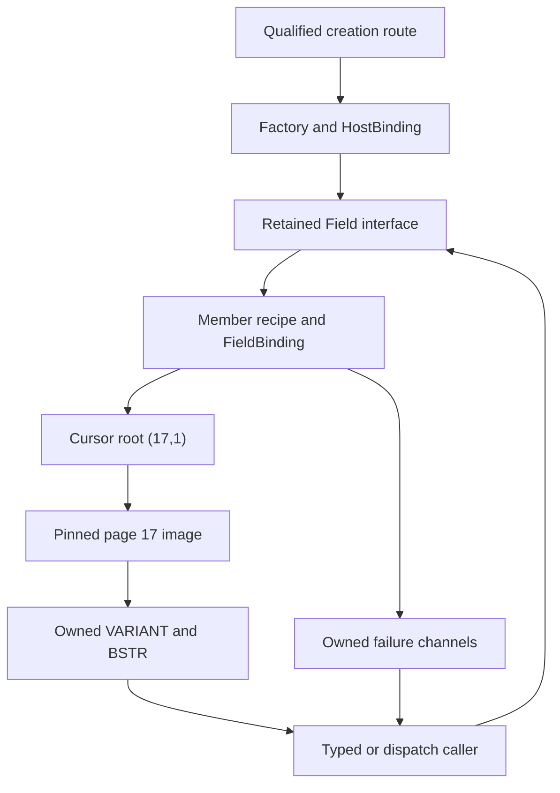
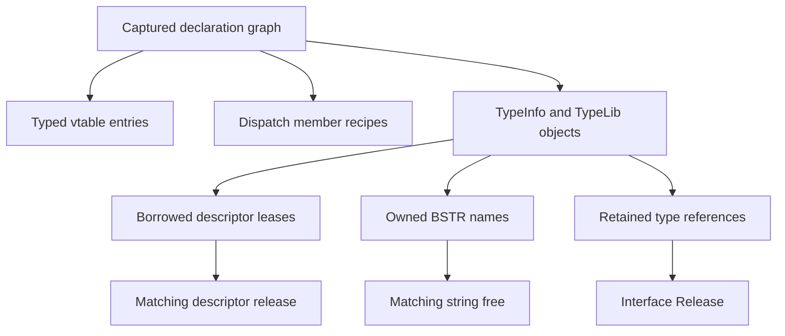
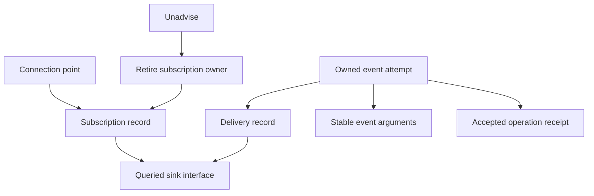
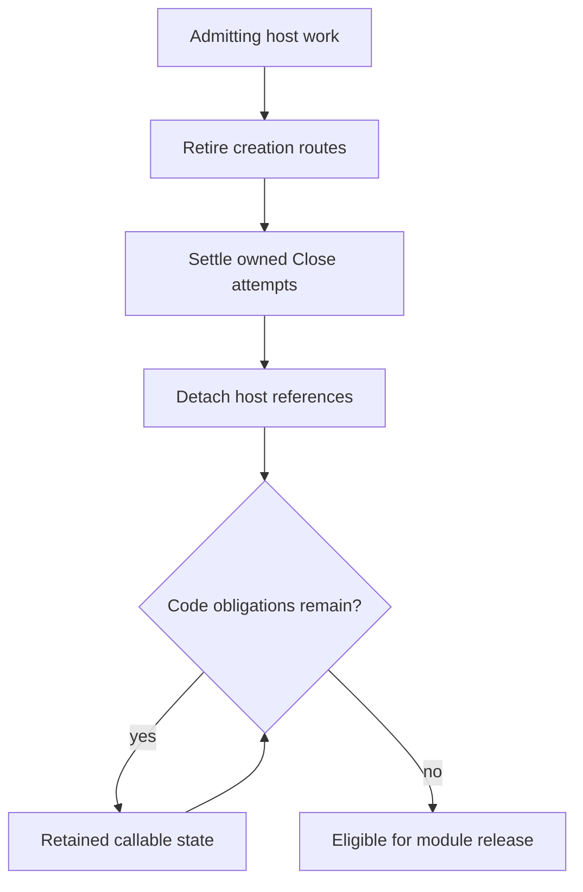
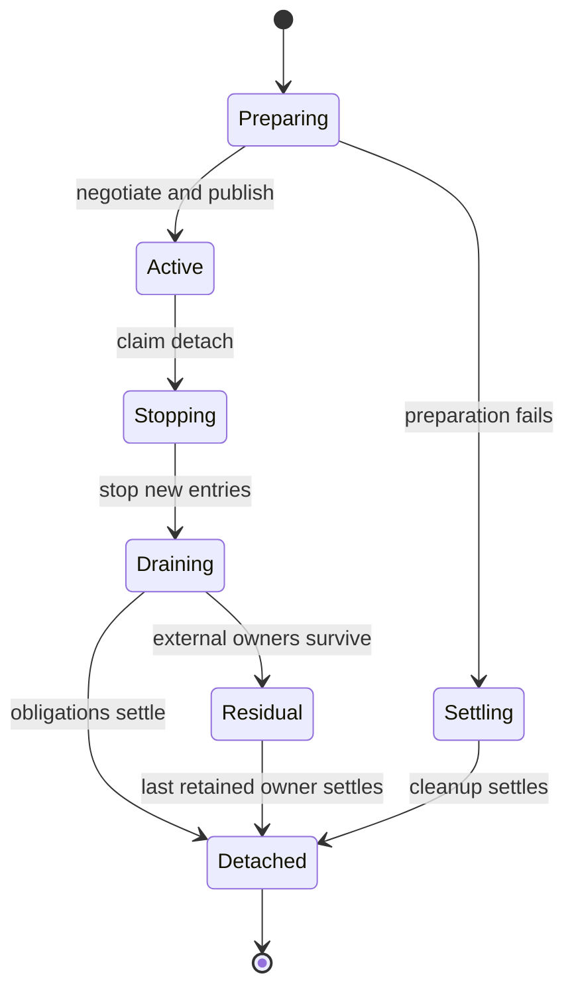

# II-13. COM, activation and DNA Calc integration

Revision 1 · Stage 2, response 12 · 2026-11-14

**Requirement trace:** Primary RQ-PROD-02, RQ-COM-01, RQ-COM-02, RQ-COM-03, RQ-CALL-01, RQ-PORT-02, RQ-PORT-03 and RQ-HOST-01. Supporting RQ-PROD-01, RQ-PROD-06, RQ-SEM-03, RQ-DAO-01, RQ-DAO-04, RQ-ADO-01, RQ-ADO-02, RQ-LATE-05, RQ-VAL-01, RQ-VAL-03, RQ-EXPR-01, RQ-EXPR-02, RQ-CALL-03, RQ-CALL-04, RQ-ORACLE-02, RQ-LEDGER-01, RQ-PERF-01 and RQ-PERF-02. I-16 retains the full scope/phase map. II-02 supplies the shared values, II-09 owned work and waits, II-10 accepted host invocation, and II-12 member recipes and final outcome publication. This chapter realizes K-COM, K-VALUE, K-STRING, K-ERROR, K-THREAD, K-WORK, K-ADMISSION and K-BROWSER at the native and portable boundaries; it introduces no rival object model or database API.

Prefer a native CalcDb COM server generated from the reconciled public declarations, with own public identities and host-scoped compatibility activation. Retain an explicit host binding in issued factories and objects. Supply the full consumed Automation service set through native Windows services or CalcVBA's portable foundation. Keep installed Framework 4.8-family and .NET 10 LTS clients as separate unchanged-client lanes, and distinguish native values from managed projection. **D-ACT-1 and D-HOST-1 remain Provisional; D-VALUE-1's representation and D-CALL-1 remain Decided.** Windows `Both` threading is the preferred provisional class direction only with the corresponding synchronized implementation and qualified callback ownership. DAO retains priority; ADO may proceed alongside it.

**Evidence boundary.** The initial oracle remains user-reported ACEDAO.DLL **16.0.20527.20016**. Public Microsoft documentation and current Excel-DNA runtime documentation supply the stated facts; actual loaded metadata, runtime, factory and module identities remain to be captured. No Windows/ACE, CalcVBA, COM/ABI, .NET, DNA Calc or portable-runtime experiment was executed. The corrected shared value is the real platform Automation VARIANT and real BSTR, including the **24-byte VARIANT on Windows x64**. Target declarations, Windows x64 by-value calling, Decimal/BSTR/SAFEARRAY and spreadsheet-string examples are explicit derivations or constructed witnesses, not native captures. The page-17 witness retains the prior format hypotheses. The portable stand-in remains CalcVBA-owned implementation work, with no portable apartments or marshaling. Figures are emitted tables/Mermaid source, not render-verified.[^authority]

## 1. Define compatibility over a complete call path

The unit of integration is a particular unchanged caller reaching a particular CalcDb object through a qualified creation route, then completing the same observable operation as its native reference. A successful `QueryInterface`, a synthetic dispatch call and a query returning the expected rows establish different parts of that path. **RQ-PROD-02, RQ-COM-01, RQ-COM-02 and RQ-COM-03** require the path to join: actual client metadata and loading, class selection, the genuine interface, value ownership, object behavior and shutdown.

Prefer three separately identified records. An `InterfaceManifest` contains the evidenced public declarations introduced in II-12. An `ActivationProfile` describes a supported host route, its mappings and lifetime. A `HostBinding` retains the actual runtime/services capable of servicing this call. These are proposed implementation records, not additional public COM interfaces or fields written into an Access database. Build provenance accompanies a capture; it never selects a hidden answer table inside the engine.

**Figure F-137 — evidence needed for one unchanged-client route.** Original design table. Each row can fail while every row above it succeeds.

| Boundary | Concrete evidence | What remains separate |
| --- | --- | --- |
| Client loading | Same client binary/source project as appropriate, dependency identities, load outcome and actual runtime | A rebuilt probe is a different fixture; loading a CLR does not establish add-in compatibility. |
| Creation | Original ProgID or CLSID, requested context/IID, active mapping, chosen factory and implementation provenance | The genuine IID can be implemented by ACE or CalcDb; an IID does not identify the selected implementation. |
| Declaration | Actual base interfaces, slots, calling convention, directions, defaults, type information and source interfaces | A names-only late-bound client does not exercise the early-bound layout. |
| Transport | Active VARIANT contents, counted BSTR bytes, array shape, ByRef aliases, outputs and each error channel | A managed projection can change how the same native value is represented to the language. |
| Operation | Accepted binding/cursor/mutation receipts and visible results from the common engine | Native state can change before a later diagnostic or return-path failure. |
| Lifetime | Surviving references, module/service ownership, Close disposition, callbacks and final cleanup | Resource Close, COM final Release, factory revocation and host exit are separate events. |

Record these dimensions without inserting new diagnostic observations into the call being measured. II-12's error observers remain separate fixtures where reading a thread slot or evaluating an Error property would itself alter the evidence. Raw outputs are captured immediately by the caller before unrelated calls; trusted host instrumentation can append implementation provenance to a separate trace. The release build need not expose a private identification property on DAO objects. A module loaded somewhere in the process is insufficient proof that the tested object came from it: use the matched activation attempt, factory instance and retained implementation owner.

The Windows lanes are actual CalcVBA early and late binding, a genuine x64 `.xll`, and unchanged managed clients on installed .NET Framework 4.8-family and .NET 10 LTS. Native probes add focused routes that those clients do not expose conveniently. Non-Windows and wasm32 lanes use real CalcVBA clients compiled for their shared target ABI. Windows binary loading across operating systems is not an added product claim. **RQ-PORT-02/03** require the portable object model and services, while **RQ-HOST-01** requires DNA Calc to retain the host responsibilities that make those objects usable.

Keep the construction profile separate from the database behavior profile. Initial ADO activates CalcDb's own Connection, Command, Recordset and related classes; its ACE provider string is interpreted by the native-file adapter specified in II-12. The later CalcDb OLE DB provider remains **RQ-LATE-05**. Successful activation of Microsoft's ADODB followed by an unimplemented provider path does not deliver the initial CalcDb ADO route.

No public signature is inferred from the Office16 path or a familiar sample. The initial engine remains the user-reported ACEDAO.DLL 16.0.20527.20016. Capture the type library, imported client metadata, loaded engine, ADO runtime and host independently. A supported member that lacks evidence or implementation remains visible in the coverage ledger. Generic refusals cannot complete this integration requirement.

## 2. Publish declarations and activation identities as different artifacts

**RQ-PROD-02, RQ-COM-01, RQ-COM-02 and RQ-HOST-01.** The deliverable is a native server that existing callers can both find and call. II-12's member recipes describe the calls; this chapter supplies the actual interface declarations, class factories, type information and host ownership that make those recipes reachable. A correct `QueryInterface` implementation cannot repair activation that selected ACE, and a manifest pointing to CalcDb cannot repair a vtable whose third argument is the wrong type.

Maintain two related immutable artifacts. `DeclarationProfile` is a target-specific reconciled projection of II-12's captured interface manifest; it contains the public ABI and metadata without creating another inventory. `ActivationProfile` says which requested creation identities map to which CalcDb factories under a particular host scope. Give CalcDb its own public CLSIDs, ProgIDs and deployment identity. The compatibility profile also contains the original identities consumed by unchanged clients, with evidence for each alias. It does not rewrite the operating system's Microsoft registrations. Keep `DAO.DBEngine.120` and `Microsoft.ACE.OLEDB.12.0` in their actual roles: the former is a creation name whose target must be captured; the latter is a provider-name value interpreted by CalcDb's ADO adapter under II-12, not an instruction to instantiate Microsoft's ADO stack.

The native collector introduced in II-12 loads explicitly selected public type-library material with `LoadTypeLibEx(..., REGKIND_NONE)`, copies the permitted declarations, and releases descriptors through their owning type-information interfaces. That registration mode matters: the default and register modes can register material. Capture the exact file/resource identity and its hash, architecture, library GUID, version and LCID independently of the loaded ACE engine. An Office16 pathname does not determine any of those identities.[^act-loadtypelib]

Extend the owned declaration graph with `TypeRef(library, type)`, implemented/source/default-interface relationships, aliases, recursively described parameters and record types, and the native function kind. A dual interface has both Automation and vtable views. For a dual `TKIND_DISPATCH`, the documented `GetRefTypeOfImplType(-1)` route retrieves its interface view; merely walking the dispatch list and treating its order as a vtable is insufficient.[^act-dual] `FUNCDESC.oVft`, invocation kind, calling convention, return/parameter descriptors and `TYPEATTR.cbSizeVft` are retained as separate evidence. Preserve inherited slots and declaration order while using a deterministic sort only for comparing captures.[^act-funcdesc][^act-typeattr]

**Figure F-138 — proposed declaration and deployment records.** These are original build artifacts, not native database records or a captured DAO type library.

| Record | Important fields | Consumer and rejection condition |
| --- | --- | --- |
| `InterfaceDecl` | Captured IID; base references; native vtable size; dispatch/dual flags; ordered entries | Generator rejects unresolved type, overlapping/inconsistent slot or unsupported call shape |
| `MemberDecl` | Member ID plus invocation kind; byte offset where applicable; recursive argument/result descriptors; LCID/name rules | Typed entry and dispatch adapter bind to one II-12 operation recipe |
| `ClassDecl` | Captured class identity; default and source interfaces; construction/aggregation cases | Factory chooses the correct public object family |
| `TypeLibraryImage` | Library identity/version/LCID/target ABI; all referenced declarations; original provenance | Windows type library and portable type-information service retain the same meanings |
| `ActivationBinding` | Requested ProgID/CLSID; own or compatibility role; factory descriptor; allowed route/context; host scope | No automatic registry fallback is accepted as successful CalcDb selection |
| `DeploymentImage` | CalcDb module/build; declaration-profile hash; manifest identity; dependency/type-library resources | Host verifies that code, metadata and manifest belong to one deployment |

`ITypeLib` contains library-wide lookup, binding and attributes; `ITypeInfo` exposes referenced types and descriptor lifetimes as well as functions. Implement the consumed metadata surface, including `ITypeComp` binding if the actual CalcVBA client requests it. A correct `GetIDsOfNames` dictionary is not a substitute for a type library. Conversely, a correct `.tlb` does not establish that an object's `GetTypeInfo` returns the right interface view.[^act-typelib][^act-typeinfo]

Generate CalcDb's declaration output and Windows type-library material from the reconciled manifest. Preserve required compatibility library identities and version behavior where clients depend on them, while keeping CalcDb's package identity explicit. The reference capture is evidence, not a redistribution plan for Office binaries. Any later redistribution or source adaptation requires the exact-material rights check already required by A-01; this design adopts no Office binary or Microsoft example implementation.

Type-library lookup has its own test branch. A client can resolve a library by GUID/version/LCID before creating any coclass, load a known path, obtain type information from a live object, or use compiled imported metadata without opening a type library at run time. `LoadRegTypeLib` documents version selection in which an exact match wins and otherwise an eligible higher minor version with the same major can be selected. Capture the selected library, not only the requested version; do not turn that documented registry behavior into an assumption about every activation-context or managed route.[^act-loadreg] When an unchanged binary explicitly opens an Office type-library path, a COM-class mapping does not by itself supply that path. R-ACT-1 records this as a separate deployment problem, rather than quietly requiring Office to remain installed.

## 3. Generate native entries with the actual x64 ABI

**RQ-COM-01, RQ-VAL-01 and RQ-CALL-01.** Each public interface pointer addresses a valid interface head whose first machine word is the vtable pointer. Use a native-layout boundary structure and generated typed entry points; neither a Rust trait object nor a managed object address is a COM interface pointer. The private owner state can use handles and generations, but the address and vtable exposed to a client remain valid until that client's reference is released.

For the standard `IUnknown` prefix, the native entries are `QueryInterface`, `AddRef` and `Release`; the `IDispatch` prefix then adds `GetTypeInfoCount`, `GetTypeInfo`, `GetIDsOfNames` and `Invoke`. Those standard contracts are known. Every additional DAO/ADO slot, IID, DISPID, direction and return form comes from the captured profile. Do not assign a guessed numerical slot to `MoveNext` or `Field.Value`. A dispatch-only interface does not acquire extra vtable entries because its documentation lists methods.[^act-dispatch]

The build emits a C-compatible declaration probe and an independently compiled client for each target ABI. Compare `sizeof`, `alignof`, field offsets, array stride and actual calls across the boundary. The Windows x64 profile uses a 24-byte `VARIANT` as already fixed in II-02. Its size changes both contiguous argument arrays and the compiler's treatment of a by-value parameter. The native compiler owns register/stack lowering; avoid handwritten assembly thunks unless an evidenced call shape makes them necessary.

**Figure F-139 — a constructed x64 call shape.** This deliberately invented method is only an ABI witness; it is not asserted to be any DAO or ADO declaration.

```text
HRESULT Witness(IWitness* self, LONG n, VARIANT value, BSTR* out_text)
```

| Logical input/output | Windows x64 location for this prototype | Ownership meaning |
| --- | --- | --- |
| `self` | First integer/pointer argument register, `RCX` | Borrowed interface reference valid for the call |
| `n` | Low 32 bits of `RDX` | A 32-bit value, not a pointer-sized host integer |
| `value` | `R8` points to the caller's ABI temporary | The 24-byte aggregate is passed indirectly; this does not make its semantic parameter `[in,out]` |
| `out_text` | `R9` | Pointer to caller's output cell; successful ownership transfer follows the declared recipe |
| `HRESULT` | Low 32 bits of `RAX` | Native transport status, independently projected from error information |

Windows x64 uses four positional register slots, with later arguments on the stack and caller-provided shadow space. An aggregate that is not one of the directly supported sizes is passed through a caller-allocated temporary. Thus the `VARIANT` witness has one argument position containing a pointer, not three register arguments containing pieces of its payload. The ABI's hidden indirection is separate from a `VT_BYREF` tag, and both differ from a declared `VARIANT*` parameter. Include all three shapes in the compiled probe.[^act-x64call][^act-x64layout]

A generated entry has a fixed `InterfaceDecl` and `MemberDecl`; it therefore reaches the typed operation without a per-call string lookup. It validates the boundary form appropriate to that declaration, establishes an `OwnedCallAttempt`, and invokes the existing II-12 operation. A dispatch call performs its required argument binding first, then reaches that same operation. The two adapters can have different binding errors because the callers supplied different representations, but they do not maintain independent cursor or transaction logic.

```text
typed_entry(interface_head, native_arguments, native_outputs):
    owner = recover_stable_owner(interface_head, generated_head_offset)
    call = owner.begin_owned_call(member_recipe)   // owned before reentrant preparation
    decode_declared_inputs(call, native_arguments)
    result = run_typed_object_operation(call)
    complete_using_II12_owned_publication(call, result, native_outputs)
```

This is original design pseudocode. Inputs are borrowed for the declared call duration unless the member's contract transfers ownership; retained values are copied or retained into the call before their sources can disappear. Output transfer, thread error-info action and diagnostic publication use II-12's completed recipe, including its fallible `SetErrorInfo` branch. The outline adds neither a second error policy nor an allocation after the final inert handoff. Register the call and its owner before any reference operation, allocator operation with a foreign destructor, type-information call or callback can reenter.

There is no promise to recover safely from an arbitrary invalid native address. The ABI assumes valid caller-owned addresses for the declared accessible extents, with explicit handling of valid null/optional forms and bounded lengths. Treating process memory corruption as an ordinary missing-parameter error would hide a different failure. Testing malformed but addressable descriptors is valuable; intentionally invalid-address probes belong in a disposable child process and do not justify swallowing all faults in the host.

No Rust unwind, C++ exception or managed exception crosses a native COM entry. Translate owned language-level failures at that boundary. A fail-fast implementation defect and an ordinary ACE-equivalent error remain distinguishable in the harness; do not turn every defect into an undocumented successful empty value. Native compiler/linker settings, unwind mode, integer widths and module exports are part of the build profile, not details inferred from a language's default object representation.

## 4. Keep COM identity, open resources and executable code separately alive

**RQ-COM-01, RQ-DAO-04, RQ-CALL-04 and K-COM.** Prefer an immovable wrapper with one controlling identity, a small set of interface heads and a typed state handle. A field wrapper may have several interface pointers while still naming one public object. `QueryInterface(IID_IUnknown)` from any of them returns the same controlling pointer with a retained reference. Other interface pointers are allowed to differ even when requested repeatedly; stable embedded heads are CalcDb's economical implementation choice, not a wider COM pointer-equality guarantee.[^act-qi]

**Figure F-140 — constructed interface-head and owner witness.** Addresses only illustrate the design; none is an observed native object layout.

| Client reference | Example address | `QueryInterface(IID_IUnknown)` result | Shared private owner |
| --- | --- | --- | --- |
| Primary object interface | `0x1000` | `0x1000`, retained | Wrapper incarnation `W7` |
| Secondary object interface | `0x1020` | `0x1000`, retained | `W7` |
| Error-support interface | `0x1040` | `0x1000`, retained | `W7` |
| Independent child wrapper | `0x2000` | `0x2000`, retained | Wrapper incarnation `W8`, with its own retained parent-state anchor |

The supported interface set is immutable for the wrapper's lifetime. Closing a Database, moving a Recordset or deleting a TableDef changes member legality and resources, not which IIDs the same wrapper supports. `QueryInterface` never opens a file or advances an iterator just to decide interface support. A later feature whose methods are not implemented remains visible in member coverage; a changing `QueryInterface` answer cannot disguise it.[^act-qirules]

Use three distinct ownership counts or equivalent exact sets: externally/internal retained wrapper references, active entry frames, and module-lifetime obligations. An outstanding object includes class factories, enumerators, error objects, connection-point objects and CalcDb-owned type-information objects whose methods reside in the DLL. A live callback thunk or deferred completion can also keep code alive even if the original database wrapper has closed. Ordinary Windows BSTR ownership can survive CalcDb unloading because its allocator/free contract belongs to Automation; a custom foundation allocation with a module-owned destructor needs its foundation owner retained explicitly.

`AddRef` and `Release` on foreign objects are calls. Detach a release list from protected engine state, end the internal critical section, and then release those references on the qualified thread. Retain the current entry/module owner until those releases finish. A released event sink may call back into the host or release another CalcDb object; it must not discover a half-destroyed owner graph. The destruction path is part of the reentry model rather than an exemption from it.

Initial wrapper construction allocates and initializes private state while its construction owner retains the module. Publish no interface until required interface heads, state identity and error-policy dependencies exist. For a requested interface that is unsupported, return the declared failure with a null output and dispose of unpublished state through owned cleanup. If initialization caused a foreign call, its failure path retains the original failure until cleanup and II-12 publication are resolved.

Factories must treat aggregation explicitly. `IClassFactory::CreateInstance` takes the outer controlling `IUnknown` and requires an `IID_IUnknown` request when that outer is non-null. A class that does not support aggregation returns `CLASS_E_NOAGGREGATION`; it must not ignore the outer and create a separate identity. Prefer no aggregation for an unobserved class until the inventory and native experiment require it. If a required class accepts aggregation, implement its delegating/nondelegating identity and lifetime rules as a complete branch, with capture of nested QI and outer release behavior. Generic COM documentation does not prove that a particular DAO or ADO class accepts it.[^act-classcreate]

This wrapper plan leaves II-12's public identity policies intact. Two opens of the same file can share native state and still have separate Database identities; repeated collection lookup can return an already-held wrapper only when that family policy calls for it. COM lifetime protects the callable representation. Database Close separately releases resources according to the observed semantics and its owned `CloseAttempt`. Neither fact implies the other.

## 5. Follow a retained Field through the native page and back to its caller

Use II-12's independent two-root table fixture to connect integration work to the engine it exposes. The 4096-byte data page is page 17; the row with Id 42 has logical root `(17,1)`, body offset `0x0FDD` and absolute file offset `0x11FDD`. Its example index entry is `7F 80 00 00 2A 00 00 11 01`. The full 19-byte row is `04 00 2A 00 00 00 48 00 69 00 0A 00 0A 00 06 00 02 00 07`, with Name payload `48 00 69 00` at file offset `0x11FE3`. These are the source-derived hypotheses and original fixture from earlier chapters, not a new observation of a native ACE file.[^root-page]

The client has already created CalcDb, opened the database and retained a Field whose `FieldBinding` targets this recordset's current Name column. A real generated entry recovers the object owner from the interface pointer, enters its caller/runtime context and invokes the II-12 member recipe. That recipe checks public state and the qualified schema binding. The cursor resolves its current logical root to the selected row body; the pager supplies a stable image under a pin. The row codec locates text bytes through the native format descriptor. Neither COM identity nor the Field wrapper stores a permanent address into that page.

For this single result, the preferred D-STRING-1 path reserves and constructs one owned BSTR directly from the text, then releases temporary page access as its existing owner permits. The caller receives a real `VT_BSTR` VARIANT, with Windows x64 stride 24 and a separately owned string. The four payload bytes remain `48 00 69 00`; an ordinary text BSTR also has its byte-count prefix and terminator. The pointer value depends on allocation and is not part of cross-run equality. Automation cleanup uses the matching allocator. Corrected CalcVBA can retain or consume that canonical owned result without a mandatory private 16-byte intermediate.[^root-string]

**Figure F-141 — activation chooses an object; a warm call reaches the existing page path.** Original flow. Arrows do not claim that a route has been executed.



Moving the recordset changes which logical row that retained Field reads. Refresh, Requery, schema replacement and Close follow II-12's family-specific rules; an alive wrapper may have an invalid or closed operation state. An earlier returned Hi BSTR remains owned by its caller. The Hi-to-Ho edit changes the candidate byte at file offset `0x11FE5` in the same fixture, but does not mutate that returned string. On Update, the shared edit and mutation service chooses accepted native work; COM cleanup has no independent permission to undo or repeat it.

A raw vtable call, a late-bound Invoke, an RCW property access and a portable CalcVBA call should reach this same Field operation. Their bindings and final language projections differ. An adapter can pass the native row/value check and still fail because it returns a borrowed BSTR, uses a 16-byte element stride, publishes the wrong error object, loses a ByRef writeback or destroys its module while a Field survives. An RCW's documented projection of a correct native value needs comparison against the same managed native-reference lane before it is classified as an engine mismatch.

The first data-bearing integration prototype uses this path with a real read-only file, followed by one owned value retained across MoveNext and Close. The first write-bearing prototype adds Edit/Update and validates the existing native mutation receipt after deliberately failed result preparation. These slices need the corresponding W-04 and W-05 services, respectively. Declaration capture, activation coverage and allocator round trips can begin earlier with bounded synthetic server fixtures, explicitly labelled as such.

## 6. Publish one target ABI and one foundation service inventory

**Requirement trace:** RQ-VAL-01, RQ-VAL-03, RQ-COM-01, RQ-PORT-02 and RQ-PORT-03; supporting RQ-ADO-01, RQ-CALL-01 and RQ-HOST-01. **D-VALUE-1 remains Decided representation; provisional package.** CalcDb consumes the corrected shared Automation declarations and services. CalcVBA owns the portable COM stand-in. The following structures and service groups specify what that implementation must provide; they do not identify an existing CalcVBA API.

Publish a small `TargetAbiDescription` alongside the shared declarations. It records fixed scalar widths, pointer width, endianness, function calling convention, aggregate alignment, offsets and array strides, supported ownership operations, and the versioned allocation domain. A digest can identify the complete declaration set for diagnostics and startup compatibility checks. It must not select different value semantics according to a private build hash. The public interface/member inventory from II-12 supplies signatures and identities; the target description supplies their physical realization.

**Figure F-142 — target declarations and evidence obligations.** The Windows column is derived from public declarations and x64 rules. Other columns are requirements on the shared target definition, not claims about an implemented stand-in.

| Item | Windows x64 contract | Native portable target and wasm32 obligation |
| --- | --- | --- |
| Integral ABI types | `LONG`, `ULONG`, `HRESULT`, `LCID` and `DISPID` retain their defined 32-bit width; pointer-sized types are separate. | Use explicit widths; a host language's `long`, Boolean or pointer-sized integer is not a substitute. |
| String element | Counted 16-bit Automation string units, with byte-counted BSTR operations available. | Keep that representation; do not substitute the platform's `wchar_t` or a UTF-8 allocation. |
| VARIANT | Size 24, alignment 8, ordinary payload offset 8; Decimal overlays offset zero. | Publish and verify actual shared offsets and stride. A 32-bit-pointer target need not have the Windows x64 size. |
| SAFEARRAY | Pointer alignment produces the fixed fields and bound locations derived below. | Publish the actual descriptor, element stride, metadata and function ABI used by the CalcVBA client. |
| Interface pointer | Pointer to the target's callable interface layout, with the real method declarations. | The two participants must agree on the target ABI and function-pointer representation; Windows machine instructions do not become portable. |
| Ownership | Native matching allocators and reference services. | One agreed foundation allocation domain survives every value/interface it owns. |

The fixed Windows integer widths are documented independently of pointer width.[^fnd-wintypes] The 24-byte VARIANT derivation combines the declaration's pointer-pair record arm with the x64 aggregate rules; it is not an ACE observation.[^fnd-variant][^fnd-x64] On a selected portable 64-bit target the same field widths and alignment may produce the same size, but the actual calling convention must still be verified. On wasm32, two four-byte pointers and the Decimal arm can produce a different size. Neither possibility justifies retaining CalcVBA's old private 16-byte semantic representation on Windows x64.

The initial foundation delivery has six service groups: allocation and values; genuine interface identity and class factories; dispatch and type descriptions; collection enumeration; error information; and connection points with their enumerators. The shared expression and text services remain the II-10 extension of I-FOUNDATION-1. These groups may share implementation storage but cannot be collapsed into a names-to-functions dictionary: an early-bound caller consumes metadata, a `For Each` loop consumes an enumerator, and ADO events consume outgoing interfaces with independently retained references.

Portable activation resolves an admitted class identity to a retained factory using the host's selected compatibility mapping, then uses the same genuine object declarations. It supplies IClassFactory CreateInstance and LockServer ownership rather than a private constructor reachable only from CalcDb tests.[^fnd-factory] A non-null aggregation outer has the documented IID_IUnknown creation constraint; unsupported aggregation remains an explicit class-specific failure, not an ignored parameter.[^fnd-createinstance] Factory references and server locks are distinct lifetime obligations. A balanced LockServer release does not unload code still referenced by a live interface, type descriptor or active call.[^fnd-lockserver]

The portable stand-in adds no apartments or cross-thread/cross-process marshaling. Objects and callbacks remain with the declared runtime caller owner; any worker coordination inside CalcDb uses private engine state rather than transporting public COM pointers. Windows keeps its native COM adapter and apartment obligations. The shared target ABI enables co-located portable components to call each other; it is not a wire format for moving a VARIANT containing pointers to another process or browser worker.

Start with declarations, a small value round trip and one typed member. Expand to a real early-bound CalcVBA caller before building the whole object hierarchy. Keep a coverage row for every required service/member and each actual consumer. A mock written against the same mistaken declaration can agree with itself. The independently compiled Windows SDK caller, existing client metadata, and actual portable CalcVBA runtime provide the necessary independent checks. Missing portable services remain implementation work owned by the shared foundation; they do not authorize a CalcDb-specific object protocol.

## 7. Make the Decimal overlay and array stride visible in bytes

Use an initialized 24-byte test object to construct a negative Decimal with scale four and magnitude words `Hi32=1`, `Mid32=0x23456789`, `Lo32=0xABCDEF01`. Its exact value is the negative of `(2^64 + 0x23456789 × 2^32 + 0xABCDEF01) / 10^4`. This deliberately exercises the high word and both ordinary reserved-header regions. Decimal carries a 96-bit integer magnitude and a scale from zero to 28; its layout overlays the start of VARIANT.[^fnd-decimal]

**Figure F-143 — constructed Windows x64 Decimal VARIANT.** This is an original ABI witness, not bytes captured from ACE. The final eight zero bytes belong to the fixture's initialization and are not semantic Decimal data.

| Offset | Bytes | Meaning |
| --- | --- | --- |
| `0x00..0x01` | `0E 00` | `VT_DECIMAL`; occupies the Decimal reserved word. |
| `0x02` | `04` | Scale four. |
| `0x03` | `80` | Negative sign. |
| `0x04..0x07` | `01 00 00 00` | High 32 magnitude bits. |
| `0x08..0x0B` | `01 EF CD AB` | Low 32 magnitude bits. |
| `0x0C..0x0F` | `89 67 45 23` | Middle 32 magnitude bits. |
| `0x10..0x17` | Eight zero bytes in this fixture only. | Inactive tail of the 24-byte VARIANT storage. |

A constructor that writes the Decimal arm and then clears the ordinary VARIANT reserved words destroys the scale, sign and high magnitude. Conversely, writing the tag before assigning an entire standalone Decimal can replace the tag with that Decimal's reserved word. The shared typed constructor must establish the arm and tag in the correct order; this follows from the two overlaid declarations. The proposed fixture compares active fields after the call and verifies neighboring canaries; it does not demand identical inactive bytes from native Automation.

The stride defect is independent. If a caller allocates three Windows x64 VARIANTs, their starts are at offsets `0`, `24` and `48`; the buffer occupies 72 bytes. A 16-byte stride puts the second argument in the first argument's record-pointer capacity and corrupts subsequent arguments even when each test value happens to be a small integer. Exercise at least three arguments, one Decimal, a pointer-bearing value and a legal ByRef argument in both typed and dispatch calls. Single-scalar tests often miss this error.

The boundary checker therefore records two views. Its ABI view records size, alignment, field offsets, stride, the exact declared call signature and initialized canaries. Its value view records tags, active scalar bits, exact BSTR payload, array shape and object identity events. Only the latter is compared for ordinary database compatibility. Pointer addresses, uninitialized padding and the private address of a caller's stack cell never enter the compatibility ledger as expected semantic values.

Treat native ABI pointers as pointers with documented caller obligations. A tag check does not make an arbitrary address safe to dereference. The portable stand-in may validate linear-memory ranges where its target representation permits that, but such checks remain target-specific argument admission. The design does not promise to recover from an arbitrary invalid native pointer, and it does not use speculative memory inspection to discover an allocator or interface type.

## 8. Allocate BSTRs and task buffers in their actual ownership domains

A BSTR pointer addresses its payload, not its allocation base; its four-byte prefix records payload bytes independently of embedded nulls.[^fnd-bstr] String allocation, copy, explicit length and free are one family; task-memory allocation is another. Native `CoTaskMemAlloc` returns uninitialized storage, may fail even for small requests, and permits a zero-size allocation.[^fnd-taskalloc] A public task buffer therefore carries a documented size and initialization obligation in its method recipe. It cannot be handed to `SysFreeString`, and a BSTR cannot be freed with the task allocator merely because both values are pointers.

The portable allocation requirement is an agreed service family with the same observable contracts and stable lifetime. It need not reproduce OleAut32's private heap organization. CalcDb's private accounting records the allocation kind, requested payload capacity and current owner outside the public BSTR/VARIANT/SAFEARRAY layout. Windows returned allocations use native services; portable allocations use the shared service selected by the actual CalcVBA runtime. A buffer must never cross to a different instance of an incompatible allocator just because its prefix looks plausible.

**Figure F-144 — an odd-byte binary BSTR is not three UTF-16 characters.** The pointer `p` addresses the first payload byte. This constructed allocation illustrates counted byte preservation; allocator bookkeeping and alignment outside the shown region are unspecified.

| Address relative to `p` | Bytes | Role |
| --- | --- | --- |
| `-4..-1` | `03 00 00 00` | Three payload bytes. |
| `0..2` | `41 00 FF` | Exact binary payload. |
| `3..4` | `00 00` | Two-byte terminator supplied after the payload. |

`SysAllocStringByteLen` copies bytes without character-set translation and permits embedded zero bytes; its paired byte-length query reports the original byte count.[^fnd-bytealloc][^fnd-bytelen] Therefore this witness is copied as three bytes, not two or four. It is not admitted as ordinary database text merely by dividing the length by two. A method requiring text applies its evidenced conversion or rejection policy after preserving the input ownership correctly. The usual text witness remains the three units `0041, 0000, 03A9`: six payload bytes plus the terminator, with an embedded null that does not end the value.

For a page-backed text result, the sequence is the II-02 materializer: determine checked output length from the field descriptor, reserve, allocate an owned BSTR, decode into its payload, and publish only after the result is complete. No `Fields(...).Value` result points into an evictable page or reusable UTF-16 scratch. On the next `MoveNext`, the retained BSTR remains independently valid. Returning a scalar uses the declared scalar arm without allocating a string simply to pass through a generic bridge.

When a client gives CalcDb a BSTR as an `[in]` argument, the method borrows it for the permitted interval. Retention requires a correct copy; a setter's success does not transfer ownership unless the declaration explicitly says so. `[out] BSTR*` and `[in,out] BSTR*` are different recipes. The former may designate uninitialized output storage that CalcDb must not clear; the latter may require replacing a caller-owned value with an explicitly defined release/writeback sequence. Aliases between argument locations remain significant and are captured before any reentrant operation.

Allocation failure also has a state. An attempt owns every completed allocation before the next fallible step. If a large BSTR result succeeds but a later wrapper or diagnostic allocation fails, the same attempt releases or transfers that BSTR under the II-12 outcome policy. It does not rerun a query, refetch a mutable field or invoke the UDF again to reconstruct the value. The foundation must remain usable until all such cleanup obligations and externally retained values covered by its host lifetime have settled.

## 9. Copy value ownership without erasing ByRef behavior

The service inventory must distinguish initialization, reference-preserving copy, permitted dereferenced copy, move, clear and typed construction. `VariantCopy` copies owning resources or retains object references according to the active arm, while a ByRef object wrapper does not by itself acquire the referent. `VariantCopyInd` supplies the documented indirect form, including supported nested `VT_BYREF|VT_VARIANT` cases.[^fnd-copy][^fnd-copyind] Those functions are not interchangeable implementations of a generic “clone argument” action.

Represent an admitted call argument by a borrowed canonical address, its declared direction, and an alias group or explicitly owned by-value snapshot. The direction comes from the captured member declaration, not the incoming tag alone. A legal ByRef pointer can refer to a scalar cell, a BSTR cell or another VARIANT. Two parameters can share the same destination. Copying each to unrelated temporaries and writing them back in parameter order changes observable behavior when a callback sees or changes the same cell. II-10's invocation intervals and II-12's member recipe already carry that relationship; the foundation preserves it.

The proposed `ArgumentAttempt` is registered under the outer call before any potentially reentrant retention. It owns the source-lifetime anchor, selected alias/snapshot role and cleanup obligation. Its owned-snapshot branch additionally registers a `CopyAttempt` containing the source-stability contract, copy form, reservation, initialized temporary, completed element/resource owners and foreign-call progress. Native copying can invoke foreign reference methods and allocate; a conservative complete reservation or an explicitly budget-aware shared operation remains necessary. The native API offers no incremental budget callback. An opaque record copy with unknown allocation behavior cannot be made bounded by reserving a nominal constant.

Source lifetime and source mutation stability are separate. Opaque native copy may keep traversing after a foreign AddRef or record callback reenters. A generation check after it returns cannot prevent that traversal from seeing a mutated graph or freed nested payload. The owned-snapshot branch therefore requires a qualified interval in which its source graph remains stable, or an already owned immutable/local source whose reachable resources have the necessary lifetime. An unqualified mutable graph must first be admitted through a safe shared-foundation preparation protocol; retaining its top-level owner is insufficient. This restriction does not freeze a legal alias-preserving ByRef argument: that branch keeps its observed mutable lvalue semantics and never substitutes the native snapshot operation.

```text
prepare_argument_value(call, source, declared_use) -> prepared_argument | failure
  register ArgumentAttempt under call before any fallible or foreign retention
  acquire source-lifetime/interval anchors into that attempt; revalidate after reentry
  derive preserve-alias versus permitted-owned-snapshot from member recipe
  if alias must remain observable:
      record referent identity, bounds and writeback role; do not dereference-copy it
      transfer the admitted borrowed argument and its interval owner to call
      return that alias-preserving argument without snapshot copying
  require a qualified mutation-stable graph for the entire copy traversal
  register CopyAttempt under ArgumentAttempt with initialized temporary and copy plan
  invoke supported native or shared copy outside internal latches
  after every foreign boundary:
      capture its failure promptly and revalidate source/continuation dependencies
      retain completed effects and partial-cleanup obligations in CopyAttempt
  if copy failed or continuation is invalid:
      settle or retain the exact residual owner; return the selected failure
  transfer the completed temporary into the call's accepted argument binding
```

The algorithm performs work proportional to inspected/copied payload plus foreign calls. Reference-preserving scalar/ByRef admission is bounded local work. It is not a universal implementation of arbitrary pointer graphs: legal forms, source stability, cycle handling and supported record services are explicit. A repeated ByRef address is an alias, not evidence of another allocation to free. A circular invalid pointer graph must not send the implementation into an unbounded traversal.

Clearing an owned array can fail when it is locked; clearing a ByRef object wrapper does not release the referred object.[^fnd-clear] Accordingly, a failed clear is not followed by zeroing the old owner and declaring success. `CleanupPending` retains the resource and whatever valid residual state the actual service contract leaves. The replacement value remains separately owned until the member's publication policy permits transfer. Nested arrays and record callbacks need their own partial-failure cases; the design does not assume that an arbitrary failing destroy has left every element unchanged.

Default native Automation copy/cleanup and foreign reference operations to the caller thread, as II-02 already requires. Microsoft's `VariantCopy` documentation warns about thread safety, and SAFEARRAY instance operations do not establish concurrent safety by themselves.[^fnd-copy][^fnd-array] A single caller-thread rule still needs a multi-caller/reentry policy. Avoid sharing mutable instances between concurrent calls unless the foundation supplies a demonstrated ownership protocol. No global engine mutex may span foreign `AddRef`, `Release`, record cleanup or an event handler.

## 10. Preserve SAFEARRAY shape, element ownership and lock state

A SAFEARRAY is a descriptor plus data and possibly additional type information. Element size alone does not identify element ownership: a pointer-sized slot might contain a BSTR, an `IUnknown*` or an unrelated scalar representation. Feature flags and the documented type-query services distinguish these cases. Record and typed-interface arrays also require their associated metadata; a private vector with a matching data pointer is insufficient.[^fnd-array] Query the element kind through the supported services and account for the documented `FADF_UNKNOWN` caveat when `SafeArrayGetVartype` alone does not identify an IUnknown array.[^fnd-arraytype]

For Windows x64 the descriptor declaration and alignment yield a 24-byte prefix before the first eight-byte bound. This is an explicit derivation to verify against the SDK, separate from any allocator metadata preceding the descriptor. A one-dimensional descriptor occupies 32 bytes; two bounds require 40. This calculation says nothing about whether metadata or data shares a larger allocation.

**Figure F-145 — constructed one-dimensional VARIANT SAFEARRAY on Windows x64.** Lower bound `-2`, count `3`; values are Long `-1`, Null and a BSTR containing `0041, 0000, 03A9`. Flags and pointer addresses are deliberately symbolic until returned by the actual service.

| Descriptor offset | Width and value | Interpretation |
| --- | --- | --- |
| `0` | 2 bytes: `01 00` | One dimension. |
| `2` | 2 bytes: actual valid feature flags. | Includes the required VARIANT ownership semantics; no guessed complete flag word. |
| `4` | 4 bytes: `18 00 00 00` | Each element occupies 24 bytes. |
| `8` | 4 bytes: zero. | No outstanding access lock initially. |
| `12` | 4 bytes: padding, unspecified. | Alignment before the pointer. |
| `16` | 8 bytes: data pointer `d`. | Owned data allocation. |
| `24` | 4 bytes: `03 00 00 00`. | Element count three. |
| `28` | 4 bytes: `FE FF FF FF`. | Lower bound minus two. |

The payload has 72 bytes. Indices `-2`, `-1`, `0` map to starts `d+0`, `d+24`, `d+48`; the final BSTR pointer is at `d+56`. The first element's active scalar bytes at `d+8` are `FF FF FF FF`; the second element has tag `VT_NULL`. The third points to a separately owned six-byte BSTR payload. Copying the 72 data bytes alone would duplicate ownership of that pointer. A proper array copy clones the BSTR; object elements instead acquire the required references.[^fnd-arraycopy]

Multidimensional API semantics and raw descriptor order must be named separately. The GetElement/PutElement documentation places the right-most index in `rgIndices[0]`; Automation's array explanation describes column-major data, where the language's left-most index varies first.[^fnd-arrayget][^fnd-arrayput][^fnd-arrayorder] An implementation should not reconcile these descriptions by guessing that every vector has the same orientation. Store a target-qualified mapping among language dimensions, API index-vector positions, bound-query dimensions, descriptor-bound positions and byte strides. Establish it once with asymmetric bounds/counts and labeled cells created and read through the native public functions; then validate CalcVBA in both directions. This is declaration qualification, not a proposal to make documented Get/Put behavior configurable.

For example, the proposed normalized language view has dimensions `[-1..0]` and `[4..6]`, with labels `(i,j)` in each cell. Its column-major rank is `(i+1) + 2×(j-4)`. Thus `(-1,4)`, `(0,4)`, `(-1,5)` have ranks zero, one and two. The native API fixture supplies the documented index vector `[j,i]`; the raw-descriptor inspector independently checks the target map. Swapping counts or choosing equal bounds would conceal a mistaken permutation. Do not use the MS-OAUT marshaled SAFEARRAY declaration as the in-process descriptor: that specification explicitly describes wire formats.[^fnd-oaut-array]

Construction checks every arithmetic stage before allocation: descriptor extent, each upper-bound calculation, product of counts, product with element stride, and owned nested payload admission. Use a wide checked intermediate even when the final public count is 32-bit. Zero-element dimensions and extreme lower bounds require public-service fixtures; there is no unchecked `upper-lower+1` in native `LONG` arithmetic. A malformed externally supplied native descriptor cannot be made safe merely by recomputing its product; pointer validity remains the caller's ABI responsibility.

`SafeArrayAccessData` obtains data access and increments the lock count; the paired UnaccessData releases that access and invalidates the borrowed pointer.[^fnd-access][^fnd-unaccess] That access lock is not mutation exclusion: PutElement permits element assignment while other operations hold array locks.[^fnd-arrayput] Track the access owner before using the pointer, and establish any required mutation-stable interval separately. No public result retains that borrow after unlock. The common array builder prefers initialization to empty values and an explicit completed prefix, allowing failure cleanup without treating unconstructed slots as owning values. Failure to unlock remains a named cleanup obligation and prevents a subsequent assumption that destruction succeeded. Native destruction releases elements according to their kind and can refuse a locked array.[^fnd-arraydestroy]

Direct data filling is an optional bounded optimization after declaration and ownership qualification. The baseline public Get/Put path gives independent semantics; PutElement has type-specific pointer conventions and performs the required reference handling.[^fnd-arrayput] A hot bulk path may fill initialized owned slots directly, but it must produce the identical shape, copied values and lifetime behavior. This optimization never makes SAFEARRAY storage an alias of row pages or substitutes a private spill format for an exported Automation array.

## 11. Type information is an owned graph consumed by real callers

Build portable type information over the same captured declaration graph that generates the genuine interfaces and II-12 member recipes. The graph contains libraries, type descriptions, implemented/base-interface edges, referenced types, functions, constants, parameter/default descriptors, coclasses and outgoing interfaces. It includes the metadata consumed by compilation and object inspection, not only the names currently called by a smoke test. `ITypeInfo` and `ITypeLib` expose graph traversal, descriptor retrieval, name binding and type-library ownership; the latter can represent a standalone library or one embedded in a binary.[^fnd-typeinfo][^fnd-typelib]

**Figure F-146 — one immutable declaration graph, distinct owned projections.** Original portable implementation proposal; no Windows type-library parsing format is invented here.



Prefer immutable shared metadata with per-request leases where public descriptors contain pointers into graph storage. `GetTypeAttr`, `GetFuncDesc` and `GetVarDesc` return through their matching release families; `ReleaseFuncDesc` is specifically paired with the corresponding retrieval.[^fnd-releasefunc] Retain the metadata owner and module while a live descriptor can refer to it. An implementation can return immutable shared storage with lease accounting or allocate a private descriptor; the caller-facing release contract remains unchanged. The preferred shared representation avoids rebuilding parameter trees for each type query and is reopened only by actual client requirements or measured memory cost.

Returned names are separately owned BSTRs. `GetNames` returns member/parameter information, with the assignment value unnamed for put/putref and inherited lookup where needed.[^fnd-getnames] Consequently, a generated name array cannot blindly assign one name to every physical ABI parameter. A lookup cache uses declaration identity, relevant locale and member context, and retains its metadata owner. It must never store a pointer into a transient `FUNCDESC` after release.

Support reference traversal and containing-library relationships as real object operations, with retained returned interfaces. `GetRefTypeInfo` resolves referenced type descriptions; `GetContainingTypeLib` returns the owning library and index.[^fnd-reftype][^fnd-containing] `GetTypeComp` and its binding surface must be included when consumed by the actual CalcVBA early binder; unavailable compiler metadata is not excused by late-bound dispatch working. `ITypeInfo::Invoke`, coclass creation or other advertised members likewise need exact supported behavior or the evidenced native refusal, rather than unexplained generic stubs.

`IDispatch::GetTypeInfo` uses its published index/locale contract.[^fnd-gettypeinfo] `GetIDsOfNames` is case-insensitive, interprets additional names as parameter names and guarantees stable returned IDs over the object's lifetime.[^fnd-getids] Member binding and parameter binding therefore have separate keys. Do not use a database's sort-order comparer to resolve interface names, and do not use a human-readable name as a substitute for the genuine ID. Late-bound Invoke consumes II-12's existing argument map, invocation-kind distinction and owned outcome sequence; the portable foundation does not implement a second argument binder with different missing-value or property-put rules.

This graph can be serialized as a build artifact chosen by the shared implementation, but its runtime projections are real interfaces. No requirement here authorizes distributing Microsoft's PIA or type-library binary. Provenance and redistribution analysis remain separate from reading public metadata for compatible declarations. Runtime tests record which metadata object supplied every consumed declaration so that an accidentally loaded native library cannot conceal missing portable support.

## 12. Enumeration has a result count, a position and returned owners

An enumerator's sequence membership policy belongs to the DAO/ADO family in II-12. Its transport belongs to the foundation: `_NewEnum` yields the evidenced interface form, and `IEnumVARIANT` supports Next, Skip, Reset and Clone.[^fnd-enum] Do not return the collection's current mutable iterator by address. The enumerator owns its sequence image or qualified live-view binding, current position, invalidation state and an operation record for a partially prepared fetch.

**Figure F-147 — constructed enumeration ownership witness.** Assume the preferred retained image `[child A, child B, child C]`; native family-specific mutation behavior remains R-DAO-1/R-ADO-1 evidence.

| Operation | Required ordinary sequence consequence | Ownership consequence |
| --- | --- | --- |
| `Next(2)` at position zero | Two elements; position two; `S_OK`. | Two independently owned result VARIANTs. |
| `Clone` | New enumerator initially at position two. | Independent enumerator identity retaining the same eligible image. |
| Original `Next(2)` | One element; position three; `S_FALSE`. | One returned child reference remains valid after the enumerator is released. |
| Clone `Next(1)` | Child C again from its own position; `S_OK`. | Another independently retained result. |
| `Reset` on clone | Position returns to start under the selected sequence policy. | Previously returned values are not reclaimed. |

The ordinary full/short-fetch return and count contract is documented.[^fnd-enumnext] Failure after preparation of a prefix is a different case. An `EnumerationAttempt` records the old position, prospective position, each initialized output value, count transferred and selected failure recipe. It uses the family-qualified policy for position and partial outputs; it does not assume that every failure is atomic or that every initialized temporary has already been handed to the caller. All foreign element AddRef/copy/cleanup happens outside internal latches, with revalidation before publication.

The result buffer's byte extent uses the target VARIANT stride, so `Next(3)` requires 72 bytes on Windows x64 before any pointed-to payload. The client is responsible for its declared output storage; CalcDb does not call VariantClear over arbitrary uninitialized caller slots. The adapter transfers only completed results under the actual ABI recipe and reports the exact completed count. Null-count-pointer cases are tested against the particular enumerator declaration and native behavior; do not mechanically apply a rule from a different enumerator interface.

Clone copies enumeration state, not the database or every object's mutable content. A retained image can retain membership while a child subsequently becomes closed or invalid according to its own object policy. Reset similarly does not mean Refresh. Those distinctions matter for early-bound VBA, late-bound VBA and managed `foreach`, whose wrappers can perform different combinations of `_NewEnum`, QueryInterface, Next and Release. The acceptance suite must drive the actual loops, not merely call Next from a private test harness.

## 13. Error services preserve the call's channel policy

The portable service set includes the required error-object creation interface, `IErrorInfo`, `ISupportErrorInfo` where advertised, the logical-caller error slot and EXCEPINFO ownership. It does not merge those channels with DBEngine.Errors or Connection.Errors. II-12 already owns their keep/replace/clear policy and the call's result/effect receipt. The foundation supplies the mechanics needed to express that policy without losing or replaying effects.

Native GetErrorInfo transfers the current logical-thread error object and empties that slot; a second get ordinarily finds no object.[^fnd-geterror] The portable runtime must define the corresponding logical caller identity explicitly. Neither “one error per database” nor a process-global last-error pointer meets that requirement. Nested calls use the same defined slot rules; they do not cause an automatic restoration of whatever pointer happened to be present at outer entry. A successful nested operation can legitimately change the current observable diagnostic state.

SetErrorInfo can release the displaced object and reports an HRESULT; therefore it may contain foreign lifetime work and cannot be presumed an inert final store.[^fnd-seterror] Preserve II-12's reviewed sequence: capture/retire foreign owners outside latches, prepare all fallible outputs, revalidate their dependencies, retain publication ownership, establish an empty or qualified inert slot, freeze the complete recipe, and perform its slot action. Only qualified completion allows the final bounded output transfer. A failed installation must remain under the same attempt and select a qualified bounded fallback or a visible unresolved outcome; it must not fall through with the old frozen success result.

A portable implementation can make its own slot wrapper and reference operations non-reentrant by design, while still honoring foreign incoming error objects. That makes a useful fast path; it does not prove every `SetErrorInfo`-equivalent call infallible. Allocation failures, old-object destruction and actual runtime callbacks belong in I-FOUNDATION-1/R-ERR-1. Do not log through arbitrary COM objects between a failing foreign call and immediate error capture, or between final error installation and return.

EXCEPINFO contains owned strings, mutually constrained code fields and an optional deferred-fill callback.[^fnd-excep] Eagerly prepare CalcDb's own complete error projection where compatible, leaving the callback absent. When consuming an actual deferred callback, retain the error/operation context, invoke it at most once under the selected recipe, capture its failure promptly, and preserve every partially filled owned string for cleanup. A pointer to a callback with expired module lifetime is not made safe by retaining the EXCEPINFO bytes. Neither deferred formatting nor another diagnostic request may rerun the original database action.

The qualification fixture is deliberately separate from the activation fixture: fail a real typed member, consume its native error slot immediately, repeat through Invoke and EXCEPINFO, then repeat through actual CalcVBA and managed projections. Record numeric HRESULT, argument-error index, error metadata, collection transitions and caller-visible exception separately. The boundary can be mechanically correct while matching the wrong error policy; both observations are required.

## 14. Connection points retain subscriptions independently of event delivery

ADO event support requires `IConnectionPointContainer`, `IConnectionPoint`, `IEnumConnectionPoints` and `IEnumConnections`, using the actual outgoing IIDs and signatures from the captured ADO declarations. The connection-point enumerator is a separate interface with its own Next/Skip/Reset/Clone surface.[^fnd-enumcp] CalcDb's portable implementation supplies that machinery; II-12 supplies which events occur, when, which ByRef values are writable and how outcomes survive reentry.

`Advise` must query the sink for the connection point's outgoing interface and keep the resulting reference; failure to obtain that interface has its specified connection failure. Each active connection receives a unique cookie for that point.[^fnd-advise] The proposed table stores `cookie`, retained sink interface, outgoing declaration identity, subscription state and an internal serial. Prefer nonzero monotonically issued 32-bit cookies within the point's lifetime, failing through the qualified resource outcome before exhaustion rather than wrapping onto an active or stale ambiguous subscription. This issuance policy is provisional and is changed if the native cookie contract requires otherwise; no private serial appears in the public cookie.

**Figure F-148 — subscription and in-flight event are different owners.** Original ownership graph. Arrows denote retained ownership, not callback order.



An event selects eligible subscriptions according to the provisional II-12 captured-subscription/registration-order policy. It retains the selected records before any handler is invoked. Retaining an internal record can defer its foreign sink release without calling foreign AddRef under a table latch; where another public interface reference is required, acquire it outside the latch while the internal owner keeps the sink alive. Self-Unadvise removes future subscription eligibility but cannot destroy the interface underneath the current call. Native event-order and mutation differences change selection policy, not this memory-ownership invariant.

Unadvise retires the subscription and performs the matching foreign Release outside internal latches.[^fnd-unadvise] Reentry during that Release can inspect the point, subscribe again or close a related object. The old record is already logically retired and has a named destruction owner; it is not still discoverable as an active connection while its sink is being destroyed. In-flight event frames and connection enumerators retain their own needed ownership until their qualified completion.

`EnumConnections` returns an owned enumerator; its Next results include interface pointers that the caller must release.[^fnd-enumconnections][^fnd-enumconnnext] Therefore connection enumeration needs prepared output-reference ownership just as collection enumeration does. Duplicate Advise calls are distinct subscriptions even when they query the same controlling sink object. Unadvising one cookie must not remove another. Mutation during enumeration and Close/subscription retention are native behavior questions, and are tested separately from the mechanical guarantee that every handed-out pointer remains alive for its reference lifetime.

COM cycles are possible: a source retains a sink that retains the source. The host and event-owning add-in need explicit unsubscription/teardown ownership; reference counting does not collect cycles. A source Close cannot silently break all subscriptions merely to make shutdown easy unless that matches the particular ADO object. Retained point/enumerator/sink references can outlive closed database resources. They still require callable vtables and valid metadata. The host shutdown protocol therefore separates stopping new calls, retiring subscriptions under their policies, settling calls/cleanup, and releasing the final module/foundation lifetime.

## 15. Qualify every unchanged creation route

**D-ACT-1 — Provisional.** Prefer a host-selected private native DLL deployment and scoped activation context. Add host-EXE factory registration only for demonstrated coverage that cannot be supplied by that context. Keep the two mechanisms independently testable. `CoCreateInstance` receives a class identity, execution-context flags and requested interface; it obtains a class factory, creates the instance and releases its temporary factory reference. `CoGetClassObject` exposes the factory as a separately retainable object. A retained factory no longer needs to repeat class resolution each time it creates an object.[^act-cocreate][^act-cogetclass]

**Figure F-149 — creation routes have different remaining dependencies.** Each row requires a distinct R-ACT-1 result; an accepted object must independently prove CalcDb implementation provenance.

| Caller action | What can select CalcDb | What a successful simpler test does not establish |
| --- | --- | --- |
| CalcVBA resolves an owned creation name | Host lookup-only resolver and captured alias | Direct calls made inside a native add-in |
| Native `CLSIDFromProgID` then `CoCreateInstance` | Active ProgID mapping and class mapping | Cached class identity or a different CLSCTX route |
| Native creation using embedded CLSID | Active class mapping or qualified host factory | Type-library lookup needed before creation |
| `CoGetClassObject`, then retained `CreateInstance` | Factory selected when it was obtained | A later context switch redirecting that retained factory |
| Imported managed coclass construction | Runtime's actual class identity and Windows activation route | Another runtime's constructor/binder behavior |
| Already-created object passed into DNA Calc | Whoever originally created the object | Any activation alias changing its implementation after the fact |
| Explicit DLL path plus exported factory | Explicit file selection, outside the normal COM resolution path | A manifest acting as a universal interceptor |
| Runtime type-information construction | Actual `ITypeInfo` and its class-creation behavior | Ordinary `CoCreateInstance` evidence alone |

The type-information route has a documented additional branch: `ITypeInfo::CreateInstance` normally calls `CoCreateInstance` using the type GUID, but for an Application object it tries `GetActiveObject` first. Capture whether a required type uses that route and which object it obtains; do not treat a pre-existing native object as newly redirected CalcDb.[^act-typecreate]

The last two rows are discriminators, not newly invented requirements for arbitrary unsupported loading tricks. Inventory real required add-ins. If one uses a route outside the selected mechanism, keep that route visible and settle it before claiming the add-in works unchanged. Do not patch an existing add-in's creation code and call the resulting test unchanged. An instrumented probe can isolate the reason for failure, but its result belongs to a different caller artifact.

Positive activation captures record requested identity, active profile, CLSCTX, requested IID, module build, selected factory and returned controlling identity. Obtain module/factory provenance using CalcDb's test instrumentation and ordinary loader/module inspection, without disassembling proprietary code. Use an explicit own-identity control and a reference ACE control in separate clean process runs. A result containing the expected rows but produced by loaded ACE is an activation failure. A class can also be CalcDb while its ADO implementation silently delegates to Microsoft's ADO; II-12's implementation-selection evidence must exclude that path.

Missing-class tests deserve a separate recipe. Microsoft documents that `CLSIDFromProgID` can synthesize an OLE1 identity and create a registry entry when the name is absent. `CLSIDFromProgIDEx` can trigger automatic installation under the relevant system policy. It has no execution-context parameter through which the caller can add a no-download flag.[^act-progid][^act-progidex] Therefore CalcDb's own alias resolver performs bounded lookup in its deployment inventory and returns a named resolution failure; it does not call either API on arbitrary unknown strings as a supposedly read-only existence check.

Where DNA Calc owns a Windows activation call, its explicit policy can request the qualified in-process route and disable code download. That does not alter an unchanged add-in's own direct API calls. Probe its actual missing-name/installation behavior only in a preconfigured disposable environment that already permits the test and records any registry change. Never create/delete Microsoft registrations or change machine policy on the user's installation as part of these experiments. The deployment itself requires no registration changes; external client behavior is separately observed rather than covered by an impossible assertion that a host can prevent every arbitrary native action.

A manifest also permits fallback: Microsoft documents that an absent active-context mapping leads COM to the registry. The host-controlled path can reject missing inventory entries before invoking Windows. For direct unchanged clients, the compatibility ledger must establish that all required mappings exist and that no route accidentally succeeds through ACE. An instrumentation label on the expected path cannot prove an unobserved path was intercepted.[^act-regfree]

## 16. Own activation-context scope through callbacks and nested entry

A private deployment image contains the native module, generated type-library material and a manifest describing the evidenced classes, library resources and threading model. Use symbolic captured identifiers in design examples; fill actual `comClass`/`typelib`/interface metadata from the declaration profile at build time. The manifest schema distinguishes class, type-library and proxy/interface metadata, so treating them as one GUID-to-DLL dictionary loses information. Package architecture and resource paths must match the x64 module that will actually load.[^act-manifest]

An `ActivationScope` is owned by DNA Calc, not by a mutable global variable in CalcDb. It retains the activation-context handle, an immutable profile generation, the entering thread identity and the activation cookie. `CreateActCtxW` failure uses `INVALID_HANDLE_VALUE`; the successful handle is reference-counted by the activation-context APIs rather than closed as a kernel file handle. Handle lifetime and a particular thread's active stack frame are separate obligations.[^act-createctx][^act-releasectx]

```text
enter_host_callback(host, route, callback):
    entry = host.register_entry_owner(route)       // retain before foreign preparation
    profile = entry.retain_current_activation_profile()
    cookie_slot = entry.reserve_inactive_cookie_slot(current_thread)
    cookie = activate_on_this_thread(profile.context)   // failure leaves slot inactive
    cookie_slot.record_active_without_failure(cookie)  // no allocation or foreign call
    try:
        callback_outcome = callback_and_capture_owned_outcome(entry)
    finally:
        pop = attempt_deactivate_and_capture_on_same_thread(cookie)
        if pop.proves_this_frame_removed:
            entry.finish_context_obligation()
            entry.release_profile_after_owned_cleanup()
        else:
            entry.retain_cookie_profile_and_integration_failure(pop)
    return settle_host_outcome_with_all_cleanup_results(callback_outcome)
```

This wrapper surrounds host dispatch and an owned callback outcome, not an already frozen public COM return. The callback captures values and foreign error information before scope/profile cleanup. If the operation ultimately returns through COM, II-12's final publication follows that cleanup; no foreign Release or scope destructor is inserted into its inert tail. The pop adapter records normal failure or a captured deactivation exception without releasing the uncertain frame owner. A failed or unproven pop cannot return ordinary success; settlement selects the qualified host-failure or retained disposition while preserving accepted callback effects. The original pseudocode describes ownership, not permission to ignore failed cleanup. Context creation/activation failure prevents dispatch of the callback under the wrong profile. The entry reserves its cookie ownership slot before activation; after a successful push, recording the returned cookie is an inert non-failing store. An allocation failure therefore cannot strand an active stack frame before cleanup ownership is recorded. If foreign code corrupts the expected stack discipline, retain a host integration failure and the cleanup obligation; do not forcibly pop arbitrary intervening frames to make the error disappear. `ActivateActCtx` creates a thread-stack frame. Its cookie must be deactivated in reverse activation order; documented early or invalid deactivation can raise an exception.[^act-activate][^act-deactivate]

Install the scope before any relevant add-in initialization or call that can resolve metadata or create an object. Re-enter it at the actual host dispatch boundaries, including an event callback that can create another object. Preserve nested contexts deliberately: an inner add-in can have another legitimate profile, and its return must restore the outer one. A per-workbook mapping implemented only by changing a thread's context around one initial call does not give every future worker or cached factory a workbook identity.

Windows provides useful propagation. The documented side-by-side behavior includes inheritance of the current context by `CreateThread`, propagation to the described asynchronous callbacks, and propagation with in-process window messages. COM separately propagates the creating thread's context when it chooses a host thread for loading the server and obtaining the factory.[^act-contextthreads][^act-regfree] These mechanisms make scoped deployment plausible; they do not replace experiments for the real scheduler and entry paths.

**Figure F-150 — context propagation and retained selection are different things.** The table states the starting interpretation and the case that must qualify it.

| Boundary | Starting interpretation | Required discriminator |
| --- | --- | --- |
| New `CreateThread` under active profile | Documented current-context inheritance | Parent pops before child creates; manifest inheritance settings; nested child override |
| Pre-existing native worker pool | A prior thread creation proves no mapping for this task | Actual task submission/dispatch context and worker reuse across profiles |
| Documented APC/completion/message delivery | Use the documented propagation mechanism | Real callback source, nested callback and failure return |
| Managed Task or custom host scheduler | Capture actual runtime behavior separately | Reuse of existing workers, execution-context suppression and callback registration time |
| COM-selected creation host thread | Documented creation-context propagation | Module/factory selected under both STA and MTA callers |
| Cached factory or live object | Selection already happened | Create/use after switching contexts; ensure no false retargeting |

There are two coherent deployment scopes to test. A process-default DNA Calc compatibility profile can cover broad host entry, while explicit nested scopes allow controlled coexistence. A narrow per-entry profile limits accidental selection changes but requires complete dispatch coverage. Prefer the narrow host-owned scopes while their coverage is demonstrated; if unchanged add-ins create from independent entry points, promote an evidenced process-default private profile rather than adding unexplained thread-local heuristics. Neither approach provides isolation between arbitrary native components running in the same process. R-ACT-1 decides the required scope, and the record retains which route selects which profile.

Avoid per-row context work. After creation, a typed DAO call uses its existing object and normally performs no class lookup. The host scope belongs at an entry that may need creation or host-dependent callback behavior, not around every `MoveNext`. A retained class factory/profile also cannot be replaced in place while clients hold it; a new deployment generation creates a new owner while old objects retain their original code and metadata.

## 17. Make the DLL factory and host registration real lifetime owners

The native DLL exports `DllGetClassObject` and `DllCanUnloadNow`. `DllGetClassObject` receives a CLSID and requested factory IID, selects a captured class descriptor, and returns an appropriately retained factory or a null output with the documented class/interface failure. The export is an implementation responsibility, not a function supplied by OLE. Normal clients reach it through COM; a hand-written direct loader is a distinct test route.[^act-dllget]

Prefer a small factory containing an immutable class descriptor, declaration profile, shared implementation/module owner and an activation binding. The binding identifies the host capability context required at creation. A factory retained after a scope changes must not silently obtain unrelated capabilities from whichever global host happens to be current. If the factory can be used by several legitimate host contexts, carry an explicit qualified resolver and validate at each creation; otherwise retain the original context and make its retirement policy explicit.

Construction has a bounded allocation cost: one wrapper plus the required family state and any already-accounted metadata references. It performs no file open until the relevant member semantics require one. A failure in interface selection or factory initialization leaves no published object, but any foreign release or host obligation remains owned until settled. Testing allocation failure at each construction point is valuable because factory errors occur before a database exists and are easily obscured by a global singleton.

When scoped manifests are insufficient, the candidate alternative is host-EXE registration through `CoRegisterClassObject`. Microsoft documents this for EXE applications and their internal objects; DLL servers instead expose `DllGetClassObject`. Registration adds a reference and yields a cookie, and revocation releases the registration's reference. Use a separate record for every successful registration, including repeated registrations of the same class.[^act-register]

Start the experiment with `CLSCTX_INPROC_SERVER` and a documented valid multiuse registration combination. Do not incidentally add `CLSCTX_LOCAL_SERVER`: in combination with `REGCLS_MULTIPLEUSE`, that flag can also register the class for in-process use, and would make this an externally published server experiment. `REGCLS_MULTI_SEPARATE` supports explicit separation and documents local satisfaction of appropriate EXE in-process requests. These flags supply a mechanism to investigate, not a proof of precedence against active-context mappings or existing ACE registration.[^act-regcls]

The owner stores `(class, context_flags, registration_flags, cookie, factory, host_generation, state)`. It does not share a registration cookie with an activation-stack cookie. Publish the host configuration only after all required registrations succeed; on partial failure, retain each successful registration until its revocation outcome is known. Do not free a factory merely because revocation was requested. A client that already holds the factory keeps its own reference; revocation removes discovery through the class table but does not erase that reference. The retirement policy must decide whether such a client can still create, and compare that behavior where the native target makes it observable.[^act-revoke]

`IClassFactory::LockServer` is an additional count, not a Boolean. Balanced true/false calls retain the server across creation bursts; releasing the factory pointer does not excuse dropping the lock obligation. Keep underflow and unmatched cleanup visible in the test harness. Standard COM identifies the caller as responsible for balancing locks; CalcDb's host must not decrement someone else's count to force unload.[^act-lockserver]

Host factory registration can be useful for a process-wide class selection, but is not automatically a per-workbook resolver. If two simultaneous contexts require different implementations for the same original CLSID, test their interaction with the selected registration scope. Do not install one global factory and claim it isolates both contexts because its implementation internally reads a current-thread variable. A qualifying resolver must receive or recover an evidenced host identity on every actual creation path.

## 18. Choose threading metadata from execution and callback requirements

**RQ-CALL-01, RQ-CALL-03, RQ-COM-03 and K-THREAD.** Windows COM owns apartments; CalcDb owns synchronization inside its actual object implementation. Thread initialization belongs to the host or caller that created the thread. Every successful `CoInitializeEx`, including `S_FALSE`, requires a matching uninitialization by that owner. An incompatible mode returns `RPC_E_CHANGED_MODE`; CalcDb must not uninitialize an add-in's thread and reinitialize it to obtain a preferred mode.[^act-coinit]

**Preferred provisional Windows choice within D-ACT-1:** expose the native DLL classes as `Both` once the factory and object state have the corresponding synchronized implementation. This keeps newly created objects in their caller's apartment and avoids imposing an extra STA dispatch on ordinary MTA construction. Use the existing owner/call admission model for shared state, with no internal latch spanning waits or foreign callbacks. Do not advertise the threading model before those requirements work; prototype the two caller modes as an early W-08 slice. R-ACT-1 changes this choice if the required interfaces, real host callback rules or target behavior require a class-specific model.[^act-threadchoice]

The alternative `Apartment` is simpler for a host whose relevant calls all begin on one STA, but a client with another threading model can cause COM to interpose a proxy and choose another apartment. An in-process DLL does not select its class threading model by calling `CoInitializeEx` in the factory. Its deployment metadata declares it, and COM uses that metadata in activation.[^act-inproc] `Free` would impose MTA residence; an agile/free-threaded-marshaler claim would impose still wider direct-access obligations. Neither follows merely from using atomic reference counts.

An STA instance receives cross-apartment calls on its apartment thread; pointers must be marshaled when crossing apartments. Within an MTA, direct calls can arrive concurrently on different threads, without COM serializing them. The object therefore uses an explicit call context containing the current physical thread, logical invocation owner and host runtime lease. Store durable cursor/transaction ownership in shared state; never identify it solely with the operating-system thread that happened to create an MTA wrapper.[^act-sta][^act-mta]

This creates a necessary distinction for **D-CALL-1**. A direct native call and a CalcVBA callback normally share one physical caller thread. A synchronous Windows proxy can keep the originating caller blocked while executing the server method on another apartment's thread; the blocking-call requirement is still satisfied. The additional rule for CalcVBA user code requires a separate check. R-ACT-1/I-HOST-1/R-UDF-1 capture the initiating thread, actual COM entry thread and CalcVBA runtime owner. They must establish which runtime may be invoked and how its required caller-thread execution is preserved. The initiating context carries its evidence source: an owned host-entry token or caller-side capture where available, otherwise Unknown. A proxy entry does not by itself reveal an original caller thread or document identity; never substitute its server-entry thread as the missing origin. Unknown origin can leave a callback-dependent route unqualified without implying rejection of unrelated pure native file work. If a required unchanged route needs a callback to a single-threaded CalcVBA instance owned elsewhere, the host must demonstrate a compatible route or expose a material thread/scope conflict. An implicit worker actor, automatic move of the runtime, silent blanket refusal or replay on a convenient thread does not settle that conflict.

Prefer the direct same-apartment CalcVBA path first. Native or managed clients that never invoke CalcVBA user code still require their own correct STA/MTA synchronization and diagnostics. A cross-apartment native call can use Windows marshaling where the interface metadata/proxy support is present; this does not make portable COM support marshaling. No unqualified raw interface pointer is sent to an internal worker. Workers receive approved immutable data or native engine work descriptors and return to the caller-owned continuation before a VBA callback.

Do not add the free-threaded marshaler as an optimization of a previously apartment-bound object. Microsoft's documentation explains that it can expose the real object pointer across apartments and imposes restrictions on retained interfaces. A wrapper containing an apartment-bound event sink, host callback or type-information owner cannot assume those references become agile because the wrapper uses that marshaler. Any later adoption requires complete closure over the reachable foreign-interface graph and actual cross-apartment tests.[^act-ftm]

Blocking I/O also needs the II-09 host-owned waiting protocol. On a thread that must service COM reentry, a raw wait can prevent progress; a broadly pumping wait can expose new calls and Close. Use the qualified host wait service, retain exact pending I/O/grant ownership, and revalidate after dispatch. CalcDb does not replace the host's message filter or introduce a per-object mailbox. An event can close the object while the original method is still on the stack; its entry owner and mutation receipt survive independently of resource-open state.

## 19. Managed compatibility follows the original client, metadata and runtime

For **RQ-COM-03**, maintain two independent required Windows x64 lanes: the installed .NET Framework 4.8-family runtime and .NET 10 LTS. An unchanged add-in remains the same binary, with its original imported interfaces, coclass metadata, dependency resolution and runtime-selection settings. A newly compiled diagnostic client helps identify a failure; it does not replace that compatibility result. The native CalcDb server must serve both lanes through the genuine COM boundary. Its engine and value foundation do not depend on either CLR.

Microsoft documents built-in COM interop on Windows in modern .NET as well as .NET Framework. Prefer that existing route for unchanged PIA and imported-interface clients. The COM source generator is an additional facility, presently restricted to IUnknown-based interfaces with materially different declaration and marshalling rules; requiring an existing dual-interface DAO/ADO client to adopt it would change the client being tested. NativeAOT, trimming and a new ComWrappers implementation are therefore not prerequisites for the initial compatibility lane.[^host-net][^host-comgen]

**Figure F-151 — managed compatibility has separate declaration, loading and execution evidence.** This is the proposed capture matrix; no target runtime was executed.

| Dimension | Required retained evidence | What a successful neighbouring check cannot prove |
| --- | --- | --- |
| Client | Binary identity, build architecture, original dependency and runtime configuration | A rebuilt sample does not establish unchanged operation. |
| Managed declarations | Imported IID/member order, invocation kinds, marshal attributes, optional/default values, coclass and event metadata | A correct native type library does not repair an already compiled wrong declaration. |
| Assembly loading | Actual assembly identities, paths, load context and binding result | Finding a PIA file does not prove that this client loaded it. |
| Runtime | Actually loaded Framework or .NET 10 identity and configuration; apartment at entry | Target-framework text does not identify the runtime that executed the call. |
| Activation | Original ProgID/CLSID route, context, factory and implementation provenance | Receiving a plausible Database object does not prove CalcDb was activated. |
| Native call | IID/member, typed arguments, direction, raw result and entry count | A managed exception before server entry is not a CalcDb error result. |
| Managed observation | Returned managed type/value, exception, enumeration and event behaviour | A managed value alone can conceal an Automation subtype difference. |

The Office PIA inventory identifies `Microsoft.Office.Interop.Access.Dao.dll`; it does not identify the user's installed assembly version, imported coclasses, embedded subset or redistribution rights. Capture those independently from the reported ACEDAO.DLL build 16.0.20527.20016. The creation route might come from a managed imported coclass or an interface's CoClass metadata, not from a visible ProgID string in application source.[^host-pia][^host-coclass] Consequently, activation tests must include the actual constructor emitted by the existing client, a direct CLSID route and a late-bound ProgID route. Do not claim coverage by replacing all three with one host helper.

Embedded interop types need their own lane. .NET supports equivalence for eligible interfaces, structures, enums and delegates using their declared identity; two assemblies can contain different subsets of a COM interface's metadata. Prefer preserving the client's metadata and testing the native object's real interfaces. Do not publish a replacement PIA with a convenient new namespace and assume that matching method names or integer DISPIDs establishes managed type equivalence.[^host-equivalence] Test an object passed between two existing add-in assemblies with embedded and ordinary interop references, including a cast, collection enumeration, event subscription and a held child after parent Close. The native controlling IUnknown remains the object-identity anchor; managed reference equality across wrappers or runtime domains is recorded separately.

For newly built probes, pin the permitted PIA or pregenerated wrapper as an ordinary managed assembly reference, or use the documented Framework MSBuild import route. `ResolveComReference` is unsupported by the .NET Core version of MSBuild used by `dotnet build`; this is a build-tool limitation, not proof that .NET 10 cannot consume CalcDb at runtime. Microsoft also distinguishes registry-based COMReference, path-based COMFileReference and pregenerated Reference inputs.[^host-msbuild][^host-buildrefs] Record the imported artifact hash and build tool, but leave existing clients unchanged. No build step registers Microsoft's classes, edits HKLM or changes Office installation state.

The declaration validator must compare managed metadata with the captured native inventory, including inherited vtable slots. The built-in ComImport system does not interpret C# interface inheritance as native vtable inheritance; correctly imported declarations contain the necessary base-method layout. A hand-written probe omitting inherited slots can call the wrong native method while both its source names look reasonable.[^host-inheritance] Keep the raw native probe as the discriminator, and never change CalcDb's genuine vtable to accommodate an erroneous diagnostic declaration.

## 20. Capture Automation values before the managed projection loses information

The shared engine value remains the exact platform VARIANT and real BSTR. A managed client receives its runtime's projection of that value. These are separate observations under **RQ-VAL-01**, **RQ-SEM-03**, **K-VALUE** and **K-ERROR**. The RCW uses native identity and interfaces, retains interface references, and marshals values such as BSTR into managed strings. It may also consume type information, error information and connection-point interfaces without exposing those calls directly in the user's code.[^host-rcw] Qualify the complete public path rather than treating a successful scalar getter as complete .NET interoperability.

Use a two-level comparison. First compare ACE and CalcDb at the native ABI: active VARTYPE, exact scalar payload, BSTR byte length/payload, SAFEARRAY type/rank/bounds and meaningful interface identity. Then compare the same unchanged managed client against each server: managed result type, value and public failure. Padding and addresses are not semantic data; addresses are used only to establish live identity and ownership relationships within a capture.

For example, the documented built-in object marshaller maps managed null to VT_EMPTY and DBNull to VT_NULL; Missing and ErrorWrapper have distinct error-value roles. Currency and Decimal can both arrive in managed code as Decimal, while a later ordinary Decimal argument is emitted as VT_DECIMAL. The documentation explicitly warns that a VARIANT-to-object-to-VARIANT round trip need not retain its tag.[^host-objectmarshal] The CalcDb harness must not diagnose that runtime projection as the engine changing Currency. Conversely, equality of the resulting managed Decimal is insufficient evidence that CalcDb returned the correct native subtype. Preserve the original raw capture before the projection.

The same distinction matters for typed arrays. A managed SZARRAY declaration cannot represent an arbitrary SAFEARRAY rank or nonzero lower bound; the imported signature determines the marshaller's assumptions and failures.[^host-arraymarshal] Use actual DAO/ADO array-returning members, including GetRows, and record rank, each lower/upper bound, element type and orientation through the original client. A modified `/sysarray` probe can isolate a declaration problem, but it is labelled a modified diagnostic lane. CalcDb cannot reshape an array merely to make that alternative probe pass when ACE returned another shape.

A concrete original witness follows II-12's text row. The engine owns a BSTR for the two code units `H`, `i`; the COM result's VARTYPE is VT_BSTR and Windows x64's wrapper occupies 24 bytes. A PIA getter may return a managed String containing those two code units. After the recordset moves and its decode scratch is reused for `H`, `o`, both the retained native BSTR and the retained managed String must still represent `Hi`. The managed string and native BSTR are different allocations with different release mechanisms; neither is a page pointer. The witness does not predict the number of RCW internals or allocation blocks. Instrument native allocation/copy counters and managed allocation observations separately.

For optional arguments, preserve three separate events: the source language deciding an omission/default, the managed binder or marshaller constructing arguments, and the server accepting or rejecting the call. A binder can fail before CalcDb receives anything. The native recorder must distinguish zero server entries from an entered member returning a failure. Native and managed observers also use separate runs where error retrieval is destructive, as II-12 specifies. Capturing the managed exception and then querying a thread error slot does not reconstruct the original native IErrorInfo.

Retain the diagnostic split already designed in II-12: HRESULT, EXCEPINFO, logical-thread IErrorInfo, DAO/ADO Errors and managed exception fields are not interchangeable. PreserveSig diagnostic declarations expose raw HRESULT handling; unchanged client declarations preserve their normal exception transformation. Do not inject a managed wrapper that converts every failure into a new generic COMException, because it would change Source, message, help information, error numbering and potentially failure timing. Event handlers implemented in managed code are foreign callbacks with their own immediate error capture and retained owner; the event frame must survive handler reentry before any caller-visible publication.

Explicit RCW release is a test case, not the host's blanket shutdown strategy. Microsoft's ReleaseComObject documentation warns that releasing a wrapper while another use is active can corrupt execution, and that shared wrappers make indiscriminate release dangerous.[^host-release48][^host-release10] DNA Calc must not enumerate arbitrary user RCWs and repeatedly release them until a counter reaches zero. It closes resources it owns through their public lifetime policy, drops its own references and keeps remaining native objects/modules alive. A user-held Recordset, event subscription or factory may outlive one database operation or host activation scope. GC timing is not a substitute for the explicit database Close semantics.

## 21. Host both runtime families without pretending their loaders are equivalent

The preferred Windows host arrangement is a native DNA Calc process that can support the installed Framework 4.8-family runtime and one selected modern .NET runtime, with .NET 10 as the initial modern lane. This is a **provisional host integration design**, not evidence that DNA Calc already loads every existing add-in. CalcDb remains a native COM component shared by those callers. A host-runtime failure is reported separately from activation or database behaviour and remains relevant to **RQ-PROD-02**.

Current Excel-DNA documentation explicitly describes Framework 4.x add-ins coexisting with one modern .NET runtime and includes .NET 10 among supported targets.[^host-exceldna] That is useful primary evidence for the kind of add-in loading required here. It does not establish the current DNA Calc loader, all third-party loader variants or every combination of runtime configurations. Preserve each add-in's original runtime requirement and loading order in the fixture. Do not silently rewrite its RollForward settings or retarget a Framework binary to .NET 10 in order to obtain a passing result.

Microsoft's native hosting guide describes nethost/hostfxr for framework-dependent deployments and says an existing modern runtime is reused only when the requested configuration is compatible. Treat the one-modern-runtime constraint as a real host planning input.[^host-nativehosting] Separately, Framework's in-process side-by-side guidance is explicitly Framework-specific; it does not demonstrate modern .NET behaviour.[^host-frameworksxs] These sources support a two-family qualification plan, not either extreme assertion that both families can never coexist or that arbitrary major modern runtimes can be loaded independently in one process.

Capture the loaded runtime modules and host configuration before the first database creation. Test Framework-first and .NET-10-first loading, compatible repeated modern initialization, and an original incompatible modern configuration as a diagnostic case. The latter must produce its real host failure without retrying under another runtime covertly. If the user's required unchanged add-in combination cannot be hosted, record the exact combination and missing mechanism. Moving it into another process would alter native add-in and COM lifetime assumptions and requires a material architecture decision; it is not the automatic fallback of this chapter.

Assembly binding is a different axis. Framework AppDomains and modern AssemblyLoadContext must not be conflated. A modern load context groups dependencies and gives them their own resolution scope; it does not load another CLR or provide binary isolation.[^host-alc] Prefer the actual add-in loader's established isolation and loading rules. Capture duplicate PIA loads and type identity across add-ins rather than using a process-global assembly resolver that accidentally unifies unrelated dependencies. A successfully imported native interface remains subject to the original assembly's metadata and runtime marshaller.

Unload likewise remains a host protocol. Modern collectible load-context unloading is cooperative and can be held alive by stacks, strong references or GC handles; Framework AppDomain unload has different behaviour.[^host-unload] Therefore a retained UDF descriptor, event sink or delegate must retain its provider/runtime owner until its last invocation and cleanup finishes. Conversely, removing a provider from future name resolution must not wait for GC to revoke future entry permission. II-10's registry generation and entry permit separate permission from lifetime. Initial implementation should prefer explicit add-in disable/detach with retained residual owners over claiming that every arbitrary add-in can be safely unloaded on demand.

## 22. An XLL crosses the spreadsheet ABI as well as COM

An unchanged `.xll` is hosted by DNA Calc's Excel-compatible loader and C API surface. CalcDb supplies its database calls through COM; it does not replace XLOPER12 with VARIANT or implement Excel's registration and worksheet-call conventions inside the database engine. Microsoft documents XLOPER12, FP12, length-counted Unicode strings and the C API registration codes as Excel-specific types.[^host-xlltypes] Treat their declared layouts and ownership separately from Automation even when both transport UTF-16 text or arrays.

For a native add-in that opens a DAO recordset, reads a field and returns an XLOPER12 to the sheet, the ownership path is: CalcDb creates the owned Automation result; the add-in consumes or converts it according to its existing code; the host accepts the returned spreadsheet object under the XLL protocol. A host-side external-data feature may perform that last conversion itself, but it still consumes the same query state and values. A BSTR is not handed to `xlFree`, and an XLOPER12 string buffer is not handed to `SysFreeString`.

**Figure F-152 — the same two characters have distinct allocation contracts.** This constructed memory witness shows string payloads, not the complete XLOPER12 structure, allocator padding or an observed native exchange.

| Representation of `Hi` | Relevant little-endian bytes | Pointer and release obligation |
| --- | --- | --- |
| Automation BSTR | Byte-length prefix `04 00 00 00`; payload `48 00 69 00`; terminator `00 00` | BSTR points at payload; its Automation allocator owns the matching free. |
| XLOPER12 length-counted string | Count word `02 00`, followed by `48 00 69 00` | Spreadsheet string pointer includes the count word; ownership follows its XLL/host origin and flags. |
| Jet text field | Qualified native row/text encoding | A page-borrow owner or decoded value owner; no public string allocator owns the page bytes. |

Excel's memory rules distinguish arguments borrowed from the host, memory returned by a C API call and memory an XLL returns for later release. Host-owned C API results use xlFree; an XLL can identify its own returned allocations for the matching xlAutoFree/xlAutoFree12 callback.[^host-xllmemory] The callback's documented restrictions and same-thread behaviour under multithreaded recalculation are separate host obligations.[^host-xllfree] DNA Calc must preserve those existing add-in expectations while retaining the module containing the cleanup function. A pending spreadsheet cleanup callback is another executable-owner obligation; it does not vanish when a database recordset closes.

A worksheet function declared thread-safe is not thereby authorized to run CalcVBA on an arbitrary calculation worker. Excel distinguishes thread-safe XLL functions from VBA and other unsafe UDF routes.[^host-xllthreads] Record the actual XLL entry thread, its COM initialization, and whether its database operation can reach a VBA callback. Pure supported database work may execute on an admitted caller. A route requiring a single-threaded VBA runtime must satisfy the thread contract in the next section; an unqualified main-thread redirection is not a hidden fix.

## 23. Bind a small versioned set of host capabilities

**D-HOST-1 remains Provisional.** Prefer one immutable, retained host binding supplying integration capabilities. Public database operations continue through genuine DAO/ADO interfaces and the shared engine. The following records and names are **proposed logical contracts**, not existing CalcVBA exports, stable GUID assignments or a claim about its JIT ABI. I-HOST-1 publishes their actual declarations after the real host prototype determines the necessary calling conventions and service packaging.

```text
HostBinding {
    host_incarnation, binding_identity, binding_generation
    negotiated_contract_version, target_abi_identity
    configuration_owner, capability_catalog_owner
    runtime_owners[], activation_and_type_resolution_owner
    vfs_authority_owner, effect_services_owner
    function_registry_owner, wait_policy_owner, diagnostic_owner
    lifecycle_state, active_entry_registry, residual_obligation_registry
}
CapabilityLease {
    capability_identity, interface_contract_version
    immutable_service_descriptor, retained_service_owner
    code_and_runtime_owner, permitted_call_context
    ownership_and_error_recipe, lifecycle_generation
}
HostEntry {
    entry_identity, host_binding_owner, public_object_owner
    initiating_context, actual_entry_thread, callback_runtime_owner
    activation_scope_owner, parent_entry, admitted_capabilities
    active_operation_owner, cleanup_reservation, terminal_outcome
}
```

Prefer a small bootstrap offer with a declared byte size, major/minor contract version, target ABI identifier and explicit capability requests. The public bootstrap uses fixed-width scalar fields and opaque owned interface handles defined by the selected foundation; it never exports language-specific Vec, String, Arc, managed object references or unspecified C++ layouts. An ABI mismatch is rejected before interpreting any target-dependent tail. A compatible minor extension is read only within the advertised size; major changes require an explicit adapter or fail. I-HOST-1 decides the exact frozen prefix and call signatures, and those declarations receive the same layout tests as the Automation foundation.

Negotiate capabilities per use. Opening a native table does not require a VBA interpreter when it uses only foundation values and builtin functions. A query invoking a project function requires a suitable resolver/invoker and runtime owner; an unsupported capability yields a named integration outcome at its required boundary. This is a distinction in available host services, not permission to drop a native-accepted DAO/ADO feature from initial scope. Missing required capability is recorded with the affected client case and next implementation work.

**Figure F-153 — proposed host services and their owners.** The table defines responsibility; actual service signatures remain I-HOST-1 work.

| Capability | Concrete responsibility | Owned state and excluded shortcut |
| --- | --- | --- |
| Activation/type resolution | Supply the scoped mapping, metadata provenance and factory binding used by the actual caller route | Retain context/factory/module owners; never infer success from a matching interface name. |
| Runtime and caller context | Identify the admitted execution thread, runtime incarnation and nesting | Retain the real runtime/provider; no discovery of private JIT entrypoints. |
| VFS authority | Resolve database and temporary-file capabilities through the existing VFS contract | Retain authority, file/session/request owners; a display path is not authority. |
| Configuration and policy | Publish immutable locale, sandbox, file-access and resource-policy values | Record generation and selected compatibility profile; no global Trust Center or registry editing. |
| Function resolution/invocation | Return II-10's stable descriptor and caller-thread entry permission | Retain code, signature, values and result/error owners; no name-to-unowned-pointer table. |
| Clock, randomness and scheduling | Supply the injected effects already required by deterministic execution | Preserve state and seed lineage; no process-global random fallback during replay. |
| Owned waiting | Select the permitted apartment/runtime wait for an already owned request | Wait wake does not transfer or complete the underlying request. |
| Diagnostics | Accept owned structured capture after immediate error preservation | No host logger or formatter during II-12's inert final publication. |
| Shutdown | Stop new entries and settle or retain exact remaining obligations | No forced module unload while issued interfaces or callbacks survive. |

Ordinary CoCreateInstance does not receive a HostBinding or workbook token, and DllGetClassObject receives only the requested class/interface identities. Prefer an explicit sequence: load and retain the component module, bootstrap outside DllMain, publish an Active immutable process-host anchor, then expose compatibility activation contexts/factories. The anchor identifies the retained runtime/service catalog and host incarnation. A qualified current-entry scope can select a narrower document/function namespace for host-controlled entry paths; unchanged native creation receives only the scope that R-ACT-1 actually demonstrates is available. Do not manufacture a workbook identity from the current thread name or most recently active window. Multiple hosts or ambiguous nested scopes require an explicit qualified resolver or a named unresolved binding outcome, not last-writer-wins global state.

Compatibility creation requires a valid Active anchor before object publication. An absent, Stopping or Residual binding produces the qualified host-lifecycle outcome; it must not silently fall back to a standalone binding and bypass retired host policy or VFS authority. Standalone selection is an explicit own-class/deployment mode. CalcDb's own public class identities in that mode support a standalone native-file binding with explicit/default configuration and VFS services. Plain DAO file work does not require the DNA Calc bootstrap or a VBA interpreter. A later member that genuinely needs a missing host capability receives the qualified integration outcome; missing native-accepted functionality remains visible initial work. Bootstrap signatures and any document-scope resolver ABI are proposed I-HOST-1 outputs, not inferred CalcVBA exports.

A factory captures the intended HostBinding when that factory is issued. An object retains its binding when created. Deactivating a Windows thread activation context does not destroy those retained services, and calling a held factory later does not silently bind it to whichever document or host scope is currently active. Conversely, a context must not remain active merely because one object retains the associated binding. Context selection and service lifetime are separate owners. R-ACT-1 and I-HOST-1 test two host scopes creating similarly named objects, nested reentry and a factory used after the creating scope exits.

Prefer locally retainable capability records prepared outside engine synchronization. A service's foreign AddRef, QueryInterface, activation, descriptor acquisition and Release can reenter; copying a local lease under a short registry latch must not execute them. Replace configuration or provider catalogs by publishing a new immutable generation. Existing objects retain their captured binding and validate only the generations relevant to the next operation. Do not store all host context in mutable thread-local globals: nested creation and callbacks can temporarily select another scope while the outer operation still owns its original meaning.

## 24. Keep caller ownership explicit across COM delivery and waits

Under **D-CALL-1 — Decided**, public calls block their caller and VBA executes only on the caller's permitted runtime thread. Windows COM delivery can introduce another thread or apartment before the implementation runs; the host must record that instead of treating every native entry as equivalent. Retain three identities with their capture provenance: the initiating caller, actual CalcDb method-entry thread, and CalcVBA runtime owner. An arbitrary Windows proxy entry need not expose the original initiating thread to CalcDb. A qualified owned in-process entry token or independent caller trace can establish it; otherwise record unknown origin and keep callback-thread qualification unresolved, rather than inferring it from server entry. For the initial direct-call lane, prefer all three coinciding where the operation can invoke VBA. This preserves the row-loop cost and avoids a hidden worker or actor hop.

A native MTA caller executing an operation that requires no VBA is a separate qualified case from an MTA caller whose query reaches a single-threaded CalcVBA provider. The latter cannot be declared compatible by silently scheduling the callback on the UI thread, by returning early, or by disabling the callback. If a required native-admitted route needs different delivery, R-ACT-1/I-HOST-1 must demonstrate a mechanism that preserves the specified caller and public blocking behaviour. Until then that route is a visible initial compatibility gap. A correctly marshaled blocking COM call is not intrinsically incompatible: its actual callback and runtime-owner path must satisfy the same contract. The preferred Both model described earlier requires a real synchronized MTA implementation; neither Both metadata nor an agile marker supplies that implementation or grants VBA access on a new thread.

**Figure F-154 — distinct threads imply distinct evidence obligations.** Original design matrix; “qualified” means a planned native and actual-host case has selected its behaviour.

| Initiating caller and delivery | Preferred initial treatment | Required evidence before broader admission |
| --- | --- | --- |
| CalcVBA owner thread, direct native COM entry | Direct blocking execution and callbacks on that thread | Actual runtime dispatch/vtable calls and nested host callback. |
| Framework or .NET 10 caller in the same permitted apartment | Preserve its imported call route and actual entry thread | Each runtime's activation, RCW, events and error capture. |
| Native/managed foreign thread with no VBA access | Admit only qualified object/thread policies | Native identity, synchronization, Close and foreign-interface ownership. |
| Marshaled entry or a foreign thread that reaches VBA | Preserve the full thread tuple; no unproved relocation | Native route plus actual host mechanism satisfying caller ownership. |
| Portable caller worker | Direct local interfaces, single runtime owner | Actual CalcVBA stand-in client and worker lifecycle. |

The host entry registry is present before anything capable of reentry. Reserving an operation after a resolver or AddRef returns is too late: a nested Close may already have observed no active owner. Admission records the public object incarnation, host/runtime lease and parent entry without holding an engine latch across foreign code. When a callback returns, II-10's existing InvocationAttempt determines whether the continuation remains valid; thread identity alone does not establish valid row, catalog, transaction or function state.

Waiting is also a host capability, not a generic engine sleep. Preserve II-09's preferred STA CoWaitForMultipleHandles path with the narrow host-approved policy; it enters COM's modal processing using the thread's message-filter arrangement. In an MTA the documented API follows a different wait path.[^host-cowait] Additional flags affect allowed dispatch; notably COWAIT_DISPATCH_CALLS is specified for ASTA and ignored in other apartment types, while broader window-message dispatch has separate meaning.[^host-cowaitflags] Do not enable a collection of flags on the assumption that “more pumping” is harmless, or replace the host's message filter.

```text
WaitOwned(host_entry, request_owner, terminal_predicate, deadline):
    retain request and stable completion state before any wait
    register the wait dependency in the existing operation ownership graph
    reject or use a qualified borrow if progress depends on a suspended ancestor
    loop:
        inspect exact completion predicate and current continuation dependencies
        if request is terminal:
            consume its receipt through the designated owner; return
        if continuation is invalid or cancellation/deadline is reached:
            request supported cancellation or transfer to its qualified settler
            preserve request buffers, handle and uncertainty until settlement
            return only the policy-admitted public disposition
        release all internal latches
        wait through the retained host policy on the recorded caller context
        capture wait result before foreign logging
        recheck predicate, deadline and generations after every dispatch or wake
```

This pseudocode adds no new I/O completion semantics. A signal, APC, timeout or reentrant Close cannot make an unresolved request terminal. A host wait failure can change the public outcome while the native request retains its exact settlement owner. Pending write/lock/rollback obligations remain attached to II-08/09's receipts and CloseAttempt; there is no rival host rollback. An inner callback must not wait for an ancestor operation suspended inside that callback, including indirect dependencies through queue precedence or a held view-admission permit.

ADO option handling retains II-12's unresolved issue. D-CALL-1 is not changed here. A documented option being ignored synchronously or refused by the native target can be matched once evidenced. If delayed-work captures demonstrate an initial-scope native ADO route that returns pending work and later completes, it is a material scope/architecture conflict. Host dispatch or a UI promise does not conceal that difference, and completion events must not be fabricated before the native-equivalent effect has occurred.

## 25. UDF integration transfers an owned invocation, not a runtime address

The host resolver returns the exact II-10 FunctionDescriptor: stable provider/function identity, definition and signature generations, named/default/ByRef metadata, effects, permission identity and retained invoker owner. D-UDF-1 continues to prefer explicit host resolution. R-UDF-1 determines whether a native-compatible discovery adapter is necessary; the adapter still produces the same owned descriptor. The supplied CalcVBA note provides no private VM/JIT ABI, so this chapter does not infer an entrypoint from a Rust function name or expose an unowned compiled-code pointer.[^host-integration]

The integration sequence is concrete. A query binds the descriptor under its captured database/host scope. At the selected evaluation occurrence, the engine registers an InvocationAttempt, retains already accepted input/source ownership and prepares each argument in the qualified demand order. It claims the current policy entry once, invokes the retained provider on the admitted caller thread, immediately captures result and failure ownership, and resumes only after validating the needed continuation. The host's function registry does not execute the query, own its transaction or choose new parameter values. Those remain the shared expression/ISAM/Workspace services.

Consider a constructed invocation for a text field whose current root is `(17,1)` and whose accepted value is the BSTR `Hi`. The host function records one invocation marker and returns a new BSTR containing `Hi!`. During its body it requeries the outer cursor and unloads its own name from future resolution. The active descriptor and runtime remain retained; the call can finish its existing entry. Its result belongs to the original invocation, not the new cursor generation. The engine follows the qualified invalid-continuation outcome, settles the owned result and never invokes the function again to repair that state. A later distinct occurrence must resolve or validate permission afresh and sees the removed name. This example changes no native page and asserts no observed ACE UDF count.

ByRef aliases cross the same boundary. Two arguments referencing the same host variable must retain one qualified referent owner and preserve the signature's alias/writeback behaviour. A query field expression is not automatically a writable reference into a data page. Required coercion, object default-member calls, result conversion, deferred error filling and foreign cleanup are separate reentry points with separate ownership receipts. Register and validate at each of those boundaries; one check immediately after the UDF body is insufficient.

Permission revocation is not code-lifetime revocation. Once entry wins, the runtime/provider owner remains alive through its call, result capture and cleanup. Revocation removes future entry authority, including nested calls that require a new permit. The host must not unload code to enforce cancellation of arbitrary VBA. The public cancellation/error behaviour remains experimental, while the ownership rule is fixed: an accepted external effect cannot be erased from its receipt or repeated under a newly resolved provider.

Domain/Eval operations retain the explicit database and namespace capability from II-10. A host can expose its own compatible project functions; it does not execute the preserved Access modules stored in the database. Missing forms, application state or host namespaces remain their proper capability/binding outcomes. No process-wide search chooses an unrelated “current database” to satisfy a name. Host configuration carries sandbox/trust context as data and does not change machine policy during a query.

## 26. Retire mappings and modules without invalidating retained callers

**RQ-HOST-01 and RQ-CALL-04.** The preferred shutdown sequence closes admission to new host work, retires discovery mappings, asks owned sessions/cursors to settle through their existing Close attempts, releases host-owned subscriptions and wrapper references, and finally unloads only when executable-code obligations have ended. These are separate states. Mapping retirement prevents new discovery; it does not revoke a BSTR, turn a held child pointer into freed memory or prove a pending file request has stopped.

**Figure F-155 — proposed shutdown ownership.** Original state structure; `Retained` can persist after discovery has stopped and does not imply that database resources remain open.



`DllCanUnloadNow` reports whether the DLL can be unloaded; it must return `S_FALSE` while it manages referenced objects; `S_OK` means that unloading is permitted. Include factories and helper interfaces, not just open Database objects. CalcDb's internal module eligibility also requires no active entry frame, server lock, callback thunk, release continuation or other owned work that can execute its code. This stronger internal accounting is an implementation mechanism for fulfilling the native contract; it is not a new public Close result.[^act-unload]

There is an unavoidable ordering issue: an entry that releases its last object may still be executing the final instructions in the DLL. Keep its execution obligation until the return path is safe under the loader/host protocol. The explicit DNA Calc module owner retains the module across all host calls and releases it only from outside those calls. `DllCanUnloadNow` participates in COM's protocol; it is not authorization for another host thread to call `FreeLibrary` concurrently with an in-flight entry. An object graph leak is a defect to diagnose, but forced unloading does not repair it.

Prefer eagerly populated outgoing error information when the native behavior permits it. `EXCEPINFO` can carry a deferred fill-in function pointer. If that pointer points into CalcDb, the error structure can outlive the original call without an ordinary COM reference to the code. The implementation must prove a lifetime protocol for that callback or retain the containing module for the necessary host lifetime. Merely counting objects is insufficient. Consuming an incoming deferred callback follows II-12's owned error capture; exposing a new callback is a separate module-lifetime choice.[^act-excep]

`DllMain` performs only the loader-safe minimum. Do not initialize COM, load a type library that can load dependent modules, create host factories, wait for worker termination or invoke foreign cleanup there. Microsoft's DLL guidance identifies the loader lock and the restrictions that follow from it. Place substantial startup and shutdown in explicit owned host operations where failure and reentry can be represented, then leave process-detach handling bounded.[^act-dllmain]

A host can retain a small closed wrapper anchor after database shutdown without retaining the database file. It must also retain any services that the wrapper's legal post-Close operations still need: immutable metadata, correct allocator support and diagnostics. Host-service revocation is therefore capability-specific. Revoking permission to open another file does not delete the allocator needed to free a previously returned array. A new host generation does not adopt stale wrappers merely because their file path matches a newly opened database.

Factory-revocation failure, outstanding event cycles and an undelivered close result are observable host shutdown outcomes. Preserve them with their owners. The normal test is not only that the process exits; it includes unloading one add-in while the process remains alive, making the allowed calls through held references, then releasing them and observing eligibility. Delayed managed collection belongs to its separate runtime lane. No `.xll` or CLR finalizer is treated as an infallible universal cleanup order.

## 27. Attach, detach and shutdown retain the owners that can still execute

Prefer a lifecycle with explicit preparation, active admission, stopping, draining and residual ownership. A host binding is not a Boolean `initialized` flag, and an activation context is not the owner of every object created while it was active. This implements **RQ-HOST-01**, **RQ-CALL-01**, **K-COM**, **K-THREAD** and the existing lifetime policies in II-09/12.

**Figure F-156 — host detach separates new-entry permission from retained executable ownership.** Original state projection; no forced release or accepted-effect reversal is implied.



Attach first reserves a guarded attempt and cleanup capacity, validates the bootstrap prefix and requested ABI, and retains provider/module owners outside engine latches. It negotiates required service contracts, prepares immutable leases and validates the actual runtime/thread association. Only then does a short publication step make the binding available to new objects. Failed publication releases the prepared foreign owners through the registered attempt. If one release reenters, the partially prepared binding is still visible as non-active owned work; no second initializer can reuse its storage prematurely.

Do not install a half-valid service table and lazily discover that a required allocator or invocation signature is missing during a commit callback. Conversely, avoid eagerly constructing every optional service and loading a VBA interpreter for a simple native row read. The capability request defines the initial closure; a later capability extension is an explicit new negotiation with retained ownership and validation. It cannot mutate old vtables or reinterpret an already negotiated record layout.

Detach claims one HostShutdownAttempt before callbacks or releases. It stops future host admissions and future provider resolution, revokes only the activation/factory registrations it owns, and leaves already issued object identities valid through their public lifetime. It requests the existing resource-specific Close transitions, cancels dispensable work and drains admitted operations through their exact owners. The host does not free event sinks, call frames or VFS state simply because it no longer wants the add-in displayed in the UI.

```text
DetachHost(binding, cause, caller):
    reserve and guard one shutdown attempt before possible reentry
    claim Stopping or join the existing attempt without self-wait
    stop future host/provider admission; retain outstanding-owner snapshot
    outside latches, revoke owned creation registrations and subscriptions
    request qualified Close/cancellation through existing owner protocols
    for each pending obligation:
        if settlement would wait for this caller's suspended ancestor:
            retain the qualified deferred disposition; do not wait
        else:
            settle or retain through its existing request/call/close owner
    retire host-owned foreign references outside latches
    after cleanup reentry, revalidate remaining detach progress
    if external interfaces/callbacks or uncertain work survive:
        publish Residual with explicit retained runtime/module/service owners
    else:
        publish Detached and release the final locally owned binding
```

The outer host can request unsubscription for subscriptions it owns, but it cannot invent ownership of an arbitrary user's event cycle. Track connection-point cookies and in-flight sink owners separately. Unadvise prevents future selected deliveries according to the qualified event policy; an already retained delivery frame remains alive. A client-held factory can still hold module code after creation registration is revoked. A managed RCW can keep a native object alive after the host drops its own interface pointer. Those are residual owners to account for, not leaks to “fix” by invalidating the vtable.

Residual lifetime must include allocator and diagnostic services used by final cleanup. A last Release that clears an object VARIANT, destroys a SAFEARRAY or releases a callback can invoke foreign code. Keep the necessary runtime owner and permitted execution context until it settles. A failed cleanup or unresolved I/O requires retained minimum state and an observable shutdown disposition; no finite shutdown deadline is promised for arbitrary foreign code. After the object-model outcome has frozen, any final transport publication follows II-12's qualified inert tail. A host diagnostic callback, scope destructor or last service Release must not be inserted casually after that point.

## 28. Portable delivery and integration costs follow the same boundary

Off Windows, prefer the CalcVBA-owned portable stand-in and direct in-process calls on the selected runtime owner. It supplies no apartments or cross-thread/process marshaling. DNA Calc's browser arrangement co-locates CalcVBA, CalcDb and the stand-in in the caller worker; the UI boundary may be asynchronous while an individual DAO/ADO call remains blocking. Dynamic file acquisition follows II-03's VFS capability/broker contract and II-14's planned browser qualification. A host promise is not passed into a VARIANT in place of the synchronous native result.

A native desktop provider cannot be reused in the browser merely because its public function name exists. The FunctionDescriptor records portability and host-capability requirements. Actual portable CalcVBA clients must demonstrate metadata, dispatch, enumeration, error consumption and events, with real target layouts and allocators. .NET's Windows built-in COM interop does not become portable through this stand-in; a future managed bridge is a separately scoped integration design. The initial portable object model is still the genuine interface contract expressed through the shared foundation.

Keep the warm DAO path local. An object retains its immutable HostBinding and directly calls its typed member recipe; it does not consult Windows registration, load a PIA, call the host resolver or send a host message on every Field.Value. Pure value operations use the shared interpreter-independent foundation. Registry/policy generation checks are paid at their required semantic boundary. A UDF call pays for its real argument preparation, permission, callback and revalidation, not for a second database API.

Measure cold costs separately: runtime loading, activation contexts, DLL and type metadata, PIA binding, first RCW and first imported-call stub. Warm measurements record native boundary crossings, reference operations, BSTR/SAFEARRAY allocation and copy bytes, managed allocation, lookup/cache misses, host capability checks, wait dispatch, callback count and retained working set. The XLL lane adds its actual spreadsheet projection and cleanup. No benchmark target or measured count is claimed here. DAO row loops remain first priority; bulk transfer can reduce crossings only where the existing public API and demand/error timing admit it.

If a spreadsheet external-data feature needs a bulk host facility, first specify the missing operation and compare it with DAO/ADO GetRows and existing execution state. A proposed facility may consume a retained result/batch with explicit ownership and worksheet projection, but it must share the same accepted query inputs, cursor/transaction state and cancellation/error policy. It cannot bypass public compatibility work or establish an independent SQL engine. I-HOST-1 decides whether that additional facility is needed.

### Host and managed research summary

**R-ACT-1** verifies unchanged PIA/coclass, embedded-type, ProgID and direct-CLSID routes in each runtime, with actual loaded-module provenance, original settings and held factories. **I-HOST-1** verifies the proposed capability binding, thread tuple, reentrant waits, provider revocation and residual shutdown ownership. **I-FOUNDATION-1** verifies the real ABI/allocator services before those callers exchange values. All target-runtime cases remain planned and unexecuted; the full branch cards belong in A-02.

## 29. Qualify mechanics before optimizing the boundary

The first useful service fixture is a real caller that creates an object through the selected route, obtains its type information, calls one typed scalar member, gets a counted BSTR, enumerates a small collection, consumes one error and receives one connection-point event. Native Windows, native portable and wasm32 execute that fixture independently. A single implementation run cannot establish an ABI for another target, and a native Windows result cannot demonstrate that the currently absent portable client/stand-in integration exists.

Use fault injection at allocation, descriptor construction, returned-name preparation, source copy, foreign QI/AddRef/Release, array lock/unlock, enumerator output preparation, subscription publication and error-slot retirement. The injected implementation can be an original small test double with explicit reentry behavior; it does not purport to reproduce ACE. Its purpose is to prove owner retention and absence of use-after-release, double free, unintended replay and stale output publication. Native differential tests separately determine the observable target outcome.

The cost ledger separates cold metadata/activation work from warm database calls. Record allocations and copied bytes, number of interface queries and foreign reference operations, metadata traversals, dispatch name lookups, active pins, retained array/string capacity and calls crossing the host boundary. Cache immutable metadata and valid DISPIDs with their owner; bind hot typed entries directly to II-12's typed implementation. Avoid a mandatory host message, generic argument dictionary or interpreter transition for a scalar DAO row-loop call. These are design directions, not claimed timing results.

For the three-element SAFEARRAY witness, the known data storage is 72 bytes plus a 32-byte public descriptor and the separately allocated string payload; allocator overhead, hidden metadata and wrapper storage are measured separately. A deep copy adds another array ownership graph rather than only 72 copied bytes. For `Fields("Name").Value`, returning a fresh BSTR incurs its actual decoded/copied payload, while a cached field wrapper need not be recreated. For early binding, name lookup and type graph construction should not recur at every row if the actual caller retains valid bindings. Managed wrapper costs are measured in their own lanes.

I-FOUNDATION-1 confirms actual declarations, package placement and service availability. It changes an incorrect declaration or missing shared operation; it never introduces a private CalcDb value representation. R-DAO-1/R-ADO-1 select family-specific enumeration, event and held-object behavior; R-ERR-1 selects diagnostic policy; R-ACT-1 proves the implementation actually created. All target ABI, portable-runtime and ACE cases in this chapter remain planned and unexecuted. The constructed byte witnesses are arithmetic examples only.

## 30. Exercise the original add-in at its real entry points

**RQ-PROD-02 and RQ-COM-03.** The first native probe is deliberately small, but acceptance ultimately uses the unchanged x64 `.xll` inside DNA Calc. Preserve its bytes and imported metadata in the corpus. Record its reference behavior in Excel using the selected installed native environment, then run the same permitted database operation in DNA Calc. Separate add-in loading failure, spreadsheet-host API failure, COM resolution failure, ABI failure and database behavior mismatch so one layer cannot be credited for another's success.

Exercise initial load, the first and later function/command invocations, callbacks, deactivation and reactivation. Microsoft documents `xlAutoOpen` as the XLL activation callback and `xlAutoClose` as the optional deactivation cleanup callback. Creation may occur in either initialization or an ordinary exported function; the chosen activation scope must cover the actual occurrence rather than assuming all objects are created once at startup.[^act-xllopen][^act-xllclose]

Excel's public threading description distinguishes main-thread XLL commands/manager callbacks from functions explicitly registered as thread-safe and eligible for multithreaded calculation. That is evidence for the caller matrix, not a claim that DNA Calc already implements those host rules. Test the add-in's real registration and calling pattern. An arbitrary background thread is not made safe for CalcVBA or Excel callbacks because it can create a COM object.[^act-xllthreads]

Use II-12's page-17 DAO witness as the first data test after selection: activate the real object interfaces, open the fixture, hold a Field, read `Hi`, edit to `Ho`, inspect the result through the required caller and close through the real API. The scalar result must use the exact platform VARIANT and owned BSTR. The byte update remains the existing constructed witness until actual target files are captured; activation testing neither validates a guessed file format nor substitutes a mock cursor for full DAO acceptance.

Measure cold class lookup, manifest/type-library resolution, module loading and first factory construction separately from warm object calls. The warm direct vtable row loop has one public interface crossing per member call and no mandatory host message, COM activation, typelib parse or interpreter entry. Dispatch adds its actual binding/lookup costs; callbacks add only the crossings the semantics demand. Count wrapper allocations, metadata retention, reference operations, Automation allocations and bytes copied, and charge STA/MTA proxy paths separately. No timing target or relative speed is asserted before measurement.

The early implementation result is a coherent slice: captured declarations; own and compatibility creation profiles; one native factory with provenance; real QI/type information/dispatch/enumeration; a scalar value/error round trip; deterministic failure cleanup; and a real CalcVBA/native/managed caller. That slice depends on W-02 and minimal host ownership, not on full SQL or W-07. Replace its mock operation with native read/edit members as W-04/W-05 become available, preserving the same activation and ABI tests. R-ACT-1 remains unexecuted in this session; documented feasibility is not a successful native run.

## 31. Keep the row-loop cost visible through every adapter

**RQ-PERF-01/02** retain the workload order: DAO loops from VBA, bulk SQL, then WASM. Integration cannot make the first workload pay for a universal host message, a managed transition, a global object registry lookup or an executor queue on every scalar call. Prefer a warm same-apartment path through the genuine vtable entry, local object-owner lookup, member recipe and existing cursor/value path. Dispatch adds its necessary argument binding; crossing a Windows apartment adds its actual native machinery. A documented supported route retains its behavior even when it costs more.

Measure cold creation separately. Its terms include module loading, manifest/context construction, type-library acquisition, class resolution, factory creation, first interface queries and client wrapper/runtime work. Some are host startup costs, some occur once per object family, and some recur after a context or module is retired. Cache keys retain the relevant owner and lifetime; a pointer address or matching type name alone does not establish reuse.

For a scalar loop, record the actual member-entry trace before optimizing it. One explicit loop retaining the Id Field before iteration and calling EOF, Value and MoveNext once per row makes `3n+1` public entries for n rows, including the final EOF check. A trace obtaining Fields and Item anew on each row adds `2n`, giving `5n+1` under that specified expansion. These are arithmetic examples, not assertions about an unmeasured VBA compiler, runtime or imported declaration. Retain the unchanged loop as well as the explicitly cached variant; CalcDb cannot rely on rewriting user code to meet its priority.

Name lookup can be cached where the public contract allows it: GetIDsOfNames identifiers remain stable for the object's lifetime, while the same name can have different identifiers in another interface or parameter context. Keep a lookup result with that context and its owner. This does not make a dynamic collection name, catalog binding or Field interpretation immutable.[^root-name]

**Figure F-157 — integration cost ledger for the page-17 scalar path.** Original measurement plan. No elapsed-time, allocation or throughput result is claimed.

| Path | Count or byte quantity to retain | Preferred implementation condition |
| --- | --- | --- |
| Warm typed Long Value | Entries, QI/reference operations, allocations, native row reads and 24-byte output construction | Real VARIANT output; unchanged row/cache hits need no interpreter or host-message crossing. |
| Warm typed Text Value of m UTF-16 units | `2m` payload bytes decoded/copied, BSTR requests and actual allocated capacity | Direct owned output when profitable; returned data never aliases a pinned page or cursor scratch. |
| Late binding | Name resolutions, binding, default/ByRef materialization and scratch high-water mark | Owner-valid DISPID cache; the same typed operation after binding. |
| Managed property | Native work plus RCW transitions, managed allocation/boxing and native reference release | Measure each runtime/imported signature; projection stays outside native semantic storage. |
| Collection enumeration | Next batch sizes, independent element ownership, image retention and cleanup | Count observed client batching; do not assume a particular foreach batch size. |
| ADO event | Prepared arguments, retained sinks, outgoing calls, handler time and revalidation | No event moves onto an unowned worker to improve scalar latency. |
| Array/bulk result | Descriptor bytes, element storage, nested payloads and boundary copies | Account returned arrays independently of SQL working memory and page cache. |
| Spreadsheet result | Database output, native/managed conversion and host cell/XLL representation | Charge host projection explicitly; database output lifetime remains qualified. |
| Close and unload | Pending owners, final-release work, callbacks, wait/dispatch and retained bytes | Resource settlement and actual module eligibility measured separately. |

A native string cost of `2m` describes meaningful UTF-16 payload, not the allocator's full block. Prefix, terminator, alignment and bookkeeping are additional; binary BSTRs use their exact byte count. Arrays multiply their actual target element stride and retain nested allocations. Budget reservation and observed resident capacity remain distinct. Native allocation services and managed allocation can hide additional copies, so semantic-boundary counters need allocator/runtime evidence before becoming a complete cost claim.

Record live public wrappers, enumerator images, subscriptions, active calls and module/service leases by owner. A faster hot loop that retains every historical Field or Error indefinitely fails the bounded working-set design. A cache that retargets a held Field or drops a sink during an active event fails compatibility. Compare cold creation, warmed access, repeated traversal, invalidation and shutdown with the same object policy.

The platform matrix changes boundary costs, not engine semantics. Native non-Windows clients use real target declarations and local direct calls. The browser caller worker co-locates CalcVBA, CalcDb and portable objects; its VFS may use the qualified broker from II-03/14, but a Value getter does not become a UI message merely because the application has a browser UI. Internal SQL workers consume admissible engine data and never receive an apartment-bound COM pointer or permission to invoke CalcVBA.

## 32. Build integration before the expensive dependencies become assumptions

The preferred sequence adds concrete slices to existing W-02, W-08 and W-09. Start public metadata capture against the installed native reference and actual add-in dependencies. In parallel, publish CalcVBA's corrected value declarations and the host's real loading/runtime ownership. Native oracle capture needs native dependencies and fixtures; it does not wait for CalcDb's portable stand-in or SQL implementation.

Next, build the smallest native factory/context and host-services prototype. Exercise own and compatibility class identities, both managed runtime families, an unchanged .xll, actual CalcVBA early/late binding, one owned scalar/array and a failure. Synthetic methods isolate ABI failures; they do not count as a matched full DAO implementation. Include factory retention, active-call shutdown and context reentry immediately. This is the early W-08 activation slice.

Join the native read path. The retained Field fixture exercises real catalog/ISAM/page/value ownership. Add one same-engine edit once W-05 is available, and one accepted UDF callback once the scalar foundation and minimal real host adapter exist. Saved-query/DDL behavior uses its W-07 branch. ADO starts class/parameter/event integration alongside these slices and consumes native query/edit/batch services as they arrive. Its own creation and connection-string adapter require no future external OLE DB provider.

Portable execution starts from the same declarations and member recipes. CalcVBA owns portable services; CalcDb supplies the consumed-surface inventory and real client fixtures. First prove scalar identity/value/error and type information. Extend through enumeration, arrays, events and reentrant shutdown on each target. The foundation's complete VBA function inventory is not a prerequisite for one correct Field read, and a mock-only stand-in is not completion of **RQ-PORT-03**.

Widen member coverage and lifecycle cases using II-12's full inventory. Integrate real external-data requests through the same objects, then measure warm paths and retained working sets. Browser storage/durability and later capabilities stay in II-14 with their phase labels. No activation shortcut alters native crash/undo, preservation or cross-process admission requirements.

The deciding cards remain **R-ACT-1**, **I-FOUNDATION-1** and **I-HOST-1** in A-02; R-DAO-1/R-ADO-1/R-ERR-1 and R-UDF-1 supply object and callback semantics. D-ACT-1 and D-HOST-1 remain Provisional. D-VALUE-1's representation and D-CALL-1's blocking/caller-thread rules remain decided. A required creation route that selects ACE, an add-in that cannot load unchanged, a missing actual portable service or an incompatible callback thread remains an explicit initial-scope integration gap. The existing ADO pending-work/early-return conflict remains for targeted R-ADO-1 evidence; this chapter does not quietly replace it with another execution model.

## 33. Planned acceptance follows the caller through creation, operation and retirement

These **64 T-INT families are planned and unexecuted**. They turn R-ACT-1, I-FOUNDATION-1 and I-HOST-1 into observable integration results; A-02 contains the complete fixtures, environment dimensions, dependencies and decisive branches. Pair an unchanged native-reference caller with its CalcDb run whenever the behavior has a native counterpart. Keep declaration probes, synthetic server/client experiments, actual CalcVBA use and full database tests separately identified. A local constructed-byte check is none of those native acceptance results.

Capture the client artifact and its hash, exact requested and selected identities, native/managed runtime, interface declaration profile, activation scope, actual module/factory, thread tuple with origin provenance or Unknown, typed inputs/outputs, error channels and release/cleanup outcome. Client and server logs use a common operation identity where instrumentation is available, without modifying the unchanged client's database calls. Uninstrumented clients need an independently qualified provenance method. Native builds, policies and environment are capture provenance, not undocumented runtime answer selectors.

The matrix requires the target's result, including a native refusal when it actually refuses the same case. A missing CalcDb member, unavailable portable service, wrong implementation, changed client or inconclusive provenance is not a passing match. Native-only behavior on a platform lacking the corresponding service remains classified by the actual platform requirement; Windows marshaling is not silently required of the decided portable stand-in. The rows below name the concrete distinction each test must establish, with object semantics continuing to use II-12's T-OBJ families.

| Family | Fixture and operation | Required distinction and retained evidence | Deciding research |
| --- | --- | --- | --- |
| T-INT-01 | Capture each required DAO/ADO public type library and real imported client metadata | Reconcile IIDs, base interfaces, dual views, slots, DISPIDs, source/default interfaces, defaults/directions and architecture; unresolved declarations remain explicit. | R-ACT-1; R-DAO-1/R-ADO-1 |
| T-INT-02 | Compile the same boundary declarations with independent native clients | SDK/foundation sizes, alignment, offsets, array stride and actual call lowering agree; a successful self-generated mock pair alone is insufficient. | I-FOUNDATION-1 |
| T-INT-03 | Call standard prefixes and captured extra members through their real interface pointers | Typed entries use evidenced offsets and calling conventions; dispatch-only members do not acquire invented vtable slots. | R-ACT-1; I-FOUNDATION-1 |
| T-INT-04 | Request each IID repeatedly and across secondary interface heads | Controlling IUnknown identity, retained success references and static support set hold across MoveNext, Close and retained-child lifetime. | R-ACT-1; R-DAO-1 |
| T-INT-05 | Create own and compatibility class identities under the host | Requested class, factory, module and actual object implementation prove CalcDb; correct rows produced by ACE remain an activation failure. | R-ACT-1 |
| T-INT-06 | Resolve captured ProgID then activate with actual client flags | Name resolution and class selection are independently captured; installed ACE cannot conceal a missing active mapping. | R-ACT-1 |
| T-INT-07 | Activate an embedded CLSID with each required CLSCTX/IID combination | Coverage reaches direct native and imported-coclass routes; successful string aliases do not count as this result. | R-ACT-1 |
| T-INT-08 | Resolve absent names in the permitted disposable environment | Record any OLE1 identity/registration or installation attempt; host-owned lookup remains lookup-only, and unknown direct-client behavior is not probed on the user's installation. | R-ACT-1 |
| T-INT-09 | Retain a class factory, switch active profile and create again | Factory selection and captured host generation persist or change only through the qualified resolver; contexts never retroactively retarget a live object. | R-ACT-1; I-HOST-1 |
| T-INT-10 | Exercise an actual required explicit-DLL route and retained ITypeInfo creation after a context switch | Distinguish fresh activation through type information from a retained factory; ordinary CoCreateInstance evidence cannot cover either special route by assertion. | R-ACT-1 |
| T-INT-11 | Resolve type information before object creation by each actual caller route | Exact requested/selected library identity, version, LCID, path and descriptors are available with and without installed Office in separate environments. | R-ACT-1 |
| T-INT-12 | Activate nested scopes, return normally and fail at each entry point | Thread/cookie LIFO discipline restores the parent; failed activation prevents wrong-profile dispatch; failed cleanup retains its obligation. | R-ACT-1; I-HOST-1 |
| T-INT-13 | Create a native thread while a context is active; pop the parent before child creation | Test documented inheritance and actual manifest settings, plus nested child override; do not confuse inheritance with cached factory selection. | R-ACT-1 |
| T-INT-14 | Reuse native pool, managed Task and custom scheduler threads | Capture submission, dispatch and callback registration scopes for the real runtime; no universal thread propagation assumption. | R-ACT-1; I-HOST-1 |
| T-INT-15 | Deliver documented completion/message callbacks and reenter creation | Required context and host owner survive the exact callback route; unrelated callbacks do not inherit authority accidentally. | R-ACT-1; I-HOST-1 |
| T-INT-16 | Register/revoke host-EXE in-process factories with partial failures | Record valid flag combinations, precedence, every cookie/reference and no unintended local-server publication; retained factories remain callable according to policy. | R-ACT-1 |
| T-INT-17 | Balance multiple LockServer calls while releasing factories and objects | Server locks, object references and active entries are independent; unmatched counts are not erased to force unloading. | R-ACT-1 |
| T-INT-18 | Pass an aggregation outer with valid and invalid requested IIDs | Exact refusal or supported controlling/nondelegating identity is captured per class; silently ignoring the outer fails. | R-ACT-1 |
| T-INT-19 | Load unchanged Framework 4.8-family add-ins using their actual loader/dependencies | Actual installed Framework, client/PIA identity and construction/call behavior qualify this lane independently of .NET 10. | R-ACT-1; I-HOST-1 |
| T-INT-20 | Load unchanged .NET 10 add-ins with their actual runtime configuration | Selected CoreCLR/runtime dependencies, imported metadata and native COM route are evidenced; a rewritten ComWrappers client is a distinct test. | R-ACT-1; I-HOST-1 |
| T-INT-21 | Load required Framework and modern add-ins together in one host | Prove the actual two-family hosting configuration and the one-selected-modern-runtime policy; no runtime roll-forward or binary-compatibility assumption substitutes for loading. | I-HOST-1 |
| T-INT-22 | Use real PIA, embedded interop and generated interop metadata where present | Preserve class/interface identity and actual type equivalence; a similarly named independently compiled interface is not evidence for unchanged clients. | R-ACT-1 |
| T-INT-23 | Build probes using the supported wrapper/reference tool route | Classify COMReference/MSBuild tooling failure separately from runtime COM failure; keep rebuilt probes distinct from unchanged artifacts. | R-ACT-1 |
| T-INT-24 | Compare typed, late-bound and raw managed/native calls on each runtime | Separate binder-before-entry, entered-member errors, native HRESULT and language projection; use actual imported PreserveSig/default signatures. | R-ACT-1; R-ERR-1 |
| T-INT-25 | Round-trip Currency, Decimal, Date, Null, Empty, missing, object and array values | Compare raw VARIANTs and managed projections independently; permitted managed tag transformations do not weaken native value fidelity. | I-FOUNDATION-1; R-ERR-1 |
| T-INT-26 | Retain managed aliases and children across Close, GC and explicit client release | RCW identity/reference behavior and callable module lifetime match the actual lane; no server assumption of immediate collection or forced shared-wrapper release. | I-HOST-1; R-DAO-1 |
| T-INT-27 | Subscribe managed and CalcVBA event sinks, reenter and unsubscribe | Actual connection-point signatures, argument directions, sink identity and reference lifetime work through each runtime's projection. | I-FOUNDATION-1; R-ADO-1 |
| T-INT-28 | Initialize actual STA and MTA callers and construct Both classes | Initialization ownership is balanced; MTA factories/state handle concurrent calls; no incompatible CoInitializeEx result is 'repaired' by uninitializing foreign state. | R-ACT-1; I-HOST-1 |
| T-INT-29 | Marshal a supported interface across Windows apartments and call synchronously | Distinguish originating blocked thread, server-entry thread and callback runtime owner; actual proxy/type-library support is demonstrated. | R-ACT-1; I-HOST-1 |
| T-INT-30 | Invoke a host UDF from each required direct/proxy/MTA caller route | VBA executes on its admitted caller/runtime owner outside internal latches; an irreducible thread conflict remains visible rather than becoming a hidden worker call. | I-HOST-1; R-UDF-1 |
| T-INT-31 | Close one add-in while objects, factories, type info or enumerators survive | DllCanUnloadNow and host eligibility retain all callable code; new discovery, post-Close behavior and final module release remain separate. | R-ACT-1; I-HOST-1 |
| T-INT-32 | Retain a deferred EXCEPINFO callback or custom allocation destructor | The callback/destructor's code and allocator owner survive until the required use; object counts alone cannot justify unloading. | I-FOUNDATION-1; I-HOST-1; R-ERR-1 |
| T-INT-33 | Exercise every supported scalar tag through actual Windows and portable clients | Exact native width/layout, active payload and conversion semantics agree; unused padding is excluded from semantic equality. | I-FOUNDATION-1 |
| T-INT-34 | Construct/return the DECIMAL overlay with nonzero high magnitude and scale/sign | Overlay bytes are preserved; ordinary reserved-word zeroing cannot corrupt the Decimal payload; precision is retained until an evidenced conversion. | I-FOUNDATION-1 |
| T-INT-35 | Return text BSTRs containing embedded zero and unmatched UTF-16 surrogate | Explicit byte/code-unit lengths and matching allocation/free survive copy, retained value and source-object Close. | I-FOUNDATION-1; R-STRING-1 |
| T-INT-36 | Copy an odd-byte binary BSTR and distinguish null from allocated empty | Exact counted bytes survive; no text-length rounding, host wchar_t assumption or invented binary-to-text policy. | I-FOUNDATION-1 |
| T-INT-37 | Invoke with shared ByRef lvalues, nested variants and separately owned temporaries | Aliases, declared directions and writeback intervals are preserved; hidden by-value ABI indirection does not become semantic ByRef. | I-FOUNDATION-1; R-UDF-1 |
| T-INT-38 | Copy owned and indirect values with object/array payloads, including reentrant source mutation | Required copy/retention is exact; snapshot traversal has actual source mutation stability, with attempt registered before reentrant retention. Partial failures retain owners and publish no incomplete output. | I-FOUNDATION-1 |
| T-INT-39 | Clear values with locked arrays, nested objects and reentrant foreign Release | Failed cleanup remains an owned obligation; no double free, forgotten array or foreign call under a latch. | I-FOUNDATION-1; R-ERR-1 |
| T-INT-40 | Use nonzero-lower-bound and multidimensional SAFEARRAYs through native APIs | Public bounds/indexing, descriptor layout, element stride and raw-coordinate mapping are distinguished and qualified per target. | I-FOUNDATION-1 |
| T-INT-41 | Copy/access/destroy arrays with BSTR, VARIANT, interfaces and required record metadata | Nested ownership, type metadata and access locks survive partial failure; an access lock alone does not exclude mutation. Native descriptor/private metadata is not guessed from a wire format. | I-FOUNDATION-1 |
| T-INT-42 | Drive actual CalcVBA early binding and type inspection | Required ITypeInfo/ITypeLib/ITypeComp surface, descriptor lifetimes, inherited/default/source interfaces and names work beyond a scalar dispatch dictionary. | I-FOUNDATION-1; R-ACT-1 |
| T-INT-43 | Invoke get/put/putref/method with named, omitted, default and reversed positional arguments | Member recipes preserve actual parameter IDs, locale, arg-error indexing and ownership; errors follow the qualified transport recipe. | I-FOUNDATION-1; R-ERR-1 |
| T-INT-44 | Enumerate zero, partial and complete batches; Skip/Reset/Clone and mutate the collection | Counts, HRESULT, independent output ownership and clone position match the qualified family policy; partial failure is not silently converted to end. | I-FOUNDATION-1; R-DAO-1/R-ADO-1 |
| T-INT-45 | Find/enumerate connection points, Advise duplicate sinks and Unadvise during delivery | Outgoing IID checks, cookies, enumerator ownership and independently retained in-flight sinks work; subscription cycles have explicit cleanup. | I-FOUNDATION-1; R-ADO-1 |
| T-INT-46 | Trigger nested failures and delayed diagnostic consumption | IErrorInfo, EXCEPINFO, HRESULT, language Err and live collections remain separate; final slot installation obeys II-12's fallible publication sequence. | I-FOUNDATION-1; R-ERR-1 |
| T-INT-47 | Negotiate the proposed host boundary with old/new sizes, versions and capabilities | Only the owned common prefix is read; required missing capability rejects admission explicitly; allocator/release ABI is known before retaining foreign services. | I-HOST-1 |
| T-INT-48 | Enter ordinary DllGetClassObject/CoCreateInstance after explicit host bootstrap | An Active process/scope binding is recovered after bootstrap; before-bootstrap, Stopping and Residual compatibility creation cannot fall back to standalone. CLSID/IID alone supplies no host or workbook token. | I-HOST-1; R-ACT-1 |
| T-INT-49 | Activate CalcDb's own public class outside DNA Calc | Explicit own-class/standalone mode supports ordinary native-file DAO; it is never a fallback for an absent or retired compatibility binding. Optional UDF capability absence is kept separate. | I-HOST-1; R-ACT-1 |
| T-INT-50 | Revoke a function provider while a prepared/admitted invocation survives | Current entry permission and retained executable lifetime are separate; future invocations are rechecked and accepted effects are not replayed. | I-HOST-1; R-UDF-1 |
| T-INT-51 | Reenter Close or shutdown from a callback belonging to the outer operation | Descendant cleanup does not wait for its own ancestor; call, mutation and foreign cleanup owners remain registered through qualified completion. | I-HOST-1; R-UDF-1 |
| T-INT-52 | Reenter during a host-approved wait while native I/O/grant work remains pending | Wake/dispatch does not imply completion; generations/predicates are rechecked and buffers/request owners survive cancellation and invalidation. | I-HOST-1; R-LOCK-1/2 |
| T-INT-53 | Retire host services while legal post-Close objects and returned values survive | Capability revocation stops future work without destroying allocators, metadata, diagnostics or callbacks still needed by retained owners. | I-HOST-1 |
| T-INT-54 | Pull spreadsheet external data through the same native database objects | Parameters, transaction/visibility, cursor demand and errors share the existing engine; host projection cannot secretly materialize a second database API. | I-HOST-1 |
| T-INT-55 | Return XLL-owned and host-owned XLOPER12 payloads and perform actual cleanup callbacks | Spreadsheet and Automation allocation domains are separate; xlFree/xlAutoFree12 behavior is a host/add-in contract, not VariantClear on another layout. | I-HOST-1; R-ACT-1 |
| T-INT-56 | Run the actual native non-Windows CalcVBA client through portable services | Genuine local interfaces and values, type info, enumeration, errors and events pass without a Windows COM runtime or a mock-only proof. | I-FOUNDATION-1; I-HOST-1 |
| T-INT-57 | Run actual wasm32 CalcVBA and CalcDb co-located in the caller worker | Target ABI/pointers and blocking object calls work; UI messages and VFS broker ownership remain outside local interface calls. | I-FOUNDATION-1; I-HOST-1; R-WASM-1 |
| T-INT-58 | Exhaust allocation budgets during metadata, values, arrays, calls and cleanup | Preflight and actual reservations account distinct owners; bounded diagnostics cannot lose original effects or impose unsafe cleanup. | I-FOUNDATION-1; I-HOST-1; R-ERR-1 |
| T-INT-59 | Read the real page-17 fixture through retained Field in every required caller lane | Same native row/value operation reaches owned outputs; advancing/closing the cursor cannot mutate a previously returned BSTR. | R-ACT-1; R-DAO-1 |
| T-INT-60 | Edit through COM, then fail after the native mutation has been accepted | Existing mutation/force/cleanup receipts remain authoritative; failure in transport, host diagnostics or release does not authorize replay or private rollback. | R-ERR-1; R-TXN-1; R-CRASH-2 |
| T-INT-61 | Activate CalcDb ADO using actual unchanged construction and ACE provider strings | Proven CalcDb ADO reaches its shared native-file adapter; no hidden Microsoft ADO dependency or later-provider prerequisite supplies the result. | R-ACT-1; R-ADO-1 |
| T-INT-62 | Run delayed ADO async-option cases through the actual host | Native refusal/ignore/synchronous branches remain distinct from pending-work return; a demonstrated blocking-scope conflict stays explicit. | R-ADO-1; I-HOST-1 |
| T-INT-63 | Measure actual unchanged and explicitly cached DAO loops, bulk arrays and invalidation | Separate cold/warm costs, crossings, allocations/copies, page work and retained memory; `3n+1`/`5n+1` are trace arithmetic, not benchmark claims. | I-HOST-1; R-STRING-1 |
| T-INT-64 | Retire and reload a deployment while old objects/metadata remain retained | New generations cannot adopt stale factories/capabilities by address or name; old code remains callable until its obligations settle, with bounded leak diagnostics. | R-ACT-1; I-HOST-1 |

Implement the early families before complete DAO/ADO coverage: metadata and layout, own/compatibility activation, actual runtime loading, one owned value/error, host bootstrap and retained-reference shutdown. Read/edit rows then add the actual engine dependency. Expand the rest alongside the relevant services. Full crash tracing, complete SQL, all portable targets and the later OLE DB provider are not prerequisites for discovering an unusable Windows creation route. Conversely, an early prototype that only returns synthetic values does not discharge the missing database or portable cases.

## Constructed checks and evidence limits

The original consistency checker passed **35 assertions, with zero failures**, covering the displayed Decimal overlay and its corruption counterexample, exact odd-byte BSTR preservation, SAFEARRAY extent/stride/bounds and index arithmetic, the independent page-17 offset, retained text, the distinct XLOPER12 string prefix, explicit loop-entry counts, and small hypothetical identity/scope/factory/module/event ownership traces. These are constructed arithmetic and ownership counterexamples. They do not execute the SDK ABI, the proposed CalcDb implementation, a native COM runtime or an unchanged client.

All **64 T-INT acceptance families remain planned and unexecuted**. The checker reports native, ABI, CalcDb, managed and benchmark execution as false and records no acceptance cases run. Its original script has SHA-256 `36dfbe9e621f0f70e3184e3018d28c59d03773d938cb2bb8db853098b4e8548a`. Target type-library capture, real Windows/portable callers, actual activation and threading, file/Compact & Repair/crash outcomes, runtime coexistence and performance measurements remain the work described in the full research cards.

## Sources and evidence notes

Exact material, version/inspection extent, permitted use and citation locations are in [A-01-sources.md](A-01-sources.md). Full R-ACT-1, I-FOUNDATION-1 and I-HOST-1 cards are in [A-02-experiments.md](A-02-experiments.md); they preserve the earlier scalar/text, wait and owned-UDF requirements and distinguish native discovery from CalcDb comparison prerequisites. Public API documentation does not settle actual class metadata, target activation coverage or native object-policy outcomes. No proprietary implementation was decompiled or disassembled, no excluded reference project was inspected, and no source/sample code or Office binary was adopted.

[^authority]: [N], [C], [V], [U], [A], [B] Supplied scope, compatible charter elaboration, CalcVBA integration note, approved assignment, user corrections and current record. Exact platform values, unchanged required clients, own identities plus scoped host compatibility, CalcVBA-owned portable COM, caller-thread foreign work, initial/later scope and ACE-first crash parity remain governing requirements. Proposed integration records are not claims about unpublished CalcVBA APIs.

[^root-page]: [II-12, section 7](II-12-object-models.md), with native layout/locator hypotheses from [II-04](II-04-format.md), [II-05](II-05-indexes.md) and [II-07](II-07-isam.md). The two-root page-17 fixture is independent of II-08's key-update fixture. Prior exact-source provenance remains in A-01; no new file-format observation is claimed.

[^root-string]: [II-02](II-02-values.md) and [II-12, sections 7 and 34](II-12-object-models.md) specify real VARIANT/BSTR ownership and costs. The shared target is the user's corrected actual platform ABI.

[^root-name]: [S-MS-GETIDSOFNAMES] Microsoft, [IDispatch::GetIDsOfNames](https://learn.microsoft.com/en-us/windows/win32/api/oaidl/nf-oaidl-idispatch-getidsofnames), accessed 2026-11-14; stable member/parameter identifiers with interface/parameter context significant. Documentary facts only; examples are not adopted.

[^act-loadtypelib]: Microsoft, [LoadTypeLibEx function (oleauto.h)](https://learn.microsoft.com/en-us/windows/win32/api/oleauto/nf-oleauto-loadtypelibex), S-MS-LOADTYPELIBEX; accessed 2026-11-14. Signature and REGKIND_NONE/default/register distinction. The surrounding mechanisms and examples are original proposed design; no native result is claimed.

[^act-dual]: Microsoft, [ITypeInfo::GetRefTypeOfImplType method (oaidl.h)](https://learn.microsoft.com/en-us/windows/win32/api/oaidl/nf-oaidl-itypeinfo-getreftypeofimpltype), S-MS-ITYPEINFO-DUALVIEW; accessed 2026-11-14. Inherited type lookup and dual-interface index -1 route. The surrounding mechanisms and examples are original proposed design; no native result is claimed.

[^act-funcdesc]: Microsoft, [FUNCDESC structure (oaidl.h)](https://learn.microsoft.com/en-us/windows/win32/api/oaidl/ns-oaidl-funcdesc), S-MS-FUNCDESC; accessed 2026-11-14. Function kind, invocation, calling convention and oVft fields; no declaration sample adaptation. The surrounding mechanisms and examples are original proposed design; no native result is claimed.

[^act-typeattr]: Microsoft, [TYPEATTR structure (oaidl.h)](https://learn.microsoft.com/en-us/windows/win32/api/oaidl/ns-oaidl-typeattr), S-MS-TYPEATTR; accessed 2026-11-14. Type identities, counts, alignment and vtable-size attributes; no structure example adaptation. The surrounding mechanisms and examples are original proposed design; no native result is claimed.

[^act-typelib]: Microsoft, [ITypeLib interface (oaidl.h)](https://learn.microsoft.com/en-us/windows/win32/api/oaidl/nn-oaidl-itypelib), S-MS-ITYPELIB; accessed 2026-11-14. Library lookup/binding, attributes and descriptor lifetime inventory. The surrounding mechanisms and examples are original proposed design; no native result is claimed.

[^act-typeinfo]: Microsoft, [ITypeInfo interface (oaidl.h)](https://learn.microsoft.com/en-us/windows/win32/api/oaidl/nn-oaidl-itypeinfo), S-MS-ITYPEINFO; accessed 2026-11-14. Type references, ITypeComp, function/variable descriptors and release inventory. The surrounding mechanisms and examples are original proposed design; no native result is claimed.

[^act-loadreg]: Microsoft, [LoadRegTypeLib function (oleauto.h)](https://learn.microsoft.com/en-us/windows/win32/api/oleauto/nf-oleauto-loadregtypelib), S-MS-LOADREGTYPELIB; accessed 2026-11-14. GUID/version/LCID lookup and documented major/minor selection. The surrounding mechanisms and examples are original proposed design; no native result is claimed.

[^act-dispatch]: Microsoft, [IDispatch interface (oaidl.h)](https://learn.microsoft.com/en-us/windows/win32/api/oaidl/nn-oaidl-idispatch), S-MS-IDISPATCH-INTERFACE; accessed 2026-11-14. IUnknown inheritance and the four Automation methods. The surrounding mechanisms and examples are original proposed design; no native result is claimed.

[^act-x64call]: Microsoft, [x64 calling convention](https://learn.microsoft.com/en-us/cpp/build/x64-calling-convention?view=msvc-170), S-MS-X64-CALLING; accessed 2026-11-14. Four register positions, aggregate indirection and caller shadow space; no code copied. The surrounding mechanisms and examples are original proposed design; no native result is claimed.

[^act-x64layout]: Microsoft, [Overview of x64 ABI conventions](https://learn.microsoft.com/en-us/cpp/build/x64-software-conventions?view=msvc-170), S-MS-X64ABI; accessed 2026-11-14. Scalar widths, pointer size, aggregate layout and register roles; no example implementation reused. The surrounding mechanisms and examples are original proposed design; no native result is claimed.

[^act-qi]: Microsoft, [IUnknown::QueryInterface method (unknwn.h)](https://learn.microsoft.com/en-us/windows/win32/api/unknwn/nf-unknwn-iunknown-queryinterface(refiid_void)), S-MS-QUERYINTERFACE; accessed 2026-11-14. Success retain, null failure output and controlling identity versus other pointer equality. The surrounding mechanisms and examples are original proposed design; no native result is claimed.

[^act-qirules]: Microsoft, [Rules for Implementing QueryInterface](https://learn.microsoft.com/en-us/windows/win32/com/rules-for-implementing-queryinterface), S-MS-QI-RULES; accessed 2026-11-14. Static supported interface set, symmetric/transitive discovery and reference/resource distinction. The surrounding mechanisms and examples are original proposed design; no native result is claimed.

[^act-classcreate]: Microsoft, [IClassFactory::CreateInstance method (unknwn.h)](https://learn.microsoft.com/en-us/windows/win32/api/unknwn/nf-unknwn-iclassfactory-createinstance), S-MS-CLASSCREATE; accessed 2026-11-14. Aggregation outer, required IID_IUnknown and unsupported aggregation outcome. The surrounding mechanisms and examples are original proposed design; no native result is claimed.

[^act-cocreate]: Microsoft, [CoCreateInstance function (combaseapi.h)](https://learn.microsoft.com/en-us/windows/win32/api/combaseapi/nf-combaseapi-cocreateinstance), S-MS-COCREATE; accessed 2026-11-14. CLSID/context/IID inputs, null failure and conceptual get/create/release behavior; sample not reused. The surrounding mechanisms and examples are original proposed design; no native result is claimed.

[^act-cogetclass]: Microsoft, [CoGetClassObject function (combaseapi.h)](https://learn.microsoft.com/en-us/windows/win32/api/combaseapi/nf-combaseapi-cogetclassobject), S-MS-COGETCLASSOBJECT; accessed 2026-11-14. Retainable class-object lookup and execution-context inputs. The surrounding mechanisms and examples are original proposed design; no native result is claimed.

[^act-typecreate]: Microsoft, [ITypeInfo::CreateInstance method (oaidl.h)](https://learn.microsoft.com/en-us/windows/win32/api/oaidl/nf-oaidl-itypeinfo-createinstance), S-MS-ITYPEINFO-CREATE; accessed 2026-11-14. Normal coclass activation and Application GetActiveObject-first branch. The surrounding mechanisms and examples are original proposed design; no native result is claimed.

[^act-progid]: Microsoft, [CLSIDFromProgID function (combaseapi.h)](https://learn.microsoft.com/en-us/windows/win32/api/combaseapi/nf-combaseapi-clsidfromprogid), S-MS-CLSIDFROMPROGID; accessed 2026-11-14. Missing ProgID can create OLE1 CLSID and registry entry. The surrounding mechanisms and examples are original proposed design; no native result is claimed.

[^act-progidex]: Microsoft, [CLSIDFromProgIDEx function (combaseapi.h)](https://learn.microsoft.com/en-us/windows/win32/api/combaseapi/nf-combaseapi-clsidfromprogidex), S-MS-CLSIDFROMPROGIDEX; accessed 2026-11-14. Policy-enabled installation and no CLSCTX parameter on this function. The surrounding mechanisms and examples are original proposed design; no native result is claimed.

[^act-regfree]: Microsoft, [Creating Registration-Free COM Objects](https://learn.microsoft.com/en-us/windows/win32/sbscs/creating-registration-free-com-objects), S-MS-ACT; accessed 2026-11-14. Active ProgID/CLSID mappings, fallback and COM creation host-thread context propagation. The surrounding mechanisms and examples are original proposed design; no native result is claimed.

[^act-manifest]: Microsoft, [Assembly Manifests](https://learn.microsoft.com/en-us/windows/win32/sbscs/assembly-manifests), S-MS-ASSEMBLY-MANIFESTS; accessed 2026-11-14. Manifest class/type-library/interface fields, architecture and private package distinctions; no sample manifest copied. The surrounding mechanisms and examples are original proposed design; no native result is claimed.

[^act-createctx]: Microsoft, [CreateActCtxW function (winbase.h)](https://learn.microsoft.com/en-us/windows/win32/api/winbase/nf-winbase-createactctxw), S-MS-CREATEACTCTX; accessed 2026-11-14. Activation-context creation, INVALID_HANDLE_VALUE and flag validity. The surrounding mechanisms and examples are original proposed design; no native result is claimed.

[^act-releasectx]: Microsoft, [ReleaseActCtx function (winbase.h)](https://learn.microsoft.com/en-us/windows/win32/api/winbase/nf-winbase-releaseactctx), S-MS-RELEASEACTCTX; accessed 2026-11-14. Reference-counted context lifetime, distinct from kernel handle close. The surrounding mechanisms and examples are original proposed design; no native result is claimed.

[^act-activate]: Microsoft, [ActivateActCtx function (winbase.h)](https://learn.microsoft.com/en-us/windows/win32/api/winbase/nf-winbase-activateactctx), S-MS-ACTIVATECTX; accessed 2026-11-14. Thread-associated activation stack and matching cookie. The surrounding mechanisms and examples are original proposed design; no native result is claimed.

[^act-deactivate]: Microsoft, [DeactivateActCtx function (winbase.h)](https://learn.microsoft.com/en-us/windows/win32/api/winbase/nf-winbase-deactivateactctx), S-MS-DEACTIVATECTX; accessed 2026-11-14. LIFO deactivation and early/invalid exception behavior. The surrounding mechanisms and examples are original proposed design; no native result is claimed.

[^act-contextthreads]: Microsoft, [Using Threads, Asynchronous Procedures, and Window Messages](https://learn.microsoft.com/en-us/windows/win32/sbscs/using-threads--asynchronous-procedures--and-window-messages), S-MS-ACTCTX-THREADS; accessed 2026-11-14. CreateThread inheritance and documented APC/completion/window-message context propagation. The surrounding mechanisms and examples are original proposed design; no native result is claimed.

[^act-dllget]: Microsoft, [DllGetClassObject function (combaseapi.h)](https://learn.microsoft.com/en-us/windows/win32/api/combaseapi/nf-combaseapi-dllgetclassobject), S-MS-DLLGETCLASSOBJECT; accessed 2026-11-14. DLL export responsibility, class selection and null failure result; implementation example not adopted. The surrounding mechanisms and examples are original proposed design; no native result is claimed.

[^act-register]: Microsoft, [CoRegisterClassObject function (combaseapi.h)](https://learn.microsoft.com/en-us/windows/win32/api/combaseapi/nf-combaseapi-coregisterclassobject), S-MS-COREGISTER; accessed 2026-11-14. EXE versus DLL responsibilities, registration cookie and retained reference. The surrounding mechanisms and examples are original proposed design; no native result is claimed.

[^act-regcls]: Microsoft, [REGCLS enumeration (combaseapi.h)](https://learn.microsoft.com/en-us/windows/win32/api/combaseapi/ne-combaseapi-regcls), S-MS-FACTORY; accessed 2026-11-14. Allowed flags, MULTIPLEUSE local/in-process interaction and MULTI_SEPARATE local satisfaction. The surrounding mechanisms and examples are original proposed design; no native result is claimed.

[^act-revoke]: Microsoft, [CoRevokeClassObject function (combaseapi.h)](https://learn.microsoft.com/en-us/windows/win32/api/combaseapi/nf-combaseapi-corevokeclassobject), S-MS-COREVOKECLASSOBJECT; accessed 2026-11-14. Removal from discovery table and surviving client references; registration AddRef/Release pair. The surrounding mechanisms and examples are original proposed design; no native result is claimed.

[^act-lockserver]: Microsoft, [IClassFactory::LockServer method (unknwn.h)](https://learn.microsoft.com/en-us/windows/win32/api/unknwn/nf-unknwn-iclassfactory-lockserver), S-MS-LOCKSERVER; accessed 2026-11-14. Balanced integer server-lock obligation and factory lifetime. The surrounding mechanisms and examples are original proposed design; no native result is claimed.

[^act-coinit]: Microsoft, [CoInitializeEx function (combaseapi.h)](https://learn.microsoft.com/en-us/windows/win32/api/combaseapi/nf-combaseapi-coinitializeex), S-MS-COINIT; accessed 2026-11-14. Per-thread model, S_FALSE balance, RPC_E_CHANGED_MODE and native call delivery. The surrounding mechanisms and examples are original proposed design; no native result is claimed.

[^act-threadchoice]: Microsoft, [Choosing the Threading Model](https://learn.microsoft.com/en-us/windows/win32/com/choosing-the-threading-model), S-MS-COM-THREADING-CHOICE; accessed 2026-11-14. Apartment/Free/Both placement and synchronization implications. The surrounding mechanisms and examples are original proposed design; no native result is claimed.

[^act-inproc]: Microsoft, [In-Process Server Threading Issues](https://learn.microsoft.com/en-us/windows/win32/com/in-process-server-threading-issues), S-MS-COM-INPROC-THREADING; accessed 2026-11-14. Metadata-declared in-process threading model and interposed proxy for differing models. The surrounding mechanisms and examples are original proposed design; no native result is claimed.

[^act-sta]: Microsoft, [Single-Threaded Apartments](https://learn.microsoft.com/en-us/windows/win32/com/single-threaded-apartments), S-MS-COM-STA; accessed 2026-11-14. Apartment-thread delivery, pointer marshaling and pumping; managed code snippets not adopted. The surrounding mechanisms and examples are original proposed design; no native result is claimed.

[^act-mta]: Microsoft, [Multithreaded Apartments](https://learn.microsoft.com/en-us/windows/win32/com/multithreaded-apartments), S-MS-COM-MTA; accessed 2026-11-14. Concurrent direct calls without COM serialization and explicit shared-state ownership. The surrounding mechanisms and examples are original proposed design; no native result is claimed.

[^act-ftm]: Microsoft, [CoCreateFreeThreadedMarshaler function (combaseapi.h)](https://learn.microsoft.com/en-us/windows/win32/api/combaseapi/nf-combaseapi-cocreatefreethreadedmarshaler), S-MS-COM-FTM; accessed 2026-11-14. Direct pointer exposure across apartments and restrictions on retained interfaces. The surrounding mechanisms and examples are original proposed design; no native result is claimed.

[^act-unload]: Microsoft, [DllCanUnloadNow function (combaseapi.h)](https://learn.microsoft.com/en-us/windows/win32/api/combaseapi/nf-combaseapi-dllcanunloadnow), S-MS-DLLCANUNLOADNOW; accessed 2026-11-14. S_OK/S_FALSE and referenced-object unload restriction. The surrounding mechanisms and examples are original proposed design; no native result is claimed.

[^act-excep]: Microsoft, [EXCEPINFO structure (oaidl.h)](https://learn.microsoft.com/en-us/windows/win32/api/oaidl/ns-oaidl-excepinfo), S-MS-EXCEPINFO; accessed 2026-11-14. Deferred fill-in callback representation and lifetime consequence; no sample copied. The surrounding mechanisms and examples are original proposed design; no native result is claimed.

[^act-dllmain]: Microsoft, [Dynamic-Link Library Best Practices](https://learn.microsoft.com/en-us/windows/win32/dlls/dynamic-link-library-best-practices), S-MS-DLL-BEST-PRACTICES; accessed 2026-11-14. Loader-lock restrictions, minimal entry initialization and avoiding COM/loading/waits. The surrounding mechanisms and examples are original proposed design; no native result is claimed.

[^act-xllopen]: Microsoft, [xlAutoOpen](https://learn.microsoft.com/en-us/office/client-developer/excel/xlautoopen), S-MS-XLL-AUTOOPEN; accessed 2026-11-14. XLL activation callback occasions; examples not adopted. The surrounding mechanisms and examples are original proposed design; no native result is claimed.

[^act-xllclose]: Microsoft, [xlAutoClose](https://learn.microsoft.com/en-us/office/client-developer/excel/xlautoclose), S-MS-XLL-AUTOCLOSE; accessed 2026-11-14. Optional deactivation cleanup callback and lifecycle; example code not adopted. The surrounding mechanisms and examples are original proposed design; no native result is claimed.

[^act-xllthreads]: Microsoft, [Multithreaded recalculation in Excel](https://learn.microsoft.com/en-us/office/client-developer/excel/multithreaded-recalculation-in-excel), S-MS-XLL-MTR; accessed 2026-11-14. Main-thread XLL manager/command calls versus explicitly thread-safe recalculation functions. The surrounding mechanisms and examples are original proposed design; no native result is claimed.

[^fnd-wintypes]: Microsoft [Windows Data Types](https://learn.microsoft.com/en-us/windows/win32/winprog/windows-data-types), **S-MS-WINDOWS-DATA-TYPES**, accessed 2026-11-14. Fixed-width LONG/ULONG/HRESULT/LCID and pointer-specific declarations; only type facts used.

[^fnd-variant]: Microsoft [VARIANT structure](https://learn.microsoft.com/en-us/windows/win32/api/oaidl/ns-oaidl-variant), **S-MS-VARIANT**, accessed 2026-11-14. Native field/union declaration; pointer-pair record capacity and Decimal overlay.

[^fnd-x64]: Microsoft [Overview of x64 ABI conventions](https://learn.microsoft.com/en-us/cpp/build/x64-software-conventions?view=msvc-170), **S-MS-X64ABI**, accessed 2026-11-14. Scalar widths and aggregate/union/array alignment; no example implementation reused.

[^fnd-decimal]: Microsoft [DECIMAL structure](https://learn.microsoft.com/en-us/windows/win32/api/wtypes/ns-wtypes-decimal-r1), **S-MS-DECIMAL**, accessed 2026-11-14. Magnitude/scale and complete declaration; constructed byte witness is original.

[^fnd-bstr]: Microsoft [BSTR](https://learn.microsoft.com/en-us/previous-versions/windows/desktop/automat/bstr), **S-MS-BSTR**, accessed 2026-11-14. Prefix, pointer, payload and terminator facts; examples not adopted.

[^fnd-taskalloc]: Microsoft [CoTaskMemAlloc function](https://learn.microsoft.com/en-us/windows/win32/api/combaseapi/nf-combaseapi-cotaskmemalloc), **S-MS-COTASKMEMALLOC**, accessed 2026-11-14. Uninitialized allocation, zero-size behavior, allocation failure and task allocation domain.

[^fnd-bytealloc]: Microsoft [SysAllocStringByteLen function](https://learn.microsoft.com/en-us/windows/win32/api/oleauto/nf-oleauto-sysallocstringbytelen), **S-MS-SYSALLOCSTRINGBYTELEN**, accessed 2026-11-14. Byte-counted allocation, no translation, embedded zero bytes and termination.

[^fnd-bytelen]: Microsoft [SysStringByteLen function](https://learn.microsoft.com/en-us/windows/win32/api/oleauto/nf-oleauto-sysstringbytelen), **S-MS-SYSSTRINGBYTELEN**, accessed 2026-11-14. Exact payload byte count independent of embedded zeros.

[^fnd-copy]: Microsoft [VariantCopy function](https://learn.microsoft.com/en-us/windows/win32/api/oleauto/nf-oleauto-variantcopy), **S-MS-VARIANTCOPY**, accessed 2026-11-14. Initialized destination, resource copy, reference form and thread-safety note.

[^fnd-copyind]: Microsoft [VariantCopyInd function](https://learn.microsoft.com/en-us/windows/win32/api/oleauto/nf-oleauto-variantcopyind), **S-MS-VARIANTCOPYIND**, accessed 2026-11-14. Legal indirect copy and supported nested ByRef Variant cases.

[^fnd-clear]: Microsoft [VariantClear function](https://learn.microsoft.com/en-us/windows/win32/api/oleauto/nf-oleauto-variantclear), **S-MS-VARIANTCLEAR**, accessed 2026-11-14. Owned clear, ByRef object distinction, locked-array error and initialization restriction.

[^fnd-array]: Microsoft [SAFEARRAY structure](https://learn.microsoft.com/en-us/windows/win32/api/oaidl/ns-oaidl-safearray), **S-MS-SAFEARRAY**, accessed 2026-11-14. Native descriptor, feature ownership/type metadata and instance-thread-safety facts.

[^fnd-arraytype]: Microsoft [SafeArrayGetVartype function](https://learn.microsoft.com/en-us/windows/win32/api/oleauto/nf-oleauto-safearraygetvartype), **S-MS-SAFEARRAYGETVARTYPE**, accessed 2026-11-14. Feature/type interaction and documented IUnknown-type caveat.

[^fnd-arraycopy]: Microsoft [SafeArrayCopy function](https://learn.microsoft.com/en-us/windows/win32/api/oleauto/nf-oleauto-safearraycopy), **S-MS-SAFEARRAYCOPY**, accessed 2026-11-14. Type-correct string/variant copying and object reference retention.

[^fnd-arrayget]: Microsoft [SafeArrayGetElement function](https://learn.microsoft.com/en-us/windows/win32/api/oleauto/nf-oleauto-safearraygetelement), **S-MS-SAFEARRAYGETELEMENT**, accessed 2026-11-14. Index-vector order, result storage and element-copy ownership; sample ignored.

[^fnd-arrayput]: Microsoft [SafeArrayPutElement function](https://learn.microsoft.com/en-us/windows/win32/api/oleauto/nf-oleauto-safearrayputelement), **S-MS-SAFEARRAYPUTELEMENT**, accessed 2026-11-14. Index-vector order, pointer convention, replacement/reference ownership and permitted element writes while other operations hold locks.

[^fnd-arrayorder]: Microsoft [Array Manipulation Functions](https://learn.microsoft.com/en-us/previous-versions/windows/desktop/automat/array-manipulation-functions), **S-MS-ARRAY-MANIPULATION**, accessed 2026-11-14. Automation column-major explanation and service inventory; no sample/code use.

[^fnd-oaut-array]: Microsoft [MS-OAUT SAFEARRAY wire definition](https://learn.microsoft.com/en-us/openspecs/windows_protocols/ms-oaut/2e87a537-9305-41c6-a88b-b79809b3703a), **S-MS-OAUT-SAFEARRAY**, accessed 2026-11-14. Explicit wire-format scope prevents misuse as native descriptor; declaration not adopted.

[^fnd-access]: Microsoft [SafeArrayAccessData function](https://learn.microsoft.com/en-us/windows/win32/api/oleauto/nf-oleauto-safearrayaccessdata), **S-MS-SAFEARRAYACCESS**, accessed 2026-11-14. Data access and balanced lock requirement; sample implementation not adopted.

[^fnd-unaccess]: Microsoft [SafeArrayUnaccessData function](https://learn.microsoft.com/en-us/windows/win32/api/oleauto/nf-oleauto-safearrayunaccessdata), **S-MS-SAFEARRAYUNACCESS**, accessed 2026-11-14. Unlock, borrowed-pointer invalidation and failure outcomes.

[^fnd-arraydestroy]: Microsoft [SafeArrayDestroy function](https://learn.microsoft.com/en-us/windows/win32/api/oleauto/nf-oleauto-safearraydestroy), **S-MS-SAFEARRAYDESTROY**, accessed 2026-11-14. Element cleanup and locked-array refusal; sample ignored.

[^fnd-typeinfo]: Microsoft [ITypeInfo interface](https://learn.microsoft.com/en-us/windows/win32/api/oaidl/nn-oaidl-itypeinfo), **S-MS-ITYPEINFO**, accessed 2026-11-14. Documented type-information methods and compiler/browser consumers.

[^fnd-typelib]: Microsoft [ITypeLib interface](https://learn.microsoft.com/en-us/windows/win32/api/oaidl/nn-oaidl-itypelib), **S-MS-ITYPELIB**, accessed 2026-11-14. Library containers, traversal/binding services and lifetime interface.

[^fnd-releasefunc]: Microsoft [ITypeInfo::ReleaseFuncDesc](https://learn.microsoft.com/en-us/windows/win32/api/oaidl/nf-oaidl-itypeinfo-releasefuncdesc), **S-MS-RELEASEFUNCDESC**, accessed 2026-11-14. Descriptor release pairing.

[^fnd-getnames]: Microsoft [ITypeInfo::GetNames](https://learn.microsoft.com/en-us/windows/win32/api/oaidl/nf-oaidl-itypeinfo-getnames), **S-MS-TYPEINFO-GETNAMES**, accessed 2026-11-14. Owned names, put/putref unnamed assignment parameter and inheritance.

[^fnd-reftype]: Microsoft [ITypeInfo::GetRefTypeInfo](https://learn.microsoft.com/en-us/windows/win32/api/oaidl/nf-oaidl-itypeinfo-getreftypeinfo), **S-MS-GETREFTYPEINFO**, accessed 2026-11-14. Referenced type-description resolution.

[^fnd-containing]: Microsoft [ITypeInfo::GetContainingTypeLib](https://learn.microsoft.com/en-us/windows/win32/api/oaidl/nf-oaidl-itypeinfo-getcontainingtypelib), **S-MS-GETCONTAININGTYPELIB**, accessed 2026-11-14. Containing-library reference and type index.

[^fnd-gettypeinfo]: Microsoft [IDispatch::GetTypeInfo](https://learn.microsoft.com/en-us/windows/win32/api/oaidl/nf-oaidl-idispatch-gettypeinfo), **S-MS-DISPATCH-GETTYPEINFO**, accessed 2026-11-14. Index and LCID contract.

[^fnd-getids]: Microsoft [IDispatch::GetIDsOfNames](https://learn.microsoft.com/en-us/windows/win32/api/oaidl/nf-oaidl-idispatch-getidsofnames), **S-MS-GETIDSOFNAMES**, accessed 2026-11-14. Case-insensitive names, member/parameter context and stable DISPIDs.

[^fnd-enum]: Microsoft [IEnumVARIANT interface](https://learn.microsoft.com/en-us/windows/win32/api/oaidl/nn-oaidl-ienumvariant), **S-MS-IENUMVARIANT**, accessed 2026-11-14. Next/Skip/Reset/Clone service inventory; sample not used.

[^fnd-enumnext]: Microsoft [IEnumVARIANT::Next](https://learn.microsoft.com/en-us/windows/win32/api/oaidl/nf-oaidl-ienumvariant-next), **S-MS-ENUMVARIANTNEXT**, accessed 2026-11-14. Full/short results and fetched count; sample implementation ignored.

[^fnd-geterror]: Microsoft [GetErrorInfo function](https://learn.microsoft.com/en-us/windows/win32/api/oleauto/nf-oleauto-geterrorinfo), **S-MS-GETERRORINFO**, accessed 2026-11-14. Logical-thread slot, consumption and ownership transfer.

[^fnd-seterror]: Microsoft [SetErrorInfo function](https://learn.microsoft.com/en-us/windows/win32/api/oleauto/nf-oleauto-seterrorinfo), **S-MS-ERR-SETERRORINFO**, accessed 2026-11-14. Displaced error-object release, failure result and final-return restrictions.

[^fnd-excep]: Microsoft [EXCEPINFO structure](https://learn.microsoft.com/en-us/windows/win32/api/oaidl/ns-oaidl-excepinfo), **S-MS-EXCEPINFO**, accessed 2026-11-14. Diagnostic fields, code constraints and optional deferred fill.

[^fnd-enumcp]: Microsoft [IEnumConnectionPoints interface](https://learn.microsoft.com/en-us/windows/win32/api/ocidl/nn-ocidl-ienumconnectionpoints), **S-MS-IENUMCONNECTIONPOINTS**, accessed 2026-11-14. Connection-point enumerator methods and outgoing-interface purpose.

[^fnd-advise]: Microsoft [IConnectionPoint::Advise](https://learn.microsoft.com/en-us/windows/win32/api/ocidl/nf-ocidl-iconnectionpoint-advise), **S-MS-CONNECTIONADVISE**, accessed 2026-11-14. Sink outgoing-IID query, retained reference, failure and cookie uniqueness.

[^fnd-unadvise]: Microsoft [IConnectionPoint::Unadvise](https://learn.microsoft.com/en-us/windows/win32/api/ocidl/nf-ocidl-iconnectionpoint-unadvise), **S-MS-CONNECTIONUNADVISE**, accessed 2026-11-14. Connection retirement and matching foreign Release.

[^fnd-enumconnections]: Microsoft [IConnectionPoint::EnumConnections](https://learn.microsoft.com/en-us/windows/win32/api/ocidl/nf-ocidl-iconnectionpoint-enumconnections), **S-MS-CONNECTION-ENUMCONNECTIONS**, accessed 2026-11-14. Owned enumerator and caller release.

[^fnd-enumconnnext]: Microsoft [IEnumConnections::Next](https://learn.microsoft.com/en-us/windows/win32/api/ocidl/nf-ocidl-ienumconnections-next), **S-MS-ENUMCONNECTIONS-NEXT**, accessed 2026-11-14. Fetched result and returned interface release obligations.

[^fnd-factory]: Microsoft [IClassFactory interface](https://learn.microsoft.com/en-us/windows/win32/api/unknwn/nn-unknwn-iclassfactory), **S-MS-ICLASSFACTORY**, accessed 2026-11-14. CreateInstance and LockServer interface requirements.

[^fnd-createinstance]: Microsoft [IClassFactory::CreateInstance](https://learn.microsoft.com/en-us/windows/win32/api/unknwn/nf-unknwn-iclassfactory-createinstance), **S-MS-CLASSCREATE**, accessed 2026-11-14. Aggregation/IID_IUnknown condition and unsupported-aggregation failure.

[^fnd-lockserver]: Microsoft [IClassFactory::LockServer](https://learn.microsoft.com/en-us/windows/win32/api/unknwn/nf-unknwn-iclassfactory-lockserver), **S-MS-LOCKSERVER**, accessed 2026-11-14. Balanced lock count and lifetime conditions distinct from instance references.

[^host-net]: [S-MS-NET-COM] Microsoft, [COM interop in .NET](https://learn.microsoft.com/en-us/dotnet/standard/native-interop/cominterop), displayed update 2026-07-12; Windows built-in and ComWrappers alternatives.

[^host-comgen]: [S-MS-COM-SOURCEGEN] Microsoft, [ComWrappers source generation](https://learn.microsoft.com/en-us/dotnet/standard/native-interop/comwrappers-source-generation); IUnknown-only restriction, declaration and marshalling differences. No sample adopted.

[^host-pia]: [S-MS-PIA] Microsoft, [Office primary interop assemblies](https://learn.microsoft.com/en-us/visualstudio/vsto/office-primary-interop-assemblies?view=visualstudio); public inventory, not the user's actual binary or redistribution authority.

[^host-coclass]: [S-MS-COCLASS] Microsoft, [Compiler Error CS1613](https://learn.microsoft.com/en-us/dotnet/csharp/misc/cs1613); ComImport/CoClass construction metadata, factual use only.

[^host-equivalence]: [S-MS-TYPE-EQUIVALENCE] Microsoft, [Type equivalence and embedded interop types](https://learn.microsoft.com/en-us/dotnet/standard/native-interop/type-equivalence-and-embedded-interop-types); eligible types and identity rules, not proof for a particular PIA/client pair.

[^host-msbuild]: [S-MS-RESOLVECOM] Microsoft, [ResolveComReference task](https://learn.microsoft.com/en-us/visualstudio/msbuild/resolvecomreference-task?view=visualstudio), displayed update 2025-07-28; Framework MSBuild versus `dotnet build` task support.

[^host-buildrefs]: [S-MS-COM-REFERENCES] Microsoft, [Troubleshoot COM references](https://learn.microsoft.com/en-us/visualstudio/msbuild/troubleshoot-com-references?view=visualstudio); registry, file and pregenerated managed reference choices.

[^host-inheritance]: [S-MS-COM-INTEROP-TYPES] Microsoft, [Qualifying .NET types for COM interoperation](https://learn.microsoft.com/en-us/dotnet/standard/native-interop/qualify-net-types-for-interoperation); ComImport interface-inheritance/vtable caveat.

[^host-rcw]: [S-MS-RCW] Microsoft, [Runtime Callable Wrapper](https://learn.microsoft.com/en-us/dotnet/standard/native-interop/runtime-callable-wrapper); identity, retention, value conversion and consumed interfaces. Framework-oriented domain discussion is not generalized to all modern runtime internals.

[^host-objectmarshal]: [S-MS-OBJECT-MARSHAL] Microsoft, [Default marshalling for objects](https://learn.microsoft.com/en-us/dotnet/standard/native-interop/default-marshalling-for-objects); typed mapping tables and non-preservation of VARIANT tags across managed round trips. Examples are not adopted.

[^host-arraymarshal]: [S-MS-ARRAY-MARSHAL] Microsoft, [Default marshalling for arrays](https://learn.microsoft.com/en-us/dotnet/standard/native-interop/default-marshalling-for-arrays); SAFEARRAY rank/bounds and imported-signature constraints. Modified wrappers are diagnostic only.

[^host-release48]: [S-MS-RELEASECOM48] Microsoft, [Marshal.ReleaseComObject, .NET Framework 4.8.1 view](https://learn.microsoft.com/en-us/dotnet/api/system.runtime.interopservices.marshal.releasecomobject?view=netframework-4.8.1); active/shared-RCW lifetime hazards.

[^host-release10]: [S-MS-RELEASECOM10] Microsoft, [Marshal.ReleaseComObject, .NET 10 view](https://learn.microsoft.com/en-us/dotnet/api/system.runtime.interopservices.marshal.releasecomobject?view=net-10.0); separate runtime API view, not observed client behaviour.

[^host-exceldna]: [S-EXCELDNA-RUNTIME] Excel-DNA, [.NET runtime support](https://excel-dna.net/docs/guides-basic/dotnet-runtime-support/); current documented Framework/modern-runtime coexistence, .NET 10 target and original runtime selection. This is evidence about Excel-DNA, not an executed DNA Calc host.

[^host-nativehosting]: [S-MS-NATIVE-NET-HOST] Microsoft, [Write a custom .NET runtime host](https://learn.microsoft.com/en-us/dotnet/core/tutorials/netcore-hosting), displayed update 2025-11-10; framework-dependent nethost/hostfxr use and compatibility of an already loaded modern runtime. Sample code is not used.

[^host-frameworksxs]: [S-MS-FRAMEWORK-SXS] Microsoft, [In-process side-by-side execution](https://learn.microsoft.com/en-us/dotnet/framework/deployment/in-process-side-by-side-execution); explicitly Framework-specific scope.

[^host-alc]: [S-MS-ASSEMBLYLOADCONTEXT] Microsoft, [About AssemblyLoadContext](https://learn.microsoft.com/en-us/dotnet/core/dependency-loading/understanding-assemblyloadcontext); dependency/type resolution scopes and absence of binary isolation.

[^host-unload]: [S-MS-NET-UNLOAD] Microsoft, [How to use and debug assembly unloadability in .NET](https://learn.microsoft.com/en-us/dotnet/standard/assembly/unloadability); cooperative collectible-context unload and retained roots/stacks, contrasted with Framework domain unload. No sample used.

[^host-xlltypes]: [S-MS-XLL-TYPES] Microsoft, [Data types used by Excel](https://learn.microsoft.com/en-us/office/client-developer/excel/data-types-used-by-excel), displayed update 2022-02-23; XLOPER12/FP12, string and registration representation.

[^host-xllmemory]: [S-MS-XLL-MEMORY] Microsoft, [Memory management in Excel](https://learn.microsoft.com/en-us/office/client-developer/excel/memory-management-in-excel); allocation origin, flags and matched release. No examples reused.

[^host-xllfree]: [S-MS-XLL-AUTOFREE] Microsoft, [xlAutoFree/xlAutoFree12](https://learn.microsoft.com/en-us/office/client-developer/excel/xlautofree-xlautofree12); cleanup callback restrictions and thread relationship. No examples reused.

[^host-xllthreads]: [S-MS-XLL-MTR] Microsoft, [Multithreaded recalculation in Excel](https://learn.microsoft.com/en-us/office/client-developer/excel/multithreaded-recalculation-in-excel); thread-safe XLL and unsafe UDF distinctions.

[^host-cowait]: [S-MS-COWAIT] Microsoft, [CoWaitForMultipleHandles](https://learn.microsoft.com/en-us/windows/win32/api/combaseapi/nf-combaseapi-cowaitformultiplehandles), displayed update 2021-10-13; apartment wait behaviour and outcomes.

[^host-cowaitflags]: [S-MS-COWAIT-FLAGS] Microsoft, [COWAIT_FLAGS](https://learn.microsoft.com/en-us/windows/win32/api/combaseapi/ne-combaseapi-cowait_flags), displayed update 2022-01-31; default, ASTA-specific call-dispatch and window-message flags.

[^host-integration]: Supplied `calcvba-integration-note.md`, commit 8115aa781, “COM,” “Calls and threads” and “Not in this note,” with the user's corrected exact platform VARIANT/BSTR assumption. Host record names here are requirements to design, not existing runtime exports.
