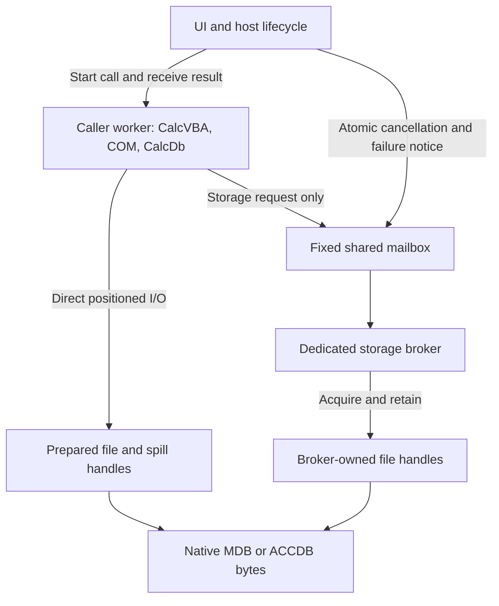
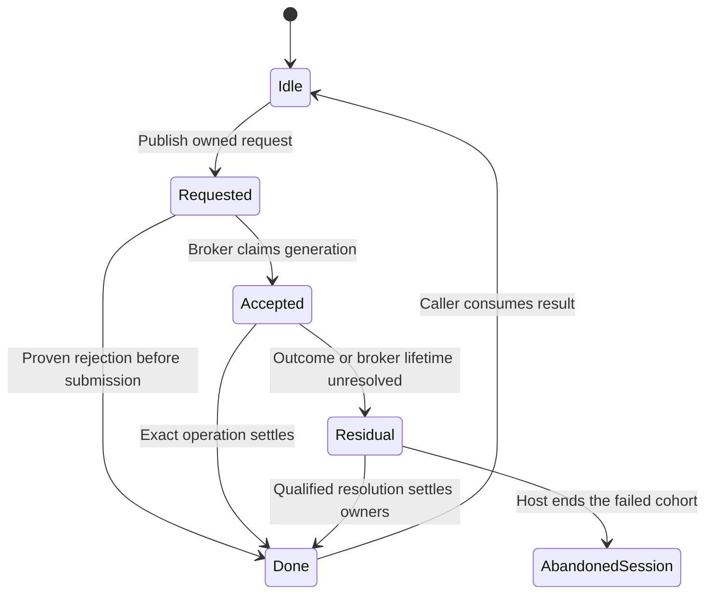
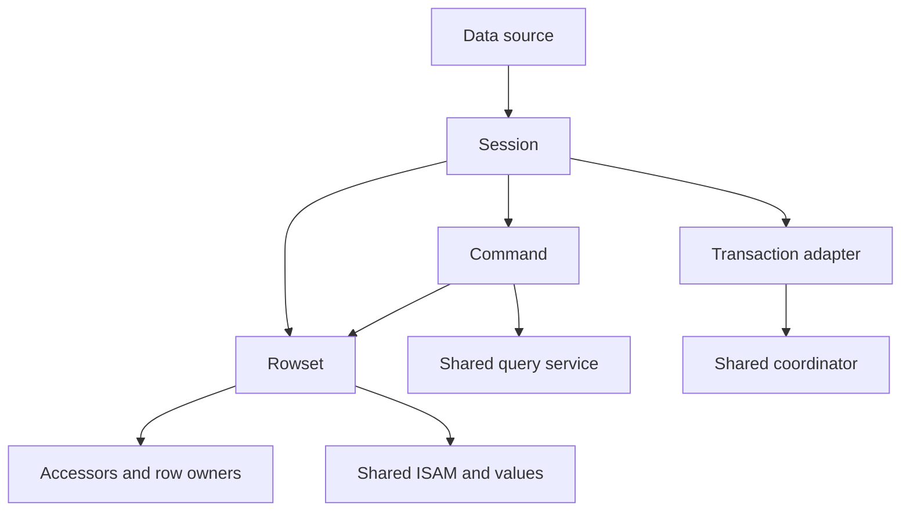
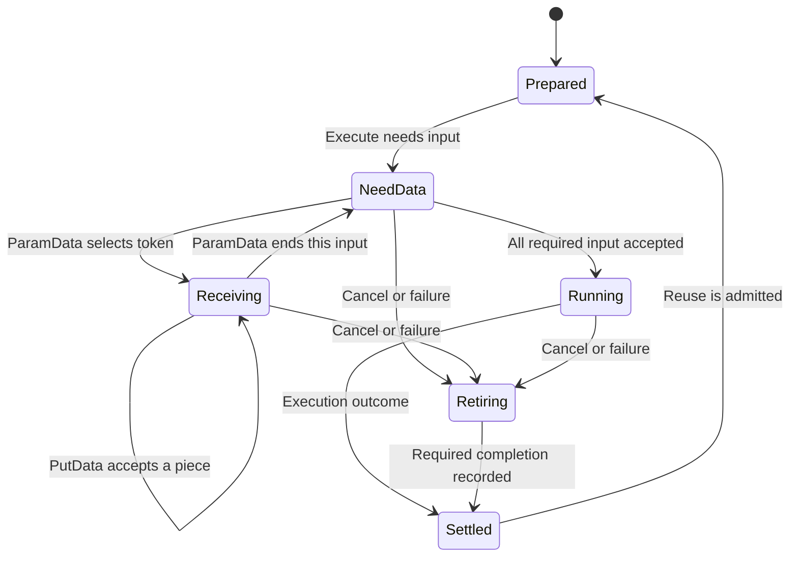

# II-14. WASM and later capabilities

Revision 1 · Stage 2, response 13 · 2026-11-14

**Requirement trace:** Primary RQ-PROD-06 and RQ-LATE-01 through RQ-LATE-06; supporting RQ-PROD-02, RQ-PROD-04, RQ-PROD-05, RQ-PORT-01, RQ-PORT-02, RQ-PORT-03, RQ-VAL-01, RQ-CALL-01, RQ-CALL-02, RQ-CALL-03, RQ-CALL-04, RQ-STORE-01, RQ-STORE-02, RQ-STORE-03, RQ-STORE-04, RQ-STORE-05, RQ-LOCK-01 through RQ-LOCK-04, RQ-OUT-01, RQ-OUT-02, RQ-PERF-01, RQ-PERF-02, RQ-DEV-01 and RQ-DEV-02. I-16 retains the complete scope and phase map. II-03 supplies owned positioned I/O, II-04/05/06 the native format/index/catalog rules, II-08/09 persistence and protection, II-11 the common query engine, and II-12/13 object and interop behavior. This chapter realizes K-BROWSER and extends the existing storage, source and external-surface seams; it creates no second evaluator, object model or authoritative database format.

**Preferred direction.** Keep CalcVBA, the shared Automation foundation and CalcDb in one qualified wasm32 address/call domain in a dedicated caller worker. Run blocking object calls locally. Use prepared direct storage handles for the common path and an owned host broker for operations whose acquisition is asynchronous; qualify reader-only sharing separately. Keep browser commit, export and durability outcomes distinct. **D-WASM-1 remains Provisional**, settled by R-WASM-1 and the applicable foundation/crash/lock branches. **D-LATER-1 remains Recommended**: explicit codec, source, complex-field, rebuild and provider seams now, feature-specific implementations in later scope. DAO row loops retain priority over bulk SQL and browser costs; ADO may proceed alongside DAO.

**Evidence boundary.** The initial ACE oracle remains user-reported ACEDAO.DLL 16.0.20527.20016. Public specifications and named reference implementations establish their stated facts, not observations of this ACE build or the user's browsers. All actual browser, CalcVBA, native encrypted/complex/rebuild, provider, driver and managed-client acceptance remains unexecuted. Worked bytes, request records and relocation examples are constructed witnesses. Native layout details learned from readers remain hypotheses until native-file and oracle qualification. The real target Automation layout is assumed, including 24-byte Windows x64 VARIANT; the wasm32 foundation must publish and qualify its own exact target ABI. Figures are emitted tables/Mermaid source, not render-verified.[^root-authority]

## 1. Bind the browser build to one actual address and call domain

**RQ-PROD-06, RQ-PORT-01/02/03, RQ-VAL-01 and RQ-CALL-01/03.** A browser build needs a concrete composition decision before individual crates merely pass a wasm32 compiler check. Prefer linking CalcVBA's selected interpreter/runtime, the shared Automation services, CalcDb's portable layers and their typed interface entries into one initial WebAssembly program. If build tooling uses several instances, they must deliberately share the required memory, indirect-function table, allocator services and compatible declarations. A common source language, a matching interface ID or equal pointer integers establishes none of those relationships.

The inspected WebAssembly Basic C ABI describes the LLVM-compatible wasm32 data model as ILP32, with 32-bit pointers and 64-bit `long long`; it is one ABI convention rather than a mandate for every WebAssembly compiler. The selected convention and actual language bindings therefore belong in the target ABI description from II-13. Do not import Windows x64 register lowering or the host's C `long`/`wchar_t` into that description.[^root-basic-abi]

WebAssembly module instances refer to particular memory and table instances. The dynamic-linking convention documents shared imports for memory, the indirect-function table and associated base/stack globals, and explicitly describes its dynamic ABI as not yet stable. These facts support the simple initial linked-program choice; they do not qualify an arbitrary pair of separately built modules.[^root-runtime][^root-dynamic]

Use the following proposed deployment record. It is build/host metadata, never a record in an Access file.

**Figure F-158 — the browser deployment joins declarations to live owners.** Original design table; names are proposed, with actual CalcVBA exports still to be supplied.

| Record field | Meaning | Admission check |
| --- | --- | --- |
| `target_description` | Scalar widths, alignments, aggregate layouts, call lowering and supported interface graph | Actual CalcVBA and CalcDb layout/call probes agree with an independently checked target declaration |
| `program_generation` | One retained code deployment and its imported services | A retained object cannot outlive or silently switch its implementation generation |
| `memory_domain` | The live memory instance containing interface objects, values and their allocations | All direct pointer-consuming participants use that instance |
| `call_domain` | The compatible indirect-call table and typed entries | Interface slots resolve within this domain with their declared call types |
| `allocator_domains` | BSTR, SAFEARRAY, task-memory and internal allocation services | Return and cleanup paths retain the matching services |
| `runtime_owner` | CalcVBA runtime and allowed caller worker | UDFs/events use this owner; storage brokers never invoke it |
| `host_binding` | Retained II-13 capabilities, admission state and authority | Publish compatibility activation only after an Active bootstrap |
| `storage_profile` | Actual direct/broker/read-only routes and evidence | Capability discovery does not upgrade unqualified durability or locking behavior |

**Constructed pointer witness.** Let an illustrative program A store a BSTR length of four bytes at offset `0x1200`, with `48 00 69 00 00 00` beginning at `0x1204`. Its BSTR data pointer is the number `0x1204`. Program B, with a different memory, can store `Ho` at the same offsets. Passing that number alone from A to B selects B's bytes; copying the VARIANT pointer field does not transfer the string or allocator owner. Within the preferred shared domain, a pointer may be passed directly under the foundation's normal ownership rules. Across a host message boundary, the design sends explicitly owned bytes or an opaque host request identity instead.

The same distinction applies to an illustrative vtable slot containing function-table index 19. Index 19 in another table can identify another function. WebAssembly's indirect call checks the selected table element and function type; type checking cannot establish that a different function with the same compatible type is the intended method.[^root-indirect] The deployment test therefore exercises real early-bound methods, late binding, enumeration, errors, ByRef updates and event callbacks through the actual CalcVBA client. It does not stop at comparing `sizeof(VARIANT)` between two copies of the same header.

Retain interface pointers inside the caller worker. JavaScript UI code may hold an opaque operation/result handle under the host's ownership protocol; it receives no transferable COM pointer. Presenting a grid can use a documented lossless value projection where needed, but that projection is not the canonical query value representation and does not become a second DAO implementation. Windows .xll/.NET loading remains the native II-13 lane; this chapter specifies the portable runtime and core, not a Windows binary loader in the browser.

Bootstrap before a user call enters the blocking runtime. Fetching or compiling a module, acquiring a prepared storage handle and discovering deployment capabilities may be asynchronous at that host boundary. Once the Active binding is visible, a DAO call uses the local typed/dispatch path and returns the required synchronous result.

```text
BootstrapBrowserProgram(plan, host_authority) -> ActiveBinding or BootstrapOutcome
  input: immutable deployment plan and authority; no public objects issued yet
  state: registered BootstrapAttempt owns partial modules, services and handles
  reserve bounded attempt/result storage before invoking host preparation
  prepare code and host services asynchronously on the available event loop
  validate actual memory/call/allocator domains and target declarations
  bind portable activation and the selected runtime owner
  prepare direct handles and broker/reader capabilities for this profile
  publish one ActiveBinding only after all required owners are retained
  transfer accepted owners to the binding; retire all other preparation owners
  on failure: retain unresolved preparation/cleanup in the attempt; publish no Active binding
```

This is proposed host orchestration, not an invented CalcVBA ABI. Work is linear in the deployment descriptors and prepared resources; there is no database scan. The actual service-entry names and runtime construction sequence belong to I-FOUNDATION-1/I-HOST-1. No engine latch is held across asynchronous preparation or foreign service initialization. A later reconfiguration constructs a new binding; it does not replace allocator or function-table entries beneath live objects.

## 2. Keep suspension, blocking and observable reentry separate

**RQ-CALL-01, RQ-CALL-03/04 and RQ-PROD-06.** The preferred initial route keeps the caller worker blocked during each object call. The UI can remain responsive on the Window's separate event loop; the storage broker can complete acquisition on its own worker event loop. A Promise queued on the blocked caller's own event loop cannot be used as the completion mechanism for that same call.

JSPI is a relevant alternative to measure, not a missing fact to ignore. V8's public description explains that a suspending import can suspend WebAssembly and that a wrapped export returns a Promise, with resumption driven by the browser's task runner. It also states that JSPI does not suspend arbitrary intervening JavaScript execution.[^root-jspi] That changes the host-entry and potential reentry boundary even when the WebAssembly body remains straight-line code.

Prefer the direct/broker mechanism because it already expresses the decided blocking-caller rule and keeps the portable COM call chain local. Reopen the mechanism if the actual CalcVBA build, all required native-to-portable calls, nested callbacks and event delivery demonstrate an equivalent suspension arrangement with explicit owner retention and admission. A prototype must identify which stack is suspended, which event handlers can run, whether another call can enter the runtime, and how Close/cancellation interacts with that suspended owner. It must not equate a Promise resolving eventually with a blocking COM result. A result requiring relaxation of the decided caller contract is a scope decision, not an unlabelled browser optimization.

The initial portable execution strategy is likewise measured against the actual CalcVBA target. An interpreter that already supports the target is the preferred construction path; this chapter does not invent a browser Cranelift/JIT backend or substitute JavaScript semantics for shared scalar functions. Pure query workers remain optional under II-11's serial-equivalence proof. They may consume admitted immutable data and return owned results, but they do not share live COM objects or run VBA UDFs. If a browser deployment cannot supply threads or shared memory, the scalar engine still has a concrete single-worker implementation; the missing dynamic-storage or sharing route remains visible rather than silently disappearing from the required cases.

## 3. Place every later capability at the existing mechanism it extends

**D-LATER-1 — Recommended.** The following seams are required early even though the complete capabilities remain later scope. Keep their descriptors extensible without inventing native fields. Ordinary unencrypted/unlinked/simple-column operations select small direct paths; they do not allocate speculative encryption, provider or child-cursor machinery on every field access.

**Figure F-159 — later features extend existing owners.** Original design table; complete algorithms follow in this chapter.

| Capability | Early retained information | Existing mechanism extended | Later evidence required |
| --- | --- | --- | --- |
| Encryption | Stored-image identity, codec domain, header exceptions and credential-service owner | Physical I/O to owned logical page images; phase-specific stored outputs | Actual family/key/password behavior and interrupted writes, R-ENC-1 |
| Linked tables | Raw native source metadata, bound source/schema identity and source capability descriptor | Catalog/binder, common cursor, shared expression and workspace coordination | Per-source comparison, row identity, updates and transaction limits, R-LINK-1 |
| Complex fields | Kind-specific descriptor and preserved native child/reference ownership | Catalog/row/LV, child ISAM cursors and common evaluation | Parent/child visibility, physical wrappers and mutation outcomes, R-COMPLEX-1 |
| Compact and repair | Full ownership/reference graph, protected opaque extents and destination identity | Existing checked decoder, allocator, encoder, index builder and validator | Relocation coverage, independent destination acceptance and salvage policy, R-REBUILD-1 |
| OLE DB | Genuine interface declarations, negotiated properties, binding and rowset owners | Shared query/cursor/transaction/error services | Required native and managed consumer paths, R-OLEDB-1 |
| ODBC | Target ABI, handle/descriptor generations, binding and diagnostic ownership | The same query/cursor/transaction/error services | Actual Driver Manager, buffers, state transitions and consumer behavior, R-ODBC-1 |

Reading beside an ACE writer and shared writing remain the later protection profiles developed in II-09, R-LOCK-3/4 and W-11/12. A codec or linked-table implementation need not wait for those profiles to exist. Its combination with external sharing does need the applicable protected-source, rebase, lock and crash tests. Conversely, successful browser exclusion between cooperating contexts cannot stand in for native ACE lock-file interoperability.

Require each concrete source/storage descriptor to answer the operation being attempted: supported byte transfers, lock/admission behavior, stable identity, enumeration/update capabilities, transaction scope and observed durability. Do not reduce that record to `can_read`, `can_write` and `supports_transactions`. A true flag supplies no ordering proof, row identity or distributed commit protocol. Missing capability produces a typed unresolved/refused case under the existing compatibility accounting; it cannot silently select a private format or an unrelated engine.

## 4. Select a browser execution profile before entering VBA

**RQ-PROD-06, RQ-PORT-01/02/03, RQ-CALL-01/03/04. D-WASM-1 remains Provisional, settled by R-WASM-1.** Prefer one dedicated caller worker containing the qualified CalcVBA runtime, the shared foundation, portable COM and CalcDb. Keep the UI outside that runtime owner. A UI request may return a Promise to the document while the VBA code it starts makes ordinary blocking DAO/ADO calls locally. Resolve the module/linear-memory/function-table arrangement as described earlier in this chapter; a worker boundary carries storage operations, never interface pointers, BSTR addresses or a replacement database API.

Use two storage routes within that arrangement. A database or spill file prepared before the first VBA call can retain its synchronous access handle in the caller worker and use direct positioned I/O. A file first named during a blocking call uses a dedicated broker in the permitted agent cluster. The broker performs asynchronous acquisition and then owns the resulting handle for its entire open interval. Prefer the direct route for an already prepared hot database; retain the broker route for arbitrary runtime OpenDatabase/CreateDatabase, later linked-file acquisition and growth of the bounded spill pool. There is one selected route per live file session, not a direct handle plus a broker handle opened speculatively for the same file.

The inspected File System Standard makes sync-handle acquisition a Promise, restricts it to secure dedicated workers and bucket storage, and gives the default handle exclusive access. Positioned reads/writes accept shared buffers; the access handle has no serialization/transfer declaration. Partial write ordering is deliberately under-specified. Flush attempts underlying-device transfer; close does not supply that guarantee. `isSameEntry` compares locators, which is insufficient evidence of persistent file incarnation.[^wb-fs] These are API facts; the records, mailbox and admission rules below are proposed CalcDb host mechanisms.

The browser profile is selected from tested behavior, not from method-name presence. Capture browser engine/build, OS, secure context, effective cross-origin isolation, worker ancestry, storage partition/bucket, permitted file routes, actual ABI profile, budgets and supported fault observations. Its capabilities say whether it can supply a requested operation. They do not select different SQL results or hidden answers based on a browser version. An operation missing from the required coverage remains a failed or unresolved compatibility case.

**Figure F-160 — proposed browser ownership topology.** Original design; Mermaid source, not render-verified. The two file routes share one pager and persistence coordinator.



HTML permits potentially blocking Atomics calls in dedicated/shared worker agents. A dedicated worker belongs to its creator's agent cluster; a SharedWorker or service worker does not provide an interchangeable shared-memory bridge to the creating Window. Structured serialization of shared memory also requires the effective cross-origin-isolated capability and compatible agent cluster.[^wb-agents][^wb-data] Create the caller and broker with a demonstrated ancestry; test their shared cell exchange during bootstrap before admitting VBA. Passing a common origin string is not that test.

The broker is an event-driven host adapter. It must return to its event loop whenever acquisition or lock admission is pending; it does not sit in `Atomics.wait` while its own Promise needs to resume. A request message wakes it, and an owned request descriptor remains live through asynchronous continuation. The waiting caller uses the shared terminal state, so it does not depend on processing a reply message on its blocked event loop. The UI stays able to set cancellation state and report failures. This arrangement needs no engine async runtime and no callback into VBA from the broker.

Without the qualified shared-memory route, support an explicitly prestaged session: acquire its admitted files and temporary backing before starting VBA, then use direct synchronous operations. This is useful for a bounded feasibility slice, but runtime acquisition outside the prepared set remains incomplete initial coverage. Do not label this restriction as complete WASM support. Stack-suspension or Promise-integration alternatives are separate measured reopenings of D-WASM-1; their admission and reentry consequences must be qualified through the complete CalcVBA call chain before selection.

## 5. Bind paths, admission and backend handles before a page is read

**RQ-PROD-06, RQ-STORE-01, RQ-LOCK-01/02, RQ-PROD-05.** Treat an imported native file as an independent origin-private working file. The native bytes remain the database. Host mount descriptions, allowed paths and open-handle tables are access metadata; they cannot substitute private table/catalog records for the MDB/ACCDB or reconstruct missing native content from a browser store.

Prefer a host-managed mount namespace. It maps a requested name to an admitted root and canonical backend entry, retaining the original name for diagnostics. Resolve path syntax and case behavior through the chosen host policy before issuing a storage effect. An arbitrary Windows pathname in unchanged VBA does not grant access to that pathname in the browser. A user-selected import or authorized mounted directory establishes the available namespace; unresolved required paths remain visible compatibility failures.

The File System Access proposal places local-file picker/permission behavior in the Window and requires transient activation for specified permission requests. It is a separate proposal from the origin-private storage API, and its existence does not make synchronous arbitrary local-file access available to a blocked worker.[^wb-picker] Prefer import/export for external files initially. Do not ask the broker to conjure a user gesture, silently substitute a network URL for a local pathname, or route local-file writes through a replacement stream as if it were the native commit mechanism.

Use these proposed records:

| Record | Retained content | Required lifetime |
| --- | --- | --- |
| `BrowserMount` | Host authority, root locator/handle, namespace policy and incarnation | Through resolution and every admitted descendant binding |
| `EntryBinding` | Canonical entry key, actual file handle/route, alias evidence, rights, incarnation | Through all reload sources and pending operations that name the entry |
| `BrowserFileSession` | One direct or broker route, requested/effective access, lease owner, observed extent, capabilities | Through drain, required flush disposition and proven close/release |
| `BrokerHandle` | Session nonce, table slot and slot generation; backend handle stays in broker | Never reused while an old request or result can still name that incarnation |
| `AcquisitionAttempt` | Requested path/mode, namespace lease, phase/effect receipt, reserved handle-table/result capacity | Registered before an API can create an entry or acquire a lease |
| `BrowserFaultProfile` | Declared interruption kinds and available evidence for completion, durability and identity | Bound to the session; no silent strengthening during recovery |

Names alone cannot collapse aliases. Compare actual resolved handles as available, then use the host's canonical identity in its admission directory. The authority and entry identity are separate: possession of another path to an existing session does not grant its write rights. Cross-context admission uses the same canonical key and namespace policy; a basename or differently normalized user path is insufficient. Creation/replacement/removal also take the relevant namespace admission so that a second caller cannot race an absent-name check through the host's own routes.

Acquisition is a stateful operation rather than a single Boolean result. Distinguish lookup, creation requested, entry observed, access requested, native handle acquired, published to the caller, and cleanup owed. Reserve the attempt and result slots before starting. In particular, cancellation after `getFileHandle(..., create=true)` has been issued is not proof that no empty entry was created. Record whether creation is known, unknown or known absent; do not delete a subsequently found entry merely because its name matches the attempted name.

A successful handle acquisition that arrives after cancellation still needs an owner. The broker records it, applies the qualified cancellation outcome, closes it if no supported continuation adopts it, and only then publishes its terminal cleanup disposition. An exception during a later table insertion must not leak the acquired handle; that insertion capacity was reserved before acquisition. Keep minimal phase/error state writable when ordinary diagnostic allocation fails.

Direct-to-broker or broker-to-direct migration is an explicit quiescent operation. Stop new admission for that file session, settle every request, preserve any required reload source, close the old route, reacquire through the new route, and revalidate identity, rights, extent and the admitted view. Cached page bytes alone cannot bridge an unproved continuity gap. Do not migrate a database while a transaction or old-version source still relies on the old lease unless the existing coordinator has a qualified transition for it.

The browser handle table can be sparse and bounded. A cold open pays for pathname resolution, admission and acquisition; a warm page transfer names a slot and generation. It does not rescan the directory or call `isSameEntry` for every DAO field access. Reuse is permitted only after the entry's previous owners have ended, with generation exhaustion handled by quiescent session replacement rather than wraparound.

## 6. Use a fixed mailbox with one live request per caller

**RQ-CALL-01/04, RQ-SIM-01/02, RQ-PERF-02.** Start with one outstanding broker request per caller and one fixed shared mailbox, allocated separately from the growable WASM memory. The broker can serve several caller mailboxes later, but each request retains its own session and file owners. This bounds the initial protocol and makes each observed file effect attributable to a single current request.

A host message is a wake hint. The shared request state is the authoritative in-memory record for this session. It is not a native file record, durable transaction journal or recovery promise. Duplicate messages cannot cause a second execution: the broker claims the exact requested generation once. A duplicate acknowledgement cannot release a later generation.

**Figure F-161 — proposed 128-byte mailbox header.** Original host-protocol layout, not a Jet/ACE page or portable COM ABI. Byte offsets are constructed. Atomic cells are accessed numerically through the selected atomic view; other integer metadata uses explicit little-endian DataView operations.

| Bytes | Field | Owner while live |
| --- | --- | --- |
| 0–3 | Atomic state: Idle, Requested, Accepted, Done | Caller publishes Requested; broker claims/finishes; caller consumes Done |
| 4–7 | Atomic wake counter | State-changing participants |
| 8–11 | Atomic cancellation generation | Authorized host/caller |
| 12–15 | Atomic session failure state | Host lifecycle owner |
| 16–19 | Request generation | Caller before publication; immutable until consumed |
| 20–23 | Session generation | Bootstrap owner; immutable |
| 24–31 | Handle slot and generation | Caller before publication |
| 32–39 | Operation and flags | Caller before publication |
| 40–47 | File offset, low/high 32-bit words | Caller before publication |
| 48–55 | Requested byte count and payload descriptor | Caller before publication |
| 56–63 | Reserved request context | Zero/validated according to protocol version |
| 64–71 | Terminal status and native cause code | Broker before Done |
| 72–79 | Raw backend byte count as low/high words | Broker before Done |
| 80–87 | Proved prefix within bounded arena and response/count-validity flags | Broker before Done |
| 88–103 | Possible-effect start/end, each as low/high words | Broker before Done |
| 104–119 | Result extent or acquired-handle result | Broker before Done |
| 120–127 | Fixed bounded diagnostic/phase fields | Broker before Done |

The payload arena begins at byte 128. Choose its capacity from page, path and measured transfer requirements; reserve it at session bootstrap. For the illustrative 4,096-byte-page profile, a 4,096-byte arena plus header occupies 4,224 bytes. That is a protocol example, not a universal transfer target. A qualified contiguous run can use a larger bounded arena; an oversized request is split before publication without changing the native write program's order or failure boundaries.

Publish all request metadata and, for a write, the immutable payload before the atomic transition to Requested. The broker claims the state, validates the session/request/handle generations, and only then reads payload or submits an effect. It writes its complete bounded receipt and read payload before publishing Done. The caller checks the terminal generation and copies/adopts the result before returning the slot to Idle. Neither side modifies the other side's payload during ownership.

The control words must not overlap ordinary metadata bytes, and there are no simultaneous non-atomic reads/writes of a published field. Session and request counters do not wrap while stale messages could exist. Version the mailbox and validate its lengths at bootstrap; a malformed request is rejected before any file effect. Do not encode object pointers or growable-heap addresses in it. A 32-bit WASM pointer and a 64-bit file offset have different types even if they happen to carry the same small number.

`Atomics.wait` checks the cell against an expected value before suspending and can return because the value differs, a notification arrives or its timeout expires. Its return value is not the operation's result.[^wb-atomics] Use a predicate loop around the request state and generation:

```text
BrowserTransfer(session, operation, range, stable_buffer) -> TransferReceipt:
    require admitted session, checked range and one idle request slot
    reserve/register attempt, result capacity and all buffer/file owners
    copy the immutable selected stored-byte image into the arena if Write
    fill immutable request fields; publish Requested atomically
    send wake message carrying only session and request generation
    if wake send fails: enter owned request resolution; retain publication
    loop:
        state = atomic_load(mailbox.state)
        if state == Done and response names this exact generation:
            receipt = copy validated bounded response into owned result
            if Read: copy only proved received bytes into unpublished frame
            end broker payload ownership; publish Idle
            return receipt
        if session failure is recorded:
            enter the owned host-failure path; do not synthesize completion
        observe atomic cancellation and publish the supported request once
        atomic_wait(mailbox.state, state, bounded_observation_interval)
```

The interval only bounds how soon the caller rechecks independently writable control state; it is not an I/O deadline or failure detector. The wait holds no engine latch. The exact page/source permits and attempt remain retained across it. A cancellation request needs neither a message handler nor a timer callback on the blocked caller.

The broker dispatch is similarly small:

```text
OnBrokerWake(mailbox, announced_generation):
    if no exact Requested generation exists: return
    claim Requested -> Accepted; retain its registered owners
    validate range, handle incarnation, rights and payload bounds
    if validation fails: publish terminal pre-submission failure
    else if operation needs asynchronous acquisition/admission:
        start exactly one owned continuation; return to event loop
    else:
        execute the selected synchronous primitive once
        classify completion and possible effects from the qualified adapter
        publish response fields, then Done, then notify
```

A failed wake send is itself recorded under the already published attempt. Retrying a wake hint for the same generation cannot repeat the physical request because the broker claims that generation once. If the channel is unusable, enter owned failure resolution; do not unwind and free the mailbox as though nothing were published. The claim belongs to the request, not to the wake message. The async continuation checks its attempt state after each await, retains any newly obtained resource before another fallible action, and settles late cancellation through the same owner. It never calls back into CalcVBA. A broker supporting multiple sessions must also serialize overlapping effects on each retained handle according to the existing file program; wake arrival order is not a new transaction ordering policy.

Both normal paths use O(1) control work plus O(n) explicitly charged payload copying. The state machines are simple enough to test exhaustively as a small constructed model before the real browser fixture, but that model cannot prove browser API completion or durability.

## 7. Translate each storage result without inventing a stronger prefix

**RQ-STORE-02/04, RQ-PROD-04/05, RQ-PERF-02.** The adapter produces II-03's `TransferReceipt`; it does not publish a transaction result. Record attempted range, request/handle incarnation, native return or exception, proved prefix and possible-effect range independently. Offset, read/write count and extent checks happen before narrowing into the browser call.

A native returned count is first recorded as a count. Converting a short browser write into a proved contiguous prefix is permitted only when the selected adapter profile establishes that property. The standard's deliberately unspecified partial-result details do not by themselves provide it.[^wb-fs] Prefer the conservative initial rule: a complete successful transfer can advance the program; a short or exceptional mutation without a qualified prefix is terminal for this primitive but leaves the attempted range possibly changed and stops normal advancement. R-WASM-1 decides whether a stronger exact-suffix continuation is justified.

This matters to the page-17 witness. Reading page 17 at 4,096 bytes per page names `[0x11000,0x12000)`. Its request metadata encodes offset-low bytes `00 10 01 00`, offset-high `00 00 00 00`, and count `00 10 00 00`. A complete read supplies 4,096 physical stored bytes to an unpublished buffer. The file session selects the existing codec domain: apply that page/header recipe into an admitted logical frame before the common page envelope and row decoders run. The page-17 numbers here retain the earlier unencrypted witness; an encrypted file does not skip its codec because the transfer ran in a browser. The browser adapter does not decode TableDef pages, usage maps, row offsets or long values.

**Figure F-162 — constructed page-transfer outcomes.** These are adapter-policy examples over the existing 4-KiB page witness, not observed browser writes.

| Primitive result | Recorded evidence | Permitted continuation |
| --- | --- | --- |
| Complete 4,096-byte read | Exact stored page received into reserved buffer | Apply the selected codec/header recipe, then validate and publish the logical frame through the common pager |
| 1,536-byte read, then zero progress | Incomplete page; no valid full-frame publication | Return the typed read failure; never fill missing bytes with zeros |
| Complete 4,096-byte write | Full submitted bytes reported complete; durability still separate | Advance only the next justified edge in II-08's program |
| Short write reports 1,536, prefix property unproved | Native count 1,536; attempted range `[0x11000,0x12000)` possibly changed | Stop and retain uncertainty; no suffix loop |
| Same short result under a qualified exact-prefix profile | Proved prefix `[0x11000,0x11600)` | Continue only the authorized remaining 2,560 bytes at `0x11600` |
| Broker disappears after submission | No terminal receipt; effect and payload owners remain unresolved | Enter host-failure/resolution ownership; do not return a fabricated zero-byte failure |

Pass an explicit positioned offset on every primitive. A retained browser cursor is not the engine's file position. Extending and truncating the file are distinct operations with distinct extent receipts; a successful size query does not grant permission to change that size. New native pages must receive the required initialized bytes before references to them are published. Browser zero-filling of a newly exposed range would not create a valid index, usage map or catalog page.

The UI, caller and broker can all fail after different boundaries. A successful broker call followed by a lost reply must not be submitted again. The same mailbox generation may be re-observed, and a duplicate wake may be ignored, but the physical effect is not replayed. If the result cannot be recovered, retain uncertainty in the coordinator and quarantine the affected reload source. A later reread can reveal visible bytes without proving their survival under a different fault.

Write payloads are the immutable encoded stored-byte images selected for the exact native phase, including codec/header exceptions. A broker never substitutes its copy of a decoded page or re-encodes with an unretained current key. Batches describe a sequence of exact primitive requests or a qualified coalesced span, with preallocated receipts for every submitted part. They cannot reorder data, allocation, index, catalog, flush or commit-related edges. A flush request follows completion of the same owned file program's prior writes; it does not race them through an independent broker queue. Ordinary commit is not automatically followed by flush merely because that is convenient for the bridge.

For a direct route, supply a fresh view of the reserved WASM frame to the synchronous read, with no intervening call that can grow/reconfigure memory. In the broker route, the shared arena can be the API payload while its ownership is exclusive. The common case then pays one explicit WASM-to-mailbox copy for a write or mailbox-to-WASM copy for a read, not a per-value JSON conversion. Browser-internal copies remain measured costs; the host design does not claim that accepting shared memory eliminates them.

A browser cannot establish its error mapping by translating every DOMException name into an arbitrary familiar DAO number. Retain the native cause and operation phase, then use the same public error-policy evidence as the other VFS adapters. Definite pre-submission permission/range failure, quota failure after a possible extent change, short transfer, failed flush and lost completion remain different inputs to that mapping.

## 8. Keep cancellation, broker failure and Close as different transitions

**RQ-CALL-04, RQ-STORE-04, RQ-SIM-02.** A cancellation cell is an instruction to the operation owner. It is never permission for the UI to clear the mailbox, recycle a generation, release a file lease or overwrite a write payload. The owner classifies the request at the existing semantic or native checkpoint. A successful write or commit can win the race, and a cancellation arriving after required commit survival cannot reverse that commit.

Use one cancellation generation for the outer admitted call, with the current request recording which generation it has observed. Poll it at bounded engine checkpoints and at broker wait observations. A long pure VBA loop needs CalcVBA's corresponding polling support; the database adapter cannot make that loop responsive merely by adding a UI cancel button. The broker checks the control state before starting an effect and after each asynchronous acquisition boundary, then applies the relevant operation policy.

HTML worker termination can abort running script and discard queued tasks; the queued cleanup or cancellation message is therefore not a reliable termination protocol.[^wb-workers] Treat termination as a fault injection. A heartbeat gap can trigger investigation or a declared failure policy, but is not proof that an agent is dead or that a write has not occurred. Background throttling, slow I/O and suspension are separate fixtures.

**Figure F-163 — request ownership through cancellation or lost delivery.** Original proposed state diagram; Mermaid source, not render-verified.



Residual is host ownership, not a fabricated terminal VFS receipt. The residual owner retains the mailbox, immutable input bytes, file/session admission, pending acquisition objects and minimal effect record. The host sets the separate failure cell rather than overwriting the broker-owned Accepted/Done transition. A recovered terminal payload still requires continuation validation; it does not restore an expired file lease. It cannot issue the next normal mutation for that entry. If the runtime cannot safely transfer those obligations through its existing failure path, the affected caller session fails closed as a unit. A generic timeout exception that unwinds and frees a still-owned frame is not an implementation of this path.

Keep the broker and its caller as an explicit failure cohort. For a controlled shutdown, stop admission to the caller first, settle or classify the active operation, drain accepted broker work and late acquisitions, then close handles and release leases. Killing the broker first can release its browser locks while a caller still holds cached or reloadable state. Independent unexpected broker death is a required R-WASM-1 fault branch: the admitted profile must establish how the surviving caller loses permission to continue and how storage ownership is reacquired safely. If it cannot, that profile cannot claim the corresponding cross-context sharing behavior.

A known stopped agent does not by itself provide the missing terminal storage receipt. Backend work may already have changed bytes; the effect range and required buffer lifetime must be settled or conservatively retained. A fresh broker does not inherit the old request table merely by using the same numeric slots. It obtains a fresh session nonce, reacquires exclusion, audits the file through the existing coordinator and treats prior outcomes as uncertain. It must not read a previous in-memory request and execute it again.

For normal Close, reject new requests for the closing public binding, preserve requests already accepted under their owners, and execute the evidenced close/transaction policy. The caller can block waiting for its broker's final close receipt because that broker's event loop remains available. Close inside a VBA callback must still obey II-09's ancestor/self-wait rule; the browser supplies no exemption. If the current callback would wait for the suspended ancestor to finish, resolve through the qualified reentry policy instead of sleeping.

Keep a file lease until the final request and every permitted reload source under that lease have ended. A requested Web Lock release, native handle close, storage flush and discarded UI reply are distinct observations. Cleanup errors retain their cause and remaining obligations. A late result can complete residual cleanup but cannot silently publish a stale success into a newer Recordset or host invocation.

## 9. Qualify reader-only sharing separately from the exclusive handle path

**RQ-LOCK-01/02, RQ-PROD-06.** An exclusive sync handle provides a useful browser primitive for the first storage profile. It does not implement native Jet lock-file participation, nor does it prove the required many-reader mode. Multiple logical CalcDb connections under one retained session are one ownership domain. Independent browser contexts require a separately tested admission mechanism.

Prefer a measured native read-only access-handle mode where the target browser supplies it. Chrome's primary documentation describes a `read-only` option allowing multiple read-only handles and a distinct `readwrite-unsafe` option allowing competing writers.[^wb-chrome-modes] The inspected WHATWG baseline does not contain that mode parameter. Capture requested and effective behavior in the actual browser; a dictionary option being accepted is not proof that it was honored. Test multiple readers, attempted writes through read handles, late writer denial, aliases and lifetime after close.

Do not select `readwrite-unsafe` merely to obtain more than one handle. That would remove the initial writer-exclusion primitive before CalcDb has supplied its replacement. Reading beside a writer and shared writing are still later scope; enabling a browser API mode is not evidence for the native coherence or rebase protocol.

Where native read-only handles are unavailable, investigate a cooperating-host reader profile built from a shared Web Lock and a retained File/Blob source. Web Locks supplies named shared/exclusive admission; the callback's pending Promise retains the lock, and settling that Promise releases it. Pending-request abort and held-lock release are different. Its `steal` option can invalidate exclusivity while old code continues, so it is not an acceptable timeout recovery operation here.[^wb-weblocks]

Use a shared lock for a reader session and an exclusive lock for every corresponding write, replacement, import publication, removal and rebuild publication through the host. The canonical name comes from the resolved entry identity and namespace policy, not a raw user path. Web Locks coordinates participating code; it is not an OS share-denial guarantee against code that bypasses the protocol. Its storage-partition scope must match the file entries being coordinated. Those limits belong in the browser capability profile and do not alter II-09's Windows ACE tests.

The proposed reader backend holds the actual shared grant while it obtains one File source, then uses bounded slices with synchronous `FileReaderSync` reads in its owning worker. File API supplies Blob slicing and synchronous worker reads. Its disk snapshot-state requirement is a SHOULD, and a changed or unreadable source can fail with `NotReadableError`.[^wb-fileapi] Therefore retain continuous writer exclusion rather than releasing the lock and assuming that File provides the engine's persistent snapshot history.

Prefer caller-owned preacquired reader sources and leases for the first fallback prototype. Dynamic acquisition can use the broker, but both its source and shared grant remain there; the failure-cohort and continued-use proof in the cancellation and Close section must be satisfied before claiming this mode across independent contexts. Do not transfer a File to another caller and casually release the only shared grant. The returned byte chunks become ordinary owned cache images; the reload capability remains conditional on the live source/lease.

A Web Lock request resolves asynchronously. The broker's lock callback publishes the acquired lease and then awaits an explicit owned release condition, rather than returning immediately after the open response. After drain, it ends the source, settles the hold condition and waits for the request's release completion before publishing Close as settled. Cancellation before grant can abort the waiting request; cancellation after grant follows the normal owner cleanup. Reentry that requests an incompatible lock already held by its own ancestor must be recognized before an indefinite wait.

**Figure F-164 — proposed browser admission profiles.** These are alternatives selected by measured capability; none claims live ACE sharing of an OPFS file.

| Profile | Source and exclusion | Main unresolved evidence |
| --- | --- | --- |
| Exclusive direct | Caller owns default sync handle | Native lifetime, failure release and persistence behavior |
| Exclusive broker | Broker owns default sync handle; caller owns exact request | Partial-failure cohort, dynamic acquisition and outcome settlement |
| Qualified native readers | Actual read-only access handles | Requested mode honored, many-reader success and continuous writer denial |
| Cooperating reader fallback | Shared Web Lock plus retained File source; all host mutators take exclusive | Canonical identity, source stability, lock/source lifetime and broker-loss consequences |
| Prestaged fallback without shared memory | Caller owns only admitted files/backing | Runtime opens outside that set remain unsupported required coverage |

A read source returning an error is not a cue to reopen the same path and mix later pages into the existing view. Reopen/requery follows a new admitted binding and the existing cursor policy. Likewise, a long reader cannot remain reloadable after its grant is released simply because its cache currently contains several hot pages. The cost ledger must charge the extra ArrayBuffer allocation/copy of the FileReaderSync fallback and compare it with native read-only handles.

## 10. Budget linear memory, host memory and spill together

**RQ-PERF-01/02, RQ-PORT-01, RQ-CALL-04.** The browser executes the same page-cache, cursor and operator mechanisms under a tighter budget. It must not load an entire Access file into WASM merely because a file-picker example uses `arrayBuffer()` on the whole file. Admit page, value, history and bridge peaks together.

For one wasm32 memory, the core memory-type bound is 65,536 pages of 65,536 bytes, or 4 GiB; that is a validation ceiling, not an allocation promise.[^wb-core-memory] Memory allocation/growth can fail. The inspected JavaScript-interface draft distinguishes fixed and resizable buffers; refreshing a fixed buffer detaches its previous buffer, while other supported forms have their own refresh behavior.[^wb-memory] Reacquire the current view after any operation that can grow or reconfigure memory. A logical page pin retains an engine image; it does not retain an old JavaScript typed-array view.

Keep the fixed mailbox outside that memory. Direct I/O creates or borrows the current view only after all potentially growing preparation has finished, validates `pointer + length` without overflow, calls the synchronous primitive, and drops the JS view before any later growth boundary. Do not retain that view in an asynchronous acquisition closure. Broker I/O addresses its own fixed payload arena and copies into the current WASM view after a terminal read result.

Use a budget equation with measured runtime baseline rather than an invented browser-wide limit:

```text
linear_peak =
    runtime_and_foundation + stack_reserve + owned_values
  + page_size * (clean_frames + dirty_images + historical_images)
  + query_state + long_value_workspace + codec_workspace + stored_phase_buffers
  + prepared_transition_overlap + failure_reserve + allocator_overhead

host_peak =
    mailbox_arenas + imported/exported_chunk_buffers
  + broker_handle_and_attempt_tables + browser_API_temporaries
```

Each resident image belongs to one charge category; a pin on that same frame is a retention constraint, not another copy of its page bytes. Plaintext logical frames, immutable encoded phase buffers and mailbox copies are separately charged whenever they are distinct allocations; a shared source name does not make them one buffer. A dirty replacement and its preserved before/reader image are separate images and both count. A transition reserves its peak overlap before releasing its predecessor. Quota or allocation failure after eviction of the only reloadable old source is too late.

**Figure F-165 — constructed page-memory budget.** The numbers demonstrate accounting only; they are not proposed product limits or measurements.

| Image category | Constructed count | Bytes at 4,096 per image |
| --- | ---: | ---: |
| Clean/loading cache frames | 256 | 1,048,576 |
| Private dirty images | 64 | 262,144 |
| Required historical images | 128 | 524,288 |
| These image categories together | 448 | 1,835,008 |
| One extra page during a prepared transition | 1 | 4,096 |
| One mailbox header and page arena, outside linear memory | 1 | 4,224 |

The table illustrates the unencrypted page-image categories only. An encrypted operation additionally admits its encoded phase buffers and codec scratch, without double-counting a buffer that is actually shared under one owner. VBA strings, SAFEARRAY payloads, query hash/sort state, index keys and the runtime baseline are additional. A one-MiB cache setting is not a one-MiB process budget. Long Text and binary materialization must retain the already defined length checks and output admission; a chunked internal read cannot turn a requested single huge public BSTR/SAFEARRAY into an unannounced stream.

Temporary backing is also bounded. Preacquire a pool sufficient for the initial operators and their declared working sets, then use the broker for dynamic growth. Reserve an extent/slot in the spill manager before consuming it, retain the source image until the spill write is settled, and keep temporary-file errors distinct from database mutation errors. A missing spill capability does not authorize silently changing a requested snapshot into a live cursor or changing a sort's comparison semantics. Apply the later encryption design's explicit protection policy to plaintext history, spill, mailbox copies, temporary exports and diagnostic captures. Origin-private storage by itself is not evidence that this protection requirement has been met.

Storage usage and quota are estimates. Persistence permission protects against specified user-agent clearing policies; it is not a reservation, a force-to-device operation or a promise against explicit user deletion.[^wb-storage] Acquire/report the intended persistence class at session setup, account for competing database/spill/export usage and handle quota failure at each real operation. Preallocation can expose space failure earlier but cannot promise that no later failure occurs.

File offsets remain checked 64-bit values independent of wasm32 pointers. Reconstruct low/high words without a signed 32-bit shift, check the format extent, and validate exact representability before passing a JavaScript Number to an API. An arithmetic fixture at `0x1_0000_0000` exercises the high word; it does not admit a 4-GiB database if the selected native format's limit is lower. Near-limit page numbers, lengths, final partial pages and `offset + count` overflow all need separate cases.

Prefer serial execution initially. Optional internal workers add stack/runtime costs, shared-memory synchronization and retained completion buffers; their result still follows II-11's serial semantic frontier. Keep pure decoding/comparison work eligible only after that equivalence is established. VBA UDFs, portable COM reference actions that can reenter and host callbacks remain on their owning caller. More browser workers cannot repair a storage capability that the deployment lacks.

## 11. Separate database commit, export and interrupted-file capture

**RQ-STORE-01/02/04/05, RQ-PROD-03/04/05.** Browser storage is a different environment for the same native file program. It retains the distinction among logical transaction resolution, submitted bytes, reported completion, requested durability, public acknowledgement and the bytes that survive the declared interruption. Neither a successful `write` nor a successful `close` is recorded as `dbForceOSFlush` parity.

Prefer a direct mapping of an explicitly selected force operation to the browser's actual flush primitive, with a distinct recorded receipt. Do not add an unconditional flush to every ordinary commit or omit a requested flush because the origin has persistent-storage permission. Whether the result meets the required ACE survival class is determined by the fault profile and R-CRASH-1/2 combined with R-WASM-1. A platform whose required durability cannot be established remains an unresolved compatibility case.

Keep import and export explicit host operations. Import streams byte chunks into a new owned native working file, checks the complete length and hash as appropriate, and publishes its host binding only after the selected validation and storage disposition. Preserve the original external file. A failed import has an owned partial destination; it is not a damaged database that normal opening should repair automatically.

Export chooses a settled native stored image under appropriate admission, then streams its exact physical bytes to a separate destination, including encrypted pages and native header exceptions. If readers can continue while exporting, retain the corresponding immutable file-image sources through the copy; otherwise hold the qualified quiescent/exclusive interval. Exporting a current page sometimes and an old cached page elsewhere is not an export of any committed database. Unknown pages and preserved front-end bytes travel through the same raw copy path. A decoded cache followed by re-encoding is not this byte-preserving export, even if logical query results would match.

For a selected user destination, capture the destination's own publication/close result. The File System Standard's writable-stream path has a distinct publication mechanism, so that path belongs to export or explicitly designed replacement, not the database's ordinary in-place write program.[^wb-fs] A browser download also supplies a different observable completion boundary; dispatching it is not evidence that a durable desktop file has been written.

**Figure F-166 — three separate receipts around an exported database.** Original design table; each receipt can exist without the following one.

| Receipt | What it establishes | What it does not establish |
| --- | --- | --- |
| `DatabaseResolution` | Selected native working-file operation and its known logical/physical outcome | Delivery or durability of an external exported copy |
| `ExportImage` | Exact native image, extent and copied byte/hash evidence | Whether the user destination has finished publication |
| `ExportPublication` | Observed destination completion and any qualified durability result | A stronger database commit-survival class than the original operation had |

For interruption experiments, preserve the post-fault native bytes before any CalcDb recovery or repair. Use a byte-only capture path over physical stored bytes and record every open/read/export action it performs. It neither requires successful decryption nor repairs/re-encodes the captured ciphertext or exceptional header regions. Do not flush the source merely to simplify capture: that can change the state being measured. Clone the captured native bytes into independent ACE-first, Access-first, Compact & Repair and CalcDb-first branches on the Windows oracle. State precisely whether the evidence concerns the original browser store, a captured native image or the exported destination.

Worker termination, renderer termination, whole-browser exit/restart, OS failure and power interruption are different experiments. A worker-only test can leave browser and OS caches alive. A clean browser close can perform extra work. Those observations cannot be promoted into power-loss guarantees. Ordinary completed writes still require the calibrated T-COMPACT-1 checks; repairing a crashed export does not make an originally completed ordinary write acceptable.

Keep optional private undo disabled in the initial browser profile unless its identity, side-file durability, disarm frontier and recovery ordering can all be qualified. If enabled, the exact D-UNDO-1 test remains unchanged: under exclusion validate file identity, then full-read the database; every uncovered page must match its recorded original fingerprint and every covered page must equal its before-image or intended new image, including the recorded length/ABSENT alternatives. Otherwise discard. Fingerprints and covered before/intended images are over physical stored bytes; a torn ciphertext page is a third image and must discard the candidate, even if a decoder could return plausible values. No continuous-history witness is added. A matching locator or timestamp alone does not discharge file identity.

D-UNDO-2's one-shot recovery still durably disarms before the first recovery write, and an Armed candidate must be disarmed before the earliest effect that can cross the native commit-survival frontier. Failed retirement remains owned. A browser-specific inability to prove those operations disables the optional enhancement; it does not insert a WAL, make the browser's copy authoritative over the native file, or change ACE-first parity.

## 12. Measure storage crossings at the page boundary

**RQ-PERF-01/02, RQ-DEV-01.** Keep activation, file acquisition and import costs separate from a warm DAO loop. A row loop hitting retained pages stays in the caller's CalcVBA/portable-COM/CalcDb domain. It does not send a UI or broker message for every Field.Value. Broker crossings occur for actual storage misses, writes, extent operations, flush and acquisition.

For a workload with `m` page misses of size `P`, the simple broker read route explicitly copies at most the demanded received payload into the WASM frames, approximately `mP` bytes for complete page reads. Its API may copy internally; measure that separately. A direct route can eliminate that explicit mailbox copy while retaining the same page validation. A FileReaderSync fallback adds its returned ArrayBuffer and a copy into the selected frame or mailbox. Those costs explain why the direct prepared handle remains the preferred common route.

Measure the complete latency distribution of acquisition, primitive read/write, notification-to-observation and flush. Also record pages requested, successful/short/uncertain calls, bytes copied by each host step, buffer allocations, WASM high-water mark, retained history, spill bytes and broker queue occupancy. A faster mean with an unbounded completion backlog is not an improvement. Keep browser rendering and developer-tool overhead out of the reference fixture where possible, and record when they cannot be separated.

Qualified contiguous reads can amortize a mailbox transition, but must preserve the selected scan's demand/error behavior and its admitted memory. Writes may be combined only where the native program permits it. A browser-specific batching optimization cannot move catalog publication before its required data/index effects, change forced-flush placement or replay a partly completed batch.

R-WASM-1 starts with the actual portable CalcVBA bootstrap and a small VFS slice, in parallel with native foundations. It does not wait for full SQL, DAO or ADO. First demonstrate local object calls and dynamic acquisition without deadlock; next qualify ownership, short/uncertain effects, reader modes and memory; then attach real page mutations, spill operators and interruption comparisons. No browser, CalcVBA, ACE or power-loss experiment is reported as executed here.

## 13. Select the native encryption mechanism before decoding ordinary pages

**RQ-LATE-01, RQ-PROD-03/05, RQ-STORE-03/04 and RQ-VAL-01.** Keep the page-codec seam from I-14, but give it a typed native profile. A password, a page encoding key and an encryption-provider descriptor are different inputs. Jet 4 database-password handling can coexist with Jet page encoding; it must not be represented as an unconditional password-to-page-key derivation. Jackcess Encrypt's public description explicitly distinguishes the two. Its current release notes also describe separate-file conversion operations, which are useful conceptual evidence for a maintenance path rather than evidence of ACE's own interruption behavior.[^fmt-enc-home][^fmt-enc-changes]

The inspected immutable Jackcess Encrypt snapshot is commit `77a1d54db8fc71606f391d94adacae7e34b108ca`; its POM says `5.0.1-SNAPSHOT`. The independently accessed website describes release 5.0.2. These are different source versions, retained separately in A-01.[^fmt-enc-package] No claim that the mirror contains the newer conversion utility is made. The source facts below describe those inspected files; R-ENC-1 must qualify them against the selected ACE installation before CalcDb writes the corresponding variant.

Prefer the following proposed records. They belong to the opened database and format description, not a new native catalog or a new file wrapper.

**Figure F-167 — native encryption profile and owned operation state.** Original design table; no native execution.

| Record | Fields that carry meaning | Reason for keeping it explicit |
| --- | --- | --- |
| `EncodedFileProfile` | Format family; native header rules; encrypted page predicate; provider/version/flags; key/hash/block sizes; page-parameter recipe; supported read/write granularity | A `.accdb` suffix does not select a cipher or page transform. |
| `CredentialAttempt` | Retained database identity; caller authorization; credential owner; native verification state; bounded derivation budget | Wrong credential, malformed provider metadata, unavailable provider and I/O failure are different internal outcomes. |
| `CodecDomain` | FileSession identity; immutable header interpretation; active key epoch; provider implementation owner | Cached plaintext or derived parameters cannot be reused under another key or file incarnation. |
| `EncodedImage` | Physical page number; phase/image identity; exact stored bytes; source plaintext identity; retained codec owner | The persistence coordinator submits a stable byte image, independent of later edits or key retirement. |
| `CredentialChangePlan` | Source/destination identities; operation surface; old/new domains; affected password/SID/header regions; publication recipe | Rekeying and Jet password changes can affect more than the page transform. |

Bootstrap first reads the minimally required raw header under the same admission and identity rules as an ordinary open. Apply the evidenced header mask/interpretation rules through the existing format description. Then bound the provider-information region, interpret its discriminator, retain its exact bytes and obtain credentials through the host. Decode no ordinary page into the shared cache until this attempt has selected a valid codec domain. Credential acquisition may invoke foreign host code, so prepare its ownership and release internal latches before calling it. On return, revalidate the open attempt and relevant header/file identity before admitting the result.

The pinned Office handler reads a length-prefixed crypto structure at header offset `0x299`, interprets two little-endian version words, excludes page zero from ordinary page encryption, and distinguishes Agile, binary-document RC4, CryptoAPI/standard variants and unsupported extensible-provider cases. Those are candidate format rules, not a declaration that all headers produced by ACE use one fixed grammar.[^fmt-enc-office]

For a **constructed partial header witness**, suppose the length at `0x299` is 12 and the next eight bytes are:

| Header offset | Bytes | Interpretation in the candidate grammar |
| --- | --- | --- |
| `0x299` | `0C 00` | Twelve bytes of provider information follow. |
| `0x29B` | `04 00 04 00` | Major/minor pair 4,4. |
| `0x29F` | `40 00 00 00` | Candidate Agile reserved field. |
| `0x2A3` | Four remaining bytes | Deliberately insufficient for a usable descriptor. |

This is a rejected parsing witness, not a valid encrypted Access file. The enclosing header check proves the region ends at `0x2A7`; the inner parser then rejects missing required descriptor material before allocating cryptographic state. Do not use a signed 16-bit interpretation to allow a negative length, nor let a malformed XML descriptor trigger unbounded work or external-resource retrieval. Accepted lengths, fields, password limits and unknown extensions remain native-profile evidence, with bounded parsing independent of the native public error mapping.

Microsoft's MS-OFFCRYPTO documents the password/key material and segmented encrypted-package construction. Its `EncryptedPackage` algorithm does not by itself specify the Access page mapping. The pinned Jackcess Agile provider explicitly combines Access's encoding key with the page number when deriving page parameters. Therefore reuse the evidenced primitive recipes while qualifying the Access-specific mapping separately.[^fmt-offcrypto-key][^fmt-offcrypto-data][^fmt-enc-agile]

The charter's AES/CNG coverage is retained as intended coverage, with named native cases required. CNG is not used as a substitute for recording the actual file metadata, algorithm, parameters and host-provider requirements. A provider the reference reader rejects remains a CalcDb coverage question; a reference implementation's limitation cannot remove the requirement.

## 14. Transform complete phase images while preserving physical failure boundaries

For ordinary encrypted mutations, keep the existing plaintext page/row editor and physical persistence coordinator. Prefer full owned plaintext phase images and separately owned encoded output images initially. This allows the unchanged-page preservation audit to compare the logical native bytes while the write executor submits exactly the stored representation prepared for that phase. Encoding into a pinned cache frame would corrupt other readers and make before-image identity ambiguous.

The reference distinguishes stream-cipher partial encoding from block-cipher handling: its Jet RC4 path permits partial-page encoding and in-place decoding; its block-provider path requests a complete page and separate output. Its stream encoder nevertheless starts the keystream at page offset zero before reaching the requested range.[^fmt-enc-jet][^fmt-enc-block][^fmt-enc-base] CalcDb initially uses a complete encoded phase image for both, allowing narrower physical submissions only when the native write program and codec permit them. Full-image preparation does not imply atomic full-page persistence.

**Figure F-168 — constructed page parameter and transfer witnesses.** Derived from the inspected reference rules; ciphertext and native acceptance have not been computed or observed.

| Case | Constructed input | Required conclusion |
| --- | --- | --- |
| Page parameter | Four-byte encoding key `12 34 56 78`; page 17 represented `11 00 00 00` | The illustrated XOR page input is `03 34 56 78`; substituting raw page bytes selects different parameters. |
| RC4 slice | Modify plaintext byte 100 on page 17 | Byte 100 needs the page keystream at position 100; resetting the cipher at that byte is incorrect. |
| Block transform | Modify one byte in a 4,096-byte logical page | The transformation's required closure can exceed one byte; prepare the complete qualified encoded image before choosing physical spans. |
| Torn transfer | Submit a 4,096-byte encoded image; storage settles only a prefix | The surviving stored bytes may decode to neither the old nor new logical page. Retain the actual physical outcome. |

For an unchanged page at the same physical number and in the same codec domain, prefer retaining its original stored bytes when no write is needed. For a changed page, preserve every unmodified logical byte in the prepared image. The codec's known transformation changes its encoded representation without authorizing changes to opaque logical payloads. A relocation or key change needs separate proof of the page-number/key-dependent transform and the opaque-reference closure. Comparing arbitrary ciphertext from different salts or destinations is not the preservation test; the record must identify which known transformation changed the outer representation and which inner byte ranges were preserved exactly.

The following is original CalcDb pseudocode. It does not reproduce the reference encoder.

```text
prepare_encoded_transfer(attempt, phase_image, physical_program) -> OwnedTransfer
  require attempt has a registered cleanup/resolution owner
  require phase_image is immutable and belongs to attempt's file/codec domain
  require physical_program names this exact phase and admitted page identity
  reserve output bytes, codec scratch, result slot and failure-report capacity
  retain codec implementation and key-domain owners
  validate every input/output range with checked arithmetic
  encode phase_image into a new private stored-byte buffer
  if encoding fails:
    settle preparation failure; release or retain cleanup obligations
    submit no database transfer for this prepared image
  validate output extent and the program's allowed physical spans
  freeze output; associate its exact digest and ownership with the phase receipt
  return transfer owning output, codec lifetime and terminal completion slot
```

Time is the transform cost for the admitted image, plus any page-parameter derivation not already cached; memory is one output page plus bounded cipher scratch and retained owners. Reuse a bounded buffer only after the previous transfer's terminal result proves it no longer references that buffer. A kernel/broker operation that was merely cancelled or timed out does not release it.

A logical phase that changes one native page several times gets separately prepared encoded images for the relevant revisions. Re-encoding only the final page and submitting it at each phase would erase the write-order design of II-08. Native header resolution, allocated data, usage maps, indexes and catalog publication keep their existing phase relationships; encryption changes the bytes and possibly the required physical granularity, not the meaning of commit.

Crash testing must capture stored ciphertext, header state, attempted spans and settled/uncertain progress. A decoded page is a useful additional observation only when its codec remains interpretable. The same distinction matters to optional private undo: its exact whole-file external-change check is performed against the physical file extent and recorded stored-byte alternatives. Every uncovered page must be unchanged; every covered page must be exactly its before-image or intended new image, otherwise discard. A torn ciphertext page is a third image even if a tolerant decoder can extract some values. This does not authorize recovery across an evidenced native commit-survival frontier or change the optional record's existing disarm-before-recovery-write protocol.

## 15. Credential changes, rekeying and temporary plaintext have separate owners

The pinned Jet password utility warns that its open-database form changes both page-zero password material and SIDs, and that interruption is not repaired simply by rerunning it. The later 5.0.2 release documentation describes separate-file forms. That is a concrete reason to make `CredentialChangePlan` broader than a page codec.[^fmt-enc-password][^fmt-enc-changes]

Prefer a separate native destination for **explicit whole-file maintenance conversions**: copy/transform the admitted source, verify the complete destination under its new credentials, and publish only when the host's requested operation calls for publication. Use the same destination ownership and publication mechanism as compaction below. The source is a native Access file throughout; the destination is another native Access file being constructed. This is not a second authoritative database format or a WAL.

That preference does not redefine an existing in-place DAO password-changing member. If the original public operation permits an open database and has observable identity, transaction, partial-failure or crash behavior, implement its separately qualified native recipe. A hidden replacement that breaks hard links, changes existing handle behavior or improves commit survival beyond the target comparison is not automatically compatible. R-ENC-1 therefore has distinct ordinary-write, open-database password-change, closed-file conversion and CompactDatabase encryption branches. A whole-file conversion mechanism is enabled only for the branch that authorizes it.

Keep the old codec domain alive for any pinned old image, pending transfer, permitted snapshot or cleanup that still requires it. A proposed key epoch is runtime identity, never an extra field written into an Access page. Before switching active domains, settle the admitted readers/writers required by that operation; publish one new binding rather than mutating a shared key buffer in place. A failed conversion leaves an explicit source/destination outcome, not a blanket successful rollback.

Plaintext protection is a resource policy attached to the operation. It names decoded page frames, old versions, row scratch, BSTR/VARIANT results, query spill, optional undo, attachment staging, compaction output and diagnostic captures. The encrypted native file alone does not protect those copies. Prefer retained owned buffers that are cleared before allocator reuse, no plaintext in ordinary diagnostic text, and host-protected temporary backing for workloads that must spill. The host must supply and qualify that backing; do not silently fall back to unprotected disk storage. A memory-only fallback must retain its real budget and expose exhaustion rather than enabling an unbounded encrypted query.

Keep runtime values ordinary canonical Automation values once admitted. Encryption does not create an encrypted BSTR type or force every scalar read back through credential acquisition. Host authorization controls who can obtain/use the database binding; already-issued values have their normal ownership. Test the chosen application's behavior on credential revocation separately from code/key lifetime.

Cost accounting separates open-time password derivation from page-time transformation, and counts plaintext and encoded buffers simultaneously. A database cache of `n` logical pages, `h` retained history pages and `w` prepared encoded transfers already accounts for at least `(n+h+w)×page_size` bytes before metadata, cipher state, values or spill buffers. Count re-encodings per phase and physical bytes written, not only final dirty pages. The preferred ordinary DAO path retains its codec binding and uses bounded reusable scratch; repeated field reads do not rederive a password key. R-ENC-1 measures this alongside R-STRING-1 and the existing pager cost ledger.

## 16. Preserve a linked table's native identity while binding its source

**RQ-LATE-02, RQ-PROD-05, RQ-SQL-01 and RQ-DAO-03.** Linked tables add source adapters to the catalog/ISAM seam. They do not turn the catalog into a connection-string database of CalcDb's own, and do not make DAO call a second query engine. Retain II-06's native linked-object records, `Database`/`ForeignName`/`Connect` projection, flags, properties and unmodelled bytes. Resolve those records to an owned source capability only when the accepted operation requires access. Opening a database to enumerate link metadata need not establish every external connection.

Microsoft describes `TableDef.Connect` as a database-type specifier and semicolon-separated parameters, and `SourceTableName` as the external table name; the latter is separately mutable for a link. These are two inputs, not a single normalized URI.[^ad-connect][^ad-source] Prefer a lossless parse containing the original counted text plus evidenced token boundaries. A parsed driver/path/key view supports binding, while writing a changed link follows the native catalog recipe. Do not reorder keys, discard an unknown option, case-fold credentials or rewrite a stored path merely because the selected adapter uses a canonical internal identity.

**Figure F-169 — proposed linked-source records and their owners.** Original in-memory design; none of these records is a private on-disk catalog.

| Record | Content retained | Lifetime and use |
| --- | --- | --- |
| `LinkDefinition` | Native database/object identity, raw link fields and properties, definition generation | Catalog descriptor; names the original local link and its source request. |
| `SourceBinding` | Adapter family, resolved source identity/incarnation, actual session, schema generation, capabilities, credential lease | Accepted open/execution; retains executable adapter and source ownership. |
| `SourceSchema` | Source column identities, types/nullability, external names, key declarations, comparison/type-map evidence | Immutable schema snapshot; supplies binder and public metadata projections. |
| `SourceRowToken` | Source/session incarnation, identity kind and owned identity bytes, optional original-value/version evidence | Result occurrence or edit ticket; never interpreted as a local page/slot locator. |
| `SourceOperation` | Inputs, acceptance state, observed progress, diagnostic snapshot and terminal outcome | Registered before an adapter call; survives a lost reply or failed cleanup. |

A native Access link selects the existing native-file service for the target file, preserving identity, access authority, admission and transaction participation. This does not create a second native pager. An ODBC link selects the outbound driver capability supplied by the host. A text/spreadsheet ISAM source needs its own evidenced schema and mutation rules. Supporting the ODBC family does not establish support for every installed driver or every historical ISAM name listed in the documentation; their required and missing cases remain visible in the compatibility inventory.

Represent source capabilities at the granularity the executor uses: ordered/unordered scan, key lookup, candidate filtering, projection, stable row identity, insert/update/delete, original-value conflict checking, generated values, long-value streaming, statement cancel, transaction participation and schema refresh. Each capability includes its applicable schema, connection and semantic descriptor. `supports_filter=true` is insufficient: the planner needs to know which comparisons, types, collations, Null rules and error/effect behavior have been qualified.

Prefer source-row identity supplied by an actual stable key or a provider bookmark with an explicit validity domain. A displayed row number is not update identity. A key claimed unique by link metadata needs source evidence; Null-bearing and collated keys need their actual identity semantics. A bookmark valid only within a rowset cannot be retained as a durable cross-session key. If an adapter must use original values to locate an update target, retain the relevant original types and Null distinctions and the source's matching policy; do not regenerate the predicate from formatted display text. Join occurrences continue to use II-07's separate result identity and `UpdateMap`.

Relinking prepares a candidate binding and changed native metadata under one registered attempt. Resolve the candidate source and schema without an engine latch, retain the old binding while existing owners require it, then validate definition and admission dependencies before publication. A failed remote open does not justify partially replacing the local catalog descriptor. The exact point at which ACE changes `Connect`, link metadata and held objects is a surface policy for R-LINK-1; if native observation requires an intermediate visible property state, represent that state explicitly without publishing an unowned live connection.

There is a current documentary reason to capture this carefully: Microsoft's `RefreshLink` page says Access 365 Version 2403 began preserving existing table indexes, and calls out the resulting duplicate-primary-key error in applications that recreate them. It separately requires collection refresh for associated information.[^ad-refresh] The initial user-reported ACE build therefore needs its own relink/index/collection traces. The Office16 path alone does not select the old or new behavior. Neither deleting every index nor preserving every index becomes a timeless rule.

Proposed `BindLinkedSource` first registers an attempt and reserves result/error ownership; captures the link definition and host authority; acquires an adapter/credential lease; resolves source identity and schema; checks the required operation capabilities; then revalidates local definition and source dependencies before installing the binding. Failure before installation releases the candidate through that attempt. After an externally accepted effect, dependency change can invalidate continuation but cannot convert the effect into an unperformed operation. This costs one source open/schema acquisition per required binding generation, followed by retained lookup on the row path; credential acquisition, network round trips and schema bytes are measured separately.

## 17. Prove pushdown against the operation's semantic demand

Prefer local evaluation unless the delegated operation has a specific equivalence argument. This follows II-11's distinction between a candidate restriction, an exact filter and an order-producing access path. A remote optimizer's acceptance of generated SQL says nothing about whether it matches the local expression's values, errors or effects.

**Figure F-170 — constructed pushdown discriminators.** These fixtures define hypotheses to test, not observed ACE results.

| Local operation | Counterexample to an unqualified translation | Required proof or retained local work |
| --- | --- | --- |
| Text equality on `a` and `A` | A case-sensitive remote comparison can exclude a locally equal row | Source predicate must be exact or a proven superset; local residual cannot restore a missing row. |
| `Amount <> 0 AND 1/Amount > 2` | Delegation can alter whether, when and for which row division is demanded | Preserve accepted expression demand/error order; Boolean truth equivalence alone is insufficient. |
| `TOP ... ORDER BY Name` | Different collation can change cutoff rows and ties | Prove ordering, equality at the cutoff and observable tie behavior together. |
| Projecting a text conversion | Remote formatting can depend on a different locale or precision | Return an exact native value and convert through the shared evaluator, unless conversion equivalence is qualified. |
| Filter with a host function | Delegation can omit, duplicate or move calls | Keep the accepted invocation on the admitted CalcVBA caller; no remote substitute or speculative evaluation. |
| Updating a joined result | Duplicate result occurrences can refer to one source row | Preserve II-07 target provenance and II-11 action occurrence policy before submission. |

A candidate-only remote filter is useful only if it cannot remove a needed row **or remove an observable evaluation that the accepted serial operation would perform**. The existing `CandidateProof` and demand descriptor should be extended with the source capability and schema generations, not replaced by a driver-name whitelist. A remote text sort also cannot be treated as an exact input order for merge join, DISTINCT or grouped aggregation merely because both sides describe it as ascending.

Bind parameter values through a typed adapter conversion plan. Keep source-declared SQL type, local expression type and transfer C/COM type separately, including precision, scale, time precision and Null. Sending every value as a locale-formatted string would move conversions and errors into the external source and prevent the common evaluator from owning them. Source-side parameter conversion that is required by the native linked-table path remains explicit evidence rather than being silently replaced by local conversion.

A useful initial physical plan is `SourceScan(projected_fields, qualified_candidate) -> local residual -> ordinary operators`. Projection includes hidden fields needed for update identity, conflict detection and residual evaluation. The local result still owns occurrences and public cursor state. A source can stream bounded batches of encoded native values or shared semantic values; borrowing requires a retained batch owner and cannot outlive the adapter's next destructive fetch. Decode only fields that the accepted operator demands.

Remote execution that can fail partway produces a prefix and an error occurrence according to the source policy. Do not discard the prefix and restart with a local plan after a conversion failure; the first attempt may already have advanced a cursor, observed a changing source, or performed effects. A local fallback is selected before execution, or after an explicitly proven no-effect rejection. The visible plan describes the actual delegated operation and the remaining local work, including transport, conversion and materialization.

Keep read caches separate from native page caching. II-07 already assigns DAO `CacheSize`, `CacheStart` and `FillCache` to their qualifying provider context. A source batch cache has schema, visibility and refresh ownership; it cannot promise a fresh row merely because the corresponding local page-cache entry was invalidated. Measure source opens, requests, rows and bytes transferred, discarded candidates, conversions and bounded cache residency. This exposes whether a pushdown saves work or simply replaces cheap local comparisons with expensive source calls.

## 18. Keep linked-source transaction outcomes attributable

**RQ-LATE-02, RQ-STORE-04 and RQ-CALL-04.** The source participant joins II-08's existing Workspace coordinator. Its capabilities state separately whether it supports transactions, nesting, statement rollback, reliable commit outcome, cancellation and any connection-sharing constraints. `Database.Transactions` reports support; it is not a distributed atomicity certificate.[^ad-transactions] The DAO BeginTrans reference documents unsupported-source behavior and a restriction on nesting when accessing ODBC through the Access engine; those branches require actual mixed-source captures.[^ad-begin]

Connection sharing is observable. Microsoft's `IsolateODBCTrans` documentation describes shared ODBC connections across Workspaces by default and separately forcing connections for simultaneous isolated transactions.[^ad-isolate] Therefore the adapter's session key includes the accepted Workspace isolation policy and credential identity. Blindly pooling solely by an equal connection string can merge transactions that the caller expected to be separate. Conversely, always opening a new connection may change native behavior and cost. R-LINK-1 chooses the actual connection-sharing recipe.

Use a source-specific participant outcome, with states such as not submitted, submitted with accepted identity, succeeded, failed with known effect, and unresolved. These are internal evidence states, not new DAO errors. The public surface still reports native-selected outcomes through II-12. A local rollback cannot undo a nontransactional source mutation; a disconnected source cannot be declared rolled back because its local wrapper has closed.

For a constructed two-participant operation, file A may have a prepared local change while source B has accepted a remote update. If B's commit reply is lost, retrying the update might duplicate it; restoring A's private image cannot prove what happened at B. Retain the participant receipts, apply the evidenced resolution policy to A, and leave B's outcome unresolved until a supported observation can settle it. Do not add a durable private coordinator database or claim two-phase commit through a host callback. The actual ACE behavior for the same failure point selects the compatibility outcome.

A cancellation request is similarly not permission to dispose a session whose operation can still complete. Source call, source cancellation and source drain/release have retained owners. No internal engine latch spans driver/provider calls, credential prompts or waits; these can block, reenter or deliver completion. A revoked credential or host permission prevents new admission, while accepted operations retain whatever code and allocation services they still need to settle.

In a browser, linked-source transport is an explicit host capability with an endpoint/session authority and a qualified value transport. An installed desktop ODBC driver does not become available to wasm32. Browser networking may require the asynchronous host broker developed earlier in this chapter, while the CalcVBA-facing operation remains blocking on its worker. This is a client adapter to a separately provided source, not a new CalcDb server role. If the required source cannot be reached or its semantics cannot be supplied, the corresponding case remains a failed later-capability case rather than an empty successful table.

Credentials remain in host-owned leases. Preserve credential-bearing native metadata where compatibility requires it, but redact diagnostic traces and keep reusable plans keyed by credential identity/authority rather than embedding secret bytes. Credential prompts are host interactions with owned cancellation and actual caller context. Headless tests supply explicit temporary credentials; no fixture changes the user's machine-wide data-source configuration or default security settings.

## 19. Resolve complex storage through native identities, not display names

**RQ-LATE-03, RQ-PROD-05, RQ-DAO-01/03/04, RQ-FMT-01/03 and RQ-OUT-01.** The existing `COMPLEX_TYPE` row codec carries a four-byte value, but that value is not the complex column's catalog identity or the child row's identity. The pinned Jackcess support resolves the descriptor's complex ID through a system association row, checking the conceptual table and column, then resolving `FlatTableID` and `ComplexTypeObjectID`. Its current implementation uses reserved type-table names with structural fallback; these recognition rules remain evidence to qualify, not a licence to recognize arbitrary user tables by a similar name.[^fmt-complex-support]

The reference flat table has the payload columns plus a child primary key and a parent-value foreign key. Its lookup uses the latter's index. Child identity also retains a native row locator. These facts support reusing the existing native table, index and cursor machinery rather than serializing a collection into a private value blob.[^fmt-complex-info]

**Figure F-171 — complex-field identities and their different meanings.** Original design, with native association field names from the inspected reference.

| Identity | Example in a constructed fixture | Meaning |
| --- | --- | --- |
| Parent row root | Table A, root `(17,1)` | The stable ISAM row binding, independently of an overflow body. |
| Parent field | Native column number 5 | Selects the field descriptor and its catalog dependencies. |
| Complex type/association ID | 73 | Connects the descriptor to the system association and supporting tables. |
| Parent complex-value key | 42, stored `2A 00 00 00` | Selects this row's group in the flat table. |
| Child value IDs | 901 and 902 | Distinguish two child values in that group. |
| Child native locators | `(31,2)` and `(31,3)` | Locate physical rows; not interchangeable with the value IDs. |

The proposed `ComplexFieldDescriptor` retains the column/type association, kind-specific payload schema, foreign-key access path, native constraints and a catalog-view dependency. It also retains raw descriptor/property/association bytes for preservation. A `ChildCursorBinding` retains the accepted parent row and field bindings, group key, cursor policy, edit owner, schema generation and issued bookmark family; child IDs and native locators belong to its admitted rows or edit tickets. No component selects the child table through a synthesized display name after binding.

Loading a complex descriptor follows II-06's property-free bootstrap and deferred descriptor completion. Load the ordinary catalog first, resolve the complex association under its retained view, validate table/column relationships, then bind the payload codecs. Detect catalog cycles and duplicate/missing associations before exposing a partially completed descriptor. Bound recursion and the number of association reads; a malformed chain cannot create unlimited recursive catalog loading.

Microsoft's multivalue example obtains a child `Recordset2` through `Field2.Value`, while `Recordset2.ParentRecordset` exposes the parent relationship.[^fmt-field-complex][^fmt-parent] The public parent reference and the physical group key remain different. A retained child does not accidentally retarget when the parent cursor moves because its internal binding always records the accepted parent identity; whether ACE invalidates, preserves or otherwise changes that held child is the surface policy R-COMPLEX-1 selects. The physical implementation can enforce any selected policy without losing which group the object originally owned.

## 20. Put parent/child updates into the same mutation machinery

The preferred provisional mutation direction is to prepare the complete affected parent/child closure before any native publication. For an existing parent with an established complex-value key, a new multivalue entry prepares its child row, child key/index changes, allocation changes and any evidenced parent bookkeeping. For a new parent, prepare key allocation and the parent row as part of the same accepted operation. Do not equate parent-key generation with child AutoNumber generation or expose a child table's generated value as the parent table's public AutoNumber.

The minimal constructed example has parent key 42 and child rows `(901,42,"red")` and `(902,42,"blue")`. The three fields are conceptual projections, not a claim about a particular native row layout. Adding `(903,42,"green")` uses the flat table's existing row encoder and indexes. Moving the parent's row body does not change 42. Deleting the parent must resolve all owned child rows, their payload long values and any metadata required by the qualified native rule before their storage can be reclaimed. Sharing a type-definition table is not permission to delete that type table when one parent row or field disappears.

The source's multivalue implementation represents one scalar payload per flat-table row.[^fmt-multivalue] Native experiments still determine duplicate acceptance, Null versus empty collection, order, collation, public child IDs and rollback. A set-like API description does not authorize deduplicating stored child rows. In particular, equal visible values can retain distinct child identities and different error/selection behavior until ACE evidence says otherwise.

```text
prepare_complex_edit(parent_binding, field_binding, child_edit) -> PreparedEdit
  register operation ownership before any fallible or foreign preparation
  capture parent identity, group key, schema and actual visibility policy
  retain the payload source and any externally supplied file capability
  establish stable input intervals; decode/validate payload within reserved budget
  build candidate child rows, indexes, long values and parent bookkeeping privately
  enumerate required deletions/constraints and reject unproved opaque ownership
  admit the same Workspace participant and publication scope as the public operation
  revalidate parent/schema/edit dependencies at the mutation acceptance point
  return a prepared closure to the shared mutation and persistence coordinator
```

Before native acceptance, a failure leaves no accepted complex edit. After acceptance, report the existing operation receipt and native failure scope; do not promise atomicity merely because one prepared closure was built. The relationship between child `Update`, parent `Update`, parent `CancelUpdate`, Workspace rollback and a public error is an explicit oracle matrix. Microsoft’s attachment example edits the parent, updates the child and then updates the parent; that sequence is useful evidence of the required route, not a complete transaction specification.[^fmt-attachment-dao]

Keep pending child edits in an owner that survives reentry, parent movement and close-resolution as required. A child wrapper can close while an accepted attachment read/write still retains its payload and cleanup owners. Conversely, retaining the wrapper does not grant new access after parent deletion or credential/host admission revocation. Reuse II-12's family-specific lifecycle policy and II-09's continuation checks; the later capability supplies concrete child state and dependencies.

For a group containing `k` children, an indexed open should require its index descent and the admitted child range rather than materializing every complex value in the database. Avoid eager attachment decoding just to enumerate `FileName`. A child Count operation has the same population/visibility question as other recordsets; neither a foreign-key index nor a cached vector is proof of the native `RecordCount` timing. Measure index pages, child row pages, nested payload reads, allocations and retained pins separately.

## 21. Attachment data has a native wrapper inside long-value storage

Microsoft identifies `FileData` as the internal binary attachment field and exposes `LoadFromFile`/`SaveToFile` through the child recordset.[^fmt-attachment-dao] The inspected Jackcess attachment implementation identifies payload metadata for URL, name, type, timestamp and flags, and distinguishes encoded attachment data from the decoded file bytes.[^fmt-attachment]

Its candidate content grammar has an eight-byte outer wrapper: a little-endian kind flag and an uncompressed content length. Kind 0 is raw and kind 1 uses a compressed content stream. The uncompressed stream begins with three little-endian 32-bit values: header byte length, a flag written as 1, and an extension-character count. A terminated UTF-16 extension follows, then file bytes. The native Long Binary/LV layer wraps this entire attachment representation; the eight bytes are not a replacement for II-04's long-value locator. The reference's list of uncompressed extensions and compression choices are observations to test, rather than an assertion that all ACE builds make identical compression choices.[^fmt-attachment]

**Figure F-172 — constructed 32-byte raw attachment representation.** This is a grammar witness with a four-byte artificial payload, not a valid JPEG or an ACE-produced attachment.

| Offset | Bytes | Meaning |
| --- | --- | --- |
| `0x00` | `00 00 00 00` | Raw kind 0. |
| `0x04` | `18 00 00 00` | 24 uncompressed content bytes. |
| `0x08` | `14 00 00 00` | Content header is 20 bytes, including its own length. |
| `0x0C` | `01 00 00 00` | Constructed native-profile content flag. |
| `0x10` | `04 00 00 00` | Four UTF-16 code units including the terminator. |
| `0x14` | `6A 00 70 00 67 00 00 00` | `jpg` plus the terminator. |
| `0x1C` | `DE AD BE EF` | Four artificial file bytes. |

The checked relationships are `header_length = 12 + 2×4 = 20`, `content_length = 20 + 4 = 24` and `stored_length = 8 + 24 = 32` for this raw case. For compressed kind 1, the declared content length describes the decoded content, not the physical stored length. A decoder must bound output before decompression, verify all arithmetic and ensure the admitted grammar's content extent is satisfied. It must not allocate directly from an untrusted length or ignore a truncated stream because the metadata columns look plausible.

Prefer incremental decode through the existing long-value source handle into a bounded consumer or staging buffer. Maintain separate limits for encoded bytes read, decoded bytes produced and remaining caller budget. A declared small output followed by excess decompressed bytes is an error; a short result is not silently zero-filled. The exact treatment of trailing data and alternate header forms requires native evidence. Unchanged unknown payloads can remain byte-preserved without decoding; operations that require their contents remain unsupported until the grammar is known, and that refusal stays in the compatibility count.

Loading an attachment from a file is an external input operation. The host opens a stable read capability, records the chosen file identity/extent and supplies owned byte intervals; the engine does not keep re-opening a pathname during compression. Read and transform the content under an accepted operation owner before publishing the child LV references. A later source-file change, read failure or cancellation preserves the actual accepted/not-accepted outcome. On the browser route, the same requirement binds the selected browser file capability and its qualified stable snapshot; a string resembling a desktop path does not grant access.

Saving an attachment is an external output operation distinct from database commit. It needs its own destination identity, overwrite policy, partial-output result and publication receipt. A successful database read followed by a failed file close must not be reported as a successfully exported attachment. Conversely, an export failure does not roll back unrelated database changes. Attachments remain stored data: CalcDb does not execute or launch the payload.

## 22. Calculated fields and version history keep their own native rules

Calculated fields use the descriptor-dependent codecs already developed in II-04: resolved result type, stored wrapper, special numeric/Boolean forms and the wrapper's placement inside Memo content. They are not represented as another kind of child collection. Microsoft documents their expression as using same-table fields and supported built-in functions, with read-only calculated results.[^fmt-expression]

Prefer a `CalculatedFieldPlan` bound to the existing semantic evaluator. It retains the native expression/property bytes, resolved result type, source-column dependencies, semantic context and qualified recomputation policy. Binding errors, dependency cycles, unsupported functions and schema changes are handled through the same catalog/expression services as other stored definitions. The permitted function and dependency set is the native table-calculation set; ordinary query UDF admission does not automatically grant a table expression permission to call a host function.

For a constructed row with source columns `Price` and `Quantity`, calculate the result from the accepted candidate row values at the native update point, then encode it through the existing calculated-result wrapper. Keep source-field validation, expression demand/error order, constraint/index effects and result publication in the operation plan. A source write followed by byte-copying the old calculated result would create stale stored state even if the ordinary row envelope remained valid. R-COMPLEX-1 decides when ACE recomputes, which dependencies it allows and what it exposes after an expression error. No new evaluator or universal eager-recalculation policy is introduced.

When preserving a calculated column that CalcDb cannot yet evaluate, retain its raw stored value and expression only for mutations proven not to affect its dependencies or evaluation context. Unknown dependencies can constrain otherwise ordinary row or schema edits. A read-only UI property is not proof that the field lacks stored representation, nor permission to regenerate its result through a different type system. II-04's `N+23` wrapper witness remains the authoritative chapter explanation of that encoding.[^fmt-calculated]

Append-only Long Text history is a neighboring native mechanism that the full object inventory and preservation rules cannot forget. The pinned complex support recognizes separate version-history type tables; Microsoft's property documentation describes history tracking and its removal when Append Only is disabled.[^fmt-complex-support][^fmt-appendonly] Retain that history and its references even when only multivalue and attachments are being implemented. Mutating an append-only field is not qualified by a successful ordinary Memo update. R-COMPLEX-1 includes the history-bearing case so that an apparently unrelated edit cannot silently discard earlier values. This records an existing native surface and preservation obligation rather than creating a fourth generic complex representation.

## 23. Compact a complete ownership graph into a separate native destination

**RQ-LATE-04, RQ-PROD-04/05, RQ-STORE-01/03 and RQ-OUT-01.** CalcDb's later compactor is a native graph transformation. It is not an export of known tables through SQL followed by recreation. Such an export would omit native relationships, query metadata, security associations, complex storage, historical column coordinates and preserved front-end material unless every one of those features were separately reconstructed.

DAO documents a closed exclusive source, a distinct destination and enough capacity for both files. It exposes format, collation and encryption conversion options with format-specific restrictions.[^fmt-compact] Those public options become separate maintenance profiles. Prefer same-format, same-collation, same-credential compaction first; it exercises relocation without simultaneously changing every native key or page codec. Later conversion branches reuse the same graph engine with additional qualified transformations. Jet 3 remains excluded.

Construct an inventory from the existing format/catalog/ISAM traversal. A graph node represents an owned page, row root/body, native object or payload extent as appropriate. Edges describe table-definition continuation, data ownership, usage-map ownership, index child/peer/root references, row-overflow targets, long-value links, catalog locators, complex associations, security references and qualified opaque relationships. Give each edge a typed rewrite recipe or an explicit preservation restriction. A page number discovered in an arbitrary byte sequence is not evidence of a pointer.

**Figure F-173 — proposed relocation classifications.** Original design table.

| Classification | Permitted movement | Evidence needed |
| --- | --- | --- |
| Fully described native structure | Move and rewrite every known physical reference | Complete codecs, exact key/reference rules and validated incoming/outgoing edges. |
| Opaque payload with proved address independence | Copy payload bytes unchanged to a new owned location | Proven envelope and absence of address-dependent payload meaning; rewritten known enclosing locator. |
| Opaque structure requiring fixed placement | Preserve its address and every referenced target required by its protection closure | Bounded ownership and address constraints, including incoming relationships. |
| Unknown ownership or reference closure | No relocation that could affect it | Further R-PRESERVE-1/R-REBUILD-1 evidence; inability to complete the requested compaction remains a reported compatibility failure. |

An opaque page may have references to other pages; preserving that one page's bytes while moving its referents is insufficient. Propagate fixed-placement requirements across all evidenced address dependencies. Unknown references can force the whole connected region, or ultimately the whole source layout, to stay fixed. Do not label that a successful full compaction if the required public operation cannot be completed. A constrained rebuild that retains gaps is permitted only where it meets the selected operation's observable contract and preserves all required content.

The plan contains a relocation mapping keyed by typed source identity, not only by old page number. Two row slots on one source page can move independently while an index entry still needs the correct root locator. A native object ID can have physical meaning in one catalog family and logical meaning in another; II-06's typed identities determine which mapping applies. Re-encode sort-key bytes through the existing qualified encoder only where necessary, and patch only the evidenced row/page location portions. Changing a database collation is its own operation, with every affected index rebuilt under the new qualified descriptor.

**Figure F-174 — constructed relocation closure.** Original example; page kinds and numbers are illustrative.

| Source node | Proposed destination | Required associated work |
| --- | --- | --- |
| TableDef continuation chain at pages 8 and 12 | Pages 8 and 9 | Patch the continuation link and affected catalog location under the native profile. |
| Data root `(17,1)` with overflow body `(21,4)` | Root `(14,1)`, body `(15,0)` | Rewrite the row-overflow target and all index root locators. |
| Long-value chain starting at `(40,2)` | Chain starting at `(16,0)` | Rewrite its containing row locator and all chain links. |
| Opaque object at page 50 with an unresolved address relationship | Fixed or unresolved | Do not decide page 50 is movable merely because its bytes can be copied. |

This example deliberately prevents a simple “subtract the free-page count” mapping. If an opaque object's reference to old page 21 cannot be rewritten or proved independent, page 21 and the required target identity must stay protected; moving the understood overflow body elsewhere does not satisfy that unknown reference. The plan must either keep the closure valid or refuse before publication.

Prefer two passes with bounded metadata backing. The discovery pass builds typed ownership/relocation constraints and reserves a valid destination assignment. The construction pass streams source structures into destination pages, rebuilding allocation maps and reference fields from that assignment. The temporary mapping may spill under the owned maintenance workspace; it is not required to reopen the completed destination, and it never becomes an authoritative companion database.

```text
build_compacted_copy(source_session, destination_request, profile) -> BuildOutcome
  register maintenance owner and source/destination cleanup responsibilities
  acquire qualified closed-source exclusion and retain source identity/extent
  create a distinct destination without overwriting an unrelated existing file
  walk native roots and protected opaque ownership; accumulate typed constraints
  reject unresolved relocation before it can produce a published destination
  assign destination identities; reserve bounded buffers and mapping spill
  for each planned structure in dependency order:
    read its stable source image
    preserve protected payload bytes; rewrite only admitted references/metadata
    encode destination bytes under its selected codec domain
    submit through the ordinary owned VFS transfer path
    record settled or uncertain progress without changing the source
  verify full destination ownership, keys, counts, metadata and protected payloads
  complete requested destination durability and close obligations
  return an owned completed destination, or a failed/uncertain unpublished result
```

The plan need not hold every source row in memory. Ownership enumeration is linear in admitted nodes/edges; relocation lookup costs depend on the chosen bounded map. Index rebuilding can sort a bounded stream of exact keys and root locators using II-11's spill discipline. Reuse validated bulk index construction instead of repeatedly calling public `AddNew`, which would add API conversion, constraint and allocation work without preserving extra native information. Every alternative still passes the same native acceptance checks.

## 24. Destination completion and replacement are different operations

The compactor's default result is the completed distinct native destination requested by the public API. Publishing it over a source pathname, when a host operation requests that behavior, is a separate VFS/host action with its own identity and failure outcome. A successful build does not prove that a rename, replacement, directory update or browser export has completed or survived the required failure class.

Before publication, recheck the source and destination bindings under continuous qualified exclusion. Close operations and provider callbacks can fail or reenter; their obligations remain owned. Avoid a check-then-reopen race in which a different file is substituted at the original path. The native host must qualify the required replace/rename semantics, same-volume restrictions, alias handling, existing handles and durability. The browser host keeps its own export/publication receipt; a completed origin-private destination is not a completed replacement of an external desktop file.

The original source remains available until the requested publication is settled according to its qualified recipe. During an uncertain replacement, retain every identifiable candidate and the operation outcome. Do not automatically delete the apparent loser or retry the build as a mutation against whichever file now occupies the name. A later retry begins by resolving identities and existing outcomes, not by assuming the first attempt never happened.

The encrypted conversion path uses this machinery with the appropriate codec domains. Physical page relocation can require a different page-derived key/IV even when every logical byte is identical. A source ciphertext page cannot simply be copied to a different page number and treated as a correctly encrypted destination page. Likewise a rekey operation must not mix old-domain pages with a new header and call the file complete. The whole-file destination verification checks each required page under the destination domain before publication.

Completed compaction output must preserve the selected native semantics, including values with exact stored precision, multiplicity, indexes, QueryDefs and parameters, properties, relations, security/native object associations, long values, complex payloads and opaque front-end bytes. Capture the native counter/AutoNumber effects explicitly: a generic “retain every seed” or “reset to maximum plus one” rule is not inferred merely from a smaller output file. Source file identity and row bookmarks may change according to the public maintenance operation; the test distinguishes those permitted changes from lost logical identity and dangling native references.

T-COMPACT-1 remains the independent test for ordinary completed writes, including a compactor's output where applicable. Its clean controls, positive damaged controls, fresh ACE/Access/Compact & Repair branches and content/structure comparison are reused. A second compaction can test stability but cannot establish canonical file bytes. A native tool that silently rebuilds an index on both clean and damaged input does not, by that output alone, prove that the original CalcDb index was undamaged.

## 25. Repair produces an explicit salvage result from classified damage

Normal open, compaction and repair are separate paths. An I/O exception, unavailable credential, sharing conflict or unsupported format is not automatically evidence of corruption. A repair operation starts with an independently retained source image and a classified structural defect. Microsoft warns that repair can truncate damaged table data and describes `MSysCompactErrors` for objects that could not be repaired; a successful tool return is consequently not a proof of complete preservation.[^fmt-repair]

Prefer a conservative separate-destination salvage engine over the same checked decoders. It retains three outcomes per discovered object or fragment: verified retained material; evidenced loss; and material whose ownership or interpretation remains uncertain. The machine-readable salvage manifest is an external result of the maintenance operation, not a replacement database catalog. It records source byte ranges, native object identity where known, defect evidence, chosen recovery action and the destination association.

**Figure F-175 — repair classification and permitted action.** Original design; the native comparison selects the final policy.

| Defect | Candidate action | What cannot be inferred |
| --- | --- | --- |
| Damaged index with independently verified complete table rows | Rebuild that index through the existing key encoder, recording the correction | Successful rebuild does not prove every table row was discovered. |
| Truncated long-value chain | Retain verified fragments in the salvage result; publish a database value only if the qualified native rule defines it | Missing bytes are not zeros and a prefix is not the original attachment/document. |
| Duplicate ownership of a physical page | Preserve the competing claims and resolve only from independent native evidence | First traversal order does not identify the correct owner. |
| Broken catalog link with a recognizable page | Record candidate association and uncertainty | Recognizable row syntax does not establish the object's name, security or complete ownership. |
| Allocation mismatch | Reconstruct maps only after a sufficient ownership audit | An unvisited page is not automatically free space. |
| Opaque front-end damage | Preserve source bytes and report unresolved material | CalcDb does not execute stored macros/modules to decide what can be recovered. |

Keep salvage discovery deterministic for a given source and policy. Bound every chain, count and decompression; cycle detection and duplicate-ownership detection belong to the traversal state, not recursive retries. Do not run default expressions or user functions while interpreting damaged rows. Where constructing a valid destination requires suppressing a damaged object or constraint, the result records that difference; it cannot be labelled an ordinary successful lossless compaction.

Repair must never be inserted into an ordinary open or write just to make a compatibility test pass. For interrupted files, the user-approved ACE crash comparison remains the baseline: CalcDb may need to reproduce an evidenced needs-repair state rather than erase it. Conversely, repair of a known damaged copy does not waive preservation of unaffected and opaque content. R-REBUILD-1 compares independent native repair outcomes, intact controls and the explicitly changed source graph, and keeps unsupported damage classes visible.

## 26. Build the later format capabilities from small qualified slices

**D-LATER-1 remains Recommended.** The concrete early seams are the codec-domain boundary, typed catalog associations, child cursor/edit bindings, ownership traversal, relocation restrictions and separately owned destination publication. These seams are present in the ordinary format/pager/catalog/ISAM services; the later features do not install a second storage engine.

The preferred later sequence follows the uncertainty each slice removes. Start encryption with one native-read profile and exact raw/decrypted page comparisons, then ordinary exclusive mutation, then qualified credential conversions. Start complex fields with one catalog association and scalar child read, then held-child lifetime, mutation, large attachments and calculated dependencies. Start compaction with a small completely described file and distinct output, then opaque preservation and complex/encrypted combinations, then conservative damaged-input repair. Research can start as soon as the native fixtures and capture driver exist; a completed CalcDb writer is needed only for the comparative writer branch. None of these exclusive implementations has a blanket W-12 shared-writing prerequisite.

Measure ordinary work as well as maintenance. Encryption adds page transforms and retained key/output ownership; complex fields add native child range traversal and LV decoding; compaction adds source reads, destination writes, relocation-map lookups and index construction. Report bytes of raw versus decoded attachments, ciphertext versus plaintext buffers, preserved versus rewritten extents, spill reads/writes, retained pins and peak owned memory. Do not call a file smaller because data disappeared, or a read faster because an unsupported complex column was skipped.

**R-ENC-1 (L)** selects native provider/page recipes, credential errors, password/SID closure and ordinary versus whole-file conversion behavior; use independent encrypted/plain twins and interruption branches. **R-COMPLEX-1 (L)** selects catalog associations, kind-specific storage, held-child/edit lifetime, attachment wrappers and calculated/history effects. **R-REBUILD-1 (L)** selects relocation and publication profiles and bounded salvage from clean plus singly damaged native fixtures. The full cards are in A-02; all three remain planned and unexecuted.

## 27. Implement the later OLE DB provider as its own surface adapter

**RQ-LATE-05, RQ-COM-03 and RQ-ADO-02.** The later provider exposes genuine OLE DB interfaces over the existing engine. Initial CalcDb ADO continues to use its native-file adapter directly and has no dependency on this provider. An OLE DB method does not mechanically call the nearest DAO method: both enter shared catalog, query, cursor and transaction services through their own captured surface policies.

Microsoft's model begins with an initialized data-source object, then a session that creates commands, transactions and rowsets.[^ad-session] Prefer distinct internal owners matching these observable lifetimes. The data-source object owns configuration and initialization; the session owns a transaction context and connection admission; a command owns text, parameters, properties and prepared bindings; a rowset owns its accepted execution/population and issued row/accessor handles. Retaining a command does not automatically keep every old rowset live, and closing a connection cannot free an issued object whose COM owner still exists.

**Figure F-176 — proposed provider objects over shared services.** Original dependency and ownership sketch; Mermaid source, not render-verified.



Capture the required interface inventory from actual consumers, including `IDBInitialize`, `IDBProperties`, `IDBCreateSession`, session/command factories, `IOpenRowset`, metadata/schema services, command text/prepare/parameter services, rowsets, accessors, transactions and error support. Optional interface support is negotiated rather than guessed from the presence of a method in a header. `QueryInterface` support and the rowset's effective properties must agree.

Represent each property request as property-set GUID, property ID, optional column identity, required/optional option, original VARIANT and result status. `DBPROP` explicitly distinguishes required from optional requests and carries a per-property result.[^ad-dbprop] Keep requests, defaults and effective values separate. A failed required property cannot be converted into a successful rowset whose behavior contradicts it. A property known to the provider is not necessarily supported by every schema, command or rowset; Microsoft's property-information reference makes this distinction explicit.[^ad-propinfo]

The adapter resolves combinations before producing a rowset: requested navigation, visibility, updateability, bookmarks, hold-rows behavior and long-value access map to one of II-07's qualified cursor policies or a native-selected error. It does not set every capability True and emulate failures later. Store the accepted property generation with the execution so a subsequent command-property change does not silently rewrite an existing rowset's contract.

For the first implementation slice, use the real factory, data-source/session initialization, one command and a two-row read-only rowset, then a parameter and one edit. This can precede broad SQL coverage. Add schema rowsets, update interfaces and the complete required negotiation matrix alongside their shared services. Actual Framework 4.8-family and .NET 10 `System.Data.OleDb` consumers remain separate acceptance lanes using their original provider selection and configuration.

## 28. Compile accessors into exact buffer-transfer plans

An OLE DB accessor is an owned compiled description of the consumer buffer. Each `DBBINDING` selects a column/parameter ordinal, requested type, value/length/status offsets, bound parts and ownership mode. `DBSTATUS` is a 32-bit DWORD, while the x64 declarations make `DBLENGTH`, `DBBYTEOFFSET`, `DBORDINAL` and counts 64-bit quantities.[^ad-binding][^ad-oledb64] Use the actual target SDK declarations and independent layout assertions; a machine `long` or a copied 32-bit sample is not the ABI.

**Figure F-177 — constructed 48-byte x64 consumer row.** The bytes are a deliberately chosen consumer layout, not a Jet record, VARIANT array, DBBINDING structure or captured ACE output. Status cells are named by SDK constants rather than invented numeric encodings. Padding and unused capacity are not data.

| Offset / bytes | Bound part | Constructed content |
| --- | --- | --- |
| 0 / 4 | Ordinal 1 status | `DBSTATUS_S_OK` |
| 4 / 4 | Padding | Unspecified |
| 8 / 8 | Ordinal 1 length | `04 00 00 00 00 00 00 00` |
| 16 / 4 | Ordinal 1 `DBTYPE_I4` value | 42: `2A 00 00 00` |
| 20 / 4 | Padding | Unspecified |
| 24 / 4 | Ordinal 2 status | `DBSTATUS_S_OK` |
| 28 / 4 | Padding | Unspecified |
| 32 / 8 | Ordinal 2 length | 4 payload bytes: `04 00 00 00 00 00 00 00` |
| 40 / 6 | Ordinal 2 `DBTYPE_WSTR`, capacity 6 | `AΩ` and terminator: `41 00 A9 03 00 00` |
| 46 / 2 | Padding | Unspecified |

The binding triples are `(status=0,length=8,value=16)` and `(status=24,length=32,value=40)`. A second row is not implicitly addressed by adding 48 inside `GetData`; that method is called with the chosen HROW and its buffer. Conversely, a parameter accessor used for multiple parameter sets needs an explicit set stride.

`IAccessor::CreateAccessor` documents that `cbRowSize` serves parameter-set/criteria layout and is not used for rowset fetches. It also permits metadata-dependent validation to be deferred.[^ad-accessor] Consequently CalcDb checks representable offsets, type alignment and arithmetic, but cannot claim that `GetData` knows the allocated size behind an arbitrary native `pData`. A valid sufficiently large caller buffer remains the native ABI precondition. Tests use canaries and independently computed SDK layouts to detect wrong provider writes; they do not create a fictitious buffer-length argument.

Prefer a compact accessor plan containing copied declaration fields, an immutable binding generation, type-conversion recipes, explicit owned/borrowed output policy, and the consumer transfer extents. Copy the needed `DBOBJECT`/type description at accessor creation according to the actual interface contract; do not retain a pointer into a caller's temporary binding array. If an accessor belongs to a command, record its inheritance/validation relationship to each rowset rather than treating a numerically equal handle as universally valid.

`GetData` executes one transfer recipe per bound field. It obtains the row's accepted value view, performs the requested external conversion through the shared conversion services, then publishes each bound part under OLE DB's own result rules. Null is carried by status; the consumer must ignore the associated value and length. Truncation on retrieval is a warning status, and can accompany `S_OK`; mixed successful/error columns use the documented aggregate result. A fatal error can leave status outputs undefined, so the capture preserves which cells are contractually meaningful rather than comparing all initialized canaries as values.[^ad-status][^ad-getdata]

A constructed variant of the second binding uses capacity 4 for `AΩ`: it has room for one 16-bit character plus a terminator. The experiment checks the resulting converted length, prefix, status and HRESULT against native behavior. It separately tries a Null field, missing status part, unsupported conversion and a fixed-size value with a misleading capacity. Do not use a tiny capacity to justify a partial fixed-size integer write.

Input transfer distinguishes `DBSTATUS_S_ISNULL`, `DBSTATUS_S_DEFAULT` and `DBSTATUS_S_IGNORE` from a value. These select different mutation intents. Prepare an owned mutation input before foreign stream reads or acceptance; a returned status written back into the consumer buffer must not erase an input still required later in the same operation. Partial transfer is not automatically statement rollback. The selected column/row failure scope returns to the common mutation coordinator.

For long columns, a `DBTYPE_IUNKNOWN` binding can request a storage interface such as `ISequentialStream`, subject to negotiated support. Microsoft's storage-object documentation allows deferred consumption of an input stream and requires its lifetime to continue until the provider releases it.[^ad-blob] Retain that interface before leaving the accepting call, account for streaming buffers and callbacks, and release outside engine latches. An output stream retains its row/value view and module owner through its applicable lifetime; it cannot borrow a page merely until `GetData` returns.

Creating an accessor costs O(bindings) validation and retained metadata. Repeated fixed-size scalar transfer can use a precompiled contiguous recipe with no per-field metadata allocation; actual string/interface outputs still have their required ownership cost. Measure conversion calls, bytes copied, returned allocations, stream chunk requests and retained row/view bytes. A faster representation is acceptable only if repeated `GetData` with different accessors preserves the native-visible result and error timing.

## 29. Own row handles independently of fetch position and transactions

`IRowset::GetNextRows` advances a fetch position and returns counted row handles. A short result can accompany an end/limit warning, and each returned handle acquires a row reference that must eventually be released.[^ad-getnext] The allocated array of handle values and the individual row references are separate ownership objects; freeing the array does not perform `ReleaseRows`.

Prefer an HROW table scoped to the rowset incarnation. Each entry retains a source occurrence or stable row identity, accepted value-view policy and reference count. A handle is not a naked page address and is not generally the public bookmark bytes. Repeated retrieval of the same row follows the qualified identity/reference policy. Generation checks protect CalcDb's handle table from accidental reuse, but the external API does not promise recovery from every arbitrary invalid pointer or client memory violation.

Prepare a fetch attempt before population can execute queries or allocate output owners. It owns provisional row references, the returned-array allocation when applicable, and the captured next-position transition. Publish only the native-selected prefix and disposition. If a later row has an error, apply the specific method policy: some problems belong to data conversion in `GetData` rather than to fetching the row handle. Never advance the cursor a second time simply because a return-array allocation failed after population.

Transaction completion can preserve, invalidate or change a rowset's usable state according to its negotiated policy. Keep `Close`, final COM Release, row-reference release and transaction resolution separate. A rowset in an unusable post-transaction state still owns storage and code needed to answer applicable methods and release resources. R-OLEDB-1 holds rows, accessors and streams across commit, abort, session-close attempts and final outer-reference release.

`ITransactionLocal::StartTransaction` describes session-local transaction scope, requested isolation and nesting where supported; unsupported nesting has an explicit failure.[^ad-localtxn] Map it onto the common coordinator through the provider's policy. Do not equate an isolation-level name with the existing snapshot mechanism without checking visibility, lock and retention requirements. Distributed-transaction interface requests remain separately inventoried; the presence of local transaction support does not establish a distributed coordinator.

Provider update methods prepare the same row/constraint/index effects as DAO and ADO. Their public per-row/column statuses, deferred-update cache and original/visible/current value choices remain provider policies over shared mechanisms. A deferred local rowset update is not already a durable file commit. If the eventual submission partly succeeds, retain the matching receipts so retry cannot duplicate a settled effect.

## 30. Complete the provider's diagnostics and real consumer route

The provider needs OLE DB error records in addition to its data-status cells. The documented error object combines Automation `IErrorInfo` with OLE DB `IErrorRecords`, record-specific information and applicable lookup/custom error services.[^ad-errors] Map the common owned error outcome into that object after fallible result construction and cleanup, following II-12's publication sequence. An ordinary `CreateErrorInfo` object alone does not supply the full extended-record contract described by OLE DB.

Preserve HRESULT, per-property status, per-binding status, per-row status and extended error records independently. None is a replacement for the others. Calls that inspect errors receive independent fixtures where inspection itself can consume a thread slot or affect later observations. Retained error objects own the strings, parameters and executable services their methods may need after the failing command is released.

`System.Data.OleDb` is an actual consumer, not an alternate provider implementation. Microsoft documents positional `?` parameters for `OleDbCommand` text and requires parameter-collection order to match those positions.[^ad-netparams][^ad-netparams10] This gives a concrete discriminator: two deliberately differently named parameters with different types/values must bind by their actual positions under that client path. The common binder still supports native Access QueryDef parameter semantics in their own context; a managed adapter convention does not rewrite saved-query metadata.

The two managed runtime lanes retain their exact assembly/package, configuration and host identities. Public API pages may mix multi-target and prerelease banners, so they do not establish the package actually loaded on the user's machine. Test `GetSchema`, typed and sequential readers, parameter metadata, transactions, command cancellation and retained readers through the original runtime-specific client. Native ABI probes capture raw values before managed projection; neither passing layer substitutes for the other.

Apply II-13's own-class/private deployment and host-bound compatibility activation to the provider's real data-source class. Provider selection, COM services and any service-component wrapping are recorded in the fixture; otherwise a successful query could be handled by ACE or another provider. Required registration behavior is explicit and confined to the approved host/testing deployment. The provider does not change HKLM or take over Microsoft ProgIDs as an implementation convenience.

## 31. Represent ODBC handles and descriptors as observable state

**RQ-LATE-06, RQ-SEM-03 and RQ-PORT-01.** The later ODBC driver has genuine exported entry points and Driver Manager interaction over the same query, cursor and transaction services. Its first unchanged-client lane is Windows x64. A portable engine does not imply that a Windows driver DLL, Driver Manager or OLE DB provider runs in a browser; any additional native driver-manager ABI is a separately compiled and qualified adapter.

Use separate environment, connection, statement and descriptor handle tables. Each handle retains its type/incarnation, parent owner, negotiated API version, diagnostics and relevant state. A statement adds text/preparation, accepted execution, cursor, current rowset, bound buffers, parameter-data protocol and cancellation owner. A connection owns autocommit/manual-commit policy, source admission and transaction context. Do not encode these states as “a DAO Recordset pointer plus an error number.”

The application/implementation row and parameter descriptors have different roles. ARD/APD describe application buffers; IRD/IPD describe result and parameter metadata. ODBC allocates four automatic descriptors for a statement and permits explicitly allocated application descriptors to be associated with multiple statements.[^ad-desc] Thus descriptor changes must reach every statement using that descriptor under the specified call rules. Prefer immutable captured binding plans for an active operation plus a generation for later calls; do not copy a descriptor once and then ignore public descriptor edits.

The declared ODBC version influences Driver Manager behavior. Microsoft requires an ODBC 3.x application to set `SQL_ATTR_ODBC_VERSION` before allocating its connection, and documents translation of older calls.[^ad-version] Capture the original application version, Driver Manager version, ANSI/Unicode entry path and effective function route. Directly invoking the driver's exported function is useful for a small test but cannot prove the Driver Manager path.

Provide metadata and negotiation from the real engine capabilities: supported functions, type information, identifier rules, parameter description, catalog/schema rowsets, cursor attributes, transaction attributes and affected-row counts. A capability query must not advertise a behavior whose later use is refused. Public standard escape forms, parameter markers and metadata conventions are decoded at the ODBC surface and bound into the common Access semantics where supported; no independent SQL dialect or evaluator is introduced.

The function-state table distinguishes allocated, connected, prepared, executing, need-data, cursor-open, exhausted, canceled and unresolved cases as appropriate per handle. Its exact permitted transitions and diagnostic precedence are captured in R-ODBC-1. A statement can be reused only after its previous operation and retained buffers have reached the documented disposition. “The last function returned an error” does not prove that all its work has stopped.

## 32. Make x64 buffer widths and array strides explicit

**Figure F-178 — Windows x64 external buffer types.** Documentary ABI facts; actual SDK compiler assertions and Driver Manager calls remain unexecuted.[^ad-odbc64][^ad-ctypes][^ad-wintypes]

| Item | Windows x64 representation used by the adapter | Consequence |
| --- | --- | --- |
| `SQLINTEGER` / `SQLUINTEGER` | 32-bit signed/unsigned | A C `SQL_C_SLONG` value occupies four bytes. |
| `SQLLEN` / `SQLULEN` | 64-bit signed/unsigned | Length/indicator buffers and applicable sizes must not use four-byte cells. |
| `SQLSMALLINT` / `SQLUSMALLINT` | 16-bit signed/unsigned | Per-row/parameter status arrays use their declared element type. |
| `SQLWCHAR` in the Windows target ABI | 16-bit wide character | Buffer byte capacity is distinct from character count and terminator capacity. |
| `SQLHANDLE` and pointers | Pointer-sized target values | They are not serialized as portable object pointers or file offsets. |

Keep each API's specified length unit; do not infer it from the suffix `W`. For native targets using another Driver Manager, compile against its real headers and verify width, encoding, calling convention and function signatures separately. Host C `long` and `wchar_t` are not portable substitutes for the external types.

`SQLBindCol` stores deferred application-buffer bindings. The application must keep them valid for later fetch/update calls, and rebinding affects subsequent uses rather than retroactively refilling the current row.[^ad-bindcol] The driver owns the binding description and active-call state, while the caller still owns the buffers. Snapshot the accepted descriptor configuration before an operation can reenter; retain the statement and descriptor owners through completion. This is not an instruction to copy every application array into an unbounded staging allocation.

**Figure F-179 — constructed two-row x64 ODBC binding.** Each row has a 32-byte stride; offsets are chosen for this example and must be established with the actual target declarations in the real fixture.

| Offset in each row | Cell | Size | Row 0 witness |
| --- | --- | --- | --- |
| 0 | `SQLINTEGER id` | 4 | 42: `2A 00 00 00` |
| 4 | Padding | 4 | Unspecified |
| 8 | `SQLLEN id_indicator` | 8 | 4: `04 00 00 00 00 00 00 00` |
| 16 | `SQLWCHAR text[4]` | 8 | `41 00 A9 03 00 00`, with two unused bytes |
| 24 | `SQLLEN text_indicator` | 8 | Four payload bytes: `04 00 00 00 00 00 00 00` |

Set row-array size 2 and row-binding stride 32. The second row's text indicator lies at absolute offset 56. For a Null text value its `SQL_NULL_DATA` indicator is the eight-byte signed -1 pattern `FF FF FF FF FF FF FF FF`; the text bytes do not define a value. A four-byte indicator would leave the upper half wrong and can overlap a later cell in other layouts.

For row-wise binding, a cell address is its bound first-row address plus the applicable binding offset plus row-index times the declared stride. Column-wise binding uses the relevant value or length/indicator element size instead. Microsoft documents row-wise and parameter-array addressing; several legacy samples still declare narrow indicator types, so derive x64 fixtures from the modern declarations rather than copying those samples.[^ad-rowwise][^ad-paramarrays] For the binding-offset cell, current Microsoft references disagree in spelling: the descriptor page gives `SQLLEN*`, the statement-attribute page `SQLULEN*`, and older walkthroughs `SQLINTEGER*`. Both modern alternatives occupy eight bytes on Windows x64. Use the modern target declarations and a byte-preserving offset cell; positive offsets form the initial fixture, and signed/high-bit behavior requires its own target trace. Do not silently choose a four-byte legacy cell.[^ad-descfield][^ad-stmtattr]

The internal address calculation uses checked addition and multiplication. Null unbound pointers remain unbound; adding a nonzero offset must not manufacture a binding from a null pointer. As with OLE DB, numerical checks do not prove that an arbitrary native pointer denotes a sufficiently large allocation. The caller's memory contract remains necessary, and independent canary fixtures verify CalcDb's arithmetic.

Array operations retain both per-element status and processed-count ownership. `SQL_ATTR_ROW_STATUS_PTR` and `SQL_ATTR_PARAM_STATUS_PTR` point to `SQLUSMALLINT` arrays, while `SQL_ATTR_ROWS_FETCHED_PTR` and `SQL_ATTR_PARAMS_PROCESSED_PTR` point to `SQLULEN` cells. Defined counts can include error rows/sets, so they are neither successful-row counts nor commit receipts. Capture their definedness for the particular return path; generic attribute descriptions and special data-at-execution descriptions must not be combined into an invented always-valid count.[^ad-stmtattr][^ad-usearrays] For a constructed three-set insert where the second set violates a unique key, distinguish “one succeeded, one failed, third unprocessed” from “one succeeded, one failed, third succeeded,” and distinguish either from a transaction-wide rollback. The selected driver behavior determines continuation and public statuses. A single `SQL_ERROR` return is not enough to decide which effects may be retried.

Use the same exact values with an external representation recipe. For example, a deliberately constructed `SQL_NUMERIC_STRUCT` for -12.34 has precision 4, scale 2, sign 0, and little-endian magnitude 1234 beginning `D2 04` in its 16-byte magnitude array. That sign convention and shape differ from Automation Decimal. Convert by shared numeric meaning and checked precision/scale; do not reinterpret one structure as the other.[^ad-ctypes]

## 33. Stream long results without losing the active position

A statement owns a `GetDataCursor` containing the execution/row incarnation, current column, target conversion descriptor, source long-value owner, converted-stream position and completion state. This state is separate from the public row cursor and from an LV page pin. It permits bounded decoding and copying even when one Memo or binary value is larger than the available scratch budget.

The ODBC contract permits successive `SQLGetData` calls for variable-length data. Its restrictions depend on advertised `SQL_GETDATA_EXTENSIONS`; buffer length is in bytes, and fixed-size target types do not use that capacity as a truncation bound.[^ad-getdata-odbc] Expose only qualified extensions. A wide string's payload, terminator and indicator length are separate quantities. Do not use the BSTR allocation prefix as an ODBC length cell.

For an original binary witness containing bytes `00 01 02 03 04 05 06 07 08 09`, a three-byte retrieval buffer gives payload chunks of 3, 3, 3 and 1 byte. Where the converted total is known, the length indicators before each chunk are 10, 7, 4 and 1; the first three calls have truncation warnings, the last completes, and the following call reports no further data. This is a derived protocol example, not an ACE trace. Unknown total-length behavior is tested separately; the final successful piece must report its length according to the documented contract.[^ad-long]

The implementation retains a conversion-stream owner across pieces. A multibyte conversion cannot restart from the source beginning for every chunk or split conversion state arbitrarily. Changing the requested column or moving the row has its specified effect on the active `GetData` position; do not invent an unlimited map of independent resumable positions for every column. Error, cancel and reexecution retire that state through the statement owner.

The canonical engine preserves embedded NULs, but the ODBC character boundary has its own documented limitations: Microsoft calls embedded-NUL character behavior driver-specific/undefined for interoperability and recommends binary handling for such content.[^ad-characters] This is a concrete native-driver probe, not permission to truncate internal BSTRs. Capture the original character request's actual outcome and a binary control independently. An adapter must not silently change the requested C type to make a test easier.

Result streaming cost is O(payload bytes plus conversion work) with bounded scratch and one public crossing per requested piece. Include LV page reads, repeated decoding, terminator writes, diagnostic updates and buffer-copy bytes. A direct contiguous binary copy can bypass a temporary semantic BSTR, while still following the same native value and length rules.

## 34. Treat data-at-execution as an owned operation across calls

`SQLExecute` or a related function can return `SQL_NEED_DATA`; `SQLParamData` then identifies the requested bound parameter/column, and `SQLPutData` supplies its data in pieces. The returned identifier belongs to the accepted binding protocol; it is not automatically a pointer that the driver may dereference as a value.[^ad-paramdata] Once entered, this sequence is a retained execution attempt across multiple public calls, with its accepted statement text, parameters, descriptor generation, transaction context and cancellation owner.

**Figure F-180 — simplified proposed data-at-execution ownership.** Original state diagram. Exact error transitions, parameter order and supported operation forms remain R-ODBC-1 outcomes; this is not a complete ODBC state specification.



Prefer bounded owned chunk staging or the common spill service until the shared execution policy permits consumption. A success from `SQLPutData` means the supplied piece reached the function's accepted disposition; it is not a completed insert/commit receipt. Byte totals use checked arithmetic and retain zero-length, Null and default-input distinctions. Microsoft documents separate errors for concatenating Null/default and for sending non-character/non-binary data in pieces.[^ad-putdata]

For a constructed binary input with required length 7, pieces of 3 then 4 bytes create one seven-byte value only after the protocol ends that input. Failure before the second piece does not permit a fabricated shorter value; failure after execution accepts the row is not solved by dropping the staging buffer. If the target driver requires a supplied total length, capture too-short and too-long sequences separately. Parameter arrays add an accepted set ordinal to the token and progress record so a callback cannot supply a piece to the wrong row. Microsoft specifically warns that an array data-at-execution token need not identify an individual array element; the current parameter-set position is also required, and request order is not assumed.[^ad-usearrays]

No engine latch spans `SQLPutData` copying, foreign source calls or waits. Descriptor or connection changes during the active sequence follow the native function-state/error policy. Retained operation ownership protects resources even when an invalid intervening call fails. A final diagnostic allocation failure must not cause `SQLExecute` to run again; the accepted execution receipt remains authoritative.

The common engine can stay blocking while the adapter implements this externally staged protocol. Optional asynchronous ODBC capabilities are inventoried and qualified independently. Advertising unsupported asynchronous behavior, silently moving VBA callbacks to a worker, or counting a native-supported refusal as a pass would contradict the existing scope and evidence rules.

## 35. Preserve diagnostic lifetime and cancellation races at the driver boundary

ODBC diagnostics belong to handles. Both driver and Driver Manager keep records, the Driver Manager determines their final ordering, and diagnostic-retrieval calls do not post records about themselves.[^ad-diag] Prefer an owned per-handle snapshot with SQLSTATE, native error, message, row/column coordinates and relevant header fields. Clear or replace it according to the actual function's rule, not whenever any code happens to touch the connection. Shared internal error records can supply the content, but DAO's Errors collection and the ODBC handle snapshot have different lifetimes.

**Figure F-181 — outcomes that a cancellation fixture must distinguish.** Original proposed capture table.

| Observation | What it establishes | What remains unresolved |
| --- | --- | --- |
| Cancel request returned success | The request was processed under that path | Whether the original operation stopped or already completed. |
| Original operation returns cancellation | Its public terminal outcome | Any effects whose native policy survives cancellation. |
| Original operation succeeds while cancel also succeeds | A real race outcome | Driver Manager cursor/state consequences and subsequent valid calls. |
| Connection lost during resolution | Transport failure was observed | Whether commit/rollback reached the source. |
| Statement wrapper is freed | The public wrapper was released under the admitted rule | Outstanding operation/code/buffer owners still needing retirement. |

Microsoft explicitly allows a successful cancellation request to race with successful execution. It also distinguishes diagnostic handling for canceling an asynchronous/need-data operation from canceling a function on another thread.[^ad-cancel] Accordingly a second-thread cancel entry claims a cancellation attempt without taking the statement's long execution lock. It signals the existing operation owner; it does not free active consumer buffers, rowsets or native I/O. The execution path captures its terminal outcome and selected cursor disposition before ownership is released. Actual Driver Manager traces select the public sequencing.

`SQLEndTran` applies to connection or environment scope, but the Driver Manager does not simulate a global transaction or two-phase commit across connections. Its documentation includes unknown transaction outcomes and per-connection diagnostic discovery.[^ad-endtran] Reuse II-08's participant outcome model; do not hide an uncertain native commit under a generic disconnected-handle error, and do not replay statements merely because the connection becomes unusable.

The acceptance suite therefore records raw return values and meaningful buffer regions, every relevant diagnostic record in order, statement/descriptor/cursor state, per-element progress and file/source effects. Observe errors immediately in a dedicated fixture before unrelated calls overwrite them. Include paired direct-driver and real Driver Manager paths; disagreement can expose a manager conversion or state transition rather than a database semantic error.

## 36. Build the three adapters from small observable slices

The early architectural requirement is a stable source/transfer seam, not a universal driver framework. Keep native rows on their existing direct ISAM path. Linked-source capability dispatch is resolved once per binding/execution and should not add virtual source negotiation to every local scalar field access. OLE DB accessors and ODBC descriptors compile once per binding generation; warm transfer walks compact recipes and uses the shared exact type-conversion services.

For linked tables, implement a link to another native Access file first through the existing file service, then a deliberately small external-source family with real credentials, metadata and transaction behavior. Probe relink, source disappearance and schema change before broad pushdown. For OLE DB, first qualify actual activation, one rowset/accessor and a managed consumer; for ODBC, first qualify the real Driver Manager, one descriptor/bound fetch and diagnostics. Add edits and transaction failure once the shared mutation service exists. These later implementation slices do not require completed shared writing with ACE; shared-writing combinations add W-12 and their corresponding crash/locking evidence only when exercised.

The comparison workload includes scalar and long-value fetch, a two-column retained cursor loop, parameterized lookup, array insert with a middle failure, joined linked-source update and disconnect during commit. Record boundary calls, descriptor/accessor compilation, allocation count, owned bytes, decoded/copied payload, source round trips, rowset/statement retained memory and actual page/stream I/O. For an OLE DB consumer fetching batches of b HROWs and reading each through `GetData`, nominal crossings include about `ceil(n/b)` fetch calls, n data calls and the chosen release calls; end detection and real client behavior are separately counted. For ODBC bound arrays, fetch crossings can scale with batches, while late `SQLGetData` adds its own per-piece calls. These are cost formulas for stated traces, not measured throughput or targets.

The preferred choices remain within **D-LATER-1 — Recommended**: explicit source capabilities and native metadata; shared engine execution with provider/driver-specific state; compiled buffer plans; attributable partial/unknown outcomes. The detailed source, negotiation and lifecycle policies remain **Provisional** under **R-LINK-1**, **R-OLEDB-1** and **R-ODBC-1**. Those cards select narrower delegation or different state transitions when evidence demands them; required but unsupported cases remain visible failures. No native ACE, OLE DB, Driver Manager, .NET or browser-source experiment was executed for this chapter.

## 37. Qualify combinations without turning later scope into an initial dependency

**RQ-DEV-01/02, RQ-PERF-01/02 and RQ-LATE-01 through RQ-LATE-06.** Start R-WASM-1 with the real portable foundation and a minimal page reader/writer. It needs actual target declarations, worker execution and host storage; it does not need all Access SQL or every DAO member. Native fixture discovery for encryption, complex columns, links and rebuild can likewise begin before those CalcDb features exist. A reference capture and a differential comparison have different prerequisites.

Prefer the following implementation slices. They refine I-16's existing work items, not the initial/later scope map.

**Figure F-182 — implementation slices expose expensive uncertainty early.** Original dependency table. Each row adds only the services its next observable result consumes.

| Work | First concrete result | Subsequent integration | What does not become a prerequisite |
| --- | --- | --- | --- |
| W-02/03/08 browser slice | Actual local portable call, exact value ownership and positioned page read through selected worker routes | Dynamic open/create/spill, writer uncertainty, reader-only deployment and real runtime lifecycle | Complete SQL/DAO; a new engine scheduler; full shared writing |
| W-L1 encryption | Read native encrypted fixtures through a selected codec and credential owner | Native updates/password operations, failure cuts, protected temporary data and optional rekey rebuild | Unrelated linked/provider work; W-12 except shared-writing combinations |
| W-L2 links | One evidenced native link descriptor reaches a real source and exposes its actual capabilities | Bound pushdown, updates, schema changes and mixed-participant outcomes | A universal remote SQL dialect or invented distributed commit |
| W-L3 complex fields | Separate native parent/child and calculated descriptors read through common services | Child mutations, attachment streams, calculation timing and surface lifetimes | Executing Access front-end code; one guessed representation for every complex kind |
| W-L4 rebuild | Complete ownership survey and validated separate native destination on an admitted fixture | Relocation expansion, explicit publication and conservative corruption salvage | A canonical-byte assumption or destructive replacement of the source |
| W-L5 OLE DB | Actual native consumer constructs the provider and consumes a bound rowset | Commands/parameters/updates/transactions and both System.Data.OleDb client lanes | Initial CalcDb ADO; forwarding all calls through DAO |
| W-L6 ODBC | Actual Driver Manager loads the driver, binds a row and consumes diagnostics | Arrays, streams, data-at-execution, cursor/update and transaction/cancel states | An OLE DB implementation or a second SQL executor |

The cross-feature matrix is selected by mechanisms, not every Cartesian product. Encrypt an attachment-bearing database to exercise codec/LV/child ownership. Rebuild a database with links, unknown front-end payloads and stored QueryDefs to exercise preservation. Fetch the same extended scalar/Null/text through DAO, ADO, OLE DB and ODBC to expose boundary conversions. Run a browser query whose intermediate spills exceed the prepared backing to exercise dynamic acquisition without changing the accepted evaluator state. Add external-sharing cases only when both the feature and the corresponding II-09 protection profile exist.

Count per-operation allocations, copied bytes, codec input/output bytes, temporary capacity, native page reads/writes, broker wakeups, foreign calls and diagnostic/result retention. Separate cold creation/acquisition from warm recordset traversal. A codec's full-page transformation cost must not be charged to an unencrypted read; a link's network delay must not hide avoidable local value copies. Driver row arrays can reduce calls only where their per-row status, ordering and demand semantics remain correct. Browser batching must not fuse two effects across a required error, callback or persistence boundary.

Retain independently identified environment lanes. Windows native ACE/Access and both managed runtime families remain the selected integration targets. A browser run additionally records browser version, worker topology, origin/isolation policy, storage bucket, actual optional extensions, OS/storage and failure kind. A native provider/driver result never establishes a browser transport capability. An OPFS export that opens successfully in ACE establishes that particular file interchange result, not live sharing or untested browser power-loss behavior.

## 38. Planned acceptance follows the physical and public effects

All cases below are **planned and unexecuted**. They name observable families rather than pretending to be a complete generated corpus. R-WASM-1 and the six later-capability cards in A-02 supply exact conditions, fixtures, capture rules, dependencies and outcome choices. Reuse II-15's eventual common harness; T-COMPACT-1 remains the calibrated independent ordinary-write check, while crash cases compare the required native crash class. A refusal, missing path or mismatched outcome remains a failure in the applicable scope.

### Browser execution and storage

| Acceptance ID | Fixture / interference | Required evidence |
| --- | --- | --- |
| T-PLAT-01 | Real CalcVBA early/late calls, enumeration, error consumption and ADO event on wasm32 | Target declarations and memory/call/allocator domains are qualified by actual clients; no JSON substitution for Automation. |
| T-PLAT-02 | Equal numeric string/interface offsets in two deliberately distinct memories or function tables | Mismatched deployment is rejected before public objects; a compatible function signature cannot conceal the wrong implementation. |
| T-PLAT-03 | Bootstrap preparation fails or reenters; retained object survives replacement deployment | No partial Active binding; existing owners retain their original code, allocator and runtime generation. |
| T-PLAT-04 | Direct prepared handle reads a native header, TableDef, index and data page | Checked offsets, exact bytes and common decoders; no full-file load prerequisite. |
| T-PLAT-05 | Blocking OpenDatabase/CreateDatabase names a previously unprepared admitted file | Owning broker completes asynchronous acquisition without relying on the blocked caller's event loop; actual returned DAO behavior matches. |
| T-PLAT-06 | Query/cursor retention exhausts prepared temporary backing during a call | New admitted backing or a truthful resource outcome; no evaluator replay, hidden unbounded buffer or uncommitted main-file spill. |
| T-PLAT-07 | Malformed mailbox lengths, offset overflow, unsupported operation and stale handle generation | Rejection precedes effect; live request/payload ownership remains exact. |
| T-PLAT-08 | Late completion after session replacement and request-number wrap boundary | Incarnation-qualified completion cannot release or satisfy a newer request; uncertain old effects remain owned. |
| T-PLAT-09 | Completion precedes wait, notification is omitted, or cancellation races publication | State predicate determines settlement; no lost wakeup, buffer reuse or inference that cancellation reversed a write. |
| T-PLAT-10 | Qualified prefix write versus an unqualified browser short count | Raw count and proved prefix remain distinct; only the former qualified case permits exact-suffix continuation. |
| T-PLAT-11 | Exception during write/truncate/flush, including quota exhaustion | Retain operation, extent and possible-effect evidence; no invented no-change result from an exception or zeroed output. |
| T-PLAT-12 | Caller dies while the broker is acquiring or writing | Broker-owned work and exclusion settle under the surviving owner; no automatic repeat of the database mutation. |
| T-PLAT-13 | Broker is terminated at request claim, native call and result publication | Unknown I/O completion is not converted to terminal no-effect; affected session is retired/quarantined and mailbox ownership is resolved conservatively. |
| T-PLAT-14 | UI timeout or reply loss after accepted action query | Original operation identity and outcome are retained while available; UI retry does not replay accepted effects. |
| T-PLAT-15 | Memory growth, stale JS view and near-limit span arithmetic | Reacquire eligible views, preserve allocation ownership and reject invalid bounds before touching memory or storage. |
| T-PLAT-16 | Joint pressure from VBA strings, page/history images, query state, mailbox and attachments | Peak reservations account for all owners; growth/temporary failure follows the declared operation outcome. |
| T-PLAT-17 | Ordinary and dbForceOSFlush commits at every selected write/flush cut | Public acknowledgement, flush call and post-failure bytes are separate; compare the native survival class without claiming worker-kill proves power-loss durability. |
| T-PLAT-18 | Two readers overlap, writer attempts between arrivals/releases, and a reader owner fails | Proven profile admits required readers and continuously excludes writers while protected inputs remain live. |
| T-PLAT-19 | Alias path, removal/recreation, unauthorized same-origin writer and stale File snapshot | Identity/protection evidence is explicit; cooperative locks and locator equality are not promoted to universal native exclusion/incarnation. |
| T-PLAT-20 | Import and separate export fail, truncate, close or lose a UI acknowledgement | OPFS database state, destination publication and export durability have separate receipts; source remains identifiable. |
| T-PLAT-21 | Optional undo after a third/torn image, uncovered-page change or ambiguous identity/disarm | Exact whole-file predicate and eligibility are enforced; unqualified optional recovery stays disabled without weakening ACE-first parity. |
| T-PLAT-22 | No SAB deployment and optional JSPI prototype with nested callback/Close | Prestaged limitations remain visible; any alternative proves actual blocking/reentry/owner behavior before replacing D-WASM-1. |

### Encryption

| Acceptance ID | Fixture / interference | Required evidence |
| --- | --- | --- |
| T-PLAT-23 | Plain and native encrypted logical twins across admitted Jet/ACE families | Header/codec selection and complete rows/indexes agree; an Office container recipe is not assumed to be Access page encryption. |
| T-PLAT-24 | Wrong, absent, empty and changed credentials; unavailable host credential service | Native error phase and number are captured; no cache reuse across database/key domains or guessed credential diagnosis. |
| T-PLAT-25 | Same page number under distinct file keys, plus selected header exceptions | Correct stored/logical identity; complete intended encoded image retained separately from pinned plaintext. |
| T-PLAT-26 | Password change with secured Jet metadata and untouched ordinary data | All evidenced metadata/SID consequences preserved; no header-only shortcut inferred from an API name. |
| T-PLAT-27 | Short encrypted write, quota failure and interruption at each native phase | Stored-byte effects and whole-file crash class match; plaintext equality never validates damaged ciphertext or optional undo. |
| T-PLAT-28 | Plaintext scratch, temporary spill, history and diagnostics under failure/Close | Declared protection policy and retained key/allocator ownership; no accidental plaintext publication or unbounded decrypt copy. |
| T-PLAT-29 | Separate-destination encryption change fails during creation or publication | Source survives; destination is independently accepted before promotion; no presumed in-place rekey atomicity. |

### Linked tables

| Acceptance ID | Fixture / interference | Required evidence |
| --- | --- | --- |
| T-PLAT-30 | Native link catalog with connection/source properties and a secret-bearing connection string | Raw native metadata survives; parsed binding and redacted diagnostics do not replace or expose the stored representation improperly. |
| T-PLAT-31 | Relink/RefreshLink with changed source schema, keys and indexes | Capture this ACE build's refresh/index behavior and invalidate only the qualified binding dependencies. |
| T-PLAT-32 | Pushdown candidates involving Null, collation, pattern and conversion errors | Exact equivalence proof or local evaluation; fewer transferred rows cannot justify changed values, errors or effects. |
| T-PLAT-33 | Duplicate values, missing unique key and source row movement during update | Row identity/update capability follows source evidence; physical Access bookmarks are not invented for foreign rows. |
| T-PLAT-34 | Native and linked participants commit, fail or disconnect in different orders | Per-participant outcomes and source transaction limits; no distributed atomicity inferred from individual support flags. |
| T-PLAT-35 | Credential renewal, denied transport or browser without the required source driver | Exact host/source owner and truthful unsupported case; no implicit network service or desktop-driver availability. |
| T-PLAT-36 | Linked long-value fetch or update is cancelled after external effects | Accepted source receipt and stream state survive; reconnect/reprepare does not replay an unknown mutation. |

### Complex fields

| Acceptance ID | Fixture / interference | Required evidence |
| --- | --- | --- |
| T-PLAT-37 | Native multivalue descriptor and separately captured child association | Correct catalog identity, foreign key and child rows; no guessed child table based on a visible name. |
| T-PLAT-38 | Two parents, duplicate child values and child AutoNumber-like identifiers | Parent-value association and child identity remain distinct from public parent primary keys and row slots. |
| T-PLAT-39 | Parent/child add, edit, delete and rollback at each physical phase | Completed outputs have the qualified row/index/map/LV closure and no orphan children; interrupted states match the qualified ACE crash class and exact observable transaction scope. |
| T-PLAT-40 | Retained Field2/Recordset2 across parent movement, clone, Requery and Close | Native binding/identity/lifetime captured independently; convenience caching does not freeze the wrong child collection. |
| T-PLAT-41 | Raw/deflated attachment wrapper, metadata and zero/large/malformed payload | Bounded decode with exact native wrapper preservation; file content is not confused with the entire stored LV. |
| T-PLAT-42 | Calculated column dependency, Null, conversion error and update timing | Shared evaluator and native storage/timing policy; stored results or formulas are not fabricated from wrapper assumptions. |
| T-PLAT-43 | Unknown complex kind or attachment metadata during unrelated update/rebuild | Protected bytes/reference closure survive; unsafe relocation is refused before mutation and remains a compatibility failure. |

### Compact and repair

| Acceptance ID | Fixture / interference | Required evidence |
| --- | --- | --- |
| T-PLAT-44 | Valid fragmented database with tables, indexes, LV and native catalog | Complete ownership graph and separately validated native destination; original source stays unchanged. |
| T-PLAT-45 | Opaque front-end objects and unknown inbound/outbound references | Preservation/relocation proof covers the whole closure; copying opaque payload alone is insufficient. |
| T-PLAT-46 | B-tree/LV/catalog references move, while an opaque extent must retain address | Exact fixups or qualified pinned placement; no stale page/row reference or hidden reference rewritten by guessing. |
| T-PLAT-47 | Destination full, temporary failure, cancelled build or publication collision | Source survives, unpublished destination is identified, and publication is not reported before its actual outcome. |
| T-PLAT-48 | Independently restored ordinary-write result and clean/damaged controls | T-COMPACT-1 distinguishes repair from normal compaction; a successful repair cannot retrospectively validate the original write. |
| T-PLAT-49 | Single corrupt pointer, duplicate ownership, truncated LV or damaged index | Conservative salvage classifies evidence and uncertain/lost material; recovery does not silently invent values or discard objects. |
| T-PLAT-50 | Busy file, denied I/O, external replacement or interrupted scan | No corruption diagnosis or automatic repair solely from access/transport failure; source identity and exclusion remain owned. |

### OLE DB provider

| Acceptance ID | Fixture / interference | Required evidence |
| --- | --- | --- |
| T-PLAT-51 | Actual native consumer and Framework/.NET 10 System.Data.OleDb clients | Genuine provider creation, requested properties and implementation identity; no dependency of initial CalcDb ADO on this provider. |
| T-PLAT-52 | Required/optional property conflicts, unsupported interface and consumer aggregation | Per-property/interface outcomes and lifetime follow the actual consumer contract. |
| T-PLAT-53 | x64 accessor with status/length/value offsets, unaligned fields and Null/truncation | Checked binding arithmetic and exact DBTYPE/DBSTATUS/DBLENGTH behavior; cbRowSize is not invented as a GetData allocation bound. |
| T-PLAT-54 | Multiple parameter sets, null parameters and deferred values | Correct set stride, direction, conversion, counts and partial outcomes over one common execution state. |
| T-PLAT-55 | HROW retention/release, restart, bookmarks and held values after rowset transition | Row identity, owners and cursor policy are qualified independently of the language wrapper. |
| T-PLAT-56 | Row update conflicts, per-column/per-row failures and transaction completion | Shared mutation/transaction receipt survives surface conversion or diagnostic failure. |
| T-PLAT-57 | Sequential long-value object, cancellation, reentry and provider retirement | Correct stream/rowset/code owners and ordered diagnostics; no replay of an accepted write. |

### ODBC driver

| Acceptance ID | Fixture / interference | Required evidence |
| --- | --- | --- |
| T-PLAT-58 | Actual Driver Manager/client path versus direct driver probe on each required target ABI | Correct loading, handle hierarchy, descriptor ownership and SQLLEN/SQLWCHAR widths; no reliance on copied 32-bit samples. |
| T-PLAT-59 | Column-wise and row-wise row arrays with offsets, Null, truncation and guard bytes | Exact stride/indicator/status/rows-fetched behavior and bounded writes. |
| T-PLAT-60 | Parameter arrays with ignored/failed sets and input/output values | Qualified processed-count/status meaning and accepted effects for each set. |
| T-PLAT-61 | SQLGetData chunks across text boundaries, NULL, unknown total and exhausted stream | Retained conversion/stream state and exact length/truncation/diagnostic behavior. |
| T-PLAT-62 | SQL_DATA_AT_EXEC, SQLParamData/SQLPutData sequencing and failure after a supplied chunk | Owned parameter stream, correct state transitions and no repeated external demand. |
| T-PLAT-63 | SQLCancel races execution or another thread; later API reads diagnostics | Cancellation request disposition is distinct from operation settlement; target diagnostic lifetime and order retained. |
| T-PLAT-64 | SQLEndTran over multiple connections with mixed success, plus close/disconnect failures | Per-connection receipts and actual Driver Manager behavior; no implicit two-phase commit or fabricated rollback. |

## Constructed checks and evidence limits

The original consistency checker passed **23 constructed checks with zero failures**. It checks the displayed memory-domain counterexample, page/mailbox ranges, memory budget, header bounds, page-parameter arithmetic, attachment wrapper, relocation and x64 provider/driver buffer arithmetic, together with small hypothetical ownership and streaming traces. Negative controls expose incorrect domains, stale-generation matching, unproved write-prefix continuation, bad extents and wrong buffer widths. These are constructed arithmetic and policy counterexamples; they do not execute the proposed CalcDb implementation, cryptographic primitives, a browser, a native ABI or ACE. The mailbox component enumerates 117,649 six-action traces in a deliberately small two-request model; this does not exhaust the actual host/browser protocol.

All **64 T-PLAT acceptance families remain planned and unexecuted**. Actual portable CalcVBA calls, browser I/O and fault qualification, native encryption/complex/rebuild behavior, COM provider and Driver Manager consumers, managed runtime behavior and performance remain the work of the full research cards. The original checker has SHA-256 `2161c85c0a07ea6ce56ceb2fc3a26bd457d0af5986463c9dd046d281939a95c9`; its result records the checked draft hashes and explicit execution limits.

## Sources and evidence notes

Exact sources, versions, inspected extents, hashes where available, licence inspection and permitted use are in [A-01-sources.md](A-01-sources.md). The full **R-WASM-1, R-ENC-1, R-LINK-1, R-COMPLEX-1, R-REBUILD-1, R-OLEDB-1 and R-ODBC-1** cards are in [A-02-experiments.md](A-02-experiments.md). Native discovery and CalcDb differential comparisons have separate dependencies; the other cards and T-COMPACT-1 remain in force.

The pinned Jackcess and Jackcess Encrypt material supplies labelled reference-format facts. Its exact inspected file headers and matching licences are recorded without a code port or blanket dependency/resource clearance. Public Web, Microsoft and runtime documents supply API facts, not native observations. No proprietary implementation was decompiled or disassembled, no excluded reference repository/source extract was consulted, and no source/sample code or Office binary was adopted. Proposed records, pseudocode and byte witnesses are original design and remain subject to the named experiments.

[^root-authority]: [N, C, V, U, A, B] Supplied `calcdb-one-pager.md` (Draft 2), `CHARTER.md`, `calcvba-integration-note.md` (8115aa781, corrected by the user), `gpt6pro-book-prompt.md`, and user scope/crash/VARIANT/continuation corrections. Requirement/phase map and current decisions: [I-16](I-16-development.md) and [planning reference](00-stage0-plan.md); prior concrete mechanisms: [II-03](II-03-pager.md), [II-08](II-08-transactions.md), [II-09](II-09-locking.md) and [II-13](II-13-interop.md). These supply authority/design continuity, not native execution.

[^root-basic-abi]: [S-WEB-WASM-BASIC-C-ABI] WebAssembly tool-conventions, [Basic C ABI](https://github.com/WebAssembly/tool-conventions/blob/main/BasicCABI.md), ABI version 1, live material inspected 2026-11-14: data-model/scalar and aggregate/call-convention passages. One documented convention, not proof of CalcVBA's target declaration. Factual use; no implementation or example adaptation.

[^root-runtime]: [S-WEB-WASM-RUNTIME] WebAssembly, [Runtime Structure](https://webassembly.github.io/spec/core/exec/runtime.html), Core 3.0 page dated 2026-11-04, accessed 2026-11-14: module instances, memories and tables. The pointer witness is original, not a runtime test.

[^root-dynamic]: [S-WEB-WASM-DYNAMIC-LINK] WebAssembly tool-conventions, [Dynamic Linking](https://github.com/WebAssembly/tool-conventions/blob/main/DynamicLinking.md), live material inspected 2026-11-14: ABI-stability note, shared memory/table/stack imports and base relocation conventions. No dynamic loader implementation is adopted.

[^root-indirect]: [S-WEB-WASM-INDIRECT] WebAssembly, [Instructions: indirect calls](https://webassembly.github.io/spec/core/syntax/instructions.html#control-instructions), Core 3.0 page dated 2026-11-04, accessed 2026-11-14. Compatible-type misselection is a design deduction; no native or browser call was executed.

[^root-jspi]: [S-WEB-JSPI] V8, [Introducing the WebAssembly JavaScript Promise Integration API](https://v8.dev/blog/jspi), published 2024-07-01, live text accessed 2026-11-14: suspension/resumption, wrapped export result and JavaScript-stack limitation. Documentary mechanism only; current target availability and exact CalcVBA behavior remain R-WASM-1 cases.

[^wb-fs]: [S-WEB-FS] WHATWG File System Living Standard, [primary source](https://fs.spec.whatwg.org/). Living Standard last updated 2026-10-19; reread 2026-11-14. Selected handle/locator declarations, acquisition, partial write, flush, close and writable-stream publication algorithms. No source/example implementation is adopted.

[^wb-agents]: [S-WEB-HTML-AGENTS] HTML Standard: Agents and agent clusters, [primary source](https://html.spec.whatwg.org/multipage/webappapis.html#agents-and-agent-clusters). Living Standard displayed update 2026-11-14; accessed 2026-11-14. Blocking permission and allocation of dedicated/shared/service worker agent clusters. No source/example implementation is adopted.

[^wb-data]: [S-WEB-HTML-DATA] HTML Standard: Safe passing of structured data, [primary source](https://html.spec.whatwg.org/multipage/structured-data.html). Living Standard displayed update 2026-11-14; accessed 2026-11-14. SharedArrayBuffer serialization, cross-origin-isolation and same-agent-cluster restrictions; platform-object transfer declarations. No source/example implementation is adopted.

[^wb-atomics]: [S-WEB-ECMA-ATOMICS] ECMAScript 2024: Atomics.wait and DoWait, [primary source](https://tc39.es/ecma262/2024/multipage/structured-data.html#sec-atomics.wait). Fixed ECMAScript 2024 edition; accessed 2026-11-14. Expected-value wait, shared atomic cell and notification/timeout results; proposed mailbox is original. No source/example implementation is adopted.

[^wb-workers]: [S-WEB-HTML-WORKERS] HTML Standard: Web workers, [primary source](https://html.spec.whatwg.org/multipage/workers.html). Living Standard displayed update 2026-11-14; accessed 2026-11-14. Worker event-loop/lifecycle and termination actions; queued tasks are not guaranteed cleanup. No source/example implementation is adopted.

[^wb-picker]: [S-WEB-FILE-ACCESS] File System Access, [primary source](https://wicg.github.io/file-system-access/). Draft Community Group Report, 2025-10-10; accessed 2026-11-14. Local-file picker and permission request conditions, Window/transient activation; separate origin-private and user-visible file routes. No source/example implementation is adopted.

[^wb-chrome-modes]: [S-WEB-CHROME-ACCESS-MODES] API Improvements for working with files in the browser, [primary source](https://developer.chrome.com/blog/new-dev-trial-for-multiple-readers-and-writers/). Chrome vendor documentation describing Chrome 121 additions; accessed 2026-11-14. Documented read-only/readwrite/readwrite-unsafe access-handle modes; real target support remains to test. No source/example implementation is adopted.

[^wb-weblocks]: [S-WEB-WEBLOCKS] Web Locks API, [primary source](https://www.w3.org/TR/2026/WD-web-locks-20261112/). W3C Working Draft, 2026-11-12; accessed 2026-11-14. Named shared/exclusive lock lifetime, callback promise, abort-before-grant, termination and steal caveats. No source/example implementation is adopted.

[^wb-fileapi]: [S-WEB-FILEAPI] File API, [primary source](https://www.w3.org/TR/2026/WD-FileAPI-20261112/). W3C Working Draft, 2026-11-12; accessed 2026-11-14. Blob slices, File snapshot state, FileReaderSync worker scope and NotReadableError; no assumed native MVCC. No source/example implementation is adopted.

[^wb-core-memory]: [S-WEB-WASM-CORE-MEMORY] WebAssembly Core: Memory-type validation, [primary source](https://webassembly.github.io/spec/core/valid/types.html#memory-types). WebAssembly 3.0 page displayed 2026-11-04; accessed 2026-11-14. Memory page/address limit; original 32-bit ceiling arithmetic, not allocation guarantee. No source/example implementation is adopted.

[^wb-memory]: [S-WEB-WASM-JS] WebAssembly JavaScript Interface, [primary source](https://www.w3.org/TR/2026/CRD-wasm-js-api-2-20261106/). W3C Candidate Recommendation Draft, 2026-11-06; accessed 2026-11-14. Memory allocation/growth failure, buffer refresh and fixed/resizable view lifetime. No source/example implementation is adopted.

[^wb-storage]: [S-WEB-STORAGE] WHATWG Storage Living Standard, [primary source](https://storage.spec.whatwg.org/). Living Standard last updated 2026-10-19; reread 2026-11-14. Usage/quota estimates and persistence permission/clearing limits; no durability or reservation inferred. No source/example implementation is adopted.

[^fmt-enc-home]: Jackcess Encrypt, [project description](https://jackcessencrypt.sourceforge.io/), live site accessed 2026-11-14; some Access encryption forms, separate Jet encoding/password operations and codec-provider concept. S-WEB-JACK-ENCRYPT.

[^fmt-enc-changes]: Jackcess Encrypt, [release notes](https://jackcessencrypt.sourceforge.io/changes-report.html), 5.0.2 (2026-10-06) and 4.0.4 (2026-09-12) entries, accessed 2026-11-14; separate-file conversion and Jet password/SID scope. S-JACK-ENC-CHANGES.

[^fmt-enc-office]: James Ahlborn, [OfficeCryptCodecHandler.java](https://raw.githubusercontent.com/jahlborn/jackcessencrypt/77a1d54db8fc71606f391d94adacae7e34b108ca/src/main/java/com/healthmarketscience/jackcess/crypt/impl/OfficeCryptCodecHandler.java), pinned snapshot; header selection and page predicate inspected. S-JACK-ENC-OFFICE.

[^fmt-enc-base]: Vladimir Berezniker and contributors, [BaseCryptCodecHandler.java](https://raw.githubusercontent.com/jahlborn/jackcessencrypt/77a1d54db8fc71606f391d94adacae7e34b108ca/src/main/java/com/healthmarketscience/jackcess/crypt/impl/BaseCryptCodecHandler.java), pinned snapshot; page-number combination and stream/block byte boundaries. S-JACK-ENC-BASE.

[^fmt-enc-jet]: James Ahlborn, [BaseJetCryptCodecHandler.java](https://raw.githubusercontent.com/jahlborn/jackcessencrypt/77a1d54db8fc71606f391d94adacae7e34b108ca/src/main/java/com/healthmarketscience/jackcess/crypt/impl/BaseJetCryptCodecHandler.java), pinned snapshot; RC4/page-zero/partial transform behavior. S-JACK-ENC-JET.

[^fmt-enc-block]: James Ahlborn, [BlockCipherProvider.java](https://raw.githubusercontent.com/jahlborn/jackcessencrypt/77a1d54db8fc71606f391d94adacae7e34b108ca/src/main/java/com/healthmarketscience/jackcess/crypt/impl/office/BlockCipherProvider.java), pinned snapshot; full-page/separate-buffer transform interface. S-JACK-ENC-BLOCK.

[^fmt-enc-agile]: James Ahlborn, [AgileEncryptionProvider.java](https://raw.githubusercontent.com/jahlborn/jackcessencrypt/77a1d54db8fc71606f391d94adacae7e34b108ca/src/main/java/com/healthmarketscience/jackcess/crypt/impl/office/AgileEncryptionProvider.java), pinned snapshot; Access-specific page input and distinct credential/page parameters. S-JACK-ENC-AGILE.

[^fmt-offcrypto-key]: Microsoft, [MS-OFFCRYPTO §2.3.4.11, Encryption Key Generation (Agile Encryption)](https://learn.microsoft.com/en-us/openspecs/office_file_formats/ms-offcrypto/74d60145-a0f0-44be-99ce-c65d211b4eb7), accessed 2026-11-14; normative primitive recipe, not the entire Access file profile. S-MS-OFFCRYPTO-AGILE-KEY.

[^fmt-offcrypto-data]: Microsoft, [MS-OFFCRYPTO §2.3.4.15, Data Encryption (Agile Encryption)](https://learn.microsoft.com/en-us/openspecs/office_file_formats/ms-offcrypto/9e61da63-8ddb-4c0a-b25d-f85d990f44c8), accessed 2026-11-14; encrypted-package segmentation. S-MS-OFFCRYPTO-AGILE-DATA.

[^fmt-enc-password]: James Ahlborn, [PasswordUtil.java](https://raw.githubusercontent.com/jahlborn/jackcessencrypt/77a1d54db8fc71606f391d94adacae7e34b108ca/src/main/java/com/healthmarketscience/jackcess/crypt/PasswordUtil.java), pinned `5.0.1-SNAPSHOT`; open-database Jet 4 password/SID mutation and interruption warning. S-JACK-ENC-PASSWORD.

[^fmt-complex-support]: James Ahlborn, [ComplexColumnSupport.java](https://raw.githubusercontent.com/jahlborn/jackcess/be0a2139b087a227d14cafd4ea231306a5a3a862/src/main/java/com/healthmarketscience/jackcess/impl/ComplexColumnSupport.java), existing pinned Jackcess commit; catalog association and kind recognition. S-JACK-COMPLEX-SUPPORT.

[^fmt-complex-info]: James Ahlborn, [ComplexColumnInfoImpl.java](https://raw.githubusercontent.com/jahlborn/jackcess/be0a2139b087a227d14cafd4ea231306a5a3a862/src/main/java/com/healthmarketscience/jackcess/impl/complex/ComplexColumnInfoImpl.java), pinned commit; child primary key, parent-value foreign key, indexed traversal and row identity. S-JACK-COMPLEX-INFO.

[^fmt-multivalue]: James Ahlborn, [MultiValueColumnInfoImpl.java](https://raw.githubusercontent.com/jahlborn/jackcess/be0a2139b087a227d14cafd4ea231306a5a3a862/src/main/java/com/healthmarketscience/jackcess/impl/complex/MultiValueColumnInfoImpl.java), pinned commit; scalar payload projection. S-JACK-MULTIVALUE.

[^fmt-attachment]: James Ahlborn, [AttachmentColumnInfoImpl.java](https://raw.githubusercontent.com/jahlborn/jackcess/be0a2139b087a227d14cafd4ea231306a5a3a862/src/main/java/com/healthmarketscience/jackcess/impl/complex/AttachmentColumnInfoImpl.java), pinned commit; attachment metadata and wrapper grammar. S-JACK-ATTACHMENT.

[^fmt-field-complex]: Microsoft, [Field2.IsComplex](https://learn.microsoft.com/en-us/office/client-developer/access/desktop-database-reference/field2-iscomplex-property-dao), updated 2021-09-14, accessed 2026-11-14; child Recordset2 public route. S-MS-FIELD2-COMPLEX.

[^fmt-parent]: Microsoft, [Recordset2.ParentRecordset](https://learn.microsoft.com/en-us/office/client-developer/access/desktop-database-reference/recordset2-parentrecordset-property-dao), updated 2021-09-14, accessed 2026-11-14. S-MS-DAO-PARENTRECORDSET.

[^fmt-attachment-dao]: Microsoft, [Work with attachments in DAO](https://learn.microsoft.com/en-us/office/vba/access/concepts/data-access-objects/work-with-attachments-in-dao), updated 2022-02-08, accessed 2026-11-14; public child/file methods and example sequence, no sample code reused. S-MS-DAO-ATTACHMENTS.

[^fmt-expression]: Microsoft, [Field2.Expression](https://learn.microsoft.com/en-us/office/client-developer/access/desktop-database-reference/field2-expression-property-dao), updated 2021-09-14, accessed 2026-11-14; same-table dependencies and read-only result. S-MS-DAO-FIELD2-EXPRESSION.

[^fmt-calculated]: James Ahlborn, `CalculatedColumnUtil.java`, existing pinned source and exact provenance S-JACK-CALC in A-01; physical wrapper is detailed in [II-04 §5.6](II-04-format.md#56-calculated-fields-change-the-physical-envelope-and-scalar-dispatch).

[^fmt-appendonly]: Microsoft, [Introduction to data types and field properties](https://support.microsoft.com/en-us/access/introduction-to-data-types-and-field-properties), live article accessed 2026-11-14; Append Only history and removal behavior. S-MS-AUTONUM.

[^fmt-compact]: Microsoft, [DBEngine.CompactDatabase](https://learn.microsoft.com/en-us/office/client-developer/access/desktop-database-reference/dbengine-compactdatabase-method-dao), accessed 2026-11-14; distinct closed/exclusive source and destination, space and conversion options. S-MS-COMPACT.

[^fmt-repair]: Microsoft, [Compact and repair a database](https://support.microsoft.com/en-us/access/compact-and-repair-a-database), live article accessed 2026-11-14; repair/data-loss and diagnostic limitations. S-MS-REPAIR-GUIDE.

[^fmt-enc-package]: Jackcess Encrypt, [pom.xml](https://raw.githubusercontent.com/jahlborn/jackcessencrypt/77a1d54db8fc71606f391d94adacae7e34b108ca/pom.xml), pinned snapshot; project version and dependency/provenance inspection only. S-JACK-ENC-POM.

[^ad-connect]: [S-MS-TABLEDEF-CONNECT] Microsoft, [TableDef.Connect property (DAO)](https://learn.microsoft.com/en-us/office/client-developer/access/desktop-database-reference/tabledef-connect-property-dao); accessed 2026-11-14. Connection syntax, native versus linked tables and stored connection parameters; no sample code used. Documentary facts only; the source does not establish the proposed CalcDb implementation or an executed ACE/client result.

[^ad-source]: [S-MS-TABLEDEF-SOURCETABLENAME] Microsoft, [TableDef.SourceTableName property (DAO)](https://learn.microsoft.com/en-us/office/client-developer/access/desktop-database-reference/tabledef-sourcetablename-property-dao); accessed 2026-11-14. External source table name and mutability distinction between local and linked tables; no sample code used. Documentary facts only; the source does not establish the proposed CalcDb implementation or an executed ACE/client result.

[^ad-refresh]: [S-MS-TABLEDEF-REFRESHLINK] Microsoft, [TableDef.RefreshLink method (DAO)](https://learn.microsoft.com/en-us/office/client-developer/access/desktop-database-reference/tabledef-refreshlink-method-dao); accessed 2026-11-14. Connection refresh, collection refresh and documented Access 365 Version 2403 index-preservation change. Documentary facts only; the source does not establish the proposed CalcDb implementation or an executed ACE/client result.

[^ad-transactions]: [S-MS-DATABASE-TRANSACTIONS] Microsoft, [Database.Transactions property (DAO)](https://learn.microsoft.com/en-us/office/client-developer/access/desktop-database-reference/database-transactions-property-dao); accessed 2026-11-14. The Boolean capability property and its limited meaning for transaction support. Documentary facts only; the source does not establish the proposed CalcDb implementation or an executed ACE/client result.

[^ad-begin]: [S-MS-DAO-BEGINTRANS] Microsoft, [Workspace.BeginTrans method (DAO)](https://learn.microsoft.com/en-us/office/client-developer/access/desktop-database-reference/workspace-begintrans-method-dao); accessed 2026-11-14. Workspace scope and limitations for external ISAM/ODBC transactions; not a claim of distributed atomicity. Documentary facts only; the source does not establish the proposed CalcDb implementation or an executed ACE/client result.

[^ad-isolate]: [S-MS-WORKSPACE-ISOLATEODBC] Microsoft, [Workspace.IsolateODBCTrans property (DAO)](https://learn.microsoft.com/en-us/office/client-developer/access/desktop-database-reference/workspace-isolateodbctrans-property-dao); accessed 2026-11-14. Documented ODBC connection sharing between workspaces and the isolation property. Documentary facts only; the source does not establish the proposed CalcDb implementation or an executed ACE/client result.

[^ad-session]: [S-MS-OLEDB-SESSION] Microsoft, [Session Objects (OLE DB)](https://learn.microsoft.com/en-us/previous-versions/windows/desktop/ms714909(v=vs.85)); accessed 2026-11-14. Data-source initialization, session construction and session ownership of commands, rowsets and transactions. Documentary facts only; the source does not establish the proposed CalcDb implementation or an executed ACE/client result.

[^ad-dbprop]: [S-MS-OLEDB-DBPROP] Microsoft, [DBPROP structure (OLE DB)](https://learn.microsoft.com/en-us/previous-versions/windows/desktop/ms717970(v=vs.85)); accessed 2026-11-14. Property identifiers, options, statuses, column identifiers and VARIANT values; requested versus effective properties. Documentary facts only; the source does not establish the proposed CalcDb implementation or an executed ACE/client result.

[^ad-propinfo]: [S-MS-OLEDB-PROPINFO] Microsoft, [Properties Overview (OLE DB)](https://learn.microsoft.com/en-us/previous-versions/windows/desktop/ms718175(v=vs.85)); accessed 2026-11-14. Known properties, supported properties and required provider properties; interface support must agree with negotiated behavior. Documentary facts only; the source does not establish the proposed CalcDb implementation or an executed ACE/client result.

[^ad-binding]: [S-MS-OLEDB-DBBINDING] Microsoft, [DBBINDING Structures (OLE DB)](https://learn.microsoft.com/en-us/previous-versions/windows/desktop/ms716845(v=vs.85)); accessed 2026-11-14. Binding ordinals, parts, value/length/status offsets, types, alignment and memory ownership; no layout or code copied. Documentary facts only; the source does not establish the proposed CalcDb implementation or an executed ACE/client result.

[^ad-oledb64]: [S-MS-OLEDB-64BIT] Microsoft, [64-Bit OLE DB Programming](https://learn.microsoft.com/en-us/previous-versions/windows/desktop/ms724310(v=vs.85)); accessed 2026-11-14. 64-bit DBLENGTH, DBBYTEOFFSET, ordinal/count types and fixed-width status/reference counts. Documentary facts only; the source does not establish the proposed CalcDb implementation or an executed ACE/client result.

[^ad-accessor]: [S-MS-OLEDB-CREATEACCESSOR] Microsoft, [IAccessor::CreateAccessor (OLE DB)](https://learn.microsoft.com/en-us/previous-versions/windows/desktop/ms720969(v=vs.85)); accessed 2026-11-14. Accessor creation, binding validation and cbRowSize as parameter-set stride rather than GetData allocation length. Documentary facts only; the source does not establish the proposed CalcDb implementation or an executed ACE/client result.

[^ad-getdata]: [S-MS-OLEDB-GETDATA] Microsoft, [IRowset::GetData (OLE DB)](https://learn.microsoft.com/en-us/previous-versions/windows/desktop/ms716988(v=vs.85)); accessed 2026-11-14. Consumer buffer ownership, retained HROW/accessor use, conversion and aggregate result behavior. Documentary facts only; the source does not establish the proposed CalcDb implementation or an executed ACE/client result.

[^ad-status]: [S-MS-OLEDB-STATUS] Microsoft, [Status (OLE DB)](https://learn.microsoft.com/en-us/previous-versions/windows/desktop/ms722617(v=vs.85)); accessed 2026-11-14. Null, truncation, ignored/undefined fields and differing input/output status semantics. Documentary facts only; the source does not establish the proposed CalcDb implementation or an executed ACE/client result.

[^ad-getnext]: [S-MS-OLEDB-GETNEXTROWS] Microsoft, [IRowset::GetNextRows (OLE DB)](https://learn.microsoft.com/en-us/previous-versions/windows/desktop/ms709827(v=vs.85)); accessed 2026-11-14. Fetch counts, HROW reference increments, short returns and separately allocated handle arrays. Documentary facts only; the source does not establish the proposed CalcDb implementation or an executed ACE/client result.

[^ad-blob]: [S-MS-OLEDB-STORAGEOBJECTS] Microsoft, [BLOBs and Storage Objects (OLE DB)](https://learn.microsoft.com/en-us/previous-versions/windows/desktop/ms716943(v=vs.85)); accessed 2026-11-14. Storage-object binding and deferred input object consumption/retention; empty versus Null. Documentary facts only; the source does not establish the proposed CalcDb implementation or an executed ACE/client result.

[^ad-localtxn]: [S-MS-OLEDB-STARTTRANSACTION] Microsoft, [ITransactionLocal::StartTransaction (OLE DB)](https://learn.microsoft.com/en-us/previous-versions/windows/desktop/ms709786(v=vs.85)); accessed 2026-11-14. Session-local transaction scope, isolation levels and optional nesting behavior. Documentary facts only; the source does not establish the proposed CalcDb implementation or an executed ACE/client result.

[^ad-errors]: [S-MS-OLEDB-ERRORINTERFACES] Microsoft, [OLE DB Error Interfaces](https://learn.microsoft.com/en-us/previous-versions/windows/desktop/ms717976(v=vs.85)); accessed 2026-11-14. IErrorInfo, IErrorRecords and supporting error interfaces; creation and retrieval of rich error objects. Documentary facts only; the source does not establish the proposed CalcDb implementation or an executed ACE/client result.

[^ad-netparams]: [S-MS-NET-OLEDB-PARAMETERS48] Microsoft, [OleDbCommand.Parameters Property](https://learn.microsoft.com/en-us/dotnet/api/system.data.oledb.oledbcommand.parameters?view=netframework-4.8.1); accessed 2026-11-14. Text-command positional question-mark parameters and collection order; current page does not identify installed client binaries. Documentary facts only; the source does not establish the proposed CalcDb implementation or an executed ACE/client result.

[^ad-odbc64]: [S-MS-ODBC-64BIT] Microsoft, [ODBC 64-Bit Information](https://learn.microsoft.com/en-us/sql/odbc/reference/odbc-64-bit-information?view=sql-server-ver17); accessed 2026-11-14. Windows 64-bit SQLLEN/SQLULEN widths, retained 32-bit SQLINTEGER and target-specific function/attribute declarations. Documentary facts only; the source does not establish the proposed CalcDb implementation or an executed ACE/client result.

[^ad-ctypes]: [S-MS-ODBC-CTYPES] Microsoft, [C Data Types (ODBC)](https://learn.microsoft.com/en-us/sql/odbc/reference/appendixes/c-data-types?view=sql-server-ver17); accessed 2026-11-14. C binding type representations and SQL_NUMERIC_STRUCT sign, scale and little-endian magnitude array. Documentary facts only; the source does not establish the proposed CalcDb implementation or an executed ACE/client result.

[^ad-wintypes]: [S-MS-WINDOWS-DATA-TYPES] Microsoft, [Windows Data Types](https://learn.microsoft.com/en-us/windows/win32/winprog/windows-data-types); accessed 2026-11-14. Windows fixed-width integer types, 16-bit WCHAR and pointer-sized declarations. Documentary facts only; the source does not establish the proposed CalcDb implementation or an executed ACE/client result.

[^ad-desc]: [S-MS-ODBC-DESCRIPTORHANDLES] Microsoft, [Descriptor Handles](https://learn.microsoft.com/en-us/sql/odbc/reference/develop-app/descriptor-handles?view=sql-server-ver17); accessed 2026-11-14. Four automatic statement descriptors, application versus implementation roles and connection-owned explicit descriptors. Documentary facts only; the source does not establish the proposed CalcDb implementation or an executed ACE/client result.

[^ad-version]: [S-MS-ODBC-VERSIONBEHAVIOR] Microsoft, [Behavioral Changes and ODBC 3.x Drivers](https://learn.microsoft.com/en-us/sql/odbc/reference/appendixes/behavioral-changes-and-odbc-3-x-drivers?view=sql-server-ver17); accessed 2026-11-14. Environment version selection and Driver Manager adaptation of older application behavior. Documentary facts only; the source does not establish the proposed CalcDb implementation or an executed ACE/client result.

[^ad-bindcol]: [S-MS-ODBC-BINDCOL] Microsoft, [SQLBindCol Function](https://learn.microsoft.com/en-us/sql/odbc/reference/syntax/sqlbindcol-function?view=sql-server-ver17); accessed 2026-11-14. Deferred application buffers, rebinding, SQLLEN indicators, descriptor sharing and target-specific array address arithmetic. Documentary facts only; the source does not establish the proposed CalcDb implementation or an executed ACE/client result.

[^ad-rowwise]: [S-MS-ODBC-ROWBINDING] Microsoft, [Row-Wise Binding](https://learn.microsoft.com/en-us/sql/odbc/reference/develop-app/row-wise-binding?view=sql-server-ver17); accessed 2026-11-14. Row stride and addresses; older narrow-indicator examples were inspected but not reused. Documentary facts only; the source does not establish the proposed CalcDb implementation or an executed ACE/client result.

[^ad-paramarrays]: [S-MS-ODBC-PARAMARRAYS] Microsoft, [Binding Arrays of Parameters](https://learn.microsoft.com/en-us/sql/odbc/reference/develop-app/binding-arrays-of-parameters?view=sql-server-ver17); accessed 2026-11-14. Row-wise/column-wise parameter arrays, bind offsets, processed counts and per-set status ownership. Documentary facts only; the source does not establish the proposed CalcDb implementation or an executed ACE/client result.

[^ad-getdata-odbc]: [S-MS-ODBC-GETDATA] Microsoft, [SQLGetData Function](https://learn.microsoft.com/en-us/sql/odbc/reference/syntax/sqlgetdata-function?view=sql-server-ver17); accessed 2026-11-14. Chunk state, length interpretation, legal extensions, fixed-type transfers and rules for defined output buffers. Documentary facts only; the source does not establish the proposed CalcDb implementation or an executed ACE/client result.

[^ad-long]: [S-MS-ODBC-LONGDATA] Microsoft, [Getting Long Data](https://learn.microsoft.com/en-us/sql/odbc/reference/develop-app/getting-long-data?view=sql-server-ver17); accessed 2026-11-14. Piecewise return codes, truncation diagnostics, remaining length and SQL_NO_TOTAL. Documentary facts only; the source does not establish the proposed CalcDb implementation or an executed ACE/client result.

[^ad-characters]: [S-MS-ODBC-CHARACTERS] Microsoft, [Character Data and C Strings](https://learn.microsoft.com/en-us/sql/odbc/reference/develop-app/character-data-and-c-strings?view=sql-server-ver17); accessed 2026-11-14. Character length/terminator semantics and nonportable embedded-NUL behavior; binary transfer as a separate binding option. Documentary facts only; the source does not establish the proposed CalcDb implementation or an executed ACE/client result.

[^ad-paramdata]: [S-MS-ODBC-PARAMDATA] Microsoft, [SQLParamData Function](https://learn.microsoft.com/en-us/sql/odbc/reference/syntax/sqlparamdata-function?view=sql-server-ver17); accessed 2026-11-14. SQL_NEED_DATA token protocol, execution continuation and unknown completion diagnostics. Documentary facts only; the source does not establish the proposed CalcDb implementation or an executed ACE/client result.

[^ad-putdata]: [S-MS-ODBC-PUTDATA] Microsoft, [SQLPutData Function](https://learn.microsoft.com/en-us/sql/odbc/reference/syntax/sqlputdata-function?view=sql-server-ver17); accessed 2026-11-14. Chunk submission, permitted data kinds, total-length checking and Null/concatenation restrictions. Documentary facts only; the source does not establish the proposed CalcDb implementation or an executed ACE/client result.

[^ad-diag]: [S-MS-ODBC-DIAGNOSTICS] Microsoft, [Implementing SQLGetDiagRec and SQLGetDiagField](https://learn.microsoft.com/en-us/sql/odbc/reference/develop-app/implementing-sqlgetdiagrec-and-sqlgetdiagfield?view=sql-server-ver17); accessed 2026-11-14. Driver and Driver Manager diagnostic ownership, ordering and nonposting diagnostic reads. Documentary facts only; the source does not establish the proposed CalcDb implementation or an executed ACE/client result.

[^ad-cancel]: [S-MS-ODBC-CANCEL] Microsoft, [SQLCancel Function](https://learn.microsoft.com/en-us/sql/odbc/reference/syntax/sqlcancel-function?view=sql-server-ver17); accessed 2026-11-14. Cancel request disposition versus terminal operation result, races and special diagnostic behavior for another-thread cancellation. Documentary facts only; the source does not establish the proposed CalcDb implementation or an executed ACE/client result.

[^ad-endtran]: [S-MS-ODBC-ENDTRAN] Microsoft, [SQLEndTran Function](https://learn.microsoft.com/en-us/sql/odbc/reference/syntax/sqlendtran-function?view=sql-server-ver17); accessed 2026-11-14. Connection/environment transaction completion and explicit lack of Driver Manager two-phase commit across connections. Documentary facts only; the source does not establish the proposed CalcDb implementation or an executed ACE/client result.

[^ad-descfield]: [S-MS-ODBC-SETDESCFIELD] Microsoft, [SQLSetDescField Function](https://learn.microsoft.com/en-us/sql/odbc/reference/syntax/sqlsetdescfield-function?view=sql-server-ver17); accessed 2026-11-14. Descriptor binding-offset pointer spelling, array-status and processed-count fields; explicit documented differences from statement-attribute spelling retained as an unresolved target qualification. Documentary facts only; target driver behavior has not been executed.

[^ad-stmtattr]: [S-MS-ODBC-SETSTMTATTR] Microsoft, [SQLSetStmtAttr Function](https://learn.microsoft.com/en-us/sql/odbc/reference/syntax/sqlsetstmtattr-function?view=sql-server-ver17); accessed 2026-11-14. Statement binding-offset pointer spelling, SQLUSMALLINT status arrays, SQLULEN counts and their return-path definedness. Documentary facts only; target driver behavior has not been executed.

[^ad-usearrays]: [S-MS-ODBC-USEPARAMARRAYS] Microsoft, [Using Arrays of Parameters](https://learn.microsoft.com/en-us/sql/odbc/reference/develop-app/using-arrays-of-parameters?view=sql-server-ver17); accessed 2026-11-14. Parameter-set processed counts, error continuation, ignored inputs, data-at-execution token/current-row relationship and return-path caveats. Documentary facts only; target driver behavior has not been executed.

[^ad-netparams10]: [S-MS-NET-OLEDB-PARAMETERS10] Microsoft, [OleDbCommand.Parameters Property — .NET 10 package-provided view](https://learn.microsoft.com/en-us/dotnet/api/system.data.oledb.oledbcommand.parameters?view=net-10.0-pp); accessed 2026-11-14. Positional text-parameter rule only; retrieved page also displayed an 11.0 prerelease package banner, which does not identify the installed .NET 10 client package. No sample code reused.
