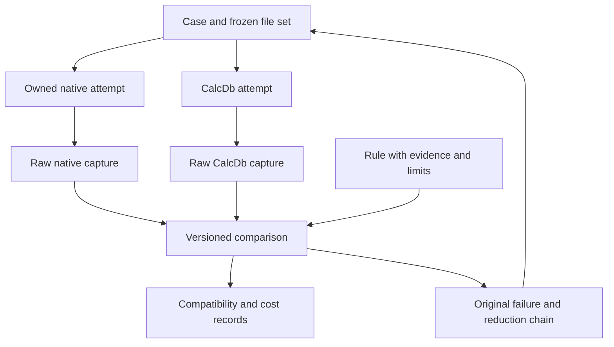
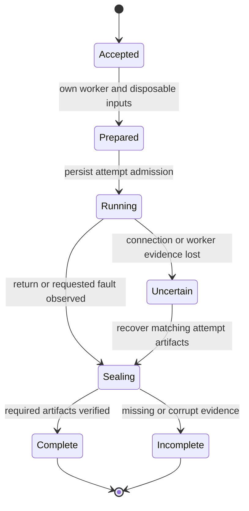
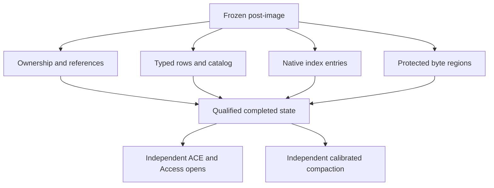
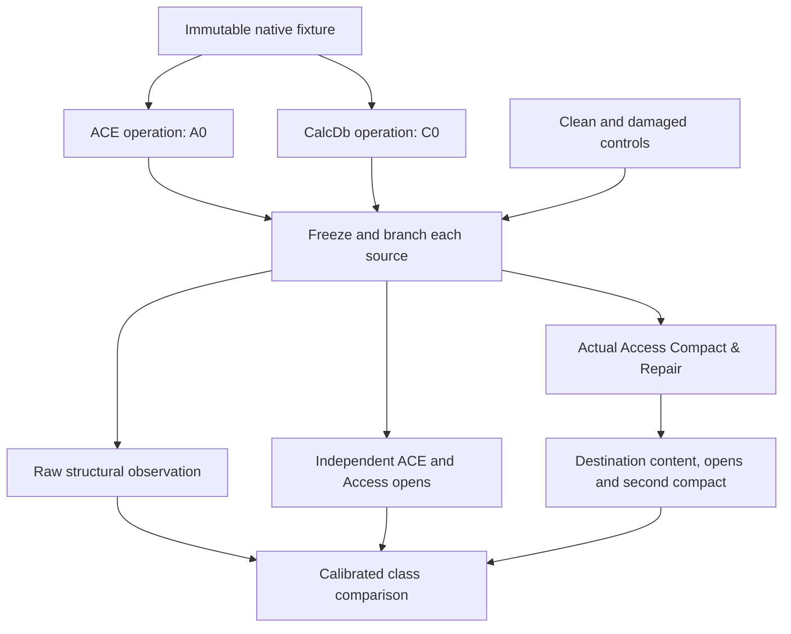
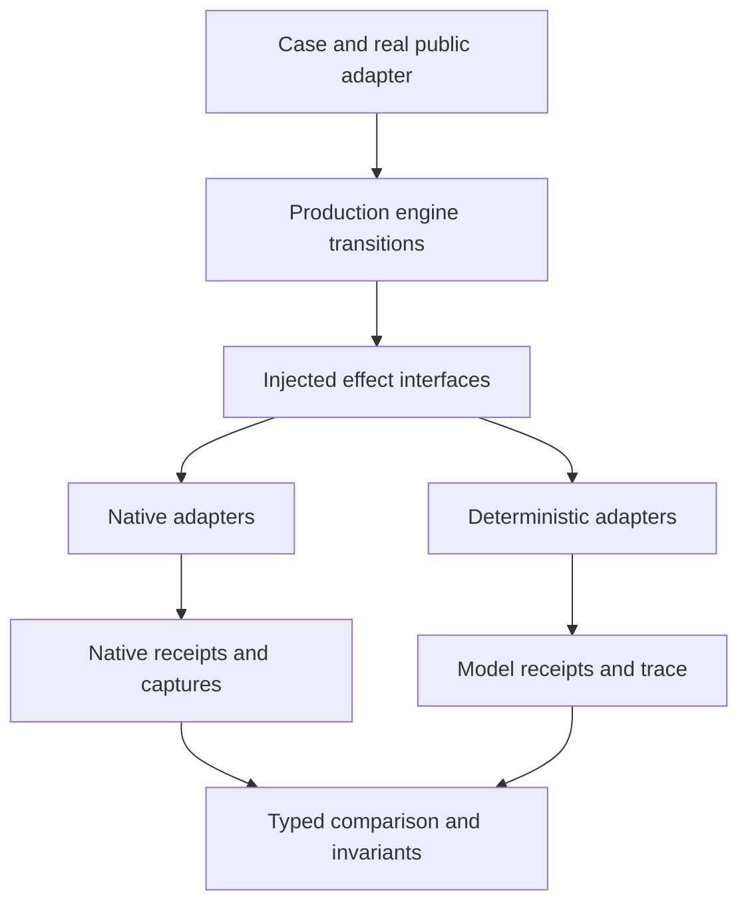

# II-15. Oracle, corpus, tests and performance

Revision 1 · Stage 2, response 14 · 2026-11-14

**Requirement trace.** Primary: RQ-SRC-03, RQ-ORACLE-01, RQ-ORACLE-02, RQ-ORACLE-03, RQ-ORACLE-04, RQ-ORACLE-05, RQ-SIM-01, RQ-SIM-02, RQ-PERF-01, RQ-PERF-02, RQ-LEDGER-01, RQ-TEST-01. Supporting: RQ-PROD-04, RQ-SEM-01, RQ-SEM-03, RQ-LOCK-02, RQ-LOCK-03, RQ-LOCK-04, RQ-SRC-01, RQ-SRC-02, RQ-FMT-02, RQ-CONC-01, RQ-CALL-02, RQ-PLAN-01, RQ-ARCH-01, RQ-PROCESS-01, RQ-DEV-02, RQ-STORE-04 and RQ-STORE-05. The section-to-requirement map near the end identifies the mechanisms that satisfy them; the full requirement text remains in I-16.

**Evidence boundary.** This chapter specifies the executable evidence system for the design in II-01–14. No Windows/ACE, CalcDb, Office, managed-client or browser acceptance test has been executed here. The first native oracle remains the user's reported `ACEDAO.DLL` **16.0.20527.20016**; its actually loaded module, Access host, provider, runtime and machine identities still require capture. The constructed page and comparison examples below are explicitly separate from native observations. All proposed acceptance families remain planned.[^root-authority] Public documents establish their stated API or testing facts; permitted reference-format material supplies hypotheses to test against ACE.

## 1. The result this chapter makes implementable

The smallest useful evidence slice is one immutable native fixture, one actual caller route, one fully captured operation, one comparator and one discrepancy that can be reproduced. Build that slice before a broad queue, a web dashboard or a large generated corpus. The controller, native drivers, byte inspector, simulator and timing runner share request identities and artifacts, but their results retain distinct evidence classes. A fast parser fuzz test must not masquerade as an ACE match; a well-formed capture must not imply that the captured operation succeeded.

**D-EVIDENCE-1 — Recommended.** Keep immutable inputs and raw observations, select explicit comparison rules, and run the actual implementation under controlled effects. The concrete choice is a versioned case description plus content-addressed artifact store, with separate native-capture, CalcDb-execution and comparison records. The comparison is reproducible from those records without reopening or altering the original file. This holds while the store can retain every referenced input/output and the capture schema represents the demanded observations losslessly. R-ORACLE-1 changes the representation or driver when a value, error, identity, lifetime or file effect cannot be captured faithfully. It does not change the expected answer to accommodate a CalcDb difference.

**D-ORACLE-1 — Decided.** One long-lived batched service owns its native workers and preserves their results. Its internal worker layout, capture transport and Office desktop arrangement remain subject to qualification. There is no CalcDb server product hidden in this test service. The service is a development tool; the database engine remains an embedded library. A service job log is likewise not a private database WAL, and it cannot recover an uncertain database mutation by executing that mutation again.

**D-PERF-1 — Recommended.** Start the cost ledger with the first genuine DAO read loop, using the actual call route and required value ownership. Measure DAO/VBA row loops first, bulk SQL second and WASM third where an implementation choice trades them off. Correctness evidence accompanies each optimization; diagnostic counters and timing have separate measurement modes. Numerical budgets follow repeated measurements, not the size of a conceptual example in this book.

These decisions deliberately keep the first implementation small. The persistent records can initially be ordinary files and an index rebuilt from their manifests. Introduce a queue database, distributed runner or richer report only when it removes an observed bottleneck. The immutable result protocol, process ownership and comparison semantics are required immediately; a particular orchestration framework is not.

**Figure F-183 — evidence objects and permitted promotion.** Original design; Mermaid source emitted, not render-verified.



The arrows identify data dependencies, not permission to overwrite an earlier object. Recapturing a case creates another native attempt. Changing a comparison rule creates another comparison. Reducing a failure creates another case. None replaces the original evidence. `K-EVIDENCE`, `K-ERROR`, `K-CRASH` and `K-PAR` are applied below at the points where capture, comparison or execution could otherwise lose their meaning.

## 2. Evidence packs separate a question, an execution and its interpretation

**Requirement trace:** RQ-ORACLE-01, RQ-ORACLE-02, RQ-ORACLE-04, RQ-ORACLE-05, RQ-TEST-01; supporting RQ-SEM-01, RQ-SEM-03 and RQ-STORE-04. **D-ORACLE-1 remains Decided; D-EVIDENCE-1 remains Recommended.** The service is a persistent queue and capture store serving small native drivers. It does not require a CalcDb writer, SQL implementation or portable COM implementation before it can answer the first question. Its smallest useful result is a known native fixture, a direct DAO operation, a lossless returned value, an observed implementation identity and a sealed capture that another machine can replay through the comparator.

Four identifiers prevent the service from confusing reusable evidence with a repeatable execution. A `QuestionKey` identifies the exact semantic request and starting artifacts. An `EnvironmentKey` identifies the selected oracle configuration. An `AttemptId` identifies one execution, including any partial result. A `ComparisonId` identifies one interpretation of immutable evidence under a versioned comparison policy. These are internal harness identities, never database fields or inputs that secretly select CalcDb behavior.

**Figure F-184 — Proposed capture identities and owners.** This is a harness schema, not a native file layout.

| Record | Essential fields | Ownership and purpose |
| --- | --- | --- |
| `Question` | Schema version; ordered operation program; starting fixture manifest; caller surface; observation recipe; fault request; declared external inputs | Immutable input, retained independently of any run. |
| `Environment` | Actual module and runtime identities; target architecture; host/activation route; locale and database options; profile/desktop/storage configuration | Immutable receipt of the environment actually used, not merely the environment requested. |
| `Job` | Client idempotency token; QuestionKey; requested environment; current disposition; allowed attempt identity | Durable controller record, established before admitting execution. |
| `Attempt` | JobId; AttemptId; owned worker generation; Started/Returned/Terminated events; last complete operation event; observed EnvironmentKey | One invocation history. A replacement worker creates a new attempt. |
| `Artifact` | Kind; exact length; content digest; ordered chunks; source identity; capture boundary; capture errors | Immutable bytes. The artifact can exist even when execution never produced a normal response. |
| `CaptureManifest` | AttemptId; artifact references; required-channel checklist; execution disposition; capture completeness; seal digest | Atomically published after referenced bytes are present and verified. |
| `Comparison` | Capture IDs; implementation build; comparator/policy version; typed mismatch or accepted relation; evidence limitations | Derived result. Changing a policy creates another record and never rewrites the oracle capture. |

Compute keys over a versioned, length-delimited binary representation of the declared body, excluding the record's own ID, seal and transport receipts. Preserve exact SQL and string code units, argument positions, named-argument identities, parameter omission, explicit public options and the order of operations. Do not normalize identifier case, trim SQL, normalize Unicode, or serialize all numbers through a JSON Double. A printable JSON view may expose byte payloads as hex or content references; the bytes, lengths and typed tags remain authoritative. Store the key algorithm/version, so a later encoding change cannot accidentally retrieve a different question under an old key.

The fixture manifest includes every input file relevant to the case: the native database, explicitly selected workgroup file when applicable, required linked-source snapshots in later cases, and any initial lock-file artifact specified by a crash experiment. A generated database's creation recipe and provenance accompany its exact bytes. A filesystem path can affect returned descriptions, authorization or linking, so the request includes a path-binding policy and the capture retains actual paths. A rule that equates two temporary-directory prefixes is an explicit comparison rule for a particular diagnostic field; it does not remove paths from all observations.

Cache reuse is a query over compatible evidence, not “same SQL means same answer.” It requires the same QuestionKey, an admitted environment identity, the required observation channels and a complete eligible capture. A newly observed environment variation can partition the cache. Different oracle builds remain separately searchable provenance; they do not become hidden production branches in CalcDb. A new comparator can reinterpret preserved bytes without rerunning ACE, but a new operation, new observer sequence, different fixture or previously absent observation requires new evidence.

A capture's two terminal dimensions are independent. `Execution=ReturnedFailure; Capture=Complete` can be a perfectly useful error case. `Execution=Terminated; Capture=CompleteForRequestedCrash` can be a useful crash observation. `Execution=ReturnedSuccess; Capture=Incomplete` is unusable as a matched result when a required artifact is missing. EOF in a transport is never encoded as an empty rowset, a missing error collection or a cleanly closed database.

## 3. A durable job receipt does not promise exactly-once database mutation

The controller admits a caller-supplied job token only once for an exact QuestionKey and requested environment. Repeating the token with identical input returns status or the existing capture. Repeating it with different input returns a conflict before launching a worker. This provides idempotent **job submission**, not exactly-once execution of an arbitrary external operation.

**Figure F-185 — Job progression and uncertain execution.** Proposed state flow; Mermaid source emitted, not render-verified.



Before `Running`, reserve the run directory, input copies, trace capacity and ownership record. Persist the unique AttemptId and intended worker generation before handing it the instruction that can execute the first native call. The worker repeats that identity on its initial receipt and on each frame. If the controller loses the worker's response, it queries or inspects that same attempt. It does not assume a missing completion receipt means the operation never ran. A durable Started record followed by no Returned record permits both “call not yet entered” and “effect accepted but response lost” unless stronger observed evidence narrows the interval.

A worker is never assigned two mutation attempts concurrently. Its local journal monotonically records operation sequence numbers and trace segments; duplicate request delivery does not enter the same sequence twice. Controller and worker generation checks reject stale completions from a reused process or IPC endpoint. These records need only support the harness's queue and evidence store; they do not add a journal to the native database being tested.

```text
SubmitOrQuery(token, immutable_request):
    input: validated Question, required artifacts, requested environment
    output: existing JobReceipt or one newly accepted JobReceipt
    owner: controller owns receipt and input references before any worker handoff
    failure: persistence/allocation failure admits no new execution
    cost: O(request bytes + manifest entries), plus indexed token lookup

    qkey = hash_versioned_exact_request(immutable_request)
    within controller_store_transaction:
        if token exists:
            require existing.question == qkey
            require existing.requested_environment == requested_environment
            return retained existing receipt
        retain immutable input references
        insert Accepted(token, qkey, requested_environment)
    return durable receipt
```

If an attempt becomes uncertain, a later retry of the *experiment* uses a new AttemptId and a fresh copy of the immutable fixture. The old attempt remains uncertain in the evidence record. The controller first proves that its earlier owners no longer operate on the same run inputs. For later linked-table experiments, a fresh local database copy does not reset a remote source; the case needs a separately owned source reset or is not safely repeatable. No arbitrary `UPDATE`, UDF or callback is replayed merely to make an incomplete trace easier to read.

Trace frames carry schema version, AttemptId, worker generation, sequence number, payload length and digest. The receiver rejects gaps, duplicate frames with different content, invalid lengths and mixed attempts. A complete manifest lists its expected terminal frame and every required artifact. Chunked artifact transfer can resume by digest and offset because it transfers immutable capture bytes; this permission does not extend to resubmitting a native operation. Disk-full or encoder failure marks the capture incomplete while retaining any already executed native effects and the minimum execution receipt.

Cacheable stateful batches include their entire reproducible setup and preceding operation program from a qualified reset, plus relevant external inputs, in the QuestionKey. A retained process-state label or earlier AttemptId alone is not a semantic description of hidden Workspace/random/callback state. If that prehistory cannot be reproduced or a reset cannot be qualified, mark the attempt noncacheable for cross-attempt answer reuse while retaining it as evidence.

Batching operates at declared reset boundaries. A batch can reuse a worker for independent read questions with a qualified reset; a test of hidden default Workspace state deliberately keeps that state. Reuse versus a fresh worker is itself an R-ORACLE-1 comparison. Closing a Recordset is not assumed to reset DBEngine defaults, locale-sensitive caches, error collections, random state, retained event sinks or Access application state. Once a reset is known to be insufficient, select a process boundary rather than accumulating cleanup calls whose behavior the harness has not established.

## 4. Qualify the actual Windows and Office owners before running a case

The initial reference remains the **user-reported** `ACEDAO.DLL` version **16.0.20527.20016**, located under `C:\Program Files\Microsoft Office\root\Office16\`. That is an installation lead, not an observed capture of this session. Record the DLL actually loaded by each oracle process, the Access executable independently, the ADO runtime and selected provider independently, and the exact client runtime. Installed .NET Framework 4.8-family and .NET 10 LTS are separate caller lanes. A Framework interop exception and a raw native HRESULT are separate projections of a case, not interchangeable artifacts.

The in-process DAO driver identifies loaded modules through public operating-system metadata APIs. `GetModuleFileNameW` resolves the path of a module loaded by its own process; external module enumeration has documented races when the target's module list changes. Therefore, take identity observations after the relevant operation has loaded its dependencies, record enumeration failures, and repeat at a stable boundary where necessary. A registry entry, ProgID string or Office installation directory alone does not identify the implementation that answered the call.[^or-module][^or-enum]

For each relevant image, retain the observed loaded path, file identity, version-resource fields, architecture and hash of the corresponding file under the run's stable-installation policy. Record when and how that disk file was associated with the loaded module. Do not label a disk hash as a hash of reconstructed in-memory code. An update or unresolvable identity race makes affected provenance incomplete. Module metadata collection is not decompilation or disassembly and supplies no undocumented engine algorithms.

**Figure F-186 — Minimum environment receipt for a native case.** Proposed required dimensions; exact values are captured on Windows.

| Dimension | Captured distinction |
| --- | --- |
| Engine and host | Loaded DAO/ACE, ADO/provider and Access identities; requested activation versus selected implementation; client executable/assembly. |
| Caller | Native vtable/dispatch, actual VBA/CalcVBA client, or actual managed projection; architecture; framework/runtime/interop assembly versions; apartment and thread. |
| Database | Exact input hash; Jet 4/ACE profile; sort/collation descriptors; format options; encryption/security/workgroup context where applicable. |
| Expression context | ANSI mode, locale, relevant sandbox/host state and admitted function provider; public connection/query options. |
| Process environment | User/profile identity label, private desktop/window station, process creation receipt, current/TEMP paths, reset policy and previous batch state. |
| Storage and fault | Volume/filesystem/backend, access/share flags, cache configuration actually known, local versus network location, fault mechanism and observer boundary. |

Use a dedicated logged-on test environment with a qualified private desktop. The queue controller can live elsewhere, but an Office worker must not be silently moved into a noninteractive service context. Microsoft's unattended Office guidance identifies interactive UI and identity assumptions and says that application automation in unattended noninteractive contexts is not generally supported. That informs the qualification experiment; it does not authorize changing Trust Center, macro security, HKLM, or the user's working Office configuration.[^or-rpa]

The ownership record contains retained process handles and creation observations, not just a process name or a PID later looked up in a global list. The controller creates the native driver suspended when appropriate, records it, assigns the intended containment and only then permits execution. A Windows Job Object can manage associated processes, but child association has documented exceptions; COM activation through another service is not proved to belong to the driver's job merely because the driver requested it. Keep an explicit owned-process set and verify membership.[^or-job]

An Access automation reference needs its own ownership proof. Prefer an explicitly launched, qualified Access route in the dedicated environment. Before driving a database or requesting `Quit`, obtain its main window identity through the documented `hWndAccessApp` method and correlate the window's process using `GetWindowThreadProcessId` with the retained owned launch receipt. Qualify the captured target's return type and x64 handle conversion; do not infer them from a generic VBA declaration. An unexpected or unresolvable process identity leaves the route unavailable. Do not attach to, close, terminate or dismiss dialogs in an unowned Access instance to make the test continue.[^or-hwnd][^or-window]

Run UI Automation observation on a separate, qualified MTA thread or observer process, with serialized event subscription/removal and owned-window filtering. Microsoft's UI Automation guidance recommends a windowless MTA thread for broad desktop interaction and documents apartment-lifetime issues. Its event handlers must not call back into the DAO/ADO error channel being captured. Record window/process identity, dialog properties, timestamp and the specific action chosen by the case's dialog policy; an unexpected dialog is evidence, not a reason to press a universal affirmative button. Validate that UI Automation actually sees and can operate on the selected private desktop; the words “private desktop” are not proof of that capability.[^or-uia]

Normal worker recycling and deliberate crash injection use different exits. A normal recycle drains the admitted batch, records required Close outcomes, releases owned automation references and closes only owned applications. A crash case invokes the chosen fault mechanism at its observed cut and retains the raw outcome. `TerminateProcess` initiated by another process returns asynchronously and requests cancellation of pending I/O; Windows does not report process exit until its pending I/O has completed or been canceled. Wait for the retained process handle and account for all other owned writers before collecting a stable process-kill artifact. This is still neither rollback nor a power-loss persistence test.[^or-terminate]

## 5. Capture the active Automation value, not the whole VARIANT allocation

The native value at the Windows x64 boundary is the real **24-byte VARIANT** and real BSTR. Its durable capture is a typed encoding of active fields and owned referents, not a dump of 24 bytes containing pointers, padding or inactive union members. Each result descriptor has an output-validity bitmap for the actual return path: bytes in an output the API does not define on that path are retained only as optional guard diagnostics, never compared as returned values. Decimal capture selects its valid numeric fields instead of comparing the overlaid VARIANT/DECIMAL structure wholesale. The recorder uses the same actual target declarations as II-13 and verifies that its capture/replay client is distinct from the proposed portable implementation. A compact wire representation does not change the shared in-process ABI. Where a public projection loses native field precision or storage distinctions, pair it with the qualified field metadata and physical-value observation; a matching VARIANT alone does not prove a Date/Time Extended or native numeric payload survived.

**Figure F-187 — Lossless value records and deliberate distinctions.** These are proposed evidence records; the examples are constructed, not ACE outputs.

| Active value family | Durable content | Distinction that must survive |
| --- | --- | --- |
| Integer or Boolean | VARTYPE; native active width; signedness where applicable; exact payload bits | `VT_I2(1)`, `VT_I4(1)` and `VT_BOOL(-1)` do not become one JSON value. |
| Single/Double/DATE | VARTYPE and exact 32-/64-bit payload; derived display only as annotation | Negative zero, NaN payloads where admitted, native DATE bits and rounded display text remain separate. |
| Currency/Decimal | Currency's scaled integer; Decimal sign, scale and 96-bit coefficient | Decimal `1.0` and `1.00` retain their returned representation; comparison policy decides any permitted semantic equivalence. |
| BSTR | Null-pointer presence flag; `SysStringByteLen`; exact payload bytes | Embedded zeros, odd byte lengths and unpaired UTF-16 units survive; null and allocated empty remain raw observations. |
| Empty/Null/error/omitted input | Actual tag and error payload; explicit argument-present bitmap | Missing argument is not inferred from every `VT_ERROR`; `DISP_E_PARAMNOTFOUND` is recorded with its actual invocation position. |
| SAFEARRAY | Element type/descriptor facts; rank; ordered bounds and extents; elements indexed by explicit tuples | Lower bounds, dimension order, empty shapes, object/value element ownership and element tags remain visible. |
| ByRef | Declared tag; capture-local storage/alias identity; before/after active target snapshots | Two parameters referring to the same writable cell do not turn into independent values. |
| Interface/record | Captured interface/type identity and supported observation protocol; capture-local object equivalence classes | Raw pointer values are diagnostic addresses, not expected identity across processes. Unsupported structured types are a capture failure, not an empty value. |

For BSTR, capture bytes using its explicit byte length. Microsoft specifies that `SysStringByteLen` returns the allocated payload byte count even with embedded nulls, and `SysAllocStringByteLen` supports binary data without ANSI/Unicode translation.[^or-bstr][^or-bstralloc] Consider the constructed five-byte payload:

| Item | Exact value |
| --- | --- |
| Byte count | `5`, encoded as little-endian `05 00 00 00` in this witness |
| Payload | `41 00 00 00 7F` |
| Derived view | First complete unit `0041`, second `0000`, then one trailing byte `7F` |
| Evidence meaning | Five bytes, not the string `A`, not four bytes, and not replacement-character text |

The recorder excludes the allocator's terminating storage and records the pointer's nullness separately. The reconstructed round-trip must recover all five payload bytes. This is a serialization test, not a claim that a DAO Text field accepts an odd-byte BSTR. A semantic case can establish that null BSTR and allocated empty BSTR are equivalent for a particular call while the raw capture continues to distinguish their representations.

For a constructed `VT_R8` negative zero, the active 64-bit payload is `8000000000000000` in hexadecimal, or `00 00 00 00 00 00 00 80` in little-endian storage. Its decimal display can equal positive zero's display while the bits differ. The capture therefore never regenerates expected bits by parsing display text. Exact serial/parallel Double comparisons consume these preserved bits.

SAFEARRAY collection must not guess a flat order from a language's two-dimensional array syntax. Record bounds with a stated API dimension convention and serialize explicit index tuples or a versioned traversal. `SafeArrayGetElement` specifies its index-vector order and copies string, object and Variant elements appropriately; those copies have ownership and may allocate or invoke foreign reference operations.[^or-array] For a constructed two-axis array with logical bounds `[-1..0]` and `[5..6]`, retain four tuples `(-1,5)`, `(0,5)`, `(-1,6)`, `(0,6)` under the declared traversal. A different source wrapper's nesting order is not evidence that the dimensions changed.

Capture nested values through II-13's mutation-stable owned-copy service. A naive recursive `VariantCopy` walk can miss ByRef aliases, cycles or state changes caused by foreign `AddRef`/release/copy callbacks. Register the capture graph, retain admitted owners, memoize already observed references and apply checked depth/byte budgets. A budget failure yields an incomplete required value capture with its reason; it never truncates an array or substitutes Null and then calls the result matched. Obtain raw interface identity through the declared identity protocol while its owner lives, after transient diagnostics have been retained.

## 6. Observation itself is part of the operation program

A native operation's response record contains its original input ordinal and invocation kind, return/HRESULT bits, active outputs, resulting public state, relevant diagnostic channels and callback/event sequence. Not every channel can be observed simultaneously without changing the object. The `ObservationRecipe` therefore names which calls are observers, their order, their state effects and the paired runs needed when channels interfere.

In the raw native lane, preserve immediate return evidence first. `GetErrorInfo` transfers the logical thread's error object and clears the slot; a proxy call before it can clear the object. The recorder must not obtain a friendly object name, enumerate an Errors collection, release foreign arguments or render a COM diagnostic before retaining that transient evidence. Keep EXCEPINFO's owned BSTRs and any deferred-fill provider separately; II-12's single-fill/lifetime policy applies. Capture the original call before a fallible richer description, so a failed description never causes the operation to run again.[^or-error]

The VBA lane first snapshots the language's error fields according to its qualified trap recipe. The managed lanes first snapshot the actual exception type, HRESULT, message/source/help information and nested exception data before doing another interop call. Their runtime may already have consumed IErrorInfo. A later empty slot in such a run says nothing conclusive about what the original native callee supplied. A paired fresh raw invocation answers that different question; it cannot be merged into a fictional simultaneous observation.

**Figure F-188 — Observation recipes for one failing operation.** Proposed pairing preserves the original context and makes observer effects visible.

| Lane | First retained result | Subsequent observations | What it does not establish alone |
| --- | --- | --- | --- |
| Raw vtable | HRESULT, defined outputs, immediate thread error object | Owned IErrorInfo fields, DAO/ADO Errors, permitted state reads | Actual VBA or managed translation. |
| Raw dispatch | HRESULT, path-defined `puArgErr`/EXCEPINFO and immediate error object | Qualified deferred fill, output arguments, collections | Early-bound binder behavior. |
| Actual VBA | Trap-visible Err fields and output/ByRef variables | Ordered DAO/ADO collection reads and following public operation | The native thread slot before the VBA runtime touched it. |
| Framework/NET 10 | Actual managed exception/result and argument projection | Ordered collection and object-state reads | The other runtime's projection or an unmodified native slot. |
| Event/callback | Event arguments, caller-thread/operation identity, nested operation receipt | Completion, live collection and outer return in order | A global order invented by sorting timestamps. |

A successful property getter used as an observer is an actual call. Asking `RecordCount`, moving to the end, enumerating Fields or reading a stream can change later population, position, diagnostics or demand. The ordinary semantic program records these calls when it needs their observations. A separate minimal-observer run tests whether an instrumentation route changes the behavior under study. Full state dumps between every API call are not a transparent substitute.

Cross-process traces use per-process sequence and explicit synchronization edges. Monotonic timestamps support timing and correlation, but two events with close clock readings are not a proved total order. For lock experiments, retain the acknowledged issue/completion/barrier events that establish happens-before. For reentrant callbacks, keep the invocation parent and nested sequence, so the comparer can distinguish `outer enters → nested fails → outer succeeds` from an unordered bag of errors.

Observer failure remains separate from engine failure. A failed Error.Description getter, a UI Automation timeout, an exhausted serializer or a dropped mandatory trace segment does not become the DAO operation's error. Preserve both receipts and classify the required capture as incomplete. Qualify encoder and observer behavior with controlled native test objects first, including hostile reentry and deferred diagnostics, then repeat against ACE. Success of the synthetic object tests is evidence about the harness, not about ACE's value policies.

## 7. Freeze native bytes before the first reopening branch

Every database-mutating attempt produces an artifact boundary before any ACE/Access reopening, repair, pretty-printer rewrite or export transformation. For normal completion, record the exact sequence of public commit, force option, acknowledgement and explicit Close calls; stopping at CommitTrans return and closing the last database are different capture boundaries. For a process-kill case, record requested cut, observed issue/completion frontier, process-exit observation and limitations of the copy procedure. II-08 owns the admissible crash classes and the distinction between runtime-visible and durable storage.

A live post-Commit capture needs a qualified stable snapshot/read route while the declared owner state is retained. Do not insert Close, force flush, repair or an unrecorded lock transition merely to make copying convenient. If the selected route cannot obtain a coherent image at that boundary without changing it, retain the public observations and mark the physical capture unresolved; use a separately named later boundary for any copy obtained there.

Store the complete physical file bytes and logical length, any relevant lock-file bytes/existence state, and per-file identity/metadata observations. Do not decrypt/re-encrypt, compact, normalize headers, reconstruct from rows or discard unclassified pages before preserving the original. Copying a local post-kill file after all writers settle preserves the then-readable OS view; it does not reconstruct which dirty cached bytes would survive power loss. A storage-snapshot procedure has to state its own consistency and persistence model.

Use per-page digests to index differences, then retain and compare actual bytes for each required changed or protected region. For a qualified 4,096-byte profile, page 17 begins at `17 × 4096 = 69,632 = 0x11000`; an observed difference at local offset `0x0FF0` is at file offset `0x11FF0`. That arithmetic locates an observation without asserting what the byte means. The classifier records page-kind evidence, owning object hypotheses, changed ranges, reference edges and whether each range is understood, protected opaque data or unresolved. A changed unknown byte is not automatically exempt because the SQL rows still match.

The first branch is a byte-preserving copy for raw analysis. Separate copies receive ACE-first ordinary open, Access-first ordinary open and Compact & Repair first. Starting lock-file state is an explicit experiment input: it may be absent, an exact captured stale artifact, or a deliberately selected control. Never silently delete an unexpected lock file and then claim to have observed native first-opening behavior. Independent branches record any new lock file and every change made by opening/closing itself. An Access branch that repaired a file cannot supply the bytes for the subsequent ACE-first branch.

Artifact sealing uses a streaming writer with owned staging output. It computes length/digest while writing, closes and verifies required transfer/storage completion, then atomically publishes the manifest reference under the capture-store protocol. On failure it retains an unsealed partial artifact and reason. Complexity is linear in captured bytes, with bounded transfer buffers; page summaries add one digest and classification record per inspected page. Its sealing guarantees are about the evidence store and never strengthen the tested database's commit durability.

## 8. The corpus is a set of native histories, not just sample databases

**RQ-ORACLE-04, RQ-FMT-02 and RQ-TEST-01.** A fixture records how the bytes came to exist. A fresh table and a table that reached the same public schema through deletion, append, rename and compaction are different storage tests. An old row can retain its original physical-column count after a field is added; a growing value can leave a stable root row pointing at an overflow body; a short long-value tail can share its page with unrelated values. Importing all rows into a new file would erase precisely the histories that the reader and writer must handle. II-04's recorded physical columns, variable indexes, root/body distinction and map roles therefore become corpus dimensions.

Prefer three connected fixture tracks. **Native legal histories** are created by identified Access/ACE operations and remain the source of compatibility expectations. **Constructed format fixtures** exercise the one physical description, including exact boundary and malformed cases; they are hypotheses until an actual native driver accepts or rejects them with captured behavior. **Interrupted images** come from a named real or simulated fault model and preserve the state at capture, before repair or ordinary reopening changes it. Each track may produce a useful regression, but their evidence labels never collapse into one “valid database” flag.

An ordinary fixture is a `FileSet`, not necessarily one pathname. It can include a database, a deliberately retained lock file, a workgroup file for an applicable secured-MDB case, later linked-source fixtures, and an explicit list of absent paths. Every included file has exact length and content, role, provenance and retention rules. A reference to a source outside the set must be an explicitly declared environmental dependency. The isolated worker directory is a mapping from logical fixture roles to owned paths; it must not silently change path spelling, aliasing or relative-link behavior that the case is meant to test.

```text
FixtureManifest {
    schema_version
    fixture_id                  // digest of input_body only; this ID is excluded
    input_body {
        files[] { role, logical_name_bytes, length, blob_digest, kind }
        absent_paths[]          // absence is an input when the case depends on it
        external_dependencies[] // already identified immutable inputs/profiles
    }
}
FixtureProvenance {
    fixture_id
    creation { tool, observed_environment_id, recipe_id, parent_fixture_ids[] }
    native_history[] { operation_id, before_id, after_id, capture_id }
    format_profile_evidence[]   // file-visible facts, not a hidden engine-build selector
    feature_tags[]              // scalar, index, LV, catalog, preserved, later, damaged ...
    protected_regions[]        // physical bytes plus known ownership/reference roles
    provenance { owner_or_source, redistribution_terms, transformations[] }
    status { generated, native_observed, incomplete_dimensions[] }
}
```

The fixture identity hashes exact input roles/bytes/absence and declared immutable dependencies. Post-execution history, captures and derived interpretation live in separately versioned provenance records that can refer back to that identity without a hash cycle. A case additionally pins the provenance/profile interpretation revisions it uses. This is test metadata; no part is inserted into the database to make CalcDb recognize a fixture. Keep passwords and source credentials in the test environment's secret capability, referring to an opaque versioned credential label where needed. A changed credential can change an expected failure, so its identity belongs to the case even when its cleartext does not belong in a shared capture. An omitted or unavailable secret makes that case unexecuted, not matched. Synthetic fixtures are the preferred distributable corpus; a supplied real-world file retains its permission and distribution limits instead of being republished merely because it helped find a bug.

Store the exact original blob. A generated recipe is useful but does not replace it: a later Access build can produce different native metadata from the same public creation calls. Re-running a recipe creates a new fixture with a new creation environment. Native files written by older Access versions remain useful even when only the current oracle can reopen them. Distinguish **creator coverage**, **opener coverage** and **mutation coverage**. Successful opening by the initial engine does not establish how the historical engine behaved, or certify that CalcDb writes every variant that engine created.

**Figure F-189 — fixture dimensions and discriminating native histories.** Test-design table; planned coverage, not executed evidence.

| Family | Small starting fixture | History or boundary that gives the case its value |
| --- | --- | --- |
| File envelope | Empty Jet 4 MDB and each evidenced ACCDB profile | Creator version/options, sort descriptor, header exceptions, unsupported signature, truncated extent and native reopen behavior. |
| Ordinary rows | One table with fixed Long, Text, Boolean and nullable Text | Null versus non-Null empty, fixed-field holes, physical column order versus display order, appended/deleted fields, pre-trailer padding and slot boundaries. |
| Text and scalar precision | Exact raw scalar/text payloads with captured public values | Compressed/uncompressed text transitions; embedded nulls; non-BMP or isolated UTF-16 units where admitted; Decimal/Currency scale; raw Date/Time Extended precision versus public projection. |
| Long values | Inline, one-row and chained LV values | Encoded byte lengths at transitions, chunk boundary inside text state, shared tail page, overflow/deleted flags, truncation, cycles and allocation ownership. |
| Indexes | Empty, one-entry and duplicate-heavy indexes | Root growth, prefix expansion, high-fence update, peer/tail structure, shortening collisions, mixed directions, Null policy and exact descriptor-selected key bytes. |
| Usage maps | Inline object and global declarations | Rebase and promotion, exact bitmap boundary, allocation of a bitmap that must itself be marked allocated, EOF extension and reuse of existing free holes. |
| Catalog and QueryDefs | User table, relation, properties and saved parameter query | TableDef continuation, native MR2/property/query records, stale held descriptors, names differing by contextual comparison, old/new schema and native security applicability. |
| Preserved content | Native forms/reports/modules and unknown properties/types | Unrelated row/DDL mutation, shared pages, incoming opaque references, byte preservation and safe refusal before any modification. CalcDb never runs the stored front end. |
| Object histories | Two held recordsets and related child/collection objects | Seek/Find/bookmark, cloning, failed edit, Refresh/Requery/Close, stale references, error collection lifetime and actual caller ABI. |
| Transactions and sharing | Small indexed edit with identified participants | Explicit/implicit nesting, force options, late writer admission, rollback, mixed outcomes and independently frozen crash images. |
| Later mechanisms | One minimal encrypted/link/complex/rebuild/provider case | Preserve initial parse/read boundaries; activate later semantics only under the corresponding II-14 profile and card. |

The matrix is a coverage inventory, not a request for its full Cartesian product. Start with a small witness for each rule and add interactions where ownership or representation meets: compressed text spanning LV chunks, a schema change while a cursor holds old metadata, or an index split while the allocator promotes a map. Pairwise combinations can organize otherwise independent dimensions, but they do not replace such mechanism-driven cases. The corpus index records which combinations have never been created or observed.

For size boundaries, distinguish the file-format ceiling, the API's semantic limit, a reference writer's policy and the harness budget. Microsoft documents a 2 GB Access database limit minus system-object overhead and up to 255 table fields; those facts identify boundary families, not a promise that all combinations fit simultaneously. A 4060-byte reference row-writing limit and 4076-byte LV-row limit have different meanings from the documented character limit and from the actual slot extent. An exhausted test budget does not become a new accepted Access limit.[^cor-limits][^cor-format]

## 9. A page-level fixture that tests values, masks and bounds together

Use II-04's 19-byte row A as a constructed witness. It has physical columns `Id: Long=42`, `Name: Text="Hi"`, `Flag: Boolean=True` and `Notes: Text=Null`. The Text bytes are deliberately uncompressed UTF-16LE. Its row body is:

```text
04 00 2A 00 00 00 48 00 69 00 0A 00 0A 00 06 00 02 00 07
```

Place this row in slot 0 of a 4096-byte ordinary data page at page number 57, with a constructed TableDef owner at page 9. The row begins at `4096−19=4077=0x0FED`; a one-slot directory ends at offset 16. The free counter is `4082−19−2=4061=0x0FDD`. The first sixteen bytes of the page are therefore:

```text
01 01 DD 0F 09 00 00 00 00 00 00 00 01 00 ED 0F
```

All remaining bytes before the row are zero in this **constructed page witness**. This page alone is not a complete valid database: a full fixture also needs the native file envelope, TableDef, catalog and allocation/ownership closure. The creator byte and zero stamp are reference-creator choices, not universal constants to demand from ACE. The page geometry, slot coordinates and row-mask/trailer rules come from the previously pinned permitted reference; the complete synthetic example is original and still needs native qualification.[^cor-format][^cor-row]

**Figure F-190 — one page, several distinct classes of test.** Constructed Jet 4-family layout hypothesis; arithmetic check only, not an ACE capture or rendered figure.

| Operation on this witness | Exact byte location | Expected diagnostic value of the test |
| --- | --- | --- |
| Decode row start | Page `+0x000E`: `ED 0F` | Obtain `[0x0FED,0x1000)` from the slot, not from a guessed fixed row length. |
| Change Name from Hi to Ho | Row `+8`, page `+0x0FF5`, file `0x00039FF5`: `69→6F` | Same-length field edit changes the correct code unit while retaining row trailer and mask. This says nothing about physical write size. |
| Change Notes from Null to empty Text | Row `+18`, file `0x00039FFF`: `07→0F` | The variable span stays `[10,10)`; the mask changes the public value and must defeat a payload-only comparator. |
| Change Flag to False | Same mask byte: `07→03` | An ordinary Boolean has its value in the mask; no scalar payload is removed or appended. |
| Corrupt Name's end | Row `+12..13`: `0A 00→05 00` | The computed span `[6,5)` is invalid; the parser rejects before slicing or allocation. Native error mapping needs its own capture. |
| Corrupt variable count | Row `+16..17`: `02 00→FF FF` | Checked trailer arithmetic rejects the impossible count within the 19-byte row; it does not allocate a 65,535-entry offset vector. |
| Read an appended ordinary field | Current schema adds physical column 4; row C remains 4 | The decoder handles absence from the row's own column count without reading a nonexistent extra variable offset. |

The Null/empty pair is especially useful because a plausible-looking test can get it wrong twice. A decoder that returns empty for both and a comparator that treats both as the same printed string would agree with themselves. Keep the native mask, the typed public capture and the exact empty BSTR payload as independent observations. The typed comparison must distinguish `VT_NULL` from a non-Null `VT_BSTR` whose byte length is zero. Whether a particular public method returns a null BSTR pointer or an allocated zero-length BSTR is another observation, with its own applicable comparison rule; it must not be confused with the VARIANT's Null tag.

For the malformed branches, the parser's required invariant is bounded behavior and no mutation of the original. An ACE refusal can later supply a matching error expectation, but the constructed bad count alone establishes no native HRESULT, DAO error number or demand phase. A boundary test should also include a valid nearby value so a parser that rejects everything cannot satisfy the suite.

## 10. Map and long-value witnesses make ownership observable

Byte equality and semantic membership are deliberately different tests. Start with the 69-byte inline object-usage declaration in II-04: type `00`, base 0, and members 400 and 410. The membership bytes are at declaration offsets 55 (`01`) and 56 (`04`). To include page 600, construct a new declaration with base 400 (`90 01 00 00`) and membership bytes at offsets 5 (`01`), 6 (`04`) and 30 (`01`). The set becomes exactly `{400,410,600}`. Copying the old bits under the new base would instead produce the wrong members; comparing only the base would miss that failure.[^cor-map]

For a reference map, the 4096-byte bitmap body begins at offset 4 and covers 32,736 page numbers. A map declaration pointing to bitmap page 90 begins `01 5A 00 00 00`. Membership of page 700 resides at bitmap offset `4+floor(700/8)=91=0x5B`, bit `0x10`; its absolute byte offset is `90×4096+91=0x0005A05B`. The boundary page 32,735 uses the last byte of one bitmap and bit `0x80`; page 32,736 uses the next pointer and bit 0 at that bitmap's offset 4. These arithmetic cases test pointer selection, extent validation and page-number multiplication independently of any allocator policy.[^cor-map]

**Figure F-191 — preserve the map's role while comparing its contents.** Constructed native-reference examples; no native allocation schedule asserted.

| Observation | Object-owned map | Available-space map | Global free-space map |
| --- | --- | --- | --- |
| Set bit | Membership in this object's evidenced ownership domain. | Candidate page for an insert/update; still validate slots, bytes and native packing rules. | Free/reusable state under the selected native profile; the bit sense differs from positive ownership. |
| Empty or missing backing | Interpret according to the evidenced object-map profile. | Does not prove the page can or cannot hold every row size. | Do not import object-map missing-block semantics; extent and initialization state matter. |
| Comparator obligation | Every required reachable resource is covered, without conflicting ownership. | Required native maintenance plus safe allocation behavior; not exact row-capacity inference from one bit. | Live allocations are not offered as free; appended bitmap pages account for their own allocation. |

The graph includes more than page ownership. II-04's constructed 4080-byte chained LV has a definition `F0 0F 00 00 00 50 00 00 00 00 00 00`, pointing to row 0 on page 80. That row has 4072 payload bytes after its four-byte next locator, which points to row 0 on page 81. The tail contains eight payload bytes after its terminal locator. The declared length is 4080, while the external row extents total 4088 bytes. The comparison must not add the link bytes to the public binary length.[^cor-lv]

Now add an unrelated short LV in another slot on page 81. A shrink of the first value may retire its tail row; it may not free page 81 while the second row remains live. This discriminates whole-page ownership from the row-level reference and allocation closure. A broken implementation can return the first value correctly and still destroy the unrelated value on the next allocation. The acceptance sequence therefore reads both values, performs a new allocation capable of reusing the mistakenly freed page, and reads both again through an independent native opener. It records the first state that differs, not merely the final missing row.

Keep paired positive and negative graph controls: a legal repartitioning of payload across admitted chunk sizes; a self-cycle; an out-of-extent page; a pointer to the wrong kind or slot; a chain longer or shorter than the declared length; and a live tail whose map bit incorrectly permits reuse. The same format description supplies each locator field and kind check. The test generator changes a named field or relationship, records the mutation, and retains the unmodified parent fixture. Arbitrary corruption remains useful for robustness, but a targeted violation is more informative about which invariant failed.

## 11. Generate from one description without making agreement circular

Compile the format description into the production decoder/encoder, inspector, bounded generator and constraint checker. Keep their traversal strategies and test evidence distinguishable. Sharing the coordinate of a slot word avoids drift; using a decoder's output to generate its only expected answer would merely reproduce a mistaken coordinate. Native captures and separately written small arithmetic witnesses provide the independent checks. Jackcess is a reference fact source for the listed fields, not a second oracle that can decide a disagreement with ACE.

```text
GenerateCandidate(parent, target_rule, mutation_kind, seed, budgets):
    require parent is immutable and every output is a new file set
    graph = InspectBounded(parent, selected_format_description, budgets)
    if target requires a relationship the inspector has not resolved:
        return UnresolvedTarget(reason, parent.id)
    choices = EnumerateRelevantCoordinates(graph, target_rule)
    chosen = SelectDeterministically(choices, seed)
    patch = PlanNamedMutation(chosen, mutation_kind)
    verify patch arithmetic, extents and explicitly allowed violation set
    candidate = CopyAndApply(parent, patch)  // owns all changed bytes
    receipt = Record(parent.id, target_rule.id, seed, patch, candidate.digest)
    return Candidate(candidate, receipt, intended_violations)
```

**Inputs/outputs and ownership.** The parent is read-only; the returned candidate and patch receipt are newly owned artifacts. A valid-history generator instead drives the native surface and captures its result, with no direct byte patch. The malformed track can intentionally violate `target_rule`, but it must still record other known violations introduced by that patch. A one-byte change that produces three graph failures must not be advertised as an isolated test of only one.

**Failure and cost.** A parse limit, unknown reference, overflow or exhausted budget produces an unresolved generator result and retains its parent; it does not mutate the parent to make generation easier. Full graph inspection costs O(P+E+B) for P visited pages, E traversed references and B decoded content, subject to the format's indexing costs. A small local patch can reuse a valid immutable inspection summary, but its dependencies must be invalidated by the patch's complete affected closure. Test generation may consume more memory than the engine; its own bounds are still explicit so hostile files cannot hang the evidence service.

Use three classes of transformation with different expected relations. A **representation-preserving** transformation, such as a legal alternative LV partition, needs native acceptance before semantic equality is assumed. A **semantic** transformation, such as changing Null to empty, needs a new expected typed answer. A **malformed** transformation tests bounded rejection and, after oracle capture, the target's exact error behavior. A crash image is none of those by inference: it carries the fault model and corresponding survival obligations.

Metamorphic tests are similarly conditional. A scan and an index path may be compared only when their admissible ordering and demanded errors agree. SQL rewrites involving Null, overflow, UDFs, rounding or evaluation order cannot acquire correctness from a familiar algebraic identity. Disable a CalcDb optimization and compare with its already accepted serial plan to detect an optimization defect; do not count that internal match as an additional ACE-matched case. The fault and optimization-baseline sections below apply the same distinction: the transformation must preserve the accepted semantics, and an internal match remains supporting evidence rather than another native observation.

## 12. The comparison rule is an explicit, reviewable object

**RQ-ORACLE-02, RQ-SEM-01 and RQ-SEM-03.** Store comparison policy separately from both raw captures. Prefer strict typed comparison; relax a field only through a named rule with evidence, applicability and a counterexample that the rule must still reject. A normalization proposal is consequential when it hides a compatibility difference. It needs native evidence or a documented nonobservable representation distinction, not the fact that the current implementation otherwise fails.

```text
ComparisonRule {
    rule_id, revision, requirement_ids[]
    applicable_surface_and_operation
    required_capture_channels[]
    relation                   // Exact, Ordered, Multiset, IdentityGraph, Structural ...
    field_selectors_and_definedness
    evidence_ids[], unresolved_contexts[]
    permitted_normalizations[] // each has reason, bounds and a rejecting control
    comparator_build
}
ComparisonRecord {
    case_id, oracle_capture_id, calcdb_capture_id, rule_id_and_revision
    status, first_difference, all_difference_artifact
    missing_or_invalid_channels[], coverage_dimensions[]
}
```

A schema version controls how bytes are decoded; a comparison revision controls what relation is required. Re-decoding old raw artifacts is permissible when their original version remains known. Silently interpreting an old payload under new field meanings is not. Re-comparison appends a result linked to the same raw captures; it does not edit the oracle file or bless a previously missing channel.

**Figure F-192 — select the relation at the observable boundary.** Proposed rule registry; actual exceptions require evidence.

| Observation | Default relation | What must not be normalized away |
| --- | --- | --- |
| Public scalar values | Same declared context where relevant, same VARIANT tag and exact meaningful payload. | Null/Empty/Missing/error distinctions, sign/width, Boolean representation where observable, Decimal scale, Double bits, temporal precision. |
| Text/Binary | Exact length and bytes; text also retains code-unit interpretation. | Embedded nulls, odd-length binary BSTR, empty versus Null, trailing spaces, Unicode normalization and lossy replacement. |
| Ordered rowset | Exact schema and typed row sequence. | Ties, duplicates, cursor position, first demanded error and partial population. |
| Evidenced unordered result | Exact typed multiset, retaining raw orders. | Duplicate multiplicity, type distinctions and the error/effect prefix; a multiset rule does not cover callback order. |
| Object behavior | Required identity/alias graph, member results, state transitions and event order. | Identity changes, collection refresh policy, held-child lifetime and actual implementation provenance. |
| Errors | Required channel values and ordered records at their defined observation points. | HRESULT versus language number, warnings, Source, error collection ordering, information consumed by observation. |
| File output | Exact mandated bytes plus qualified native graph and required semantic state. | Unknown regions, index-key payloads, missing references, overlapping ownership or unexplained header/catalog changes. |
| Interrupted output | Qualified state class and survival obligations for the same fault/context. | A required surviving commit, lost unrelated data, unobserved repair marking or a weaker next-opener result. |
| Timing/cost | Declared sampling and distribution procedure. | Failed/incomplete runs, warm/cold mix, scope changes, instrumentation overhead and hidden plan changes. |

The semantic capture format is **not** a substitute Automation ABI. Native calls still use the platform's real VARIANT/BSTR; on Windows x64 a VARIANT has 24 bytes. The comparison payload excludes meaningless padding and process-specific pointers while preserving the defined values, valid raw fields and identity graph that the caller can observe. II-13's ABI tests separately check size, alignment, array stride and ownership through actual clients. A wire encoder that happens to fit in 16 bytes cannot redefine the shared value representation.

For ordinary data tests, bind explicit parameter values instead of relying on `Now`, an unseeded random stream or an uncontrolled external source. Tests of those effects remain necessary. They capture an admissible relation—such as a type and a time bracket or an evidenced seeded sequence—with its uncertainty and context. Do not inject a CalcDb deterministic clock into ACE by assumption, replace its raw values, or demand identical independent random draws. If the proposed relation cannot distinguish an implementation defect from uncontrolled environment, the case is unresolved. CalcDb serial/parallel comparison continues to use the same controlled effect sequence and exact required outcomes.

A file timestamp or path in a diagnostic can be nondeterministic without being freely discardable. Preserve it raw. Map only a declared owned run-directory prefix when the rule specifically treats the location as an artifact of the harness; retain the relative name, case, suffix, error source and all other text. A permission error, bad link resolution or path-dependent expression must still fail. Likewise, differences across actual ACE builds produce separate capture lanes and an explicit target decision; the comparator cannot select whichever oracle happens to agree with CalcDb.

## 13. Exact unordered rows and precise first differences

Never compare a general recordset by printing values and sorting the printed lines. The rows `(VT_I4,1)` and `(VT_BSTR,"1")` can print alike. Two Null rows and one Null row have different multiplicities. Text containing an embedded null can be truncated by a display routine. A locale-based string sort would insert new collation semantics into a comparator whose job is to preserve exact captured values.

For an admitted unordered rule, encode each captured row into a self-delimiting canonical byte sequence. First compare the required schema observations and derive a common signature from those equal semantic fields; never serialize unrelated capture-local schema IDs as equality keys. For an admitted pure-value row grammar, the encoder includes that common signature, element count, each tag, exact payload length and payload. It preserves array bounds and nested element tags if such values are admitted. Canonical here means **one representation of the capture**, not conversion of the native database values into a preferred type. Interface references, ByRef cells and graphs with cross-row aliases require the separate qualified identity-graph comparison. They cannot enter this per-row multiset path merely by replacing pointers with encounter-order IDs. Either establish a consistent cross-capture graph mapping that also survives permitted row permutation, or leave that combination unresolved. A constructed pure-value comparison example is:

```text
Oracle rows:  [(VT_I4,1), (VT_I4,1), (VT_BSTR, UTF16LE "1")]
Candidate A:  [(VT_BSTR, UTF16LE "1"), (VT_I4,1), (VT_I4,1)]
Candidate B:  [(VT_BSTR, UTF16LE "1"), (VT_I4,1)]
```

Under the qualified unordered relation A matches and B does not. Under an ordered relation A also fails. These are tests of the comparator, not captured ACE answers. Include a forced digest-collision test so an implementation that compares only hashes is shown to reject or resolve the collision correctly.

```text
CompareMultiset(left_rows, right_rows, schema, memory_budget, temp_owner):
    require equal qualified semantic schema and no unobserved demanded channels
    require pure-value row grammar or an independently qualified whole-graph mapping
    L = MakeRuns(left_rows, EncodeExactRow, memory_budget, temp_owner)
    R = MakeRuns(right_rows, EncodeExactRow, memory_budget, temp_owner)
    // Ordering is (digest, complete encoded bytes), never digest alone.
    // End is a distinct sentinel greater than every real group; it is never a row.
    differences = owned bounded diagnostic set; first = none
    while L or R has a next group:
        (bytesL, countL) = PeekEqualByteGroupOrEnd(L)
        (bytesR, countR) = PeekEqualByteGroupOrEnd(R)
        if bytesL != bytesR or countL != countR:
            retain first difference and bounded further diagnostics with raw links
        advance the lesser encoded key, or both when keys are equal
    if first exists: return Mismatch(first, differences, complete_counts, report_limits)
    return MatchedUnder(rule_id, revision)
```

**Ownership and failure.** The comparator owns only copies/references into immutable captures and its temporary runs; it calls no database object. Every run is owned by the comparison attempt and settled before finalization. A truncated capture, unknown tag, malformed length, spill failure or missing schema returns `EvidenceIncomplete` with a bounded diagnostic; it never silently drops the affected row. Hashing accelerates grouping and artifact lookup; full encoded bytes resolve collisions. For very large values, stream exact bytes through the run representation or retain content-addressed spans and compare their contents on equality; do not require all LV data in memory.

**Cost.** With N encoded rows and total encoded bytes B, external sorting is O(N log N) comparisons plus the bytes actually compared and the planned spill passes. An in-memory counted map is an alternative when its charged capacity fits; collision buckets still compare complete bytes. Exact ordered comparison is a streaming O(B) path and should remain the default where ordering is required. The slower multiset path buys only the freedom specifically established for that case.

Report the first difference by semantic path: operation, channel, row occurrence, field or event, expected tag/length/value and actual tag/length/value. For a Double show the stored hexadecimal bits alongside an exact diagnostic rendering. For text show byte length and a bounded escaped code-unit window, without silently replacing an unpaired surrogate. For an array report the dimension and index tuple using the captured lower bounds. Do not use a pretty-printer's lossy rendering as the equality predicate.

The first difference is a reduction aid, not permission to discard the rest. Retain the bounded discrepancy artifact, its stated reporting limits, complete comparison counts where obtained, and the raw captures. A first-difference-only mode must say that it stopped early; it cannot claim to have enumerated later differences. An early type mismatch can coexist with later data loss; fixing the first must not erase the second from the evidence record. Where observations are incomparable because the operation diverged, record that dependency rather than fabricating later expected values.

## 14. Structural and opaque comparison of completed native writes

**RQ-PROD-04, RQ-SRC-01/02 and RQ-STORE-04/05.** Completed writes are checked on independent immutable post-images. Compare the expected public state, the native reference/ownership graph, exact key payloads and protected byte regions. Whole-file equality is a useful diagnostic but is neither a universal success requirement nor a substitute for those checks. Native allocation, compaction and metadata maintenance can place valid structures differently; each permitted difference still needs an applicable rule.

Use the same format description to inspect pages into typed observations, while retaining each observation's physical byte ranges and evidence status. A graph node identifies a file incarnation plus a page, row, object, key entry or opaque region; an edge identifies its actual role. An ordinary table row's root locator, an overflow-body locator and an LV chunk locator must not become one untyped “record pointer.” The graph also records unresolved edges, not only the decoded known subgraph.

**Figure F-193 — four independent views of an indexed LV update.** Original comparison design; Mermaid source emitted, not render-verified.



For each completed indexed mutation, establish the applicable row-to-entry relation. An ordinary admitted index profile may require one entry for each qualifying live root row, except its evidenced Null/eligibility rules. Validate each entry's native encoded key bytes against the exact descriptor and field values, and its locator against the correct live root. Conversely, enumerate required roots and show that every required entry exists, including duplicate keys with distinct locators. Checking that every existing entry is valid would miss a missing entry; scanning only the table would miss it too.

Do not regenerate expected keys with the same unqualified encoder and call that independent validation. For fixed captured inputs, use actual native key bytes. For larger generated datasets, a production invariant can check the encoder/tree relationship, but native samples, boundary keys and reopened behavior must separately qualify that encoder. A source reference or a clean structural tree alone cannot establish compatibility for a new sort descriptor.

Allocation validation follows typed roles. Prove that live table/index/LV/catalog/bitmap resources have the required native ownership, are not simultaneously reusable, and stay within the valid extent. Detect incompatible double ownership, dangling locators, invalid continuation chains and native count/fence inconsistencies. Some pages deliberately host several rows or declarations; shared physical containment is not itself double allocation. Unknown structures can require additional owners or references, so “all known nodes accounted for” is not a proof that the whole file is understood.

Opaque preservation has two obligations. First, every protected payload retains exact bytes unless a specific permitted native transformation applies. Second, its incoming/outgoing relationships and required placement survive. If a writer copies an opaque blob but relocates a page number embedded inside it without understanding that reference, payload equality does not make the result safe. II-04/06/14's preflight policy requires a known relocation closure or a typed refusal before mutation. Such a refusal is safe behavior under uncertainty and remains a compatibility failure for the required operation.

```text
CompareNativeImage(before, expected_operation, actual_after, evidence_profile):
    require all three inputs and profile versions are immutable
    raw_delta = CompareBytesAndExtent(before, actual_after)
    old = InspectBounded(before, profile)
    new = InspectBounded(actual_after, profile)
    check RequiredSemanticPostState(expected_operation, new)
    check NativeOwnershipAndReferenceRules(new, profile)
    check RequiredIndexEntriesAndKeyBytes(new, profile.native_key_evidence)
    for region in old.protected_regions:
        mapping = ResolveQualifiedPlacement(region, new, profile)
        require exact protected payload and all required reference obligations
    classify every changed byte/range by the applicable native operation rule
    return {raw_delta, structural_results, protected_results,
            unresolved_ranges, missing_evidence, independently_reopenable_artifacts}
```

**Ownership/failure/cost.** Inspection borrows immutable blobs under bounded readers; decoded summaries and differences belong to the comparison attempt. The procedure never repairs or rewrites its input. A malformed structure produces a diagnostic at the last validated boundary; an unresolved region remains unresolved rather than being silently ignored. A full page/graph pass is O(P+E) plus decoding and index verification; exact payload comparison adds the bytes required by protected regions and values. Streaming page scans and bounded external tables keep the comparison feasible near the native file limit.

An initially unknown field can be preserved byte-for-byte during a small unrelated edit even if its meaning is not known. That satisfies the protected-byte check for that edit; it does not give permission to compact its owner or broaden the supported mutation set. Conversely, a known benign relocation field may change after native compaction. Its exception names the exact field, role and allowed mapping; it is not a mask over an entire page header. New unexplained bytes make the result inconclusive or failing according to the existing rule, and create a research case.

Normal completion and interruption use separate profiles. The complete-state invariant may reject an interrupted image that actual ACE also leaves with an evidenced needs-repair marker. That is a crash-class comparison, not a reason to weaken normal-write acceptance. Optional undo uses physical stored bytes and the unchanged whole-file predicate from I-03/I-08; decoded semantic equality never substitutes for its uncovered-page exactness or covered-page before/new alternatives.

## 15. Calibrate T-COMPACT-1 with a defect the observer can actually detect

**Requirement trace:** RQ-PROD-04, RQ-ORACLE-02 and RQ-TEST-01; supporting RQ-ORACLE-04 and RQ-STORE-04. **T-COMPACT-1** applies to normally completed CalcDb writes. Interrupted files are assessed against the corresponding ACE crash classes, which may include an evidenced repair-required state. Passing the normal-completion test requires independent ordinary opens, preserved expected content, no calibrated repair indicator, no repair-specific structural correction and only explained normal compaction transformations.

Microsoft's current Access guidance distinguishes removing unused space from repairing damage, warns that repair can truncate damaged data, and describes `MSysCompactErrors` for objects left unrepaired after a partially successful repair. Consequently, the absence of that table or new entries cannot prove that a successful repair did no work.[^or-repair] The book's stricter acceptance protocol is a proposed CalcDb test, not a Microsoft certification statement.

Build the experiment around three source classes. `A0` is the result of the intended legal operation sequence executed by ACE on a native fixture copy. `C0` is CalcDb's independently produced result from the identical original. `Dk` is a disposable damaged copy with one independently recorded defect of class `k`. Additional clean controls include a fresh native file and a file with comparable insertion, deletion and free-space history. Controls must use the same relevant format, sort and encryption options as C0; the expected semantic result is recorded before either implementation runs.

**Figure F-194 — Independent normal-completion and repair branches.** Each terminal branch begins with frozen original bytes; Mermaid source emitted, not render-verified.



The primary route is the selected Access host's actual Compact & Repair command on a closed disposable source with exclusive access. A documented `Application.CompactRepair` route is a candidate automation lane, but its equivalence to that command must be demonstrated on the target. The accessible archived Access 2003 documentation describes an explicit destination and a `LogFile=True` option that creates a corruption log when corruption is detected; it also requires a source that is not the current database and is not open elsewhere. Treat those as documentary leads with older applicability, not observed behavior of the user's Office build. Where the candidate route is unavailable or its equivalence is unresolved, use the qualified owned-process command driver. DAO `CompactDatabase` remains a separately named additional lane.[^or-compactmethod]

Do not enable Compact on Close during ordinary-open testing. Capture the starting option and select a fixture/profile that permits the intended ordinary-open branch without automatic maintenance. If an existing fixture's native option causes maintenance, retain that case separately; do not silently change it and claim the original was tested. The explicit repair branch records the command/method, full dialogs, return/error channels, new files and actual source/destination identities. Requested log output, absence of a log and failure to capture a log are three different observations.

A concrete calibration can use a native table with six stored rows and a non-null indexed field containing distinct values `10, 20, 30, 40, 50, 60`. Capture table rows, each encoded key and its actual row reference. On a disposable damaged copy, remove the leaf entry for the row containing `30` using an already evidenced page recipe while retaining that row and all unrelated entries. The damage recipe records before/after bytes and every adjusted directory/count field; if the format evidence cannot isolate this defect, the control is not yet a valid missing-entry calibration. It is not enough to flip a random index byte and call every resulting rejection the same defect class.

The comparator must show that the damaged **preimage** has a missing key/row relation and determine whether the selected Access route reports it, silently reconstructs it, loses content or refuses. Compare that with the clean control's preimage and output. If both clean and damaged routes rebuild all index pages, identical rebuilt destinations do not distinguish the original states. The independent preimage key/row coverage check can still discriminate the deliberately missing entry; an observer that only compares post-compaction bytes cannot. Qualify allocation-conflict, catalog-reference and long-value defects separately rather than treating one successful positive control as sensitivity to every form of damage.

**Figure F-195 — Example index calibration outcomes.** These are hypothetical deciding outcomes, not native results.

| Source and observation | Interpretation |
| --- | --- |
| Clean source has six row/key pairs; compacted destination has the same six; only qualified relocation/free-space changes occur | Clean transformation evidence for this profile and history. |
| Damaged source has six rows but five corresponding leaf entries; destination has six pairs and no repair diagnostic | The route can silently correct this class; preimage coverage is required to recognize it. |
| C0 has six expected rows but five leaf entries, then compaction restores six | Completed CalcDb write fails T-COMPACT-1, regardless of successful return or clean destination. |
| C0 and destination both contain five rows although six were expected | Completed write fails content preservation; comparing only source with destination would miss the loss. |
| Both source classes produce differences the present inspector cannot classify | Calibration is inconclusive for that class; no “nothing to fix” claim follows. |

Represent an allowed compaction transformation as a mapping of native identities and physical locations with field-specific rules. Page relocation may change a known pointer while its target's logical object and protected payload remain identical. A known free-space compaction can remove unreachable free pages. These permissions do not allow arbitrary changes throughout an index page, catalog row or opaque object. Retain each raw difference and the rule/evidence that accounts for it. If an opaque payload has unclassified embedded addresses, an asserted relocation mapping is not enough to declare it preserved.

Use the expected operation result as the reference for both C0 and the compacted destination: typed row multiplicities, exact native values/precision, required key encodings, schema/properties, relationships, QueryDef SQL/parameter metadata, long-value payloads and protected objects. Separately validate ownership, reachability and index/row correspondence before and after. A generated validator sharing CalcDb's format description is useful, but its agreement with the writer is not independent evidence; positive controls, hand-audited small layouts and native access paths supply additional checks. A second compaction checks semantic stability and absence of new unexplained changes, not whole-file byte canonicalization.

Return `Pass`, `Fail` or `Inconclusive` with per-class reasons. An observed repair indicator, missing expected content or required structural correction fails C0. Missing artifacts, an unqualified command route, absent relevant positive controls or unexplained transformation make the test inconclusive. A failed or inconclusive result never changes the original bytes or replaces C0 with the repaired destination. Store all branch manifests and the calibration version used so that an improved observer can revisit earlier evidence honestly.

## 16. The oracle's first acceptance slice

R-ORACLE-1 should start with a small bounded sequence that exercises the entire evidence path. Create a native scalar/text fixture; capture a successful DAO read and a deliberate native failure; capture one recordset transition; freeze a known completed mutation; run the independent opening/compaction branches; then lose the transport at each controller/worker receipt boundary. This can be implemented before the CalcDb writer by replacing C0 with another explicitly labelled native control. It validates the harness route, not CalcDb compatibility.

The concrete oracle acceptance set needs at least: same token/same input and conflicting reuse; stale worker completion; started-without-returned uncertainty; corrupt/missing trace chunks; odd-byte BSTR and exact float bits; nonzero/negative array lower bounds; aliased ByRef parameters; error-slot interference; actual VBA and both managed projections; a failed rich diagnostic; foreign reentry during copying; owned and unexpected-window cases; private-desktop UI observation; fresh versus reused worker state; module identity changing or capture failing; killed process with delayed I/O settlement; independent reopening branches; and a silent index-repair positive control. Every test keeps its intended native or synthetic authority explicit.

The resulting service is ready for broader research when it can preserve a question and an incomplete answer as faithfully as a successful one. A per-build capability record names which caller routes, observation recipes, containment arrangements and repair defect classes have actually been qualified. An unavailable lane remains missing evidence for the corresponding required behavior; it cannot be hidden by running a simpler driver that happens to return the same displayed value.

## 17. Run the production transitions under explicit effects

**Requirement trace:** RQ-SIM-01, RQ-SIM-02, RQ-TEST-01, RQ-ARCH-01, RQ-CALL-02 and RQ-STORE-04. The simulator executes the same page builders, pager, cursor, coordinator, expression evaluator and operators used by the product. Its substitution is at an effect boundary: file and lock primitives, allocation admission, time, entropy, worker scheduling and explicitly modelled foreign calls. A second miniature transaction implementation would test the model writer while leaving the real writer untested.

Make these substitutions ordinary dependencies of the relevant owner. `FileSession` retains its VFS and lock implementation; a call retains its effect context; workers receive the same context with distinct logical identities. Pure format decoding has no ambient clock or random generator. Construction of a temporary filename, a randomized hash seed or a retry delay also goes through the context. A hidden effect in an incidental helper can invalidate reproducibility as surely as one in the pager. Hash-table iteration must not become a secret scheduler or public row-order policy.

The production blocking interface remains blocking. In simulation, logical callers and workers yield at named transition boundaries, and the harness chooses an enabled continuation or completion. One OS thread can execute those logical tasks in a small deterministic run. That arrangement does not claim to explore every native instruction interleaving. Boundaries belong immediately before acquisition/publication, after accepted submission, on receipt consumption, and around a foreign call whose reentry is being modelled. They should reveal real state transitions, rather than add a test-only transaction state machine.

**Figure F-196 — one implementation, two effect providers.** Original proposed structure; Mermaid source, not render-verified. The observations feed the same result comparator, while each provider retains its own evidence classification.



FoundationDB's 2021 paper provides the conceptual precedent for running production database logic with controlled time, storage and scheduling, and explicitly describes limits involving dependencies and mistaken operating-system assumptions. CalcDb takes those testing lessons; it does not adopt Flow, an actor per object, or FoundationDB transaction semantics.[^sim-fdb] The mechanisms below are proposed CalcDb mechanisms, not observations about ACE.

Run three complementary forms. A deterministic component run substitutes all relevant effects and records the controlled schedule. A native adapter run exercises the real Windows or browser primitive and checks that its receipts obey the adapter's declared contract. An end-to-end native run exercises genuine COM, actual CalcVBA or .NET clients, host callbacks and real thread execution. Passing the first form cannot qualify an allocator ABI, apartment transition, weak-memory race, browser API or storage durability claim belonging to the other two.

Foreign code receives a declared treatment. A controlled test callback can deliberately close its ancestor, mutate a ByRef alias or revoke a host binding at a specified entry. A real CalcVBA callback tests the actual path separately. Substituting a recorded result for a foreign call is useful for engine replay, but that run has not re-executed the caller's implementation. Never label the substituted lane a successful native interop test. If the effect cannot yet be intercepted faithfully, stop the deterministic claim at that boundary and retain the missing coverage.

## 18. A replay trace names transitions rather than logging accidents

Give each run a trace manifest containing the engine build and dependency hashes, target ABI, format-description revision, effect-model revision, case identity, initial image identities, schedule algorithm and seed, enabled injection sites, and trace-codec version. Include the actual event stream; the seed is a way to find a run, not a sufficient reproduction artifact across source changes. Each stream ends with a completion record, emitted-event count, dropped-event count and the unresolved-owner set. An interrupted stream can still be diagnostic evidence, but an absent suffix is never treated as successful cleanup.

Assign logical operation IDs from the case's call tree. A child call gets its parent's ID and a deterministic child ordinal; a native effect gets its operation, phase-node ID and attempt ordinal. Resource IDs refer through a run-local table to file identity, page-image identity, cursor family, allocation incarnation, host binding or worker. They are not raw pointers, process IDs or global allocation ordinals whose order changes with the schedule. Native handles and addresses can remain additional diagnostics. An observer arrival sequence orders that observer's records only; it does not manufacture causality between different CPUs or prove persistence order.

The following compact record is one concrete private trace encoding. It is neither a native Jet structure nor a new product ABI. All integers are little-endian, lengths are checked before allocation, and record padding is zero. Bulk page images and value payloads use immutable artifacts; the event refers to their identity and exact slice.

**Figure F-197 — proposed 80-byte event prefix.** Original private layout. The fixed prefix enables bounded capture without formatting JSON or allocating a string at every transition.

| Offset | Width | Field | Meaning |
| --- | --- | --- | --- |
| `00` | 4 | Magic `43 44 54 31` | Private `CDT1` record family. |
| `04` | 2 | Codec version | Reject unsupported replay semantics. |
| `06` | 2 | Event kind | Submit, complete, acquire, publish, callback, fault, model persistence or terminal record. |
| `08` | 4 | Record bytes | `80 + payload_bytes + zero_padding`, aligned to eight bytes. |
| `0C` | 4 | Flags | Declared payload/evidence flags; unknown required flags reject replay. |
| `10` | 8 | Stream sequence | Monotonic within this stream. |
| `18` | 8 | Operation ID | Index into the manifest's logical-operation table. |
| `20` | 8 | Owner ID | Owner that must retain this transition's obligations. |
| `28` | 8 | Resource ID | Index into the typed resource table. |
| `30` | 8 | Generation | Resource incarnation relevant to this event. |
| `38` | 8 | Causal event ID | Zero if absent; additional parents belong in the payload. |
| `40` | 8 | Virtual tick | Simulation time; native timestamps carry their own clock domain in payloads. |
| `48` | 4 | Payload bytes | Exact byte count, excluding padding. |
| `4C` | 4 | Payload kind/version | Selects the checked payload grammar. |

For example, a write-submission payload contains file identity token, stored-image identity, offset, requested length, native phase, lease generation and a retained-source token. Completion contains the matching effect ID, backend status, raw reported count, any proved prefix, possible-effect range and resolution status. These are separate fields because II-03 and II-14 deliberately distinguish a count from proof of where bytes changed. A model-persistence event additionally names the model rule and byte ranges it chose to make stable; it must never be rendered as an observed Windows disk completion.

Record pending-to-granted and granted-to-released lock transitions separately. A cancellation request names the target generation, while the eventual completion retains its own result. `Close` entry is not release of every resource: the trace includes the actual receipt transfer, settlement or remaining owner. This makes a leaked or prematurely released image detectable without inferring ownership from an exception stack.

Use preallocated trace segments and reserved terminal/error space. A run that exhausts trace capacity records an overflow and loses its exact-replay qualification; silently sampling events would make a replay claim false. Diagnostic capture allocation belongs to a separate harness budget so an engine-allocation failure does not erase its own evidence. Test failure of that diagnostic budget too, with an explicit evidence failure. Capture overhead is measured separately from uninstrumented performance runs.

```text
Replay(case, manifest, events, engine_build) -> Result | ReplayDiverged:
    validate codec, build compatibility, artifacts and effect-model identity
    world = construct production components from the frozen inputs
    for recorded decision in events:
        ready = world.enumerate_enabled_effects_and_continuations()
        chosen = match exact logical ID, kind, generation and argument digest
        if chosen is absent or ambiguous:
            return ReplayDiverged(recorded decision, ready, retained prefix)
        verify every recorded completion is legal for this submitted effect
        execute chosen production transition with the recorded effect result
        compare transition observations and ownership assertions
    verify required terminal record and unresolved-owner accounting
    return compare_case_observations(world, case)
```

Inputs are immutable; the replay world owns all live buffers, handles and tasks. Rejection performs no replay of an unmatched mutation. A failed or truncated trace preserves its successfully decoded prefix for diagnosis. With indexed ready identities, event lookup is expected O(1) per decision; execution cost is the real component work plus trace checks, and retained artifact storage is proportional to captured evidence. A new build may legitimately change its transition sequence. In that case run the original semantic case again and produce a new trace; do not search ahead and silently skip a write, release or callback until the old trace appears to fit.

### Bounded schedule search before replay

Begin with a single reproducible schedule and branch only at explicitly enabled choices: two ready page completions, a reader admission racing a writer hold, cancellation before or after a terminal receipt, or a callback that reenters while an outer owner is retained. Record the complete ready set and the selected logical identity at each branch. In the first harness implementation, deterministic test threads can execute the unchanged blocking call stack under one scheduler-issued execution permit; they park at instrumented effect/synchronization boundaries. The simulated lock/wait adapter releases that permit before waiting and restores it before continuing. A platform-specific stackful test runner is an optional implementation of the same checkpoints, not a required production async runtime. A hidden native wait or foreign execution outside that controlled boundary invalidates the exact-schedule claim.

```text
ExploreSchedules(case, model, limits):
    frontier = [empty choice prefix]; seen_prefixes = empty set
    while frontier nonempty and limits permit:
        prefix = remove next prefix in stable search order
        result = run_fresh_with_prefix_then_default_choices(case, model, prefix)
        retain result.trace, ownership checks, outcomes and unexplored suffixes
        for branch in result.recorded_enabled_choices:
            for alternative in branch.enabled_set except branch.chosen:
                next_prefix = choices_through(branch.parent) + alternative
                if next_prefix new and admitted by explicit depth/preemption bounds:
                    frontier.add(next_prefix)
    return explored prefixes, outcomes, excluded combinations and remaining frontier
```

The run owns every simulated resource and a new initial file world. A prefix mismatch stops that trial with divergence; it never attaches an old choice ordinal to a newly different request. Straight replay from the beginning costs O(explored trials × average case work) and is preferable initially to an incomplete snapshot facility. A search bound limits transitions, preemptions, outstanding effects or trial count explicitly; seed-guided random search supplements the stable enumeration and records its draws. No bounded result is called exhaustive over native instruction interleavings. Commutativity reduction needs a proved independence relation for the relevant future bytes, owners and public observations; disjoint logical rows that share an allocator/map page cannot be pruned as independent merely from their row IDs.

## 19. Explore failure paths that the successful run never reaches

Start each failure trial from a fresh fixture and fresh engine state. A failure target is a typed site, logical operation and occurrence within that operation. For allocations, distinguish reserve denial, allocator failure after successful accounting reservation, and failure while constructing a value or diagnostics. For I/O, distinguish rejection before submission, accepted short progress, exceptional completion with possible effects, lost terminal delivery, flush failure, extent uncertainty and close failure. Never inject an arbitrary recoverable return into an interface that has no such return path and call it native behavior.

SQLite's testing documentation describes successive allocation/I/O failure points, once-only and continuing failures, and compound failures during recovery. These are useful test-design concepts; the same page explicitly identifies proprietary test material, which is not reused here.[^sim-sqlite] CalcDb needs one additional precaution in applying the concept: the first failure may create rollback, rich-error or deferred-release operations absent from the healthy run. A sweep bounded only by the healthy run's allocation count misses those paths.

Maintain a frontier of reachable **fault plans**, not bare site names. Each item retains the prerequisite injected faults and controlling schedule prefix/constraints that made its next target reachable, then adds that target's site, occurrence, argument digest and once/continuing mode. For example, an error-allocation failure reachable only after a failed page write must replay the page-write failure first. Key both deduplication and coverage by this full context; the same cleanup site reached after another primary fault can have different obligations.

Maintain the discovered target inventory separately from the executable frontier. A no-fault execution discovers the first set. Each injected trial contributes newly reached cleanup and failure-handling sites; selected trials receive a second fault there. A trial that fails at its first site does not erase later sites from the inventory. Enumerate isolated faults first, then continuing failure in the same declared resource class, then selected cross-class combinations such as a failed database write followed by TEMP exhaustion during rollback. “Continue failing” describes a precise class, not every unrelated harness service.

**Figure F-198 — a fault campaign follows its reachable continuation.** The paths are test recipes; their public error and transaction outcomes still come from the applicable native policy.

| First target | Newly reachable second target | Required observation |
| --- | --- | --- |
| Reserve an owned BSTR for `Field.Value` | Rich-error allocation | Return mapping preserves the primary failure; no borrowed page pointer escapes as a result. |
| Submit an indexed-row page revision | Retain/prepare rollback sources | Completed and possible native effects remain owned, even when rollback preparation fails. |
| Spill an accepted sort run | Reopen/read temporary backing | No duplicate evaluation of accepted UDF values and no invented empty run. |
| Commit force request | Public error construction or caller handoff | Surviving native effects are not undone because the success response was lost. |
| Release a lock or close a broker handle | Residual-owner registration | No claim that a still-live lease or source has disappeared. |
| Optional record seal or disarm | Record retirement before a later mutation | A possibly Armed record cannot be forgotten while new work makes it dangerous. |

A minimal implementation can replay each frontier item from the beginning. That costs O(number of trials × case cost), but uses simple ownership and frozen inputs. Add simulator snapshots only after a snapshot includes all logical component state, pending effects, file/cache/stable bytes, allocator state, effect-source state and ownership. Copying only the database image does not create an equivalent restart point.

```text
SweepFaults(case, model, limits) -> CampaignReport:
    healthy = run_fresh(case, model, no_fault)
    todo = singleton_fault_plans_from(healthy)
    seen = empty context-key set; reports = owned append-only results
    while todo is nonempty and declared limits permit another trial:
        plan = remove stable next plan
        key = digest(prerequisite_faults, schedule_constraints,
                     next_site, occurrence, argument_digest, mode)
        if key already in seen: continue
        seen.insert(key)
        result = run_fresh(case, model, retained_prefix_plus_next_fault(plan))
        retain raw observations, all terminal/residual owners, and trace
        compare phase-appropriate invariants and applicable oracle relation
        for newly reached site admitted by the campaign policy:
            todo.add(extend(plan, observed_schedule_constraints, site))
    report visited, unreachable, remaining, divergent and evidence-failed contexts
```

The extension policy bounds fault depth and repeated-site contexts and records omitted combinations. A newly discovered single-fault candidate can be tested without a prerequisite only after an actual fresh run shows that its path is independently reachable. The report never calls a bounded frontier exhausted merely because a time or trial limit was reached. “Unreachable in this replay” is distinct from “tested successfully.” A failure-target argument digest prevents an old target from attaching to another write after a change in page layout. Persistent-failure trials finish when the selected API continuation reaches a documented terminal or retained-owner state; they do not require impossible cleanup to manufacture an empty resource count.

Check conservation at each relevant boundary. Every pin is either held by a live owner or released; every admitted allocation is transferred or returned; every submitted effect retains its required input buffer until terminal settlement; every retained old page has valid backing; every late result meets the expected generation. At successful final shutdown there are no unexplained owners. At an unresolved native outcome there can be intentional residual ownership, whose identity, retained bytes and permitted next actions are asserted. Counting every residual as a leak would encourage an unsafe early release.

## 20. Give the storage model enough state to expose a torn native page

The model maintains separate submitted requests, application-visible file bytes, pending cached effects, stable bytes, file extent, metadata state and native lock ownership. Its description names allowed partial-transfer shapes, overlap ordering, flush guarantees, extent behavior, post-termination effects and the loss rule for each fault family. These are declared assumptions calibrated by adapter experiments. A 4,096-byte Jet/ACE page is a format unit; it is not an assertion about a device's atomic write size.

Use II-08's constructed indexed 42→43 update as the first discriminating fixture. Data page 17 begins at file offset `0x11000`; its one-column row starts at page offset `0x0FF9`. The Long byte changing from `2A` to `2B` is at `0x0FFB`, absolute `0x11FFB`. Index leaf `0x90` has an old-key-removed revision and a final revision. A test retaining only before/final leaf images would omit a real phase in the proposed writer. All addresses and bytes here come from that constructed witness, not an ACE trace.

**Figure F-199 — the same short count can support different receipt knowledge.** A proposed 4,096-byte transfer writes the intended page-17 image. The alternative changed-range arrangements are model examples; no native browser or device behavior is asserted.

| Adapter/model result | What the harness can infer | Effect on row byte `0x11FFB` |
| --- | --- | --- |
| Qualified contiguous-prefix receipt, 1,536 bytes | Prefix `[0x11000,0x11600)` completed; suffix length is 2,560. | The critical byte lies beyond the proved prefix. Its prior value is retained if the model excludes other effects. |
| Unqualified raw count 1,536 | Entire attempted `[0x11000,0x12000)` is possibly affected. | The byte cannot be inferred from the count. |
| Illustrative three 512-byte changed regions at page offsets `000–1FF`, `600–7FF`, `E00–FFF` | A model can make 1,536 byte positions affected without making them a prefix. | The last region includes the critical byte. |
| Complete transfer receipt, no durability evidence | Full intended page is application-visible under that receipt contract. | The visible byte is `2B`; survival after another fault remains a separate question. |

The model feeds the unqualified case to the real coordinator as uncertainty. The expected engine action is to stop ordinary phase advancement and retain the attempted effect, not submit the remaining 2,560 bytes at `0x11600`. A special model that promises prefix writes can test authorized suffix continuation separately. This makes a mistaken count-to-prefix conversion observable without relying on a rare real partial write.

For page tearing, construct the actual mixed bytes and run the checked page decoder and structural inspector. Installing an index entry-mask/header revision while retaining another revision's packed entry stream can create a third image with malformed boundaries. Do not label every nonfinal page “old” or “new.” An image can be a valid page with a missing logical index entry, an invalid page, or a valid page whose references form an invalid larger graph. Those classes have different native reopen questions.

The model also includes repeated writes to the same physical map page. II-08's long-value replacement first allocates pages 80/81 and later frees page 70. A global free bit and a column ownership bit have opposite meanings, and allocation and retirement can occur in separate revisions of the same page. A crash image is built from stored-byte effects and the selected persistence rules, not by replaying a set of logical “allocated pages.” The latter would conceal lost updates in a shared map byte.

After normal completion, enforce the complete allocation/reference/row/index/catalog invariants and T-COMPACT-1. At an intermediate phase, assert the phase's declared local obligations and compare the complete interrupted state with its native crash relation. The old-key-removed leaf is not forced to satisfy final index completeness; equally, naming it an intended intermediate does not make it an admissible ACE crash state. Partial-order reduction may commute transitions only when their future effects and observations are independent. Two logical allocations that modify the same physical usage-map page are not independent.

## 21. Align native crashes by semantic milestones and record coverage honestly

R-CRASH-1's unit is a particular operation, environment and fault model. It includes the preceding transaction history, accepted values, observed public acknowledgements and the actual cut. CalcDb's third write is not equivalent to ACE's third write. Align using the operation and established milestones: accepted edit, scope resolution, discovered native publication/marking transitions, force request/completion and externally observed return. Where the correspondence is not established, retain an unresolved alignment rather than choose the native capture whose outcome happens to pass.

The native probe separately records which operations it can observe and which it can control. Its coverage table lists database, lock-file and TEMP targets; cached, noncached, paging and fast-I/O classes where applicable; payload availability; pre/post pairing; outstanding requests; requested fault points; actual observed cuts; and dropped or incomplete records. ETW exposes event and buffer-loss statistics. A nonzero loss count invalidates a completeness claim, while zero loss alone does not prove that every relevant provider or I/O class was enabled.[^sim-etw] A user-mode API hook or passive trace cannot advertise storage-level coverage merely because it logged every call it recognized.

Process termination is also a sequence. Microsoft documents that an external `TerminateProcess` request is asynchronous and that process exit waits for pending I/O to complete or cancel.[^sim-terminate] Record trigger, termination completion and the continuing file/cache effects up to the declared capture boundary. Do not retain an I/O indefinitely while waiting for an exit that requires it to settle. Observing a pre-write callback, requesting termination, and later seeing the intended bytes is not evidence that the request stopped before that write.

**Figure F-200 — each fault family has its own post-trigger closure.** “Closure” means the effects that may still occur before the frozen state is obtained; the model or experiment must define them.

| Fault family | State retained or lost | Capture and comparison obligation |
| --- | --- | --- |
| Live allocation/I/O failure | Process continues with its coordinator, leases and receipts. | Observe error, next-call state and rollback/commit continuation; do not substitute a crash reopen. |
| Process kill | Process volatile state is lost; OS/cache and other processes can remain active. | Account for completion/cancellation and later cache effects before the declared frozen cut. |
| OS, VM or power interruption | Defined volatile layers are lost; device/cache assumptions are explicit. | Obtain the image without an extra flush that changes the fault; no process-kill inference. |
| Browser caller/broker/renderer termination | Different members of II-14's failure cohort may survive. | Keep uncertain effects and payload/lease owners; a restarted broker does not replay an old accepted request. |
| Interrupted recovery | Native state plus the actual private-record control state survive according to the model. | First-opener branches use the newly interrupted image; a disarmed record cannot restart recovery. |

Before any opener, freeze the database set and lock/TEMP evidence, including file absence. A consistent byte copy after a controlled process-crash drain can be a valid capture for that declared boundary; a copy while the source is still changing cannot. Use identity-preserving snapshots when a case depends on file identity. Do not reset a lock file, compact a fixture or perform a helpful flush to prepare the evidence. ACE, Access, Compact & Repair and CalcDb then receive independent branches. A mutating first opener's output is never the input to another first-opener branch.

The comparison record contains explicit required, allowed and forbidden commit survivors, plus ordinary-open, repair-required, repair-result and content-loss observations. These are constraints established for the case, not a total ranking of database health. A clean file that loses a commit required to survive fails; a successful repair that discards a row does not become equivalent to ordinary-open success. Correlated native marker bytes remain candidates until a discriminating experiment connects them to behavior. The harness never invents a needs-repair flag to classify an otherwise unexplained image.

An observed outcome is not the set of every possible outcome. Repetition, controlled variation and the applicable persistence contract establish what a capture can support. If only process-kill timing samples are available, report their actual coverage, continue the complete CalcDb cut analysis under its declared models, and qualify only operation/environment cases whose cuts fit established native constraints. The bounded exclusive writer direction in II-08 remains in force. Complete ACE tracing is preferred, but its absence neither turns timing samples into exhaustive evidence nor requires replacing the native writer with a private journal.

## 22. Test optional recovery without moving the crash baseline

R-CRASH-2 reuses the same interruption and opener machinery. Every baseline case runs with optional undo absent. The enhancement adds paired CalcDb-first branches from the identical state, while ACE-first and Access-first acceptance remains independent. Recovery cannot improve a baseline failure into a passing native writer case.

Construct the full manifest, not only the dirty set. Under the held exclusive identity, recovery reads the complete current file; every uncovered page must remain unchanged and every covered page must equal its complete before-image or complete intended image, with the recorded extent/presence alternatives. A known intermediate revision, including the old-key-removed index leaf, is a third image and rejects the entire candidate. Retain the user's predicate exactly: no continuous-history or USN witness is added. A changed-and-restored history that satisfies the selected checks is not rejected merely because such a history is imaginable.

The fault campaign distinguishes codec/predicate tests from reachable native recovery states. Artificial page mixtures and partial tails are useful unit witnesses even where they are not valid database files. A claim about the enabled native enhancement additionally requires that the operation profile can reach and recover the state under its declared fault model. The codec accepting a manifest is not evidence of an admissible rollback program.

Test a mismatch in the last uncovered page after all covered pages have matched and assert zero database recovery writes. Then combine that known mismatch with a later diagnostic/read failure: rejection remains rejection, with the failure retained as secondary evidence. Before a mismatch is established, an I/O failure produces an unresolved audit outcome and zero recovery writes, not a fabricated external-change detection. Replacing the file at the same pathname, unexpected growth, mixed whole pages, torn pages, absent appended pages and failed candidate retirement all receive their own outcomes.

Disarm tests straddle the earliest established native commit-survival frontier, including the interval before the caller receives success. An all-intended Armed record cannot be allowed to undo a commit that the native rules require to survive. The campaign also checks that making the private control state durable did not accidentally strengthen ordinary database commit survival. If the required ordering cannot be qualified, the optional profile remains disabled.

Finally interrupt recovery at every applicable effect. D-UNDO-2's preferred one-shot path durably disarms before the first recovery database write, then retains its source buffers and native effect receipts through settlement. The second crash therefore uses the native baseline with an inactive record. A failed seal, disarm or retirement retains the admission obligation needed to prevent a stale credible candidate from surviving into later mutation. Tests assert that obligation; they must not demand that an error path simply delete its in-memory owner to make a leak counter reach zero.

## 23. Reduction preserves the failure, its inputs and its uncertainty

A reducer returns a smaller case plus new evidence. It does not edit the original capture or regenerate an expectation from CalcDb's output. Its failure signature names the first differing public observation, typed payload/error channel, structural invariant, ownership violation, or crash-survival constraint, together with the relevant prerequisite and evidence class. “Both runs fail somewhere” is too weak: removing a table might turn a wrong result into a bind error and falsely appear to preserve failure.

Choose the transformation vocabulary from the input layer. A SQL reducer removes syntax-tree subexpressions while retaining declared parameters and the required demand context. An object-script reducer removes calls only if the remaining object construction, transaction nesting and callback ownership remain meaningful. A row reducer preserves the duplicate, Null, sort-key collision, long-value boundary or relationship cycle that makes the case discriminate. A physical reducer preserves protected opaque regions and reference closure. A fault reducer removes schedule choices or moves the fault using logical effect identity and prerequisites, not the old numeric event position.

**Figure F-201 — admissible reduction preserves the defining mechanism.** These are constructed examples of reduction rules, not observations of a CalcDb defect.

| Failure to retain | Useful smaller candidate | Invalid apparent reduction |
| --- | --- | --- |
| Wrong count of duplicate result rows | Remove unrelated rows while retaining the equal-value multiplicity. | Deduplicate input and compare only sets. |
| Row/index discrepancy after a key change | Remove unrelated indexes but retain the changed key's leaf and its map/reference closure. | Replace the indexed update with an unindexed one. |
| Native repair required after a split | Reduce keys while still causing the same kind/root/peer transition. | Shrink below the split threshold and keep only a generic open failure. |
| Lost accepted UDF effect during spill | Reduce batches while retaining the accepted occurrence and spill/reload boundary. | Replace the callback with a constant and lose the effect requirement. |
| Stale optional undo accepted | Retain the uncovered changed page and full manifest/identity conditions. | Drop that page from the audit domain. |
| Premature release after broker loss | Retain accepted request, live payload owner and missing terminal receipt. | Convert the failure into a definite pre-submission rejection. |

For each candidate, validate its prerequisites and execute the implementation under the required real or model conditions. A native differential signature requires ACE evidence for every changed semantic input. A pure invariant, ownership or simulator signature instead re-executes its exact versioned assertion/model predicate; it does not wait for an unrelated ACE run or change its evidence class. A cached ACE capture is reusable only if its complete semantic/environment/fault identity still matches. Changing the fixture, request, comparison-relevant options or native fault experiment requires a new native capture. Merely changing CalcDb's internal deterministic schedule need not invalidate a previously captured ordinary semantic expectation, but the new schedule is not evidence about an unexecuted ACE crash cut.

Classify candidate outcomes as same failure, different failure, pass, invalid candidate, replay divergence or evidence unavailable. An unavailable native run is not a successful reduction. Preserve intermittent results and their trial history; do not keep retrying only until one favored result appears. A statistical reduction policy, if needed, must state its trial budget and acceptance rule before examining candidates. A minimal result is “no smaller candidate found under these transformations and limits,” not a proof of global minimality. Zeller and Hildebrandt distinguish an unresolved test outcome from pass/fail and distinguish 1-minimality—no single selected element can be removed while retaining the target failure—from a global minimum. Their framework supplies those concepts here; a CalcDb run claims 1-minimality only after the corresponding single-removal trials have been completed under its stated result rule.[^sim-reduction]

```text
Reduce(original, signature, transforms, budget) -> ReducedCaseAndChain:
    best = immutable original; chain = empty owned list
    for candidate in transforms(best) while budget permits:
        if prerequisites_or_preservation_closure_fail(candidate): retain rejection; continue
        calc = execute_fresh(candidate)
        if calc cannot retain signature: retain outcome; continue
        if signature.requires_native_reference:
            oracle = obtain_matching_capture_or_run(candidate)
            if oracle unavailable: retain unresolved candidate; continue
            comparison = compare(candidate, oracle, calc)
        else:
            comparison = evaluate_exact_assertion_and_model_predicate(signature, calc)
        if comparison retains the defined failure and its evidence class:
            append immutable parent, transform, candidate and evidence links
            best = candidate; restart transformations at the new best
    return best, chain, remaining transformations and unresolved candidates
```

The reducer owns disposable working copies; original inputs and captures remain immutable. Failure during reduction leaves the latest accepted child and every completed link usable. With C candidates its cost is the sum of their validation, engine and oracle runs; content-addressed artifact reuse limits repeated storage but never replaces required execution. Semantic reduction and trace reduction can alternate, provided each accepted step records which identity and evidence changed.

## 24. Use independent assertions without inflating ACE compatibility

The single format description deliberately supplies reader, writer, validator and generator coordinates. This prevents drift but creates a correlated-error risk: an incorrect row-offset rule can be accepted by all four. Counter it with ACE-created boundary fixtures, native opens/queries and Compact & Repair controls, independently specified byte witnesses, and selected licensed reference facts. Agreement among code generated from the same wrong rule is useful internal consistency evidence, not an ACE match.

Run permitted execution alternatives against the accepted serial implementation. Compare exact values and required order, errors, demanded expression occurrences, callback traces, counts and side effects. Include different worker counts, batch boundaries, tiny temporary budgets and spill/no-spill paths. A parallel Double sum that changes bits fails even if a numerical tolerance would look harmless. A plan-shape test separately checks that the installed seek/scan/operator graph was actually executed; it does not turn a correct answer into proof that the intended optimization ran.

SQLite's optimization-disabled testing supplies a narrow concept: compare optimized and baseline execution, while separating semantic checks from tests that deliberately assert the optimization's work reduction.[^sim-sqlite] For CalcDb, an alternative is admitted only where II-10/II-11 establish equivalent evaluation demand. Disabling an operator must not replace native error timing with a supposedly simpler reference behavior. Metamorphic checks—such as splitting an effect-free scan batch or changing cache capacity—need the same explicit equivalence condition. They support the harness but do not create additional oracle-matched members.

Mutation checks can test the observer itself. Deliberately perturb a returned type tag, one BSTR code unit, a duplicate count, an error order, a missing release or a protected-byte digest in a disposable harness result and require detection in the right channel. Corrupting a trace length or removing its terminal record must produce evidence failure, not a semantic mismatch or pass. For physical acceptance, positive damaged-file controls calibrate the relevant defect class; the comparator's success on its own synthetic output does not replace those controls.

The consolidated T-EVID acceptance inventory near the end specifies these trace, fault, ownership, reduction and equivalence cases; all remain planned.

## 25. A performance result names the operation that was completed

**Requirement trace:** RQ-PERF-01/02, RQ-CONC-01, RQ-CALL-02, RQ-PLAN-01 and RQ-TEST-01. **D-PERF-1 remains Recommended.** Its workload order is decided: DAO loops from VBA, bulk SQL, then WASM when a choice conflicts. The measurement method should make that order enforceable. A useful improvement removes a measured cost from an accepted operation without changing its inputs, demanded work, result, effects or lifetime. A fast query that was never exhausted, a getter that returns borrowed text, or an ordinary commit compared with a forced commit has measured a different operation.

Use the existing semantic case as the root of a `PerformanceCase`. Add a driver and a measurement boundary; do not create a second fixture description with slightly different values. A benchmark can execute less diagnostic capture than its semantic twin, but it must name that twin, the same operation expansion and the outputs that will be consumed. Mutating repetitions each start from a qualified equivalent input state. Reusing a database after successive inserts or compactions changes tree depth, free space and locality; it is a separate growth workload when intentional.

**Figure F-202 — proposed performance-case and result records.** Original design; field names describe harness artifacts, not the native database format.

| Record | Required fields | What an omitted field would conceal |
| --- | --- | --- |
| `PerformanceCase` | Semantic case/revision, fixture digest and recipe, surface, exact client program, measured operation expansion, output consumer, cleanup boundary | A shorter or differently consumed operation being called faster. |
| `Shape` | Rows/widths, native page kinds and reached-page counts, data distributions, physical indexes, sort descriptor, row/LV forms, result cardinality and required ordering | A favorable layout being mistaken for an algorithmic improvement. |
| `RunConfiguration` | Actual engine/client/runtime binaries, compilation options, worker count, budgets, cache preparation, durability option, backend and instrumentation mode | JIT, cache or durability changes being attributed to CalcDb code. |
| `Sample` | Block/repetition/order IDs, raw clock readings/frequency, outcome, consumed work, diagnostic references, environmental exceptions | Selective removal of slow, incomplete or failed runs. |
| `CostVector` | Counter schema, exact versus sampled status, scope, start/end values, high-water marks, missing counters and overflow | Partial accounting being presented as a complete resource total. |
| `Comparison` | Baseline/candidate artifacts, semantic evidence IDs, estimator, sample hierarchy, uncertainty, practical decision criterion and disposition | A favorable number without the conditions that made it meaningful. |

Separate five measurements: activation/open, prepared execution, result consumption, public Close/cleanup, and the end-to-end workflow. Their intervals may overlap when a documented API performs deferred work, so they are not automatically additive. A Recordset open followed by no movement measures construction and any eager population; a loop through EOF additionally demands all rows. A public Close that settles owned work belongs in the workflow even if it is reported separately. Record the boundary at which values are released: retaining a million outputs and overwriting one reusable Variant have different allocation lifetimes.

The first slice needs only the real factory, one native-created table, its cursor and one Field. Measure that route before complete SQL or ADO exists. Later SQL, provider and browser slices join the same records. This keeps the method small: a versioned case file, a driver, raw samples and a comparison report are sufficient. A new tracing service or dashboard is not a prerequisite to noticing that a resident scalar getter allocates.

## 26. The priority loop is actual VBA through the declared COM interface

Retain an unchanged representative application loop and several explicit diagnostic variants. The unchanged loop is the compatibility/performance obligation; the variants isolate avoidable work. Compile and run the program in the actual caller lane. Native C++ vtable calls, Access VBA, CalcVBA in the DNA Calc host, Framework 4.8-family interop, .NET 10 interop, and portable CalcVBA are separate programs and results. None is a numerical proxy for another. The activation capture must prove which implementation the program actually obtained.

The following is a **proposed VBA benchmark body**, not an executed measurement. Its fixture has a non-Null Long `Id`, and the harness bounds the row count to the declared VBA counter range. Open, field acquisition and initial position are outside this body for the prepared-loop case. The caller starts the clock immediately before the call and stops it after return; a separate end-to-end case includes those setup costs.

```vb
' The installed target declarations supply the DAO types.
' This body deliberately includes Variant assignment and CLng consumption.
Public Function ScanCachedId(ByVal rs As DAO.Recordset, _
                             ByVal idField As DAO.Field, _
                             ByRef rows As Long) As Long
    Dim v As Variant
    Dim sink As Long
    rows = 0
    sink = 0
    Do While Not rs.EOF
        v = idField.Value
        sink = sink Xor CLng(v)
        rows = rows + 1
        rs.MoveNext
    Loop
    ScanCachedId = sink
End Function
```

The returned row count and sink prevent accidental omission of the body and catch some execution mistakes. They are **not** the equality oracle: XOR loses multiplicity/order information and collisions are possible. The semantic twin records every active Variant subtype and exact payload, final position and errors. A nullable field uses a separate body with an explicit `IsNull` branch and a specified consumer; quietly inserting that branch into only one candidate invalidates the comparison. Similarly, a Double accumulator introduces rounding and arithmetic work; it cannot be called a bare field-access measurement.

Create the following bodies from a checked template, and retain their exact source and compiled identity. The value statement changes; the rest of the chosen consumer and movement stays fixed:

| Body | Value statement or retained input | Work to attribute |
| --- | --- | --- |
| Named collection access | `v = rs.Fields("Id").Value` | Actual Fields/Item/Value expansion, name-argument construction, name lookup and temporary wrapper/reference work. |
| Ordinal collection access | `v = rs.Fields(0).Value` | The same observed expansion with ordinal binding and its actual argument type. |
| Cached Fields collection | Retain `fields`; use `v = fields(0).Value` | Collection acquisition is moved to setup, while Item remains per iteration. |
| Cached Field | Retain `idField`; use `v = idField.Value` | Current-row resolution and public value construction with a valid field binding. |
| Repeated value | Read the same Field `r` times before movement | Decode reuse, output ownership and retained scratch/cache cost. |
| Wide projection | Retain a fixed declared set of Fields, then read each per row | Descriptor locality, null-map access, row-view reuse and aggregate result bytes. |

Under the explicit expansion in II-13, the cached-Field body has `3n+1` public member entries for `n` rows: EOF, Value and MoveNext per row plus the final EOF. Obtaining Fields and Item afresh adds `2n` entries, giving `5n+1`. Verify that expansion in an instrumented CalcDb/client trace; it is not an assertion about an unobserved VBA compiler. QueryInterface, AddRef/Release, dispatch name resolution and client conversions are additional counters with distinct meaning. A vtable entry, an `IDispatch::Invoke` and a cross-apartment transition must not all be labelled one interchangeable “COM cost.”

The first fixtures cross native fixed rows, variable rows, compressed/uncompressed text, inline/spanning long values, deleted slots, overflow roots, sparse ownership maps and duplicate index keys. Derive boundaries from the installed format descriptor, not a convenient round row count. For movement, retain the logical row position and actual physical page transition counts; a million rows on a dense native data run do not test the same locality as a million random bookmark resolutions. Seek cases include a resident root/leaf, a cold path, duplicate/collision groups, miss positioning and repeated mixed-direction partial keys. Find cases distinguish parsed criterion reuse from repeated parsing and report examined candidates, not only found rows.

Edit loops vary unchanged-key edits, changed indexed values, row growth, long-value replacement and cascades. Count distinct physical trees touched rather than public logical index aliases. The measured boundary states whether each Update is an implicit operation, belongs to a surrounding transaction, or is followed by ordinary or `dbForceOSFlush` commit. Never optimize the benchmark by adding a transaction the application did not use. A diagnostic grouped-transaction variant is valuable, but its different semantics and costs remain explicit.

### A byte-level string cost witness

**Figure F-203 — one constructed public text result and three kinds of byte accounting.** ABI arithmetic only; this does not establish a native Jet text encoding, allocation block size or benchmark result.

| Component | Constructed bytes/size | Accounting consequence |
| --- | --- | --- |
| Text payload | UTF-16 units `0041 0000 D83D DE00`; little-endian bytes `41 00 00 00 3D D8 00 DE` | Four UTF-16 units, eight meaningful payload bytes; an embedded null does not shorten it. |
| BSTR prefix and terminator | Byte-length prefix `08 00 00 00`; two trailing zero bytes | Four prefix bytes and two terminator bytes in addition to the payload; allocator alignment/metadata are separate. |
| Windows x64 public Variant slot | 24 bytes, with active `VT_BSTR` and its pointer | One reused caller slot is 24 live bytes, not a new 24-byte heap allocation for every getter. |
| `r` independently returned values | `8r` payload bytes delivered, with the actual result lifetime | Repeated reads still require independently owned public backing where the contract requires it. Scratch reuse cannot turn those outputs into aliases. |

For a direct decode, count emitted UTF-16 payload separately from any sizing pass over encoded bytes. For a scratch route, count decode emission into scratch and the copy into each final BSTR separately. A repeated field cache can reduce decoding while increasing retained capacity and invalidation work. Count that cache's capacity after a single large value and after subsequent small rows; a peak allocation that never shrinks can dominate a long-lived DAO cursor. The native BSTR service may retain allocator storage after a free, and a client may free outputs outside CalcDb's wrappers. Distinguish known allocation requests, observed frees, owner-live payload, allocator-retained capacity and process memory; missing visibility is not evidence of a leak or of zero cost. These are the deciding measurements for R-STRING-1.

## 27. Bulk SQL and browser cases retain their physical work

For SQL, keep a small, adversarial shape matrix rather than a catalogue of convenient queries. Record the actual executed operator graph and completion events from II-11. The graph must say where a scan became a seek, which native key descriptor was used, where a residual ran, which input supplied order, when a result became ready and whether a spill actually happened. An explain string captured before a different runtime branch executed is insufficient for RQ-PLAN-01.

| Shape family | Controlled dimensions | Counters that distinguish implementations |
| --- | --- | --- |
| Scan/project/filter | Narrow/wide rows, projected columns, selective/nonselective predicate, native text/LV forms | Data/LV pages, examined slots, decoded units, scalar occurrences and returned bytes. |
| Seek and range | Tree height, prefix length, duplicate fan-out, row-page locality, lossy-key residual | Index/row reads, full-entry comparisons, residual candidates and reseeks. |
| Join | Outer size, duplicate/skew distribution, match multiplicity, Null-extension and available native indexes | Probes, candidate pairs, retained lineage, accepted matches and output occurrences. |
| Sort, DISTINCT and groups | Key width, group count/skew, tie sizes, input order, budget crossings | Comparisons, payload retention, run count/fan-in, state reads/writes, merge passes and temporary bytes. |
| TOP/crosstab/union | Cutoff ties, dynamic column discoveries, branch distribution and demanded failures | Input consumed before schema/first row/EOF, accepted effect frontier and exact output order. |
| Actions/DDL | Affected rows, physical trees, growth/cascades, public count policy and durability | Candidate/accepted mutation counts, image revisions, main-file spans, extent changes and flushes. |

Select sizes around observed boundaries: the working set just below/above a cache budget; a record just below/above an evidenced row or LV form; a key set that introduces another tree level; a group state that requires spill. The input manifest records the resulting actual dimensions. An operator claiming bounded memory is tested with one very large key/value and severe skew as well as many ordinary rows. A throughput gain caused by retaining the entire result after the nominal budget is exceeded is a resource failure.

Report first-row, full-consumption and Close latency where each is observable. Use the same output consumer when comparing engines; native iteration and GetRows are different workload variants. File validation, full semantic capture and Compact & Repair run on independent copies outside the timed interval, but remain necessary evidence for normally completed write cases. A faster invalid write is a rejected candidate, not a successful timing with a footnote. A timeout or partial action records accepted/uncertain work; it cannot be converted to rows-per-second using the requested row count.

The browser matrix attaches the real portable CalcVBA/Automation boundary to the same native file fixtures. Split import/acquisition, resident getter loop, page misses, prepared writes/flush, spill and export/publication. The direct-handle and broker variants must use the same qualified semantics, budgets and result consumer. In the constructed case of 17 complete 4096-byte page reads, a broker that copies each returned payload once into WASM emits `17 × 4096 = 69,632` explicit bytes across that copy boundary. That is not a measured browser total: host API copies, mailbox staging, retained File/ArrayBuffer storage and allocator capacity require their own observations. A resident Field.Value should show no storage-broker message merely because the caller runs in a worker.

Measure caller-worker elapsed time with that worker's monotonic clock. Record clock resolution and browser/session identity. `performance.now()` is relative to the relevant context's time origin; browser clocks may be coarsened, and worker and window origins differ. Use local durations or explicitly aligned `timeOrigin + now` observations for communicating contexts; do not subtract unrelated raw `now()` readings or join separate browser executions into a monotonic timeline.[^perf-hrtime] Do not infer persistence from a shorter flush or a received broker notification: the II-14 outcome receipt and fault-class qualification remain decisive.

## 28. Counters explain cost without becoming the hot path

Maintain a versioned counter schema. Every counter declares its unit, exact/sampled nature, scope, reset interval, owner and valid outcomes. Use caller-local or worker-local accumulation for cheap engine counters, then reduce after owned work settles. Do not place a contended global atomic increment on every scalar getter merely to count it. A disabled instrumentation path should remove diagnostic formatting and variable-sized events; measure the remaining overhead instead of assuming it is free. Counter overflow, trace loss or an unjoined worker makes the affected aggregate incomplete.

The base cost vector has allocations/frees and requested capacity by allocator; decoded units and copied payload bytes by boundary; live/peak unique image capacity, output/scratch capacity and pinned/history bytes; name/descriptor/cache probes; row slots and full index entries examined; physical read/write spans, requested/returned/uncertain bytes and flush requests; temporary bytes/passes; synchronization, queue and foreign-boundary counts. Charge one shared immutable image once for owned capacity and record its additional pins separately. Summing pin lengths would count the same image repeatedly. Also record residency and lifetime: two implementations with equal allocation counts can have very different working sets.

Use two modes. The diagnostic mode traces enough to attribute a discrepancy or an unexpected cost. The timing mode keeps bounded low-overhead outcome/counter capture and stores raw elapsed samples. Join them by case/build/configuration identity; do not claim that a complete diagnostic trace and a minimally instrumented timing were one execution. Run selected A/A comparisons between instrumentation modes to measure perturbation. If enabling tracing changes the selected plan, worker schedule or spill boundary, report that and collect a less intrusive diagnostic view.

On Windows, QPC provides interval timestamps; retain integer start/end ticks and the actual `QueryPerformanceFrequency` value, then convert the difference outside the timed body using overflow-safe arithmetic. Its frequency is not CPU clock speed, and QPC is not UTC. Microsoft recommends QPC over direct TSC reads and distinguishes counter resolution from measurement precision.[^perf-qpc] Batch a short getter loop so timer overhead is measurable as a small part of the interval, choosing the batch length from a pilot. Keep empty-body/timer controls as diagnostics. Do not subtract a noisy empty-loop result and name the remainder the precise cost of one COM instruction; loop, allocator, branch and cache effects need not add independently.

WPR/ETW and native profiling can explain CPU samples, scheduling and I/O in an owned test process. Retain the profile/provider configuration and available lost-event counters; Microsoft's tooling explicitly reports dropped events.[^perf-wpr] A sampled stack share is not an exact call count, and a file event is not a physical-media persistence receipt. Missing private ACE symbols limit attribution; they do not justify proprietary disassembly. Internal CalcDb counters can be exact about instrumented CalcDb work, but cannot be presented as measurements of ACE's cache hits, allocations or branches.

For .NET 10, standard EventPipe supplies runtime and managed events; by itself it does not cover native CalcDb/ACE execution or kernel I/O, so use appropriate Windows tracing when those quantities matter.[^perf-eventpipe] Framework 4.8-family uses its applicable CLR/ETW facilities and remains a separate lane. GC allocation-tick events are thresholded observations, not one event per allocation; Microsoft describes the allocation tick at roughly 100 KB intervals, with details varying by event/runtime.[^perf-gctick][^perf-gctickframework] Record the actual event schema and do not sum event counts into a purported exact object count. Exact application-level allocation counters, when available and qualified, are still scoped to what they observe.

## 29. Cache state, startup and repetition are experimental inputs

**Figure F-204 — distinguish preparation states before comparing elapsed samples.** Original measurement protocol; “cold” without this row identity is insufficient.

| State | Required preparation/evidence | Permitted description |
| --- | --- | --- |
| New process | New owned process, actual modules/runtime identified, first operation recorded | Process startup included; OS/storage cache state separately reported. |
| New engine/session | Fresh CalcDb session or qualified ACE open, preceding operations retained | Engine/session-cold; no assumption about shared ACE state or OS cache. |
| Resident loop | Declared priming traversal and retained objects, pages and query population | Warm for that specified workload and budget. |
| New pathname/copied bytes | Copy method, source/destination identity and copy timing retained | New fixture copy; copying is not proof of cold storage. |
| Cache-pressure experiment | Declared pressure/preparation procedure and observed I/O evidence | Conditioned OS/storage behavior, with limitations; no unverified fully-cold claim. |
| Browser restart/new worker | Browser/context/storage and worker identities, cache/import history | New caller/context or browser run, separately from persistent-origin/backend state. |

Do not flush global caches or change machine-wide security/performance settings as a hidden benchmark convenience. When a stronger cache-reset experiment needs a dedicated environment, state its procedure and separately compare it with the ordinary supported configuration. Network shares enter the later sharing measurements with server/client/cache/lease provenance; they do not redefine the first exclusive local-file baseline.

Record process architecture, OS build, CPU topology, memory, storage/backend, compiler and flags, loaded engine/client binaries, runtime GC/JIT configuration and power/background-load observations available to the harness. Preserve the actually installed Framework 4.8-family identity and the exact .NET 10 runtime identity. The latter's tiered compilation, ReadyToRun and dynamic PGO can change code during execution, so record their settings and observe startup/warmup separately.[^perf-compilation] Do not disable all runtime features for the headline result merely to flatten the trace. A controlled configuration comparison is useful when labelled with its actual deployment consequences.

Warmup is a sequence to observe, not a fixed number of discarded samples. Keep its samples and criterion. If timings continue to drift or change regime, report a startup/trajectory workload or an inconclusive steady-state comparison instead of selecting the attractive plateau. Periodic GC, thermal changes and storage background work can create dependence between samples. More iterations within one process cannot estimate variation that arises only between process starts or independent experiment blocks. Kalibera and Jones, *Rigorous Benchmarking in Reasonable Time* (2013), motivates placing repetition at the levels where variation occurs and reporting uncertainty in the performance effect; the block protocol here is CalcDb's proposed application of those concepts.[^perf-kalibera]

### Paired blocks and honest stopping

Use A/A runs first: the same binary, distinct run identities, the same preparation and randomized order. They estimate noise and reveal drift, asymmetrical setup or counter instability. Then compare baseline A and candidate B in independent blocks with randomized A/B or B/A order. For a mutating case, each side uses its own initial image and effects never flow into the other. For a resident read, prime each side according to the same declared recipe. A whole-process benchmark includes setup in both sides; a prepared-body benchmark measures and reports setup separately in both.

```text
run_comparison(plan, case, artifacts):
    # Inputs: fixed pilot-informed block plan; immutable case/artifacts.
    # Output: every attempted sample plus analysis eligibility, never just winners.
    # Owner: controller owns block directories and sample journal;
    #        each worker owns its process, fixture and in-flight operation.
    for block in plan.blocks:
        order = plan.recorded_random_order(block)
        for variant in order:
            attempt = journal.reserve(case, block, variant)
            worker = start_owned_worker(artifacts[variant], attempt)
            preparation = worker.prepare(case.preparation)
            if preparation not qualified:
                journal.record_noneligible(attempt, preparation)
                settle_owned_worker(worker)
                continue
            sample = worker.run_declared_interval(case)
            journal.record_sample(attempt, sample)
            validation = validate_consumption_and_outcome(case, sample)
            journal.record_eligibility(attempt, validation)
            settle_owned_worker(worker)
        journal.complete_block_with_missing_members_visible(block)
    return analyze_declared_pairs_and_failures(plan, journal)
```

**Failure and cost.** A failed/timed-out/uncertain attempt retains its disposition and artifacts; it is not silently rerun until fast. An independently scheduled replacement attempt gets a new ID, and both remain in the record. Cleanup follows the oracle ownership rules and cannot replay an uncertain mutation. Runtime is proportional to the declared executed work and setup for all attempts; sample metadata is O(number of attempts), with larger diagnostic artifacts stored separately. Unconsumed asynchronous work or incomplete Close invalidates a measurement that claimed completion.

Choose the estimator before examining candidate results. For positive paired durations `a_b` and `b_b`, the per-block log ratio is `d_b = log(b_b/a_b)`; `exp(mean(d_b))` estimates the geometric mean paired time ratio for that block population. Ratios below one favor B for elapsed time. This is not the ratio of arithmetic means or the mean latency of the user's whole application. Report raw sample distributions and meaningful absolute quantities beside it. If the decision concerns total workflow time, estimate that quantity directly rather than substitute whichever ratio looks best.

Estimate uncertainty at the independent block/process level. A paired bootstrap resamples whole blocks and keeps A/B together; it does not treat every row or inner-loop iteration as an independent sample. State the resampling method, interval and sample count, and avoid a precise interval when there are too few independent blocks or nonstationary effects. Retain slow samples and explain environmental exclusions under a predeclared rule. A collection of many workloads also needs disclosure of selection and multiple comparisons; one favorable interval among many exploratory comparisons does not establish a universal improvement.

The pilot selects a finite main experiment or an explicit sequential method. Do not repeatedly inspect an ordinary fixed-sample interval and stop at the first favorable result. The practical decision threshold comes from measured application costs and the priority workload: enough benefit to justify implementation complexity, retained memory and any regressions, with uncertainty smaller than the decision requires. Noise sets how much evidence is needed; it does not by itself define which speedup matters. No numerical threshold or throughput target is invented here.

## 30. Optimize a measured mechanism and retain negative results

**Figure F-205 — a proposed optimization ledger row.** Each row links compatibility evidence to measured cost; the example is a hypothesis, not a claimed result.

| Field | Example hypothesis: repeated text getter |
| --- | --- |
| Candidate and premise | Cache decoded UTF-16 for the current row/field generation when repeated reads are observed. |
| Expected change | Fewer emitted decode units; extra final-BSTR copies and retained scratch capacity. |
| Required semantic cases | Exact BSTR bytes/subtype; retained outputs; row movement, Edit, Requery, schema change, Close and failure/reentry ownership. |
| Compared artifacts | Direct-output baseline and cache candidate, same fixture, getter body and real client lane. |
| Required measurements | Decode/read/copy bytes, BSTR requests, cache hits/invalidation, live/peak retained capacity, elapsed distributions and A/A controls. |
| Decision | Keep only where the measured net benefit supports a bounded policy; otherwise retain direct construction or reduce retention. |
| Uncertainty retained | External allocator/free visibility, unmeasured client lanes, unstable timing or uncovered invalidation cases. |

Record rejected optimizations with their evidence. A negative result prevents repeated work and can show that an attractive isolated microbenchmark does not survive the actual VBA path. Preserve the simplicity benefit of leaving a mechanism unchanged when the difference is unresolved. Cross-family effects remain explicit: a batch decoder may improve bulk SQL while hurting a one-field DAO read; a larger cache may reduce native I/O while exceeding the browser budget. Do not collapse the three priority families into an arbitrary weighted score that hides the conflict.

For worker admission, compare the accepted serial path, an otherwise comparable one-worker path, and each proposed parallel configuration. Keep exact serial rows, Double bits, error/effect frontier, callback thread and resource ownership as preconditions, as R-PAR-1 requires. Then measure total preparation, queueing, copy, synchronization, retention, spill and settlement cost. A faster worker body is not sufficient if submission and ordered consumption make the public call slower. The admissibility proof and the cost threshold are separate fields; changing the threshold never grants a worker permission to call VBA or replay an accepted effect.

## 31. Compatibility accounting keeps every required case visible

**Requirement trace:** RQ-ORACLE-01/02/03, RQ-LEDGER-01, RQ-PROCESS-01 and RQ-TEST-01. **D-EVIDENCE-1 remains Recommended.** Keep a finite, versioned inventory of required surfaces and their context partitions, plus the concrete cases covering them. SQL inputs form an open domain: a count of passed examples is not a proof of the language. Report member/feature/context coverage and case outcomes separately. Generating thousands of variations for one easy scalar getter cannot increase the number of implemented DAO members.

A ledger key contains requirement ID, surface/member or language feature, relevant context/profile, declared phase, case revision and observation/comparison policy. It points to native capture identity, CalcDb build/run identity, first differing observation and supporting invariant/fault/performance evidence. Keep documentary expectations in a separate column. A case based only on documentation has no actual ACE comparison, even if its expected result appears obvious.

**Figure F-206 — evidence dispositions and their accounting effect.** Proposed ledger policy; every row retains its underlying raw evidence.

| Disposition | Meaning | Counts as ACE-matched? |
| --- | --- | --- |
| Matched | Complete comparable native and CalcDb observations agree under the named policy. | Yes, for that case/context only. |
| Matched native rejection | Both actual executions reject the same request with the required diagnostics, timing/effects and surviving state. | Yes; retain it as a negative case. |
| Mismatched | A demanded value/type/order/error/state/byte observation differs. | No. |
| CalcDb refusal | The target accepts an operation that CalcDb declines to perform. | No, even when refusal prevents unsafe mutation. |
| Missing implementation or run | Required member/path is absent or has not been executed. | No. |
| Oracle unavailable / capture invalid | No usable native capture, interrupted evidence transfer, lost required trace or contamination. | No; distinguish the reason from an implementation failure. |
| Comparison unresolved | Raw evidence exists but admissibility, nondeterminism or structural interpretation is not settled. | No. |
| Invariant/model pass | A structural, arithmetic, ownership, simulation or plan-shape check passed. | Supporting evidence only; it does not add an ACE-matched case. |

Publish the initial-scope inventory and its full required case denominator alongside the complete planned product inventory. Later encryption/links/complex/rebuild/provider/driver and sharing contexts remain visible under their declared phase; they do not disappear from the product list or masquerade as implemented initial cases. Conversely, later-only cases do not silently change the meaning of the initial-scope fraction. Counts carry inventory/comparator revisions. If requirements or context partitions change, issue a new denominator and retain the old report; do not relabel an old percentage as comparable.

Acceptance is conjunctive where a case requires several observations. A normally completed write with matching SQL rows but a failed T-COMPACT-1 branch is not a matched write. A COM member with correct values but the wrong `IErrorInfo` lifetime remains mismatched. For malformed input, bounded parsing can pass its robustness obligation while ACE error parity remains unresolved. Show these component results, but use the unresolved required component in the case's overall disposition.

The report should permit direct action: grouped missing members/contexts, first differing observation, owning experiment/work item and the smallest retained reproducer. Performance entries link to this ledger rather than create a second definition of “correct.” A benchmark result without its required semantic evidence is an unqualified measurement, never a reason to reduce the compatibility denominator.

## 32. Acceptance families and what each one actually establishes

The following families are **planned and unexecuted**. Each expands over its applicable native file profile, caller route and operation context; the table is not a claim that forty-five examples can establish the full product. The compatibility ledger records actual case counts and the separate member/feature/context inventory. Synthetic capture checks, byte arithmetic and model assertions retain their narrower authority even when they contribute to one of these families.

| ID | Required case and negative control | Owning work or experiment |
| --- | --- | --- |
| T-EVID-01 | Exact question keys distinguish tags, omitted arguments, SQL/code-unit changes, observer recipes and stateful prehistory; a printable JSON collision cannot retrieve another answer. | W-01; R-ORACLE-1 OR-JOB/OR-WIRE. |
| T-EVID-02 | Same token/input queries one job; conflicting reuse rejects; lost start/return/seal receipts preserve uncertainty without resubmitting a native mutation. | W-01; R-ORACLE-1 OR-JOB. |
| T-EVID-03 | Missing/corrupt/reordered chunks, unsupported versions, exhausted trace space and failed sealing cannot become an empty success; partial execution and capture status remain independent. | W-01; OR-SEAL. |
| T-EVID-04 | Private-desktop UI observation and cleanup act only on retained owned processes/windows; an unexpected Access instance is left untouched and reported unavailable. | OR-OWN/OR-DESKTOP; R-ACT-1. |
| T-EVID-05 | Actually loaded engine, Access, provider and client/runtime identities are captured after relevant lazy loads; failed enumeration or an identity race invalidates affected provenance. | OR-IDENT; I-HOST-1. |
| T-EVID-06 | Real native active values round-trip: subtype bits, Decimal fields, embedded-null/odd-byte BSTR, array bounds and ByRef aliases; padding, undefined outputs and process pointers are not values. | OR-WIRE/OR-REENTRY; I-FOUNDATION-1. |
| T-EVID-07 | Interfering getters, deferred diagnostics, copying reentry and actual VBA/managed projections preserve the first defined error evidence and expose observer-induced differences. | OR-OBS; R-ERR-1. |
| T-EVID-08 | Fresh/reused worker and changed preceding-case order qualify reset; a stateful case lacking reproducible history cannot reuse another attempt's cached answer. | OR-REUSE; R-DAO-1/R-ADO-1. |
| T-EVID-09 | Raw database/lock/TEMP evidence is frozen at its declared boundary; independent first openers start from the same state, and a live snapshot cannot add an unrecorded Close/flush. | OR-FREEZE; W-PROBE/R-CRASH-1/2. |
| T-EVID-10 | T-COMPACT-1 detects a missing index entry even after silent native reconstruction, rejects content already lost before repair, and leaves uncalibrated classes inconclusive. | OR-REPAIR; applicable format/sort/catalog/preservation cards. |
| T-EVID-11 | Creator, opener and mutator histories remain distinct; recreating an old recipe on a new engine creates a new fixture rather than replacing historical bytes. | R-FMT-1; W-01. |
| T-EVID-12 | Row-57 coordinates and mask changes discriminate Null, empty Text and False; the same public text rendering cannot conceal changed tags or bytes. | R-FMT-2; W-04/05. |
| T-EVID-13 | Old-row column counts, deleted variable slots, appended fields, display order and pre-trailer padding are exercised by native schema histories. | R-FMT-1/2; R-CAT-1. |
| T-EVID-14 | Inline rebase, reference-map boundary, global/object bit roles and allocation of a map's own bitmap preserve exact membership and ownership. | R-FMT-2; W-04/05. |
| T-EVID-15 | LV payload length excludes locators; valid alternate chunk partitions are separately qualified; deleting a shared tail row cannot free unrelated live content on its page. | R-FMT-2; R-PRESERVE-1. |
| T-EVID-16 | TableDef continuations, catalog/query/property bytes and opaque reference closure survive the admitted edit; unknown relocation is refused before any mutation and remains unmatched. | R-CAT-1; R-PRESERVE-1. |
| T-EVID-17 | Targeted bad count/offset/kind/cycle/extent cases remain bounded and preserve original bytes; valid adjacent controls prevent an always-reject parser from passing. | W-04; R-FMT-1/2. |
| T-EVID-18 | Ordered and unordered rules differ as declared; typed multiplicity, embedded zeros and deliberately colliding digests still detect missing/excess rows. | W-01; R-ORACLE-1. |
| T-EVID-19 | Independent capture-local schema/object labels do not cause false differences; a qualified graph comparison detects aliases shared across rows instead of flattening them. | W-01; I-FOUNDATION-1/R-DAO-1/R-ADO-1. |
| T-EVID-20 | Time/random/path-dependent cases retain raw outcomes and justified relations; uncontrolled nondeterminism stays unresolved and cannot weaken serial/parallel exactness. | R-EXPR-1; R-PAR-1; OR-OBS. |
| T-EVID-21 | Index validation checks both existing entries and every required row, exact native key evidence and locator policy; a correct table scan cannot conceal missing index coverage. | R-SORT-3; R-FMT-2. |
| T-EVID-22 | Protected payload equality and preserved reference/placement obligations are checked independently; copied opaque bytes with a dangling address fail. | R-PRESERVE-1; relevant W-05/07 or later W-L4. |
| T-EVID-23 | Format/API limits, source-writer choices and harness budgets remain distinguishable; test exhaustion cannot define a new accepted database limit. | R-FMT-1/2; W-01/04. |
| T-EVID-24 | Every source/fixture has exact provenance and permitted use; a hypothesis, document or model result cannot be promoted to an actual ACE capture. | RQ-SRC-03; W-01; A-01 ledger. |
| T-EVID-25 | Exact replay checks logical IDs, arguments, generations, ready choices and complete trace; missing events or an incompatible model/build stop with explicit divergence. | R-CRASH-1 CRASH-TRACE; deterministic W-03/05 slices. |
| T-EVID-26 | Once-only/continuing fault plans retain prerequisite failures and controlling schedules, reach cleanup-only sites and report unvisited contexts separately. | R-CRASH-2 FAIL-FRONTIER. |
| T-EVID-27 | Page-17 short-write models distinguish count, proved prefix and possible range; actual mixed mask/entry/page bytes are inspected without inventing atomic pages. | CRASH-PARTIAL; W-03/05. |
| T-EVID-28 | Native cut coverage reports observed/control classes, loss, actual post-trigger effects and independent reopeners; equal write ordinals cannot establish alignment. | W-PROBE; CRASH-MILESTONE/TRACE. |
| T-EVID-29 | Ordinary/forced commit histories enforce required/allowed/forbidden survivors; clean-but-lost and repair-with-loss outcomes cannot pass by a generic health ranking. | R-TXN-1; R-CRASH-1/2. |
| T-EVID-30 | Optional undo exercises late uncovered mismatch, third image, extent/identity alternatives, disarm/retirement failure and second recovery interruption while baseline cases omit it. | R-CRASH-2 UNDO-OBSERVE/SECOND-FAULT. |
| T-EVID-31 | Reduction retains the defining failure, prerequisites and opaque closure; native differences obtain fresh applicable evidence, while invariant/model failures use their own exact predicate. | W-01; CRASH-REPLAY. |
| T-EVID-32 | Admitted serial/worker/batch/spill alternatives preserve rows, exact scalar bits, errors, effects and ownership; actual-plan checks remain separate. | R-PAR-1; R-SQL-1/2/3. |
| T-EVID-33 | Deliberately corrupted result tags, duplicates, error order, release events and trace framing fail in their correct channels; a reporting bound is not a claim to list all differences. | W-01; OR-WIRE/SEAL; FAIL-OWNERS. |
| T-EVID-34 | Genuine VBA, native, Framework 4.8-family, .NET 10 and portable callers retain separate implementation/run identities; a synthetic route is never relabelled. | W-08/09; R-ACT-1/R-WASM-1. |
| T-EVID-35 | Cached/named/ordinal Field bodies retain exact source and measured member expansion; the timing sink never replaces typed semantic comparison. | R-STRING-1; W-08 read slice. |
| T-EVID-36 | BSTR payload, prefix/terminator, reusable 24-byte native slot, decode/copy boundaries and actual allocator capacity remain distinct measurements. | R-STRING-1; I-FOUNDATION-1. |
| T-EVID-37 | Unique shared-image capacity is counted once; pins, retained scratch/history and external-free visibility remain separate through invalidation and Close. | W-03/08; R-STRING-1. |
| T-EVID-38 | A plan diagnostic names the graph actually executed, demanded input, spill and completion; a prior estimate cannot substitute for the measured path. | RQ-PLAN-01; W-06/07. |
| T-EVID-39 | A/A controls, warmup trajectories, paired order, raw clock readings, failures and independent block identities survive analysis under its declared estimator/stopping rule. | D-PERF-1; R-STRING-1/R-PAR-1. |
| T-EVID-40 | Copied/new-path files are not automatically OS-cold; process, engine, browser and storage preparation remain separate recorded inputs. | W-01 performance driver. |
| T-EVID-41 | Sampled GC/CPU events, missing native attribution, counter overflow and lost events cannot produce exact or complete resource claims. | W-01 diagnostic driver. |
| T-EVID-42 | Timed-out/partial mutations remain incomplete; ordinary versus forced commits and actual cleanup are separate measurement boundaries. | R-TXN-1; W-05/08. |
| T-EVID-43 | Serial/parallel equivalence is established before interpreting total public-call cost, including submission, ordered consumption, spill and settlement. | R-PAR-1 PAR-COST. |
| T-EVID-44 | Browser clock domains and explicit page-copy bytes remain visible; a received notification or elapsed flush interval cannot stand for durability. | R-WASM-1; W-03/08. |
| T-EVID-45 | Refused, missing, mismatched, invalid-capture and unresolved cases remain in the required denominator; later scope and supporting model checks cannot inflate initial ACE matches. | RQ-ORACLE-03/RQ-LEDGER-01; W-01. |

Failures in the evidence machinery invalidate only the claims that depend on the missing evidence; they do not erase unrelated valid captures. A broken BSTR encoder, for example, makes affected text comparisons unusable until recaptured or re-decoded from sufficient raw data. It does not justify calling native integer captures wrong, nor accepting the text cases based on their display strings. The evidence record names that dependency precisely.

## 33. Implementation slices, source use and requirement closure

W-01 begins with exact requests, immutable file copies, one genuine native driver, typed capture and comparison. OR-JOB/OR-WIRE/OR-SEAL can be qualified using controlled native test objects before every DAO/ADO feature exists. Native scalar/read/failed-call captures then validate the real selected installation. W-PROBE attaches public I/O/identity/exclusion and external crash observation to that capture core; it still does not depend on a completed production pager. A capability already unavailable in the configured test environment stays unavailable rather than prompting a change to Office security or HKLM.

As W-03/04 arrive, attach the real effect adapters, format-driven corpus and checked inspection. The first genuine DAO read slice through W-02/08 supplies the cost baseline; no complete SELECT, writer or ADO implementation is needed to count field-access costs. W-05 adds completed-write and interruption evidence, with T-COMPACT-1 calibrated for each relevant mutation class. R-CRASH-1/2 expand observation/control coverage alongside writer construction and preserve the bounded writer direction when full ACE tracing cannot be established.

W-06/07 add full query/action/DDL demand, actual plans, spill and reduction vocabularies. W-09 attaches ADO through the same artifacts and comparison framework alongside DAO as its services become available. W-10/11/12 add their exact reader, visibility and cross-process contexts. Native, portable and browser clients have independently qualified execution lanes. Later encryption, links, complex fields, rebuild, OLE DB and ODBC add cases and profile-specific sources to the same corpus; they do not require another definition of evidence or a blanket dependency on shared writing.

Keep the full research cards in A-02. This chapter refines **R-ORACLE-1**, **R-CRASH-1/2**, **R-STRING-1** and **R-PAR-1** without adding new research or work IDs. The large set of tests is a case inventory, not a reason to delay the first useful native observation until every case exists. II-16 will turn the book's accumulated branch dependencies and acceptance into the final implementation sequence.

**Requirement closure within II-15.** The following map locates the concrete treatment in this chapter.

| Requirement | Concrete treatment |
| --- | --- |
| RQ-ORACLE-01/02/05 | §2–§16: actual provenance, exact questions, owned worker/job protocol, typed capture, observation recipes and independent branches; §12–§14: explicit comparison relations. |
| RQ-ORACLE-03; RQ-LEDGER-01 | §31 and §32: declared denominator, actual native matching, refusal/missing/unresolved states and separate product/context coverage. |
| RQ-ORACLE-04 | §8–§11 and §23: immutable native histories, acyclic content/provenance identities, targeted generators and evidence-preserving reduction. |
| RQ-SIM-01/02 | §17–§22: real production transitions, exact effects/trace, bounded schedules, prerequisite fault plans and independently qualified crash/recovery classes. |
| RQ-PERF-01/02 | §25–§30: genuine DAO priority, explicit byte/call costs, actual plan/consumption boundaries, cache states, paired measurements and negative results. |
| RQ-TEST-01 | §9–§14, §24 and §32: byte/graph/typed tests, bounded malformed input, independent controls, fault schedules and concrete planned families. |
| RQ-PROD-04 | §15 and §14: expected post-state, preimage key/row and ownership checks, independent native opens and calibrated T-COMPACT-1. |
| RQ-STORE-04/05 | §7, §20–§22 and §14: fault-specific capture, required commit survivors, native first openers and unchanged optional whole-file recovery predicate. |
| RQ-SEM-01/03 | §5/§6 and §12/§13: exact active types/payloads, diagnostic lifetime, observer interference and ordered effects. |
| RQ-FMT-02; RQ-SRC-01/02/03 | §8–§11/§14 and sources below: one description, reference hypotheses, provenance/licence boundaries and no excluded implementation sources. |
| RQ-LOCK-02/03/04 | §17–§21 and §33: reader/admission and sharing schedules with real native source/lease lifetimes; local and later network cases retain separate evidence. |
| RQ-CONC-01; RQ-CALL-02; RQ-PLAN-01 | §26–§30 and §24: exclusive/DAO baseline, exact accepted serial equivalence and plan actually executed. |
| RQ-ARCH-01; RQ-PROCESS-01; RQ-DEV-02 | §1, §17 and §33: one harness/implementation, small useful slices, branch-specific prerequisites and observable acceptance. |

All external material is classified by exact source, version/read extent and use in A-01. Microsoft documents provide API facts and tooling limits, not a substituted result for the user's engine. The pinned Jackcess files provide the identified format hypotheses; no reference code is ported, and the writer does not inherit reference transaction or crash rules. SQLite's documentation supplies only the cited testing concepts; the proprietary suites are not reused. The FoundationDB and reduction/benchmark papers contribute their expressly identified concepts. The original schemas, pseudocode and constructed byte examples are design work.

The user-cleared FrankenSqlite/asupersync final and nine first-stage reports remain concept input under the established source boundary; no direct repository, mirror, package or external source extract was consulted. No proprietary binary was decompiled or disassembled. The source ledger and experiment appendix remain complete reference artifacts; the working record keeps only their current counts, status and next actions.

## Constructed checks and execution limits

The original consistency checker passed **25 constructed checks with zero failures**. Its scope is the displayed row/page/mask, inline/reference map, LV length, BSTR/Double/array and trace-prefix arithmetic, plus small exact-comparison and prerequisite-fault-plan counterexamples. Negative controls distinguish malformed bounds, changed membership, type/multiplicity differences, digest collisions and an unreachable cleanup target without its primary fault. These checks do not execute a CalcDb parser, comparator, allocator, fault scheduler or native adapter; they are independently constructed witnesses for the design text.

All **45 T-EVID acceptance families remain planned and unexecuted**. No ACE/Access, actual CalcDb, VBA/CalcVBA, native Automation ABI, .NET Framework/.NET 10 client, browser, I/O interruption, Compact & Repair or benchmark run occurred here. The checker records the exact checked draft hashes and explicit execution limits; successful arithmetic does not change any research card to observed or confirmed. Figures are emitted as Markdown tables or Mermaid source and remain not render-verified.

## Sources and evidence notes

Full exact material/version, inspected extent, licence status and actual citation locations are in [A-01-sources.md](A-01-sources.md). Full experiment conditions, deciding outcomes and dependencies are in [A-02-experiments.md](A-02-experiments.md). Source facts, native observations, constructed witnesses, production invariants and simulations remain distinct evidence classes; only complete comparable native executions can establish the corresponding ACE match.

[^root-authority]: [N, C, V, U, A, B] Supplied `calcdb-one-pager.md`, compatible `CHARTER.md`, corrected `calcvba-integration-note.md`, subsequent user instructions, `gpt6pro-book-prompt.md` and the current `book-record.md`. User corrections fix real target Automation values, initial oracle/runtime lanes, ACE-first crash parity, the optional full-file predicate, concept-report clearance, flexible lengths/order and compact current-state record. Input inventory and authority conflicts remain in the planning reference.

[^or-module]: Microsoft, [GetModuleFileNameW](https://learn.microsoft.com/en-us/windows/win32/api/libloaderapi/nf-libloaderapi-getmodulefilenamew), **S-MS-GETMODULEFILENAME**, signature, own-process loaded-module path and truncation remarks; updated 2023-02-09, accessed 2026-11-14. Public metadata facts; no code inspection or sample reuse.

[^or-enum]: Microsoft, [EnumProcessModulesEx](https://learn.microsoft.com/en-us/windows/win32/api/psapi/nf-psapi-enumprocessmodulesex), **S-MS-ENUMPROCESSMODULES**, module enumeration, required buffer size and concurrent loader changes; accessed 2026-11-14. Documentary facts only; no native enumeration executed.

[^or-rpa]: Microsoft, [Considerations for unattended automation of Office](https://learn.microsoft.com/en-us/office/client-developer/integration/considerations-unattended-automation-office-microsoft-365-for-unattended-rpa), **S-MS-OFFICE-RPA**, interactive UI, identity and noninteractive automation limitations; accessed 2026-11-14. The proposed owned test configuration still requires R-ORACLE-1 qualification.

[^or-job]: Microsoft, [Job Objects](https://learn.microsoft.com/en-us/windows/win32/procthread/job-objects), **S-MS-JOB-OBJECTS**, process association, child/breakaway exceptions and termination/accounting; accessed 2026-11-14. Containment design is original; no command or sample copied.

[^or-hwnd]: Microsoft, [Application.hWndAccessApp](https://learn.microsoft.com/en-us/office/vba/api/access.application.hwndaccessapp), **S-MS-ACCESS-HWND**, main Access window handle; updated 2022-01-22, accessed 2026-11-14. Actual target metadata and x64 conversion remain to qualify.

[^or-window]: Microsoft, [GetWindowThreadProcessId](https://learn.microsoft.com/en-us/windows/win32/api/winuser/nf-winuser-getwindowthreadprocessid), **S-MS-WINDOW-PROCESS**, window-to-thread/process observation and failure result; updated 2024-02-22, accessed 2026-11-14.

[^or-uia]: Microsoft, [Understanding Threading Issues](https://learn.microsoft.com/en-us/windows/win32/winauto/uiauto-threading), **S-MS-UIA-THREADING**, MTA observation and event-subscription/apartment lifetime; updated 2025-07-14, accessed 2026-11-14. Private-desktop operation is a proposed qualification, not a documentary guarantee.

[^or-terminate]: Microsoft, [TerminateProcess](https://learn.microsoft.com/en-us/windows/win32/api/processthreadsapi/nf-processthreadsapi-terminateprocess), **S-MS-TERMINATE**, asynchronous external termination and pending I/O completion/cancellation; accessed 2026-11-14. No native crash experiment occurred.

[^or-bstr]: Microsoft, [SysStringByteLen](https://learn.microsoft.com/en-us/windows/win32/api/oleauto/nf-oleauto-sysstringbytelen), **S-MS-SYSSTRINGBYTELEN**, exact byte-length and embedded-null behavior; accessed 2026-11-14. Example bytes are constructed.

[^or-bstralloc]: Microsoft, [SysAllocStringByteLen](https://learn.microsoft.com/en-us/windows/win32/api/oleauto/nf-oleauto-sysallocstringbytelen), **S-MS-SYSALLOCSTRINGBYTELEN**, binary BSTR allocation, explicit byte length and no character translation; accessed 2026-11-14. No sample or allocation experiment reused.

[^or-array]: Microsoft, [SafeArrayGetElement](https://learn.microsoft.com/en-us/windows/win32/api/oleauto/nf-oleauto-safearraygetelement), **S-MS-SAFEARRAYGETELEMENT**, index-vector convention, result storage and copy ownership; accessed 2026-11-14. Constructed tuples use an explicitly stated logical dimension convention.

[^or-error]: Microsoft, [GetErrorInfo](https://learn.microsoft.com/en-us/windows/win32/api/oleauto/nf-oleauto-geterrorinfo), **S-MS-GETERRORINFO**, logical-thread ownership transfer, slot clearing and proxy-call hazard; updated 2024-02-22, accessed 2026-11-14. II-12 owns the detailed capture and publication policy.

[^or-repair]: Microsoft, [Compact and repair a database](https://support.microsoft.com/en-us/access/compact-and-repair-a-database), **S-MS-REPAIR-GUIDE**, ordinary free-space removal, exclusive access, data-loss risk and partial-repair diagnostics; accessed 2026-11-14. T-COMPACT-1 is original proposed acceptance design.

[^or-compactmethod]: Microsoft, [CompactRepair Method, Access 2003 VBA Language Reference](https://learn.microsoft.com/en-us/previous-versions/office/developer/office-2003/aa221162(v=office.11)), **S-MS-ACCESS-COMPACTREPAIR-2003**, parameters and exclusive-source remarks; updated 2006-10-16, accessed 2026-11-14. Older documentary applicability is retained; exact equivalence to the selected current Access command is unobserved.

[^cor-limits]: [S-MS-ACCESS-SPECS] Microsoft, [Access specifications](https://support.microsoft.com/en-us/access/access-specifications), database/table limits inspected 2026-11-14. Documentary boundary families only; actual target/profile combinations require native fixtures.

[^cor-format]: [S-JACK-FMT], [S-JACK-TYPES] Jackcess `JetFormat.java` and `PageTypes.java` at `be0a2139b087a227d14cafd4ea231306a5a3a862`; II-15 rechecked Jet4 geometry/offset constants and full short page-kind declarations from the previously acquired pinned files. Exact hashes and extents in A-01. Reference facts and original constructed fixtures, not ACE observations or code reuse.

[^cor-row]: [S-JACK-TABLE], [S-JACK-NULLMASK] Pinned `TableImpl.java` row construction/padding and `NullMask.java` at the same commit, rechecked 2026-11-14. II-04 retains the complete hypothesis and source boundaries; the numeric page placement above is a new original arithmetic witness.

[^cor-map]: [S-JACK-MAP] Pinned `UsageMap.java`, inline extent/base/bit interpretation and reference bitmap coordinates at the same commit, rechecked 2026-11-14. Global/object/available map roles remain separately qualified; no reference write ordering is adopted.

[^cor-lv]: [S-JACK-LONG], [S-JACK-FMT] Pinned long-value definition/header/geometry material and the constructed 4080-byte fixture already developed in II-04. The shared-tail ownership test is proposed; no actual native response is claimed.

[^sim-fdb]: [S-FDB-SIM] Jingyu Zhou et al., [*FoundationDB: A Distributed Unbundled Transactional Key Value Store*](https://www.foundationdb.org/files/fdb-paper.pdf), SIGMOD 2021, DOI 10.1145/3448016.3457559, §4; inspected 2026-11-14. Production-code simulation and its documented limitations are conceptual inputs. Copyright/abstracting notice inspected; no code, runtime, copied test or transaction protocol reused.

[^sim-sqlite]: [S-SQLITE-TEST] SQLite, [*How SQLite Is Tested*](https://sqlite.org/testing.html), §§2–3 and 9; inspected 2026-11-14. Concepts used: successive/continuing fault injection, compound recovery faults and optimization-disabled comparison. The page distinguishes public-domain and proprietary test material. No source/test code, SQLite error mapping or SQLite crash-atomicity rule is reused.

[^sim-etw]: [S-MS-ETW-PROPERTIES] Microsoft, [*EVENT_TRACE_PROPERTIES structure*](https://learn.microsoft.com/en-us/windows/win32/api/evntrace/ns-evntrace-event_trace_properties), `EventsLost`, `LogBuffersLost`, `RealTimeBuffersLost` and Remarks; inspected 2026-11-14. Documentary facts about reported trace loss only; no complete ACE tracing capability or persistence ordering is established.

[^sim-terminate]: [S-MS-TERMINATE] Microsoft, [*TerminateProcess function*](https://learn.microsoft.com/en-us/windows/win32/api/processthreadsapi/nf-processthreadsapi-terminateprocess), Remarks, updated 2025-12-30; inspected 2026-11-14. External termination, pending I/O completion/cancellation and process-handle waiting are documentary facts. No actual process termination or ACE crash experiment was executed for this chapter.

[^sim-reduction]: [S-ZELLER-DDMIN] Andreas Zeller and Ralf Hildebrandt, [*Simplifying and Isolating Failure-Inducing Input*](https://www.st.cs.uni-saarland.de/publications/files/zeller-tse-2002.pdf), IEEE Transactions on Software Engineering 28(2), 2002, DOI 10.1109/32.988498, §§II–III; author-hosted paper inspected 2026-11-14. Unresolved outcomes and minimality distinctions are conceptual inputs; no algorithm listing, source implementation or text is copied or ported. Exact reuse licence not established.

[^perf-qpc]: [S-MS-QPC-METHOD] Microsoft, [Acquiring high-resolution time stamps](https://learn.microsoft.com/en-us/windows/win32/sysinfo/acquiring-high-resolution-time-stamps), interval timing, QPC/TSC FAQ and frequency/precision sections inspected 2026-11-14. Documentation facts only; no example code copied.

[^perf-wpr]: [S-MS-WPR-STATUS] Microsoft, [WPR command-line options](https://learn.microsoft.com/en-us/windows-hardware/test/wpt/wpr-command-line-options), status/collector and lost-event reporting inspected 2026-11-14. Diagnostic capability only; no claim of a trace collected here.

[^perf-eventpipe]: [S-MS-EVENTPIPE] Microsoft, [EventPipe overview](https://learn.microsoft.com/en-us/dotnet/core/diagnostics/eventpipe), overview and EventPipe versus ETW sections inspected 2026-11-14. Standard Windows EventPipe scope distinguished from OS-native tracing.

[^perf-gctick]: [S-MS-GC-TICK] Microsoft, [Garbage collection runtime events](https://learn.microsoft.com/en-us/dotnet/fundamentals/diagnostics/runtime-garbage-collection-events), AllocationTick event descriptions inspected 2026-11-14. Event schema/threshold facts; no exact per-object-count inference.

[^perf-gctickframework]: [S-MS-FX-GC-TICK] Microsoft, [Garbage collection ETW events — .NET Framework](https://learn.microsoft.com/en-us/dotnet/framework/performance/garbage-collection-etw-events), AllocationTick descriptions inspected 2026-11-14. Actual installed-runtime schemas still captured independently.

[^perf-compilation]: [S-MS-JIT-CONFIG] Microsoft, [Runtime configuration options for compilation](https://learn.microsoft.com/en-us/dotnet/core/runtime-config/compilation), tiered compilation, ReadyToRun and dynamic PGO sections inspected 2026-11-14; page updated 2026-10-02. Configuration facts, not an installed-runtime observation.

[^perf-hrtime]: [S-W3C-HRTIME] W3C, *High Resolution Time*, Working Draft 2026-11-06, [dated version](https://www.w3.org/TR/2026/WD-hr-time-3-20261106/), monotonic clock, time origin and coarsening sections inspected 2026-11-14. Browser timing model only; no browser measurement.

[^perf-kalibera]: [S-LIT-KALIBERA2013] Tomas Kalibera and Richard Jones, *Rigorous Benchmarking in Reasonable Time* (2013), ISMM, pp. 63–74, DOI [10.1145/2464157.2464160](https://doi.org/10.1145/2464157.2464160), [author accepted manuscript](https://kar.kent.ac.uk/33611/45/p63-kaliber.pdf). Abstract, introductory methodology, repetition hierarchy and effect-uncertainty material inspected 2026-11-14. Concepts only; paper notice inspected, no text, code or implementation adapted.
