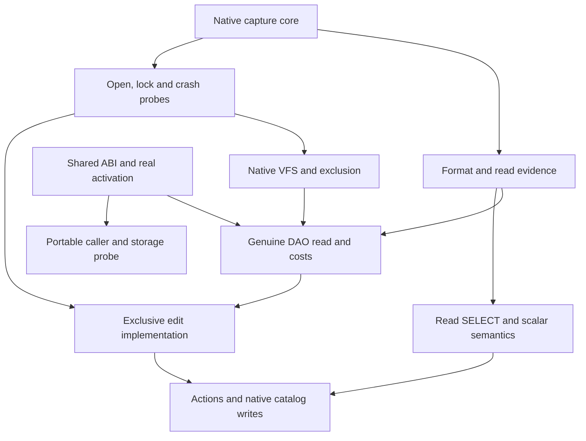
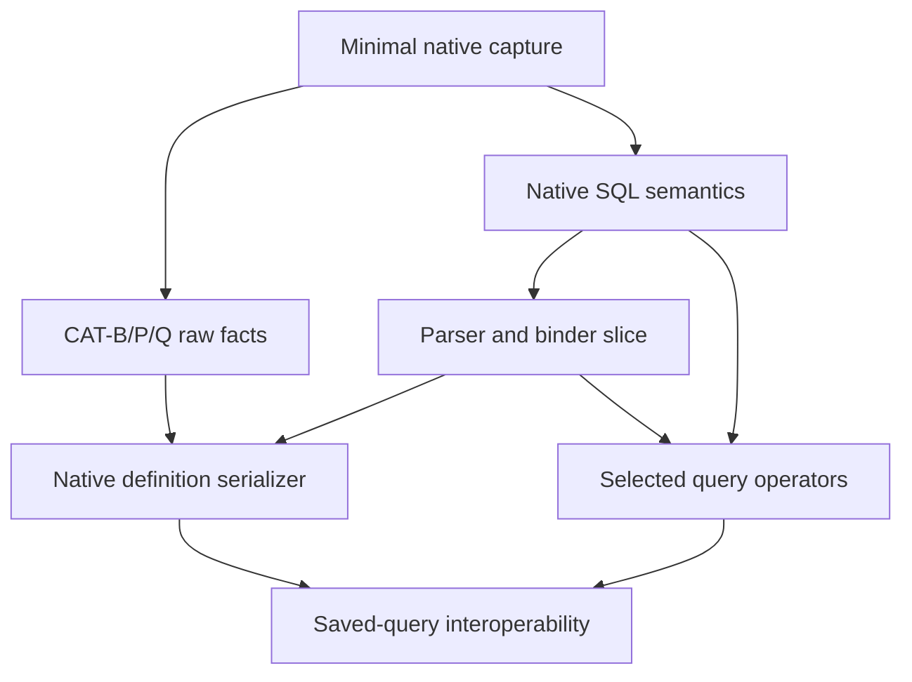
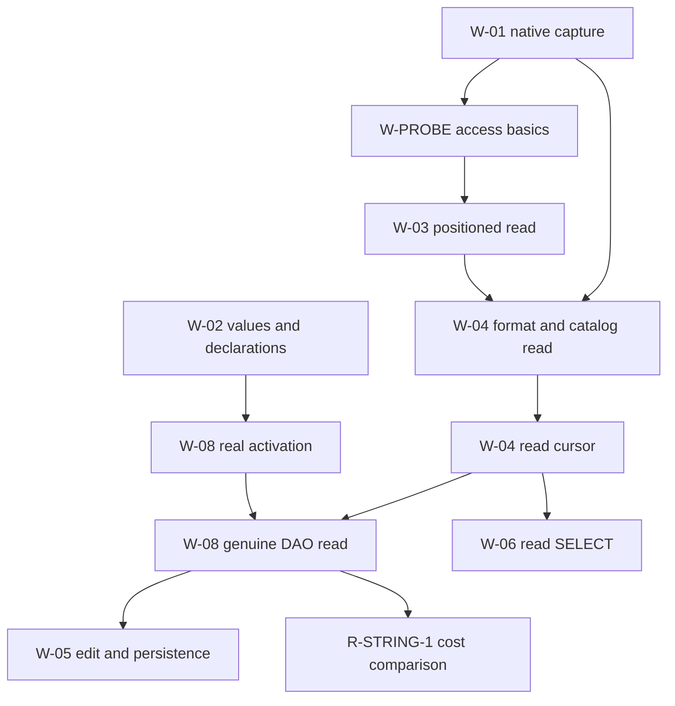

# II-16. Research and development sequence

Revision 1 · Stage 2, response 15 · 2026-11-14

**Requirement trace.** Primary: RQ-PROCESS-01, RQ-DEV-01 and RQ-DEV-02. Supporting: RQ-SRC-03, RQ-ORACLE-01/03/04/05, RQ-LEDGER-01, RQ-TEST-01, RQ-STORE-04/05, RQ-LOCK-03/04, RQ-PERF-01/02, RQ-ARCH-01 and the product requirements mapped to work and acceptance near the end. The full normative scope remains in I-16; this chapter turns the completed design into an executable development sequence. [N, C, A, U]

**Evidence boundary.** The plan consumes the mechanisms and provisional choices of II-01–15. It does not promote them to observed ACE behavior. The initial native engine is the user's reported `ACEDAO.DLL` 16.0.20527.20016; actual loaded implementation identities remain to be captured. All research cards and runtime acceptance families are planned. Document and dependency checks performed while assembling this chapter are identified separately at the end. [U, B]

## 1. Begin with decisions that could invalidate the path

The preferred sequence begins several bounded investigations together, then joins them into one genuine DAO read path. The first useful product result is an unchanged caller obtaining real field values from a native Jet 4 or ACE file through CalcDb's declared COM object model, shared values, catalog, ISAM and pager. Establishing that route early exposes an unusable activation mechanism, a wrong value boundary, an expensive per-field crossing or an impossible retained-object lifetime while each is still local to fix. A fake factory returning fixed values is useful ABI evidence, but has a different completion condition. [N, U; II-01 §5; II-13 §2–§5]

The first research results also establish native open authority and exclusion, format and index descriptors, and the ability to observe ACE mutation and crash outcomes. They can be obtained with the installed native engine, disposable fixtures and small external drivers. Waiting for a completed CalcDb writer would reverse the evidence dependency. Browser feasibility proceeds through the real CalcVBA/foundation and minimal storage paths while native read construction proceeds; its initial-scope status is unchanged by its separate implementation branch. [II-03; II-09; II-14; II-15]

The sequence is a recommendation within the fixed scope, with **D-OBJECT-1 Recommended**, **D-PERF-1 Recommended**, **D-ARCH-1 Decided** and the existing provisional native/host mechanisms retained. **ADO may start alongside DAO; DAO retains priority.** No new consequential decision is introduced solely to rename that scheduling choice. When effort competes, prefer a task that removes an immediate obstacle to the actual DAO/VBA path over a bulk-query optimization, then prefer bulk SQL over a browser optimization. This priority does not permit deleting the browser, ADO or a difficult required member from initial scope. [N, U]

Use an ordinal judgement of expensive uncertainty. A layout or ownership answer that changes several libraries comes before a broad implementation that embeds an assumption about it. A local cache choice can remain provisional while correct direct materialization is measured. A text-range optimization can remain disabled while the complete scalar pattern evaluator runs. A missing native key encoding cannot be replaced by a host collation merely to make the index branch appear complete. Each choice has a concrete consumer and an experiment; no synthetic risk score is needed.

**Figure F-207 — independently useful foundations and their first joins.** Proposed development relationships; Mermaid source emitted, not render-verified. Each box names a slice, not completion of every work item it mentions.



The graph omits edges already spelled out by slice prerequisites below. In particular, exclusive editing needs only its restricted default/validation expression slice, not completed SELECT; read SELECT does not depend on exclusive writing. The arrow from the DAO read result to editing means the shared cursor/value boundary and its first cost baseline have been exercised. It does not require complete DAO. Native crash evidence qualifies writer operations by their actual profile and interruption class while the writer is built.

## 2. Plan with named results and typed prerequisites

Retain the **19 W identifiers** as stable work packages and the **34 research/integration identifiers** as stable questions. A package is a scope/accountability unit. Its XL label does not make every contained mechanism an indivisible prerequisite. Use a local name such as “W-08 read” or “R-CAT-1 bootstrap” where the consumer needs that result. Such names refine an existing identifier; they do not create a second catalogue of product requirements.

There are three different dependency relationships. A **construction input** is an implementation or supplied declaration needed to build or run the slice. A **deciding observation** is evidence needed to choose a mechanism before investing in its broad implementation. An **acceptance obligation** is evidence needed to qualify the completed result for a declared context. Keep these relationships separate in the working tables. For example, the native R-CRASH-1 observations need the selected ACE installation and observation capability, not W-05. W-05 construction can start from the provisional protocol; its accepted operation/profile needs the corresponding crash evidence and CalcDb cut exploration.

**Figure F-208 — dependency types and the failure caused by conflating them.** Original planning schema; a table, not an execution result.

| Relationship | Concrete example | Effect on the sequence |
| --- | --- | --- |
| Construction input | W-08 read needs W-04 native read/cursor and W-03 read I/O. | The genuine read cannot run until those actual paths exist. |
| Deciding observation | R-SORT-3 selects key descriptor/length/collision rules for W-04 index reads and W-05 key mutation. | Investigate before spreading a generic or incomplete encoder through the engine. |
| Acceptance obligation | W-05 ordinary write needs row/index/map/opaque closure and applicable T-COMPACT-1 controls. | A locally working mutator remains partial until all demanded observations are satisfied. |
| Conditional input | W-07 saved-query execution adds W-06 operators; native metadata writing uses the smaller parser/binder plus writer slices. | The complete SQL package is not a prerequisite for every metadata operation. |
| Joint qualification | Same-page rollback in W-12 combines lock, transaction and writer evidence. | Combine established slices for the joint case; do not require that final case to start each constituent. |
| Improvement dependency | R-PAR-1 needs an accepted serial path and a cost baseline. | Serial delivery proceeds independently; worker use needs separate evidence. |

An implementer can represent these rows with ordinary structured data accompanying the book. The following is a proposed minimal shape. `required_contexts` contains applicable combinations of format/profile, caller, backend, operation and observation policy, rather than a promise to enumerate every possible SQL program. The `implementation_inputs` are exact local slice names. `evidence_inputs` identify experiment branches and demanded observations. A context restriction remains visible in the ledger and never changes the requirement text.

```text
WorkSlice {
    parent_work: existing W identifier
    local_name: stable descriptive name
    result: concrete callable or retained artifact
    phase: inherited initial, later, or continuous obligation
    obligation: required | conditional_required | optional_enhancement
    applicability: condition over the declared operation/context
    size: S | M | L | XL
    implementation_inputs: set of exact slice/result references
    evidence_inputs: list of (card, branch, context, required observation)
    acceptance: links to named cases, invariants and required channels
    required_contexts: versioned applicable context inventory
}

ImplementationRecord {
    slice_revision, build_identity, configuration
    available_result: artifact or callable evidence
    comparisons: immutable ComparisonId references
    invariant_and_fault_results: separate evidence references
    cost_results: separate measurement references
    unresolved: named missing inputs, contexts or observations
}
```

The representation need not become a project-management service. Initially it can be a checked file beside the source and a report produced from the same data. The book's task tables remain understandable without that tooling. Build metadata and report generation are implementation conveniences; the mandatory property is that an accepted result can be traced to its actual prerequisites and evidence without erasing missing work. [RQ-PROCESS-01, RQ-DEV-02, RQ-ARCH-01]

Never express a prerequisite as “R-CAT-1 passed” when the consumer needs only native bootstrap identity or saved-query records. A broad research card can legitimately mention another card that later mentions it back. The executable graph uses result-producing branches: native catalog bootstrap precedes binding, which precedes a query-execution experiment; the later query-result experiment is not the prerequisite for reading the catalog bootstrap. This decomposition exposes a real circular assumption if no independent starting artifact or observation exists.

Treat supported alternatives explicitly. If a slice may use a qualified direct browser handle or a qualified broker route, its construction predicate can contain an alternatives group keyed by the declared operation and context. The same deployment can require prepared direct access and broker-mediated dynamic acquisition. All obligations for each selected route still apply. An unexplained alternative such as “some host integration” does not satisfy the predicate. Shared requirements such as dynamic file acquisition remain visible even if a prestaged prototype can be built with less. Do not encode all options as an unconditional conjunction or accept one cheap option as evidence for every required mode.

Keep obligation separate from phase. The optional undo enhancement can be developed under W-05 without becoming a prerequisite for the baseline initial writer. If offered, its exact eligibility, audit, disarm and recovery obligations apply. A conditional required context is different: once the condition is applicable to the declared product target, the work remains required. Labelling a feature later identifies its implementation phase, not permission to remove it from the complete product inventory.

The following pseudocode checks only plan references and construction order. It cannot establish semantic correctness. It assumes the selected alternatives have been recorded, each node names a versioned result, and the graph has enough concrete granularity to make a real ordering possible.

```text
check_construction_plan(nodes, selected_alternatives):
    index = unique_map(nodes.key)          // duplicate names are errors
    for node in nodes:
        require known_parent_W(node.parent_work)
        require node.size in {S, M, L, XL}
        require nonempty(node.result) and nonempty(node.acceptance)
        inputs = expand_chosen_inputs(node, selected_alternatives)
        require every input names a node or a declared external result
        add_edge(input, node) for each internal construction input
        retain evidence requirements separately; do not turn them into code edges
    order = topological_order(internal construction edges)
    if not all nodes appear:
        return concrete_cycle_with_edge_reasons()
    return order, external_inputs, still_required_evidence
```

The checker uses storage proportional to the selected nodes and edges and runs in O(V + E) with a queue-based topological pass. It owns its input snapshot and returns an immutable diagnostic. An unknown reference or cycle stops that planning result; it does not alter source files or silently omit a dependency. Evidence records retain their own context and revision checks outside this ordering pass. A topological order proves only that the stated construction prerequisites can be ordered.

Qualification is a conjunction over the demanded evidence for a specific case/context. A missing comparison is missing; a successful format invariant is supporting evidence; a complete native rejection can be a matched negative case. Preserve that distinction when reporting a package. The package is not complete because its earliest slice is usable, nor because most of its cases are easy. Continuous obligations such as provenance, ownership and differential testing apply to each arriving slice; they have no final “done forever” state. [II-15 §31–§32]

## 3. Sizes describe complexity and change when evidence changes

Use **S** for one bounded question or local mechanism, **M** for several interacting mechanisms within one main boundary, **L** for a cross-service feature with a substantial behavioral matrix, and **XL** for a broad subsystem or several coupled compatibility matrices. These are the existing definitions in I-16, retained verbatim in meaning. They are not estimates of dates, elapsed time, staffing or a count of source lines. A local slice may be S while its parent package remains XL.

The initial estimate describes uncertainty as well as the number of interfaces. A bounded binary header decoder is small once its profiles are known; establishing those profiles across native histories can be a larger research result. A direct field getter can be a small implementation slice while unchanged-client activation, Automation ownership and full retained-child behavior remain larger surrounding obligations. A new observation that splits one “uniform” policy by a public context increases the applicable matrix and may increase size. It must not silently reduce the promised contexts to preserve an estimate.

Do not add the letters to produce a total project duration. Use them to choose the next independently reviewable result and to recognize where a package needs decomposition. A result that cannot state its input, callable/artifact output and observable acceptance is too broad to begin as one slice, even if it carries an XL label. Conversely, do not manufacture dozens of tiny administrative tasks around an already bounded implementation.

When an experiment changes a mechanism, keep the requirement and evidence provenance stable. Update the owning decision's conditions and affected chapters; revise the concrete construction inputs; invalidate the comparisons whose interpretation or implementation assumptions changed. Retain the old captures. If the change only concerns a cache replacement policy, it should not force unrelated activation research to repeat. If it concerns BSTR ownership, affected native/portable callers, arrays, error values and retained outputs need review even when their source file did not change.

There are three practical responses to unresolved evidence. Continue an independent branch whose assumptions do not depend on the answer. Build a bounded prototype under an explicitly provisional mechanism and keep its results out of accepted compatibility counts. Or leave the affected required case visibly unresolved while collecting the missing evidence. None authorizes a hidden target-build switch, regenerated expectations, invented error mapping or omission from initial scope. A demonstrated incompatibility with fixed scope or an authoritative input goes back for a material decision; hypothetical uncertainty does not stop routine construction. [U; II-01 §1; II-15 §31]

## 4. Public evidence supports the sequence without redefining it

The public-source check for this chapter is deliberately narrow. Current Microsoft documentation distinguishes built-in .NET COM interop from `ComWrappers` and source-generated alternatives. The source-generator documentation specifies an `IUnknown`-only interface base and marshalling differences. Therefore a new generated test wrapper is useful for its declared route, but it cannot replace the required unchanged DAO PIA/client experiment. Run the installed .NET Framework 4.8-family and .NET 10 lanes through their real metadata and loading route before broad integration commits to an assumed substitute. [S-MS-NET-COM, S-MS-COM-SOURCEGEN; II-13]

SQLite's testing description supplies a relevant scheduling lesson: allocation failures can be injected once or continuously, and execution with selected optimizations disabled can be compared with optimized execution. CalcDb applies these ideas to its own effect boundaries and accepted semantic paths as they become executable. The comparison still uses ACE requirements; SQLite's transaction guarantees, error codes, SQL semantics, proprietary test suites and numerical coverage claims do not transfer. [S-SQLITE-TEST; II-15 §17–§24, §30]

## 5. Schedule deciding observations at their actual dependency boundary

**Requirement trace:** RQ-DEV-01, RQ-DEV-02, RQ-ORACLE-01, RQ-ORACLE-03, RQ-ORACLE-04, RQ-SRC-03 and RQ-STORE-04. The complete 34 cards remain in [A-02-experiments.md](A-02-experiments.md). The following sequence assigns their first useful results and their consumers; it does not replace their conditions, fixtures or outcome branches. All native experiments remain planned and unexecuted.

An experiment starts when its native inputs and observation route exist. Its interpretation may need another branch's format or semantic finding. A CalcDb comparison additionally needs the implementation being compared. Keeping those boundaries separate is necessary to make this plan executable. Native `CreateQueryDef`, `Edit` or `UpdateBatch` can be studied before CalcDb implements those members. Conversely, a captured successful ACE operation does not establish that CalcDb has implemented it. Neither an oracle driver nor a decoder should wait for the complete compatibility matrix that it helps produce.

Treat a dependency as a demand for a particular result, not for the completion label of an entire R-card. `R-CAT-1/CAT-Q` may need the byte and public-order observations for one saved parameter query. It does not need every catalog DDL, security, held-object and crash branch before that result can be used. A consumer records the exact branch, domain and capture or interpretation revision it uses. The card's other branches stay visible and unfinished. This avoids making a small first implementation depend on a declaration that all Access behavior is already understood.

The initial target is still the user-reported ACEDAO.DLL 16.0.20527.20016. R-ORACLE-1 must identify what actually loads, including Access, the ADO runtime/provider and each required client. A result under another build, host, locale, provider or file profile remains separate evidence. These dimensions may reveal a product-target question; they are not permission to make the engine select whichever old capture is easiest to match. The same distinction applies when an experiment is documented but has not run: a plausible preferred mechanism can guide a prototype, while its compatibility claim remains unqualified.

The most expensive early assumptions concern the shared ABI, unchanged-client activation, exact native key families, external admission, write/crash behavior and the browser's blocking caller/storage path. Begin their smallest discriminators alongside the first file reader. These are independent reasons to build a narrow real path through the architecture. They do not justify replacing that path with an elaborate research service before it can answer one concrete question. II-15's immutable capture and exact comparison scheme supplies the common evidence mechanism.[^s18-research-boundary]

## 6. Start the boundary and oracle investigations with real minimal clients

**Figure F-209 — first results from the boundary investigations.** Every row preserves its existing card and relative size. The final column identifies implementation consumers, not an assertion that they are complete.

| Card / size | First independently useful result | Additional dependencies only where exercised | Main consumers |
| --- | --- | --- | --- |
| R-ORACLE-1 · M | One exact native question, owned execution and sealed active-value capture; conflicting job-ID reuse rejected. | Real VBA/managed projections add their actual callers; each repair control adds only its relevant format/key/catalog interpretation. | W-01 and every native comparison. |
| I-FOUNDATION-1 · S | Actual target declaration inventory and independent adjacent-VARIANT, Decimal, BSTR, array and typed/dispatch round trips. | Corrected CalcVBA values and actual stand-in for shared/portable comparison; real fields/events later. | W-02 and all value/interface consumers. |
| I-HOST-1 · M | Actual bootstrap, a retained scalar result, failure and one reentrant callback; held factory during detach. | Cursor, UDF, event, VFS and simultaneous-runtime branches attach their exercised services. | W-02/03/08/09. |
| R-ACT-1 · M | Original creation routes select CalcDb, using captured declarations and a minimal factory; actual x64 XLL and both managed families follow. | Real data adds W-04/05; full caller/lifetime coverage belongs to W-08/09. | W-08/09 and later W-L5. |
| R-ERR-1 · M | Failure A, success, failure B and retained Error/enumerator behavior through independent observer recipes. | Writer, transaction, callback, event and uncertain-I/O contexts add their relevant mechanisms. | W-02/05/07/08/09 and later external adapters. |
| R-STRING-1 · M | One real resident-row getter, retained BSTR and repeated-read cost comparison. | Compression/LV descriptors, invalidation and edit/requery services only as those cases arrive. | W-02/04/06/08/09. |
| R-WASM-1 · M | Actual portable typed/dispatch/ownership calls, direct native-page read and a previously unprepared dynamic open. | Write/crash, SQL spill, events and reader combinations attach separately; no complete DAO/SQL or W-12 dependency. | W-02/03/08/09/10. |

I-FOUNDATION-1 is sized S for discovery of the real consumed declarations and the bounded first ABI investigation. It does not estimate the implementation of the complete stand-in as S. Similarly, R-ACT-1's M describes the bounded activation feasibility investigation; it does not compress the full unchanged-client matrix into a small task. The corresponding W-packages retain the implementation and coverage work. This distinction prevents apparently small research estimates from hiding large delivery obligations.

Native discovery can begin with independent SDK-based drivers before the corrected portable foundation exists. Trusted capture still needs the exact native ABI, active-value ownership and observer order. An agreement between a mock client and a mock server compiled from one mistaken header is not independent validation. The real shared-value comparison then uses corrected CalcVBA, and the portable comparison uses the actual stand-in and caller. None of these observations can be substituted for another platform's result.

The activation investigation should reach an original required client early. A synthetic scalar server can isolate class selection, vtable or type-information defects. It cannot prove that the add-in's actual constructor, retained factory, PIA resolution, dispatch route or cleanup reaches the intended implementation. Record actual CalcDb module/factory provenance even when returned values look correct: accidental ACE activation would otherwise make the earliest integration result deceptively strong.

I-HOST-1 and R-ACT-1 share inputs without requiring each other to be complete. Declaration/loading discovery is first. A minimal class and immutable host binding permit bootstrap and factory tests. That same slice permits a caller-owned callback and retained-lifetime experiment. More demanding query or ADO-event behavior follows only after those semantic services exist. This progression exposes the actual host responsibility without prematurely designing a second database protocol.

R-ERR-1 begins with binding and construction failures. Those cases are available before writing and often before a database opens. Rich native error capture, managed projection and public Errors collection inspection need separate observer recipes where they interfere. The resulting publication rules accompany later members as they are added; error correctness is not an adapter cleanup exercise postponed until full DAO.

R-STRING-1 waits for a real resident-row path before deciding the priority materialization choice. A standalone allocator microbenchmark can diagnose allocation mechanics, but it omits row decoding, Field reuse, public ownership and invalidation. Begin with exact final-owned output, then compare bounded reuse on the same real path. Unresolved benefit retains the simpler construction policy; unresolved semantics remains work regardless of the timing result.

The browser investigation runs early because its risks cross the boundary between a blocking call and asynchronous acquisition. It must use actual portable COM calls in the qualified memory, function-table and allocator domain. A direct prepared-page read is the first storage slice: W-03 contributes only the minimum positioned-I/O prototype, and W-04 contributes the bounded decoder required by that page case. The completed browser adapter is the result being qualified, not its prerequisite. A dynamic open, late acquisition cancellation and broker-loss experiment follow before broad browser integration. A prestaged-only success is useful partial evidence, but cannot remove dynamic acquisition, required readers or durability from initial scope.

## 7. Establish the native read and mutation facts without waiting for a production writer

**Figure F-210 — storage, identity and persistence investigations.** Native observation uses disposable fixtures and public ACE/Access operations. CalcDb's candidate implementation is a later comparison input.

| Card / size | First native discriminator | What must precede its interpretation or candidate acceptance | Main consumers |
| --- | --- | --- | --- |
| R-FMT-1 · L | Empty MDB/ACCDB, then one ordinary table and one scalar feature change. | Exact creator/opener provenance; independent descriptor/page inspection. | W-03/04 and later writers/codecs. |
| R-FMT-2 · L | One row-growth transition and one LV storage-form change. | Relevant descriptor; counters add TXN, public relocation adds CUR-ID, calculated metadata adds CAT/EXPR. | W-04/05/07 and applicable later mutations. |
| R-PRESERVE-1 · M | Modeled row edit beside an opaque front-end object and unknown property. | Relevant ownership/reference interpretation; catalog edits add CAT-P/Q/D/X. | Every transformation that can affect protected content. |
| R-SORT-3 · L | A/a/é, integer/Null keys, then the 510-byte compound discriminator. | Descriptor plus exact index-envelope extraction; semantic consumers and Like proof attach separately. | W-04/05/06/07 and later rebuild/codecs. |
| R-CAT-1 · L | Page-2/MSysObjects projection, one property assignment, saved parameter query and temporary query. | CAT-B/P/Q start from capture/format; typed execution, writes and crash branches add only their actual prerequisites. | W-04/05/06/07/08/09. |
| R-CURSOR-1 · L | Empty/singleton/multiple-row navigation with retained Field/bookmark, then movement and Close. | Format for physical identity; keys for Seek; write, query and callback branches remain separate. | W-04/05/06/07/08/09/10. |
| R-TXN-1 · L | Nested distinguishable A/B/C changes and subsequent resolution; inner force then outer rollback separately. | Public logical outcomes first; format/catalog adds physical interpretation; crash instrumentation adds persistence. | W-05/07/08/09/10 and later participants. |
| R-CRASH-1 · L | Indexed fixed-row change and an allocation/index-changing operation. | W-PROBE observation/control capabilities, TXN coordinates, relevant graph interpretation and independent reopeners. | Writer phase programs and their qualified operation/environment cases. |
| R-CRASH-2 · M | Live exhaustion followed by resolution; optional uncovered-page mismatch as a separate branch. | Baseline receipts/fault taxonomy first; undo adds identity, full audit, survival frontier and recovery-cut evidence. | W-05 and later fault branches; optional recovery remains separate. |

R-FMT-1's first useful output is an evidenced file-visible descriptor. Native creation and controlled change provide independent fixtures before any writer exists. Do not shrink a fixture by deleting unexplained pages and then call it native-valid merely because a reference reader accepts it. A minimized native history is different from a synthetically damaged file. Both can be useful, with their evidence class retained.

R-FMT-2's row/LV/map transitions can be studied using ACE alone. This is where ownership mistakes would otherwise spread through allocator, row writer, rollback and compaction. The first long-value transition records payload length, link overhead, sharing with neighboring values and all applicable maps. The first row relocation records logical root, physical body and index references independently. Full cursor or transaction coverage is unnecessary to collect those bytes, but the corresponding public identity and rollback conclusions need CUR-ID and TXN evidence.

R-SORT-3 also needs only the extraction rules for its selected native pages, not every index mutation. Start with the relevant envelope, masks, prefix and locator framing from R-FMT-1/2. Then obtain the actual key bytes. Public equality, DAO Seek and SQL order remain different consumers. A valid exact encoder may still be lossy as a semantic key; a successful SQL order comparison does not qualify native index writing. The 510-byte shortening and collision cases therefore precede commitment to a universal comparator, unique-key checker or hash domain.

Before proposing reuse of weight resources or an encoder implementation, resolve the exact source/resource and licence status recorded in A-01. A permitted implementation file does not automatically clear every associated table. That source decision can proceed with native key research; it need not wait until a port has spread through several consumers. The book's own choice remains evidence-led whether the final implementation is written independently or an allowed exact material is reused.[^s18-research-sources]

R-PRESERVE-1 begins beside the simplest supported edit. Opaque preservation must not first appear at the end of a catalog writer, when placement and reference decisions have already been embedded. A protected-span and ownership map makes a refused transformation concrete: the missing fact is the particular relocation or shared-reference rule. Unrelated safe reads and qualified writes can continue, while that refusal remains visible in the required compatibility inventory.

Cursor and transaction research should expose the API ownership boundaries before those interfaces become expensive to change. Public POS/POP/LIFE traces begin on native tables without interpreting every page. Physical ID and edit branches then join relevant format and key evidence. Native transaction nesting can use tiny public A/B/C mutations; it does not require CalcDb's frames. Where clone Close changes a transaction, one captured joint sequence supplies both CUR-LIFE and TXN-CLOSE. There is no need to manufacture a dependency that demands complete cursor research before transaction research, followed by the reverse.

## 8. Keep exclusion, readers and later sharing as four distinct investigations

**Figure F-211 — native sharing sequence and its first discriminators.** The step order is fixed scope; the internal mechanisms remain qualified by these experiments.

| Card / size | Begin with | First distinguishing operation | Consumer and unresolved direction |
| --- | --- | --- | --- |
| R-LOCK-1 · M | Minimal W-01 capture plus W-PROBE handle/identity driver. | Proposed share-zero lease in both open orders, then aliases and retained-owner release. | W-03 exclusion and W-05 safe admission; unknown authority/identity combinations remain explicit. |
| R-LOCK-2 · M | Relevant R-LOCK-1 admission/lifetime findings and native reader drivers. | Two overlapping readers; the first closes while a late writer is attempted and the second remains. | W-10 reader-only slice; if required native readers demand database write access, qualify the native alternative before loosening admission. |
| R-LOCK-3 · L | R-LOCK-1/2 plus CUR/TXN public-view evidence. | Read during retained pessimistic Edit versus during Update, then index→root→body interference. | W-11 protected native inputs; unsupported footprints stay later work while initial modes continue. |
| R-LOCK-4 · XL | Relevant step-3 context, semantic/mutation closure and shared crash evidence. | Unrelated same-page update during preparation, then rollback that must preserve the other actor's change. | W-12 fresh rebase and scoped rollback; qualify local mechanisms before identified SMB combinations. |

W-PROBE's basic native opens, identity, rights, I/O and grant lifetimes use the small K-IO/K-LOCK interface sketch. They precede acceptance of W-03's actual adapter; a completed production VFS is not their prerequisite. Native crash observation is another slice of W-PROBE. Its passive coverage, controllable cuts and post-trigger settlement do not need to be complete before the first admitted native read.

The reader-only discriminator is early because public ReadOnly and actual database access can differ. Writable companion-file access alone does not establish a writable database request. The experiment records both. If the coarse read/share-read lease admits every required reader and excludes all writers continuously, retain it. If it rejects a required native reader, safe rejection preserves the file but does not complete Step 2. Investigate the actual native admission mechanism without merging the requirement into Step 1.

In-process visibility and external sharing remain different consumers. Historical page retention can support an old in-process view only while its source and allocation/descriptor intervals remain valid. It cannot reconstruct an unread source page already overwritten by another engine. Step 3 therefore requires a native source/protection certificate for each footprint and the corresponding public refresh policy. A local epoch or repeated equal read is insufficient evidence.

Step 4 adds a further obligation: a CalcDb publication and rollback must preserve unrelated accepted external changes. Begin with two rows sharing a data page, then extend to an index leaf and a bitmap byte. This selects whether the native ownership interval excludes interference or whether an owned delta must be rebased onto a protected fresh image. The distinction cannot be settled by disjoint logical row IDs. Local qualification comes before network combinations so that an SMB interruption is not used to explain an already-incorrect page or grant lifetime.

## 9. Break the catalog, SQL, expression and object-policy cycles into observed branches

The current cards refer to one another because a single public operation crosses services. Read those references as joint interpretation or branch-specific prerequisites. They do not form a requirement that every referenced card be complete before either may start.

**Catalog and SQL.** CAT-B/P/Q use native bootstrap, property and QueryDef creation to collect raw records and public views. That procedure uses ACE's existing parser and executor. CalcDb's catalog reader can begin from those captures. Its native serializer later needs the relevant parser/binder slice to represent a new definition, while advanced SELECT execution can still be incomplete. Conversely, ad-hoc native SELECT observations and the first CalcDb join do not need a finished QueryDef serializer. The saved-query integration result joins the two branches only when both are exercised.

**Figure F-212 — the catalog/SQL dependency is a convergence, not a completion cycle.** Original planning graph; Mermaid source emitted, not render-verified. Labels identify results within existing cards and packages.



**Expressions and UDFs.** R-EXPR-1 starts with scalar origin, type, coercion, mutation-rule and pattern cases. Restricted defaults and field/table validation can be researched through native property/edit entry points before full SELECT. Native R-UDF-1 discovery then uses a small accepted scalar baseline and an owned, already configured Access/VBA or other admitted native host fixture. It does not wait for a CalcDb or DNA Calc host prototype. The CalcDb/CalcVBA comparison separately adds corrected shared declarations and the minimal I-HOST-1 callback route. Native UDF evidence feeds the expression host-effect extension. Unsupported callbacks in a restricted default are admission results, not convenient tracing instruments. A missing UDF route does not prevent learning intrinsic values, errors or wildcard grammar.

**Transactions and actions.** R-TXN-1 begins with tiny native nesting and participant outcomes. R-SQL-2 can begin API, type and count observations with tiny native actions. The statement-failure case joins them: accepted change A, failing action B, then permitted resolution or change C. Treat TXN-STMT/ACT-FAIL as two consumers of the same discriminating sequence. Do not require completed SQL action construction to discover the rollback boundary that construction must obey.

**DAO and storage.** R-DAO-1 begins with metadata, construction, identity, collection and thin-read behavior. Full DAO consumes storage, catalog, transaction and SQL services as their member cases arrive. Those services can use the earlier public-policy evidence without waiting for the last DAO member. ADO follows the same principle with its own policies: early closed objects, connection association, Parameters and standalone Stream cases are available independently. ADO may start alongside DAO; DAO retains priority when effort competes.

**Figure F-213 — semantic and object-policy investigations.** The native start column describes what can be learned before the corresponding CalcDb implementation is complete.

| Card / size | Native start and decisive result | Later additions and consumer |
| --- | --- | --- |
| R-EXPR-1 · L | Literal/parameter/field-origin pairs, exact values and error phases; separate field/table Null acceptance. | Host effects add UDF/HOST; shared W-02/05/06 service and context adapters consume the results. |
| R-UDF-1 · M | Native typed echo, controlled reentry and trace/error function through an owned admitted host fixture; the actual CalcVBA comparison follows separately. | Signature/alias/policy/cleanup cases feed W-05/06/07/08/09; scalar baseline remains independent. |
| R-SQL-1 · L | Typed scan, range and outer-join discriminator; exact aggregate state and public demand. | Catalog, keys and host evidence attach only where used; W-06 qualifies serial operators before optimization. |
| R-SQL-2 · L | Indexed values 10/20/30 move across their range; fail a middle target after earlier accepted work. | Mutation/TXN/EXPR, catalog and provenance join by branch; W-07 action and structural writers remain separately staged. |
| R-SQL-3 · L | Full-row classes versus equal projections; TOP boundary; fixed PIVOT metadata before row population. | Relevant equality/aggregate, catalog metadata and public lifetime observations feed W-06/07. |
| R-DAO-1 · XL | Actual member manifest, hidden-session boot, identity, held-child and QueryDef binding transitions. | Read/edit/query/security and later contexts retain complete applicability rows; W-08 consumes each service slice. |
| R-ADO-1 · L | Closed construction, equal strings versus shared Connection, requested/effective options, delayed async discriminator. | Batch/events/persistence investigations can lead implementation; W-09 adds only its exercised shared services and never W-L5 as a blanket prerequisite. |
| R-PAR-1 · M | Submission/drain ownership can be tested with VFS/cursors; operator eligibility begins from its accepted serial path. | Exact values/order/effects/errors plus measured full-call benefit admit each optional placement; unresolved benefit retains serial execution. |

Candidate optimization proofs come after the semantic descriptors they use. Like-range qualification joins the semantic pattern profile and exact native key profile; neither entire card waits for the other to begin. A failed inclusion or demand proof disables that shortcut, not the scalar matcher. A hash or partition specialization similarly requires a congruent equality domain and preserved representatives. Exact aggregate state spill requires the accepted contribution frontier. Parallelism then compares the selected implementation against its accepted serial reference, with caller-thread foreign work and its cleanup retained.

A native early-return ADO result deserves prompt investigation because it could conflict with the decided blocking-call contract. Test each relevant flag and route with enough delay to expose pending work. An immediate result on a fast fixture cannot discriminate ignored/synchronous handling from a genuine asynchronous path. If a native early-return/pending branch is demonstrated, record its exact surface and effects and present that concrete architecture/scope conflict. Do not silently emulate it with a blocking call, relabel it later, or hold unrelated ADO and DAO construction pending a hypothetical conflict.

## 10. Keep later capabilities visible and attach only their real prerequisites

**Figure F-214 — later capability discovery and implementation joins.** Discovery starts when native fixtures and actual consumers are available; implementation retains its approved later phase.

| Card / size | First useful native result | CalcDb comparison joins | Direction when evidence is missing |
| --- | --- | --- | --- |
| R-ENC-1 · L | Unencoded/encoded Jet twins, encrypted ACCDB and a password change with multiple SID-bearing objects. | W-L1 codec reads; W-05 phase images/crash and protected temporary services for mutation. | Leave the affected profile unqualified; preserve exact stored-byte undo predicate and baseline survival. |
| R-LINK-1 · L | Native A→B link enumeration without connection, then one failing relink. | W-L2 catalog/binder/cursor/source transport; transaction and browser services only where used. | Retain missing source/driver or semantic proof; local residual execution needs its own demand equivalence. |
| R-COMPLEX-1 · L | One association/group/child relationship, held child during parent movement, then attachment acceptance stages. | W-L3 row/catalog/LV/cursor reads; writer/index/evaluator/coordinator by branch. | Unknown ownership blocks the affected edit before mutation and remains a compatibility gap. |
| R-REBUILD-1 · L | Clean compaction with overflow row, LV and opaque object, followed by an independently damaged-index control. | W-L4 checked traversal, destination allocator/index/codec/writer and explicit host publication. | Restrict unresolved relocation; preserve every original and report salvage uncertainty. |
| R-OLEDB-1 · L | Actual consumer factory, guarded x64 bound row buffer and retained HROW/stream. | W-L5 real rowset over shared read/query values, then update/transaction/stream services. | Missing required interface or consumer stays visible; initial CalcDb ADO remains independent. |
| R-ODBC-1 · L | Actual Driver Manager load, guarded row-wise fetch and data-at-execution split. | W-L6 target declarations and shared query/cursor, then mutation/transaction/stream. | Retain unresolved cancel/transaction effects; no OLE DB prerequisite or implicit mutation replay. |

The later label postpones delivery, not the discovery of a seam that could invalidate early architecture. Native encrypted headers can establish the codec's stored-byte domain before a writer exists. Link metadata can show that a source must remain unopened during enumeration. A complex field can reveal that group identity, child identity and parent root are separate. A real external consumer can expose an ABI or ownership requirement absent from a synthetic adapter. Each result improves an existing boundary without requiring the whole later capability to be implemented immediately.

None of W-L1 through W-L6 receives a blanket W-12 dependency. A local exclusive encrypted edit, a native link read, or a separately constructed compaction destination can be developed before shared writing with ACE. The shared combination adds its own lock, crash and source-lifetime evidence when both features exist. Likewise, external OLE DB and ODBC delivery share the engine's semantic services but do not depend on each other. Initial CalcDb ADO is its own object-model implementation and remains independent of the later external provider.

T-COMPACT-1 must be available for ordinary writer acceptance long before CalcDb implements its own compact/repair capability. The former qualifies a completed output through independent native controls. The latter constructs or salvages a destination and has separate publication, relocation and data-loss questions. An unresolved opaque relocation can block a particular compaction while ordinary qualified edits preserving that object in place continue.

## 11. Use one concrete mutation to connect evidence to construction

Start the first write investigation with a native-created table containing two distinguishable rows and a simple indexed field. The visible values identify the operation; the native capture identifies its actual root, body, key and map locations. II-08's page-17 indexed 42→43 example is a constructed design witness, not a promise that ACE will place this new fixture at page 17.

R-FMT-1 establishes the actual descriptor and the relevant read path. R-FMT-2 observes the native row/index/map changes. R-SORT-3 supplies the complete required old and new key encodings. R-CURSOR-1 captures Edit, assignment, Update, held Field and subsequent position/error state. R-TXN-1 adds the chosen implicit or explicit scope and its resolution. These native observations can be obtained before CalcDb has a writer and can share a fixture when their exact operation and observer recipes agree. Different recipes remain separate attempts.

Construct the corresponding CalcDb mutation first in owned memory against the common format description. Validate references, byte bounds and affected ownership. Add the existing coordinator's accepted-value and publication receipts, not another update implementation behind DAO. Under the qualified exclusive lease, its real page program can then run on disposable native files. Independent typed, structural, protected-byte and T-COMPACT-1 branches compare the completed state. The genuine DAO edit slice exposes the same mutation through its captured public policy.

At the same time, W-PROBE establishes what ACE writes can be observed and controlled. R-CRASH-1 varies ordinary commit and dbForceOSFlush, records actual post-trigger settlement and retains independent next openers. The CalcDb model enumerates every admitted persistence cut of its actual phase program, including repeated images of the same page. A clean final result is not enough to accept the intermediate program. A clean crash result that loses a required surviving commit also fails.

If full ACE tracing is impossible, continue the bounded writer direction already selected in D-WRITE-1. Preserve the missing coverage classes, use semantically bracketed native interruption and graph/state analysis, and require every modeled CalcDb cut in a claimed operation/environment class to fit established ACE survival and repair bounds. A timing sample is not exhaustive write-point coverage. An unknown marking or persistence rule remains unresolved. This permits construction and qualification of supported classes without inventing a private WAL, stronger atomicity or an ACE-first dependence on CalcDb recovery.

Only after that baseline exists does the optional-undo branch become relevant. Its exact full-file identity/extent/image predicate remains unchanged, and a record can be armed only for a profile with sufficient disarm/frontier and recovery-cut evidence. Before/intended mixtures do not independently establish rollback eligibility. Missing identity or frontier evidence disables the optional addition there; it does not excuse missing baseline failure behavior or postpone qualified baseline writes. The same rule extends to encrypted and browser profiles through their stored-byte and durability domains.

The next mutation families should each force a new mechanism: variable-row relocation, packed/chained LV replacement, map rebase/promotion, leaf/root changes, then native catalog/property publication. Repeating thousands of uncomplicated fixed-width edits does not establish those branches. Each added family updates the same writer and its evidence matrix; it does not create an alternate special-purpose persistence path.

## 12. Resolve uncertainty with the next discriminating result

Keep a short next-result entry for each unresolved branch. It names the ambiguity, the smallest fixture change that separates the alternatives, the implementation choice affected and the work that can continue independently. This belongs in the experiment result or work slice, with only the current action summarized in the record. A broad sentence such as “research ACE transactions” is not enough when the actual unresolved question is whether an inner forced commit changes outer persistence after a later rollback.

Different missing results need different action. An unavailable native route needs an identified environment or actual caller, not another local mock. A lossy capture needs recorder correction before its results can support behavior. Two remaining semantic hypotheses need a counterexample fixture. A missing CalcDb branch needs implementation, not repeated native captures of an unchanged question. A disputed source fact needs exact material/version review and, where behavior is involved, a native discriminator. An exhausted experiment budget retains its unvisited cases; it does not convert them to expected passes.

Build differences remain explicit. If two native environments disagree, determine which input dimension accounts for the difference and whether it is already in the declared target. A file-visible descriptor or public option can legitimately select a rule. An unexplained executable-build difference calls for a target decision before broadening the claim. Captured versions are provenance; they do not become hidden engine switches merely because the harness can identify them.

An investigation attempt can close with a discriminating result or an explicit inconclusive disposition and next action. The research question remains open in the latter case. Compatibility acceptance is stricter: the demanded native and CalcDb observations must exist and agree for the claimed case and context. A designed card, an arithmetic witness, an invariant pass and a completed native capture each contribute different evidence. None silently increments another category's completion count.

For dependency checking, use a branch-level construction graph and explicit acceptance obligations. A topological ordering establishes only that the stated construction inputs do not cycle. It cannot prove that the native interpretations are correct, that every feature has a case, or that a required observation ran. The selected starter graph accompanying this chapter's preparation uses 23 nodes to make the catalog/SQL, expression/UDF, transaction/action and W-PROBE/W-03 cuts explicit. Its machine check is a planning consistency check only. The full 34-card map still retains later joint cases and all unexecuted obligations.

Carry the first unresolved architecture-changing questions forward plainly: actual unchanged-client activation and caller ownership; corrected foundation/portable service closure; exact native crash/force and lock behavior; descriptor/key/catalog ambiguities; and demonstrated browser or ADO async conflicts if the corresponding native experiments find them. Routine mechanism changes within the agreed scope update their owning implementation and chapters directly. Only an evidenced conflict that changes the product or decided calling contract requires a new user decision.

## 13. Keep package identities stable and schedule concrete results

**Requirement trace:** RQ-PROCESS-01, RQ-DEV-01 and RQ-DEV-02; supporting RQ-ARCH-01 and RQ-TEST-01. The following work is planned. No slice is reported implemented or accepted by an ACE, CalcDb, host, managed-runtime or browser run in this chapter.

Retain the nineteen work identifiers already used by Part I and the mechanism chapters. A package is an accounting boundary for a substantial result, not an indivisible prerequisite. Its named slices below can start independently where their actual inputs exist. For example, W-06's restricted scalar service can supply a default to W-05 while W-06's crosstab implementation is unfinished. A dependence on the former does not become a dependence on complete read SQL. Conversely, a working first slice cannot make the parent package complete.

**Figure F-215 — retained work inventory.** Parent sizes and phase boundaries are unchanged; the remainder of this section supplies their executable subdivisions.

| Work | Result | Size / phase |
| --- | --- | --- |
| W-01 | Oracle capture, immutable native histories, comparison, reduction and cost records | L / continuous |
| W-02 | Shared target declarations, values and consumed Automation services | M / initial foundation |
| W-PROBE | Native I/O/exclusion basics and external ACE crash observation | M / continuous evidence |
| W-03 | Blocking VFS/pager, native exclusion and qualified browser storage | L / initial |
| W-04 | One format description and native read ISAM/catalog path | XL / initial |
| W-05 | Exclusive mutation, Workspace frames, owned resolution and compatible persistence | XL / initial |
| W-06 | Shared expressions and read-only SELECT | L / initial |
| W-07 | Actions, DDL and native QueryDefs | XL / initial |
| W-08 | DAO activation/host, native read/edit and actual portable clients | XL / initial |
| W-09 | CalcDb ADO construction, read/query, edits and complete applicable coverage | L / initial |
| W-10 | Readers-only admission and in-process visibility | L / initial |
| W-11 | Read beside an ACE writer | L / later |
| W-12 | Shared native writing with ACE | XL / later |
| W-L1 | Native encryption and credential/conversion operations | L / later |
| W-L2 | Native links and source-specific execution | XL / later |
| W-L3 | Multivalue, attachment, calculated and history behavior | XL / later |
| W-L4 | Native compaction, destination publication and conservative repair | XL / later |
| W-L5 | Genuine OLE DB provider and real consumers | XL / later |
| W-L6 | ODBC driver and actual Driver Manager clients | L / later |

For each slice, distinguish **start inputs** from **completion evidence**. Start inputs are sufficient to implement the next mechanism or run its native discovery. Completion evidence includes the applicable native comparison, structural assertions, failure cases and cost observations. A research result unavailable at the start can remain a visible provisional parameter while construction proceeds; it cannot be converted into a passing comparison at completion. Full card conditions remain in [A-02](A-02-experiments.md), and II-15 defines evidence dispositions. This chapter selects the order in which that evidence becomes useful. A dependency consumes the named mechanism qualified for the consumer's fixture/profile; it does not demand every expansion of that mechanism's acceptance family. Thus the first ordinary-row read uses its bounded native schema and bootstrap result while historical-column, LV, opaque and other required profiles continue. The parent inventory still requires their complete applicable coverage. Start and full-result dependencies are recorded separately below, and final inventory rows aggregate completion rather than delaying all member construction.

## 14. Assemble the first real DAO read before broad subsystem completion

**Requirement trace:** RQ-PROD-02, RQ-DAO-02, RQ-COM-01/02/03, RQ-VAL-01/03 and RQ-PERF-01/02. The first end-to-end result follows the direct path in [II-01 §5](II-01-architecture.md#5-the-direct-dao-read-path), the value boundary in II-02 and the actual creation routes in II-13.

Create the first fixture through the selected native installation, then freeze its bytes. Use a small table with a Long key, a second Long, short text and Yes/No; record the exact creation operations, schema/properties, sort descriptor and actual loaded implementations. An empty table and a two-row table give useful early position and failure controls. The initial engine is the user's reported `ACEDAO.DLL` 16.0.20527.20016; the running module identities still have to be captured. Native reference discovery begins with this driver and does not wait for CalcDb.

In parallel, W-02 publishes the real target declarations and allocator services, W-08 proves a genuine CalcDb factory and host selection, W-PROBE qualifies basic native access/exclusion, and W-03/04 build checked page reading and native catalog/cursor traversal. Join those results into an unchanged caller that creates a genuine DAO interface, opens the fixture, opens the table recordset, obtains a Field, calls `MoveNext`, reads values, retains a returned BSTR across movement, and closes the parents while a child interface remains held. Record implementation provenance so an accidentally selected ACE object cannot satisfy the CalcDb side.

At this point the useful result is an actual call path, not the entirety of any package. A scalar-returning factory prototype is sufficient to falsify calling convention or activation mechanics. It is insufficient to complete this path because it bypasses native row decoding, cursor lifetime and field ownership. Similarly, direct Rust/C reader tests do not establish unchanged `.xll`, VBA or managed-client behavior. Each required client route is attached explicitly, starting with the route that gives the priority DAO loop and then the independent Framework 4.8-family and .NET 10 lanes.

**Figure F-216 — first-read convergence and independent extensions.** Original dependency graph; arrows name available slices, not completion of the parent packages. Mermaid source only, not render-verified.



The `D → M` edge means that the writer's first public edit slice uses the evidenced cursor/object ownership and costs; effect-free private encoders and native mutation research can start earlier. It does not require every DAO read member or every client lane to be complete before preparing one mutation. The first completed read establishes the cost vector of real `Fields(...).Value` and movement calls. It does not wait for exclusive writing, complete SELECT or ADO.

## 15. Build the capture, ABI and external-probe foundations as bounded slices

### W-01: capture and comparisons attach to the mechanism being built

**Start — capture core (M).** The approved scope, a selected installation and a native public-API driver suffice. Implement exact requests, owned attempts, immutable input copies and typed/raw capture. The result includes separate question, environment, attempt and comparison identities; retrying a job-status request never repeats a possibly accepted database mutation. R-ORACLE-1 decides actual ownership, reset, capture and observer rules. T-EVID families in [II-15 §32](II-15-evidence.md#32-acceptance-families-and-what-each-one-actually-establishes) provide the tests; no broad DAO or production VFS dependency is introduced.

**Complete — native corpus and comparison (M).** Seal one native table-read result and one native failure with demanded values, diagnostics and file state. Show that an incomplete capture, an altered fixture and a conflicting replay payload are rejected as usable matches. Attach independent scalar/array/type, multiset/identity and structural rules as corresponding surfaces arrive. File history and contextual reset belong to the case. The result store must preserve earlier raw captures when comparison rules change. The first corpus accepts both legal native histories and explicitly labelled constructed/malformed examples; each retains its evidence class.

**Extend — controlled production effects (M).** Start the effect vocabulary and controlled adapters alongside W-03's first request owners, then attach the actual W-03/04/05 production transitions as those components exist. Preserve prerequisite faults that make later cleanup sites reachable. This work starts before the first real DAO read; later writer/query/browser fault families attach to their own implementation inputs.

**Extend — reduction (M).** Build the reduction runner from the case/capture/comparison core and an explicit original failure predicate. A changed native discrepancy needs corresponding fresh native evidence; a pure invariant discrepancy uses its own exact predicate. Actual component predicates arrive with those components. Neither the generic runner nor a pure parser failure waits for the DAO benchmark.

**Extend — actual DAO cost (M).** The first representative cost run specifically adds W-08/read. Later SQL/browser cost cases add their own real components. This slice records actual call routes, semantic twins, retained capacity and diagnostic versus timing modes. All three extensions contribute to parent W-01 completion, but their independent start points remain explicit. The cost ledger retains unsuccessful changes and uncertain measurements, as II-15 specifies.

### W-02: prove the exact target and consumed services

**Start — target declarations (S).** I-FOUNDATION-1 discovery supplies public declarations and the actual corrected CalcVBA contract. Publish each target's sizes, alignments, offsets, call signatures, array strides and allocator ownership. These declarations are consumed independently by native and portable realizations. Positioned byte I/O needs its actual platform I/O declarations and K-IO/K-LOCK sketch; it does not wait for this package's completed Automation ownership tests.

**Native ownership slice (S).** The Windows x64 target uses the real 24-byte Automation VARIANT and real BSTR. A compact internal wire format used by the harness cannot replace that ABI. Construct, copy, move and clear real scalars/BSTR/SAFEARRAY values through independently compiled callers, including Decimal overlay and nonzero array bounds.

**Shared scalar service (M) and portable closure (M).** Connect the shared conversions and functions used by the initial scalar/read/mutation paths. Portable work first proves an actual shared address/call/allocator domain and the minimal real typed/dispatch value, type-information and error route consumed by its caller. This minimal domain slice (M) can feed browser storage and a real portable field read before all array/enumeration/event cases are complete. Extend actual type information, `GetIDsOfNames`/Invoke, errors, enumeration, factories and ADO connection points to the complete consumed inventory. Each service must be demonstrated through the real target runtime; a stub implementation cannot complete RQ-PORT-03. Copy traversal, foreign reference operations and reentrant cleanup retain exact owners. II-02 §11 and T-INT-01..64 in II-13 identify the cases; R-STRING-1 chooses direct output versus bounded decode reuse only after the real row loop exists.

W-02's M estimate is retained as the existing integration package estimate. It does not mean writing the complete CalcVBA runtime inside CalcDb. If the shared dependency is unavailable, the missing service and consuming slices remain explicit. CalcDb neither silently implements a second value system nor makes every unaffected native decoder wait for the entire portable service inventory.

### W-PROBE: basic native effects precede the production adapter

**Start — access, identity and exclusion (S).** Consume W-01/capture-core, disposable fixtures and the small K-IO/K-LOCK contract sketch. Observe exact file access/share categories, file identity and alias races, immediate/pending effects, lease release and native reader/writer open order. R-LOCK-1/2 select the required native protocol. This is an external native driver: it does not consume the completed W-03 pager it is meant to inform.

**Extend — crash observation and control (M).** Establish passive coverage, then separately demonstrate controllable cuts and post-trigger settlement. Record unsupported request classes and unavailable instrumentation. Native mutation, commit/force, index/LV/catalog and rollback cases feed R-CRASH-1/2 while W-05 is built. A complete trace is preferred evidence, not a prerequisite for starting bounded construction. If complete tracing remains impossible, qualify only operation/environment cases whose CalcDb cuts fit the established ACE survival/repair classes. Preserve the direction in D-WRITE-1 and II-08; never invent a marker or private WAL to fill an evidence gap.

## 16. W-03 and W-04 turn native bytes into a bounded read path

**Requirement trace:** RQ-PROD-03/05, RQ-FMT-01/02/03, RQ-ISAM-01, RQ-LOCK-01, RQ-STORE-03, RQ-PORT-01 and RQ-CALL-04. The concrete components are in II-03–07.

W-03 begins with a positioned native adapter (M) after W-PROBE/basic, using actual platform I/O declarations and the small K-IO/K-LOCK sketch. It owns file/session identity, checked ranges, request buffers, completion and Close settlement. Verify immediate and pending completion, prefix/EOF/error, cancellation losing to success and a close during a pending request. A raw count establishes a prefix only when the adapter's evidence establishes that positional meaning. T-PAGER-06/07/13 and T-LOCK-01/04/05/13 expose different failures in that result.

Add a read cache (M): stable frame storage, an image directory, generation-qualified load tokens, waiter claims and pins. T-PAGER-04/05/09/10 are the discriminating schedules. Two misses can share one load while owning independent pins; cancellation of the first waiter cannot cancel a read still needed by the second; a stale completion cannot publish into reused storage. Admission terminates when every frame is pinned. Record capacity, directory and waiter metadata as well as page payloads. These results are useful before either browser storage or full crash tracing exists.

Private images and source coherence (M) follow the read cache. Compose edits to the same physical map or data page, retain scope-before images, seal immutable revisions and spill without treating eviction as commit. Freeze/drain/detach preserves an old source before overwrite, including a pending target that has not acquired its read permit. T-PAGER-08/11/12/14 test this independently of full in-process snapshot policy. The generic native-program executor (M) then consumes already prepared images and typed dependencies, records each native effect and stops ordinary advancement on uncertainty. W-05 supplies concrete native mutation programs; the executor does not decide their semantic transaction policy.

W-04 can begin format descriptions and raw inspection (M) as soon as W-01 has native fixtures. The description records page geometry, TableDef continuations, physical column coordinates, row masks/trailers and checked map/LV/index primitives. An inspector can run over immutable buffers before the W-03 adapter is complete. Integrated file reads add W-03/read-cache. Cross-check native files and hand-inspected controls; a decoder/encoder round trip sharing one bad rule is insufficient.

The row and catalog read slice (L) joins checked ordinary/overflow/LV traversal to native bootstrap. Catalog bootstrap supplies descriptors without a SQL binder cycle. Parse and retain property/query records before implementing their public editing or execution. R-FMT-1 and R-CAT-1's bootstrap/property/query-read branches suffice for this part; expression, DDL and writer results attach only to those later branches. T-FMT-04/05/11/13/14/18 check historical rows, long values, root identity, map roles and opaque reachability. Retaining unknown bytes without retaining their references cannot complete preservation.

The table-cursor slice (M) exposes row roots, position, population and family identities through R-CURSOR-1's corresponding read branches. A table scan yields logical roots once, suppressing independently visited overflow bodies. This is enough for the first genuine DAO row loop and scan SELECT; neither waits for complete key generation. The key-navigation slice (M) then adds index traversal with the complete entry and root locator. R-SORT-3 supplies exact key descriptors and the Seek branches of R-CURSOR-1 supply public policy. Decode existing index entries before using newly generated keys to claim matching Seek. T-IDX-09/10/11/12 distinguish fence boundaries, duplicate groups, omitted arguments and root/body identity.

The private codec slice (M) adds exact row/LV/map/index image construction over the same format description, still without issuing native writes. It is useful for malformed input, size, preservation and before/new image checks. Native writes require W-05's semantic and phase program. W-04 completion includes all required initial format/type families and read paths, not merely the four-column introductory table; unresolved extended temporal, legacy sort or opaque-reference cases remain visible work. The first real DAO read can use its qualified small slice while that coverage expands.

## 17. W-05 grows from one edit to complete exclusive persistence

**Requirement trace:** RQ-STORE-01/02/04/05, RQ-DAO-03/04, RQ-FMT-03, RQ-SEM-02/03 and RQ-ISAM-01. Preserve D-WRITE-1, D-TXN-1 and D-INDEX-1 as provisional and D-UNDO-1 as decided. [II-07 §16](II-07-isam.md#16-one-semantic-mutation-and-a-concrete-rowindex-witness) and [II-08 §9–§20](II-08-transactions.md#9-compile-a-native-operation-into-a-persistence-program) own the algorithms.

**Edit and frame slice (M).** Start from W-04's descriptors/read cursor, W-03/private-images and W-06's restricted scalar/default/validation service. Consume the relevant CUR-ID/EDIT, R-TXN-1 and R-EXPR-1 evidence; complete SELECT is not an input. Implement owned edit cells, accepted generated-value tickets, assignment/rule stages, original conflict evidence, operation frames and Workspace nesting. Native-created relationships supply early uniqueness/FK/cascade fixtures. A new SQL DDL implementation is unnecessary for exercising a constraint already present in the native file.

Acceptance distinguishes setter success, accepted candidate value, Update success, statement scope and Workspace resolution. An explicit Null assignment after an accepted default does not become omission; physical reprepare cannot regenerate an AutoNumber or rerun a callback. A failed Update retains or disposes the edit according to the native policy. Pure logical participants and empty commits remain in the coordinator rather than disappearing because no page changed. Use the transaction and cursor acceptance families in II-07/08, adding R-ERR-1 public channels through W-08/edit.

**Same-width native mutation (M).** Add one qualified scalar update with its affected physical indexes, required bookkeeping and phase program. W-03's executor receives distinct immutable images, dependency kinds, retained receipts and native resolution/flush operations. A stable final row is insufficient: validate keys in both directions, preserved spans and native counts, then freeze independent ACE/Access/Compact & Repair branches. R-CRASH-1/2 qualify each modeled transfer/persistence cut, including ordinary versus `dbForceOSFlush` survival. A successful normal write does not establish interrupted behavior.

**Growth and structural closure (L).** Add variable-row relocation, new/deleted rows, LV chains, map rebase/promotion, global allocation growth and index split/root/deletion paths. Implement one family at a time with its closure. A long-value operation reaches the column's LV owner map, not an assumed ordinary data map. A leaf split may propagate changed maxima and prefixes through ancestors. Several logical indexes sharing a physical tree produce one physical delta while retaining separate logical constraint checks. T-FMT-15/16/17, T-IDX-13/15–23 and the II-08 phase witnesses supply concrete failures.

**Resolution and live rollback (L).** Start empty/nested-frame resolution and same-width live rollback with the edit/frame and first native mutation slices. Add forced resolution, spill exhaustion, partial multi-file outcomes, Close handoff and the newly available growth/index/LV rollback families as those mechanisms arrive. Completing all growth paths is not a prerequisite for the first rollback result. A rollback program cannot restore an arbitrary before-image after another admitted writer has changed it; initial uninterrupted exclusion establishes the narrower conditions in which whole-image restoration is valid. Distinguish accepted semantic effects, successful native transfers, uncertain effects and public acknowledgement. The resolution owner survives a late public failure and teardown. Every new physical family adds its own native/crash evidence without resetting earlier accepted effects.

**Optional undo (M, separate addition).** Construct only after the relevant baseline operation/backend and recovery cuts are qualified. Under exclusion, full-read the file, require each uncovered page unchanged and each covered page exactly before or intended new, and reject identity/extent/eligibility failures. The one-shot disarm precedes recovery writes. An intermediate index image that matches neither before nor intended new rejects the record; it is not made eligible because it appears in the operation trace. No continuous-history witness is added. The presence of this optional slice never completes a baseline crash case that fails when ACE opens first.

### A growing fixture makes those subdivisions observable

Use a native-created `ProbeOrders` table with `OrderID Long`, `Qty Long`, `Note Text(64)` and `Active YesNo`, plus a primary index on OrderID and an index on Qty. Include `(42,7,"Hi",True)` and another row with a different key. The actual native file determines page numbers, physical descriptors and row locations; the construction below demonstrates expected kinds of changes and is not a claim about a captured file.

First read the row through the genuine retained DAO Field path. Next call Edit, assign Qty=9 and Update, with and without an explicit Workspace transaction. In II-07's isolated 21-byte row hypothesis, Qty changes at row offset 6 from `07` to `09`. Its constructed ascending Long entry changes from `7F 80 00 00 07 00 01 2A 03` to `7F 80 00 00 09 00 01 2A 03`; the root locator stays `(0x12A,3)`. Check the actual fixture's independently captured descriptor and location rather than hard-coding this example's addresses. The unrelated OrderID tree should change only if its native rule requires a change, and protected Note/Active bytes retain their required representation.

For relocation, create a separate native dense-page/history variant: insert neighboring rows, record their native locations and verify the remaining free space, then grow the selected Note within its declared limit. Keep adding or adjusting native-created neighbors until the observed placement distinguishes in-page growth from movement; two tiny rows alone do not force overflow. Record the actual post-update placement and use it as the discriminator. If the admitted Text(64) shape still does not force the desired case, use a separately declared wider-text fixture and retain its changed schema. Verify retained root identity, bookmark and index locator behavior against that native capture. A separate native-created Long Text table extends the same database fixture to the 100→4,080-byte replacement from II-08 §13. Capture data definition, both new chunks, owner/global/availability maps, old-row retirement and any packed neighbors. Map ownership and free-space bits have opposite meanings. The test must not infer that deleting one short tail makes its entire page free.

Finally add a native catalog operation: a property change, a saved parameterized QueryDef, then a table/field/index change through W-07. Capture native catalog rows/indexes, property LV bytes, raw QueryDef roles and held public objects. This is the point where a simple row fixture grows into a catalog-publication test; the earlier row mutator did not require that full capability.

**Figure F-217 — one fixture, several independent completion claims.** These are planned witnesses, with expected observations selected by the named native cards.

| Increment | Native mechanism made observable | Completion evidence |
| --- | --- | --- |
| Read and retain Field/BSTR | Descriptor, row root, current body, value ownership | Typed native comparison; retained output after movement/Close; genuine implementation route. |
| Qty 7→9 | Accepted edit, native key replacement, phase revisions | Exact old/new key membership; transaction/error policy; completed-write and crash branches. |
| Grow Note | Variable row resize and possible overflow relocation | Root/body distinction, bounds, index/bookmark coherence and preserved raw fields. |
| Replace Long Text | LV chunks, opposite map roles, packed retirement | Reachability/ownership closure, neighbor retention and every new persistence cut. |
| Change catalog/QueryDef | Native discovery, role rows, properties and invalidation | Native reopen/public schema plus held-object behavior, independent of execution caching. |

The series deliberately exposes transfer cost rather than equating a one-byte logical edit with one byte of I/O. II-08's separate 42→43 candidate uses two leaf revisions and one data-page revision: three complete 4 KiB transfers for 12,288 bytes. That arithmetic describes a provisional candidate, not ACE's measured implementation. If native interruption evidence rejects an intermediate state, change its phase program. Do not hide it by reporting only before/final differences.

## 18. W-06 supplies restricted expressions before complete read SQL

**Requirement trace:** RQ-SQL-01/02/03/04/07, RQ-SEM-01/02, RQ-VAL-02, RQ-EXPR-01/02/03, RQ-CALL-02/03 and RQ-PLAN-01. II-10/11 own the expression/operator structures; this sequence exposes their independently useful results.

**Restricted scalar slice (M).** Start with W-02's exact value/conversion service, counted source and explicit descriptor inputs. Build bounded syntax/binding, typed nodes, the iterative scalar frame and restricted mutation adapters. The native scalar baseline in R-EXPR-1 supplies declared/runtime type and demand/error rules. Defaults, assignment conversion, field validation and table validation each have a distinct context and acceptance adapter. A native-created table can provide the bound property descriptors; the slice does not need full SELECT or a catalog writer. W-05 consumes this result when implementing Edit/AddNew/Update.

The completion witness deliberately distinguishes omitted input, Null, Empty, zero-length text and a rejected candidate. A conversion result is not installed before the scheduled validation accepts it. A default executes at its captured occurrence, and its accepted value survives physical reprepare. Field/table validation does not acquire arbitrary query or host capabilities merely because the underlying evaluator knows those functions. SQL CHECK remains W-07's separately evidenced context. The exact initial builtin and context manifest is part of the accepted slice; missing initial-required functions remain in the broader W-06 inventory.

**Parser/binder and scan SELECT (M).** Add W-04/catalog and read cursors, R-SQL-1/3's corresponding branches and the scalar slice. Produce a parameterized projection/filter over a native table with exact result metadata and an inspectable installed plan. The first plan can be a scan; a seek/range requires the relevant R-SORT-3 inclusion, residual and error-demand proof. Completion compares typed values, Nulls, schema, ordering policy, first demand and failure phase, plus the real physical plan and ownership. No W-05 writer dependency appears. This same bounded query slice can later support a provider's first command before the full SQL package is complete.

**Joins, grouping and bounded temporary state (L).** Add nested loops and outer extension, subquery correlation, relational equality, duplicates, UNION, TOP, aggregates and exact temporary records. Spill begins with explicit owners and accepted progress; it cannot recreate consumed input by replaying callbacks. Check small memory budgets, skew, huge equality groups, split aggregate contributions and failure during replacement-run publication. T-SQL-51..61 exercise the temporary representation and continuations. Schema and rows are distinct outputs: fixed crosstab Fields can become available without evaluating all cells, while dynamic headings follow the captured discovery schedule. T-SQL-44..50 test that distinction.

**Host and specialization extensions (M each).** A minimal real caller-thread callback begins independently through I-HOST-1/R-UDF-1 and W-08's host binding. It exercises the same bound-function and invocation-attempt machinery later used by queries. Add optional arguments, aliases, arrays, policy changes and reentrant Close without a latch across user code. Domain functions and dynamic Eval attach only after their child-query contexts exist; the minimal callback itself does not require them. Optimized ranges, hash, batches or workers attach after an accepted serial path and cost evidence. R-PAR-1 and T-SQL-78..83 compare exact demand, Double folds, errors and retained work. Those choices improve an existing path; they never become prerequisites for ordinary scalar or scan completion.

W-06 completes with the entire applicable read SQL/expression inventory, metadata behavior and initial platform contexts. The scan demonstration is one accepted slice. It cannot redefine the product to a small SQL subset, omit legacy sort profiles or exclude difficult text/error cases from the denominator.

## 19. W-07 separates native metadata writing, saved definitions and execution

**Requirement trace:** RQ-SQL-03/05/06/08, RQ-DAO-03/04, RQ-STORE-02/03/04 and RQ-SEM-03. The concrete catalog recipes are in II-06; action and DDL execution is in II-11.

**Native metadata slice (M).** Start with W-04's native descriptor/raw-record capture, W-05's admitted row/LV/index closure and relevant R-CAT-1 property/DDL/relationship evidence. Implement a bounded property change first, then the native create/rename/drop and relationship recipes. A structural writer consumes compiled descriptors and preserving edit rules; it does not require every SELECT operator. Completion inspects both public metadata and native catalog/ownership references after independent reopening. Held TableDef, Field, collection and plan bindings use their qualified invalidation policies; changing a property is not permission to replace every retained object.

**Saved definition slice (M).** W-06's parser/binder feeds native QueryDef role/property serialization. W-07's metadata slice publishes it through the same mutation coordinator. Bind declared parameters, preserve source/native role differences, expose the required SQL view and retain unknown raw records. Reading a saved definition and executing it remain separate. A native-created QueryDef can be executed before CalcDb writes QueryDefs; a CalcDb-written supported definition can be round-tripped before every query operator exists. Completion checks ACE/Access reading of CalcDb's native representation and CalcDb reading of native-authored variations. Parameter and result-schema generations remain distinct from definition identity and execution ownership.

**Action execution slice (L).** Compose W-06's admitted producers with W-05's mutation service. Begin with a single-table UPDATE and one INSERT/DELETE, then self-target key movement, joined repeated targets, cascades, generated values and partial failure. D-ACTION-1 remains provisional. An identity spool is used only at a qualified boundary; otherwise preserve the structural enumeration cut without eagerly demanding future values. T-SQL-62/63/65/66 distinguish target enumeration, assignment demand and repeated-target policy. T-SQL-67..71 add default/generator behavior, counts and statement/Workspace failure disposition. Never add a SQL-only page writer or a second transaction coordinator.

**DDL and full scope slice (L).** Bind CREATE/ALTER/DROP, indexes, constraints, admitted SQL CHECK and saved view/procedure forms to their actual native recipes. Make-table needs both schema derivation and insertion, with explicit partial outcomes if creation succeeds before later insertion fails. CHECK is not reduced to a row-local DAO validation property; its native descriptor and context require their own R-CAT-1/R-SQL-2 evidence. Supported Jet 4 workgroup/security forms remain initial work in their applicable native contexts, using the owned disposable test arrangements already defined. Later encryption/provider labels remain unchanged. T-SQL-72..77 and 84 define the discriminating completion families.

The package's XL size reflects the combination of metadata closure, source translation, action demand and native failure matrices. It should be implemented as those concrete slices rather than as one large dependency before public DAO editing can start. Normal completed outputs still pass T-COMPACT-1, and newly exercised catalog/index/extent cuts add their own ACE-parity evidence. Matching `RecordsAffected` alone cannot discharge either obligation.

## 20. W-08 and W-09 expand real object surfaces alongside their services

**Requirement trace:** RQ-PROD-02, RQ-DAO-01/02/03/04, RQ-ADO-01/02, RQ-COM-01/02/03, RQ-CALL-01, RQ-PORT-02/03 and RQ-HOST-01. The scheduling choice remains **ADO may start alongside DAO; DAO retains priority**. Both eventually require their complete applicable inventory.

W-08's factory/host core (M) consumes W-02's native declarations/values and the actual host's loading interface. Establish one genuine selected CalcDb factory, immutable host binding and real caller route, with an owned scalar and failure. That result can support the first table read and ADO construction. A separate activation-route matrix (M) extends own identities and private compatibility mappings through actual early/late binding, factory/type-library routes and lifetime for native clients, CalcVBA, an unchanged `.xll` and both managed runtime families. Completing every route is not a prerequisite for attaching the first reader to the proved route. Bootstrap outside loader callbacks and publish the Active host binding before exposing compatibility creation. Factories and objects retain the captured host binding and executable/allocator owners. Absence or retirement of compatibility admission cannot silently select standalone operation. R-ACT-1 and I-HOST-1 can expose a broken route before broad database construction; T-INT-01..64 includes the relevant real-client cases.

The native-read slice (M) joins W-04's read cursor to genuine DAO objects as §14 described. The first same-width edit slice (M) adds W-05's first qualified mutation and R-ERR-1. The edit/transaction breadth slice (M) adds growth, constraints/cascades, nested resolution and Close/failure matrices as those W-05 results arrive. A first real Edit/Update does not wait for every allocation, LV and rollback family. Retained Field/collection/enumerator objects must remain real owned interfaces across movement, Refresh, Requery and Close. QueryDef/schema slices add W-06/07 only for the behavior that consumes them. Completion of W-08 (XL parent) requires the full native-admitted member families, including Properties, Containers/Documents, errors, transactions and applicable secured-MDB behavior, together with actual portable clients. A large number of row getter tests cannot stand for unimplemented member families.

W-09 begins with construction and connection policy (M). Its start inputs are declarations, actual CalcDb ADO activation, connection-string parsing and R-ADO-1/R-ACT-1's native construction cases. Exercise closed-object behavior, requested/effective properties, parameters and error ownership before attaching a database. Implement the `Microsoft.ACE.OLEDB.12.0` string route through CalcDb's own native-file adapter. It has no W-L5 external-provider dependency and does not forward the requested CalcDb implementation back into Microsoft ADO to manufacture parity.

The native read/query slice (M) attaches W-04 cursors and the required W-06 operator slice. A first immediate-edit slice (M) adds W-05's admitted same-width mutation. The broader client/batch slice (L) adds the corresponding W-05/07 transaction/action services as its actual commands require. Retain current edits, disconnected values, pending batches and observed source versions separately. A batch conflict can leave several distinct outcomes; it cannot be collapsed into a Boolean update success. Extend caller-thread event delivery, schema results, Record/Stream and native-admitted ADTG/XML persistence through their real object states. These are initial ADO implementation obligations, not optional substitutes supplied by the later provider. R-ADO-1's branch-specific cases can be captured natively before these CalcDb services exist.

Errors accompany construction from the beginning. Preserve original numeric/text evidence, thread-slot information, EXCEPINFO and live Errors collection policy through the actual caller projections. A late return or cleanup failure cannot erase an accepted mutation or trigger replay. Test callback Close, subscription changes and retained errors as mechanisms appear, not after breadth is finished. The pending native async question also remains explicit: a demonstrated material early-return requirement would conflict with the decided blocking-call scope and needs a user scope decision. Missing evidence cannot be resolved by silently dropping the option or inventing parity.

Complete W-09 only when required member/context coverage and both native/portable ownership paths are present. Work can start early while DAO remains the first priority for contested implementation and optimization effort. The scheduling freedom does not change the user's full DAO and ADO scope.

## 21. W-10, W-11 and W-12 keep admission, visibility and external sharing distinct

**Requirement trace:** RQ-LOCK-01/02/03/04, RQ-CONC-01/02, RQ-CALL-04 and RQ-STORE-04. II-09 defines the algorithms and T-LOCK-01..60 cases; its four external sharing steps remain fixed.

W-10's readers-only slice (M) starts after W-03's native authority-bound admission and W-04's read path, with R-LOCK-2's actual native open/access results. Hold two reader processes while the first closes and a late writer attempts to enter; reverse the initial open order and include native ACE/Access readers. A public ReadOnly flag does not prove the native handle's actual access categories. If the proposed protocol safely refuses a required native reader, safety is preserved but coexistence remains incomplete. T-LOCK-02/03/09/10/11 cover rights, continuous exclusion, reopen gaps and resource lifetime. Complete this initial obligation independently of full ADO or SQL.

W-10's in-process visibility slice (L) follows the exclusive writer and its DAO cost baseline, plus R-CURSOR-1/R-TXN-1's selected visibility policies. Introduce history only for owners that require it. Register existing views and close fresh-view admission before preservation selection; include pending load targets whose native source will otherwise disappear. The interval examples in T-LOCK-19..33 cover old/new allocation lifetimes, schema changes, private snapshot cuts, sparse unchanged pages, bounded history and partial participant publication. A generic MVCC label is insufficient to choose when a DAO object sees a changed value. Measure the exclusive path again to expose added coordination in resident scalar calls.

W-11's first later slice (L) consumes the relevant W-10 admission/visibility mechanics and R-LOCK-3. Its first discriminator separates a read during a retained pessimistic Edit from a read during physical Update. Then pause a path between index/root/body or LV definition/chunk while ACE relocates or reuses storage. Retain the complete protected input footprint or the qualified native validation needed by that path. A local generation counter does not certify externally unchanged bytes, and acquiring a fresh coherent graph cannot reconstruct an old unretained snapshot input. T-LOCK-34..41 define the core completion cases before network variants are added.

W-12's local shared-write slice (L) requires W-11's coherent sources, W-05's native mutation machinery and R-LOCK-4's ownership/write evidence. First test two unrelated rows sharing one physical page. If ACE changes row 1 from 100 to 101 after CalcDb prepares row 0 from 7 to 9, qualified publication must compose the protected fresh image `(9,101)`. Rollback of CalcDb's change must preserve `(7,101)`. Extend the same rule to a shared allocation byte and index/ancestor paths, retaining accepted values and generated tickets while physical preparation repeats. T-LOCK-42..48 exposes stale whole-page overwrite, false conflict, private-only retirement and uncertain ownership.

The full W-12 package is XL because promotion/reuse, native error/transaction policy, later feature combinations and identified SMB configurations add coupled matrices. Add network variants after local behavior is established. A new handle after channel loss cannot inherit old grants merely because the pathname matches. Every shared mutation and rollback family independently preserves the mandatory ACE-first crash baseline with optional undo absent. Full shared writing remains later; its unknown details cannot block unrelated initial completion or every exclusive later feature.

## 22. Portable and browser delivery are initial slices across W-02/03/08/09/10

**Requirement trace:** RQ-PROD-06, RQ-PORT-01/02/03, RQ-VAL-01, RQ-CALL-01/03/04 and RQ-LOCK-02. These slices implement the initial browser/core requirement; they are not a new later package. II-13/14 supplies the runtime-domain, broker, storage and lifetime design.

Begin the actual portable ABI/client slice (M) with corrected CalcVBA declarations and one qualified address, call-table and allocator domain. Prove typed and dispatch calls, BSTR/VARIANT ownership, real error/type-info services and a native page read through the intended worker. A helper compiled to wasm32 establishes portable code compilation; it does not establish that the actual CalcVBA runtime can call the actual CalcDb object. Keep the latter as the first concrete completion result. Extend enumeration, arrays, ByRef and event services through the same consumed inventory as their clients arrive.

In parallel, W-03's browser-storage slice (M) qualifies prepared direct handles and dynamic acquisition through the dedicated storage broker. It consumes the minimal actual portable domain and the common K-IO sketch; a completed Windows positioned adapter is not a prerequisite. The browser read-cache realization (M) then instantiates the same image/load-token/pin machinery over that actual backend. W-04's browser reader/cursor realization (M) uses it with the same compiled format, checked catalog/row traversal and cursor algorithms, plus values owned by the actual portable foundation. Those two realizations must exist before the genuine portable field-read claim. They do not consume the completed Windows read-cache or native Automation-value qualification. The shared code is implemented once and built or reused by either target; these slices qualify target compositions rather than introducing another pager or engine. Exercise the fixed mailbox, explicit request/payload ownership, immediate or late settlement, unknown partial writes and Close. The broker carries storage operations, not COM objects or engine semantics. A successful pre-staged read is useful but does not complete dynamic open/create/spill. R-WASM-1 and T-PLAT-01..64 include those boundaries; a worker timeout cannot prove that its buffers and file effects are settled.

The first dynamic browser path (M) joins the actual portable caller, W-04's qualified browser reader/cursor and W-03's browser storage. Demonstrate a database selected and opened during the real call, positioned reads and owned temporary-handle acquisition/retirement; pre-staging every handle cannot satisfy this result. The subsequent query/write integration slice (L) starts with the corresponding first writer or query path, then adds full temporary/spill and DDL behavior as those branches arrive. Its initial start does not wait for full relational spill or DDL. Its full stated completion carries actual callbacks, reentry, cancellation, dynamic spill acquisition and memory exhaustion through the real caller. Charge linear-memory buffers, runtime-owned values, host copies, temporary capacity and pending broker payloads. A browser query whose spill exceeds the prepared backing forces the dynamic route; returning a resource error or corrupting continuation state cannot be hidden behind a preloaded success example. Worker failure, broker failure, browser exit and OS/storage interruption retain their distinct evidence models.

Reader-only browser sharing is a separate W-10 slice (M). Qualify the available native read-only handle mode or the explicit cooperating File/Web Lock deployment, including all open orders and a late writer. Neither acceptance of an option nor an exclusive default handle proves many-reader behavior. Initial completion requires the declared deployment's genuine reader coexistence and writer denial; unsupported configurations remain visible.

An exported browser file that opens correctly in ACE establishes that file-interchange case. It does not establish live native-process sharing or unmeasured browser power-loss durability. Optional undo stays disabled on a profile without qualified file incarnation and disarm durability; the exact full-file image predicate and ACE-first baseline remain unchanged. If the preferred direct/broker design is falsified, measure the stated alternative through the complete calling/reentry/ownership chain before replacing it. Complete DAO/SQL, W-12 and a new async engine runtime are not prerequisites for this early feasibility result.

## 23. Later packages begin with their own smallest real consumer

**Requirement trace:** RQ-LATE-01..06 and RQ-DEV-01/02; supporting RQ-STORE-03/04, RQ-PROD-05, RQ-ISAM-01 and RQ-PERF-01/02. D-LATER-1 remains Recommended. All six capabilities remain later, while their explicit seams and native research can precede implementation. II-14 and its six full cards define the native profiles and public state machines.

### W-L1: encryption (L)

The native-read slice (M) begins with W-04 format/header inspection, W-03 positioned reads and R-ENC-1's selected credential/profile evidence. Produce independent encrypted/plain fixture twins and distinguish stored bytes, decoded native images and public values. The actual codec owner, key lifetime and failure boundary accompany each page. An unrelated encrypted fixture rejected safely remains unsupported, not evidence for the required native profile.

The phase-codec write slice (M) adds W-05's phase-image and crash program. Encode every required intermediate revision; encoding only the final page loses native persistence states. A separate credential/conversion slice (L) adds protected temporary handling and the relevant native password/SID or rekey operations. A whole-file conversion can consume W-L4's separately available destination/publication slice where that native profile requires rebuilding. W-L4's encrypted rebuild consumes the qualified codec read and phase-image write slices, never completion of W-L1's whole-file credential conversion. This keeps the conversion→destination-publication dependency acyclic. W-L4's initial plaintext rebuild need not await full W-L1, and W-L1's read slice need not await W-L4. Complete the applicable profile through normal reopening, credential failure and interrupted physical output; encrypted shared writing adds W-12 only for that later combination.

### W-L2: links and source execution (XL)

Start native-link identity and read (M) with W-04 catalog/cursor services and R-LINK-1. A link to another native Access file uses the existing file service; a small external-source family uses an explicit transport/credential owner. Demonstrate actual source identity, schema, read-side refresh/invalidation and disappearance before broad delegation, on cases whose observed effects are read-only. Native-oracle relink discovery can run at this stage, but CalcDb's first linked read does not claim to implement Connect changes or RefreshLink publication. A table-read source need not wait for every SQL operator. A parameterized linked query consumes only the corresponding W-06 binder/operator slice.

The separate relink-metadata slice (M) adds W-07's relevant native metadata writer and W-05's applicable resolution/rollback program. Implement actual Connect/relink/RefreshLink changes, including catalog/property/index closure and held-object invalidation. Any nominal refresh/open path found to publish native metadata joins this slice rather than being counted as writer-free. Completed output receives native reopening and T-COMPACT-1 evidence; interrupted metadata publication receives the corresponding ACE crash comparison.

Add qualified pushdown and update/transaction behavior (L). Preserve demand/error semantics before delegating a filter or aggregate; a faster remote query that moves a future error before an accepted local effect fails. Local and source participant receipts retain separate known, failed and unknown outcomes. Source schema changes invalidate the appropriate binding without rewriting the native link into a private catalog. Parent completion includes the declared native link/source capability matrix, transaction failures and cross-source contexts; it promises no invented distributed durable atomicity. W-12 is needed for exercised local shared-writing combinations, not every read or exclusive linked update.

### W-L3: complex fields and history (XL)

The association-core slice (M) joins W-04 catalog/row/LV traversal with R-COMPLEX-1. Resolve native parent/child and calculated descriptors through stored identities, not display-name guesses, and inspect scalar children and a bounded attachment wrapper. Separate actual DAO and native-admitted ADO surface slices (M each) attach the corresponding W-08 or W-09 object route and implement the required child binding. Hold a public child cursor across parent movement/Close and capture the native result. The core can start without those objects; public completion requires the genuine relevant interface route. Preserving a payload without exposing the required child interface does not complete the public feature.

Child mutation and calculated/history behavior (L) add W-05's constraints/index/phase machinery and W-06's relevant scalar context. Parent and child changes participate in the same coordinator. Attachment streams retain native wrapper lengths and compressed/raw payload distinctions; calculated results have their own descriptor and native timing rather than being an arbitrary expression hook. Preserve historical and unknown material through rewrites. Normal closure and interrupted crash classes remain separate. All required complex kinds receive explicit coverage; successful multivalue integers do not stand for attachments, calculations or history. No Access forms, macros or stored modules are executed by this capability.

### W-L4: rebuild, publication and repair (XL)

Begin with ownership survey (M) over W-04's checked graph. Classify complete modeled references, protected opaque references and unresolved relocation obligations before creating a destination. A small fully described file can proceed; an unsafe opaque move is refused before source mutation and remains a scope gap for that required case. Distinct source and destination identities are retained throughout.

Native destination construction/publication (L) consumes the applicable W-05 allocator/index writer, W-07 native catalog recipes, source reads and host publication services. Build and validate the complete destination, compare typed and opaque closure, then execute its separately owned publication operation. Successful destination construction is not successful replacement of the source. Encrypted/complex/link/QueryDef combinations add their own feature slices, not an unconditional cycle on all later packages. Conservative repair (L) follows valid rebuilding with classified damage, bounded salvage and native controls; retained losses and uncertainty are part of its result. A smaller output caused by lost rows cannot satisfy compaction acceptance.

### W-L5: external OLE DB provider (XL)

Begin factory/rowset (M) with native declarations and one shared cursor/value slice. An actual native consumer must activate CalcDb's provider, negotiate the supported properties, bind an accessor, obtain HROWs, transfer exact values and release them. The provider owns its state and diagnostics; it is neither an alias for initial CalcDb ADO nor a forwarding route through DAO. Commands consume a minimal corresponding W-06 query slice, not complete read SQL as an artificial first dependency.

Extend commands/parameters, updates/transactions and streams (L) as W-05/06/07 services arrive. Compile exact buffer offsets, lengths, status fields and ownership into accessor recipes, and retain row/stream lifetimes across the relevant operation states. Actual native and Framework 4.8-family/.NET 10 OleDb consumers are independent acceptance lanes. A native consumer success cannot substitute for either managed route. R-OLEDB-1 and II-14's provider tests cover partial success and independently observable diagnostics. Initial W-09 ADO remains independent of this later package.

### W-L6: ODBC driver (L)

The handle/descriptor slice (M) starts with actual target declarations, the Driver Manager and a real minimal client. Establish allocation/free, legal state transitions, descriptor ownership and diagnostics before query breadth. Attach one shared query/cursor slice, bind a row and perform a real fetch through the manager. Exact x64 widths and row/column-array strides are observed in consumer buffers; a direct function call that bypasses the manager cannot complete this route.

Add arrays, long-value fetch and data-at-execution (M) with their retained offsets, buffers and owner states. Mutation/transaction/cancellation branches (M) consume W-05 and the corresponding W-07 command service. Middle-row array failure, source exhaustion, `SQLGetData` pieces, `SQLPutData` progress and unknown transaction outcomes expose different continuation obligations. R-ODBC-1 supplies native state/error policy; actual application behavior remains the completion evidence. Neither W-L5 nor a second SQL executor is a prerequisite. W-12 attaches only to shared-native contexts exercised by the driver.

## 24. The construction index names the results consumed by each slice

This index makes the selected construction graph reviewable. Its local names refine the nineteen existing W items. They are neither new product requirements nor a claim that the listed cases exhaust the product. “Start inputs” are the bounded CalcDb results needed to begin this slice; “Completion adds” identifies broader implementation results needed for its stated completed scope. Both still require the applicable native evidence, actual caller and fault/cost obligations in the preceding sections. An empty implementation-input list does not remove external prerequisites such as the selected native installation, public declarations, owned host fixture or actual portable runtime.

Names are exact references within this index. The implementation state of a referenced result and its applicability to the current operation/context remain explicit. The index does not turn a prototype into a qualified result. Optional enhancement labels are separate from initial/later phase, and optional undo is absent from mandatory baseline dependencies. Conditional feature combinations below bind to the selected case rather than imposing all possible features on every slice.

**Figure F-218 — construction inputs for foundations and external effects.** Original plan index; evidence obligations remain in the work descriptions.

| Slice result | Size / phase | Start inputs | Completion adds |
| --- | --- | --- | --- |
| W-01/capture-core | M / continuous | No preceding CalcDb slice | No additional unconditional implementation input |
| W-01/corpus-comparison | M / continuous | W-01/capture-core | No additional unconditional implementation input |
| W-02/native-declarations-values | S / initial | W-02/target-declarations | No additional unconditional implementation input |
| W-02/shared-scalar-services | M / initial | W-02/native-declarations-values | No additional unconditional implementation input |
| W-02/portable-services | M / initial | W-02/portable-domain | No additional unconditional implementation input |
| W-PROBE/basic-native-effects | S / continuous | W-01/capture-core | No additional unconditional implementation input |
| W-PROBE/crash-observation-control | M / continuous | W-01/capture-core, W-PROBE/basic-native-effects | No additional unconditional implementation input |
| W-03/positioned-native | M / initial | W-PROBE/basic-native-effects | No additional unconditional implementation input |
| W-03/read-cache | M / initial | W-03/positioned-native | No additional unconditional implementation input |
| W-03/private-images-coherence | M / initial | W-03/read-cache | No additional unconditional implementation input |
| W-03/native-program-executor | M / initial | W-03/private-images-coherence | No additional unconditional implementation input |
| W-03/browser-storage | M / initial | W-02/portable-domain | No additional unconditional implementation input |
| W-01/production-effects | M / continuous | W-01/corpus-comparison | W-03/positioned-native |
| W-01/reduction | M / continuous | W-01/corpus-comparison | No additional unconditional implementation input |
| W-01/dao-cost | M / continuous | W-01/corpus-comparison, W-08/native-read | No additional unconditional implementation input |
| W-02/target-declarations | S / initial | No preceding CalcDb slice | No additional unconditional implementation input |
| W-02/portable-domain | M / initial | W-02/target-declarations | No additional unconditional implementation input |
| W-03/browser-read-cache | M / initial | W-03/browser-storage | No additional unconditional implementation input |

**Figure F-219 — construction inputs for native formats and exclusive mutation.** Original plan index; evidence obligations remain in the work descriptions.

| Slice result | Size / phase | Start inputs | Completion adds |
| --- | --- | --- | --- |
| W-04/description-inspector | M / initial | W-01/corpus-comparison | No additional unconditional implementation input |
| W-04/rows-catalog-read | L / initial | W-04/description-inspector, W-03/read-cache | No additional unconditional implementation input |
| W-04/table-cursor | M / initial | W-04/rows-catalog-read, W-02/native-declarations-values | No additional unconditional implementation input |
| W-04/key-navigation | M / initial | W-04/table-cursor | No additional unconditional implementation input |
| W-04/private-codecs | M / initial | W-04/rows-catalog-read, W-04/key-navigation | No additional unconditional implementation input |
| W-05/edit-frames | M / initial | W-04/table-cursor, W-03/private-images-coherence, W-06/restricted-scalar | No additional unconditional implementation input |
| W-05/same-width-mutation | M / initial | W-05/edit-frames, W-04/private-codecs, W-03/native-program-executor, W-08/native-read | No additional unconditional implementation input |
| W-05/growth-structural-closure | L / initial | W-05/same-width-mutation | No additional unconditional implementation input |
| W-05/resolution-live-rollback | L / initial | W-05/edit-frames, W-05/same-width-mutation | W-05/growth-structural-closure |
| W-05/optional-undo | M / initial; optional enhancement | W-05/same-width-mutation | No additional unconditional implementation input |
| W-04/browser-reader-cursor | M / initial | W-04/description-inspector, W-03/browser-read-cache, W-02/portable-domain | No additional unconditional implementation input |

**Figure F-220 — construction inputs for expressions, SQL and native catalog writes.** Original plan index; evidence obligations remain in the work descriptions.

| Slice result | Size / phase | Start inputs | Completion adds |
| --- | --- | --- | --- |
| W-06/restricted-scalar | M / initial | W-02/shared-scalar-services | No additional unconditional implementation input |
| W-06/parser-binder-scan | M / initial | W-06/restricted-scalar, W-04/table-cursor | No additional unconditional implementation input |
| W-06/relational-spill | L / initial | W-06/parser-binder-scan | No additional unconditional implementation input |
| W-06/host-extension | M / initial | W-06/restricted-scalar, W-08/factory-host-core | No additional unconditional implementation input |
| W-06/measured-specialization | M / initial; optional enhancement | W-06/relational-spill, W-01/production-effects, W-01/dao-cost | No additional unconditional implementation input |
| W-07/native-metadata-write | M / initial | W-04/rows-catalog-read, W-05/same-width-mutation | W-05/resolution-live-rollback |
| W-07/saved-definition | M / initial | W-04/rows-catalog-read, W-05/same-width-mutation, W-06/parser-binder-scan | W-05/resolution-live-rollback |
| W-07/actions | L / initial | W-06/parser-binder-scan, W-05/same-width-mutation | W-05/resolution-live-rollback |
| W-07/ddl-full-coverage | L / initial | W-07/native-metadata-write, W-06/parser-binder-scan | W-07/saved-definition, W-07/actions, W-06/relational-spill |

**Figure F-221 — construction inputs for actual callers and visibility.** Original plan index; evidence obligations remain in the work descriptions.

| Slice result | Size / phase | Start inputs | Completion adds |
| --- | --- | --- | --- |
| W-08/factory-host-core | M / initial | W-02/native-declarations-values, W-01/capture-core | No additional unconditional implementation input |
| W-08/native-read | M / initial | W-08/factory-host-core, W-04/table-cursor | No additional unconditional implementation input |
| W-08/same-width-edit | M / initial | W-08/native-read, W-05/same-width-mutation | No additional unconditional implementation input |
| W-08/portable-caller | M / initial | W-02/portable-domain, W-04/browser-reader-cursor | No additional unconditional implementation input |
| W-08/browser-query-write | L / initial | W-08/browser-dynamic-path | W-02/portable-services, W-05/resolution-live-rollback, W-06/relational-spill, W-07/ddl-full-coverage |
| W-08/dao-inventory | L / initial | W-08/factory-host-core | W-08/activation-route-matrix, W-08/edit-transaction-breadth, W-07/ddl-full-coverage, W-06/host-extension, W-08/portable-caller, W-02/portable-services |
| W-09/construction-policy | M / initial | W-02/native-declarations-values, W-08/factory-host-core | No additional unconditional implementation input |
| W-09/native-read-query | M / initial | W-09/construction-policy, W-04/table-cursor, W-06/parser-binder-scan | No additional unconditional implementation input |
| W-09/edit-client-batch | L / initial | W-09/native-read-query | W-09/immediate-edit, W-05/resolution-live-rollback, W-07/actions |
| W-09/events-persistence-inventory | L / initial | W-09/construction-policy | W-09/edit-client-batch, W-02/portable-services, W-07/ddl-full-coverage, W-08/activation-route-matrix, W-08/browser-dynamic-path |
| W-10/native-readers-only | M / initial | W-03/positioned-native, W-04/table-cursor | No additional unconditional implementation input |
| W-10/inprocess-visibility | L / initial | W-05/resolution-live-rollback, W-08/native-read, W-03/private-images-coherence | No additional unconditional implementation input |
| W-10/browser-readers-only | M / initial | W-03/browser-storage, W-08/portable-caller | No additional unconditional implementation input |
| W-11/external-coherent-read | L / later | W-10/native-readers-only, W-10/inprocess-visibility | No additional unconditional implementation input |
| W-12/local-shared-write | L / later | W-11/external-coherent-read, W-05/resolution-live-rollback | No additional unconditional implementation input |
| W-12/network-feature-combinations | L / later | W-12/local-shared-write | No additional unconditional implementation input |
| W-08/activation-route-matrix | M / initial | W-08/factory-host-core | W-08/native-read |
| W-08/edit-transaction-breadth | M / initial | W-08/same-width-edit | W-05/resolution-live-rollback |
| W-08/browser-dynamic-path | M / initial | W-08/portable-caller, W-03/browser-storage | No additional unconditional implementation input |
| W-09/immediate-edit | M / initial | W-09/native-read-query, W-05/same-width-mutation | No additional unconditional implementation input |

**Figure F-222 — construction inputs for later native features and external consumers.** Original plan index; evidence obligations remain in the work descriptions.

| Slice result | Size / phase | Start inputs | Completion adds |
| --- | --- | --- | --- |
| W-L1/native-codec-read | M / later | W-04/rows-catalog-read, W-03/positioned-native | No additional unconditional implementation input |
| W-L1/phase-codec-write | L / later | W-L1/native-codec-read, W-05/same-width-mutation | W-05/resolution-live-rollback |
| W-L2/native-link-read | M / later | W-04/rows-catalog-read, W-04/table-cursor, W-03/positioned-native | No additional unconditional implementation input |
| W-L2/pushdown-source-outcomes | L / later | W-L2/native-link-read, W-06/parser-binder-scan | W-05/resolution-live-rollback |
| W-L3/association-core | M / later | W-04/rows-catalog-read, W-04/key-navigation | No additional unconditional implementation input |
| W-L3/child-calculated-history | L / later | W-L3/association-core, W-05/same-width-mutation, W-06/restricted-scalar | W-05/resolution-live-rollback |
| W-L4/ownership-survey | M / later | W-04/rows-catalog-read, W-04/key-navigation | No additional unconditional implementation input |
| W-L4/destination-publication | L / later | W-L4/ownership-survey, W-05/resolution-live-rollback, W-07/native-metadata-write | No additional unconditional implementation input |
| W-L4/conservative-repair | L / later | W-L4/destination-publication | No additional unconditional implementation input |
| W-L5/factory-rowset | M / later | W-02/native-declarations-values, W-04/table-cursor | No additional unconditional implementation input |
| W-L5/commands-updates-consumers | L / later | W-L5/factory-rowset, W-06/parser-binder-scan | W-05/resolution-live-rollback |
| W-L6/manager-handles-descriptors | M / later | No preceding CalcDb slice | No additional unconditional implementation input |
| W-L6/bound-query-streams | M / later | W-L6/manager-handles-descriptors, W-06/parser-binder-scan | No additional unconditional implementation input |
| W-L6/mutation-transaction-cancel | M / later | W-L6/bound-query-streams, W-05/resolution-live-rollback, W-07/actions | No additional unconditional implementation input |
| W-L1/credential-conversion | L / later | W-L1/phase-codec-write | No additional unconditional implementation input |
| W-L3/dao-child-interface | M / later | W-L3/association-core, W-08/native-read | No additional unconditional implementation input |
| W-L3/ado-child-interface | M / later | W-L3/association-core, W-09/native-read-query | No additional unconditional implementation input |
| W-L2/relink-metadata | M / later | W-L2/native-link-read, W-07/native-metadata-write | W-05/resolution-live-rollback |

Conditional inputs are resolved for the actual case before its ordering/completion check. A descriptive family selector must be expanded into exact listed slice results; an unresolved selector cannot establish a qualified combination. The start, completion and combined graphs, including the union with all explicitly named conditional edges, were checked for cycles. Unnamed family selectors remain unchecked; the graph checks do not establish semantic completeness.

| Consumer | When it applies | Required selected result |
| --- | --- | --- |
| W-05/optional-undo | qualified recovery profile includes growth/LV/index or wider Workspace operation | W-05/resolution-live-rollback |
| W-06/host-extension | domain functions or dynamic Eval | W-06/parser-binder-scan |
| W-07/actions | joined/aggregate/richer action sources | W-06/relational-spill |
| W-08/portable-caller | a non-browser portable target is selected | its actual qualified storage/pager/value/reader instantiation |
| W-08/browser-query-write | first browser mutation branch | W-05/same-width-mutation |
| W-08/browser-query-write | first browser query branch | W-06/parser-binder-scan |
| W-08/browser-query-write | actual bounded spill branch | W-06/relational-spill |
| W-12/network-feature-combinations | a later feature is exercised under sharing | the relevant W-L feature slice |
| W-L2/pushdown-source-outcomes | richer delegated query form | the corresponding W-06 operator slice |
| W-L3/child-calculated-history | DAO public child mutation | W-L3/dao-child-interface, W-08/edit-transaction-breadth |
| W-L3/child-calculated-history | native-admitted ADO public mutation/projection | W-L3/ado-child-interface, W-09/immediate-edit |
| W-L4/destination-publication | encrypted native rebuild | W-L1/native-codec-read, W-L1/phase-codec-write |
| W-L4/destination-publication | complex native relocation | W-L3/association-core, W-L3/child-calculated-history |
| W-L4/destination-publication | native linked/saved definition rewrite beyond preserved raw copy | W-L2/native-link-read, W-L2/relink-metadata, W-07/saved-definition |
| W-L5/commands-updates-consumers | command form or schema feature expands | the corresponding W-06/W-07 slice |
| W-01/production-effects | pager/writer/query/browser component is exercised | the corresponding actual component slice |
| W-L1/credential-conversion | selected native whole-file conversion builds a separate destination | W-L4/destination-publication |

## 25. The native starter graph is a selected observation plan

The following graph names the early native-discovery and interpretation results used to expose the apparent catalog/SQL, expression/UDF and transaction/action cycles. It is a deliberately selected graph; the full research scope remains all 34 cards. A “requires” edge here concerns the chosen observation/result, not completion of an entire card or the CalcDb package that will later consume it. The independent native-host driver is distinct from the CalcDb host prototype.

**Figure F-223 — selected native observation dependencies.** Original planning table; every native result remains unexecuted.

| Local result | Selected prerequisite results | Owning cards / concrete output |
| --- | --- | --- |
| available_inputs | Supplied external inputs | Supplied declarations, selected installation and owned fixture environment |
| capture_core | available_inputs | R-ORACLE-1; Controlled native object and one exact public capture |
| foundation_discovery | available_inputs | I-FOUNDATION-1; Independent actual target declarations |
| native_open_probe | capture_core | R-LOCK-1; W-PROBE basics; no production W-03 dependency |
| native_reader_probe | native_open_probe | R-LOCK-2; Overlapping native readers and late-writer discrimination |
| native_format | capture_core | R-FMT-1; Empty/table/page descriptor evidence |
| native_catalog_raw | native_format | R-CAT-1; CAT-B/P/Q native raw captures |
| native_cursor_core | capture_core | R-CURSOR-1; CUR-POS/POP/LIFE public observations |
| native_transaction_core | capture_core | R-TXN-1; TXN-NEST and small public outcome fixtures |
| native_scalar | capture_core | R-EXPR-1; Scalar/context baseline independent of UDF |
| host_minimum | foundation_discovery | I-HOST-1, R-ACT-1; Actual small host/factory/value prototype |
| native_host_driver | capture_core | R-UDF-1; Owned already configured native host fixture and signature/trace collector, independent of the CalcDb host prototype |
| native_udf | native_scalar, native_host_driver | R-UDF-1; Admitted echo/reentry and signature observations |
| native_expression_effects | native_udf | R-EXPR-1; Host-effect extension only |
| native_sql_scalar | native_scalar | R-SQL-1; Ad-hoc parser/type/demand/ordinary relational captures |
| native_saved_query_metadata | native_catalog_raw, native_sql_scalar | R-CAT-1, R-SQL-3; Joint declaration/Fields/publication interpretation |
| native_simple_action | capture_core, native_scalar, native_transaction_core | R-SQL-2; Tiny native action/count/failure case |
| native_statement_scope | native_simple_action | R-TXN-1, R-SQL-2; Joint TXN-STMT/ACT-FAIL interpretation |
| native_mutation_shapes | native_format | R-FMT-2, R-PRESERVE-1; Row/LV/map/index closure observations |
| native_key_extraction | native_mutation_shapes | R-SORT-3; Relevant index envelope and exact keys |
| native_crash_observation | capture_core, native_transaction_core | R-CRASH-1; W-PROBE passive/control coverage independently of writer |
| native_crash_interpretation | native_crash_observation, native_mutation_shapes, native_catalog_raw | R-CRASH-1, R-CRASH-2; Qualified operation-specific native survival/repair classes |
| browser_minimum | host_minimum, native_open_probe | R-WASM-1; Actual portable client plus minimum VFS prototype |

## 26. A completed slice has a bounded claim and a complete evidence bundle

**Requirement trace:** RQ-DEV-02, RQ-PROCESS-01, RQ-TEST-01, RQ-ORACLE-01/02/03/04, RQ-LEDGER-01; supporting RQ-PROD-02/04 and RQ-STORE-04. **D-EVIDENCE-1 remains Recommended.** Implementers should be able to finish one useful slice without claiming completion of its whole subsystem. Name the result, the implementation and environment actually exercised, the required contexts covered, and the observations still missing. The result is a retained set of evidence links and a short conclusion. It does not require a new approval organization, parallel reporting database or invented percentage threshold.

A slice completion record identifies its existing W item and local slice, the source/build identity, the relevant requirement IDs, the declared operation/caller/format/context partitions, and the exact test cases used. It points to II-15's immutable native and CalcDb attempts and versioned comparisons. Required diagnostics, identity, lifetime, file effects, structural checks and applicable crash or cost measurements have individual dispositions. The record describes the accepted boundary in ordinary language: for example, a native table read through one actual Windows x64 DAO client with named and retained Fields, rather than simply “DAO done.”

The evidence bundle has four parts, applied where the slice has the corresponding behavior. First, the differential observations establish the particular native comparisons. Second, structural and ownership assertions expose defects that a selected public trace may not reveal. Third, failures exercise the actual effect boundaries and owners. Fourth, the representative cost record explains the priority workload. A pure parser slice can finish its bounded malformed-input and structural obligations while a required ACE diagnostic comparison remains unresolved. A read-only slice has no invented write-crash obligation, but it still needs failure, source-lifetime and Close behavior. A completed write carries the additional normal-write and interrupted-write branches separately.

**Figure F-224 — completion evidence follows the behavior being claimed.** Original design table. The rows identify evidence bundles, not new work items or mandatory serial phases.

| Claimed result | Required joined evidence | What remains visible outside that claim |
| --- | --- | --- |
| One native-table read through DAO | Actual caller/activation and CalcDb identity; typed values and cursor observations; demanded native pages; ownership/error/Close cases; row-loop costs | Other members, other cursor kinds, other actual caller lanes and write behavior |
| One exclusive native mutation class | Accepted values/constraints and receipts; resulting rows/keys/maps/catalog/opaque closure; independent ACE/Access and calibrated T-COMPACT-1; applicable failure and crash classes | Other mutation classes, unqualified environments and optional undo |
| One SELECT family | Native typed rows/schema/demand/errors/order; actual executed plan; bounded spill and failures; serial baseline and costs | Other SQL families, action queries, DDL and unobserved language cases |
| One actual portable path | Real CalcVBA/foundation declarations and services; actual target calls; storage ownership and declared failure model; lifecycle and memory bounds | Windows-only evidence, other portable configurations and unavailable browser capabilities |
| One optimization | The same qualified semantics and completion boundary, relevant regression comparisons, explained resource counts and measured cost difference | Unmeasured workloads and any intentional tradeoff requiring a product decision |

Neither invariant checks nor a successful constructed byte example increment the ACE-matched count. The denominator remains the versioned initial-scope inventory and its required case/context partitions; later product cases remain separately visible. Full Access SQL is an open input domain. A finite example count establishes its stated observations and coverage, never a proof of every possible query. W-01 keeps member/feature/context coverage separate from raw case counts, using the accounting in [II-15 §31](II-15-evidence.md#31-compatibility-accounting-keeps-every-required-case-visible).

The whole package is complete only when its required slices and applicable inventory are complete. A useful partial delivery can be published with exact limits while package status remains partial. A safe CalcDb refusal of a request ACE accepts remains a compatibility failure. Conversely, a matched native rejection is useful negative evidence for that state and arguments; it does not implement the member's accepted states. Missing native evidence is an unresolved comparison, not an implementation failure disguised as a native rejection. These distinctions let engineers keep delivering useful paths without shrinking the product.

## 27. Scope closure attaches all requirements to a delivered mechanism

**Requirement trace:** RQ-DEV-01/02, RQ-LEDGER-01, RQ-PROCESS-01 and the requirement groups below. The complete 83-row authority/phase/owner map remains in I-16. This table adds a delivery view: which existing work supplies each required mechanism and what concrete evidence closes the applicable obligation. “Continuous” requirements apply as a slice is built; they do not require completion of every future subsystem before the first useful result.

**Figure F-225 — scope-to-delivery closure.** Original mapping. Requirement ranges denote the existing IDs within that named family; they introduce no new identifiers or product phases.

| Requirement group | Delivery work | Closure obligation |
| --- | --- | --- |
| RQ-PROD-01; RQ-ARCH-01 | Every core/adapter slice across the 19 existing W items | One core format/ISAM/evaluator with checked dependencies; language-independent boundaries and permitted-source provenance; visibility and shared writing extend the same core; no adapter owns a second engine. |
| RQ-PROD-02; RQ-COM-01/02/03; RQ-HOST-01 | W-02, W-08/09 | Original VBA/.xll/managed creation and entry paths actually reach CalcDb, operate through genuine interfaces, retain required host/code/allocator owners and settle their lifetimes. |
| RQ-PROD-03/04/05; RQ-STORE-03; RQ-FMT-01/02/03 | W-03/04/05/07 | Jet 4 and ACE reads/writes use the common description; ordinary outputs preserve the complete relevant native closure and pass calibrated independent reopen/repair checks. |
| RQ-PROD-06; RQ-PORT-01/02/03 | W-02/03/04/08/09 plus applicable query/mutation slices | Core builds without direct platform I/O; actual non-Windows and wasm32 callers consume real shared Automation services and qualified storage. |
| RQ-SQL-01/02/03/04/07; RQ-SEM-01; RQ-VAL-02 | W-02/04/06, W-08/09 consumers | Typed SELECT/binder/evaluator behavior, both wildcard modes, DISTINCTROW, parameter and crosstab policies, demand/errors and actual plans match their native cases. |
| RQ-SQL-05/06/08 | W-05/07, W-08/09 consumers | Action enumeration/value policy, DDL and native saved QueryDefs join the common mutation/catalog path with complete normal-write and interruption evidence. |
| RQ-SEM-02 | W-04/05/06/07 | Exact native index keys and applicable comparison domains; both required-row-to-index and existing-index-to-row checks; range proofs and lossy-key residuals. |
| RQ-SEM-03; RQ-DAO-01/02/03/04; RQ-ISAM-01 | W-04/05/06/07/08 | Full applicable member manifest, typed binding, cursor/edit/catalog/transaction policies and independently retained error channels over the one ISAM. |
| RQ-ADO-01/02 | W-02/04/05/06/07/09 | Genuine CalcDb ADO and ACE-string native-file routing; complete applicable command/recordset/client/batch/event/schema/Record/Stream/persistence cases. |
| RQ-LOCK-01/02; RQ-CONC-01/02; RQ-CALL-04 | W-PROBE, W-03/05/10 | Real bidirectional exclusion and overlapping readers with continuously excluded writers; measured exclusive path; explicit view/Close/work ownership. |
| RQ-LOCK-03/04 | W-11/12 | Later protected reads beside ACE and shared native rebasing/rollback; actual local and then identified network configurations retain separate qualification. |
| RQ-STORE-01/02/04/05 | W-PROBE, W-03/05/10, later W-11/12 combinations | Native authoritative file and phase protocol; required/allowed/forbidden commit survivors and evidenced repair classes; optional full-file undo checked separately. |
| RQ-VAL-01/03; RQ-TYPE-01 | W-02/04/08/09 and later adapters | Exact target VARIANT/BSTR/type representation, field codecs, owned outputs and measured materialization; actual client and allocator tests. |
| RQ-EXPR-01/02/03; RQ-CALL-03 | W-02/06/07/08 with I-HOST-1 | Native sandbox/context rules; opt-in owned host-function binding; caller-thread foreign work, no internal latch and no repeated accepted effect. |
| RQ-CALL-01/02; RQ-PLAN-01 | W-03/06/07/08/09/10 | Blocking public operations and owned settlement; inspect the actual installed/executed graph; optional workers preserve accepted serial order, exact values, effects and errors. |
| RQ-LATE-01/02/03/04/05/06 | W-L1/2/3/4/5/6 respectively | Each native codec/link/complex/rebuild/provider/driver branch uses its own services and actual clients; later shared-writing combinations add W-12 only when exercised. |
| RQ-OUT-01/02 | W-04/06/07/08 and capability validation | Front-end payloads remain readable/preserved without executing stored forms/reports/macros/modules; Jet 3, server roles and a private SQL dialect are not introduced. |
| RQ-SRC-01/02/03 | W-01 and every source-consuming slice | Exact permitted material, use classification, licence/attribution obligations and evidence lineage; no prohibited source or proprietary binary analysis. |
| RQ-ORACLE-01/02/03/04/05; RQ-LEDGER-01 | W-01, W-PROBE and actual surface drivers | Immutable questions/history, actual native identities, owned Office attempts, complete comparisons and honest coverage; uncertainty never triggers mutation replay. |
| RQ-SIM-01/02; RQ-TEST-01 | W-01/03/05/06/07/10 and later effects | Actual implementation transitions under recorded effects; prerequisite fault plans, bounded malformed input, independent native crash/reopen observations and exact replay limits. |
| RQ-PERF-01/02 | W-01 measurement with every hot-path slice | Genuine DAO loops first, then SQL, then WASM when choices conflict; complete costs, noise control, retained failures and no invented targets. |
| RQ-PROCESS-01; RQ-DEV-01/02 | This sequence applied to every W item | Each next slice has a concrete result, actual prerequisites, S/M/L/XL size and observable acceptance; scope and uncertainty remain visible. |

The scope map and this delivery view are not interchangeable. The owner identifies where a requirement's design is defined; work identifies the code and evidence that implement it. A supporting chapter can supply an indispensable mechanism without becoming a new product owner. For example, W-05's data/index/map changes require II-03/04/05/08/09 mechanisms and the II-12 public outcome policy. The ordinary-write promise cannot be assigned solely to a final Compact & Repair command. Similarly, initial browser support cannot be assigned solely to compiling the engine for wasm32; it needs the actual portable caller and storage behavior.

The future implementation manifest expands these groups into the meaningful cases required by the selected format and caller profiles. The initial product inventory includes both process-sharing steps one and two, both .NET runtime families, the full applicable DAO/ADO surfaces and browser operation. A selected early deployment can be smaller, but its status must name that selection. The six later capabilities and live-ACE sharing steps remain in their existing phases even when early research or declarations are available. A late capability's COM declaration can be required early while its late operational contexts remain explicitly pending.

## 28. Joined caller paths prevent false completion

**Requirement trace:** RQ-PROD-02, RQ-COM-01/02/03, RQ-DAO-01/04, RQ-ADO-01/02, RQ-PORT-02/03 and RQ-HOST-01. The final integration evidence joins construction, declaration, values, behavior and retirement as [II-13 §1](II-13-interop.md#1-define-compatibility-over-a-complete-call-path) specifies. A loaded CalcDb module does not prove that the tested object came from it. The capture follows the actual activation attempt to its factory and implementation owner. Likewise, a correct IID and correct rows can still be supplied by ACE. The initial native read result is accepted only when the unchanged caller demonstrably traverses CalcDb's real page/ISAM/value path.

Keep separate unchanged client fixtures for CalcVBA early and late binding, the genuine x64 `.xll`, the installed .NET Framework 4.8-family client and the .NET 10 client. Focused rebuilt probes isolate ABI or loader defects, but retain their distinct identities. The .xll path exercises its actual load, exported invocation, callback and deactivation routes. Managed paths retain original imported declarations, coclass selection, dependencies and runtime configuration. Native scalar capture and managed projection are complementary observations; equal managed values cannot conceal a wrong native subtype. T-INT-01..64 and T-OBJ-74 cover these consumers and their lifetime cases.

The portable completion record names the actual CalcVBA runtime/foundation implementation. It includes type information and `GetIDsOfNames`/`Invoke`, native-shaped errors including `IErrorInfo`/`EXCEPINFO`, `IEnumVARIANT`, class factories, connection points and their event ownership, allocation, BSTR, VARIANT and SAFEARRAY services. A names-to-functions shim with successful scalar calls does not finish this inventory. Windows x64 uses the agreed 24-byte VARIANT. Every portable target publishes its real shared layout and call representation; copying Windows sizes onto wasm32 is not the requirement. A mock compiled from the same incorrect declarations is insufficient independent ABI evidence. I-FOUNDATION-1 and the actual consumer cases decide the package and service details without reopening the fixed representation agreement.

Object coverage starts from the three-way declaration reconciliation in [II-12 §1–2](II-12-object-models.md#1-make-member-coverage-executable): actual public type information, documented members and actual client declarations. Method/get/put/putref invocation kinds and inherited/default/source/hidden members remain distinct recipes. Required dynamically supplied properties add their own capability cases. This preserves family coverage beyond the first Database/Recordset loop: detached schema drafts, QueryDefs and parameters, Properties, Collections, Containers/Documents, Errors, transactions and applicable secured-Jet account/permission behavior. A few frequently used methods cannot complete full DAO.

The same rule applies to ADO. Construction and connection-string behavior can start alongside DAO, and their implementation remains genuine CalcDb objects over the shared native-file services. Client/disconnected state, batches, caller-thread events, schema, Record, Stream and native-admitted ADTG/XML persistence remain initial obligations where the native target supports them. They do not wait for W-L5. Each later OLE DB or ODBC result instead proves its genuine provider/driver through actual consumers, buffers, retained handles and diagnostics. A successful initial ADO case does not qualify that later surface.

ADO's potential early-return asynchronous behavior remains a named unresolved scope issue. R-ADO-1 must establish whether a required option returns pending work on the selected target or has compatible blocking behavior. The plan does not implement a contradictory execution model preemptively, and cannot call a missing required native behavior matched. If an observed required path materially conflicts with D-CALL-1, retain the exact original client case and ask for the scope decision then. Routine member-policy differences stay within implementation work.

Finally, stored Access front-end modules are not a new UDF loader. The preservation/readability requirement and the host's opted-in CalcVBA provider are different authorities. The acceptance fixture retains database module bytes while checking that opening, querying or rewriting the database does not execute them. A separately registered host function exercises the permitted callback route. This keeps RQ-OUT-01 consistent with RQ-EXPR-02/03 without erasing either capability.

## 29. Regression selection follows explicit impact and preserves old evidence

**Requirement trace:** RQ-TEST-01, RQ-ARCH-01, RQ-ORACLE-04, RQ-LEDGER-01 and RQ-PROCESS-01. The dependency graph used to schedule implementation also helps select meaningful regression runs, but it needs more than build imports. A change can affect native bytes, object lifetime, negative name lookup, caller selection or observation order without altering a function signature. Record these observable dependencies next to the case and implementation mechanisms. The first useful implementation can keep them in ordinary versioned manifests and derive indexes; it does not need a separate planning service.

A dependency edge records the produced fact or mechanism, its consuming slice/case, the applicable format/caller/context predicate and the consequence of a change. Build dependencies require compilation. Observation dependencies require a compatible native capture. Comparison-policy dependencies require reinterpreting raw captures. Effect and ownership dependencies select actual CalcDb executions and fault schedules. Cost dependencies select the corresponding workload measurements. Do not treat those edge kinds as one unconditional “must complete” arrow.

For instance, changing the text decoder touches row/LV decoding and BSTR output, but its observable impact also reaches string equality, sort keys if they share conversion, Field.Value, query comparisons, returned arrays, ADO client caches and relevant provider buffers. A change confined to a declared accessor-buffer layout can require native provider tests without rerunning unrelated SQL parsing. A changed observer recipe can invalidate a captured error sequence even when the engine is unchanged. A changed normalization rule requires its rejecting controls and a new ComparisonId; it cannot overwrite previously stored native captures.

**Figure F-226 — effect-based regression closure.** Original algorithm. It selects a bounded required run list; it does not prove semantic independence merely from its own graph.

```text
select_regressions(change, dependency_manifest, case_inventory):
    require manifest identifies its version and all known applicability rules
    pending := changed declarations, mechanisms, policies and evidence inputs
    visited := empty set
    selected := empty ordered set
    unknown := empty set
    while pending not empty:
        item := remove_one(pending)
        if item in visited: continue
        add item to visited
        for edge in consumers(item):
            applicability := evaluate(edge.predicate, change.context)
            if applicability is false with retained justification: continue
            if applicability is unknown: add edge to unknown
            add edge.consumer to pending
            add demanded cases and negative controls to selected
    add directly changed case definitions and comparator controls to selected
    widen each unknown region to its affected subsystem/context inventory
    return selected, unknown, retained selection reasons
```

Inputs are immutable manifest revisions; outputs are owned case identifiers and selection reasons. The algorithm mutates only its local sets. With indexed consumer edges it visits each reached node and edge once, apart from predicate evaluation and case insertion; memory is proportional to the reached graph and selected cases. Cycles in shared ownership or regression impact terminate through the visited set. Missing entries, failed predicates or budget exhaustion produce an incomplete selection, never an empty passing run. The scheduler's acyclic implementation prerequisites and this possibly cyclic impact graph are distinct objects.

Known dynamic or unclassified effects widen the selected region. An implementation change that bypasses the effect boundary or changes public ownership invalidates the relevant classification; an unchanged import graph cannot justify a narrow run. Boundary controls cover retained Field values, caller-thread callback/Close, exact error consumption, index membership, opaque references and fault settlement as appropriate. Pairwise or generated variation is useful after these mechanisms are identified, but cannot replace the required interaction that motivated a case.

A concrete mutation example is an allocation-map rebase change. Select inline/reference membership and malformed controls, row/LV/index allocation and deletion, shared-tail retirement, normal-write structural/T-COMPACT-1 branches, private phase/rollback and crash cuts, plus any existing view/shared-rebase contexts that consume the same map path. A parent table scan alone cannot show that an unrelated LV tail or physical index remains allocated. The selected caller tests should exercise the real operation that caused the rebase, not only call the helper in isolation. Later codec/complex/rebuild combinations are selected when their implemented contexts share the affected mechanism; their pending status remains pending otherwise.

Reusing existing native observations depends on their question, environment and demanded channels. When those remain applicable, a new CalcDb run can compare against the immutable native capture. When the question, preceding state, native environment or capture sufficiency changes, obtain new native evidence. Re-running a comparator against old raw artifacts is a new interpretation, not a newly executed engine experiment. Carrying forward a previous CalcDb result for an unaffected component is an explicitly justified inference with its original build/run identity; it must not be labelled an observed pass on a binary that never ran that case.

Retain the selected list, execution dispositions, first differences and affected unsupported contexts. If the selection reveals a mechanism the manifest omitted, add the edge and the concrete failure as a regression before relying on the narrower selection again. Once the concrete changed behavior and required affected controls are sufficiently checked, stop optional repetitions. Larger campaigns remain useful at integration points or when they resolve a named uncertainty, rather than becoming an automatic response to every local edit.

## 30. Cost evidence constrains implementation completion without inventing targets

**Requirement trace:** RQ-PERF-01/02, RQ-CONC-01, RQ-CALL-02 and RQ-PLAN-01. Cost evidence begins with the first genuine DAO/VBA read slice and accompanies changes to that path. It uses II-15's actual member-entry, allocation/copy, decoding, retained-capacity, page-I/O and synchronization measurements. The purpose at this stage is to test the mechanism selected by the design and establish the baseline, not to assign unsupported throughput numbers to an XL work item.

For a Field.Value optimization, join the native semantic twin, actual caller trace, changed allocation/decode mechanism, bounded retained-state case and paired timing result. A retained BSTR or page image is still owned memory. Moving cost into OpenDatabase, a wrapper cache, deferred work or Close must remain visible in the full operation ledger. Test the large-then-small value and invalidation cases that can expose retained capacity or stale content. If the expected allocation disappears but another copy grows, the conclusion follows the complete cost record.

For SQL, a faster elapsed time is comparable only when the demanded operation is the same: schema acquisition, first row, full consumption, action completion or cleanup. The plan shown must be the installed graph actually executed. For optional workers, serial equivalence includes ordered rows, exact Double folds, errors, callbacks and accepted effects. A coarse numeric checksum or matching row count cannot establish that equality. R-PAR-1's serial baseline precedes each worker optimization; its existence does not postpone serial delivery.

Browser measurements separately identify the portable call boundary, storage crossings, copies, linear/host memory, spill and failure-specific persistence evidence. An optimization that improves browser throughput but taxes the dominant native DAO path requires a real tradeoff decision under the stated workload priority. The design can maintain target-specific storage choices behind the common interface when that preserves semantics and reduces actual cost. It cannot impose a universal broker or worker transition merely because one target requires it.

A measured regression does not automatically negate a behaviorally correct slice, because no arbitrary target was promised. It does prevent claiming that the proposed optimization succeeded and requires retaining the explanation and next measurement. A required semantic mismatch prevents accepting the optimization regardless of speed. The negative-results ledger preserves both kinds of finding, including a change that is harmless but unhelpful. Numerical budgets are derived from the actual baseline and workload evidence when available.

## 31. Source and evidence provenance are implementation inputs

**Requirement trace:** RQ-SRC-01/02/03, RQ-ORACLE-04, RQ-FMT-02 and RQ-TEST-01. The implementation sequence consumes the existing source ledger, not a fresh informal set of remembered facts. Each imported rule or algorithm identifies the exact material/version, reading extent, licence and use classification. Public interface documentation establishes its stated contract; it does not establish that the selected ACE build produced a particular file or diagnostic. A permitted reference implementation supplies the specified format fact, algorithm or failure mode; it cannot determine CalcDb's transaction, locking or observable object semantics by default.

Before adapting or porting material, resolve the exact file and resource provenance and the resulting obligations. A project's headline licence is insufficient for an embedded table, generated resource, sample or separately licensed suite. For mdbtools, the allowed result is a format fact with an independent implementation; code translation or adaptation is outside the agreed source boundary. Jackcess and Jackcess Encrypt material may support the specifically licensed uses recorded in A-01. SQLite's testing concepts do not authorize access to proprietary test suites or assumptions about Jet pages. These classifications belong beside the source rows and applicable implementation changes, rather than being duplicated in the compact working record.

The user-cleared FrankenSqlite/asupersync final reports and all nine first-stage parts remain concept inputs. Their canonical names are `frankensqlite-report.stage1-part1..3.md` and `asupersync-report.stage1-part1..6.md`. No dependency in this sequence requires their repositories, mirrors, packaged sources or quoted implementation extracts. The permitted notes can motivate a bounded owner or deterministic experiment, but do not create an extra CalcDb requirement. No proprietary decompilation/disassembly is part of fixture or interface discovery.

Provenance travels with native fixture histories and reduced failures. Keep the creator, opener and mutator identities; retain original bytes even when the generating recipe is available. A generated or hand-constructed page has its own origin and cannot be promoted to native evidence by obtaining a plausible parse. A reduction retains the original failure and its evidence class. These rules directly support implementation work: a developer can tell whether a mismatch challenges a captured ACE fact, a documentary expectation, an internal invariant or a provisional format hypothesis.

The source audit for a completed chapter or slice therefore has a small concrete output: every factual claim used by the result has an applicable source or observed capture; every referenced external item has its classified ledger row; every row claimed as support has an actual use. Unsupported rows are removed or marked as input inventory rather than left as apparent authority. No adaptation or reuse is claimed merely because material was read. New implementation evidence can confirm a provisional choice only through the recorded experiment and scope, never through a source count.

## 32. Stage 3 reconciles the book against its nine completion criteria

**Requirement trace:** RQ-PROCESS-01, RQ-DEV-01/02, RQ-SRC-03 and RQ-LEDGER-01. Completing II-16 finishes the Part II drafting sequence. It starts the whole-book reconciliation requested in the assignment; it does not report that the future implementation or native research programme has run. Stage 3 corrects the authoritative chapters themselves. A separate discrepancy list is useful while working, but cannot leave a contradiction in the book while declaring the list to be the corrected design.

Use four bounded passes. The first checks the 83 requirement rows against their Part I and Part II owners, phases, actual designs and work acceptance. The second follows the joined mechanisms across chapter boundaries, especially value ownership, storage/crash/lock protocols, expression/query demand and public caller lifetime. The third checks evidence/source references, decision labels, experiment outcomes and slice dependencies. The fourth incorporates the corrections, reruns the affected consistency checks and produces the complete reconciled bundle and compact current record. A large reconciliation can span responses while preserving these concrete outputs; it should not restart a new book plan or reopen accepted scope.

**Figure F-227 — the assignment's nine completion criteria become review obligations.** Original review plan, restating the supplied assignment. These are document checks, not executed engine acceptance tests.

| Criterion | Concrete reconciliation action | Affected owners / retained result |
| --- | --- | --- |
| Every scope requirement appears in both parts | For each of the 83 stable rows, read the owning I and II sections and check the behavior/phase rather than only an ID occurrence. | I-16 scope map; all owning chapters; missing design corrected in its chapter. |
| Part I is a complete usable plan | Read Part I continuously; ensure each unresolved fact has a preferred mechanism, conditions and deciding experiment, with full design summaries rather than research-only placeholders. | I-01–16; appendix pointers remain for detail. |
| Chapters agree on shared semantics | Follow representative native and portable read/edit/query/callback/Close/crash routes and compare each boundary's owners and permitted outcomes. | II-02/03/07/08/09/10/11/12/13/14; exact contradictions corrected at all ends. |
| Performance recommendations follow priorities and costs | Trace each optimization to DAO/VBA, SQL or WASM and its measurable allocations, bytes, working set, I/O and synchronization. | II-02/03/07/11/12/13/14/15 and corresponding Part I summaries. |
| Unknown consequential ACE behavior has an experiment | Find behavioral assertions marked provisional/documented/hypothesis and verify that the relevant native case exists with exact environment and observation. | All chapters; A-02; no hypothetical observation promoted to fact. |
| Every experiment changes or confirms a design | Check each of the 34 cards for discriminating outcomes, affected choice and inconclusive/build-varying direction. | A-02 and the decision's owning chapters; current status remains truthful. |
| The implementation sequence is executable | Check all 19 W items and their slices for result, actual prerequisites, relative size and observable acceptance; detect dependency cycles and broad false prerequisites. | I-16/II-16 plus A-02 branch dependencies. |
| Sources and permitted reuse are clear | Check claims/citations both ways, exact material/version/use/licence and source exclusions; distinguish original examples from captured/native bytes. | A-01, source notes and supplied-input inventory; no empty source authority. |
| Remaining issues have next steps | Retain only current unresolved facts with the next discriminating experiment or implementation result and owning chapters. | Compact book-record; chapters hold design prose and reopening reasons. |

The cross-chapter pass uses concrete routes. Follow a retained Field from a native row through the real shared value and COM boundary, then MoveNext and Close while the old result remains owned. Follow an indexed text update through row/LV/map/tree changes, Workspace frames, complete/uncertain transfers, commit survival and independent reopeners. Follow a scalar UDF that reenters and closes an owner through query continuation and diagnostic publication. Follow fresh-view admission before preservation, and distinguish local history from a protected external source. Follow a browser dynamic-open/spill failure through the broker cohort to exact resource settlement. These routes are review exercises over the designs and test plans; they are not substitutes for executing the named future tests.

Dependency review distinguishes discovery from CalcDb comparison and starting a slice from completing a package. R-CAT-1's bootstrap/property/query observations cannot depend universally on full SQL/DDL; W-PROBE basics cannot depend on the production W-03 they inform; W-06 cannot depend on a completed writer; W-09 cannot depend on full DAO or W-L5; and each later feature cannot inherit a blanket W-12 prerequisite. Native oracle observations can generally precede the CalcDb implementation they judge. A cycle caused by an over-broad package edge is fixed by naming the actual supplied slice, not by deleting a real safety or semantic prerequisite.

Figure review checks every emitted ID/caption and referenced purpose, including the dependency graphs. Tables and Mermaid source are distinguished from rendered and visually inspected output. The current book's figures remain not render-verified until that work is actually performed. Page counts remain estimates until the user's PDF build supplies measured lengths. No rebalancing drops a required mechanism to fit the original guidance.

Reconciliation stops when the identified document contradictions are corrected, the relevant consistency checks agree and the remaining uncertainties have explicit next actions. It does not wait for all ACE experiments to become observed: the assignment requires the plan to specify those experiments and their consequences. It also does not hide a missing design behind the word provisional. If evidence available during review requires a material architecture or scope change, identify the exact conflict and proposed concrete correction for the user; ordinary reconciliation within the approved scope proceeds directly.

## 33. The remaining native decisions retain their next experiments

The implementation programme begins with the selected native installation and actual target identities, the minimal W-01 capture slice, the W-02/08 public boundary and the W-PROBE basics. Those results allow a real DAO read and cost baseline while the independent format/key/catalog, lock and crash observations proceed. The final sequence remains conditional on the observations; the named work can advance without representing unresolved contexts as accepted.

The highest-consequence remaining native facts are the crash/flush/needs-repair classes in R-CRASH-1/2 and R-TXN-1; access and protected-source protocols in R-LOCK-1..4; exact row/map/LV/key/catalog variants in R-FMT-1/2, R-SORT-3 and R-CAT-1; cursor/object/error policies in R-CURSOR-1, R-DAO-1, R-ADO-1 and R-ERR-1; and actual host/portable/browser mechanisms in R-ACT-1, I-FOUNDATION-1, I-HOST-1, R-UDF-1 and R-WASM-1. Their full cards retain the preferred design, discriminating outcomes and unresolved-result direction. Later capability cards retain feature-specific prerequisites and phase labels.

No native acceptance is claimed by this chapter. Constructed arithmetic, dependency or coverage checks can validate the consistency of examples and the plan, while all actual ACE/Access/CalcDb/COM/managed/browser/crash/performance families retain their execution status. After II-16, the next book task is **Stage 3, response 1 — whole-book reconciliation of scope, shared mechanisms, evidence and dependencies, correcting the affected chapters and updating the compact record**.

## Plan checks and execution limits

The document/dependency checks cover the **83 existing requirements**, **34 research/integration cards** and **19 work packages**. The slice index contains **76 named results**. Its start, completion, combined and all-named-conditional construction graphs and the **23-node selected native-observation graph** are checked as planning data. Scope mappings name supporting existing test families and unnumbered architecture checks; they do not claim that one referenced test proves a whole requirement. Unnamed conditional family selectors require exact context expansion and checking before qualification.

These are document and plan checks. No ACE/Access, actual CalcDb, native COM/Automation, VBA/CalcVBA, .NET Framework/.NET 10, browser, crash, Compact & Repair or performance acceptance was executed for this chapter. Existing acceptance families remain planned and unexecuted. Figures are emitted as tables, pseudocode or Mermaid source and remain not render-verified. Part II drafting is complete; Stage 3 whole-book reconciliation remains the next book task.

## Sources and evidence notes

Authoritative input codes N, C, V, A, U and B retain the meanings and precedence in [A-01-sources.md](A-01-sources.md). The full 83-row scope remains in [I-16](I-16-development.md), and full experiment specifications remain in [A-02](A-02-experiments.md). This chapter's dependency data, sequencing, completion rules and worked planning examples are original design synthesis.

- **S-MS-NET-COM:** Microsoft, [COM interop in .NET](https://learn.microsoft.com/en-us/dotnet/standard/native-interop/cominterop), displayed update 2026-07-12; overview and built-in/source-generated distinction re-read 2026-11-14. Documentary facts only.
- **S-MS-COM-SOURCEGEN:** Microsoft, [ComWrappers source generation](https://learn.microsoft.com/en-us/dotnet/standard/native-interop/comwrappers-source-generation), live article accessed 2026-11-14; IUnknown-only and marshalling differences inspected. No sample or source reuse.
- **S-SQLITE-TEST:** SQLite, [How SQLite Is Tested](https://sqlite.org/testing.html), selected §§3.1 and 9 re-read 2026-11-14. Testing concepts only; native ACE semantics, numerical coverage claims and proprietary test-suite material are not adopted.

[^s18-research-boundary]: Existing evidence design and status: II-15, especially exact question/environment/attempt/comparison identities, native histories, independent repair controls and compatibility accounting; I-16's stable scope/work map; all 34 complete cards in A-02. This dependency sequence is proposed CalcDb planning, not an observed native result.

[^s18-research-sources]: The source-use boundary remains RQ-SRC-01/02/03 and A-01's exact-material ledger. Reviewed FrankenSqlite/asupersync reports are concept input only; excluded repositories, mirrors and packaged sources are not used. Existing R-SORT-3 and R-FMT-1/2 distinguish native evidence from permitted reference-format hypotheses and resource provenance.
