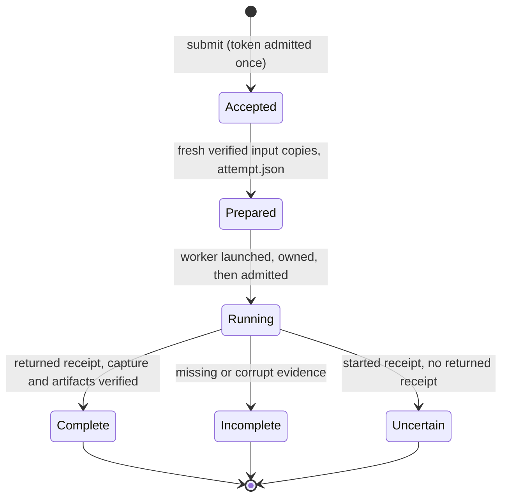

# The oracle runner

How CalcDb asks ACE a question and keeps the answer. This implements the first slice of
**W-01/capture-core** for **R-ORACLE-1** ([A-02](../book/A-02-experiments.md#r-oracle-1--capture-isolation-and-service-recovery)),
following [II-15 §§1–4](../book/II-15-evidence.md) and [The Plan](../the-plan.md) §2. The book
is the authority; this note records the choices made at the first dependency boundary
(The Plan §7) and how to use the tools. In the proposed service ([oracle-service.md](oracle-service.md))
this runner is tier 2, for owned experiments with effects.

## Pieces

| Component | Platform | Role |
| --- | --- | --- |
| [`CalcDb.Evidence`](../../src/CalcDb.Evidence) | any (.NET 11) | Questions and exact keys, captured values, captures, jobs, attempts, receipts, manifests, sealing, retained records. The one evidence schema. |
| [`calcdb-oracle`](../../src/CalcDb.Oracle.Runner) | any; `run` needs Windows | Runner CLI: `submit`, `run`, `status`, `show`, `inspect`, `freeze`, `retain`, `batch`, `compare-set`, `reduce`. |
| [`CalcDb.Oracle.Worker`](../../src/CalcDb.Oracle.Worker) | Windows x64 | One process per attempt, or with `--serve` a long-lived worker that answers several questions (below). Interprets the operation program on an STA through raw `IDispatch` (caller surface `native-idispatch/x64`) and captures every result channel. |
| [`calcdb-evidence-index`](../../src/CalcDb.Evidence.Index) | Windows x64 | Builds and verifies the derived `.accdb` index from retained JSON (The Plan §2.5), through typed DAO from the `ExcelDna.Interop.Dao` package. |
| [`probes/`](../../probes) | data | Question files, one per probe, named by book card. |
| [`evidence/`](../../evidence) | data | Retained answer records (`<card>/<probe>/<attempt>.json`, compact JSON, schema 2) and the bytes development reads back, by SHA-256 of the raw bytes (`artifacts/<sha256>.gz`: fixtures, file-I/O and lifecycle traces, lock files; [evidence-storage.md](evidence-storage.md)). |

## A question and its identities

A **question** ([`Question`](../../src/CalcDb.Evidence/Question.cs)) is an ordered operation
program (`create`, `invoke`, `loopUntil`, `forEachItem`, `release`, `observeFiles`,
`observeModules`) with typed arguments, starting fixtures by content hash, caller surface,
invoke LCID and observation recipe. Its key is a SHA-256 over a versioned, length-delimited
binary encoding of the semantic body (T-EVID-01): tags, UTF-16 code units and argument
positions are exact; labels (`probe`, `description`, `bookRefs`) are not part of the key.

The runner keeps the four identities of II-15 §2 apart: the question key, the environment
receipt the worker records (loaded modules, runtime, apartment, locale, desktop), the
attempt id (`<token>.a<generation>`), and later a comparison id (not built yet).

## Job life cycle



- **Submit or query (T-EVID-02).** A token is admitted once, by create-new of
  `jobs/<token>.json`. The same token with the same question and environment returns the
  existing job; anything else is a conflict before any worker starts. `run` on a sealed job
  reports the existing manifest; a new attempt needs `--new-attempt` and gets fresh input
  copies. Nothing is ever replayed to resolve an uncertain attempt.
- **Ownership (OR-OWN).** The runner starts the worker itself, suspended, on the private
  desktop `WinSta0\CalcDbOracle` (OR-DESKTOP), keeps its process handle, puts it in a
  kill-on-close Job Object, resumes it, and only then writes the admission line
  (`ADMIT <attempt> <generation>`) to its stdin. The worker writes its started receipt
  after admission and before its first native call, so "no started receipt" means no native
  call ran (`NotStarted`). Timeout kills only that owned process and waits for its exit.
- **Window guard (OR-DESKTOP).** While workers run, the runner samples their visible top-level
  windows every 200 ms, on the owner's desktop (must stay none) and on the private desktop, and
  records them in the owner report. Any such window is a seal problem. Nothing is dismissed.
- **Sealing (OR-SEAL, T-EVID-03).** [`Sealer`](../../src/CalcDb.Evidence/Sealer.cs) checks
  receipt identities and generations (stale receipts are rejected), the capture digest
  against the returned receipt, every artifact's length and SHA-256, worker capture errors,
  and OR-IDENT completeness. Execution (`ReturnedSuccess`, `ReturnedFailure`, `Aborted`,
  `NotStarted`, `Uncertain`) and capture (`Complete`, `Incomplete`) are independent: a
  failed ACE call with a complete capture is a useful error case.

## What a capture holds

- **Values (OR-WIRE).** The 24-byte VARIANT is read directly. Integers are exact decimal
  text, R4/R8/DATE/CY are raw bits, BSTRs are their exact `SysStringByteLen` bytes (odd
  lengths survive), DECIMAL is its fields, `VT_UI1` arrays keep bounds and bytes. Objects are
  capture-local identity labels from `QueryInterface(IUnknown)`, with the `ITypeInfo` name
  and IID; a label is retired when the worker sees the object destroyed. `text` and
  `display` fields are conveniences, never authority. Unsupported forms are named refusals.
- **Error channels (OR-OBS).** Per call, in recipe order: the Invoke HRESULT, EXCEPINFO
  (calling `pfnDeferredFillIn` at most once), then the thread's `IErrorInfo` slot, cleared
  before the call. DAO's `Errors` collection is read by the program itself.
- **Identity (OR-IDENT).** Module lists of the worker's own process before and after
  activation and at the end. Each relevant module is identified by the file *mapped* at its
  base (`GetMappedFileNameW`): Office Click-to-Run reports some modules at App-V virtual
  paths that do not exist on disk. Version resource, file id and disk-file SHA-256 are
  recorded. The list is enumerated again after identification and the observation repeats
  until stable; a list that keeps changing, or an unidentified relevant module, makes the
  capture incomplete. Every capture ends with a deliberately truncated enumeration that must
  be reported incomplete. Class registration is read from HKCR, read-only.
- **File state.** Lengths, hashes and times of inputs and outputs at labelled points; lock
  files are kept as artifacts; outputs and any changed input are kept at the end.
- **Pauses.** The `pause` operation waits the asked milliseconds within about 1 ms using a
  high-resolution waitable timer (`CreateWaitableTimerExW` with `CREATE_WAITABLE_TIMER_HIGH_RESOLUTION`)
  and a short `Stopwatch` spin (never `timeBeginPeriod`, which alters the machine-wide timer). It runs
  the same for ACE and CalcDb and records the measured elapsed milliseconds on the `sync` event's
  `waitedMs` field. ACE records retained before this change paused with `Thread.Sleep`, which wakes on
  the 15.6 ms system clock tick and could wait up to one tick longer than asked.

## Use

```powershell
dotnet build CalcDb.slnx
$oracle = "src/CalcDb.Oracle.Runner/bin/Debug/net11.0/calcdb-oracle.exe"
& $oracle submit --question probes/r-oracle-1/table-read-t1.question.json --token r-oracle-1-table-read-t1
& $oracle run --token r-oracle-1-table-read-t1      # prepares, runs the owned worker, seals
& $oracle show --attempt r-oracle-1-table-read-t1.a1  # inspect before deciding to retain
& $oracle show --attempt r-oracle-1-table-read-t1.a1 --pages 0,55   # kept page images, hex with offsets
& $oracle show --record evidence/<question>/<probe>/<record>.json --diff [input|POINT] [--pages N,...]
& $oracle retain --attempt r-oracle-1-table-read-t1.a1 --note "why it is kept"
& $oracle freeze --attempt <id> --artifact output:<file> --role main --file-name <file>  # output -> fixture
src/CalcDb.Evidence.Index/bin/Debug/net11.0-windows/win-x64/calcdb-evidence-index.exe build
src/CalcDb.Evidence.Index/bin/Debug/net11.0-windows/win-x64/calcdb-evidence-index.exe verify
```

**Inspecting a database file.** `calcdb-oracle inspect (--attempt ID --file NAME | --path FILE) [--table NAME] [--index-pages]
[--data-pages] [--page N]` reads the structure of a database file an attempt produced or consumed (`inputs/`, `work/`,
`artifacts/`; a NAME that matches none lists the candidates), read-only, over `Inspector` in CalcDb.Format. The default
summary gives the profile, page count and kinds, and each table (names from the catalog; system tables only with
`--table`) with first page, rows, columns, and physical and logical indexes. `--index-pages` gives each index page of
the table (all tables without `--table`, or page N): tree and index, leaf or intermediate, entries, the **stored prefix**
length and bytes next to the **common prefix** of the entries' stored bytes (trailer included, so the two compare),
free bytes, previous and next leaf, and the first and last entry's key bytes and row locator (every entry with
`--page`). `--data-pages` gives per page its owner, slot count and free count, and per slot offset, length and
deleted or overflow flags. `--page N` alone picks by the page's kind. One line per page or entry:

```text
index page 44: T1 (tdef 42) physical 0 (PK_T1) leaf level=0 entries=2 prefix=0 [] common=4 [7f800000] free=3598 prev=0 next=0
  first key[5]=7f80000001 -> data 48 slot 0
```

To compare CalcDb with ACE, publish CalcDb.dll to `artifacts/native` (`dotnet publish src/CalcDb.Com -r win-x64 -c
Release -o artifacts/native`) and run `batch --dir DIR --env windows-x64-calcdb-local --compare`. A sealed candidate
attempt is reused while the module is unchanged; add `--rerun` after a worker or runner change. Every candidate run
ends with a module observation, so an answer that came from ACE's own modules (an ADODB route reaching the ACE OLE DB
provider) is a provenance difference, not a match.

**Parallel candidate attempts (task mvgk, [BatchLanes](../../src/CalcDb.Oracle.Runner/BatchLanes.cs)).** A candidate
batch runs six questions at once by default (`--parallel N`; `--parallel 1` runs one at a time). ACE attempts always run
one at a time, and `--parallel` with them is refused. The batch lines, the ledger, `comparisons.jsonl` and the compare-set
run are written in file order and equal a sequential run's. Questions of one token run in file order in one lane.
Questions with further participants, a dialog policy or a claimed server run alone after the others, because their
timing or their desktop or COM server is shared; candidate runs skip ETW recording (below), so single-participant
`etwFileIo` questions run in the parallel lanes (while ACE `etwFileIo` attempts run one at a time). A batch reads the
tooling revision and the candidate module's hash once, so all its attempts answer for one module. Workers inherit only
their own pipe and log handles (launches are serialized), and records and cached content are created by a rename that
never replaces.

**The comparison rule (`calls.trace@13`, [CallTraceComparison](../../src/CalcDb.Corpus/CallTraceComparison.cs)).** Each
relaxation is a named normalization with its bounds and the control it still rejects; an owner-accepted CalcDb difference
is an accepted difference, counted apart. `calls.trace@13` compares the call trace and file observations and does not
compare `etw:file-io`. Revision 8 adds `ace-clock-fields` (task c4rv), revision 10 extends it to deleted/vacated rows and
kept `nativeRead` pages (task 4t24), revision 11 extends it to the Jet 4 and ACE 2010/2016/2019 profiles (task 6qw5),
revision 12 extends kept-read reconstruction to direct full-file assembly and post-release file observations (task q3mv),
and revision 13 matches vacated MSysObjects prefix copies without `Flags` (which remains strictly compared) and extends
intact deleted MSysObjects rows to Jet 4 (task tpjw).
ACE writes its clock into every file it creates or changes, so two ACE runs of one question give different files. Where
the SHA-256 of a file observation differs and both files' bytes can be found (ACE's from the retained content store, or
reconstructed from the capture's kept `nativeRead` pages — assembled directly when the slices cover the entire file with
no base file required, or overlaid onto the earlier retained input or the other side's verified file — found in an
adjacent `HandleEvent` block or forward across only `ReleaseEvent`s and intervening `FilesEvent`s recording the exact same
relative path, length and SHA-256, as in `r-q38-mdb-new-image/eng-general-full`, `r-q38-mdb-new-image/eng-langid-only` and
`r-q38-mdb-new-image/ws-general-full`, and accepted only when its SHA-256 equals the recorded file hash; CalcDb's from its
own attempt or the same reconstruction, each checked against its hash), the files are compared byte for byte outside the
clock fields each file's own structure locates
([AceClockFields](../../src/CalcDb.Corpus/AceClockFields.cs), Jet 4 and ACE 2007/2010/2016/2019 profiles). The same rule
applies to kept page-aligned `nativeRead` slices (`HandleEvent` reads), using either the verified full-file maps or a
per-capture `PageClockContext` built from that capture's own kept pages and retained input (for example
`r-q28-schema-write-open/dao-long30-26`). Per profile, only fields decided by ACE repeats are normalized: across all five
profiles (Jet 4 code 1, ACE 2007 code 2, ACE 2010 code 3, ACE 2016 code 5, ACE 2019 code 6), set aside are the page-0
creation DATE and live MSysObjects `DateCreate` and `DateUpdate`, and compared with the clock removed are the page-0
password (XOR the creation day) and the 2-byte SIDs of `MSysObjects.Owner` and `MSysACEs.SID` (XOR the RC4 keystream of
the DATE); for ACE 2007, Jet 4, and ACE 2010 (where repeats show them: `r-q28-schema-write-open/dao-fields-7`,
`r-q39-querydef-bytes/action-update-accdb`, `pause-open-accdb`, `union-accdb`, `sql-put-type-change-accdb`,
`r-q34-ddl-sweep/nn-two-cols-mdb-dao`, `r-q39-querydef-bytes/delete-querydef-mdb`, and `r-fmt-1/create-accdb-calculated`
`a1`/`a2`), vacated prefix copies left below the anchor MSysObjects row by a later shrink (recognised by `C`, `Id`,
`ParentId`, `Type`, `Name`, and `Owner` without `Flags`, which remains unmasked and strictly compared, including their
unmasked `Owner`) are also normalized; for ACE 2007 and Jet 4 (where repeats decide them:
`r-q28-schema-write-open/pair-dao-Aa-aA`, `r-q39-querydef-bytes/delete-querydef-accdb`, and
`r-q39-querydef-bytes/delete-querydef-mdb`), intact deleted MSysObjects rows ending at the lowest slot (plus their
unmasked `Owner`) are normalized; and for ACE 2007 only (where repeats decide it), a chained long value's millisecond
tick stamp (its definition's word and its first LVAL page's stamp, where they agree and are not zero) is set aside. Each
kind of field that differed is a note on a Matched comparison; this is ACE's nondeterminism, not an accepted difference.
Cross-profile pairs and unrecognized/refused profiles stay strict and name the refusal in the comparison note. Any other
byte (including non-clock bytes such as `Flags` in deleted or vacated rows, vacated MSysObjects copies on ACE 2016 or
ACE 2019, deleted MSysObjects rows outside ACE 2007 and Jet 4, chained long-value stamps outside ACE 2007, free-gap
bytes, unkept pages whose difference breaks SHA-256 reconstruction, sub-page `nativeRead` slices, or non-MSysObjects
pages), kept `nativeRead` pages separated from the file observation by a non-release event or a `FilesEvent` where the
file changed or is absent, kept pages that do not cover the whole file when no base file verifies (named in the note as
`kept nativeRead pages do not cover the file`), kept pages whose assembled bytes do not hash to the recorded SHA-256
(named in the note as `kept nativeRead pages do not verify against the recorded SHA-256`), or a file whose bytes cannot
be found or reconstructed still differs, the last with a note. `calcdb-oracle file-compare (--expected F --actual F | --attempts A,B | --repeats [--match REGEX])` shows the rule
on two files, two attempts, or each native attempt in the store against the one before.

**The compare set (W-01/corpus-comparison, T-OBJ-02).** `calcdb-oracle compare-set` runs that batch once over the questions
of every folder of [probes/compare-set.json](../../probes/compare-set.json) (`--dirs A,B` for a subset; `--parallel N` as
for batch), prints the time it took, writes the run as one line per
question (status, difference count, the oracle member the first difference stops at, the first difference) to
`.oracle-runs/compare-sets/NAME.tsv`, prints counts per folder and the census of first stops, and diffs the run per
question against an earlier one: gained, lost (a regression until explained), status changes, moved first differences,
added and removed questions. `--against` takes a run name, a file, `git:REV` (the baseline as committed at REV) or
`none`; the default is the committed baseline [compare-baseline.tsv](compare-baseline.tsv). `--record` makes the run
the baseline, committed with the change it measures, so its git diff shows the per-question change. `--diff NAME` diffs
a written run without running anything; `--verbose` shows the batch lines. CalcDb writes the current clock into a file it
creates on every run, so a question whose first difference is `$.files[N].sha256` at the same call, path, difference count
and expected value with only a new actual file hash stays counted `Mismatched` but is treated as unchanged in the diff
rather than `Moved`, and counted on one line (`same stop, new file hash: N`) so nothing is hidden (task sg5t).
Questions explicitly listed under `timingBoundaries` in [probes/compare-set.json](../../probes/compare-set.json) (each
with its reason) stay counted at their actual verdict in `TOTAL` and per-folder counts, while a verdict flip between
`Matched`/`AcceptedDifference` and `Mismatched` is reported on its own line (`timing boundary (counted in TOTAL, not in
gained/lost): N`) with its reason instead of `Gained`/`Lost`.
When the two runs used different comparison rules (`before.Rule != after.Rule`), the diff prints
`rule changed: <before> -> <after>`, keeps both sides' `TOTAL` as they are, and lists verdict flips in their own
`RuleChange` section (`not in gained/lost`) rather than under `Gained` or `Lost`.
Questions explicitly listed under `notComparable` in a set file (in the core set
[probes/compare-set.json](../../probes/compare-set.json), the 11 `killParticipant` questions of `r-q2-cat-txn-lock`; in
the wide set [probes/compare-set-wide.json](../../probes/compare-set-wide.json), 31 questions across its 96 folders: 22 `killParticipant` questions in `r-q2-cat-txn-lock`, `r-q-cat-txn-lock` and `r-fmt-2b`
whose retained ACE record has no capture of participant `a`, 6 ACE `0xC0000005` crashes in `r-crash-requery`, `r-expr-1`
and `r-expr-1b`, 1 ACE timeout in `r-sql-13b/join-limit-tables`, 1 ACE ODBC Select Data Source dialog timeout in
`r-wire/opt-opendatabase`, and `r-oledb-odbc/act-describe-companion-libraries` which creates only ADOX/JRO outside
`CalcDb.Compat.manifest`) are not run or counted in matched or compared questions; every run prints their count on the
folder and `TOTAL` lines (`N not comparable, listed`) and lists every one with its reason. Four probe folders stay outside
the wide set by construction: `r-access-host` (7) and `r-access-dialog` (10) activate `Access.Application` and claim
`MSACCESS.EXE`, and `r-crash-1-midcall` (12) and `r-txn-flush` (20) use `killParticipant` on every question with no
captured ACE participant `a` (task 3x6h). CalcDb's own failures (such as timeouts) never go on `notComparable` and remain
in the compared denominator as `CandidateIncomplete`.
`compare-set` uses an explicit candidate per-attempt timeout of **90 s** by default (overridden by `--timeout N`, vs the
300 s single-attempt default of `run`/`batch`): measured across the wide 96-folder set (3,158 comparable questions,
1,505 s / 25.1 min at `--parallel 6` against 7.7–8.6 min for the earlier 42-folder / 1,360-question set; multi-participant
questions run one at a time in `BatchLanes`), the slowest completing candidate attempt remains
`r-q-ado-misc/resync-affect-matrix` at 33–34 s (next slowest in the added folders `r-fix-cat-txn/txn-view-readers-late` at
29.4 s and `r-q-cat-txn-lock/txn-range-far-row-final-read` at 22.9 s), so 90 s leaves ~2.6× headroom while keeping engine
timeouts from stalling a run for five minutes (tasks mfmr, 3x6h).
At the start of `compare-set` (never `batch`, which may share the repository store concurrently), any attempt in the store
left `Prepared` or `Running` whose preparing runner process (recorded by PID and start time on the attempt) and owned
workers are all gone is settled through the `seal` path, printed with its count and attempt id, and the run goes on; when
either its owning runner or an owned worker is still alive, the command refuses without sealing (task 35gb).

`calcdb-oracle compare-stops --name <run> [--store <dir>] [--by-folder] [--detail <stop>]` reads a finished `compare-set` run (`<store>/compare-sets/<name>.tsv`, a path, `baseline`, or `git:REV`) without running any oracle or candidate, locates each non-matching question's matching candidate attempt in the store by module hash and finish time, reads only projections of `jobs/*.json`, `attempt.json` and `capture.json` up to the first difference (The Plan §3.2), and classifies the stop: a `NotModelled.*` name from `EXCEPINFO` or `IErrorInfo` (`Failure.NotModelled`), a `NotImplemented.*` gap (`Failure.NotImplemented`), a `CalcDb.Defect`, `(ace-error)` for an ACE-shaped or COM error difference, `(value-diff)` / `(file-diff)`, `(provenance)`, `(missing)`, `(incomplete)`, `(attempt-missing)`, or `(unclassified:<kind>)` where the event carries no error text (such as `EnumEvent` or `ConnectionEvent`). It prints a table sorted by question count (stop, questions, folders, example); with `--detail <stop>` it selects only the questions whose first stop is `<stop>` and groups them by the refusal's detail text (the `EXCEPINFO` or `IErrorInfo` description the classifier already reads, trimming a leading `<stop>:` prefix) with counts, folders and one example each; and with `--by-folder` appends a per-folder breakdown.

**Reduction (W-01/reduction, [II-15 §23](../book/II-15-evidence.md), T-EVID-31).** `calcdb-oracle reduce --question FILE
[--max-trials N]` (default 60) takes a question whose latest `comparisons.jsonl` verdict against CalcDb is a mismatch and
looks for a smaller question with the same defining failure: the first non-provenance difference's kind, field path and
the operation it falls on (the operation's own JSON, never its index). Candidates drop top-level `invoke`,
`describeType` and `queryInterfaces` operations (ddmin chunks, then single removals). An operation that binds a name
stays while a kept operation uses that binding, a `release` follows the operation that bound its object, and creation,
opening, observations and the failing operation stay. Every candidate runs fresh on ACE and then on CalcDb (never the
original ACE answer) and goes through the same `calls.trace` comparer. Outcomes: *same failure* (accepted), *different
failure*, *pass*, *invalid candidate* (ACE fails at a call the original ACE run did not fail), *replay divergence* (the two
traces no longer line up: event count, order) and *evidence unavailable* (a side incomplete, or the candidate not run on
CalcDb); an unavailable run is never accepted and blocks the 1-minimality claim. The unchanged original runs first as a
baseline and must reproduce the signature. 1-minimality is claimed only when every single removal of the final program ran
(or was blocked by a dependency) without keeping the failure; a program that ran as an earlier chunk is not run again.
The chain (accepted steps with question keys, both attempt ids and the verdict), every trial and the reduced question are
written to `.oracle-runs/reductions/<probe>.<key>.<run>.json` after each trial, so a failure part way leaves the latest
accepted child usable. Candidate attempts stay in the disposable store, are never retained, and their comparisons do not
enter `comparisons.jsonl`, so the compatibility accounting is unchanged. Questions with further participants are refused.

The native driver's `nativeLockScan` operation finds the byte-range locks another handle holds on a file: it bisects
the range with exclusive fail-immediately LockFileEx requests and records the locked bytes (R-LOCK-2 RO-NATIVE).

For an experiment that is not an oracle question but must keep every window off the owner's desktop (an isolation
environment, a tool under test), `calcdb-oracle desktop-run [--timeout S] [--log FILE] [--container-desktop] -- EXE
ARGS` runs the command on the private desktop inside a kill-on-close job and reports the visible windows of every
process in the job, children included. Use `--container-desktop` for AppContainer processes such as an mxc process
container: that second private desktop also admits the AppContainer groups (isolated-environments.md, M2).

**Kept page bytes (`show --pages`, `show --diff`).** Page-level answers are read through `show`, never through one-off
helpers. A probe keeps bytes with `nativeRead keep:true`; each open handle's kept reads are a *point*, named by the label
of the `observeFiles` step before it (a repeated label becomes `after-x#2`). `--attempt ID` or `--record FILE` selects
the attempt, as for the plain `show`.

- `--pages [N,...]` prints every kept point's page images as hex with offsets (16 bytes a line, repeated lines elided
  with `*`), for the listed page numbers or, bare, for all. A read that covers part of a page shows under that page at its
  offset. The page size is 4096.
- `--diff [input|POINT] [--pages N,...]` prints the bytes that differ, as runs `page P offset O: old -> new` in hex,
  grouped by page. `input` (the default) is the question's input fixture, resolved by its hash from the content/artifact
  store for both `--attempt` and `--record` (falling back to the attempt's `inputs` copy only when its hash still equals
  the question's input, and reporting the missing fixture by name otherwise); every kept point is compared with it. A
  point name compares each later point with that one. Pages beyond the input, or bytes the baseline point did not keep,
  say so on a line of their own.

```
> show --record evidence/r-q15-ddl-open/dup-append-dao/<record>.json --diff after-session-1 --pages 0
== after-session-2 against after-session-1: 1 bytes differ
  page 0 offset 3586: 02 -> 04
```

A question whose observation recipe holds `etwFileIo` (probe property `RecordFileIo`) is recorded by the ETW
file-I/O recorder on ACE attempts: every create, read, write and flush on the attempt's files, with offsets and sizes,
becomes the artifact `etw:file-io`. Because `calls.trace@13` does not compare `etw:file-io`, candidate runs
(`windows-x64-calcdb-local`) skip the ETW recorder, write `Sealer.CandidateEtwSkippedStatus`
(`skipped on candidate run (calls.trace@9 does not compare etw:file-io)`, kept verbatim for compatibility with sealed
attempts) to `artifacts/etw-status.txt`, record the omission by name on `manifest.OmittedChannels` (and as artifact `etw:status`),
and seal complete; ACE attempts still require the ETW trace. The recorder needs an elevated token, so it runs through a
scheduled task installed once by the owner ([tools/etw-setup](../../tools/etw-setup/README.md)); `calcdb-oracle etw-check`
tests it. Without it, an ACE attempt seals Incomplete with the reason. If the recorder fails before becoming ready and
writes `done-ID`, the runner stops waiting immediately (instead of waiting out the 20 s ready timeout), cleans up the
queue files, and records the recorder's reason in `etw-status.txt`. The recorder creates `done-ID` before it writes its
line, so the runner reads it only when it opens and is not empty, waiting up to 60 s on stop; a recorder that never
finishes, or a stop that fails, is written to `etw-status.txt` and seals Incomplete, never an exception that leaves the
attempt Running (task vqs3).
`calcdb-oracle show --etw --attempt ID` (or `--record FILE`, with
`--file TEXT` and `--all-io`) shows the trace in order, with each operation's process and thread. The workers'
lifecycle traces are kept as artifacts `trace:<participant>`, so each operation is placed inside the native call that
issued it. Writes are marked cached (WriteFile into the system cache) or paging (to disk). The recorder names an event's file by
FileKey, so paging writes are attributed, the system lazy writer's (pid 4) included. `etw-check` checks this with an
unflushed cached write; events with no attempt file are only counted in the recorder's status line.

In a CodeAlta worktree, pass `--store C:\Work\DnaCalc\CalcDb\.oracle-runs` to `etw-check`, `submit`, `run`, `batch`,
`show` and `retain` so ACE attempts lie under the installed recorder's allowed root
(`C:\Work\DnaCalc\CalcDb\.oracle-runs\attempts`). Attempts live in that store, while `retain` (and `batch --retain`)
still writes retained records and their `evidence/artifacts/` copies into the worktree's `evidence/` (task shmk).

**An owned out-of-process server (OR-OWN).** COM starts a local server such as Access.Application outside the
runner's job. The operation `claimProcess` asks the bound object for a window handle (`hWndAccessApp`), takes the
window's process, and claims it only when it runs the named image and started after the attempt was prepared. The
claim goes to `receipts/owned-children[.participant].json`. The runner reads the receipt while the worker runs, checks
image and start time again, and puts the process in the attempt's kill-on-close job. It guards the process's windows
with the worker's, gives it 20 s after the worker ends to exit, and then ends it. The owner report records how it ended.

**Dialogs (OR-DESKTOP).** Office shows modal dialogs that no caller option prevents: VBA run-time and compile
errors, MsgBox in generated code, an ODBC prompt. While workers run, the runner looks for visible dialog windows
(class `#32770`) of every owned process, claimed servers included. For each new one it starts the UI Automation
helper `calcdb-dialogs` ([src/CalcDb.Oracle.Dialogs](../../src/CalcDb.Oracle.Dialogs)) on the dialog's own desktop,
inside the attempt's job. The helper records the dialog's title, class and every element of its tree (texts, buttons,
enabled state) in the owner report. It acts only when a rule of the question's dialog policy matches (probe property
`Dialogs`: title, optional text, button; part of the question key). It then invokes that button through its
InvokePattern, with no mouse, keyboard or focus, and records whether the dialog closed. A window other than a dialog
is handled the same way when its title contains a rule's title, such as the VBA editor in `[break]` mode after a
compile error, whose Reset button ends the blocked call. A window is described again when its title changes. An answered
dialog that closed is an observation, not a seal problem. An unanswered one stays open until the deadline, as before.
In a main-desktop run, keyboard or mouse input in the owner's session after a dialog appeared is recorded
(`GetLastInputInfo`, no content) and is a seal problem, because a person may have answered it.

**Main desktop, by owner instruction only.** `run --desktop main` runs the workers, and the servers they start, on
`WinSta0\Default`. The owner allowed this for the Access host on 2026-11-17, until they move it to the private desktop.
The owner report records the instruction, and windows on the owner's desktop are then observations of that run, not
conduct incidents. The default stays the private desktop.

The runner always runs the worker of its own build configuration (a Debug runner runs the Debug worker).

The store lives in `.oracle-runs/` (ignored by git): attempts, dry runs and failures stay
there, and it is disposable: `prune [--days N]` removes the file copies of older sealed attempts.
Its append-only JSONL ledgers (`comparisons.jsonl`, `reuse/<run>.jsonl`, `broker/log/waits.jsonl`)
are written through [`EvidenceJson.AppendLine`](../../src/CalcDb.Evidence/EvidenceJson.cs)
(`FileMode.Append` with `FileShare.ReadWrite`, a per-path named mutex and bounded retry on sharing
violations), so concurrent candidate batches can append to one store without colliding (task b66t).
Only `retain` and `freeze` write to `evidence/`. `retain` writes the answer record and never
overwrites one; it keeps every artifact as a fact (role, length, SHA-256) and its bytes only for
traces and lock files. `freeze` keeps a fixture's bytes. Retain a capture because it answers a
question about ACE, including surprising or negative outcomes; do not retain tooling failures or
redundant reruns (The Plan §2.4). A doubted answer is run again and its record replaced. Fixture
inputs are found by hash in the store or in `evidence/artifacts/`, so a fresh clone can rerun a
retained question.

## Long-lived worker (oracle service step 1, OR-REUSE)

Step 1 of [oracle-service.md](oracle-service.md): the same interpreter, started with `--serve`, answers questions one at a
time over `calcdb-oracle/1` on its stdin and stdout ([`OracleProtocol.cs`](../../src/CalcDb.Evidence/OracleProtocol.cs):
4-byte big-endian length, type byte, compact JSON body, frames under 64 KB). The runner owns it as it owns an attempt's
worker: started suspended on the private desktop, put in its own kill-on-close job (a worker the job cannot hold is ended
before it runs), resumed, then greeted with `hello`; the window guard samples it on every receive. One-attempt-per-process
stays the default for `run` and `batch`.

- **Each question is still an attempt** ([`PooledRun`](../../src/CalcDb.Evidence/PooledRun.cs)): its own token, fresh input
  copies, receipts and seal. The `submit` frame is its admission; the worker writes the started receipt before the first
  native call, the capture and the returned receipt, and answers with the capture's digest. Captures never travel in frames.
- **Admission.** Only questions of one participant against the native installation, without output files, writing native
  opens, process control, dialog policy or ETW recording (`PooledAdmission`, each refusal names its reason). Effects through
  DAO calls are not visible to this check; they stay on the attempt's own input copy.
- **Reset and prehistory.** Between questions the worker applies the declared reset `release-bindings/1` (`WorkerReset`:
  what it does and what it leaves). Every capture records its `session`: the worker, its position and the questions that
  ran before it, each with its reset report. The runner writes the session it expects to `receipts/session.json`; the worker
  refuses a question whose expected session is not its own record, and the sealer checks that the capture names the same
  session. A capture with a session is never the oracle record of a CalcDb comparison, and is not eligible for answer reuse
  until OR-REUSE qualifies the reset for its card (II-15 §3).
- **Failure.** A worker that dies, misses the deadline, sends a malformed or out-of-turn frame or an error, or reports a
  failed reset is ended (or retired with `done`). Its question is sealed from its receipts as before (NotStarted, Uncertain;
  a channel failure makes the capture Incomplete) and is never asked again; the next question gets a new worker with an
  empty prehistory.

`calcdb-oracle reuse (--files F1,F2,... | --dir DIR) [--retain]` is the OR-REUSE experiment: every admitted question fresh
(a worker each), then all in one worker in file order and all in one worker in reverse order; each reused answer is compared
with the fresh one under `calls.trace` revision 6 (native against native: modules loaded before the question are
environment, another engine or a candidate is provenance). Comparisons go to `reuse/<run>.jsonl` in the store; `--retain`
writes the records to `evidence/r-oracle-1/or-reuse/`, apart from the cards' own folders.

## The broker (oracle service step 2)

`calcdb-oracle broker [--workers 2] [--batch 8] [--cool-down 30] [--timeout 300] [--pipe calcdb-oracle] [--qualified-cards A,B]`
runs the broker of [oracle-service.md](oracle-service.md) ([`OracleBroker`](../../src/CalcDb.Evidence/Broker/OracleBroker.cs))
on the named pipe `\\.\pipe\calcdb-oracle` (current user only) until `broker --stop` or Ctrl+C. `calcdb-oracle status`
(no `--token`) prints its one line: OK (every pool worker up), DEGRADED (some) or DOWN (none, or no broker).
`calcdb-oracle ask --via broker (--question F | --files A,B | --dir DIR) [--id ID --seq N] [--effects none] [--isolation
pooled|fresh-worker|fresh-attempt] [--purpose or-reuse] [--priority bulk] [--capture record] [--no-cache] [--compare-fresh DIR]`
is its client; `batch`, `compare-set` and `run` stay on the one-attempt path.

- **Each question is still a job and an attempt** in this store: question i of request (id, seq) is job
  `<id>.s<seq>.q<i>`, run by the step-1 pooled worker or by `RunAttempt` (tier 2), sealed by the one sealer. The
  request is persisted under `broker/requests/` before anything runs. A resent (id, seq) gets the answers the first
  produced, also after a broker restart; with other questions it is a conflict (T-EVID-02). A job left prepared or
  running by a broker that died is answered `uncertain` and never run again.
- **Admission** ([`BrokerAdmission`](../../src/CalcDb.Evidence/Broker/BrokerAdmission.cs)): questions declare `effects`
  and `isolation` (key fields, written only when present, so undeclared keys are unchanged). Pooled only when
  `effects: none`, no tier-2 shape, and the reset is qualified for the card (`--qualified-cards`, none yet) or the request
  is the OR-REUSE experiment (`--purpose or-reuse`); everything else, undeclared included, goes to tier 2. A declared
  effect-free question that calls a function of the deny list (`Shell`, `CreateObject`, ...) is refused by name.
- **Answer cache.** A complete answer without a prehistory (tier 2), or after a qualified reset, answers a later
  request for the same question key when the environment base (the receipt, `EnvironmentEntry.BaseId`) is the same and
  no module it names has another identity now. `--no-cache` asks for a new attempt.
- **Pool.** Slots share the queue (interactive first), each taking its share up to the batch size. A lost worker (death,
  deadline, malformed frame, failed reset, no pong to the idle health ping every 5 s) cools down, then restarts; later
  starts count, at most three an hour, except for the last slot with no other worker up. Unstarted questions of its
  batch go back to the head of the queue.
- **Logs** under `broker/log/`: `YYYY-MM-DD.jsonl.gz` (one line per evaluated answer: key, envId, worker, batch, the
  capture's events without module lists) and `waits.jsonl` (queue, worker-start, worker-down, tier2-route, refused,
  answer-slow, shutdown). Captures travel by `get` on the digest an answer names; fixtures and large questions by `put`.

## Linux-controlled operation

The proposed service design, with Windows-opened ssh relays to Linux hosts, a fast tier of
long-lived ACE workers, and this runner as its tier for owned experiments, is in
[oracle-service.md](oracle-service.md).

## Limits of this slice

- One caller lane: raw `IDispatch` from .NET 11 x64. VBA, .NET Framework 4.8 and .NET 10
  projections (OR-OBS lanes) and ADO are not yet driven.
- The managed lanes will use the DAO primary interop assembly from the `ExcelDna.Interop.Dao`
  NuGet package (Microsoft.Office.Interop.Access.Dao, types embedded, builds for `net452` and
  `net6.0-windows` and up). It is the projection .NET add-ins actually use, so it is a separate
  lane, never a replacement for the raw worker. A scratch probe on .NET 11 showed the difference:
  `Boolean` where the raw lane keeps `VT_BOOL -1`, `String` where it keeps exact BSTR bytes,
  and a `COMException` with HResult `0x800A0BC3` where the raw lane sees Invoke `0x80020009`
  plus EXCEPINFO.
- DAO alone can show UI: `DBEngine.OpenDatabase(Empty)` opens the ODBC Select Data Source
  dialog (evidence log, night of 2026-11-17). The private desktop and the window guard are in
  place; UI Automation dialog handling is not, so a dialog ends its attempt at the deadline.
  The owned Access host runs (cards `r-access-host`, `r-access-dialog`), on the main desktop for now. Dialogs
  are answered by policy (above); a dialog no rule matches still ends its attempt at the deadline.
- OR-JOB transport-loss and kill-at-boundary cases, OR-REENTRY, OR-FREEZE and
  OR-REPAIR are not yet exercised against the real worker; the sealing rules they rely on
  are covered by synthetic tests that qualify the harness only. OR-REUSE has its first run (long-lived worker, above);
  the death, hang and malformed-frame handling of the long-lived worker is covered by synthetic tests only.
- The store assumes one runner process at a time on one host.