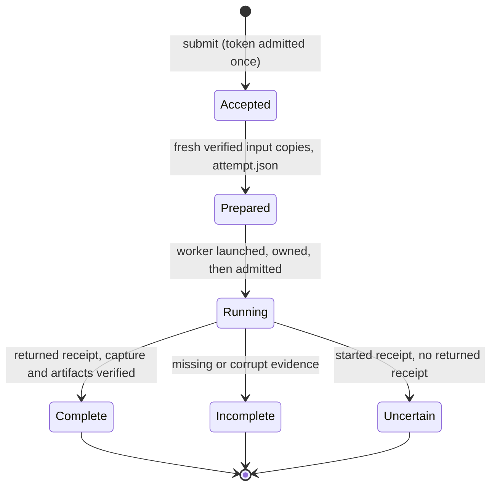

# The oracle runner

How CalcDb asks ACE a question and keeps the answer. This implements the first slice of
**W-01/capture-core** for **R-ORACLE-1** ([A-02](../book/A-02-experiments.md#r-oracle-1--capture-isolation-and-service-recovery)),
following [II-15 §§1–4](../book/II-15-evidence.md) and [The Plan](../the-plan.md) §2. The book
is the authority; this note records the choices made at the first dependency boundary
(The Plan §7) and how to use the tools. In the proposed service ([oracle-service.md](oracle-service.md))
this runner is tier 2, for owned experiments with effects.

## Pieces

| Component | Platform | Role |
| --- | --- | --- |
| [`CalcDb.Evidence`](../../src/CalcDb.Evidence) | any (.NET 11) | Questions and exact keys, captured values, captures, jobs, attempts, receipts, manifests, sealing, retained records. The one evidence schema. |
| [`calcdb-oracle`](../../src/CalcDb.Oracle.Runner) | any; `run` needs Windows | Runner CLI: `submit`, `run`, `status`, `show`, `freeze`, `retain`. |
| [`CalcDb.Oracle.Worker`](../../src/CalcDb.Oracle.Worker) | Windows x64 | One process per attempt. Interprets the operation program on an STA through raw `IDispatch` (caller surface `native-idispatch/x64`) and captures every result channel. |
| [`calcdb-evidence-index`](../../src/CalcDb.Evidence.Index) | Windows x64 | Builds and verifies the derived `.accdb` index from retained JSON (The Plan §2.5), through typed DAO from the `ExcelDna.Interop.Dao` package. |
| [`probes/`](../../probes) | data | Question files, one per probe, named by book card. |
| [`evidence/`](../../evidence) | data | Retained records (`<card>/<probe>/<attempt>.json`) and binary artifacts by SHA-256 (`artifacts/<sha256>`). |

## A question and its identities

A **question** ([`Question`](../../src/CalcDb.Evidence/Question.cs)) is an ordered operation
program (`create`, `invoke`, `loopUntil`, `forEachItem`, `release`, `observeFiles`,
`observeModules`) with typed arguments, starting fixtures by content hash, caller surface,
invoke LCID and observation recipe. Its key is a SHA-256 over a versioned, length-delimited
binary encoding of the semantic body (T-EVID-01): tags, UTF-16 code units and argument
positions are exact; labels (`probe`, `description`, `bookRefs`) are not part of the key.

The runner keeps the four identities of II-15 §2 apart: the question key, the environment
receipt the worker records (loaded modules, runtime, apartment, locale, desktop), the
attempt id (`<token>.a<generation>`), and later a comparison id (not built yet).

## Job life cycle



- **Submit or query (T-EVID-02).** A token is admitted once, by create-new of
  `jobs/<token>.json`. The same token with the same question and environment returns the
  existing job; anything else is a conflict before any worker starts. `run` on a sealed job
  reports the existing manifest; a new attempt needs `--new-attempt` and gets fresh input
  copies. Nothing is ever replayed to resolve an uncertain attempt.
- **Ownership (OR-OWN).** The runner starts the worker itself, suspended, on the private
  desktop `WinSta0\CalcDbOracle` (OR-DESKTOP), keeps its process handle, puts it in a
  kill-on-close Job Object, resumes it, and only then writes the admission line
  (`ADMIT <attempt> <generation>`) to its stdin. The worker writes its started receipt
  after admission and before its first native call, so "no started receipt" means no native
  call ran (`NotStarted`). Timeout kills only that owned process and waits for its exit.
- **Window guard (OR-DESKTOP).** While workers run, the runner samples their visible top-level
  windows every 200 ms, on the owner's desktop (must stay none) and on the private desktop, and
  records them in the owner report. Any such window is a seal problem. Nothing is dismissed.
- **Sealing (OR-SEAL, T-EVID-03).** [`Sealer`](../../src/CalcDb.Evidence/Sealer.cs) checks
  receipt identities and generations (stale receipts are rejected), the capture digest
  against the returned receipt, every artifact's length and SHA-256, worker capture errors,
  and OR-IDENT completeness. Execution (`ReturnedSuccess`, `ReturnedFailure`, `Aborted`,
  `NotStarted`, `Uncertain`) and capture (`Complete`, `Incomplete`) are independent: a
  failed ACE call with a complete capture is a useful error case.

## What a capture holds

- **Values (OR-WIRE).** The 24-byte VARIANT is read directly. Integers are exact decimal
  text, R4/R8/DATE/CY are raw bits, BSTRs are their exact `SysStringByteLen` bytes (odd
  lengths survive), DECIMAL is its fields, `VT_UI1` arrays keep bounds and bytes. Objects are
  capture-local identity labels from `QueryInterface(IUnknown)`, with the `ITypeInfo` name
  and IID; a label is retired when the worker sees the object destroyed. `text` and
  `display` fields are conveniences, never authority. Unsupported forms are named refusals.
- **Error channels (OR-OBS).** Per call, in recipe order: the Invoke HRESULT, EXCEPINFO
  (calling `pfnDeferredFillIn` at most once), then the thread's `IErrorInfo` slot, cleared
  before the call. DAO's `Errors` collection is read by the program itself.
- **Identity (OR-IDENT).** Module lists of the worker's own process before and after
  activation and at the end. Each relevant module is identified by the file *mapped* at its
  base (`GetMappedFileNameW`): Office Click-to-Run reports some modules at App-V virtual
  paths that do not exist on disk. Version resource, file id and disk-file SHA-256 are
  recorded. The list is enumerated again after identification and the observation repeats
  until stable; a list that keeps changing, or an unidentified relevant module, makes the
  capture incomplete. Every capture ends with a deliberately truncated enumeration that must
  be reported incomplete. Class registration is read from HKCR, read-only.
- **File state.** Lengths, hashes and times of inputs and outputs at labelled points; lock
  files are kept as artifacts; outputs and any changed input are kept at the end.

## Use

```powershell
dotnet build CalcDb.slnx
$oracle = "src/CalcDb.Oracle.Runner/bin/Debug/net11.0/calcdb-oracle.exe"
& $oracle submit --question probes/r-oracle-1/table-read-t1.question.json --token r-oracle-1-table-read-t1
& $oracle run --token r-oracle-1-table-read-t1      # prepares, runs the owned worker, seals
& $oracle show --attempt r-oracle-1-table-read-t1.a1  # inspect before deciding to retain
& $oracle retain --attempt r-oracle-1-table-read-t1.a1 --note "why it is kept"
& $oracle freeze --attempt <id> --artifact output:<file> --role main --file-name <file>  # output -> fixture
src/CalcDb.Evidence.Index/bin/Debug/net11.0-windows/win-x64/calcdb-evidence-index.exe build
src/CalcDb.Evidence.Index/bin/Debug/net11.0-windows/win-x64/calcdb-evidence-index.exe verify
```

For an experiment that is not an oracle question but must keep every window off the owner's desktop (an isolation
environment, a tool under test), `calcdb-oracle desktop-run [--timeout S] [--log FILE] [--container-desktop] -- EXE
ARGS` runs the command on the private desktop inside a kill-on-close job and reports the visible windows of every
process in the job, children included. Use `--container-desktop` for AppContainer processes such as an mxc process
container: that second private desktop also admits the AppContainer groups (isolated-environments.md, M2).

A question whose observation recipe holds `etwFileIo` (probe property `RecordFileIo`) is recorded by the ETW
file-I/O recorder: every create, read, write and flush on the attempt's files, with offsets and sizes, becomes the
artifact `etw:file-io`. The recorder needs an elevated token, so it runs through a scheduled task installed once by the
owner ([tools/etw-setup](../../tools/etw-setup/README.md)); `calcdb-oracle etw-check` tests it. Without it, such a
question seals Incomplete with the reason. `calcdb-oracle show --etw --attempt ID` (or `--record FILE`, with
`--file TEXT` and `--all-io`) shows the trace in order, with each operation's process and thread. The workers'
lifecycle traces are kept as artifacts `trace:<participant>`, so each operation is placed inside the native call that
issued it. Writes are marked cached (WriteFile into the system cache) or paging (to disk); the recorder attributes
paging writes only in part.

**An owned out-of-process server (OR-OWN).** COM starts a local server such as Access.Application outside the
runner's job. The operation `claimProcess` asks the bound object for a window handle (`hWndAccessApp`), takes the
window's process, and claims it only when it runs the named image and started after the attempt was prepared. The
claim goes to `receipts/owned-children[.participant].json`. The runner reads the receipt while the worker runs, checks
image and start time again, and puts the process in the attempt's kill-on-close job. It guards the process's windows
with the worker's, gives it 20 s after the worker ends to exit, and then ends it. The owner report records how it ended.

**Dialogs (OR-DESKTOP).** Office shows modal dialogs that no caller option prevents: VBA run-time and compile
errors, MsgBox in generated code, an ODBC prompt. While workers run, the runner looks for visible dialog windows
(class `#32770`) of every owned process, claimed servers included. For each new one it starts the UI Automation
helper `calcdb-dialogs` ([src/CalcDb.Oracle.Dialogs](../../src/CalcDb.Oracle.Dialogs)) on the dialog's own desktop,
inside the attempt's job. The helper records the dialog's title, class and every element of its tree (texts, buttons,
enabled state) in the owner report. It acts only when a rule of the question's dialog policy matches (probe property
`Dialogs`: title, optional text, button; part of the question key). It then invokes that button through its
InvokePattern, with no mouse, keyboard or focus, and records whether the dialog closed. A window other than a dialog
is handled the same way when its title contains a rule's title, such as the VBA editor in `[break]` mode after a
compile error, whose Reset button ends the blocked call. A window is described again when its title changes. An answered
dialog that closed is an observation, not a seal problem. An unanswered one stays open until the deadline, as before.
In a main-desktop run, keyboard or mouse input in the owner's session after a dialog appeared is recorded
(`GetLastInputInfo`, no content) and is a seal problem, because a person may have answered it.

**Main desktop, by owner instruction only.** `run --desktop main` runs the workers, and the servers they start, on
`WinSta0\Default`. The owner allowed this for the Access host on 2026-11-17, until they move it to the private desktop.
The owner report records the instruction, and windows on the owner's desktop are then observations of that run, not
conduct incidents. The default stays the private desktop.

The runner always runs the worker of its own build configuration (a Debug runner runs the Debug worker).

The store lives in `.oracle-runs/` (ignored by git): transient attempts, dry runs and
failures stay there. Only `retain` writes to `evidence/`, and it never overwrites a record.
Retain a capture because it shows something about ACE, including surprising or negative
outcomes; do not retain tooling failures or redundant reruns (The Plan §2.4). Fixture inputs
are found by hash in the store or in `evidence/artifacts/`, so a fresh clone can rerun a
retained question.

## Linux-controlled operation

The proposed service design, with Windows-opened ssh relays to Linux hosts, a fast tier of
long-lived ACE workers, and this runner as its tier for owned experiments, is in
[oracle-service.md](oracle-service.md).

## Limits of this slice

- One caller lane: raw `IDispatch` from .NET 11 x64. VBA, .NET Framework 4.8 and .NET 10
  projections (OR-OBS lanes) and ADO are not yet driven.
- The managed lanes will use the DAO primary interop assembly from the `ExcelDna.Interop.Dao`
  NuGet package (Microsoft.Office.Interop.Access.Dao, types embedded, builds for `net452` and
  `net6.0-windows` and up). It is the projection .NET add-ins actually use, so it is a separate
  lane, never a replacement for the raw worker. A scratch probe on .NET 11 showed the difference:
  `Boolean` where the raw lane keeps `VT_BOOL -1`, `String` where it keeps exact BSTR bytes,
  and a `COMException` with HResult `0x800A0BC3` where the raw lane sees Invoke `0x80020009`
  plus EXCEPINFO.
- DAO alone can show UI: `DBEngine.OpenDatabase(Empty)` opens the ODBC Select Data Source
  dialog (evidence log, night of 2026-11-17). The private desktop and the window guard are in
  place; UI Automation dialog handling is not, so a dialog ends its attempt at the deadline.
  The owned Access host runs (cards `r-access-host`, `r-access-dialog`), on the main desktop for now. Dialogs
  are answered by policy (above); a dialog no rule matches still ends its attempt at the deadline.
- OR-JOB transport-loss and kill-at-boundary cases, OR-REUSE, OR-REENTRY, OR-FREEZE and
  OR-REPAIR are not yet exercised against the real worker; the sealing rules they rely on
  are covered by synthetic tests that qualify the harness only.
- The store assumes one runner process at a time on one host.